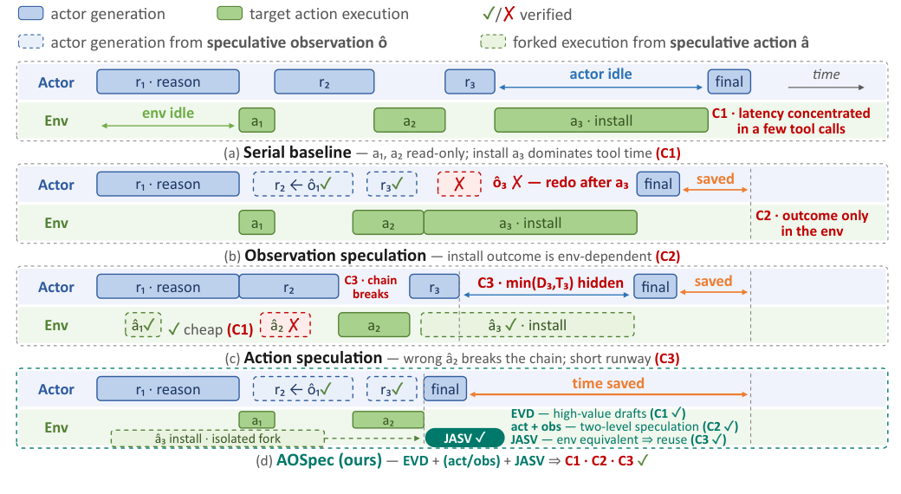

## Highlights

Slow agent tools and GPU interconnect distances can both bottleneck inference. AOSpec combines joint action–observation speculation with correctness verification, while NUNA exploits topology locality to improve multi-GPU communication.

<h2 class="daily-paper-title" id="paper-aospec">01 · AOSpec: Speculating on actions and observations</h2>

[AOSpec: Action and Observation Co-Speculation for Low-Latency Agent Serving](https://arxiv.org/abs/2608.00881)  
Hao Mark Chen, Jinnan Guo, Wayne Luk, Hongxiang Fan · 2026-08-01

Agents typically generate a tool call and then wait for the environment. Slow tools leave the model idle. AOSpec overlaps model generation and tool execution by speculating on both actions and observations across the agent–environment loop.

Expected Value Decoding prioritizes observations by the latency they could hide, rather than hit rate alone. When an outcome can only be discovered by execution, the system launches a target action in an isolated fork. Joint Action-State Verification checks both the action and its originating state against the committed execution before reuse. On a mismatch, execution follows the real trajectory. Isolation and verification are essential to serial semantics; speculative external side effects cannot simply be committed early.

<a class="note-image-link" href="/assets/images/digest/2026-08-02/aospec.png" target="_blank" rel="noopener" aria-label="AOSpec joint speculation flow">View original ↗</a>

*Reading the figure: compare serial execution, observation-only and action-only speculation, and the combined design. The bottom row executes a slow action in an isolated fork and reuses it only after action and state verification.*

The authors replay identical Terminal-Bench 2.0 trajectories across nine harness/model configurations and five generation speeds. Mean latency savings versus serial execution rise from 11.8% at 20 ms/token to 32.5% at 1 ms/token; the strongest practical baseline saves 4.3% and 12.2%, respectively. At 10 ms/token, median and p90 latency fall by 10.7% and 10.5%. Cross-benchmark replay on SWE-bench Verified saves 18.9% at 1 ms/token. These are replay results with modeled generation speeds, not measurements of a live deployment; drafting and isolated execution also consume resources. The central contribution is treating latency and execution correctness together.

<h2 class="daily-paper-title" id="paper-nuna">02 · NUNA: Accounting for on-chip distance in GPU communication</h2>

[NUNA: Characterizing and Mitigating Non-Uniform Network Access in Multi-Die GPU Scale-Up Systems](https://arxiv.org/abs/2608.00867)  
Conor James Green, William Won, Tuan Ta, Bradford M. Beckmann · 2026-08-01

In a multi-die GPU, compute units, memory and inter-GPU I/O ports are not equally distant. NUNA treats this non-uniform network access as an optimization target. NUNA-aware routing selects ports based on physical position, while NUNA-aware placement puts threadblocks and data near the relevant I/O. This extends beyond conventional NUMA placement for compute and memory locality.

In an ASTRA-sim scale-up model, placement alone speeds up collectives by up to 1.5× and placement plus routing by up to 1.8×. Across modeled inference on 12 LLM architectures, time per output token improves by 7% on average and up to 28%. End-to-end results combine inference traces and a roofline model and treat computation and communication serially; they are not measurements on a physical cluster. The practical lesson is that on-chip topology can affect cross-GPU communication, but the gains depend on hardware and parallelization.
