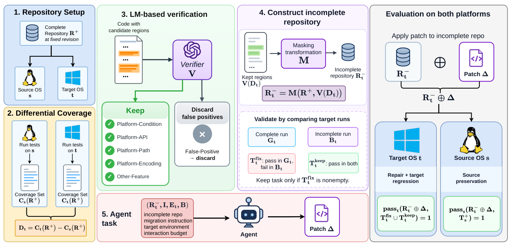
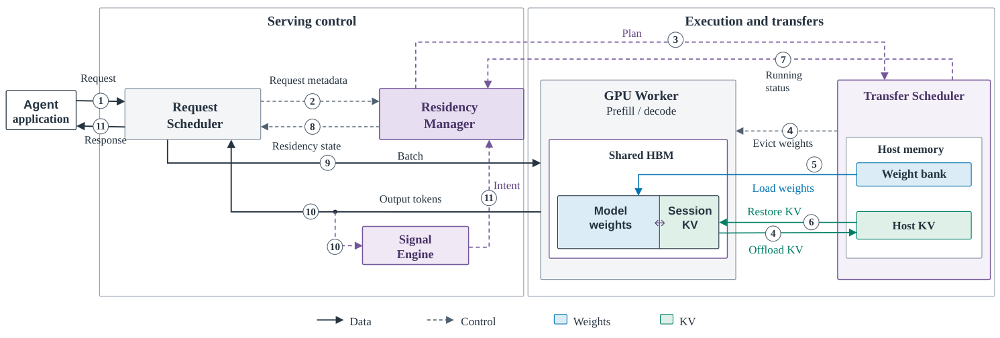
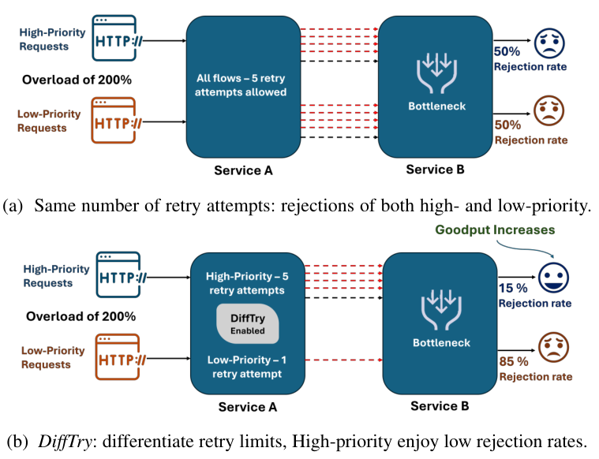
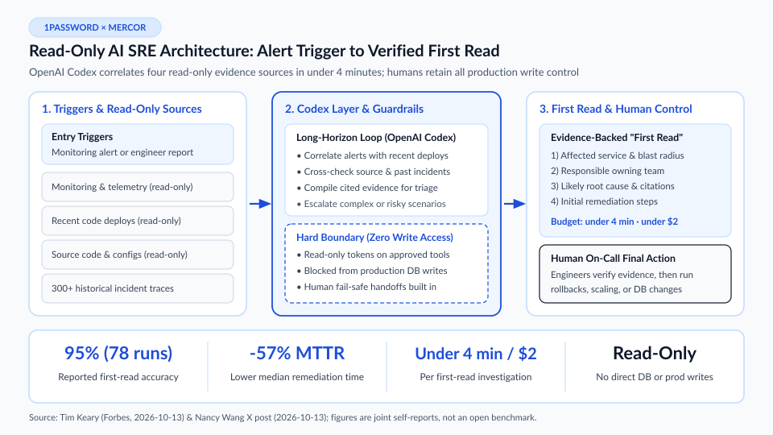
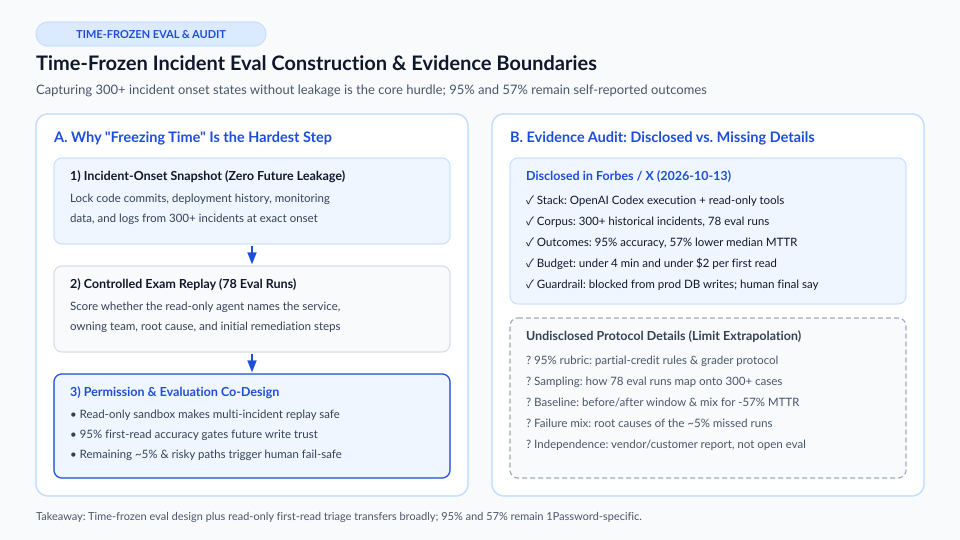

## What matters in this issue

Start with OS-Bench and JointServe. OS-Bench asks whether an agent preserves the original operating system's behavior after making software work on another. JointServe asks how a multi-model agent can switch experts under a limited GPU budget without repeatedly moving weights and rebuilding context. Both broaden the unit of analysis: from a repair in one environment to correctness on two platforms, and from an individual model request to a complete session.

DiffTry offers a smaller control point: distribute retry opportunities by request value so that overload does not reject every class equally. The accompanying technical readings examine verification budgets, KV transfer, numerical consistency between training and inference, and connecting agent execution to existing observability tools. A successful or faster local step does not, by itself, establish that the full task is reliable or efficient.

<h2 class="daily-paper-title" id="paper-os-bench">01 · OS-Bench: migrate the target without breaking the source</h2>

[OS-Bench: Evaluating SWE Agents on Cross-OS Code Migration](https://arxiv.org/abs/2610.19368)  
Qirui Jin, Kenan Li, Liao Zhu, Lingching Tung, Yikai Zhang, Yijia Wu, Zijian Jin, Pengfei Gao, Yu Kang, Qingwei Lin, Wenke Lee · First published: 2026-10-14 · **Watchlist: Qingwei Lin is a coauthor**

### Make correctness on both platforms part of success

Cross-OS migration involves more than recompilation. Paths, processes, encodings, system APIs, and build tools can all change behavior. Tests on the target generally cannot exercise source-only branches. OS-Bench requires the same patch to pass target repair and regression tests while preserving the source tests that previously passed. This makes target functionality and retained compatibility separately measurable.

The authors do not simply turn historical commits into tasks: a migration can span several commits mixed with unrelated changes. They execute each repository on native Linux and Windows environments, use coverage differences to locate platform-specific regions, and apply an LM verifier followed by human filtering to identify conditionals, APIs, paths, encodings, and other compatibility logic. Asymmetric coverage can also result from test selection or dependencies, so differences are not automatically accepted.

<a class="note-image-link" href="/assets/images/digest/2026-10-14/os-bench.png" target="_blank" rel="noopener" aria-label="Differential coverage, masking, and patch evaluation on both platforms · View original image ↗">View original image ↗</a>

*Read left to right: compare coverage, verify and mask target implementations, then test the same patch for target repair and source preservation.*

The constructor then masks verified target implementations while retaining the tests. A candidate survives only if at least one target test stops passing and the source reference tests still pass. The agent receives the incomplete repository, a migration objective, and native tools; its patch is checked on both systems. These are restoration tasks derived from existing implementations. They are relevant to new-platform development but do not fully reproduce designing support from scratch.

### The gap between two scores is particularly revealing

The benchmark contains 140 tasks from 111 repositories in C, C++, C#, Go, and Rust: 91 targeting Linux and 49 targeting Windows. Six models run at medium thinking effort, with a limit of 100 steps and five hours per run. Linux uses three harnesses; Windows uses Win-agent.

| Representative configuration | Success on both platforms |
| --- | --- |
| Claude-Opus-4.8 + OpenHands, Linux target | 24/91, 26.4% |
| GPT-5.6-Sol + Win-agent, Windows target | 10/49, 20.4% |

For GPT-5.6-Sol with Claude Code, 50 Linux-target patches pass the first stage, but only 22 obtain a pass on both platforms: success falls from 54.9% to 24.2%. The other 28 lack a validated source-platform pass. They should not all be labeled confirmed code regressions, but the gap shows how target-only evaluation overstates validated completion.

An audit of 35 explicitly recorded target-stage failures finds unrestored implementation in 18 runs and incomplete verification scope in 19; categories overlap. These observations suggest concrete improvements: track migration scope across files and ensure local verification includes the required tests and build modes.

**Assessment: read the construction pipeline and two-stage protocol closely.** Scores also change when the same model uses another harness, so they reflect model and tool capabilities together. The migration directions have different task compositions; their score gap does not isolate OS difficulty. C/C++ samples are particularly small. Differential coverage misses abstractions that execute the same paths on both systems, and passing tests establishes only the behavior they cover.

<h2 class="daily-paper-title" id="paper-jointserve">02 · JointServe: one GPU budget for weights and session KV</h2>

[JointServe: Serving Multi-Model Agents on Memory-Constrained GPUs](https://arxiv.org/abs/2610.19822)  
Daijin Hu · First published: 2026-10-14

### Switching experts has an outbound and a return cost

A planner calling several independent experts may not fit all their weights on a GPU. Loading a whole model delays the next call; evicting KV to make room forces context reconstruction when a session returns. Faster model loading addresses only part of that waiting. JointServe treats weight layer groups and session KV blocks as residency objects, selecting them jointly using estimated reuse, recovery cost, and byte size.

The decision concerns what stays in memory, beyond request ordering. Existing session routing and host-KV recovery systems also preserve state. This paper adds finer-grained weight/KV allocation inside one GPU and preparation before a call arrives.

<a class="note-image-link" href="/assets/images/digest/2026-10-14/jointserve.png" target="_blank" rel="noopener" aria-label="JointServe intent signals, residency management, and weight/KV transfers · View original image ↗">View original image ↗</a>

*The signal engine reads intent from output; the residency manager allocates shared HBM; the transfer scheduler moves weights and session KV.*

A signal module reads the caller's streamed tool-call header to identify the next expert while arguments are still being generated. The residency manager retains the layer groups needed to start and prefetches the rest. Ready events gate layer execution; a missing group causes a wait. Without explicit intent, it falls back to transition statistics and popularity, so benefit depends on visible signals and actual overlap opportunities.

KV can be restored when a valid host copy exists; otherwise it must be recomputed. Different recovery costs make size alone a poor eviction criterion. The transfer scheduler reserves a default minimum 15% bandwidth share for live-session KV traffic, protecting restoration from large weight transfers. Weight and KV allocations change with demand, while in-flight state and committed startup regions remain protected. A target residency plan is also distinct from data being ready.

### Read the gains against capacity pressure and session structure

The testbed is one A800-SXM4-80GB GPU with 1 TB host RAM and measured host-to-device bandwidth of about 24.3 GB/s. The standard pool contains five 7B-class experts. A 40% allocation of the 80 GB card, minus an 8 GB runtime reserve, leaves 24 GB usable. The author reports a median session completion time of 516 seconds, about 21.7% below the strongest whole-model swapping baseline.

Ablations clarify the combination: removing partial residency raises completion time to 608 seconds; removing the host-KV tier raises it to 793; removing adaptive control together yields 641. Avoiding recomputation on return matters alongside early loading. SWE-bench trace experiments report a 49.1% session-time reduction, whereas τ-bench improves only 5.2%. The latter still gains first-token responsiveness because user-thinking gaps already hide part of baseline switching cost.

**Assessment: joint weight/KV management merits follow-up; extreme-capacity results need cautious interpretation.** The normal hot-swap path says that all model weights are resident before decode, yet the paper also reports completion when a whole model does not fit. These descriptions do not clearly establish the complete execution path under the smallest budgets. Accordingly, the reported “46×” in that regime is not treated here as an ordinary speedup. The current prototype also overwrites buffers in place; double-buffer handoff remains a target design. Prioritize the cost model, execution protocol, and ablations. Link bandwidth, call gaps, host capacity, and visible intent all affect the practical gains.

<h2 class="daily-paper-title" id="paper-difftry">03 · DiffTry: protect valuable requests with differentiated retry limits</h2>

[Prioritizing Microservice Requests via Retries](https://arxiv.org/abs/2610.20567)  
Ofek Lavi, Jhonatan Tavori, Hanoch Levy, Anat Bremler-Barr · First published: 2026-10-14

DiffTry places priority in retry budgets: valuable requests get more opportunities, while low-priority requests give up earlier. Each service uses a propagated priority header to set the local retry limit, without waiting for a global overload signal or changing application code.

<a class="note-image-link" href="/assets/images/digest/2026-10-14/difftry.png" target="_blank" rel="noopener" aria-label="Request rejection under equal and differentiated retry budgets · View original image ↗">View original image ↗</a>

*Above, both classes can retry five times; below, the low-priority budget falls to one. Percentages illustrate the two-service example, not all results of the network experiment.*

On DeathStarBench hotelReservation in Kubernetes/Istio, high/low budgets are 5/1 versus a 5/5 baseline. High-priority arrival rate is fixed at 50 while low-priority traffic rises from 50 to 250. At the heaviest load, about 2.1 times capacity, high-priority rejection falls from approximately 54% to 15%; low-priority rejection is about 61%. This redistributes rejection rather than benefiting every request. The analysis uses approximations including independent retry rejection, discusses correlations from long service times, and does not settle equilibrium uniqueness for every network. The lightweight control point and network analysis are worth reading, assuming that business priorities are trustworthy.

## Community observations: task-level evidence for availability and trust

<h3 id="community-1password-mercor-sre">1Password × Mercor AI SRE Agent: Read-Only Triage, 300+ Incident Evals, and First-Read Attribution</h3>

[Nancy Wang on X](https://x.com/NancyZWang/status/2110150762215178531) · [Tim Keary in Forbes](https://www.forbes.com/sites/timkeary/2026/10/13/mercor-built-an-ai-agent-to-automate-sre-heres-what-happened/)  
Nancy Wang (CTO, 1Password) & Mercor engineering collaboration · Published: 2026-10-13

Nancy Wang's X post alone left out the execution stack, evaluation corpus, and operating cost behind the reported 95% accuracy and 57% lower median time to remediation (MTTR). Paired with Tim Keary's same-day *Forbes* report, the joint **1Password** and **Mercor** deployment becomes much clearer: **instead of granting autonomous production write access, the system turns the manual first hour of incident triage into an evidence-backed "first read" delivered in under 4 minutes for under $2.**

#### Codex execution layer and read-only "first read" workflow

According to *Forbes*, the SRE agent uses **OpenAI Codex** as its long-horizon execution layer inside 1Password's engineering environment. Triggered automatically by monitoring alerts or engineer-filed issues, it investigates across four read-only evidence planes: monitoring tools and telemetry, recent code deployments, source code repositories, and historical incident records. Its deliverable is a structured, evidence-backed "first read" naming four items for on-call responders: the affected service, the responsible team, the likely root cause with supporting traces, and initial remediation steps, produced in **under 4 minutes** at **under $2** per investigation.

<figure class="note-figure"><a class="note-image-link" href="/assets/images/digest/2026-10-14/mercor-1password-sre-architecture-en.svg" target="_blank" rel="noopener" aria-label="1Password and Mercor Read-Only AI SRE Agent Architecture from alert trigger to verified first read · View original image ↗">View original image ↗</a><figcaption><em>Figure 1: The 1Password × Mercor AI SRE agent correlates four read-only telemetry and code sources via OpenAI Codex, delivering a first read in under 4 minutes while reserving all write actions for human engineers.</em></figcaption></figure>

#### Building 300+ "time-frozen" incident evals and running 78 verification checks

The hardest engineering step described in the report is not prompt tuning, but evaluation construction. Mercor built an evaluation suite grounded in **over 300 historical incidents** at 1Password, pulling together source code, deployment records, monitoring telemetry, and logs. As 1Password CTO Nancy Wang noted, creating valid evaluation "exams" required **"freezing time"**: capturing the exact pre-remediation code, deployment, and monitoring state at incident onset without leaking post-incident fix commits or postmortems. Only with time-frozen snapshots can an eval test real root-cause discovery rather than hindsight summarization.

| Dimension | Disclosed in Forbes and X | Evidence Scope and Limitations |
| --- | --- | --- |
| Execution and privileges | OpenAI Codex execution layer; read-only access on approved tools | Explicitly blocked from direct production database writes; humans execute changes |
| Corpus and eval runs | Suite built from 300+ historical incidents; 78 evaluation runs | Undisclosed how the 78 runs were sampled or stratified from the 300+ pool |
| Attribution accuracy | 95% accuracy reported by 1Password CTO across 78 eval runs | Grading rubric, partial-credit rules, and failure breakdown for the ~5% miss rate undisclosed |
| Triage latency and cost | Under 4 minutes and under $2 per evidence-backed first read | No split reported between model token cost and internal tool-query overhead |
| Remediation speed | 57% lower median time to remediate (MTTR) | Self-reported before/after project metric without disclosed incident-mix controls |

#### Co-designing permission boundaries alongside evaluation

Rather than attempting autonomous self-healing in production, 1Password enforced **strict read-only permissions** across approved tools and blocked the agent from making direct production database modifications. Built-in fail-safes escalate control and ping human engineers whenever high-risk or ambiguous scenarios arise. This architecture creates a practical flywheel between permissions and evaluation: read-only sandboxing makes replaying hundreds of real incidents and connecting to live alert streams safe, while hitting quantitative benchmarks such as 95% first-read accuracy establishes a concrete gate before any future discussion of elevated privileges.

<figure class="note-figure"><a class="note-image-link" href="/assets/images/digest/2026-10-14/mercor-1password-sre-eval-boundary-en.svg" target="_blank" rel="noopener" aria-label="Time-Frozen Incident Eval Construction and Evidence Boundaries · View original image ↗">View original image ↗</a><figcaption><em>Figure 2: Left, point-in-time snapshot construction from 300+ historical incidents; right, audit separating disclosed Forbes/X facts from missing protocol specifications.</em></figcaption></figure>

#### Evidence boundaries: joint project reporting vs. open benchmarks

**Assessment**: adopt the time-frozen evaluation and read-only first-read pattern; read the headline percentages within their reporting boundary. Compared to the X post alone, Tim Keary's *Forbes* report clarifies the Codex execution layer, the 300+ incident archive, the 78 evaluation runs, and the under-4-minute / under-$2 operating envelope. Even so, these outcomes remain **joint customer/vendor self-reports** from 1Password and Mercor rather than an independent third-party benchmark. Public coverage still omits the exact grading rubric behind 95% accuracy (for instance, whether partial credit applies across service, team, root cause, and remediation), the baseline measurement window and staffing or routing controls behind the 57% median MTTR drop, and whether any of the remaining ~5% errors produced plausible-sounding misdiagnoses. For engineering teams, the durable lesson is pairing strict read-only first-read triage with **leakage-free, time-frozen incident evaluations**.

## Further technical reading

- <a href="/tech/en/adaptive-verification/">Adaptive Verification: online verification budgets without a confidence head</a>
- <a href="/tech/en/nixl-push/">NIXL Push: move KV-transfer setup off the first-token path</a>
- <a href="/tech/en/train-inference-consistency/">Training/inference consistency: mechanisms and costs of bitwise alignment</a>
- <a href="/tech/en/claude-agent-observability/">Claude agent observability: connect execution traces to OTel</a>
