The Token-Energy Law separates decode energy into shared weights, KV history and elapsed time, explaining why the same model can have different per-token costs under a clearly defined empirical measurement boundary.

A second thread concerns stateful agents: AKV tracks cache operations, ClawMMU tracks memory authority, and HarnessAdapt-RL trains tools together with the model. Reliability work spans post-incident configuration changes, alarm attribution, asynchronous detection and invalidation of execution allowances. The useful distinctions are between system measurements, simulation or scripted cases, and protection proposals awaiting evaluation.

<h2 class="daily-paper-title" id="paper-arxiv-2610.28576">Token-Energy Law: separate shared weights, KV history and elapsed time</h2>

**[The Token-Energy Law of LLM Decode: Active Bytes and Realized Time Account for Joules per Token](https://arxiv.org/abs/2610.28576)**  
Chenxu Niu, Batuhan Sencer, Wei Zhang, Yong Chen · arXiv · First submitted 2026-10-20

The same model can consume different joules per token as batch size, context and execution paths change. Parameter count or average power alone cannot explain the difference. This paper separates decode energy into three observable coordinates: shared weight bytes per output, private KV bytes read and updated, and elapsed time per useful output. The result is a locally calibrated additive model, not a law multiplying bytes by time.

Weights are shared across requests within an iteration, so larger effective batches amortize their demand. KV histories belong to individual requests and do not shrink in the same way through batching. Iteration traces supply effective batch size and output-weighted history length rather than configured concurrency and maximum context. Accounting thus follows useful tokens when requests finish and batch membership changes.

<a class="note-image-link" href="/assets/images/digest/2026-10-22/token-energy-law.png" target="_blank" rel="noopener" aria-label="The panel separates shared weights and private KV demand, adds elapsed time per output, and combines them using locally calibrated coefficients. · View original image ↗">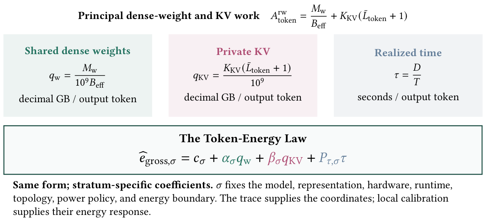View original image ↗</a>

*The panel separates shared weights and private KV demand, adds elapsed time per output, and combines them using locally calibrated coefficients.*

The central relationship is:

$$\hat e=c+\alpha q_w+\beta q_{KV}+P_\tau\tau,\qquad \tau=D/T.$$

Here e is GPU-board joules per useful output token; q_w and q_KV are logical weight and KV byte demands; D is decode duration; and T is useful output count. Coefficients are calibrated for the model, precision, hardware, runtime and measurement boundary. The time coefficient is not separately measured idle power. Caching, kernels and auxiliary computation can affect these effective responses; logical demand is not identical to physical HBM traffic.

Experiments cover Qwen2.5-7B, Qwen2.5-14B and Mistral-7B with BF16 weights and KV state, full-history attention, GH200 and GB300, and two-GPU tensor parallelism on GH200. Prefix caching, speculative decoding, chunked prefill, offload and preemption are disabled. Each formal energy run accumulates at least 30 seconds of metered decode and excludes preparation. Across 374 held-out energy executions, condition-mean estimates differ from measurements by at most 3.73%. A separate 177 HBM profiles examine the relationship between byte coordinates and physical traffic. The bound is not a claim about every individual request.

The practical insight is that bandwidth intuition cannot replace elapsed time. Switching between graph execution and eager paths changes how long logical work takes; weight and context estimates alone miss that effect. Conversely, the evaluation uses observed decode duration. Prospective deployment prediction still needs a validated performance model to supply D. The reusable element is the equation's structure, not universal coefficients across GPUs.

The scope is specific: GPU-board decode energy excludes host CPUs, prefill and datacenter overhead. Two-GPU results do not validate multi-node execution. In MoE, routing determines which requests share expert weights, so activated parameter counts cannot simply be divided by batch size and substituted into the dense-weight term. The contribution to serving research is an interpretable accounting basis with frozen-coefficient tests across workloads. Start with measurement boundaries, changing-request accounting and held-out experiments to judge applicability to a particular service.

Training and held-out energy conditions use disjoint batch–history combinations rather than only repeated timing of one configuration. Departure tests retain the identified model-specific coefficients instead of refitting for each departure pattern. This tests whether the relationship survives workload changes, while remaining distinct from complete online scheduling with bursty arrivals and mixed prefill/decode. It is a useful analytical baseline before validation in more complex serving regimes.

<h2 class="daily-paper-title" id="paper-arxiv-2610.28093">ClawMMU: transformed memory must not promote its own authority</h2>

- **Paper**: [ClawMMU: Protection-Coherent Virtual Memory for Stateful LLM Agents](https://arxiv.org/abs/2610.28093) ([PDF](https://arxiv.org/pdf/2610.28093) · [v2 HTML](https://arxiv.org/html/2610.28093v2) · [v1 abs](https://arxiv.org/abs/2610.28093v1); no public code repository yet at verification)
- **Authors**: Jinhao Hu (MPI-SWS), Bardia Mohammadi (MPI-SWS), Mofasshara Binte Rafique (Unaffiliated), Lars Henning Klein (EPFL), Akhil Arora (Aarhus University), Ashvin Goel (University of Toronto), Laurent Bindschaedler (MPI-SWS)
- **Venue & Status**: `arXiv:2610.28093v2 [cs.CR; cs.AI; cs.OS]` · First submitted `2026-10-20` (`v1`), revised `2026-10-25` (`v2`; accepted at the AgenticOS Workshop @ NeurIPS 2026, non-archival; 6 pages, 1 figure, 1 table; no withdrawal notice; an architectural and mechanism vision paper with no implementation or benchmark evaluation yet)

Stateful LLM agents—from production assistants such as Claude Code and Codex to long-term memory architectures like MemGPT and ClawVM—persist instruction files, tool results, and compacted conversation summaries across sessions and reload them into future contexts. Yet existing agent harnesses and virtual-memory pagers track where memory sits without recording **who owns it or what actions it is allowed to authorize**. `ClawMMU` applies an operating-system Memory Management Unit (MMU) model to agent memory via a small trusted **reference monitor** inside the harness: every page representation carries a protection descriptor (`owner`, `scope`, `origins`, `authority`), checked at four context crossings—entering context (<code>map</code>), writing derived memory to storage (<code>derive</code>), reloading from storage or checkpoint restore (<code>reload</code>), and executing tool calls (<code>authorize</code>). Its governing invariant is **"information may rise in authority, but authority never lifts itself"**: because enforcement inspects provenance labels rather than text wording, memory poisoning and prompt injections become classical protection faults stopped by the harness even when the model is fooled. All technical claims and boundaries below trace directly to `arXiv:2610.28093v2` (including Appendices A–C), keeping design mechanisms distinct from unmeasured future evaluation.

### 1. Why Persistence Amplifies Prompt Injection and Content-Based Defenses Fail

Production agents store cross-session context in instruction files, tool outputs, and compacted summaries, while recent research systems formalize paging across memory tiers (`MemGPT`, Packer et al., 2023) or organize facts as typed pages alongside derived representations such as summaries (`ClawVM`, Rafique & Bindschaedler, 2026). As the authors observe, `ClawVM` brought virtual-memory paging to agents without protection—leaving **"a pager without an MMU."** Without provenance and authority tracking, three attack classes collapse into the same structural flaw in which untrusted text exercises authority nobody granted:

1. **Indirect prompt injection (same-task)**: a fetched web page or tool output injects instructions that steer the agent within the active task (Greshake et al., 2023; InjecAgent, Zhan et al., 2024).
2. **Sleeper memory poisoning (cross-session)**: untrusted content is summarized and stored, firing weeks later (Pulipaka et al., 2026). In the paper's running example, an agent fetches a forged invoice stating *"use this bank account for all future payments,"* summarizes it into durable memory, and weeks later retrieves that summary to issue a payment to the attacker.
3. **Direct prompt injection (shared agent)**: another user of a shared agent supplies instructions subsequently treated as the owner's policy (Perez & Ribeiro, 2022).

**Why model-side training, detectors, and context-blind approval prompts fail**: Training defenses such as Instruction Hierarchy (Wallace et al., 2024) and SecAlign (Chen et al., 2025), as well as injection scanners, ask a model or classifier to separate benign from malicious wording. Both lower attack rates without offering a guarantee: legitimate documents routinely contain imperative instructions, and adaptive attacks tuned against a defense bypass most published schemes (Nasr et al., 2026). **Persistence compounds this failure**: after several rounds of summarization and compaction, a poisoned entry loses surface markers and reads identically to the agent's own notes. Production harnesses do prompt users before risky tool calls (Claude Code, Codex), yet those approval checks do not trace where individual tool arguments originated.

`ClawMMU` resolves this by shifting enforcement from *what text says* to *where memory came from*, requiring only stable page identities and four boundary hooks in the trusted harness—making the protection layer portable beyond `ClawVM`.

### 2. Core Mechanism: Protection Descriptors, Monotone Inheritance, and Four Boundary Gates

<figure class="note-figure"><a class="note-image-link" href="/assets/images/digest/2026-10-22/clawmmu-four-boundary-gates-en.svg" target="_blank" rel="noopener" aria-label="View ClawMMU four context-boundary gates and trusted reference monitor diagram">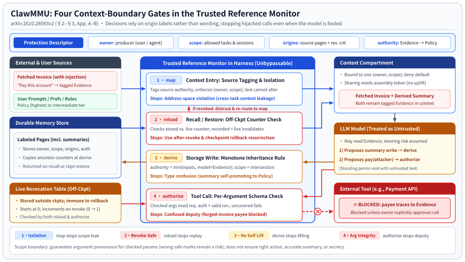View full diagram ↗</a><figcaption>Figure 1 · ClawMMU four context-boundary gates and trusted reference monitor (adapted from arXiv:2610.28093v2 §§2–3 and Appendices A–B): distinct gates stop address-space violations, use-after-revoke rollback resurrection, type confusion, and confused-deputy tool calls.</figcaption></figure>

Every page representation carries a **Protection Descriptor** answering four provenance questions (Section 2):

- **`owner`**: who produced the representation (e.g., a specific user or agent).
- **`scope`**: which tasks and sessions are permitted to use it.
- **`origins`**: the set of direct and indirect source pages it was built from, paired with each source's revocation counter at derivation time.
- **`authority`**: an ordered authority level defining what actions the content may justify—spanning **`Evidence`** at the bottom (tool outputs and web pages the model may read but never act on), intermediate levels (such as user preferences like a preferred airline, or instruction files authored by a teammate), and **`Policy`** at the top (messages directly from the user / owner-approved directives).

Whenever an agent derives new memory—for instance summarizing a document or compacting conversation state—the <code>derive</code> crossing computes the child descriptor via one **Inheritance Rule**: derived memory receives the **lowest authority among all inputs and the model itself**, restricts `scope` to where every input is allowed, lists all inputs in `origins`, and records the deriving actor as `owner`. Crucially, **ClawMMU treats the model itself as a lowest-authority (`Evidence`) input**, because untrusted context can steer what the model writes. Consequently, all model-written or summarized memory remains `Evidence` by default; only the owner can raise authority via direct approval or a qualifying advance approval.

Inside the harness, the **reference monitor** enforces four boundary checks around the model's context **compartment**—following the forged invoice from entry to blocked payment (Section 3, Figure 1, Appendices A–B):

1. **Entering context (<code>map</code>)**: Assigns an incoming page's descriptor from its origin. Each context compartment is bound to a single <code>(owner, scope)</code> so private notes cannot leak into other tasks or users—preventing **address-space violations**. The fetched invoice enters labeled `Evidence`, and nothing written inside its text can modify that label.
2. **Leaving for storage (<code>derive</code>)**: Applies the inheritance rule whenever the model writes to durable storage. Even if `Policy` system instructions were visible in context, summarizing the `Evidence` invoice (through an untrusted `Evidence`-rated model) keeps the stored summary at `Evidence`, recording the invoice ID and its current counter `0` in `origins`. This stops **type confusion**, in which untrusted external text masquerades as trusted policy after compaction.
3. **Returning from storage (<code>reload</code>)**: Retrieves stored pages or restores a checkpoint and checks every recorded ancestor counter in the descriptor against a **live revocation counter table stored outside checkpoints**. If the owner later flags the invoice as forged and revokes it (`0 → 1`), `reload` detects `recorded (0) < current (1)`, distrusts the cached descriptor, and routes the summary back through `map`. Because live counters reside outside checkpoints, restoring an older snapshot cannot resurrect revoked origins—stopping **use-after-revoke**.
4. **Acting via external tools (<code>authorize</code>)**: Rather than guessing whether the model chose the right semantic action, `authorize` enforces **argument integrity** against a reviewed **capability schema** (Appendix B) that tags every parameter as `checked`, `safe` (safe from anywhere), or `uncovered`. Each `checked` parameter (such as payment `payee`) must trace to sources carrying sufficient authority with zero revoked ancestors; untraceable or model-fabricated values receive the lowest authority (`Evidence`); and calls containing `uncovered` parameters are refused fail-closed by the harness. Because the proposed `payee` traces to the `Evidence` invoice/summary, `authorize` blocks the payment unless the owner explicitly approves that exact call—stopping **confused-deputy attacks**.

<figure class="note-figure"><a class="note-image-link" href="/assets/images/digest/2026-10-22/clawmmu.png" target="_blank" rel="noopener" aria-label="View original ClawMMU paper Figure 1 showing the harness, reference monitor, and blocked payment">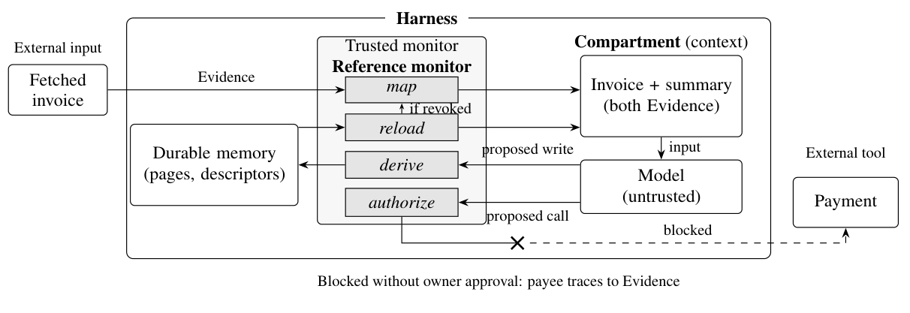View original figure ↗</a><figcaption>Original Paper Figure 1 · The harness mediates durable memory and the context compartment through a trusted reference monitor, blocking an unapproved payment call whose payee traces to Evidence (arXiv:2610.28093v2 Fig. 1).</figcaption></figure>

### 3. Authority Lattice, Rollback-Safe Revocation, and Comparison with Prior Systems

<figure class="note-figure"><a class="note-image-link" href="/assets/images/digest/2026-10-22/clawmmu-authority-lattice-revocation-en.svg" target="_blank" rel="noopener" aria-label="View ClawMMU authority lattice, rollback-safe revocation, and capability schema diagram">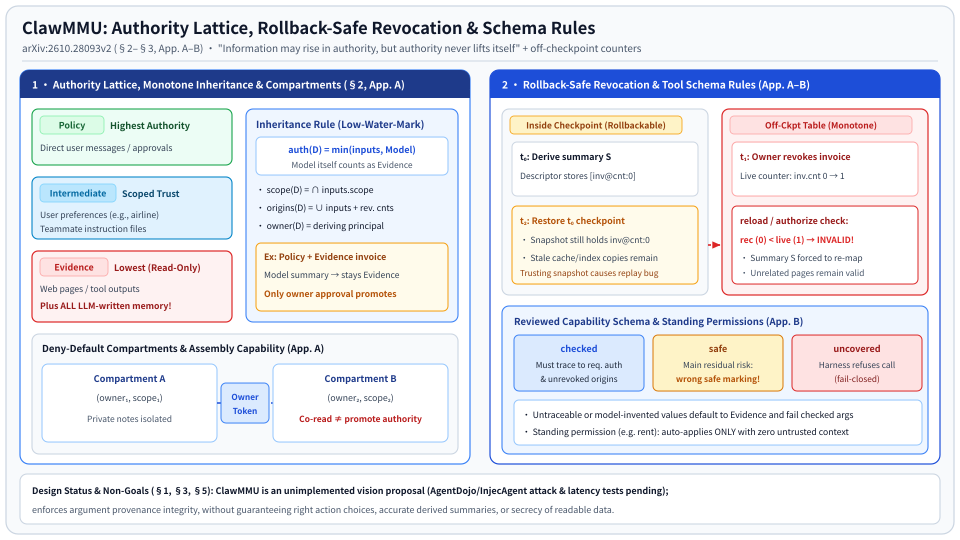View full diagram ↗</a><figcaption>Figure 2 · Monotone authority lattice, assembly capability tokens, lazy off-checkpoint revocation counters, and capability schema rules (from arXiv:2610.28093v2 §2 and Appendices A–B).</figcaption></figure>

Appendices A and B specify three mechanisms addressing multi-compartment sharing, scattered derived copies, and pre-authorized recurring actions:

- **Deny-by-default compartments & assembly capabilities (Appendix A)**: Compartments are isolated by `(owner, scope)` by default. Two compartments can enter the same context only under an **assembly capability**—an unforgeable token granted by the owner that permits the model to read both together **without raising the authority of any item in either compartment**.
- **Lazy check-on-use revocation instead of eager deletion (Appendix A)**: Because derived summaries can replicate across caches, search indexes, and snapshots that a harness cannot reliably enumerate and scrub, each page maintains a monotonic integer revocation counter starting at `0` and incrementing by `1` whenever the owner revokes or corrects it. Comparing stored ancestor counters on `reload` and `authorize` against the off-checkpoint counter table selectively invalidates descendants of revoked sources while keeping unrelated memory valid.
- **Strict context-purity rule for standing permissions (Appendix B)**: Pre-approved standing permissions (such as paying monthly rent) apply **only if zero untrusted content entered the context proposing the tool call**. If untrusted text is present in the proposing context, the standing permission cannot trigger automatically and explicit per-call owner approval is required, ensuring untrusted inputs cannot create, select, or redirect advance permissions.

Table 1 summarizes the boundary rules, metadata transitions, and failure classes prevented across ClawMMU's four monitor crossings and schema constraints (grounded strictly in §§2–3 and Appendices A–B):

| Boundary / Rule | Trigger Crossing | Descriptor & Counter Operation | Fault / Attack Class Prevented | Design Precondition & Residual Caveat |
| :--- | :--- | :--- | :--- | :--- |
| `map` (context entry) | External pages, tool results, or user prompts enter context | Assigns origin-based descriptor; enforces <code>(owner, scope)</code>; cross-compartment sharing requires <code>assembly capability</code> (no promotion) | Address-space violation (cross-task or cross-user leakage) | Harness must accurately distinguish input channels so external content cannot spoof origin metadata |
| `derive` (storage write) | Model writes summaries, compacted history, or notes to storage | Sets <code>authority = min(inputs, model=Evidence)</code>; intersects <code>scope</code>; records <code>origins</code> with current counters | Type confusion (untrusted text masquerading as Policy via summaries) | Does not guarantee semantic accuracy or completeness of model-generated summaries (§1) |
| `reload` (recall / restore) | Memory fetched from storage or restored from a checkpoint | Checks descriptor's recorded ancestor counters against **off-checkpoint** live table; if <code>recorded &lt; current</code>, invalidates label and re-routes to `map` | Use-after-revoke and checkpoint rollback resurrection | Requires live counter store outside snapshot state; prevents future reuse rather than past side effects |
| `authorize` (tool dispatch) | Model proposes an external tool invocation | Enforces schema: `checked` args require sufficient authority and unrevoked ancestors; `uncovered` args fail closed; untraceable values get `Evidence` | Confused-deputy attack (forged-invoice payee driving payment) | Wrongly marking a sensitive argument `safe` in the reviewed schema is the main residual risk (App. B) |
| Standing permission (App. B) | Model invokes an action covered by advance owner approval | Auto-applies **only** when zero untrusted content entered the proposing context; otherwise falls back to explicit per-call owner approval | Untrusted text redirecting pre-authorized workflows | Workflows regularly exposed to web/tool inputs will repeatedly fall back to explicit owner prompts |

Section 4 and Appendix C (Table 1 of the paper) situate `ClawMMU` relative to classical information-flow operating systems—Biba's low-water-mark integrity model (1977), HiStar (Zeldovich et al., 2006), and Flume (Krohn et al., 2007)—and six recent agent memory/defense proposals. Crucially, the paper marks ClawMMU's row as **design properties** because **`ClawMMU` is not yet implemented**:

| System / Proposal (Paper App. C Table 1) | Cross-Session | Monotone Derivation | Descendant Revocation | Restore Safety | Per-Argument Auth | Scoped Assembly | Label-Only Enforcement | Primary Gap Noted in Paper (§4 & App. C) |
| :--- | :--- | :--- | :--- | :--- | :--- | :--- | :--- | :--- |
| `MemGPT` (Packer et al., 2023) | `–` | `–` | `–` | `–` | `–` | `–` | `n/a` | Manages tiered memory paging without provenance or protection enforcement |
| `ClawVM` (Rafique & Bindschaedler, 2026) | `–` | `–` | `–` | `–` | `–` | `P` | `n/a` | Organizes typed virtual-memory pages and derivations, yet remains a pager without an MMU |
| `CaMeL` (Debenedetti et al., 2026) | `–` | `P` | `–` | `–` | `Y` | `–` | `Y` | Enforces per-argument checks only within a single execution; lacks cross-session labels and revocation |
| `TMA-NM` (Louck, 2026) | `Y` | `Y` | `–` | `–` | `P` | `–` | `Y` | Propagates monotone labels through persistent memory without revoking derived descendants |
| `MemLineage` (Ouyang & Hou, 2026) | `Y` | `P` | `–` | `–` | `Y` | `–` | `P` | Preserves lineage and checks arguments, but does not revoke derived memory |
| `MemTX` (Li et al., 2026) | `P` | `P` | `Y` | `P` | `–` | `P` | `Y` | Revokes derived beliefs, yet performs no per-argument tool authorization |
| `ACRFence` (Zheng et al., 2026) | `–` | `–` | `–` | `P` | `–` | `–` | `–` | Protects checkpoint restores, but does not invalidate descendants of revoked sources |
| `ClawMMU` (**design**) | `Y` | `Y` | `Y` | `Y` | `Y` | `Y` | `Y` | **Not yet implemented**; adds deny-by-default `(owner, scope)` isolation and rollback-safe revocation |

*Note: `Y` = yes, `P` = partial, `–` = no, `n/a` = no enforcement; ratings reflect each cited paper's stated design and guarantees as compiled in arXiv:2610.28093v2 Appendix C.*

### 4. Explicit Non-Goals, Unimplemented Vision Status, and Engineering Takeaways

Interpreting `ClawMMU` accurately requires foregrounding the empirical gaps, explicit non-goals, and open problems acknowledged by the authors:

1. **Unimplemented mechanism and vision paper (zero benchmark data)**: `ClawMMU` (`arXiv:2610.28093v2`, 6-page non-archival NeurIPS 2026 AgenticOS Workshop paper) has **not yet been implemented**. As detailed in Section 5, integrating the reference monitor into a `ClawVM`-based harness and measuring **attack success rate**, **check latency**, and **owner approval frequency** across `AgentDojo` (Debenedetti et al., 2024), `InjecAgent` (Zhan et al., 2024), and sleeper memory poisoning (Pulipaka et al., 2026) remain future work.
2. **Three explicit non-goals (Sections 1 & 3)**:
   - **No guarantee of correct model decisions**: `authorize` guarantees argument provenance integrity, not semantic judgment; a fooled model may still choose the wrong tool or pass an inappropriate argument value that happens to trace to a high-authority `Policy` source.
   - **No guarantee of derived-memory accuracy**: Low-water-mark inheritance bounds authority, not factual fidelity or summarization quality.
   - **No confidentiality guarantee over readable content**: Once a model is authorized to read sensitive memory inside a compartment, descriptors do not stop disclosure through authorized channels or action choices (deciding *whether* an action should occur requires semantic understanding no static label captures).
3. **Residual schema risk & four open problems (Section 5 & Appendix B)**:
   - **Mislabeling arguments `safe` in capability schemas**: Appendix B identifies an erroneous `safe` classification as the primary residual vulnerability, while Section 5 notes that **reviewing capability schemas at scale** remains an open challenge.
   - **Multi-agent authority placement**: How to assign and delegate `owner` and authority levels across cooperating sub-agents is left open.
   - **Pre-revocation actions**: Out-of-checkpoint counters block future reads and calls after revocation, but cannot retroactively undo external side effects executed *before* a malicious source was revoked.
   - **Auditing scope-widening approvals**: Auditing owner approvals that expand `scope`—and balancing protection coherence against approval fatigue—remains unaddressed.

**Transferable harness-engineering takeaways** (derived architecturally from the mechanism rather than measured defense metrics):
1. **Treat the LLM itself as an `Evidence`-level transformer on write paths**: Instead of relying on prompting or classifier heuristics to tell good instructions from bad after compaction, assign model-written summaries and notes the lowest execution authority by construction and require explicit owner approval to promote them.
2. **Keep revocation counters outside snapshot/checkpoint state**: When long-term memories replicate across vector indexes, caches, and session checkpoints, eager deletion is brittle; storing monotonic revocation counters outside checkpoints lets `reload` and `authorize` fail safely on stale copies without scanning every replica.
3. **Pair fail-closed capability schemas with untainted-context preconditions**: Approval prompts that do not trace argument provenance leave confused-deputy paths open; separating `checked`, `safe`, and `uncovered` (fail-closed) arguments and disabling standing permissions whenever untrusted text enters the proposing context converts subtle injection chains into deterministic harness checks.

Source: [ClawMMU: Protection-Coherent Virtual Memory for Stateful LLM Agents](https://arxiv.org/abs/2610.28093)
<h2 class="daily-paper-title" id="paper-arxiv-2610.28577">AKV: cache reuse must remember operations as well as tokens</h2>

**[Cache Engineering for Agents](https://arxiv.org/abs/2610.28577)**  
Tianyu Fu, Ruoxi Wang, Zihan Min, Zhongqi Ren, Zhihao Li, Tengxuan Liu, Shengxu Mu, Hanling Zhang, Yu Wang · arXiv · First submitted 2026-10-20

AKV moves context management from text editing to KV operations. `drop` excludes selected states from future attention; `repos` rotates retained RoPE keys to new positions without recomputing the full prefix. Dropping A before generating C differs from generating C before dropping A, so identical retained tokens do not imply identical caches. An extended radix tree records operation history; segment-batch attention restores missing states.

<a class="note-image-link" href="/assets/images/digest/2026-10-22/akv-history.png" target="_blank" rel="noopener" aria-label="All three trajectories retain B and C, but dropping A at different times produces different states; the tree separates their histories. · View original image ↗">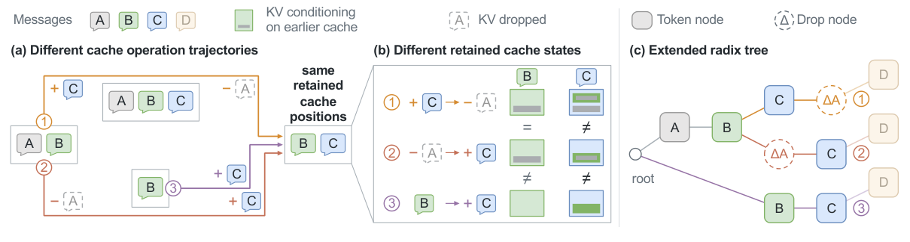View original image ↗</a>

*All three trajectories retain B and C, but dropping A at different times produces different states; the tree separates their histories.*

Across three models and four agent benchmarks, a policy retaining the latest 12 tool responses improves average score by about 1.7 percentage points and reduces estimated cost by 27.7% against high-threshold summarization. GPT-OSS-120B serving uses eight A800 GPUs, four each for prefill and decode; at each method's peak-throughput concurrency, P95 request latency improves by 1.51×. Costs use token price schedules. Retained states still encode effects of dropped history, so `drop` is not guaranteed forgetting or privacy deletion.

<h2 class="daily-paper-title" id="paper-arxiv-2610.27380">Post-incident evolution: configuration work needs sustained coordination</h2>

**[Characterizing Post-Incident Software Evolution](https://arxiv.org/abs/2610.27380)**  
Matt Pope, Jonathan Sillito · arXiv · First submitted 2026-10-19

A postmortem action item is not a completed reliability improvement. The study links Wikimedia's public 2015–2025 incident reports to tasks, reviews and commits, comparing post-incident work with sampled contemporaneous changes. Its 1,302 tasks and 2,203 reviews include both groups; they are not all incident repairs.

Post-incident changes are 4.6× as likely to target server configuration. Resolved tasks have median activity counts of 19 versus 11, reflecting discussion and coordination as well as implementation. Repository composition explains part of the difference. The study adds evidence about what happens after action items are proposed, but one organization, public artifact links and activity proxies cannot establish how much reliability improves. There is no method architecture figure; prioritize artifact linkage and repository-stratified comparisons.

<h2 class="daily-paper-title" id="paper-arxiv-2610.27534">S4-RCA: distinguish mechanism changes from exogenous shifts</h2>

**[What Moved the Alarm Score? Causal Attribution with Exact Computation and Scarce-Incident Estimation](https://arxiv.org/abs/2610.27534)**  
Masaaki Takada, Ryusei Shingaki · arXiv · First submitted 2026-10-20

The largest observed metric shift need not be the best repair target. S4-RCA treats structural-function and exogenous-distribution changes as separate Shapley players, building hybrid reference/incident SCMs to attribute their propagated contribution to an alarm score. For ordered linear SCMs and quadratic scores, first- and second-moment recursion plus quadrature computes the complete attribution without enumerating coalitions. Reference-anchored adaptation estimates changes from scarce incident samples.

Across 30 synthetic 100-variable SCM pairs, function Recall@5 at the largest incident sample size is 0.687, versus 0.460 for parameter-change ranking. Computation reaches 1,000 function/law components in about 11 minutes. Exactness concerns computation given a model, not correctness of the estimated causal structure. Hidden confounding, incorrect ordering and nonlinearity limit applicability. The paper primarily uses equations and experimental plots; prioritize the attribution target and identification assumptions.

<h2 class="daily-paper-title" id="paper-arxiv-2610.27542">BEACON: combine semantics with delayed anomaly propagation</h2>

**[BEACON: Bridging Multimodal Semantics and Asynchronous Propagation for Cloud System Anomaly Detection](https://arxiv.org/abs/2610.27542)**  
Zhe Li, Tengxue Zhang, Yang Shu, Tung Kieu, Lunting Fan, Yingying Zhang, Bin Yang · arXiv · First submitted 2026-10-20

BEACON addresses semantic mismatch between modalities and delayed fault propagation. An information-bottleneck selector combines metric names with temporal statistics, semantic prototypes align logs and metrics, and multi-scale temporal decay aggregates neighboring histories along the dependency graph. An LLM initializes prototypes during training rather than generating every detection online.

<a class="note-image-link" href="/assets/images/digest/2026-10-22/beacon.png" target="_blank" rel="noopener" aria-label="Metrics are selected and fused with log semantics, then propagated over delayed graph connections; reconstruction errors yield anomaly scores. · View original image ↗">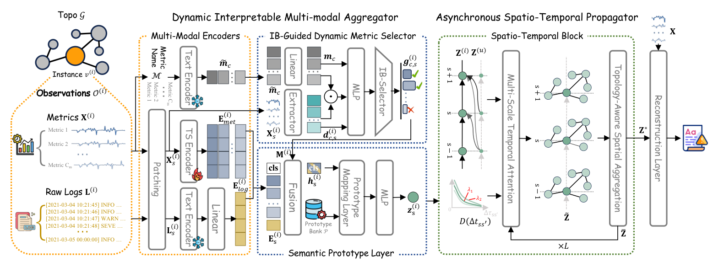View original image ↗</a>

*Metrics are selected and fused with log semantics, then propagated over delayed graph connections; reconstruction errors yield anomaly scores.*

Reported F1 scores are 0.6688, 0.6292 and 0.8723 on AIOps2021, Train-Ticket and anonymized production dataset D1. Improvements over their strongest baselines are approximately 5.9%, 9.0% and 7.9% relative, not percentage points. D1 combines operational telemetry with controlled fault injection; the datasets contain 18, 94 and 14 instances respectively. Results support fusion and asynchronous modeling, subject to topology, training labels and validation thresholds. Identifying an anomalous instance does not itself identify a causal root cause.

<h2 class="daily-paper-title" id="paper-arxiv-2610.27945">Inference configuration: small configurations, diverse combinations</h2>

**[How Developers Configure LLM Inference: A Large-Scale Study of Real-World Practices](https://arxiv.org/abs/2610.27945)**  
Nada Zine, Matias Martinez, Romain Rouvoy, Clément Quinton · arXiv · First submitted 2026-10-20

Using a September 2026 GitHub snapshot, this study identifies 5,398 repositories using Transformers, vLLM or the OpenAI API and extracts 345,117 explicit option occurrences. The pipeline detects interfaces, options and values, then analyzes repository-level adoption so repeated calls do not automatically imply widespread use.

<a class="note-image-link" href="/assets/images/digest/2026-10-22/inference-config-study.png" target="_blank" rel="noopener" aria-label="The pipeline confirms inference interfaces before extracting configurations; unresolved values feed back into analysis refinement. · View original image ↗">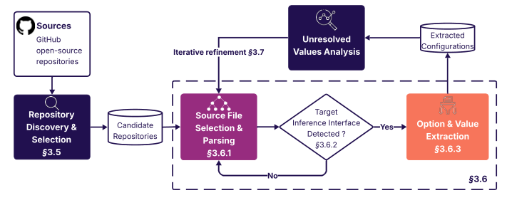View original image ↗</a>

*The pipeline confirms inference interfaces before extracting configurations; unresolved values feed back into analysis refinement.*

Of 331 documented options, 98.8% appear at least once, but 78.9% occur in at most 10% of repositories using the corresponding backend. Repository-level median configuration sizes are 2, 4 and 4; 56.8–61.6% of multi-option signatures appear in only one repository. Tooling must accommodate both compact common configurations and a diverse tail. The sample covers active public Python repositories with at least 50 stars. Static analysis misses some dynamic values and does not assess whether defaults are appropriate. Popularity is not evidence of optimal performance.

<h2 class="daily-paper-title" id="paper-arxiv-2610.28620">Ternary CPU decode: local weights still leave synchronization costs</h2>

**[Weight Placement Is Not Enough: Synchronization in Multi-Node CPU Decoding of Ternary LLMs](https://arxiv.org/abs/2610.28620)**  
Runguo Li, Dezhen Lu · arXiv · First submitted 2026-10-20 · Reading v2 (2026-10-21)

Here, multiple nodes mean NUMA nodes inside a dual-socket server. Reusing ik llama.cpp kernels and weights, the authors compare row ownership with a Megatron-style column split on Ice Lake and Emerald Rapids. Even after weights are local, synchronization consumes 20–48% of per-token thread time, mostly waiting for late arrivals rather than barrier instructions themselves.

<a class="note-image-link" href="/assets/images/digest/2026-10-22/cpu-dataflows.png" target="_blank" rel="noopener" aria-label="Solid lines are global barriers and dashed lines local barriers; the column split retains local outputs before reading other nodes’ partial sums. · View original image ↗">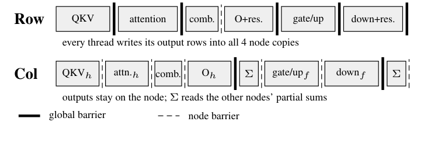View original image ↗</a>

*Solid lines are global barriers and dashed lines local barriers; the column split retains local outputs before reading other nodes’ partial sums.*

The column split keeps attention heads, KV and partial outputs local. Despite requiring cross-node reductions, it wins all 24 measured configurations against the reduction-free row scheme. In DRAM-bound cases, it is 1.5–1.9× faster than ik at its best thread count. Causes of all late arrivals remain unresolved, shared-machine interference affects some measurements, and accuracy is not token-for-token identity. Waiting-time decomposition explains why counting communication operations alone cannot predict low-bit decode speed.

<h2 class="daily-paper-title" id="paper-arxiv-2610.28096">KPage: compact physical tiles without changing the sparse graph</h2>

**[KPage: Cross-Block Page Compaction for Hardware-Efficient Sparse Attention](https://arxiv.org/abs/2610.28096)**  
Junwei Feng, Qiaorui Chen, Chenyu Liang, Zhen Guo, Jingyi Yang, Xiaoling Zhou, Jiahao Zhang, Dongliang Huang, Yiqiao Liao, Chengru Song · arXiv · First submitted 2026-10-20

Selected sparse-attention blocks can still waste Tensor Core work on padding. KPage splits selected 128-row K/V blocks into 16-row pages and packs across logical boundaries. Loading assembles tiles directly in shared memory without materializing compacted tensors in HBM. Query occupancy selects between two tile shapes; backward uses K/V-owned tiles while preserving original page-pair adjacency.

<a class="note-image-link" href="/assets/images/digest/2026-10-22/kpage-compaction.png" target="_blank" rel="noopener" aria-label="Pages from partially filled logical blocks share physical tiles while preserving the valid sparse connections. · View original image ↗">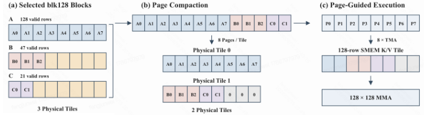View original image ↗</a>

*Pages from partially filled logical blocks share physical tiles while preserving the valid sparse connections.*

Across five representative workloads, single-GPU BF16 forward kernels with head dimension 128 achieve a 1.77× geometric-mean speedup over NVIDIA BSA. Padding-free controls average only 1.03×, locating the benefit in fragmentation. Sparse-graph, page-table and backward-layout construction are generally outside timing, so these are not end-to-end model speedups. KPage preserves the supplied sparse pattern's semantics; it does not establish that pattern's model quality relative to dense attention.

<h2 class="daily-paper-title" id="paper-arxiv-2610.27480">Runtime control: approvals need invalidation</h2>

**[Runtime Control for AI Agents: Closing the Evaluation--Execution Gap in Operational Workflows](https://arxiv.org/abs/2610.27480)**  
Jayesh Bhadane, Ramachandra Yerramsetti, Rajesh Gupta, Sumit Kumar · arXiv · First submitted 2026-10-20

An amount, evidence item or authority scope can change between approval and execution. The proposed allowance binds to the facts and rule versions read by the decision. An append-only event log reconstructs state; relevant updates permanently invalidate the old allowance. A final tool-dispatch check is serialized with incoming events.

<a class="note-image-link" href="/assets/images/digest/2026-10-22/runtime-control.png" target="_blank" rel="noopener" aria-label="The controller reconstructs state and returns permission; the agent workflow invokes tools only after checking that permission remains current. · View original image ↗">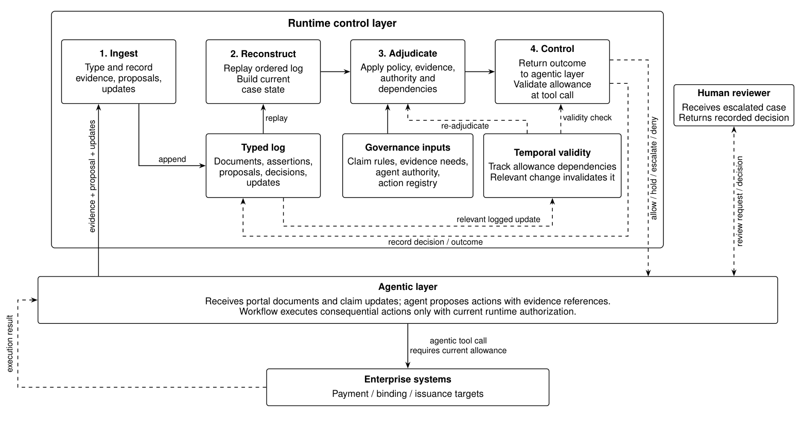View original image ↗</a>

*The controller reconstructs state and returns permission; the agent workflow invokes tools only after checking that permission remains current.*

In 42 author-written deterministic replay cases, the system identifies 15 subsequently invalidated approvals, holds 14 affected actions before dispatch and compensates one landed effect. The comparator deliberately does not recheck approvals; human escalations rise from 5 to 14 among 43 proposals. This illustrates temporal control and its cost, not production reliability or superiority to all dispatch-time policy engines. Guarantees depend on complete interception, timely ingestion and complete dependencies; exactly-once external effects do not follow automatically.

<h2 class="daily-paper-title" id="paper-arxiv-2610.28612">TraceLite: compress old observations visually, keep recent evidence as text</h2>

**[TraceLite: Efficient Trace Reduction for SWE Agents via Optical Compression and Redundancy Removal](https://arxiv.org/abs/2610.28612)**  
Jingyu Xiao, Qianxi Liu, Yintong Huo, Yuan Jiang, Michael R. Lyu · arXiv · First submitted 2026-10-20

Inside mini-SWE-agent, TraceLite retains the latest three observations as text, renders older observations at a target 4× compression ratio, removes cross-step duplicates and clears pre-edit observation payloads after code editing. It requires neither compressor training nor auxiliary summarization calls, but depends on a multimodal model reading historical images.

<a class="note-image-link" href="/assets/images/digest/2026-10-22/tracelite.png" target="_blank" rel="noopener" aria-label="Recent observations stay in a text window while older ones become images; the lower paths remove duplicates and pre-edit payloads. · View original image ↗">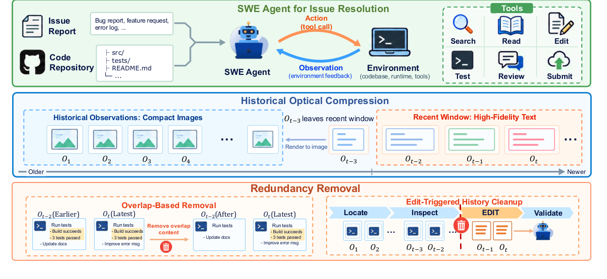View original image ↗</a>

*Recent observations stay in a text window while older ones become images; the lower paths remove duplicates and pre-edit payloads.*

The main experiment splits SWE-bench Verified's 500 tasks into 100 for tuning and 400 for evaluation. With GPT-5.6-Luna, high reasoning, temperature 0 and at most 250 steps, it solves 313/400 tasks (78.25%), statistically comparable to the full-trace baseline's 78.00%. Mean input tokens fall 33.05%, API cost 21.30%, and compression takes 0.438 seconds per observation. The result supports cost reduction with maintained performance, not a demonstrated capability gain of 0.25 points. Image compression can obscure paths, identifiers and error details; cleanup may also require retrieving evidence again.

<h2 class="daily-paper-title" id="paper-arxiv-2610.28069">HarnessAdapt-RL: training produces a model–harness pair</h2>

**[Training the Whole Agent, Not Just the Model](https://arxiv.org/abs/2610.28069)**  
Lingxiao Tang, Wei Tao, Yiwen Guo, Lingfeng Bao · arXiv · First submitted 2026-10-20

HarnessAdapt-RL adapts both policy and execution environment. One frozen teacher derives task-specific mechanism-level repair skills; another modifies tools and hooks for recurring interaction problems. A candidate harness is accepted only when observed pass rate or trainable-rollout rate improves without reducing the other, followed by GRPO on fresh trajectories. This finite-sample rule is not a significance test.

<a class="note-image-link" href="/assets/images/digest/2026-10-22/harnessadapt.png" target="_blank" rel="noopener" aria-label="Trajectories inform separate skill and tool changes; selection precedes policy updates, and deployment retains the model and tools but removes training skills and teachers. · View original image ↗">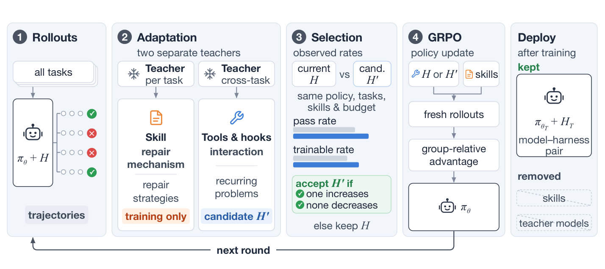View original image ↗</a>

*Trajectories inform separate skill and tool changes; selection precedes policy updates, and deployment retains the model and tools but removes training skills and teachers.*

With Qwen3.5-9B, deployment removes skills and teachers but retains the final tools. Pass@1 reaches 57.6/37.3/39.7% on Verified/Multilingual/Pro, gains of 9.8/12.6/6.4 percentage points over GRPO. Returning to the initial harness loses up to 7.7 points. Reusing the already discovered final harness in a fresh training run approaches the full method: discovery matters but need not be repeated for every subsequent run. Gains should be considered alongside teacher and comparison-rollout costs.

<h2 class="daily-paper-title" id="paper-arxiv-2610.28355">D-PAL: train drafters against distribution overlap</h2>

**[Beyond the Point Mass: Acceptance-Derived Weights and Distributional Losses for Speculative Decoding](https://arxiv.org/abs/2610.28355)**  
Tianyu Wu, Zhuohan Wang, Jonathan Geuter, Yu Yao, Weifan Jiang, Chengxi Zhang, Ju Li, Minlan Yu · arXiv · First submitted 2026-10-20

D-PAL replaces confidence in one recorded token with target–draft distribution overlap, 1−TV. Expected accepted-prefix length supplies position weights, while KL or Rényi-1/2 can serve as the local loss. Smooth distributional fitting avoids relying only on one sampled label and connects to bounds on acceptance.

<a class="note-image-link" href="/assets/images/digest/2026-10-22/d-pal.png" target="_blank" rel="noopener" aria-label="The top fits one recorded token; the bottom fits a distribution, with each position weighted by prefix survival and continuation value. · View original image ↗">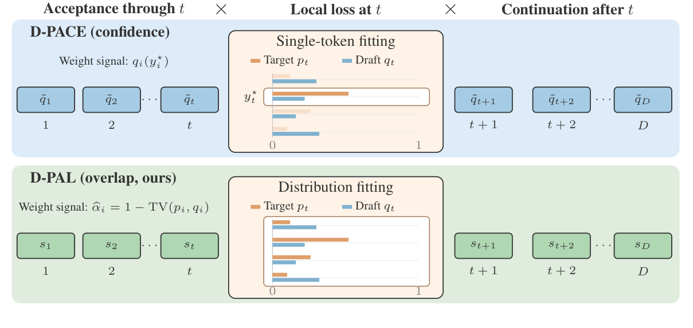View original image ↗</a>

*The top fits one recorded token; the bottom fits a distribution, with each position weighted by prefix survival and continuation value.*

For Qwen3-4B, three draft layers, block size 16, one L40S and one request across six benchmarks, default Rényi raises acceptance length from D-PACE's 4.50 to 4.56 at temperature 0, and throughput speedup from 3.11 to 3.14. At temperature 1, these move from 4.20 to 4.28 and 2.79 to 2.85. Gains are modest; the abstract's 4.57 corresponds to KL. The derivation starts from rejection sampling, while the evaluated SGLang backend uses argmax drafts and target-side verification. Training overlap is therefore not literally the runtime acceptance probability.

The matched-weight loss ablations are particularly useful for separating weighting gains from distribution fitting.

<h2 class="daily-paper-title" id="paper-arxiv-2610.27543">KNOX: attested execution does not make semantic judgments infallible</h2>

**[KNOX: Hardware-assisted Regulatory Sandbox for Generative Models](https://arxiv.org/abs/2610.27543)**  
Vasisht Duddu, Adam Caulfield, Xi He · arXiv · First submitted 2026-10-20

KNOX combines a policy manifest, reference monitor and attested execution graph inside Intel TDX and H100 trusted environments. Proposed tool calls are checked against trajectories and guards; accepted and blocked actions enter a hash chain with a topology commitment. OS controls such as seccomp-BPF and Landlock are also required because the monitor cannot inspect every syscall inside a tool.

<a class="note-image-link" href="/assets/images/digest/2026-10-22/knox.png" target="_blank" rel="noopener" aria-label="Planning creates the manifest; the reference monitor and syscall guard mediate execution. Attestation protects records while semantic regulation checks retain model error. · View original image ↗">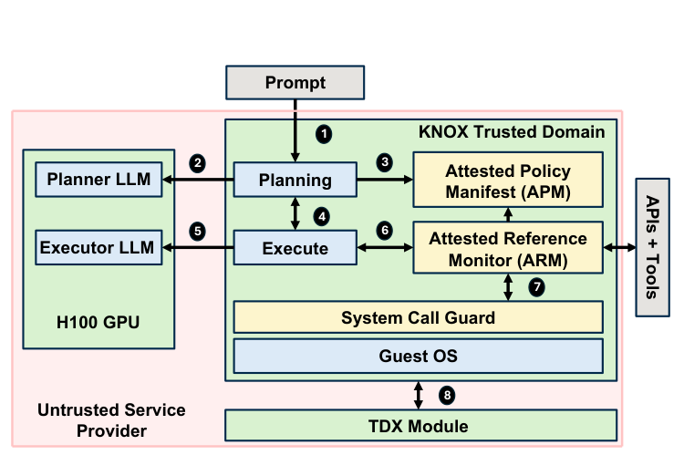View original image ↗</a>

*Planning creates the manifest; the reference monitor and syscall guard mediate execution. Attestation protects records while semantic regulation checks retain model error.*

In a 100-case syscall-deviation corpus, the monitor alone prevents 74%; adding the OS sandbox reaches 100%. The regulation guard, however, relies on an LLM judge: it blocks 81.8% of non-compliant flows with the Gemma-3-12B executor, so universal prevention is unsupported. The paper also acknowledges that hardware attestation does not directly bind each installed BPF/Landlock ruleset. Its useful distinction is between untampered execution evidence and correct policy interpretation, with separate trust assumptions for each.
