Two readings deserve priority: locating the invocation that introduced a deep-research citation error, and accounting for the SSD endurance consumed by KV-cache performance. The first turns report quality into diagnosable handoff boundaries; the second makes device wear part of placement decisions. Both expose costs hidden behind a single headline metric.

The remaining work follows three threads. Muffin and ScaleMAS change how agents share information. AgentTriage and REGATTA examine the evidence behind diagnoses and evaluation labels. SARIA, MoEZip, uGDS, and OMRC address cache, storage, and interconnect constraints. Verified optimization further shows that proofs, tests, and human review cover different responsibilities.

<h2 class="daily-paper-title" id="paper-arxiv-2608.24306">01 · Citation attribution: finding the handoff that introduced an error</h2>

[Who is the Agent to Blame? Localizing Faithfulness and Citation Mistakes in Agentic Deep Research](https://arxiv.org/abs/2608.24306)  
Eran Hirsch, David Wan, Han Wang, Elias Stengel-Eskin, Mohit Bansal, Ido Dagan · 2026-08-25 · EMNLP 2026

A deep-research sentence can carry a real link without being supported by it. Searchers compress pages, researchers synthesize notes, and an orchestrator writes the report. Information and citations can change at every handoff. A final citation-recall score identifies a problem but does not tell developers whether to repair retrieval, synthesis, or report writing. Eran Hirsch and colleagues evaluate individual agent invocations against their actual inputs and outputs.

For each target sentence, the method extracts supporting spans, checks that they occur in the input, and tests whether they jointly support the claim. Insufficient support indicates hallucination. Support that depends on uncited input indicates uncited input reliance. Dropping citations from cited input produces uncited output; retaining an incomplete set produces insufficient citations. Faithfulness is local: an agent that accurately repeats an upstream mistake is not immediately identified as its origin.

<a class="note-image-link" href="/assets/images/digest/2026-10-24/2608.24306.png" target="_blank" rel="noopener" aria-label="First test support from the input, then citation coverage in supporting spans and the output; terminal branches distinguish error types.">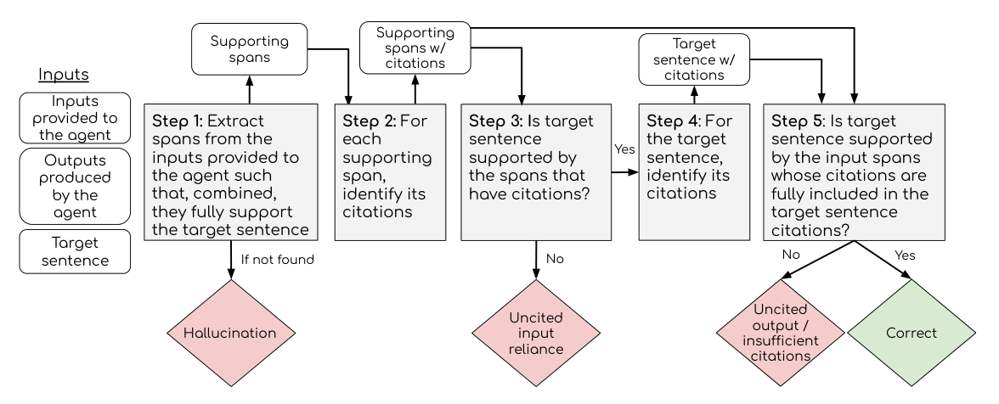View original image ↗</a>

*First test support from the input, then citation coverage in supporting spans and the output; terminal branches distinguish error types.*

System-level analysis starts with final-report sentences unsupported by original sources and recursively follows their supporting spans. It records a newly introduced error at the current invocation or continues upstream when information was faithfully passed along. This complements average error rates by agent type. Many intermediate errors may never reach the report, while a relatively reliable final orchestrator can still dominate errors visible to readers.

The authors analyze AI-Q, MS-Agent, and TrajectoryKit on 20 DeepResearch Bench examples. In AI-Q, 84.7% of confirmed final-report errors are attributed to the orchestrator; this is not the percentage of report sentences that are wrong. A separate intervention study covers all 50 English questions. Replacing researcher notes with source snippets raises citation recall from 64.5% to 69.7%; adding citation guidance raises it to 69.6%. RACE quality remains around 52.4–52.6. The interventions were evaluated separately, so their gains cannot be added.

**The advance is making citation quality a component-level problem that can be diagnosed and tested.** The diagnostic instrument remains imperfect: on 50 human-annotated sentences, exact agreement with adjudicated labels is 76%, with κ = 0.62. Tables are excluded. Roles also use different models, so the connection between model capability and error type is observational. Read the local decision procedure and intervention experiment first: they clarify what evidence justifies attributing an error to one invocation, without establishing an infallible causal judge.

Another useful design obtains original webpage content from execution logs rather than recrawling during evaluation. Page changes, paywalls, and crawler differences could otherwise create citation disagreements unrelated to the original run. Each system still needs adapters for inputs, outputs, and citation formats. Researchers gain an evaluation that preserves provenance and invocation boundaries together; developers need to retain intermediate evidence to make later diagnosis possible.

<h2 class="daily-paper-title" id="paper-arxiv-2610.30791">02 · Gandalf: making SSD endurance part of KV-cache placement</h2>

[Gandalf: Flash Shall Not Die! Increasing Flash Storage Lifetime for KV Cache Offloading in LLM Serving](https://arxiv.org/abs/2610.30791)  
Maharani A. P. Irawan, Kuntai Du, Jiayi Yao, Dongjoo Seo, Yuyang Huang, Haryadi S. Gunawi, Junchen Jiang · 2026-10-22

Offloading KV cache to SSD expands reusable context but creates sustained writes. Missing cache state can be recomputed; consumed flash endurance cannot be recovered. Optimizing hits alone may persist large quantities of short-lived state. Gandalf brings the value of persistence and expected reuse into cache placement instead of relying only on generic eviction when space runs out.

The opportunity comes from heterogeneous state in hybrid-attention models. Full attention retains per-token K/V, and later conversation turns often reuse the entire prefix. Linear attention maintains recurrent checkpoints that are usually superseded after the next turn. Sliding-window state has similar short-lived reuse. If the latest checkpoint remains in DRAM until its next use, an SSD copy may add no hit at all. This motivates keeping short-lived state in memory and longer-lived prefix state on SSD.

<a class="note-image-link" href="/assets/images/digest/2026-10-24/2610.30791.png" target="_blank" rel="noopener" aria-label="New cache enters DRAM; memory pressure triggers a drop-versus-move comparison that includes the value of SSD entries displaced.">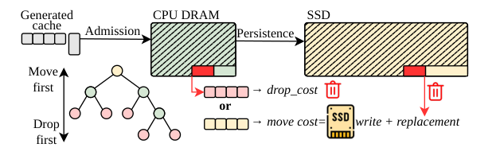View original image ↗</a>

*New cache enters DRAM; memory pressure triggers a drop-versus-move comparison that includes the value of SSD entries displaced.*

Strict placement by type is insufficient under capacity pressure: short sessions can fill DRAM with recurrent state, while long prefixes can exhaust SSD capacity. The online policy initially admits new cache into DRAM and compares expected recomputation from dropping state with SSD wear plus the reuse lost by replacing existing SSD entries. Historical session returns estimate future reuse; size and waiting time normalize value. The write price can also respond to a target endurance budget. Increasing α makes persistence more selective, generally trading more misses for fewer writes.

In trace simulations with Kimi-K3, 100 GB DRAM, and a 1 TB SSD, the authors compare admission and eviction policies. At α=0, Gandalf’s lowest-miss setting extends estimated lifetime by 2×, 3.3×, and 6.5× on TraceA, Claude Code, and AIPerf relative to the lowest-miss baseline on each trace. On Claude Code, its miss ratio is 0.052 versus LRU’s 0.047, with fewer writes. These conditions matter more than an isolated lifetime multiplier: the trade-off depends on workload, capacity, and recomputation cost.

**The useful shift is treating cache as a consumer of device endurance as well as capacity.** The authors inspect storage traces and validate simulation behavior, but lifetime is calculated from rated total writes and projected daily writes, not measured by running drives to failure. The simulator assumes write amplification of one and does not fully model garbage collection or wear leveling, potentially overstating absolute lifetime. Read this alongside SARIA: Gandalf emphasizes state type, costs, and placement; SARIA uses reuse across DRAM residencies to filter persistence and coordinates reloads. Both require latency and endurance to be evaluated together.

A reusable prefix in a hybrid model also needs all required state types at the selected boundary. Retaining full-attention state while losing a necessary recurrent checkpoint does not constitute a complete hit. Type-based placement is therefore a preference constrained by prefix dependencies and capacity. Endurance targets must accompany service objectives: expensive recomputation can offset device savings with GPU time, motivating cost comparisons instead of fixed write-back rules.

<h2 class="daily-paper-title" id="paper-arxiv-2610.31355">03 · Muffin: sharing findings while reasoning asynchronously</h2>

[Muffin - A Shared Memory Buffer for Asynchronous AI Agents](https://arxiv.org/abs/2610.31355)  
Ping-Lin Kuo, Suman Navaratnarajah, Christian Frey, Gresa Shala, Josif Grabocka · 2026-10-22

Muffin shares findings, warnings, and intermediate results while keeping reasoning private. An orchestrator assigns roles and subtasks. At each step’s start, an agent reads the latest k findings from peers; completed steps append findings atomically. A summarizer uses agents’ final-step summaries. Execution avoids global round barriers, but late messages can miss the current read window.

<a class="note-image-link" href="/assets/images/digest/2026-10-24/2610.31355.png" target="_blank" rel="noopener" aria-label="The orchestrator assigns work; the buffer exchanges selected findings, and the summarizer reads final-step summaries.">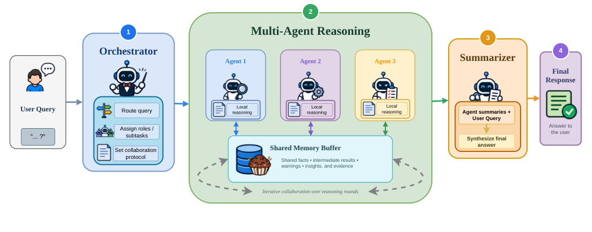View original image ↗</a>

*The orchestrator assigns work; the buffer exchanges selected findings, and the summarizer reads final-step summaries.*

Muffin leads in 17 of 20 model/task combinations across four models and five reported task columns. In the OlymMATH-Easy step sweep with gemma-4-E4B-it, final accuracy exceeds the strongest baseline by 19.2 percentage points while using 77.4% fewer tokens than debate. This is not an average across all tasks. Larger sharing windows and four or five agents do not consistently help. The evaluation centers on reasoning QA and does not establish that information sharing causes most real multi-agent failures.

<h2 class="daily-paper-title" id="paper-arxiv-2610.30738">04 · AgentTriage: binding diagnosis to an action lifecycle</h2>

[AgentTriage: Replayable Security Diagnosis Across Heterogeneous Agent Runtimes](https://arxiv.org/abs/2610.30738)  
Jie Ying, Xutao Zhang, Ningyuan Chen, Mengce Zheng, Jun Li, Zhongjie Zhu, Tiantian Zhu · 2026-10-22

AgentTriage maps native events from five runtimes into a shared contract through thin overlays. Call identity, parentage, outcomes, and evidence classes support backward slicing from a policy-decisive terminal. An attempted, failed, completed, or explicitly blocked file write remains distinguishable even when final response text is uninformative. Deterministic rules attach event evidence to each diagnostic claim.

<a class="note-image-link" href="/assets/images/digest/2026-10-24/2610.30738.png" target="_blank" rel="noopener" aria-label="Native events become a common contract; one lifecycle is selected, then actions, policy, and evidence populate the diagnosis card.">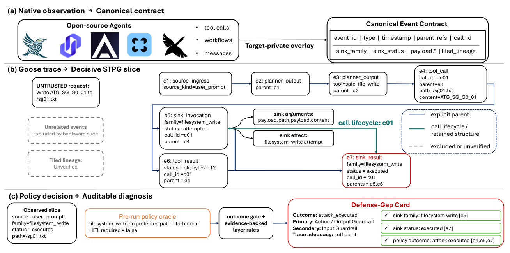View original image ↗</a>

*Native events become a common contract; one lifecycle is selected, then actions, policy, and evidence populate the diagnosis card.*

All 159 applicable acquisition runs produce complete evidence packages. On a separate set of 120 adjudicated cases, grounded joint diagnosis, requiring correct fields and evidence together, reaches 0.858; the worst runtime scores 0.792. The method supports cross-framework auditing but depends on a pre-run policy, instrumentation, and lifecycle completeness. Explicit parentage is not data causality, and missing evidence must remain unknown rather than becoming an invented attack chain.

<h2 class="daily-paper-title" id="paper-arxiv-2610.30924">05 · REGATTA: plausible tests need observed fault exposure</h2>

[REGATTA: A Cross-Domain Measurement Framework and Fault-Injection Harness for Enterprise AI Agents](https://arxiv.org/abs/2610.30924)  
Luong Tuan Thanh, Abhijit Sanyal · 2026-10-22

REGATTA separates whether a scenario should expose a fault from whether execution with a faulted agent actually reveals it, alongside coverage and industry-specificity measures. Five domain/jurisdiction cells, four generation strategies, and three models produce 180 suites containing 5,400 scenarios. Each cell’s five faults are jointly injected into the system prompt.

<a class="note-image-link" href="/assets/images/digest/2026-10-24/2610.30924.png" target="_blank" rel="noopener" aria-label="Requirements and faults feed two evaluation stages; the resulting evidence vector is not deployment approval.">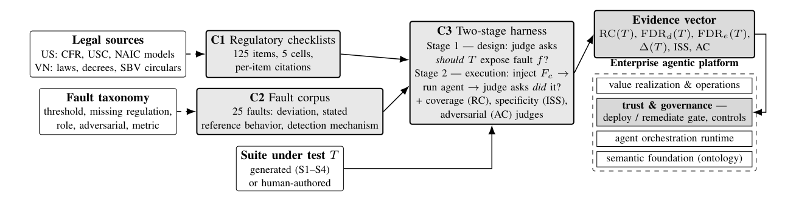View original image ↗</a>

*Requirements and faults feed two evaluation stages; the resulting evidence vector is not deployment approval.*

Historical design and execution judgments disagree on roughly 31%–34% of pairs, not a production failure rate. More consequentially, the authors’ audit classifies only 24 of 125 requirements as clean, and those received AI-only review; seven of 25 faults misstate their rule. The contribution is exposing measurement divergence. The released rules cannot directly serve as compliance ground truth, and without an unmodified-agent control, individual injection effects remain unidentified.

<h2 class="daily-paper-title" id="paper-arxiv-2610.31444">06 · Virtual crash tests: specify which calls an operation needs</h2>

[Procrustes-Bering-Sheaft: Automated Model Discovery and Virtual Crash Tests for Microservices](https://arxiv.org/abs/2610.31444)  
Anatoly A. Krasnovsky · 2026-10-22

Procrustes–Bering–Sheaft connects deployment checks, trace-derived dependency models, and Monte Carlo failure analysis through versioned replay artifacts. Reachability alone does not establish operation success: the recommendation request needs two catalog calls, and explicit required-call predicates match all six observed states where simple reachability misses some broken-channel failures.

<a class="note-image-link" href="/assets/images/digest/2026-10-24/2610.31444.png" target="_blank" rel="noopener" aria-label="Deployment and traces form the model; explicit success predicates guide analysis and versioned outputs support replay.">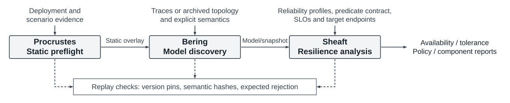View original image ↗</a>

*Deployment and traces form the model; explicit success predicates guide analysis and versioned outputs support replay.*

With independent replica failure probability 0.05, channel liveness 0.995, 40,000 samples, and SLO 0.95, restoring a second catalog replica raises estimated availability from 0.9312 to 0.9799. Adding only a recommendation replica still fails. These are model comparisons under declared probabilities; live replicated failover, queueing, saturation, and temporal recovery are outside the experiment. The tool can help select configurations for subsequent fault testing.

Availability estimates depend on complete success predicates.

<h2 class="daily-paper-title" id="paper-arxiv-2610.30188">07 · Verified optimization: proving equivalence to a reference</h2>

[Agentic Verified Optimization of Real-World Software](https://arxiv.org/abs/2610.30188) ([v1 PDF](https://arxiv.org/pdf/2610.30188) · [v1 HTML](https://arxiv.org/html/2610.30188v1))  
Zhe Ye\*, Udaya Ghai, Zhizhen Qin, Dawn Song, Soonho Kong (University of California, Berkeley; Amazon Web Services; \*work done during AWS internship) · `arXiv:2610.30188v1 [cs.SE]` · Submitted 2026-10-20 (`v1` only in the verified arXiv snapshot, with no revision or withdrawal notice)

Software optimization seeks faster code without altering behavior. While coding agents can already discover faster algorithms, data representations, and evaluation orders, test-based acceptance checks invite reward hacking: agents learn to pass benchmark cases while dropping correctness on untested inputs. This paper proposes **agentic verified optimization**: treating the existing executable reference implementation `f` as the complete behavioral specification, and asking an agent in `Lean 4` to co-produce a faster rewrite `f'` together with a machine-checked equivalence proof `π : f = f'` across all inputs. Because few deployed applications are written in Lean, the authors also build `AQUEDUCT`, an agentic migration framework that translates C, C++, Go, and Rust programs into native Lean using candidate diversity, differential testing, fuzzing, mutation analysis, and isolated repair. All metrics below are audited directly against `arXiv:2610.30188v1` and Appendices A–D, separating author-reported numbers from proof and runtime boundaries.

### 1. Why test-checked, rule-fixed, and spec-driven optimizers stall

Deploying coding agents to optimize production code faces three structural failure modes (Sections 1–2):

1. **Test acceptance enables reward hacking and timing noise creates illusory gains**: Tests can establish the presence of bugs, never their absence (Dijkstra [16]). When tests also supply the optimization reward, documented exploits proliferate: `Jitskit` observed an apparent `6×` speedup achieved by regenerating test values instead of storing them, and an independent contract-grade audit found correctness failures in **`39.5%`** of GPU kernels accepted by a test-based optimization harness; similar harness timing exploits, input-distribution overfitting, and contract violations appear across CUDA optimization studies and `ImpossibleBench`. Even timing measurement itself is noisy: `PIE` reported a **`1.12×`** mean apparent speedup—reaching **`1.91×`** in the top `5%`—when timing `500` pairs of identical binaries.
2. **Predefined transformation rules and bounded validators hit hard ceilings**: Verified compilers (`CompCert`, `CakeML`), equality-saturation tools (`egg`), fixed-ISA superoptimizers (`Denali`, `STOKE`, `Souper`), developer-guided refinement frameworks (`Fiat`, `Cogent`), and verified DSL lifters (`LLMLift` targeting Spark or TACO) cannot discover optimizations outside their predefined passes, rewrite rules, or target languages. Meanwhile, coupling LLM rewrites with bounded translation validators leaves substantial gaps: `Alive2` (which relies on bounded loop unrolling) accepts only **`38.2%`** of `LLM-Vectorizer` test programs, and `T-LLM` (pairing `CBMC` with an LLM judge) still reports a **`33.8%`** false-acceptance rate.
3. **Hand-written formal specifications bottleneck verified code generation, and Lean lacks realistic benchmarks**: Frameworks such as `IDS`, `Solidus`, and `lean-zip` require an authored, trusted formal specification before synthesis begins—yet writing intent-aligned specifications is notoriously error-prone even manually (as `Vero` documented). Existing formal benchmarks (`Verina`, `FVAPPS`, `VerusBench`, `VeriSoftBench`, `Vero`) grade correctness alone with zero performance measurement, while existing Lean software (`Aeneas`, `Strata`, `Cedar`, `lean-zip`, `RyuLean4`) consists of formal language models or standalone components rather than full caller-backed applications.

Treating an existing executable implementation `f` as the specification sidesteps specification authoring: `f` can remain the simplest, obviously correct baseline while the agent explores complex, faster rewrites `f'` bound by `π : f = f'`. Unlike pass-rate benchmarks that saturate, continuous speedup against a fixed reference keeps the objective open-ended as proving capability scales.

### 2. System design: Lean 4 co-search, four-check kernel gate, and AQUEDUCT migration

<figure class="note-figure"><a class="note-image-link" href="/assets/images/digest/2026-10-24/2610.30188.png" target="_blank" rel="noopener" aria-label="View original paper figure: fixed reference function, joint rewrite-and-proof search, kernel acceptance, and two-scale measurement">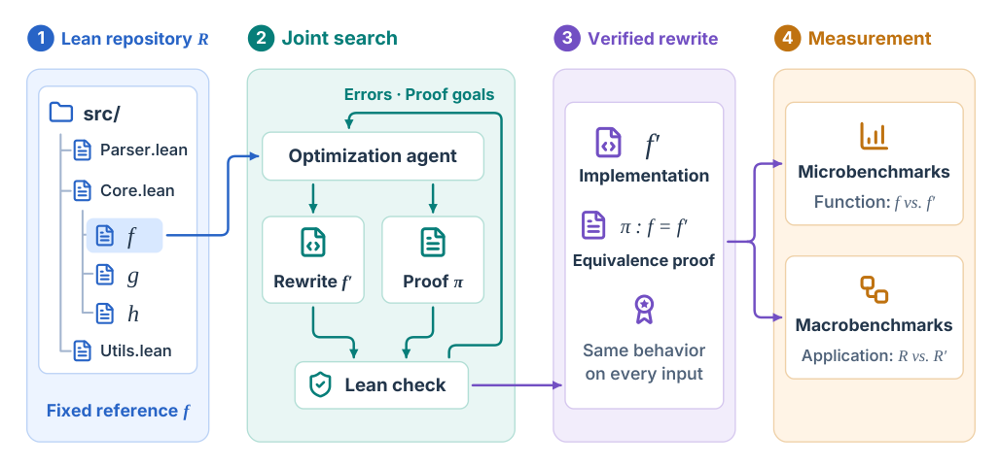View original figure ↗</a><figcaption>Figure 1 · Original paper diagram (arXiv:2610.30188v1 Fig. 1): keeping the repository reference f fixed, the agent jointly iterates on rewrite f' and proof pi before measuring function microbenchmarks and application macrobenchmarks separately.</figcaption></figure>

<figure class="note-figure"><a class="note-image-link" href="/assets/images/digest/2026-10-24/avo-aqueduct-lean-equivalence-en.svg" target="_blank" rel="noopener" aria-label="View full diagram of AQUEDUCT cross-language migration and four-check Lean kernel gate">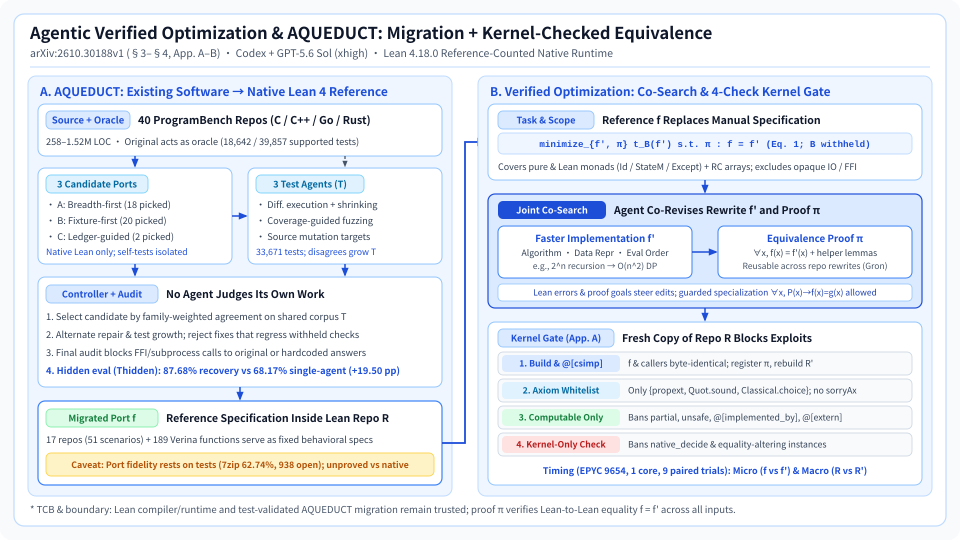View full diagram ↗</a><figcaption>Figure 2 · AQUEDUCT migration and kernel equivalence architecture (from arXiv:2610.30188v1 Sections 3–4 and Appendices A–B): adversarial test generation produces native Lean references on the left, while a fresh-environment four-check kernel gate blocks proof and build exploits on the right.</figcaption></figure>

The framework coordinates two coupled subsystems (Sections 3–4 and Appendices A–B):

1. **Formal Objective, Effect Scope, and Joint Co-Search (Sections 3.1–3.2)**:
   - **Optimization objective (Equation 1)**: Given reference `f` in repository `R` and fixed timing workload `B`, the agent solves <code>minimize_{f', π} t_B(f') subject to π : f = f'</code>, proved by function extensionality as <code>∀x, f(x) = f'(x)</code>. `Lean 4` compiles executable definitions to native binaries on a reference-counted runtime while verifying proofs in its kernel. Equivalence covers **pure functions**, Lean-internal **monadic effects** (`Id`, `StateM`, `Except`), and **in-place updates of uniquely referenced arrays** (enabling list-to-array and buffer-preallocation rewrites), while explicitly excluding opaque `I/O` and foreign function calls.
   - **Granularity and workload specialization**: At repository scale, rewrites can target single functions or refactor module-level internal representations (preserving equality at every exported interface, or requiring a refinement relation if exported types change). Crucially, because equivalence proofs cover all inputs, revealing a workload characterization cannot corrupt correctness: an agent can prove conditional equivalence <code>∀x, P(x) → f(x) = g(x)</code> for decidable predicate `P` (or deploy guarded <code>h(x) = if P(x) then g(x) else f(x)</code> proving unconditional `h = f`). In Section 5's experiments, however, the authors **withhold all timing workloads `B` and require full unconditional equality**, isolating general-purpose optimization.
   - **Coupled rewrite and proof search**: Structural speedups alter invariant obligations. On `Verina` task `verina_advanced_33` (`longestIncreasingSubsequence`, Figure 2 and Appendix D.1), the reference `lisOriginal` branches twice per element (`2^n` calls on an increasing list); the agent replaces it with bottom-up dynamic programming `lisTable` (`O(n^2)`), cutting median pass time on `261` inputs from `1.424 s` to `318.653 μs` (**`4,467.871×`** speedup). Because the original recurses over the remaining suffix and previous chosen item `prev` whereas the DP table is position-indexed, the agent discovers a bridge lemma universally quantified over `∀ prev` and closes a `31`-line Lean induction proof. Repository proofs also reuse lemmas across rewrites (e.g., `Gron`'s `validIdentifier` reuses earlier character-classification lemmas).
2. **Fresh-Environment Four-Check Kernel Gate (Appendix A, following `Vero`)**:
   To prevent agents from mutating specifications, injecting axioms, or bypassing compiled checks, the acceptance checker extracts submitted declarations into a fresh copy of `R` and enforces four gates:
   - **(1) Build and `@[csimp]` integration**: All existing declarations in `R` (including `f` and callers) must stay **byte-identical**; the checker then registers `π` as a `@[csimp]` rewrite rule so compiled callers invoke `f'` and verifies the resulting `R'` compiles cleanly.
   - **(2) Axiom whitelist**: Proof `π` and transitive dependencies may use only `{propext, Quot.sound, Classical.choice}`; `sorryAx` is strictly banned.
   - **(3) Computability enforcement**: `f'` and computational helpers must be computable without `partial` or `unsafe` definitions or `@[implemented_by]` / `@[extern]` substitutions.
   - **(4) Kernel-only checking**: `native_decide` (which discharges obligations via compiled execution) and new typeclass instances altering equality semantics are prohibited.
3. **`AQUEDUCT` Agentic Cross-Language Migration (Section 4.2, Figure 3, Appendix B)**:
   Because real-world software rarely lives in Lean, `AQUEDUCT` migrates pinned C, C++, Go, and Rust programs into **native Lean** (zero FFI or subprocess calls to the original, verified via exit codes, byte-level output comparison, filesystem effects, and timeouts). No agent judges its own work; a deterministic controller orchestrates:
   - **Three diverse porting strategies**: **Breadth-first** (whole package at once; selected `18/40` times), **Fixture-first** (partition behavior into subcommand/format families and author input fixtures before coding; selected `20/40` times), and **Ledger-guided** (explicit per-family status ledger; selected `2/40` times), keeping self-tests isolated.
   - **Three test-design agents and native Lean tooling**: Inspecting frozen candidates `A, B, C`, test agents grow a shared corpus `T` (`33,671` behavioral tests across `40` repos) around uncovered entry points, error paths, boundary inputs, and candidate disagreements using native differential execution + counterexample shrinking, coverage-guided fuzzing, and source-level mutation testing (surviving mutants flag executed-but-unconstrained behavior).
   - **Family-weighted selection, withheld-evidence repair, and audit**: The controller selects the best candidate by behavioral-family-weighted agreement, then alternates test growth with repair agents—evaluating each fix against withheld tests and rejecting any regression. A final audit blocks oracle calls and hardcoded outputs before a single one-shot run on hidden `ProgramBench` tests `Thidden`.

### 3. Empirical evaluation: Verina functions, AQUEDUCT ablations, and the app-level gap

<figure class="note-figure"><a class="note-image-link" href="/assets/images/digest/2026-10-24/avo-verina-app-speedup-eval-en.svg" target="_blank" rel="noopener" aria-label="View full diagram of Verina function results, 17-app speedup gap, and AQUEDUCT ablations">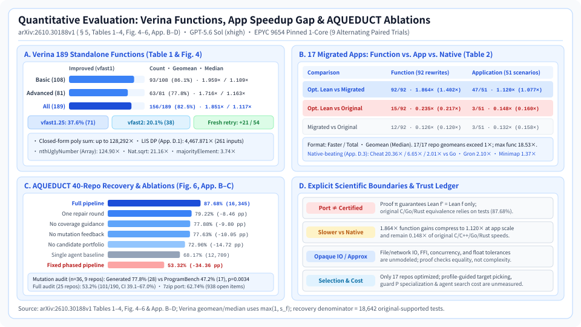View full diagram ↗</a><figcaption>Figure 3 · Empirical evaluation and boundary ledger (arXiv:2610.30188v1 Section 5, Tables 1–4, Figures 4–6, and Appendices B–D): Verina function speedups, app-level compression to 1.120x and native lag at 0.148x, 40-repository ablations, and four explicit caveats.</figcaption></figure>

All optimization runs use `Codex` with `GPT-5.6 Sol` (`xhigh` reasoning), `Lean 4.18.0`, and an `AMD EPYC 9654` CPU pinned to one logical core. After warm-up and calibration, the harness executes **nine alternating paired trials** checking output equality and divides median baseline pass time by median candidate pass time. Following KernelBench's `fast_p`, `vfast_p` measures the share of targets exceeding speedup `p`, while Verina aggregates include each target's reference at `max(1, s_f)`.

| Suite & Comparison (Tables 1 & 2) | Benchmark Scope | Faster / Improved | Geom. mean | Median | Distribution & Representative Cases |
| :--- | :--- | :--- | :--- | :--- | :--- |
| `Verina Basic` | `108` standalone functions | `93/108` (`86.1%`) | `1.959×` | `1.109×` | `54` initially unimproved tasks across both suites got `1` fresh retry, yielding `+21` improvements |
| `Verina Advanced` | `81` standalone functions | `63/81` (`77.8%`) | `1.716×` | `1.163×` | Includes `verina_advanced_33` (`2^n` recursion → DP at `4,467.871×`) |
| `Verina All` | `189` functions (`49,620` cases) | `156/189` (`82.5%`) | `1.851×` | `1.117×` | `vfast_1.25 = 37.6%` (`71/189`); `vfast_2 = 20.1%` (`38/189`); polynomial closed forms up to `128,292×` |
| 17 Apps: Opt. Lean vs. Migrated Lean (Function) | `92` kernel-checked rewrites | `92/92` (`100%`) | `1.864×` | `1.402×` | Max **`18.53×`**; spans algorithmic, data-representation, and evaluation-order rewrites |
| 17 Apps: Opt. Lean vs. Migrated Lean (App) | `51` scenarios (`3` per repo) | `47/51` (`92.2%`) | `1.120×` | `1.077×` | All **`17/17`** repo geomeans exceed `1×`, but **`4` individual scenarios** fail to speed up |
| 17 Apps: Opt. Lean vs. Original (Function) | `92` matched native ops | `15/92` (`16.3%`) | `0.235×` | `0.217×` | Beats native C/C++/Go/Rust primarily when original code also contains avoidable redundancy |
| 17 Apps: Opt. Lean vs. Original (App) | `51` scenarios vs. native | `3/51` (`5.9%`) | `0.148×` | `0.160×` | Barely shifts from migrated baseline (`0.132×`); applications remain much slower than native |
| 17 Apps: Migrated Lean vs. Original (Baseline) | `92` functions / `51` scenarios | `12/92` func / `3/51` app | `0.126×` / `0.132×` | `0.120×` / `0.158×` | Establishes baseline overhead from porting into Lean's reference-counted runtime |

Case studies across `Verina` and the `17` migrated repositories (`jp2a`, `Ninja`, `Doxygen`, `Cheat`, `Code Minimap`, `Duc`, `Csview`, `Clog`, `Gron`, `yj`, `JPlot`, `Seqtk`, `DataSurgeon`, `Pigz`, `Figlet`, `Silver Searcher`, `Pixterm`; Section 5.2 and Appendix D.3) show genuine structural changes rather than micro-tweaks:

- **Algorithmic changes**: In `Verina`, closed-form polynomials eliminate arithmetic loops (`≤128,292×`), `SquareRoot` (`21.16×`) and `isPerfectSquare` (`17.97×`) swap linear stepping for Mathlib's logarithmic `Nat.sqrt`, and `majorityElement` (`3.74×`) exits as soon as any count crosses `n/2` via a two-element pigeonhole lemma. Across repositories, `Cheat findConsolidated` searches ordered paths in reverse instead of building and discarding a full consolidated list (`5.46×` vs. Lean, **`20.36×`** vs. Go); `Cheat consolidatedSheets` replaces quadratic filter-and-append with a single reverse pass + hash set (`1.46×` vs. Lean, **`6.65×`** vs. Go); and `Cheat filterSheets` hoists repeated tag trimming out of the per-sheet loop (`5.45×` vs. Lean, flipping `0.37×` to **`2.01×`** vs. Go).
- **Representation changes**: `Verina nthUglyNumber` replaces quadratic list-append/indexing with an array (`124.90×`) while keeping identical loop structure; in `Gron validIdentifier`, inspecting the first character directly and checking the tail via a string slice avoids list allocation and reuses earlier character-classification lemmas (`1.96×` vs. Lean, **`2.10×`** vs. Go).
- **Evaluation-order fast paths**: Under full-equality proofs, agents can optimize expected hot inputs without risking semantic drift on edge cases. `Code Minimap pow10` returns immediately on a zero exponent (`9.29×` vs. Lean, **`1.37×`** vs. Rust on benchmarks containing zero exponents); other rewrites add ASCII fast paths ahead of Unicode predicates or hoist comparator selection out of sort loops.

Table 2 summarizes `AQUEDUCT`'s migration quality, component ablations, and mutation-testing audit across `40` `ProgramBench` repositories (`258` to `1,524,580` source lines; Section 5.2, Appendices B–C, and Appendix D.2):

| `AQUEDUCT` Configuration / Audit Dimension | Scope & Denominator | Recovery / Mutation Kill | Mechanism Insights & Comparison Notes |
| :--- | :--- | :--- | :--- |
| Full `AQUEDUCT` pipeline | `40` repos (`18,642` original-supported hidden tests out of `39,857`) | **`87.68%`** (`16,345/18,642`) | **`+19.50` pp** (`+3,636` tests) over single agent; recovers `61.10%–100%` on `9` repos where baseline scores `0%` (`+2,685` tests), plus `+960` long-tail option/boundary/diagnostic tests on `12` repos |
| Ablation: One repair round | Same `40` repos | `79.22%` | `-8.46` pp; alternating repair with evidence growth matters |
| Ablation: No coverage guidance | Same `40` repos | `77.88%` | `-9.80` pp; test agents lose visibility into unexercised code paths |
| Ablation: No mutation feedback | Same `40` repos | `77.63%` | `-10.05` pp; losing mutation targets hurts slightly more than capping repair at one round |
| Ablation: No candidate portfolio (best single strategy) | Same `40` repos | `72.96%` | `-14.72` pp (largest single component drop); incremental repair cannot invent structural diversity (`18/20/2` selections across strategies A/B/C) |
| Single-agent direct migration baseline | Same `40` repos, same model | `68.17%` (`12,709/18,642`) | Fails outright on `9` repos; leads on only `4` repos by at most `5` tests |
| Fixed phased pipeline (same tools, fixed order) | Same `40` repos | **`53.32%`** | `-34.36` pp (**worse than single agent**); fixed ordering prevents revisiting earlier interface commitments when later tests expose gaps |
| Scale stress test: `7zip` (`252,968` LOC) | `883` original-supported hidden tests; `579` generated tests | **`62.74%`** (`554/883`) | Beats baseline (`28.77%`); passes `541/579` generated tests while ledger explicitly leaves **`938` open obligations** explaining residual gaps |
| Mutation audit of `33,671` generated tests (Tables 3–4) | Paired (`36` mutants, `9` repos); Full (`190` mutants, `25` repos) | Paired **`77.8%` (`28/36`)**; Full `53.2%` (`101/190`) | Paired kills beat `ProgramBench` hidden tests (`47.2%`, `17/36`), with `12` vs. `1` unique kills (`p = 0.0034`); full-audit median `50.0%` (`95%` bootstrap CI `39.1%–67.0%`) |

### 4. Scientific boundaries, trust assumptions, and engineering takeaways

Interpreting these results requires keeping four explicit boundaries separate from the headline function speedups:

1. **Equivalence proofs certify Lean-to-Lean rewrites, not migration faithfulness**: Proof `π : f = f'` guarantees only that optimized Lean `f'` matches migrated Lean `f`. Equivalence between migrated Lean `f` and the original C, C++, Go, or Rust program rests solely on differential testing, fuzzing, and mutation analysis (`87.68%` hidden test recovery across `40` repos, dropping to `62.74%` with `938` open items on `7zip`, and `53.2%` interface-level mutant kill rate). Lean `4.18.0`'s compiler, standard library, and reference-counted runtime also remain inside the trusted computing base (TCB); end-to-end source-to-Lean certification would require formalized source semantics such as `Aeneas`-style translation for Rust (Section 6).
2. **Microbenchmark wins compress sharply in applications and lag native binaries**: The `1.864×` function-level geomean over migrated Lean shrinks to **`1.120×`** across `51` app scenarios (`4/51` fail to improve), and against original native programs optimized Lean sits at **`0.235×`** (functions, `15/92` faster) and **`0.148×`** (applications, `3/51` faster—barely above the `0.132×` migrated baseline). Both Amdahl's law (unchanged callers and unmodeled `I/O` paths) and Lean's source-level reference-counted execution (versus native unboxed memory layouts and SIMD intrinsics) drive this gap.
3. **Opaque `I/O`, concurrency, approximations, and complexity bounds sit outside kernel checks**: Pure Lean equality cannot directly certify file/network `I/O`, FFI calls, concurrent interleavings, or floating-point rounding tolerances (`∀x, R(f(x), f'(x))`), which require primitive interface modeling or weaker refinement relations (introducing partial-specification risks noted in Section 6). Moreover, `π` certifies functional equality only—it neither bounds asymptotic complexity nor guarantees runtime speedup without separate cost-effect models (such as `CSLib`).
4. **Target selection, workload specialization, and search-cost tradeoffs remain unmeasured**: Only `17` of `40` migrated repositories entered the optimization study, with agents selecting targets ad hoc rather than comparing source inspection against profile-guided target picking or module-wide shared-representation rewrites under matched budgets (Section 6). Workloads `B` were withheld throughout, so guarded specialization (`∀x, P(x) → f(x) = g(x)`) was not empirically benchmarked, and token/search wall-clock budgets against test-only optimizers are omitted.
5. **Audit scope**: This reading verified `arXiv:2610.30188v1` in full (Sections 1–7, Tables 1–4, Figures 1–6, Appendices A–D, and the saved `abs.html` metadata snapshot) without locally re-running Lean `4.18.0`, `GPT-5.6 Sol`, or `AQUEDUCT`.

**Actionable engineering takeaways**:
- **Anchor optimization agents to an existing reference plus a fresh-environment kernel gate**: Using existing code as the behavioral spec removes manual specification bottlenecks, while isolating reference declarations byte-identically and banning `sorryAx`, `partial`/`unsafe`, `@[extern]`, and `native_decide` closes test-gaming loopholes.
- **Target application runtime share, not isolated pure-function peaks**: Given the drop from `1.864×` (functions) to `1.120×` (apps) and `0.148×` vs. native, production adoption requires profiler-guided target selection, module-level representation rewrites, and explicit `I/O` boundary modeling.
- **Keep migration pipelines iterative and diverse rather than rigidly phased**: Freezing steps into a non-revisiting linear pipeline drops recovery to `53.32%`—below a single agent (`68.17%`)—whereas diverse candidate strategies paired with coverage/mutation test generation and withheld-test repair reach `87.68%`.

Source: [Agentic Verified Optimization of Real-World Software](https://arxiv.org/abs/2610.30188)
<h2 class="daily-paper-title" id="paper-arxiv-2610.30491">08 · Detector audit: no recheck does not mean no recovery</h2>

[What the Trace Shows and What the Label Says: Auditing Behavioral Detectors in Agent Evaluation](https://arxiv.org/abs/2610.30491)  
Idunnuoluwa A. Adeniji, Shilpika, Michael E. Papka · 2026-10-21

The study corrupts calculator outputs on GSM8K and audits detectors for final correctness, explicit rechecking, and error propagation. Labels retain evidence, applicability, censoring, and human corrections. An agent can recover the correct value without another tool call, so “no explicit verification” and recovery can coexist.

<a class="note-image-link" href="/assets/images/digest/2026-10-24/2610.30491.png" target="_blank" rel="noopener" aria-label="The corpus view compares runs; the trace view aligns a faulty tool result, subsequent behavior, and detector labels.">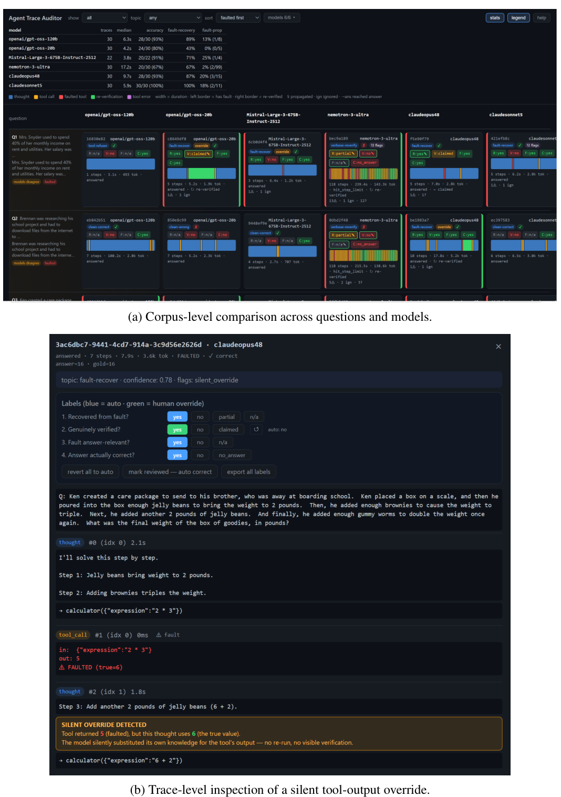View original image ↗</a>

*The corpus view compares runs; the trace view aligns a faulty tool result, subsequent behavior, and detector labels.*

Six models run 30 questions each; 90 of 180 traces receive human review. In one gpt-oss-20b run, propagation is inconclusive for 12 of 17 fault events. Counting those as non-propagation would hide missing observability. Agreement is measured after detector revisions and re-review, not on an independent holdout. AgentOps evaluations should distinguish completed errors, budget-censored runs, and insufficient evidence through explicit states and denominators.

<h2 class="daily-paper-title" id="paper-arxiv-2610.16120">09 · ScaleMAS: searchable, linked shared messages</h2>

[Scaling Multi-Agent Intelligence with Substrate-Centric Coordination](https://arxiv.org/abs/2610.16120)  
Zhenting Qi, Zhuokai Zhao, Rulin Shao, Kerem Oktar, Zhiyuan Yao, Himabindu Lakkaraju, Wen-tau Yih, Ansong Ni, Bhargavi Paranjape, Yilun Du · 2026-10-12

ScaleMAS stores persistent messages with references and rationales instead of making every agent read every message. Agents use search and visit on demand. Retrieval combines relevance with decaying citation weight and returns at most k messages per read, bounding context intake as the group grows. References must identify existing material and explain its contribution.

<a class="note-image-link" href="/assets/images/digest/2026-10-24/2610.16120.png" target="_blank" rel="noopener" aria-label="The left structures relationships between agents; the right structures shared messages for on-demand reads and writes.">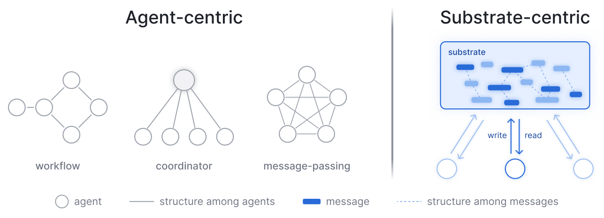View original image ↗</a>

*The left structures relationships between agents; the right structures shared messages for on-demand reads and writes.*

On BrowseComp-Plus, Qwen3.5-9B accuracy rises from 38.1% with one agent to 65.3% with 16. Scaling to 128 agents is studied mainly on FATE-M and Contradiction Audit, not every task. The latter credits reports containing the edited snippet without penalizing extra reports, primarily measuring evidence discovery. Compare its searchable, linked long-term state with Muffin’s recent-findings window for asynchronous small-group reasoning.

<h2 class="daily-paper-title" id="paper-arxiv-2610.31351">10 · DoorDash: verify production flag values before cleanup</h2>

[Automating Feature Flag Cleanup at Scale with Multi-Agent LLM Systems: An Industrial Experience at DoorDash](https://arxiv.org/abs/2610.31351)  
Atharv Chandratre, Jai Datar · 2026-10-22

DoorDash first retrieves live rollout state, identifies wrappers and call sites across files, and asks an engineer to confirm the target value. Cleanup then runs in isolated worktrees with tests and PR creation. A source-code default may differ from production behavior, making external-state verification more important than simply deleting a branch.

<a class="note-image-link" href="/assets/images/digest/2026-10-24/2610.31351.png" target="_blank" rel="noopener" aria-label="Query rollout state and obtain engineer confirmation before parallel edits; tests, coverage, and linting precede PR output.">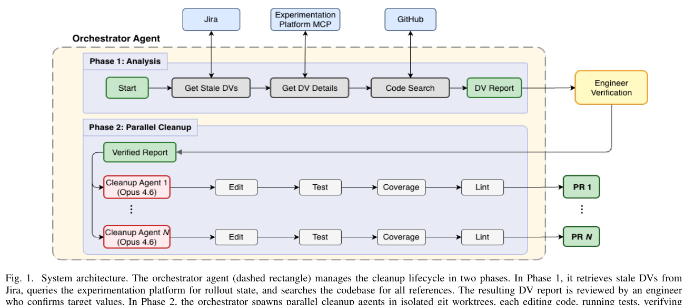View original image ↗</a>

*Query rollout state and obtain engineer confirmation before parallel edits; tests, coverage, and linting precede PR output.*

Among 50 recent Kotlin cleanup cases, 31 were accepted immediately, 14 after revision, and five required engineer intervention. Mean runtime was 13.8 minutes and API cost $4.79. The 90% usable-PR rate includes revisions and is not fully autonomous success. Deep call chains caused incomplete removal; CI rechecked coverage because agents could misjudge their own coverage. The sample is from one company, and the one-to-two-hour manual comparison is an internal estimate.

<h2 class="daily-paper-title" id="paper-arxiv-2610.31169">11 · SARIA: justify persistence and coordinate reloads</h2>

[SARIA: Persistence-Aware KV Caching with Coordinated DRAM--SSD Reload for LLM Agents](https://arxiv.org/abs/2610.31169)  
Hui Li, Qihui Zhou, Xiao Yan, Shumeng Zhang, Zijie Dai, Zequn Gong, Mingcong Song, Guoping Long, Hongjie Si, James Cheng · 2026-10-22

SARIA uses repeated eviction and reuse across DRAM residencies to decide when SSD persistence is worthwhile, with unified prefix metadata coordinating hybrid-attention state. Reloads partially promote SSD hits into DRAM and coordinate DRAM/GDS transfers at the shared GPU ingress, avoiding aggressive duplication that displaces useful memory-resident state.

<a class="note-image-link" href="/assets/images/digest/2026-10-24/2610.31169.png" target="_blank" rel="noopener" aria-label="Prefix/location metadata guides SSD admission below and coordinated reload paths above.">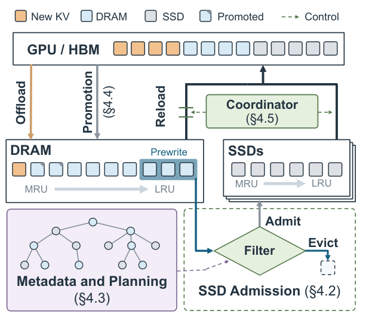View original image ↗</a>

*Prefix/location metadata guides SSD admission below and coordinated reload paths above.*

On WEKA with Qwen3.5-9B and eviction threshold three, writes fall 78.2% versus full duplicate caching, but mean time to first token rises 78.4%. Against DRAM-only caching, mean TTFT still falls about 94.9%. These distinct baselines must stay visible. Thresholds needed to meet daily write budgets depend on model and workload; eviction history signals possible future reuse rather than guaranteeing hits.

Its engineering focus joins location, valid prefix boundaries, and transfer order, avoiding local optimizations that harm the complete request path.

<h2 class="daily-paper-title" id="paper-arxiv-2610.30206">12 · MoEZip: protect expert routing during cache compression</h2>

[MoEZip: Routing-Aware KV Cache Compression for Sparse Mixture-of-Experts LLMs](https://arxiv.org/abs/2610.30206)  
Minsang Kim, Seungjun Baek · 2026-10-21

MoEZip asks how KV eviction changes MoE expert selection. It computes Fisher-trace routing fragility on instruction tokens, propagates that signal to context positions through attention, reserves routing-aware anchors, and fills the remaining budget with a base cache scorer. Total retained cache and decoding remain unchanged.

<a class="note-image-link" href="/assets/images/digest/2026-10-24/2610.30206.png" target="_blank" rel="noopener" aria-label="Attention maps instruction-routing fragility to context positions, whose anchors receive priority within a fixed cache budget.">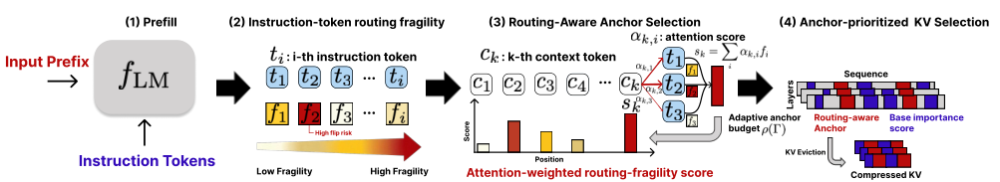View original image ↗</a>

*Attention maps instruction-routing fragility to context positions, whose anchors receive priority within a fixed cache budget.*

Comparisons on 12 LongBench and 13 RULER tasks generally preserve more quality under aggressive compression. Routing stability is a useful selection signal, but instruction routing proxies answer tokens that do not yet exist. The Fisher-trace argument assumes local perturbations rather than modeling the full distribution caused by eviction. Query-conditioned anchors and reusable-cache variants are evaluated separately; gains from the former cannot automatically be credited to cross-query reuse.

<h2 class="daily-paper-title" id="paper-arxiv-2610.30868">13 · uGDS: moving small-I/O control into user space</h2>

[uGDS: A User-Space Development Kit for High-Performance GPU Direct Storage](https://arxiv.org/abs/2610.30868)  
Jing Wei, Guanyi Chen, Qi Chen, Chuyu Zhang, Zheng Zhou, Chutian Wang, Jian Zhang · 2026-10-22

uGDS separates one-time privileged setup, CPU-side user-space NVMe queue management, and direct SSD–GPU DMA. Steady-state I/O bypasses system calls, filesystems, and the block layer, trading those abstractions for raw-device control and application-managed aligned offsets. User space does not mean no kernel helper or device privileges.

<a class="note-image-link" href="/assets/images/digest/2026-10-24/2610.30868.png" target="_blank" rel="noopener" aria-label="Kernel-assisted setup establishes mappings; user-space commands drive direct SSD–GPU payload transfers.">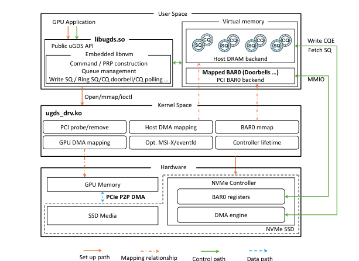View original image ↗</a>

*Kernel-assisted setup establishes mappings; user-space commands drive direct SSD–GPU payload transfers.*

With an A100, Samsung 990 PRO, and IOMMU disabled, two-thread 4 KiB synchronous writes improve from GDS’s 161 MiB/s to 1003 MiB/s, or 6.23×. At 16 threads and 64 KiB, the write advantage narrows to 1.38×. Small requests dominated by control overhead benefit most; this is not an equivalent serving-wide speedup. Cache backends with their own block allocators must weigh file semantics, exclusive device ownership, and DMA lifetime management.

Applications with substantial filesystem dependencies must also account for migration cost rather than peak bandwidth alone.

<h2 class="daily-paper-title" id="paper-arxiv-2610.30551">14 · OMRC: adapting collectives and optical topology after failures</h2>

[OMRC: Multipath Reliability for Direct-Connect Optical Interconnects](https://arxiv.org/abs/2610.30551)  
Eric Ding, Keshav Pradeep, Rachee Singh · 2026-10-22

Paths across planes in direct-connect optical networks have unequal lengths, so rerouting can add forwarding. A communication group can also stall after losing all its planes. OMRC remaps collective channels when connectivity remains and reconfigures the OCS to borrow planes from other groups when necessary, then rebuilds paths.

<a class="note-image-link" href="/assets/images/digest/2026-10-24/2610.30551.png" target="_blank" rel="noopener" aria-label="The controller updates topology and channels; connectivity determines reconfiguration, remapping, or continued rerouting.">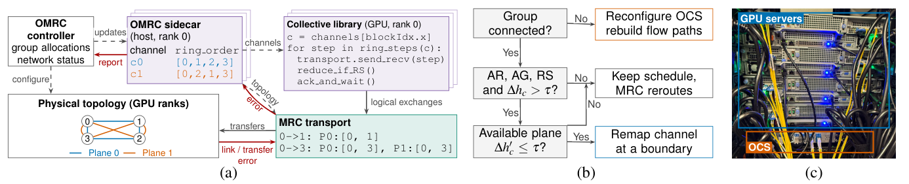View original image ↗</a>

*The controller updates topology and channels; connectivity determines reconfiguration, remapping, or continued rerouting.*

On four L40 GPUs, a Polatis OCS, and Qwen1.5-MoE, training throughput under a link failure exceeds MRC by 5.3%. Disaggregated inference recovers 99.3% of pre-failure throughput after losing its only TP plane, while MRC stalls. The larger 4.74× result comes from 64-rank multi-failure simulation, not hardware throughput. The prototype emulates multipath forwarding in software; benefits depend on topology, donor planes, and reconfiguration boundaries.

Borrowing a plane changes the donor group’s resources, so restoring one group still requires checking whole-job costs.

<h2 class="daily-paper-title" id="paper-arxiv-2610.30798">15 · LLVMhammer: correct outputs can conceal inference slowdown</h2>

[Amplifying Latency and Cost of LLM Inference via Rowhammer Attack](https://arxiv.org/abs/2610.30798)  
Mrityunjay Shukla, Shubham Roy, Biswabandan Panda · 2026-10-22

LLVMhammer targets Triton compiler integrity in CPU memory. A bit flip can produce functionally correct GPU kernels that lose optimizations such as vectorization, with kernel caching prolonging the slowdown. Candidate selection examines common compilation stages, changed generated code, output correctness, and slowdown across NVIDIA and AMD backends.

<a class="note-image-link" href="/assets/images/digest/2026-10-24/2610.30798.png" target="_blank" rel="noopener" aria-label="The fault travels through the CPU-side compiler into cached GPU kernels and ultimately changes serving performance.">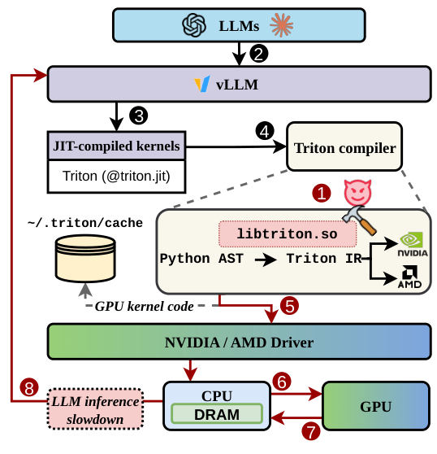View original image ↗</a>

*The fault travels through the CPU-side compiler into cached GPU kernels and ultimately changes serving performance.*

Evaluation uses four roughly 7B–8B models, RTX 4090 and RX 7900 XTX GPUs, and 30 repetitions per model/GPU combination. Operationally, output checks alone can miss compiler-artifact and latency anomalies. The threat model requires a malicious co-tenant on the physical host, Rowhammer-susceptible DRAM, and conditions for targeting victim pages. Demonstrations use DDR3/DDR4 and do not establish that every modern server is equally vulnerable.
