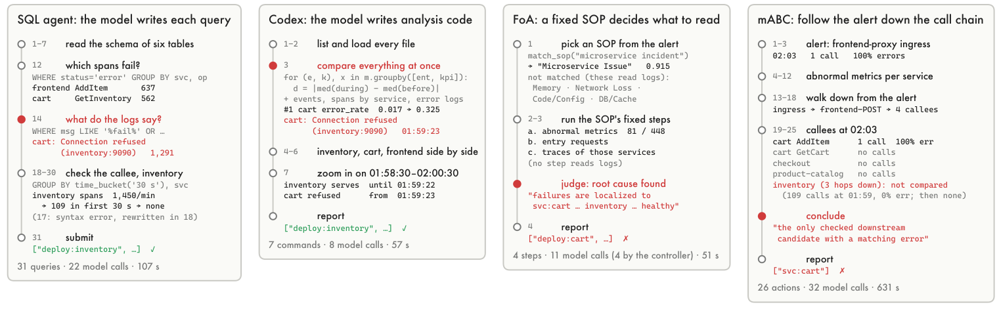
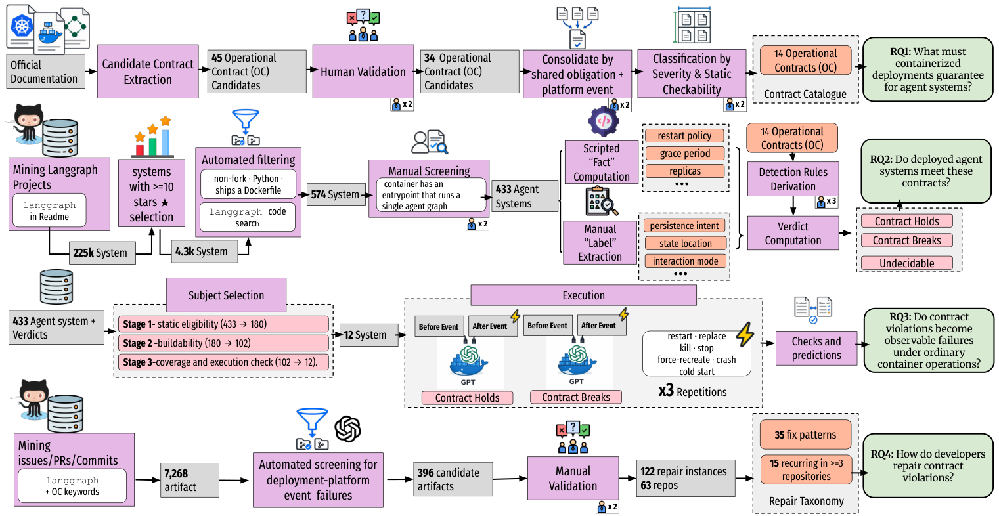
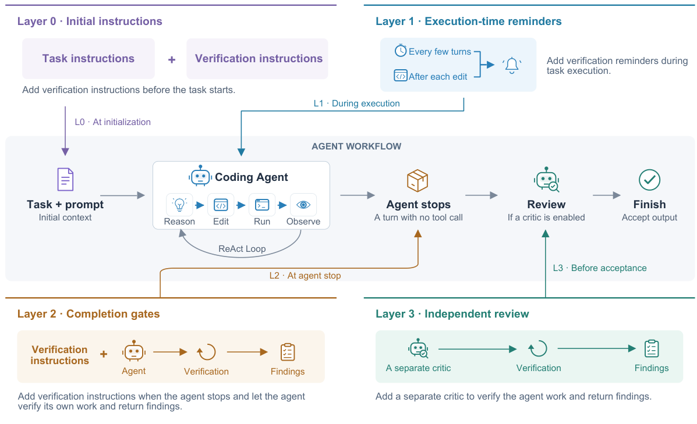
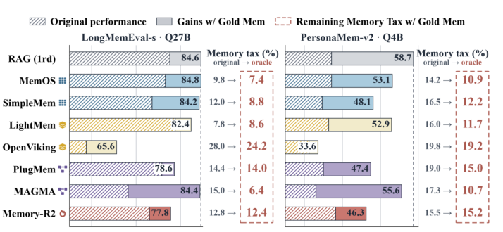
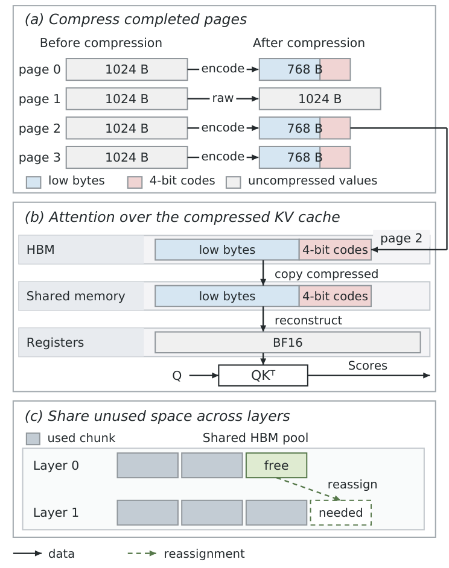

## In this issue

This issue focuses on failures hidden by apparently successful agent execution. A fixed RCA workflow may skip decisive evidence. State may survive a container restart while unfinished work never resumes. Prompt caching may silently fail while answers remain correct. Three studies examine those boundaries through shared evaluation, platform events, and real fixes.

Other readings separate the value of independent reviewers, constructed memory, and retrospectively generated rules from their implementation alone. On the serving side, ZipFusion fuses lossless KV reconstruction into attention, while InferScale exposes trade-offs among prediction, cold starts, and resource use. Across these results, distinguish aggregate accuracy, local improvements, and complete system behavior.

<h2 class="daily-paper-title" id="paper-arxiv-2610.35767">01 · RCA: letting the model choose its investigation</h2>

[Free to Look, Free to Reason: Simple LLM Harnesses Outdiagnose Hand-Crafted Root Cause Analysis Agents](https://arxiv.org/abs/2610.35767)  
Bi, Tingzhu, Zhang, Xun, Li, Jinglin, Wang, Ping, Ma, Meng · 2026-10-26

Microservice RCA agents often encode expertise as fixed procedures, stages, or roles. This study asks whether those prescriptions still help a capable model that can investigate telemetry directly. Its useful contribution is a shared comparison of three simple harnesses, five published LLM RCA methods, and statistical or causal approaches.

### Compare control over the investigation

RCAtlas harmonizes eight public data sources and selects 90 validated cases across 23 scenarios. Methods receive incident and reference windows, an entity inventory, and available telemetry. Entity-level scoring maps fine-grained answers to the dataset’s annotation level.

The simple alternatives differ: one-shot receives a rule-selected evidence package; a SQL agent chooses queries; Codex writes analysis code. Only the latter two dynamically control evidence collection. None imposes a domain-specific sequence of model calls.

<a class="note-image-link" href="/assets/images/digest/2026-10-28/rca-investigations.png" target="_blank" rel="noopener" aria-label="Four RCA investigations and the evidence they inspect · View original image ↗">View original image ↗</a>

*The two flexible approaches inspect logs and downstream traffic; fixed workflows stop at a symptomatic service. Red dots mark decisive steps.*

The illustrated failure makes the distinction concrete. Cart emits errors because inventory stops receiving requests. Flexible investigation follows connection-refusal logs and collapsing downstream traffic; a fixed procedure omits logs, while a call-chain walk misses the service receiving no calls. This is a mechanism to examine when evaluating an RCA workflow: does its control flow make decisive evidence unreachable?

### Interpret the comparison carefully

The main table reports PR@1 of 65.3–77.2% for simple harnesses, 15.6–53.3% for published LLM methods, and 38.9% for the strongest non-LLM baseline, NSigma. These summarize the table’s mid-tier model settings; some method–model combinations were not run. They are not results from a fully populated matrix. Simple harnesses also lead on models where both families were evaluated.

Repeated runs separate two useful properties. Stronger models mainly improve consistency; multi-turn harnesses mainly increase the set of cases solved at least once. Higher reasoning effort can add substantial time for relatively small accuracy changes. For incident response, that distinction matters: an occasional correct investigation is different from a dependable diagnosis.

**Read the shared evaluation and investigation traces first.** Some baselines were adapted or reimplemented, only one general coding harness was tested, and the case study does not isolate causality through an ablation. The prescribed-call ratio measures control structure, not proof that prescriptions cause failure. A productive implication is to benchmark mandatory procedures against optional guidance with access to raw evidence. Domain knowledge may still help; the question is how the harness exposes it without closing off useful investigation paths.

<h2 class="daily-paper-title" id="paper-arxiv-2610.34620">02 · Containerized agents: persistence, resumption, and shutdown are separate guarantees</h2>

[Built to Remember, Shipped to Forget: Operational Contracts, Failures, and Repairs in Containerized LLM Agent Deployments](https://arxiv.org/abs/2610.34620)  
Mastouri, Meriem, Ksontini, Emna, Barrak, Amine · 2026-10-25

Agent frameworks retain conversations, pause for human input, and resume saved work. Container platforms restart, replace, and terminate processes. Both components can behave as documented while their composition breaks an agent’s promise. This study expresses the missing obligations as operational contracts.

### Turn documentation into deployment checks

The authors combine first-party LangGraph and Docker, Compose, and Kubernetes documentation, then validate and consolidate 14 contracts. They cover saved state, running work, clients, and external resources. One example pairs a 180-second framework drain window with a 10-second container shutdown grace period: a shutdown handler cannot finish work if the platform kills it first.

<a class="note-image-link" href="/assets/images/digest/2026-10-28/operational-contracts.png" target="_blank" rel="noopener" aria-label="Study pipeline from documentation to deployment checks, fault injection, and repairs · View original image ↗">View original image ↗</a>

*The four rows derive contracts, inspect repositories, induce platform events, and examine repairs. Static predictions remain distinct from runtime evidence.*

Repository inspection covers 433 systems and distinguishes inapplicable, satisfied, violated, and undecidable contracts. Among 265 systems needing persistent state across requests, 99 fail the process-restart obligation and 110 fail the container-replacement obligation: 37.4% and 41.5%. These are proportions within the applicable subset, not production incident rates.

### A checkpoint does not restart a job

Persistence answers whether data survive. It does not establish that a worker will reclaim an unfinished job, that replayed steps have harmless side effects, or that a streaming client can recover missing output. Of 61 relevant background systems, 54 provide no resumption mechanism in the repository; 28 of those already preserve state across process lifetimes. A database is therefore insufficient evidence of recovery.

The runtime study selects 12 runnable systems and induces seven classes of platform event. Fourteen of 16 predicted violations manifest as corresponding failures; all seven scorable predictions of satisfaction pass. Two predicted violations do not reproduce because the deployed image supplies safeguards absent from repository evidence. That discrepancy is valuable: static deployment checks cannot fully describe behavior hidden inside an image.

### Repairs must cross the same boundary

A separate history study identifies 122 repairs. Seventy-eight percent change application code only, and roughly two-thirds fully restore the relevant obligation. Adding a shutdown handler or marking work interrupted can still leave the platform grace period or resumption mechanism unresolved.

**The transferable contribution is a better set of assertions for agent chaos testing.** Check state retention, eventual completion, repeated side effects, and client delivery separately. The evidence is centered on LangGraph; runtime subjects were selected for contract coverage, with few systems per contract. It supports a structured deployment-review and fault-injection starting point, not an ecosystem-wide failure-rate estimate.

<h2 class="daily-paper-title" id="paper-arxiv-2610.34817">03 · CACHELINT: correct answers can hide broken caching</h2>

[Silent and Costly: Characterizing and Detecting Prompt-Caching Mis-Integration in LLM Agents](https://arxiv.org/abs/2610.34817)  
Zhang, Ying, Guo, Ruoqi, Liu, Yi, Deng, Gelei, Li, Yuekang, Liu, Yepang, Zhang, Leo · 2026-10-26

An agent can answer correctly while prompt caching silently stops saving money. A timestamp may enter the cached prefix, a renamed model may fail a hard-coded capability check, or returned cache-token counts may be mishandled. This paper treats these as integration defects with their own correctness conditions.

### Separate request construction from accounting

The authors identify 120 defects from merged fixes in ten agent systems: 97 on the request side and 23 in usage handling. Of the 120, 108 produce no explicit error. Some waste computation; others leave caching intact but corrupt the telemetry used to judge it. Neither a successful request nor a plausible dashboard proves correct integration.

CACHELINT models a defect as an invocation site plus an unmet precondition. CodeQL locates cache directives and usage fields. Checks then concern prefix stability, provider capabilities, or accounting safety. Context matters: a clock reference is harmless if it never reaches the cached span or has already been normalized appropriately.

Provider support is a different kind of fact. Cache markers and TTLs vary across APIs and over time. The detector compares code assumptions against a dated, sourced capability table. It uses an LLM for bounded code-context guard checks, such as whether sorting or a null check resolves a suspected problem, rather than asking the model to recall current provider capabilities.

### Keep the evaluation denominators visible

On the ten projects used to derive the rules, precision is 0.71 and recall 0.78. The paper explicitly treats that recall as an in-sample upper bound. Across 571 additional projects, manual review finds 32 true positives among 37 warnings, giving 0.86 precision. Exhaustive defect labels are unavailable there, so recall is unknown. The body reports 21 developer confirmations and 18 fixes.

The single-site model misses behavior requiring multiple snapshots, particularly cross-turn mutation and prefix reassembly. Together these account for 24 of the 120 labeled defects and most false negatives. LLM guard judgments can also fail, and the external capability table requires maintenance.

**The operational contribution is to extend correctness to cost and measurement semantics.** A useful cache check should explain agreement among constructed prefixes, provider capabilities, response counters, and accounting. CACHELINT makes part of that reasoning actionable at code locations; runtime evidence remains necessary for behavior spanning calls.

<h2 class="daily-paper-title" id="paper-arxiv-2610.34577">04 · Verification harnesses: a separate critic can offer better value</h2>

[Rethinking Verification in Agent Harnesses](https://arxiv.org/abs/2610.34577)  
Zhang, Zhengxin, Zhu, Erkang, Lin, Yin, Cardie, Claire, Ding, Bolin, Zhou, Jingren · 2026-10-25

The study compares 17 designs across initial instructions, execution reminders, completion gates, and independent review. A critic starts with fresh context, reads the task and changes, and tests the live sandbox. It cannot edit the deliverable; the main agent receives findings and repairs it.

Across seven coding models on selected Terminal-Bench and SWE-bench Verified subsets, independent review improves average accuracy by 5.9–9.5 and 3.9–6.6 percentage points. Total costs, including review and revision, are 1.13–1.25× and 1.00–1.04× baseline. Repeatedly rejecting completion can help but costs more. Full trajectories do not consistently beat task-and-change context and increase critic cost.

The useful contribution is a comparison of verification placement and economics. These are cross-model averages on subsets; individual combinations regress. Read the cases where critics construct counterexamples missed by the original agent.

<a class="note-image-link" href="/assets/images/digest/2026-10-28/verification-layers.png" target="_blank" rel="noopener" aria-label="Four verification layers in the agent lifecycle · View original image ↗">View original image ↗</a>

*Follow the central workflow: the first three layers prompt self-checking; the last returns findings from a separate critic.*

<h2 class="daily-paper-title" id="paper-arxiv-2610.34073">05 · Memory Tax: preserved information can become harder to retrieve</h2>

[Memory Tax: Dissecting the Net Value of Agent Memory](https://arxiv.org/abs/2610.34073)  
He, Xuan, Zhoubian, Sining, Yang, Ruozhen, Wen, Yuhao, Wang, Zhineng, Hu, Yuyang, Yang, Ke, Zhang, Yuyu, Nie, Ping, Han, Jiawei, Zhai, ChengXiang · 2026-10-25

Using retrieval from raw history as the reference, this study separates questions a memory system newly solves from questions it newly loses. Comparisons of eleven representative systems, three backbones, and three main benchmarks show that additional processing often fails to offset information loss and retrieval difficulty.

The diagnosis goes beyond aggregate accuracy. Supplying gold memory units bypasses retrieval to expose construction losses; repeated retrieval probes accessibility; swapping construction and answering models tests sensitivity. Retrieving raw history alongside memory is one evaluated recovery path.

For long-lived agents, the contribution is a demand to measure memory’s net value against direct retrieval. The evaluation is mainly static, offline, and English, with stratified subsets for some benchmarks. Retrieval-friendly tasks leave less headroom for elaborate memory. The findings do not establish that memory is universally ineffective.

<a class="note-image-link" href="/assets/images/digest/2026-10-28/memory-tax.png" target="_blank" rel="noopener" aria-label="Scores and remaining memory tax after supplying gold memory units · View original image ↗">View original image ↗</a>

*Light extensions show gains from bypassing retrieval; remaining red-box gaps indicate that construction can also lose useful information.*

<h2 class="daily-paper-title" id="paper-arxiv-2610.34938">06 · Harness self-evolution: retained advice must earn its place</h2>

[How Do Coding-Agent Harnesses Self-Evolve? An Empirical Study of Retrospective Adaptation](https://arxiv.org/abs/2610.34938)  
Treude, Christoph, Baltes, Sebastian · 2026-10-26

Claude Code produced 125 retrospective proposals after 30 SWE-bench Verified tasks. Human selection led to 24 implementations and evaluation of 12 adaptations on later issues in the same repositories, using fresh sessions and containers.

Among seven informative evaluations, two changes eliminated the targeted action, one reduced it, and four did not. Naming the correct test runner prevented attempts to use unavailable pytest. Incomplete known-failure lists could add checking on unrelated tasks. One change removed a failed command but bundled lint instructions, raising median time from 88 to 156 seconds.

This is a small behavioral study with human selection, not an autonomous self-improvement success rate. The operational lesson is to distinguish exposure to the problem, loading the retained advice, changed behavior, task outcomes, and total cost.

<h2 class="daily-paper-title" id="paper-arxiv-2610.33719">07 · ZipFusion: keep KV compressed until attention consumes it</h2>

[ZipFusion: Fusing Lossless KV Decompression with Attention for Efficient LLM Decoding](https://arxiv.org/abs/2610.33719)  
Chen, Yuetao, Wang, Peng, Xu, Hong · 2026-10-24

Earlier lossless KV codecs often reconstruct the full cache before attention, saving transfers but leaving repeated HBM reads intact. ZipFusion co-designs BF16 exponent encoding and attention layouts. Eligible blocks retain the original bits in 12 rather than 16 bits per value; other blocks remain raw. Threads reconstruct values in registers without a full decompression buffer.

On an H100 80GB with two 8B models, decode attention improves by approximately 1.23–1.25×. At 8K input length, equal memory budgets, and each system’s maximum batch, decode throughput improves by up to 26.3% over uncompressed SGLang. Timing excludes prefill and initial compression; newly generated KV remains uncompressed. This is not an end-to-end serving speedup.

Read the interaction among encoding, operand layout, and cross-layer memory reclamation, rather than compression ratio alone.

<a class="note-image-link" href="/assets/images/digest/2026-10-28/zipfusion.png" target="_blank" rel="noopener" aria-label="ZipFusion page compression, register reconstruction, and memory reuse · View original image ↗">View original image ↗</a>

*Top to bottom: eligible blocks shrink, attention reconstructs in registers, and freed chunks can move between layers.*

<h2 class="daily-paper-title" id="paper-arxiv-2610.33108">08 · ToolContractGate: a policy decision still needs enforcement</h2>

[ToolContractGate: Versioned Trusted Contracts for Drift-Safe Agent Tool Invocation](https://arxiv.org/abs/2610.33108)  
Gupta, Sachin · 2026-10-22

ToolContractGate combines an approved OpenAPI artifact digest with version, scope, schema, and behavioral declarations. It verifies SHA-256 at startup and applies ten invocation checks, returning ALLOW, WARN, REVIEW, or BLOCK. The addition over schema validation is explicit binding to an approved artifact and policy.

All 35 unsafe cases in a 45-case synthetic benchmark produce non-ALLOW decisions: 29 BLOCK, three REVIEW, and three WARN. The 900 records repeat these cases across configurations, rather than representing independent production workloads.

The experimental endpoint returns decisions; the host must enforce blocking and review. Post-startup file changes require reloading, and a backend can change behavior while preserving its name and schema. This is an inspectable contract-evaluation prototype, not evidence of complete production drift prevention.

<h2 class="daily-paper-title" id="paper-arxiv-2610.34006">09 · InferScale: prediction buys time for cold starts</h2>

[InferScale: Kubernetes-Native Predictive Autoscaling for SLO-Aware AI Inference](https://arxiv.org/abs/2610.34006)  
Huang, Wen · 2026-10-25

InferScale combines short-horizon prediction, SLO states, spike handling, and tenant priority at Kubernetes’ replica-control layer. Every five seconds it reads Prometheus signals; capacity estimates use healthy observations so overload does not masquerade as normal per-replica capacity. It leaves the scheduler unchanged.

On AKS with CPU-based ResNet-50 inference and a roughly 21-second cold start, three ramp-burst runs improve SLO attainment from external-metric HPA’s 47.8%±1.5% to 65.3%±9.0%. Average replica use also rises from 2.1 to 5.5. A separate controlled multi-tenant experiment protects Gold more consistently, sometimes worsening lower-priority latency.

The useful evaluation dimensions are startup delay, resource use, and who bears contention. These are not GPU or LLM measurements; prefill/decode behavior, KV pressure, and dynamic batches require a different capacity model.
<h2 class="daily-paper-title" id="paper-arxiv-2610.35073">10 · SPES-Ext: Coordinating prewarming, eviction and load across workers</h2>

[Priority-Aware Scheduler for Serverless Functions Provision and Load Balancing](https://arxiv.org/abs/2610.35073) 
Cheryl Lee, Zishan Su, Zhouruixing Zhu, Tianyi Yang, Yuxin Su, Pinjia He, Michael R. Lyu · arXiv · 2026-10-26

Serverless prewarming must decide which functions to load, what to evict under memory pressure, and how to distribute work across workers. SPES-Ext categorizes and predicts invocations using historical patterns, relationships and recent changes, then combines priority-based eviction with dynamic load balancing. Unlike InferScale in this issue, which asks whether prediction arrives before a cold start, it focuses on function scheduling under multi-worker memory constraints.

The authors use a 14-day Azure Functions invocation trace: 12 days for pattern modeling and two for simulation. With six workers, the 75th percentile of per-function cold-start rates falls from 50% for the best comparator, FaaSCache, to 10%. This is a simulation result, not a production deployment or an 80% reduction across all requests. The simulation assumes executions finish within one minute, identical cold-start latency, and equal division of application memory among functions; it also omits worker dynamics.
<h2 class="daily-paper-title" id="paper-arxiv-2610.34748">11 · MANDATE: Understanding agent delegation failures from user reports</h2>

[Babysitting AI Agents: A User-Centered Taxonomy and Study of Agentic Delegation Failures](https://arxiv.org/abs/2610.34748) 
Shravika Mittal, Sunnie S. Y. Kim, Scott Counts, Jennifer Neville, Debarati Das, Philippe Laban · arXiv · 2026-10-26

An agent can complete a task while violating how the user expected it to exercise delegated authority. The authors analyze 163,487 posts from eight Reddit communities, identifying at least one delegation failure in 4,367 posts. They propose MANDATE, a taxonomy of 23 failure categories in seven groups, including misrepresentation, crossing autonomy boundaries, instruction adherence failures and failure to terminate. A subsequent scenario study with 73 experienced agent users finds that failures rated more severe are also often perceived as harder to notice.

The study broadens reliability assessment beyond final answers to whether users can notice deviations and whether the agent respects delegated authority. Reddit reports are self-selected and skew toward coding communities; 163,487 is the corpus size, not the number of failures. The 73-person scenario study captures that sample's perceptions, not real-world failure prevalence.

<h2 class="daily-paper-title" id="paper-arxiv-2610.33949">12 · Structured outputs: What does a formatting fix conceal?</h2>

[Why Does Structured Output Fail? An Empirical Study of Prompt-Enforced Pydantic Schemas Across Nine LLMs](https://arxiv.org/abs/2610.33949) 
Amit Verma · arXiv · 2026-10-24

Recording only whether JSON parses can hide other schema violations in an agent pipeline. The study evaluates a prompt-and-validate workflow using Pydantic validation and retries, not native constrained decoding. Its main reporting basis contains 3,997 generation attempts across nine models and 18 model/API configurations; similar overall failure rates can conceal different failure profiles.

Among 681 fenced-output failures, only 48.0% pass complete validation after Markdown fences are removed; the rest still contain other violations, often field-length constraints. Exploratory prompt changes can expose previously masked failures rather than create an entirely new failure mode. The result informs logging and validation, but its datasets, model configurations and prompt-enforced setup limit generalization to other structured-output interfaces.
<h2 class="daily-paper-title" id="paper-arxiv-2610.33501">13 · DualPace: Making CPU decoding independently schedulable</h2>

[DualPace: Decoupled Scheduling and Cooperative GPU–CPU Decoding for LLM Serving](https://arxiv.org/abs/2610.33501) 
YuXuan Lin, KeQiang Wu, Kingsum Chow · arXiv · 2026-10-24

Offloading KV Cache to host memory expands capacity, but CPU-resident requests cannot act as an independent serving resource if they only progress when a GPU scheduler offers an overlap window. DualPace schedules GPU and AMX-enabled CPU decoding separately. The CPU can execute a full decode iteration or request GPU help for selected stages; routing and batch choices use offline profiles.

In decode-oriented scenarios, the paper reports 6.9%–43.2% higher serving throughput than NEO at comparable latency. One experiment uses an RTX 4090, 12 physical Intel Xeon Silver 4510 cores and Llama-3.1-8B. Results depend on hardware, model and workload and do not imply every CPU-offload setup gains the same amount.

<h2 class="daily-paper-title" id="paper-arxiv-2610.33129">14 · SpecBuild: Exploring setup repairs while commands run</h2>

[Speculative Forking: Turning Idle Wait into Parallel Exploration for Repository Environment Setup](https://arxiv.org/abs/2610.33129) 
Yuling Shi et al. · arXiv · 2026-10-23

An environment-setup agent often waits for installation or compilation to fail before trying another route. SpecBuild explores candidate base images and dependency strategies in parallel; while a command is running it can also anticipate failure and prepare repair branches. It retains the first validated environment. Lower wall-clock time comes with extra parallel resource use and does not imply lower total compute cost.

On Multi-Docker-Eval, covering 334 tasks from 40 repositories in nine languages, the authors report success-rate gains of 6.4–12.0 percentage points over the strongest baseline across three models, with average setup time reduced by 22.4%–41.6%. These results concern the tested benchmark and branch strategy, not every repository or resource-constrained machine.

<h2 class="daily-paper-title" id="paper-arxiv-2610.35336">15 · Megakernel boundaries: Larger fusion is not always better</h2>

[One Megakernel is Not Enough: Predicting Where to Cut for Streaming Inference](https://arxiv.org/abs/2610.35336) 
Aditya Chatterjee, Anand Joseph X M, Sanjay Singh Chauhan · arXiv · 2026-10-26

Streaming inference stages have different rates and resource needs. Fusing all operators into one persistent kernel can reduce launch overhead but force mismatched stages to contend. The authors combine conventional execution profiles, standalone measurements and implementation contracts to simulate candidate fusion regions and event dependencies, then select boundaries for time to first output.

On H100 NVL across three models and 13 model–batch combinations, the planner reportedly selects the best measured layout, ranging from zero to four megakernels. For one TTS model at batch 32, three specialized megakernels publish first audio 21.4% sooner than one fused megakernel. These are results for the tested models, hardware and candidate implementations, not a universal prescription for three kernels.

<h2 class="daily-paper-title" id="paper-arxiv-2610.34422">16 · GPU to TPU: A running migration may change training semantics</h2>

[From GPU to TPU with Coding Agents: What Works, What Fails, and What It Costs?](https://arxiv.org/abs/2610.34422) 
Hui Sun, Anderson Uchôa, Wesley K. G. Assunção · arXiv · First submitted 2026-10-25, revised 2026-10-29

The authors collect 148 PyTorch research projects and actually migrate ten from GPU to TPU using a coding agent. They separately assess execution, numerical behavior, target hardware use, project goals and cost. Eight of the ten meet their project-goal criterion; 53 of 70 execution attempts fail, including 26 that do not raise an error.

In one four-chip case, a run completed and the agent reported success, but changed gradient clipping reduced accuracy from 86.53% to 84.89%. A successful process exit therefore does not establish preserved training semantics. Independent reference runs, validation on the intended hardware and human costs matter. Only ten projects were migrated, so the results should not be generalized as a universal migration success rate.
<h2 class="daily-paper-title" id="paper-arxiv-2610.33509">17 · SecPRBench: Finding the file is not diagnosing the vulnerability</h2>

[Can Agentic Code Review Catch Vulnerabilities Before They Are Merged?](https://arxiv.org/abs/2610.33509) 
Yihan Yang et al. · arXiv · First submitted 2026-10-24, revised 2026-10-30

SecPRBench builds security-review tasks from actual vulnerability-introducing commits rather than reconstructing changes solely from later fixes. It collects 265 tasks from nine systems and uses a model judge to match findings to target vulnerabilities. In 68% of pooled direct-review misses, a finding lands in a root-cause file but the judge rejects its proposed mechanism. The authors did not re-adjudicate these contested reports, so finding a file is not sufficient evidence of correct diagnosis and judge rejection is not equivalent to independent human confirmation.

<h2 class="daily-paper-title" id="paper-arxiv-2609.36800">18 · AI Lowering: Generating PTX directly from Triton</h2>

[AI as a Compiler: Compiling Triton kernels without the Triton compiler](https://arxiv.org/abs/2609.36800) 
François Costa, Charly Castes, Thomas Bourgeat, Azalia Mirhoseini · arXiv · 2026-09-29

The authors use an agent to translate Triton kernels directly into NVIDIA PTX and check candidate implementations in an evaluation environment. On selected common and recent research kernels they report performance of 0.83–3.34 times autotuned Triton: some candidates are slower, others faster. They also extend a PTX verifier for selected Blackwell features. Results depend on kernels, hardware and verification support; they do not establish that a model has replaced a general-purpose compiler.

<h2 class="daily-paper-title" id="paper-arxiv-2610.34907">19 · Hopper TMA: When hardware-managed asynchronous copies help</h2>

[When and Why to Use TMA: A Workload-Grounded Characterization of Tensor Memory Acceleration on NVIDIA Hopper GPUs](https://arxiv.org/abs/2610.34907) 
Christin David Bose, Cesar Avalos Baddouh, Junrui Pan, Timothy G. Rogers · arXiv · 2026-10-26

Starting from memory-access choices in production kernels such as FlashAttention-3, this measurement compares TMA, `cp.async` and inter-block sharing. The authors find that TMA's advantage depends on transfer size and descriptor reuse: setup overhead can favor `cp.async` for small transfers or low reuse, and multicast is not always beneficial. The main results are on H100 with an extension to B200; crossover points depend on hardware and workload.

<h2 class="daily-paper-title" id="paper-arxiv-2610.33588">20 · Workplace observation: How developers manage coding agents</h2>

[Developers as Managers of AI Agents: A Workplace Shadowing Study](https://arxiv.org/abs/2610.33588) 
Yi-Hung Chou et al. · arXiv · 2026-10-24

The authors shadow 11 professional developers for about 15 hours, combining 255 submitted prompts with follow-up interviews to study how people inspect, coordinate and understand agent work. Prompting or checking responses accounts for 33.4% of observed time on average; the paper describes patterns centered on direct inspection, dialogue-based delegation and learning. This complements MANDATE's self-reports with workplace observations, but its small sample and settings do not establish time allocation for all developers.
<h2 class="daily-paper-title" id="paper-arxiv-2610.34594">21 · NovaFabric: Sealing and replaying agent execution records</h2>

[NovaFabric: A Black-Box Recorder for AI Agents with Sealed, Replayable, Diffable and Auditable Runs](https://arxiv.org/abs/2610.34594) 
Mohsen Seyedkazemi Ardebili · arXiv · 2026-10-25

NovaFabric records model calls, tool calls and execution context in sealable run capsules, with mocked replay under explicit contracts, comparison and evidence export. The report stresses that remote models drift: calling them again is not byte-exact reproduction, and an intact signature does not itself establish trustworthy content. This is the implementer's system reference report, not a new independent efficacy evaluation; it also acknowledges redaction-scanner blind spots and that its default prompt/response capture does not yet meet its intended opt-in design.

<h2 class="daily-paper-title" id="paper-arxiv-2603.12440">22 · KernelFoundry: Hardware-aware evolutionary kernel search</h2>

[KernelFoundry: Hardware-aware evolutionary GPU kernel optimization](https://arxiv.org/abs/2603.12440) 
Nina Wiedemann et al. · arXiv · First submitted 2026-03-12, revised 2026-09-03

KernelFoundry maintains diverse candidates across memory-access, algorithm and parallelism behaviors using quality-diversity search, while evolving prompts and tuning template parameters. The authors evaluate SYCL and CUDA implementations on KernelBench, robust-kbench and custom tasks and report an average 2.3-fold KernelBench speedup for SYCL. Hardware, task selection and search budget bound the comparison; this is a later reading of an older paper, not a new October publication.

<h2 class="daily-paper-title" id="paper-arxiv-2610.33647">23 · Log-Sum-Exp: Distinct bottlenecks for fusion and approximation</h2>

[Speeding up Log-Sum-Exp: Kernel Fusion at the Memory Wall, Integer Arithmetic at the Compute Wall](https://arxiv.org/abs/2610.33647) 
Lingyun Yao et al. · arXiv · First submitted 2026-10-24, revised 2026-10-29

The paper targets repeated GPU launches and memory traffic with a single-pass fused Log-Sum-Exp kernel, FuseLSE; its CPU path uses integer approximation to reduce exponent and logarithm computation. Approximation is not exact computation, so deployments need to check error for their input range and application. Experiments span multiple scales and hardware, but a single-operator speedup is not automatically an end-to-end training or inference gain.

<h2 class="daily-paper-title" id="paper-arxiv-2610.33853">24 · ArchGuard-APR: A feasibility attempt at architecture-aware repair</h2>

[ArchGuard-APR: Architecture-Constraint-Aware Multi-Agent Program Repair Using Repository Graphs and Execution Feedback](https://arxiv.org/abs/2610.33853) 
Majid Feiz Deilami · arXiv · 2026-10-24

This prototype combines repository graphs, architectural constraints and isolated execution feedback with multi-agent program repair, addressing changes that pass narrow tests while violating dependency boundaries. The authors explicitly frame the evaluation as exploratory feasibility: four of six planned runs completed, both the baseline and method succeeded on 0 of two valid paired tasks, and all four completed outputs were classified as invalid patches. It is an engineering attempt with a stated negative result, not evidence of proven repair effectiveness.
