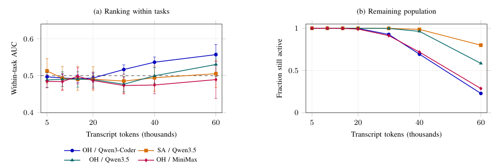

## What matters in this issue

A coding-agent run that looks likely to fail is not automatically worth restarting: the original might still finish, while a replacement has only the remaining budget. Two studies examine this decision from complementary angles. One tests whether early traces distinguish attempts on the same task; the other asks whether a prediction supports an action with adequate statistical evidence.

<h2 class="daily-paper-title" id="paper-continue-or-restart-2026">Continue or restart: limits of early trajectory prediction</h2>

[Continue or Restart? The Limits of Early Failure Prediction in Coding Agents](https://arxiv.org/abs/2610.35971)  
Srinath Srinivasan, Lunxiao Li, Tim Menzies, Wesley Assunção · 2026-10-26

After a coding agent has run for a while, a monitor might use tool calls, edits and tests to decide whether to continue. But a predictor may merely recognize task difficulty: it can separate easy issues from hard ones without identifying the failing attempt among multiple runs on the same issue. The latter distinction is what directly supports selective intervention on a particular run.

The authors analyze **147,002 traces** from two public corpora spanning four model–framework settings. They test count features, initial-text embeddings, task-conditioned rankers and a fine-tuned Qwen3-0.6B monitor, reporting both pooled ranking and ranking of successful versus failed attempts within the same task. At 20k tokens, the neural monitor's three-seed mean within-task AUC across 32,406 attempts is **0.50**, with an interval of **0.48–0.51**. That is close to chance in this setting; it does not prove that every possible monitoring signal is ineffective.

<a class="note-image-link" href="/assets/images/digest/2026-10-29/early-prediction.png" target="_blank" rel="noopener" aria-label="Within-task ranking and fraction of runs still active · View original image ↗">View original image ↗</a>

*Reading the figure: the left panel shows within-task ranking at different landmarks; the right shows the fraction of runs still active. Later decisions cover fewer runs.*

The authors replay three policies under shared token caps: continue, restart according to a score, or restart randomly at the same stopping rate. At a 75k cap, learned restarting improves resolution over matched random restarting by up to **1.98 percentage points**. A decomposition attributes almost all of that gain to allocation across tasks—avoiding stops on easier issues—rather than selecting attempts within a task. Continuation achieves higher resolution at lower mean token cost than both restart policies in all four settings at 75k, and in 216 of the 224 budget–threshold configurations overall.

This negative result makes the case for evaluating **prediction, intervention and budget together**. It concerns cold-restart replay of recorded traces; preserving edits, richer signals or other workloads could change the outcome. The within-task evaluation and shared-budget policy comparison deserve particular attention alongside pooled AUC.

<h2 class="daily-paper-title" id="paper-monitor-decision-value-2026">Beyond monitor accuracy: measuring restart decision value</h2>

[Monitor Accuracy Isn't the Answer: A Decision-Value Framework for Evaluating AI Agent Restart Monitors](https://arxiv.org/abs/2610.36544)  
Siddharth Jain, Venkat N Vedam · 2026-10-27

This paper takes the question one step further: an accurate monitor need not make restarting beneficial. The decision depends on both the original run's chance of succeeding if continued and the replacement's chance within the residual budget. In a mathematical control with an independent clean restart and zero monitoring overhead, the authors hold accuracy at **90%** and vary only replacement success probability; the resulting change in success ranges from a five-percentage-point loss to a 35-point gain. This is an analytical example, not measured monitor performance.

The authors formulate whether a compressed history preserves the information needed to choose between continuation and restart, and construct an audit using simultaneous binomial intervals. It can abstain when evidence is insufficient rather than force a recommendation. The empirical study contains **194 externally evaluated executions** on 19 selected SymPy issues from SWE-bench Verified; 130 are used in a retrospective audit. An apparent 2.29-point restart gain came from one eligible failed attempt; another model saw a 42.29-point loss. None of 103 comparisons with live data met the authors' certification threshold.

Both papers place action value ahead of prediction metrics. This one contributes a decision identity and a small-sample audit with abstention, rather than a large-scale failure predictor. Its results are limited to the selected tasks and runtime configurations, and the certificate depends on assumptions including independence. A restart retaining edits is a different intervention and cannot simply inherit the clean-restart result. The paper has no suitable architecture figure for the central mechanism, so this account uses text.
<h2 class="daily-paper-title" id="paper-reinbench-2026">ReInBench: When to wait for agent self-recovery</h2>

[When to Intervene? An Empirical Study of Errors and Self-Recovery in LLM Agents](https://arxiv.org/abs/2610.36471) 
Chiming Duan et al. · arXiv · 2026-10-27

### An error does not always require immediate intervention

The preceding studies ask whether to restart a coding agent. ReInBench asks a complementary question: can a browser or computer-use agent correct a local error if allowed to continue? The authors collect 1,259 trajectories containing 1,403 error events and annotate onset, observable recognition and local recovery using model-assisted annotation with researcher verification. A trajectory can contain multiple errors, and local recovery does not necessarily mean the whole task succeeds.

Within observed trajectories, 725 error events self-recover: 659 of 1,202 in OSWorld tasks and 66 of 201 in Web tasks. Among events with measurable recovery times, median recovery takes two and three steps, respectively. Rates vary substantially with model and task environment; the aggregate is not a universal recovery probability.

### Predicting recovery is not proof that an intervention works

ReCoF combines recovery-pattern predictors trained on historical execution context with an assessment model's judgment of the current task and error. It uses the goal and recent steps visible when the error occurs, excluding later recovery outcomes. The reported Macro-F1 across three execution models is 72.99%–74.18%, outperforming the strongest baseline for each by 1.30–11.30 percentage points.

This complements the cold-restart studies: estimate whether a run can recover before weighing intervention costs and benefits. The experiment evaluates **prediction**, however; it does not execute interventions to demonstrate improved task success. Its evidence also covers a limited set of models and interface tasks.
<h2 class="daily-paper-title" id="paper-arxiv-2610.36636">Agar: Answering microservice what-if questions with performance bounds</h2>

[Agar: What-If Analysis for Microservice Applications](https://arxiv.org/abs/2610.36636) 
Saarth Deshpande, Neeraja J. Yadwadkar, Venkat Arun · arXiv · 2026-10-27

Microservice operators need to anticipate changes in workload, allocation or SLOs. Rather than predicting precise latency point by point, Agar learns composable component performance bounds from observations and uses them to assess end-to-end SLO feasibility. The authors formulate minimum-resource allocation as such a what-if query and evaluate autoscaling and diagnosis on three applications.

They report up to 36.8% lower CPU allocation than evaluated horizontal-autoscaling baselines while satisfying application SLOs in the experiments. Results are specific to those applications and workloads; the approach assumes application behavior remains sufficiently stable and calls for retraining after code or hardware changes. Observed bounds are not unconditional guarantees outside the measured regime.

<h2 class="daily-paper-title" id="paper-arxiv-2610.37230">TAO: Scheduling agent serving around tool returns</h2>

[TAO: Tool-Aware Joint Scheduling for LLM-Based Agentic Serving](https://arxiv.org/abs/2610.37230) 
Shuhuai Li, Shengdong Ye, Dongdong Ge, Yinyu Ye, Jianghao Lin · arXiv · 2026-10-27

Agent services alternate GPU inference and external CPU tools. Reserving inference resources too early for a session whose tool has not returned can reduce efficiency. TAO combines near-term tool readiness, node-specific KV Cache value and token footprint, then jointly selects and places waiting sessions under capacity constraints.

Across 12 reported model, workload and concurrency settings, the authors report up to 26.8% lower latency and up to 36.3% lower mean time to first token against the strongest evaluated baseline for each metric. The maxima may arise in different settings and should not be read as simultaneous gains in one run; tool-duration prediction and cache benefits also depend on the workload.

<h2 class="daily-paper-title" id="paper-arxiv-2610.36329">GPU clusters: Fine-grained monitoring reveals utilization gaps</h2>

[Plenty of Room in the Middle: Revealing Opportunities on a GPU Cluster via Fine-Grained Monitoring](https://arxiv.org/abs/2610.36329) 
Andrew Sheinberg, Samyak Gupta, Kai Li · arXiv · 2026-10-26

The authors monitor a university research cluster at 100 ms intervals and analyze 7,399 jobs over ten days on 89 nodes with 319 GPUs. More than 70% of jobs use less than 20% of GPU memory, and half average below 5% streaming-multiprocessor utilization. The observations motivate finer-grained sharing and scheduling.

Low average utilization does not by itself establish interference-free sharing: 100 ms windows can smooth short communication bursts, only seven sampled jobs span multiple nodes, and the cluster covers two A100 configurations. These observations motivate hypotheses, not a portable estimate of reclaimable capacity.

<h2 class="daily-paper-title" id="paper-arxiv-2610.36589">InfraDev: Testing whether agents really build AI infrastructure</h2>

[InfraDev: Can Coding Agents Develop AI Infrastructure, and How Can We Tell?](https://arxiv.org/abs/2610.36589) 
Yangshen Deng et al. · arXiv · 2026-10-27

InfraDev derives 36 cross-file, multi-GPU tasks from real Megatron-LM, vLLM and verl pull requests. It jointly synthesizes hidden probes and task prompts that state the required interfaces. The authors report a best task resolution rate of 38.9% across six models; among 102 submissions passing all official tests, 33 fail additional probes. Passing existing tests therefore does not by itself establish correct state, resource or distributed behavior.

The hidden probes and generated prompts work together, so the measurement depends on grading design, the interfaces disclosed and the limited task set; it is not a general ranking of model capability. The paper also reports a change on specific training tasks after turning failure observations into a skill, not proof of effectiveness for all infrastructure repositories.
<h2 class="daily-paper-title" id="paper-arxiv-2610.36848">Evolving Agent Teams: Restructuring optimization teams with persistent experience</h2>

[Evolving Agent Teams](https://arxiv.org/abs/2610.36848) 
Shiyi Cao, Ziming Mao, Dacheng Li, Joseph E. Gonzalez, Ion Stoica · arXiv · 2026-10-27

To address local optima when optimizing expert GPU kernels, Evolving Agent Teams has a supervisor diagnose stagnation and restructure agent roles, using persistent learning notes, evolution history and team artifacts. The authors report stronger results than evaluated coding-agent baselines under matched token budgets. With an extended budget, one CUDA kernel generated from scratch wins on 36 of 47 FlashInfer MLA decode production workloads and reaches 0.86–0.99 times baseline speed on the other 11. This is task-, budget- and hardware-dependent, not a gain on every workload.

<h2 class="daily-paper-title" id="paper-arxiv-2610.36774">Parallel GEPA proposals: Batching reflective search</h2>

[Batching the Reflective Optimization Loop: Parallel Proposals Make GEPA Faster and Better](https://arxiv.org/abs/2610.36774) 
Jialin Zhang et al. · arXiv · 2026-10-27

GEPA's reflective optimizer proposes and evaluates candidates before selecting subsequent work. The authors extend each step to a batch of parallel proposals, compare parent and mutation counts, and model runtime with a finite worker pool. In experiments on two tasks, most batched runs finish in half the sequential wall-clock time or less, and some settings also improve held-out scores. Benefits depend on available workers, evaluation costs and the tested configurations.

<h2 class="daily-paper-title" id="paper-arxiv-2610.37651">GEPA-Curator: Which trajectories should inform self-improvement?</h2>

[GEPA-Curator: Curated Learning for Self Improving Agents](https://arxiv.org/abs/2610.37651) 
Zack Yu et al. · arXiv · 2026-10-27

A failed trajectory can reflect a weak prompt, a harness problem, stochastic execution or a noisy judge, so feeding every failure to a prompt optimizer may be counterproductive. GEPA-Curator selects more reliable task experiences and retrieves prior successes when useful. Across four agent benchmarks and two optimizer models, the paper reports gains over tested GEPA of up to 20.7%. That maximum belongs to a particular setting; the reliability and cost of curation also matter.

<h2 class="daily-paper-title" id="paper-arxiv-2610.36114">Context as a pipeline: Evidence can be lost before the model sees it</h2>

[Context Is a Pipeline, Not a Window: Information Attrition in LLM Agent Harnesses](https://arxiv.org/abs/2610.36114) 
Yuvraj Sehgal, Mahsa Panahandeh, Naser Ezzati-Jivan · arXiv · 2026-10-26

The authors study a tool-using agent diagnosing injected faults from Linux kernel traces. Across 720 runs its largest prompt uses just 5.75% of the context window, yet 3,827 of 11,189 tool results are cut before reaching the model, all becoming incomplete JSON. Fixed-length slicing disproportionately removes later fields, while the location of fault evidence is associated with diagnosis performance.

The practical lesson is to inspect tool generation, serialization, truncation and actual model inputs together, not just model-window occupancy. These figures concern the evaluated harness and tasks; the authors separately investigate causality in controlled experiments, and the observed field asymmetry is not evidence that every agent framework has the same defect.

[Read the supplementary notes](/digest/en/supplement/2026-10-29/)
