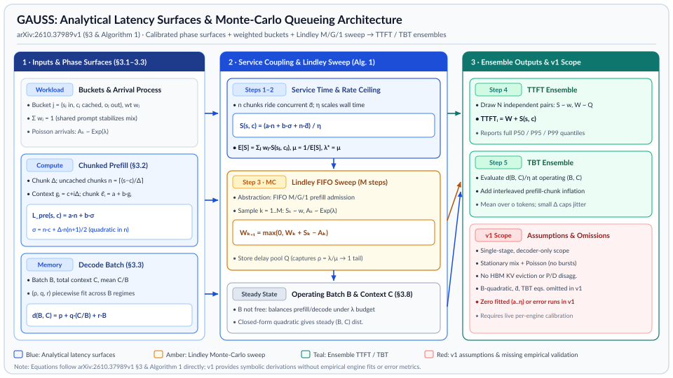
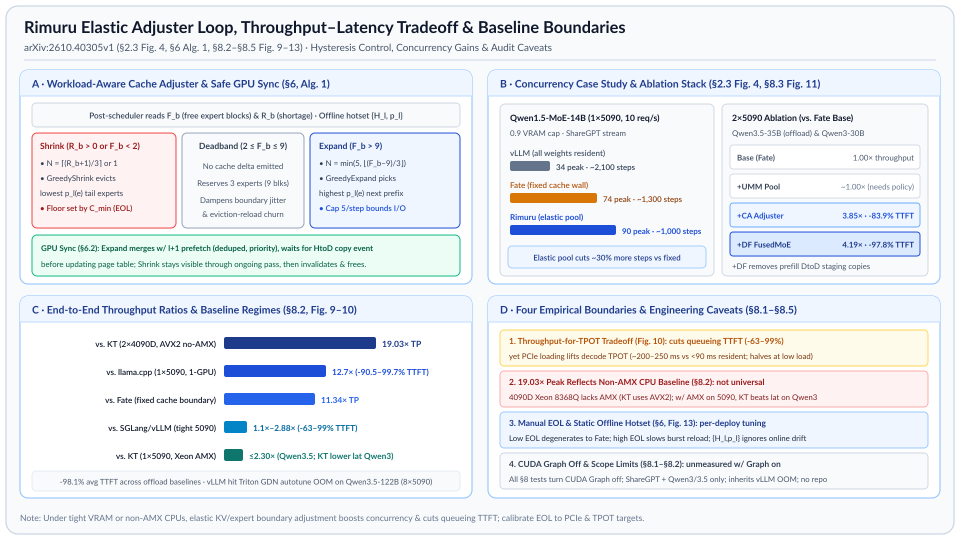
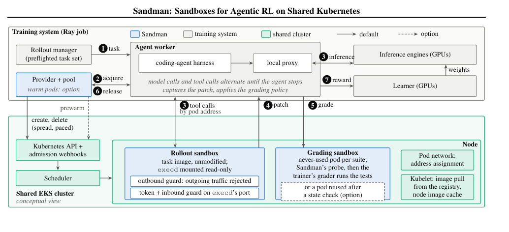

## In this issue

19 papers, 3 technical notes. Publication dates in source records are separate from this reading date.

<h2 class="daily-paper-title" id="paper-arxiv-2610.38329">01 · A Case Study of a Multi-Agent Kernel-Optimization Loop That Learns a New AI Accelerator</h2>

[A Case Study of a Multi-Agent Kernel-Optimization Loop That Learns a New AI Accelerator](https://arxiv.org/abs/2610.38329) 
Byonggon Chun · 2026-10-30

This RNGD case builds target knowledge from documentation, microbenchmarks and compiler rules, screening legality before repeated device comparisons. A 12-day run optimizes three decode kernels to 9.293× geometric-mean speedup over official baselines.

One chip and one run without ablations cannot attribute component gains. Synthetic inputs and fixed seeds do not validate full-model quality.

<h2 class="daily-paper-title" id="paper-arxiv-2610.38983">02 · Beyond atol and rtol: Sound Test Oracles for Low-Precision GPU Kernels</h2>

[Beyond atol and rtol: Sound Test Oracles for Low-Precision GPU Kernels](https://arxiv.org/abs/2610.38983) 
Xinyi Shi · 2026-10-30

numoracle derives per-element acceptance regions from precision-annotated references, tracking shared rounding and block quantization rather than fixed atol/rtol. Its RTX PRO 6000 campaign detects 116 of 124 effective mutants.

Soundness depends on rounding, hardware, domain and implementation assumptions. Zero observed alarms is not a universal guarantee, and mutants remain undetected.

<h2 class="daily-paper-title" id="paper-arxiv-2610.19792">03 · JetSpec++: Foresight Parallel Drafting with Self Refinements</h2>

[JetSpec++: Foresight Parallel Drafting with Self Refinements](https://arxiv.org/abs/2610.19792) 
Zhaoxiang Feng、Lanxiang Hu、Haoran Yuan、Yu-Yang Qian、Jihui Yang、Peng Zhao、Yibo Zhu、Tajana Rosing、Hao Zhang · 2026-10-30

JetSpec++ drafts the next block on a second GPU and refines it while verification runs. Qwen3-8B reaches up to 1,361 tokens/s in bf16 for a single request; it hides drafting latency rather than eliminating draft computation.

It uses two GPUs. Higher NVFP4 speed is a different precision setting; high batches and larger models need validation, and latency gains are not per-GPU cost gains.

<h2 class="daily-paper-title" id="paper-arxiv-2610.37810">04 · ConfluxServe: Reconciling Resource Utilization and Parallelism Efficiency across Prefill and Decode in LLM Serving</h2>

[ConfluxServe: Reconciling Resource Utilization and Parallelism Efficiency across Prefill and Decode in LLM Serving](https://arxiv.org/abs/2610.37810) 
Wenhao Chen、Hong Zhang · 2026-10-30

ConfluxServe co-executes prefill and decode within one batch using different parallel strategies across operators. It reports 1.26–1.62× goodput over strongest baselines under TTFT/TBT constraints, addressing utilization without forcing uniform phase parallelism.

Goodput depends on SLOs, workload and parallel configuration; it is not a raw-throughput multiplier for every model.

<h2 class="daily-paper-title" id="paper-arxiv-2610.37989">05 · GAUSS: Analytical Latency Surfaces and Monte-Carlo Queueing for LLM Capacity</h2>

[GAUSS: A Workload-Aware Analytical and Monte-Carlo Simulator for LLM Inference Serving](https://arxiv.org/abs/2610.37989) ([v1 PDF](https://arxiv.org/pdf/2610.37989))  
Srikant Bharadwaj, Ankur Mallick, Spyridon Mastorakis, Anjaly Parayil, Dhruv Deshmukh, Victor Ruehle (Microsoft Technical Report) · `arXiv:2610.37989v1 [cs.AI]` · Submitted 2026-10-27 (`v1` only at verification time, with no revision or withdrawal; full author list restored from the primary source after the original 2026-10-31 digest omitted authors; no code repository URL appears in the report)

Production LLM fleets are provisioned, monitored, and billed against latency service-level objectives (SLOs) on time-to-first-token (TTFT) and time-between-tokens (TBT), which a single aggregate `tokens/s` figure cannot determine. **GAUSS** couples calibrated prefill and decode latency surfaces with weighted request buckets, a stochastic Lindley queueing recurrence, and ensemble Monte-Carlo sampling to predict full TTFT/TBT percentile distributions alongside the maximum sustainable request rate. Upfront disclosure is essential: `arXiv:2610.37989v1` is a 10-page **analytical methodology and tutorial technical report** containing symbolic derivations, `Algorithm 1`, explicit modeling assumptions, and four operational use cases, with **zero fitted GPU/engine parameter values, named hardware runs, or empirical prediction-error benchmarks** in `v1`. The analysis below strictly separates the authors’ mathematical derivations from unvalidated deployment boundaries.

### 1. Why aggregate throughput and single-trace replay miss tail latency

Both scalar throughput summaries and trace-driven discrete-event simulators hit structural limits in generative LLM serving (§1–§2):

- **Two-phase accelerator asymmetry coupled via continuous batching (§2.1–§2.2)**: High-bandwidth memory (HBM) hierarchy splits inference into **prefill** (processing prompt tokens in parallel, **compute-bound**, growing with attended context) and **decode** (emitting one token per step, **memory-bound**, re-reading full model weights and active KV states from HBM per step so arithmetic lanes sit underutilized and HBM KV capacity caps concurrency). Serving runtimes reshape the effective service process through **iteration-level continuous batching** (`Orca`), **paged KV-cache management** (`vLLM` PagedAttention), and **chunked prefill** (`Sarathi-Serve`, `DeepSpeed-FastGen`), where prompts are sliced into chunks of size `Δ` and interleaved into decode batches to consume idle compute slack at a bounded TBT cost. Consequently, service times depend directly on the live workload mix and batch state.
- **Why single-trace discrete-event replay under-samples tails and fails to generalize (§1, §2.3, §4.4)**: Real traffic varies widely in prompt, cached-prefix, and output lengths while arriving in bursts (`BurstGPT`). High-fidelity discrete-event simulators such as `Vidur` are well suited to studying concrete scheduler mechanics, yet typically replay one recorded or synthetic trace—yielding a **time average** over one trajectory. Under heavy-tailed LLM service times and burstiness, one realization sparsely samples rare congestion spikes and systematically under-estimates P95 and P99 SLO tails. Trace replay also remains locked to recorded workloads and deployed hardware, and sweeping many candidate arrival rates `λ` is computationally heavy. Meanwhile, earlier profile-driven frameworks (`InferLine`, `Clockwork`) model fixed-cost pipeline stages rather than context- and batch-dependent autoregressive service.

### 2. GAUSS design: phase-specific latency surfaces, Lindley recurrence, and Algorithm 1

<figure class="note-figure"><a class="note-image-link" href="/assets/images/digest/2026-10-31/gauss-queueing-montecarlo-arch-en.svg" target="_blank" rel="noopener" aria-label="View full GAUSS analytical latency surfaces and Monte-Carlo queueing architecture diagram">View full diagram ↗</a><figcaption>Figure 1 · GAUSS analytical surfaces and Monte-Carlo queueing pipeline (from arXiv:2610.37989v1 §3 &amp; Algorithm 1): calibrated single-stage decoder-only surfaces feed a Lindley M/G/1 recurrence to produce ensemble TTFT and TBT percentiles.</figcaption></figure>

Scoped explicitly to **decoder-only models** and a **single serving stage** (§3 and `Algorithm 1`), GAUSS maps a workload mix and calibrated engine constants into latency distributions via five linked steps:

1. **Weighted workload buckets & Poisson arrivals (§3.1)**: Traffic is discretized into buckets <code>{(sⱼ, cⱼ, oⱼ, wⱼ)}</code> summing to <code>Σⱼ wⱼ = 1</code> over input length <code>sⱼ</code>, cached-prefix length <code>cⱼ</code>, and output length <code>oⱼ</code>. The authors justify planning-window stationarity from busy-period shared system prompts concentrating context near the cached prefix. Requests arrive as a Poisson process of mean rate <code>λ</code> (inter-arrival time <code>A ~ Exp(λ)</code>).
2. **Quadratic chunked-prefill surface (§3.2)**: With chunk size <code>Δ</code>, only uncached tokens <code>(s − c)</code> execute, giving <code>n = ⌈(s − c) / Δ⌉</code> chunks. Chunk <code>i</code> (<code>i = 1..n</code>) attends to cached prefix plus prior chunks, <code>gᵢ = c + iΔ</code>. Engine calibration models per-chunk time as affine, <code>ℓᵢ = a + b·gᵢ</code>, whose arithmetic sum yields closed-form prefill compute <code>L_pre(s, c) = a·n + b·σ</code> with <code>σ = n·c + Δ·n(n+1)/2</code>. Thus per-chunk latency is **linear** in resident context while total request prefill work scales **quadratically** with chunk count <code>n</code>.
3. **Decode-batch piecewise-affine surface (§3.3)**: Advancing a decode batch of size <code>B</code> and aggregate resident context <code>C</code> by one token exhibits step latency <code>d(B, C) = p + q·(C / B) + r·B</code> (piecewise across batch regimes in practice), separating per-request KV-state reads (<code>q·C/B</code>) from marginal batch widening cost (<code>r·B</code>).
4. **Concurrent interleaving & sustainable rate ceiling (§3.4–§3.5)**: Because chunked prefill rides along with active decode steps of concurrent latency <code>d̄</code>, wall-clock prefill service time (scaled by engine efficiency <code>η</code>) becomes <code>S(s, c) = (a·n + b·σ + n·d̄) / η</code>. Averaging across buckets gives <code>E[S] = Σⱼ wⱼ·S(sⱼ, cⱼ)</code>, service rate <code>μ = 1 / E[S]</code>, stability condition <code>ρ = λ / μ &lt; 1</code>, and analytical capacity ceiling <code>λ* = μ</code>.
5. **Lindley queue sweep, batch balance, and ensemble output (§3.6–§3.8, Algorithm 1)**: Admission to the chunked-prefill stage is abstracted as a FIFO single-server <code>M/G/1</code> queue. Starting from <code>W = 0</code>, `Algorithm 1` runs <code>M</code> Monte-Carlo steps—drawing <code>Sₖ</code> from bucket weights <code>w</code> and <code>Aₖ ~ Exp(λ)</code>—iterating **Lindley’s recurrence** <code>Wₖ₊₁ = max(0, Wₖ + Sₖ − Aₖ)</code> into delay pool <code>Q</code>. It then draws <code>N</code> independent pairs <code>(W ~ Q, S ~ w)</code> to obtain the steady-state <code>TTFTᵢ = W + S(s, c)</code> distribution. For <code>TBT</code>, the operating batch size <code>B</code> is treated not as a free parameter but as the closed-form root of a quadratic equation balancing prefill and decode work against the per-request budget at rate <code>λ</code>; `d(B, C)/η` inflated by interleaved prefill chunks and averaged over generated tokens <code>o</code> yields the TBT distribution.

| Model Stage (Paper Section) | Symbolic Equations (Faithful to v1 Text) | Physical / Queueing Role | Calibration &amp; Algebraic Closure Status in v1 |
| :--- | :--- | :--- | :--- |
| Workload &amp; arrivals (§3.1) | Buckets <code>(sⱼ, cⱼ, oⱼ, wⱼ)</code>, <code>Σⱼ wⱼ = 1</code>; <code>Aₖ ~ Exp(λ)</code> | Captures prompt/cache/output mix; assumes shared-prompt stationarity | Symbolic representation only; no production bucket traces listed |
| Chunked prefill (§3.2) | <code>n = ⌈(s − c)/Δ⌉</code>; <code>L_pre = a·n + b·σ</code>, <code>σ = n·c + Δ·n(n+1)/2</code> | Linear per-chunk context cost; quadratic total work in chunks <code>n</code> | <code>(a, b, Δ)</code> uninstantiated; zero per-engine fit tables in v1 |
| Decode-batch surface (§3.3) | <code>d(B, C) = p + q·(C/B) + r·B</code> (piecewise in practice) | Separates mean KV read (<code>C/B</code>) from batch-scaling cost (<code>r·B</code>) | Breakpoints across <code>B</code> regimes and fitted <code>(p, q, r)</code> omitted |
| Service &amp; rate ceiling (§3.4–3.5) | <code>S(s, c) = (a·n + b·σ + n·d̄)/η</code>; <code>μ = 1/E[S]</code>, <code>λ* = μ</code> | Folds concurrent decode steps and efficiency into capacity limit | Explicit load-dependent equation for <code>d̄</code> not written in v1 |
| Lindley sweep (§3.6) | <code>Wₖ₊₁ = max(0, Wₖ + Sₖ − Aₖ)</code> over <code>k = 1..M</code> into <code>Q</code> | Captures full queue-delay tail as <code>ρ → 1</code> without closed-form inversion | Single chain from <code>W = 0</code> in Alg. 1; burn-in and autocorrelation unaddressed |
| TTFT/TBT &amp; operating B (§3.7–3.8) | <code>TTFTᵢ = W + S</code>; TBT = <code>d(B,C)/η</code> + chunk inflation; quadratic for <code>B</code> | Jointly outputs latency percentiles and steady batch-size distribution | Explicit <code>B</code>-quadratic and chunk-TBT inflation formula omitted in §3.8 |

*Table 1 · GAUSS symbolic model formulation and v1 completeness audit (`arXiv:2610.37989v1` §3.1–§3.8 and `Algorithm 1`).*

### 3. Four capacity workflows: operating-point knee, segmentation, SRPT, and fleet ensembles

<figure class="note-figure"><a class="note-image-link" href="/assets/images/digest/2026-10-31/gauss-tail-latency-capacity-en.svg" target="_blank" rel="noopener" aria-label="View full GAUSS capacity workflows, tail mechanisms, and v1 verification scope diagram">View full diagram ↗</a><figcaption>Figure 2 · Capacity mechanisms and v1 verification audit (from arXiv:2610.37989v1 §1, §3.2, §4.1–4.4): Panels A–C illustrate qualitative analytical behavior from the equations (not measured data), while Panel D isolates missing empirical validation in v1.</figcaption></figure>

Section 4 demonstrates four capacity-planning questions enabled once service times become analytical functions of request shape:

1. **Operating-point selection & headroom (§4.1)**: Whereas trace replay requires a separate representative trace at each offered load and traffic mix without solving <code>λ*</code>, GAUSS analytically fixes <code>λ* = μ = 1 / E[S]</code> and sweeps <code>λ</code> to trace TTFT percentiles. Because queue delay explodes as <code>ρ → 1</code>, tail percentiles exhibit a sharp knee before mean latency rises; placing the operating point just below that knee preserves most utilizable throughput within SLO while exposing the exact gap to <code>λ*</code> as routing and provisioning headroom.
2. **Traffic segmentation against head-of-line blocking (§4.2)**: Under the Pollaczek-Khinchin <code>M/G/1</code> mean waiting-time formula <code>E[W] = λ · E[S²] / (2(1 − ρ))</code>, quadratic prefill scaling inflates the second moment <code>E[S²]</code> under wide context mixtures—inducing the **inspection paradox**, where arriving short requests disproportionately stall behind long requests in service. Splitting traffic by context length into separate pools shrinks intra-pool <code>E[S²]</code>; GAUSS computes <code>E[S]</code> and <code>E[S²]</code> analytically on both sides of any candidate split boundary, searching optimal cutoffs without re-recording split traces.
3. **Exact remaining work for SRPT scheduling (§4.3)**: Shortest-remaining-processing-time (SRPT) minimizes mean response time under heavy-tailed job sizes (`Harchol-Balter 2013`), provided the scheduler knows true remaining work at each decision step. Token-count or running-average heuristics misrank requests because prefill chunk cost rises linearly with already-resident context <code>c′</code>. GAUSS’s affine series computes exact remaining chunked-prefill time in closed form, enabling pre-deployment evaluation of potential SRPT tail gains.
4. **Ensemble estimation for fleet operations (§4.4)**: Underlying all three workflows is the distinction between an **ensemble** of independent stochastic realizations under fixed conditions versus one noisy **time-averaged** trace trajectory. Generating cheap independent trajectories stabilizes P95/P99 tail estimates, supporting headroom-aware load balancing, percentile-based provisioning, and pre-deployment hardware or engine comparisons.

### 4. Method positioning and v1 evidence audit: documented derivations vs. missing numerical validation

To keep conceptual capabilities distinct from experimentally verified accuracy, Table 2 contrasts GAUSS with neighboring capacity approaches and summarizes the exact empirical verification status of `arXiv:2610.37989v1`:

| Capacity Paradigm / Baseline | Workload &amp; Service Representation | Tail Distribution &amp; Policy Extrapolation | Sweep Cost | `arXiv:2610.37989v1` Empirical Evidence Audit |
| :--- | :--- | :--- | :--- | :--- |
| Mean throughput (`tokens/s`) | Aggregate scalar rate; ignores phase &amp; shape mix | Blind to sub-saturation queueing knees and TTFT/TBT tails | Minimal | Motivation baseline only; no numeric table reported |
| Profile frameworks (`InferLine`, `Clockwork`) | Fixed-cost per-stage profiles against SLOs and arrivals | Predates autoregressive context- and batch-coupled phases | Low | Discussed qualitatively in §2.3; no comparative runs |
| Trace-driven DES (e.g., `Vidur`) | Detailed event-level scheduler, batching, and memory simulation | Single-trajectory time average; tied to recorded workload/HW | High per `λ` sweep | Positioned against qualitatively; **no runtime or error comparison in v1** |
| **GAUSS (arXiv:2610.37989v1)** | Weighted buckets <code>(sⱼ,cⱼ,oⱼ,wⱼ)</code> + <code>L_pre</code> / <code>d(B,C)</code> + <code>M/G/1</code> Lindley MC | Generates ensemble P50–P99 and sweeps unseen splits/HW | Very low (closed form + recurrence) | **0 fitted (a..η) constants, 0 named GPUs, 0 measured error runs in v1** |

*Table 2 · Positioning against serving capacity baselines and empirical verification audit of `arXiv:2610.37989v1` (§1–§4).*

The audit highlights a critical boundary: while this Microsoft technical report rigorously lays out **why analytical surfaces plus Monte-Carlo queueing fill the blind spots of trace replay**, `v1` contains **no experimental validation section**. Readers receive no per-engine surface-fit residuals (e.g., on `vLLM` or `Sarathi-Serve`), no measurements on named accelerators (e.g., H100/A100/MI300), no check on whether efficiency factor <code>η</code> drifts across offered load, and no quantitative P95/P99 error bounds against live serving runs or `Vidur`.

### 5. Explicit modeling assumptions, omitted closures, and engineering takeaways

Applying GAUSS in real capacity planning requires tracking four explicit assumptions and missing specifications revealed in §3 and `Algorithm 1`:

1. **Tension between bursty-traffic motivation and stationary Poisson math**: Sections 1 and 2.3 motivate GAUSS via bursty production arrivals (citing `BurstGPT` and `Cox`), yet Section 3 locks the baseline model to **stationary Poisson arrivals** (<code>Aₖ ~ Exp(λ)</code>, unit dispersion) and time-invariant bucket weights <code>wⱼ</code> justified by shared cached system prompts. Whenever real traffic exhibits clustered bursts (<code>CV² &gt; 1</code>) or multi-turn agent/tool output drift across hours, Poisson queues systematically **underpredict** tail waiting times unless extended to modulated or Cox arrival processes.
2. **Single-server FIFO queue vs. KV HBM limits, SRPT, and disaggregation**: Step 3 of `Algorithm 1` models admission as a single **FIFO `M/G/1` queue** (`Wₖ₊₁ = max(0, Wₖ + Sₖ − Aₖ)`). This leaves three operational gaps: (a) although §2.1 identifies HBM KV capacity as the binding concurrency constraint, `Algorithm 1` enforces no HBM memory cap, preemption, or KV eviction loop; (b) §4.3 uses GAUSS for SRPT remaining-work ranking, yet `v1` gives no modified non-FIFO SRPT waiting-time recurrence; and (c) the model explicitly restricts scope to **single-stage, decoder-only** serving, excluding prefill–decode disaggregation transfers, MoE routing/all-to-all costs, speculative decoding, and multi-node collectives.
3. **Omitted algebraic closures & Markov convergence details in `v1`**: The exact quadratic equation solving operating batch size <code>B</code> (§3.8), the load-dependent closure for concurrent decode latency <code>d̄</code> inside <code>S(s, c)</code>, the marginal chunk-inflation formula for `TBT` (Algorithm 1 line 325), piecewise <code>d(B, C)</code> breakpoints (§3.3), and burn-in or multi-chain variance handling for Lindley chains initialized at <code>W = 0</code> near <code>ρ → 1</code> are described conceptually without closed-form equations in the 10-page report.
4. **Actionable engineering takeaways**: (1) **Audit P99 capacity on ensembles and second moments, not mean throughput**: even before deploying an analytical simulator, fleet reviews should treat single-trace replays as noisy tail samples and monitor quadratic prefill work growth alongside <code>E[S²]</code>; (2) **Fit phase-specific surfaces separately and validate out-of-distribution**: measure chunked-prefill <code>(a, b)</code> and decode-step <code>(p, q, r)</code> curves on your target engine/GPU, then benchmark predicted P95/P99 against live bursty runs before gating routing on modeled headroom; (3) **Balance pool segmentation against multiplexing loss**: isolating long prompts slashes short-pool <code>E[S²]</code> head-of-line blocking, yet static pool splits forfeit statistical multiplexing when traffic mix shifts—pair boundary selection with dynamic reallocation or chunk-aware SRPT.

Source: [GAUSS: A Workload-Aware Analytical and Monte-Carlo Simulator for LLM Inference Serving](https://arxiv.org/abs/2610.37989)
<h2 class="daily-paper-title" id="paper-arxiv-2610.38196">06 · GearUp: DAG-aware Acceleration for Serverless Inference Serving via Slack-guided Pre-loading</h2>

[GearUp: DAG-aware Acceleration for Serverless Inference Serving via Slack-guided Pre-loading](https://arxiv.org/abs/2610.38196) 
Qi Qi、Yifan Sui、Hanfei Yu、Hong Zhang、Hao Wang · 2026-10-30

GearUp schedules library, weight and CUDA-kernel loading within upstream DAG slack and reuses initialized instances. Two L40S workflows show 64.5% and 75.9% lower median end-to-end latency than SMIless.

Benefits depend on slack, loading profiles and reuse. Cold-execution and eager-preload comparisons use different baselines and must remain separate.

<h2 class="daily-paper-title" id="paper-arxiv-2610.38355">07 · FlatCake: A Flat KVCache Storage Architecture for LLM Serving</h2>

[FlatCake: A Flat KVCache Storage Architecture for LLM Serving](https://arxiv.org/abs/2610.38355) 
Xin Huang、Teng Ma、Zhuoran Li、Yibo Zhao、Zhaoshi Li、Qianchao Zhu、Wei Yang、Chenxi Wang、Tao Xie、Youwei Zhuo · 2026-10-30

FlatCake treats DRAM and SSD as peer KV media with fixed, session-contiguous placement at creation and GDS streaming into a bounded GPU window. Under high load on a Claude Code trace, cache hits remain 94% versus Mooncake’s 64%.

It relies on immutable blocks and session reuse. Total-token throughput includes inputs and is not generation speed; storage configuration matters.

<h2 class="daily-paper-title" id="paper-arxiv-2610.38968">08 · TableTune: Measured, Self-Correcting Draft-Length Tables for Dynamic Speculative Decoding</h2>

[TableTune: Measured, Self-Correcting Draft-Length Tables for Dynamic Speculative Decoding](https://arxiv.org/abs/2610.38968) 
Abhishek Malvankar、Paul Castro、Nick Mitchell、Lionel Villard · 2026-10-30

TableTune measures batch-size/draft-length combinations on the actual vLLM serving path and updates tables using live acceptance rates, turning draft length from a hand-written constant into a measured, repairable control parameter.

The peak 58% repairs mistuning. Comparisons are only against speculative configurations and do not establish universal gains over non-speculative decoding.

<h2 class="daily-paper-title" id="paper-arxiv-2610.38981">09 · Why Speculative Decoding Works Better Than Predicted on Sparse MoE Models</h2>

[Why Speculative Decoding Works Better Than Predicted on Sparse MoE Models](https://arxiv.org/abs/2610.38981) 
Ekagra Ranjan、Komal K. Teru、Bharat Venkitesh、Acyr Locatelli · 2026-10-30

This study shows that expert bytes alone mispredict fine-grained MoE verification cost: routing overlap, L2 reuse and kernel bandwidth utilization shape low-batch behavior. An IPF model predicts unique expert counts with under 4% error.

Expert-count error is not end-to-end latency error. Some analyses isolate target verification and omit actual drafter cost and acceptance.

<h2 class="daily-paper-title" id="paper-arxiv-2610.39216">10 · PDScope: breaking the prefill–decode seesaw in memory-bound MoE inference</h2>

[PDScope: Breaking the Prefill-Decode Seesaw for Memory-Bound MoE Inference](https://arxiv.org/abs/2610.39216) ([v1 PDF](https://arxiv.org/pdf/2610.39216) · [v1 HTML](https://arxiv.org/html/2610.39216v1) · paper footnote 1 cites anonymized repository placeholder `https://github.com/nezha-Anonymous/PDScope`)  
Enda Yu, Dezun Dong\*, Zhaoning Zhang\*, Xiaojian Yang, Weiling Yang, Shaonan Ma, Dongsheng Li, Yongwei Wu, Xiangke Liao (National University of Defense Technology; Qiyuan Laboratory; \*corresponding authors) · `arXiv:2610.39216v1 [cs.DC]` · Submitted 2026-10-29 (`Comments`: accepted by PPoPP'27; `v1` only at verification time, with no revision or withdrawal notice)

Deploying Mixture-of-Experts (MoE) LLMs locally on single CPU–GPU nodes offers cost and privacy benefits, yet limited VRAM (capped at `24 GB` in this study) forces most expert weights into host DRAM. Under this constraint, the two inference phases hit opposite hardware walls: **prefill** processes prompt tokens in parallel and benefits from aggressive GPU expert loading to relieve CPU compute saturation, whereas **decode** generates one token at a time with tiny per-expert compute and stalls whenever PCIe transfers introduce I/O bubbles. In low-batch interactive workloads lacking inter-request concurrency, phase-agnostic schedulers get trapped in a **prefill–decode seesaw**—optimizing for prefill injects unmasked decode PCIe stalls, while optimizing for decode starves prefill GPUs. `PDScope` elevates **phase-awareness** into a first-class scheduling primitive, decoupling prefill and decode independently across learned expert prediction (`PhasePer`), cross-layer cost scheduling (`AdaptSched`), and a static-graph zero-copy execution engine. All measurements and caveats below come strictly from `arXiv:2610.39216v1`, keeping author-reported results distinct from operational boundaries.

### 1. Why phase-agnostic scheduling hits a prefill–decode seesaw

Local assistant and document-processing deployments typically execute at batch size 1 or low concurrency, leaving no inter-request parallelism to mask phase contention. Across §§2.2–3, the authors trace this trade-off to three structural mechanisms:

- **Opposite phase bottlenecks (§2.2, Fig. 3)**: Profiling `HybriMoE` on `Mixtral-8x7B` (A100) reveals the inversion starkly. Under a `1024`-token prefill, all `8` experts per layer activate with heavy token load per expert, saturating the CPU: time breaks down to **CPU `2,557 ms`, PCIe `2,321 ms`, and GPU `292 ms`**, so throughput rises with GPU token share. During single-token decode, only `2` experts activate per layer and latency flips to **PCIe `1,449 ms` (`79.5%` of summed component times), CPU `264 ms`, and GPU `109 ms`**, making avoidable I/O transfers the dominant bottleneck.
- **Why all three phase-blind paradigms stall (§1, §3.2, Figs. 1–2 & 5)**: (1) *Static placement* (`KTransformers v0.3.2`) locks hot experts on GPU and runs cold experts on AVX-512 CPU kernels, stabilizing decode at zero runtime PCIe cost but peaking at `512–1024` input tokens before dropping during long-prompt prefill; (2) *On-demand loading* (`Fate` via gate approximation) boosts prefill GPU utilization yet injects unmasked PCIe stalls during decode; (3) *Dynamic load balancing* (`Fiddler`, `HybriMoE`, `MoE-APEX`) reacts layer by layer without cross-layer lookahead, failing in both directions—**Case 1 underfetching in prefill** (loading remaining cold experts of layer `l` onto GPU consumes PCIe bandwidth needed to prefetch layer `l+1` hot experts, starving the next layer) and **Case 2 overfetching in decode** (issuing late prefetches after layer `l` finishes creates PCIe bubbles whenever transfers miss next-layer attention+gating completion).
- **The layer-group effect defeats single-heuristic predictors (§3.1, Fig. 4 & §8.2 Fig. 16)**: Across `Mixtral-8x7B`, `Qwen3-30B-A3B`, `DeepSeek-V2-Lite`, and `Moonlight-16B-A3B`, routing-weight (`w_i`) variance and inter-layer hidden-state (`a`) cosine similarity partition layers into **Input**, **Middle**, and **Output** groups. Input and output groups exhibit sharp routing fluctuations and lower inter-layer similarity—causing adjacent-gate approximation (`Fate`) to degrade—whereas middle groups maintain high cosine similarity where token-similarity heuristics falter and statistics-only predictors remain mediocre globally.
- **Phase-asymmetric non-computational taxes (§3.3, Tables 1–2)**: In prefill, CPU-side I/O preparation (pinned-memory setup and DMA) competes directly with expert compute, inflating PCIe `4.0 ×16` single-expert transfer latency by **`40.3%–52.5%`** over contention-free micro-benchmarks (`DeepSeek` `1.95 → 2.78 ms`, `Qwen` `1.34 → 1.88 ms`, `Mixtral` `33.5 → 51.1 ms`). Conversely, single-token decode cannot amortize cache loading, kernel launches, or hardware status polling: on Intel 6230R CPU, a `Mixtral` expert takes `2.88 ms` pure compute versus **`4.25 ms` end-to-end runtime** (`>32%` overhead), while `Qwen` on RTX 3090 widens from `0.13 ms` to `0.24 ms`. Any per-expert runtime query or polling exposes directly on the decode critical path.

### 2. Phase-aware co-design: PhasePer prediction, AdaptSched scheduling, and zero-copy execution

<figure class="note-figure"><a class="note-image-link" href="/assets/images/digest/2026-10-31/pdscope-phase-aware-moe-pipeline-en.svg" target="_blank" rel="noopener" aria-label="View original PDScope phase-aware architecture diagram">View original image ↗</a><figcaption>Figure 1 · PDScope offline profiling and online phase-aware co-design (from arXiv:2610.39216v1 §4, Figs. 6–8, and Algorithm 1): prediction, cross-layer scheduling, and graph/I/O execution decouple into separate prefill and decode spaces with true-gate recompilation blocking error propagation.</figcaption></figure>

`PDScope` pairs a one-time offline calibration pass (`< 30 min` per model on A100, §6) with an overhead-free online runtime (§4.1–§4.4):

1. **Offline profiling & hardware calibration (§4.1, §4.2.3)**: Running `128` ShareGPT batches (`4096`-token prompt + `512`-token generation) collects phase-isolated per-layer traces `(a, w_i, e_i)`, locates Input/Middle/Output group boundaries automatically from inflection points in inter-layer hidden-state cosine similarity (§8.2), builds a hardware **cost table** mapping token counts to CPU time `t_c(·)`, GPU time `t_g`, attention time `t_attn`, PCIe setup `α`, and transfer latency `t_io`, and preloads frequent hot experts into the remaining `5.8–8.7 GB` GPU budget as a static **Hot Expert Table**.
2. **`PhasePer` — learned phase-aware ranking predictor (§4.2)**: Building on §2.1’s deterministic mapping from `(a, w_i, e_i)` to next-layer routing `e'_i`, `PhasePer` trains one lightweight per-layer predictor `e'_i = PhasePer_θ(a, w_i, e_i)` per phase:
   - **Layer-group networks & phase losses**: Noisier, skewed Input/Output groups use **shallow networks** to prevent overfitting, while stable Middle groups use **deeper networks with a residual block gated by `a`**. For Input/Output layers, prefill counters severe token-level class imbalance via `L_prefill = L_expert + λ·L_focal` (where `L_expert` weights per-expert BCE by inverse frequency `1 / f_i` and `L_focal` emphasizes hard examples), whereas single-token decode exhibits negligible batch imbalance and reduces to `L_decode = L_focal`; Middle groups use standard `BCE` in both phases.
   - **Zero-critical-path online fine-tuning (§4.2.3, §8.4)**: Monitoring error across a `16`-token input-group sliding window, `PhasePer` triggers a `2.1 ms` fine-tuning step (`128` prefill + `32` decode runtime tokens) only when average error exceeds `25%`. Trigger intervals exceed **`500` steps (prefill)** and **`1000` steps (decode)** across ShareGPT, DPO, and LLaVA, and updates overlap completely with GPU I/O idle windows (prefill) or next-token attention compute (decode).
3. **`AdaptSched` — cross-layer cost-modeled scheduler (§4.3, Algorithm 1)**: Operating over non-GPU-resident experts sorted by pending tokens (`E_cur`, `E_next`), enforcing monotonic on-demand loading and serial PCIe I/O (because single-expert transfers already hit `66%–80%` of PCIe peak and concurrent transfers risk congestion), `AdaptSched` splits into distinct phase policies:
   - **Prefill (3-step aggressive pipeline)**: *Step 1* merges `E_cur` and `E_next` into `E_all` and compares cross-layer completion times Eq. `(3)` (`T_all^G = α + (n + n' - i + 1)·t_io + t_g < T_all^C = t_c(E_all[0:i]) + t_attn`) to pick the global GPU candidate queue `L_global`. *Step 2 (local safety net)* re-evaluates `L_global ∩ E_cur` using actual layer-`l` token counts under Eq. `(4)` (`T_G < T_C`) to finalize `L_on`—preventing cross-layer skew or mispredictions from idling the CPU and bounding any misprediction penalty to at most one extra I/O round trip (§8.4). *Step 3* converts the remaining CPU-GPU slack plus attention window into continuous prefetch capacity `f = (T_gap + t_attn) / t_io` (`⌊f⌋` in Algorithm 1) and uses the hit-rate-weighted expected utility `ξ = R_hit·(f - ⌈f⌉ + 1)·t_io - (1 - R_hit)·(⌈f⌉ - f)·t_io` (printed as `<code>&#124;f&#124;</code>` in the paper text for the ceiling prefetch index) to issue the marginal prefetch only when `ξ > 0`. Appendix §8.7 confirms one-layer lookahead suffices: two-layer lookahead shifts throughput by only `1.1%–2.3%` (prefill) and `0.8%–5.4%` (decode) while tripling cache pressure.
   - **Decode (4 conservative I/O modes around optimal CPU target `n_c`)**: Solving `n_c = arg min max((k - n_c)·t_g, n_c·t_c)` sets the makespan-optimal CPU expert count per token: *Mode a (load focus)* applies revised Eq. `(5)` to minimize current-layer latency when only `E_cur` exceeds `n_c`; *Mode b (prefetch focus)* unloads redundant GPU experts and prefetches for `l+1` under Eq. `(6)` so GPU completion never falls behind CPU-only execution; *Mode c (unload focus)* performs zero-I/O GPU eviction when both layers stay `≤ n_c` (CPU holds backups of all experts); and *Mode d (cross-layer focus)* reuses Steps 1–3 guarded by Eq. `(6)` when both layers exceed `n_c`, powering multi-batch decode (§5.3, §8.6).
4. **Two-phase static graph & zero-copy `AsyncIO` engine (§4.4)**: To eliminate §3.3’s polling and contention taxes: (1) **Two-phase static graph compilation (§4.4.1)** pre-compiles a draft static graph for layer `l` while layer `l-1` executes (covering high-confidence hot/cold predictions and issuing CPU LLC cache prefetches), then **recompiles and overwrites** the full static graph using true layer-`l` gating outputs before batching all resident and prefetched GPU expert kernels into a single launch—hiding scheduling latency while guaranteeing zero prediction error reaches model math; (2) **`AsyncIO` (§4.4.2, Table 3)** pre-registers separate GPU **ping-pong buffers** (for on-demand `L_on`) and **prefetch buffers** (for conflict-free layer `l+1` `L_pre`), streaming each expert’s `gate_proj`, `up_proj`, and `down_proj` matrices concurrently across **3 independent CUDA streams** from pinned host memory to reach **`66%–80%` PCIe bandwidth utilization**.

### 3. Quantitative evaluation: cross-platform throughput, 291B scaling, ablations, and trace audit

<figure class="note-figure"><a class="note-image-link" href="/assets/images/digest/2026-10-31/pdscope-seesaw-throughput-gains-en.svg" target="_blank" rel="noopener" aria-label="View original PDScope empirical evidence chart">View original image ↗</a><figcaption>Figure 2 · Empirical highlights (from arXiv:2610.39216v1 §2.2, §3.3, §5.2–§5.5, and Tables 1–5): 10-run averages under a 24 GB VRAM cap (5.8–8.7 GB expert budget), reporting prefill and decode throughput separately.</figcaption></figure>

Evaluations span two PCIe `4.0 ×16` primary hosts—**NVIDIA A100 + dual Intel Xeon Gold 6230R** (AVX-512, no AMX) and **NVIDIA RTX 3090 + AMD EPYC 7452** (16 cores/GPU, no AVX-512)—plus an auxiliary **V100 + Intel 6230R** (PCIe `3.0 ×16`) in Appendix §8.5. GPU memory is capped at `24 GB`, leaving `5.8–8.7 GB` for GPU-resident experts. Five baselines (`KTransformers v0.3.2`, `Fate`, `Fiddler`, `HybriMoE`, `MoE-APEX`) run in individually tuned optimal configurations after 3 method-specific warm-up rounds, evaluated with ShareGPT (`128–4096` prompt / `64` output tokens, 10-run mean), OOD `DPO` and `LLaVA` (`4096`/`512`), and `291B` INT8 `DeepSeek-V4-Flash` (`512 GB` host DRAM, `chunk=256` for multi-batch).

| Model (Main BF16) | Architecture (Layers / Experts / Top-k / Size) | Raw PCIe 4.0 Transfer (Bench → Prefill / Theor.) | AsyncIO Prefill Transfer (PCIe 4.0 / 3.0 BW Util.) | Single-Expert 1-Token Time (Intel 6230R Comp./Run vs. RTX 3090) | PhasePer Top-6 ±2 Hit Rate (ShareGPT / DPO / LLaVA) &amp; Cost |
| :--- | :--- | :--- | :--- | :--- | :--- |
| Mixtral-8x7B | 32L / 8 / Top-2 / 336 MB | 33.5 → 51.1 ms / 10.67 ms | 13.98 ms (76%) / 26.7 ms (80%) | 2.88 → 4.25 ms vs. 0.33 → 0.44 ms | 100% / 99% / 99% (1.2–3.8 MB · 0.15 ms) |
| Qwen3-30B-A3B | 48L / 128 / Top-8 / 9 MB | 1.34 → 1.88 ms / 0.29 ms | 0.44 ms (66%) / 0.79 ms (72%) | 0.16 → 0.34 ms vs. 0.13 → 0.24 ms | 97% / 94% / 92% (1.7–4.2 MB · 0.12 ms) |
| DeepSeek-V2-Lite | 26L / 64 / Top-6 / 16.5 MB | 1.95 → 2.78 ms / 0.53 ms | 0.76 ms (70%) / 1.39 ms (76%) | 0.21 → 0.43 ms vs. 0.17 → 0.29 ms | 96% / 92% / 90% (1.6–4.0 MB · 0.48 ms) |
| Moonlight-16B-A3B | 26L / 64 / Top-6 / 16.5 MB | Not separately tabulated (same expert size as DS-2) | Not separately tabulated (see end-to-end §5.2) | Not separately tabulated (AMD EPYC in Table 2) | 99% / 95% / 92% (1.6–4.0 MB · 0.48 ms) |

*Table 1 · Evaluated MoE architectures, micro-benchmark transfer/compute overheads, and PhasePer prediction metrics (from `arXiv:2610.39216v1` Tables 1–5; `PhasePer` is trained offline on `16%` of ShareGPT and evaluated zero-shot on DPO/LLaVA).*

| Baseline Compared (Paradigm) | Peak Prefill Speedup Across 4 Models (§5.2.1) | Peak Decode Speedup Across 4 Models (§5.2.2) | A100 / RTX 3090 Geomean Ratio (Prefill / Decode) | 291B DeepSeek-V4 `bs=1` (Prefill / Decode) | 291B DeepSeek-V4 `bs=32` (Prefill / Decode) | Primary Baseline Bottleneck &amp; Platform Sensitivity |
| :--- | :--- | :--- | :--- | :--- | :--- | :--- |
| vs. Fate (On-demand loading) | Up to **10.3×** | Up to **6.1×** | 1.67 / 1.71 (PDScope 1.88 / 1.38) | 2.82× / 1.35× | 2.42× / 3.16× | Gate approximation degrades at Input/Output layers; decode PCIe bubbles |
| vs. KTransformers v0.3.2 (Static) | Up to **8.6×** | Up to **2.9×** | **3.23** / **2.86** (CPU-bound) | Unsupported on A100 | Unsupported on A100 | Prefill peaks at 512–1024 tokens; tied to Intel AVX-512 kernels |
| vs. Fiddler (Dynamic orchestration) | Up to **5.8×** | Up to **2.9×** | 1.92 / 1.69 | 3.06× / 1.90× | 2.61× / 3.17× | Lacks lookahead; runtime polling hits decode critical path |
| vs. HybriMoE (Dynamic + cache) | Up to **4.4×** | Up to **2.1×** | 1.85 / 1.68 | 2.69× / 1.26× | 2.35× / 3.14× | Layer-greedy dispatch induces Case 1 underfetch &amp; Case 2 overfetch |
| vs. MoE-APEX (Dynamic + INT4) | Up to **2.5×** | Up to **2.1×** | 1.72 / 1.49 | 5.03× / 1.97× | 5.37× / 5.65× | Long-prompt quantization overhead; 291B dual-copy exceeds 512 GB DRAM (no pinned I/O) |

*Table 2 · PDScope phase-isolated throughput speedups over all five baselines across single-batch, cross-platform, and 291B multi-batch regimes (from `arXiv:2610.39216v1` §§5.2.1–5.3 &amp; Figs. 9–11; peak speedups correspond to each baseline’s worst-matched length/platform regime).*

Key quantitative findings from §§5.2–5.6 and Appendix §§8.3–8.6 include:

- **Breaking the seesaw across lengths and hardware (§5.2, §8.5)**: On `128–4096`-token prefill, `PDScope` achieves the steepest length scaling—delivering up to `10.3×` over `Fate`, `8.6×` over `KTransformers`, `5.8×` over `Fiddler`, `4.4×` over `HybriMoE`, and `2.5×` over `MoE-APEX`—while concurrently reaching up to `6.1×`, `2.9×`, `2.9×`, `2.1×`, and `2.1×` decode throughput over the same five baselines. Across A100 vs. RTX 3090 (without AVX-512), `PDScope` keeps cross-platform geometric-mean ratios modest (`1.88×` prefill, `1.38×` decode), whereas `KTransformers` swings `3.23×` / `2.86×` due to Intel AVX-512 specialization; relative rankings hold similarly on PCIe `3.0 ×16` V100 (§8.5, excluding `KTransformers`).
- **291B model & multi-batch scaling (§5.3, §8.6 Fig. 20)**: Running `DeepSeek-V4-Flash` (INT8, `291B`) on A100 with `chunk=256` for multi-batch, `PDScope` outperforms all four supported baselines by `2.69×–5.03×` (prefill) and `1.26×–1.97×` (decode) at `bs=1`, and by `2.35×–5.37×` (prefill) and `3.14×–5.65×` (decode) at `bs=32` (`MoE-APEX` must disable pinned memory because dual full/compressed expert copies exceed `512 GB` host DRAM). Raising batch size from `16` to `32` yields only `5.2%` (`2048` tokens) and `0.7%` (`4096` tokens) prefill gain for `PDScope`, showing `bs=16` already saturates the node. Across all four BF16 models at `bs=32` (`1024` in / `128` out, §8.6), baseline seesaw behavior persists while `PDScope` wins both phases via decode **Mode d**.
- **Incremental ablation & microscopic trace audit (§5.4, §5.6, Figs. 12 & 14)**: Adding components incrementally over `Fiddler` on A100 yields per-step ratios of `1.16×–1.39×` (P) / `1.15×–1.46×` (D) for hot-expert caching (`+h`), `1.67×–1.88×` (P) / `1.34×–2.24×` (D) for `AsyncIO` (`+i`), `1.39×–2.06×` (P) / `1.17×–1.38×` (D) for `PhasePer+AdaptSched` (`+p+a`), and `1.10×–1.20×` (P) / `1.13×–1.39×` (D) for static graph + LLC prefetching (`+g+c`). Disabling `+h` under tight VRAM costs only `1.8%` prefill and `8.2%` decode throughput on average. Single-layer `Qwen3-30B-A3B` traces (§5.6, hot table disabled) verify `PDScope` shifts prefill execution from `38` GPU / `43` CPU experts (`HybriMoE`) to **`49` GPU / `32` CPU** experts while hiding `8.1 ms` of `Sort`/graph overhead behind `12` GPU + `4` CPU expert computations.
- **OOD generalization & degraded-predictor resilience (§5.5, §6, §8.3)**: Trained on `16%` of ShareGPT (`1.2–4.2 MB` per layer, `0.12–0.48 ms` forward latency masked by I/O), `PhasePer` sustains `90%–99%` Top-6 (±2 rank tolerance) hit rates on unseen `DPO` and `LLaVA` (avg `-4.8%` to `-5.3%` vs. ShareGPT, never `<80%` raw accuracy, `+15%–68.4%` over `Fate`). Swapping `PhasePer` for `Fate`’s weaker predictor (`45%–70%` accuracy) reduces A100 `4096`-token prefill throughput by just **`6.4%–11.3%`** in Input/Output groups and **`0.9%–2.4%`** in Middle groups, thanks to above-random ranking advantage (`25%` on Mixtral) plus Step 2’s on-demand fallback.

### 4. Scientific boundaries, experimental assumptions, and engineering takeaways

Applying `PDScope`’s co-design outside its testbed requires keeping four documented boundaries explicit:

1. **Phase speedups cannot be multiplied**: The reported `2.5–10.3×` prefill and `2.1–6.1×` decode multipliers are measured independently per phase and represent peaks against different baselines (`10.3×` vs. `Fate`; `2.5×` vs. `MoE-APEX`). Whole-request speedup depends nonlinearly on prompt-to-output token ratio (`L_in / L_out`), PCIe generation, CPU vector throughput, and expert memory granularity (`336 MB` vs. `9 MB`).
2. **No distributed prefill–decode overlap & single-node saturation**: Section 6 explicitly notes `PDScope` does not support concurrent P/D colocation/overlap because prefill already saturates CPU and PCIe under memory constraints; multi-batch mode uses phase-consolidated batching (`chunk=256`, saturated at `bs=16` on A100). Deployment also assumes `< 30 min` per-model offline profiling and sufficient host DRAM for pinned-memory buffers (`512 GB` became tight even for dual-copy baselines on `291B` INT8).
3. **Evaluation scope & primary-record caveats**: Because layer-`l` recompilation overwrites draft graphs with ground-truth gate outputs, `PDScope` executes exact unapproximated model weights (unlike `MoE-APEX`’s INT4 compression) and therefore evaluates system throughput and prediction hit rates rather than perplexity/downstream accuracy; joint interactions with speculative decoding or quantized KV caches remain untested. Source inspection also notes that footnote 1’s `https://github.com/nezha-Anonymous/PDScope` is an anonymized placeholder not publicly indexed on GitHub at verification time, pages 5 and 11 contain two unresolved `Appendix §??` cross-references (mapping to §8.7 and §8.3), and Step 3 / Eq. `(6)` print `<code>&#124;f&#124;</code>` where ceiling `⌈f⌉` is semantically intended for fractional boundary prefetch utility.
4. **Transferable engineering lessons**: (1) *Split the phase axis cleanly across prediction, scheduling, and execution* instead of tuning one compromise heuristic; (2) *Put deterministic ground-truth guardrails between learned predictors and runtime execution*—Step 2 local re-evaluation and layer-`l` graph recompilation bound misprediction cost to at most one I/O round trip without altering mathematical outputs; (3) *Eliminate per-expert runtime queries and dynamic buffer registration* in sub-millisecond decode loops via batched static graphs and pre-registered multi-stream `AsyncIO` buffers.

Source: [PDScope: Breaking the Prefill-Decode Seesaw for Memory-Bound MoE Inference](https://arxiv.org/abs/2610.39216) (`arXiv:2610.39216v1`)
<h2 class="daily-paper-title" id="paper-arxiv-2610.39999">11 · PhOSv1: GPU-context deduplication for multi-model sleep scaling</h2>

[PhOSv1: Efficient Scaling of Model Sleeping on a Single Server for Autoscaling with GPU-Context Deduplication](https://arxiv.org/abs/2610.39999) ([v1 PDF](https://arxiv.org/pdf/2610.39999) · [HTML](https://arxiv.org/html/2610.39999v1) · [GitHub](https://github.com/blitz-serving/PhoenixOSv1))  
Tianle Sun, Xingda Wei, Rong Chen (Shanghai Jiao Tong University) · `arXiv:2610.39999v1 [cs.DC]` (Accepted by IEEE HPCC 2026) · Submitted 2026-10-29 (`v1` only at verification time, with no revision or withdrawal; earlier digest entry listed 2026-10-30)

Model-as-a-service (MaaS) clusters host large catalogs of models from multiple vendors whose per-model arrival rates fluctuate over time. **Model sleeping**, used by `vLLM`, `SGLang`, and `Aegaeon`, avoids control-plane cold starts during autoscaling by pausing pre-spawned engines on the host, yet every sleeping engine still pins a private GPU context in HBM that scales linearly with model count. `PhOSv1` observes that these contexts are heavily redundant across models and delegates GPU-context allocation through `LD_PRELOAD` API remoting to a central daemon, sharing one driver context per GPU, deduplicating overlapping kernel binaries, and leaving model-specific internal GPU buffers unallocated until wake-up. All metrics and scope boundaries below are grounded directly in `arXiv:2610.39999v1`, keeping single-GPU empirical findings strictly distinct from deployment constraints.

### 1. Why model sleeping hurts serving throughput: control-plane cold starts and the linear context tax

When traffic spikes trigger autoscaling, newly allocated GPUs cannot serve requests until engine initialization completes, extending overload queueing windows. Section 2 (Fig. 1c) decomposes engine cold start into a **control plane** and a **data plane**:

- **The control plane dominates after data-plane optimization**: Copying weights over PCIe or RDMA has been accelerated to under `1 s` by recent multicast and host-caching systems (`BlitzScale`, `lambdascale`). In the Fig. 1(c) breakdown, a cold `vLLM` launch spends **`6.6 s` building the CPU context** (launching Python, importing tens of thousands of PyTorch/`vLLM` modules, instantiating schedulers) and **`3.5 s` building the GPU context** (creating the CUDA primary context, loading compiled kernels into HBM, and constructing `cuBLAS`/`cuDNN`/stream handles); across 16 popular models in §4.2, cold start still averages **`24.41 s`** even after normalizing out weight-loading storage I/O.
- **Why checkpoint/restore (C/R) falls short**: OS-level C/R (`PhoenixOS` via `CRIU`) cuts base CPU-context restore in Fig. 1(c) to **`0.57 s`** and GPU context to `≈0`, yet suffers two obstacles in production—(1) **long-tail restores** where unexplained CPU-side `CRIU` delays stretch startup to **`10–20 s`**, and (2) **rapid engine incompatibility**, because modern engines rely on features such as `io_uring` that `CRIU` does not support without invasive engine or checkpointing rewrites.
- **The model-sleeping dilemma**: Standard sleep mode pre-spawns engines offline, pauses them via Linux `cgroup freezer`, discards KV cache, and keeps host weights ready; while host CPU context (`2.9 GB` in `vLLM`) sits in shareable host DRAM, **each paused engine retains a separate GPU context in HBM**. Excluding model weights, **sleeping 24 models on vLLM v0.19.1 consumes ~27 GB (34% of an 80 GB A800 GPU)** (Fig. 3 left). Because active serving reserves remaining HBM for KV cache, shrinking free HBM from `0` to `16 GiB` of sleeping-model occupancy cuts `Qwen3.6-27B` serving throughput from **`747` to `341 tokens/s` (`-54%`)** (Fig. 3 right) and restricts context length. Providers therefore face an undesirable choice between sleeping few models (paying cold-start queues) or sleeping many (starving active KV cache).

### 2. GPU-context anatomy: shared driver state, kernel overlap, and fast buffer reconstruction

Profiling 24 popular models without weights (§3, Fig. 4 & Fig. 5), the authors break resident GPU-context memory into four components to identify what can be shared versus deferred:

1. **CUDA Context (driver primary context)**: Holds virtual-memory control state and synchronization events and is **completely model-independent**—later engines on the same physical GPU can trivially share an earlier engine’s driver context instead of paying **`~430 ms`** each to initialize one from scratch.
2. **GPU Kernels (compiled operator binaries)**: Modern LLMs share common primitives (matrix multiplication, attention) compiled from a narrow set of GPU kernel libraries such as `FlashInfer` and `cuBLAS`. Pairwise kernel similarity across 17 popular Hugging Face models (`Qwen`, `Qwen3`, `Qwen3.5`, `Llama`, `Gemma`, excluding GPU buffers; Fig. 5) reaches **`59%–99%`** for most model pairs—including **`1.00`** between `Qwen-1.5B/3B`, `Qwen3-4B/8B`, and `Gemma-E2B/E4B`, and **`0.99`** even across families (`Llama-3B` vs. `Qwen-3B` and `Qwen3-4B`).
3. **GPU Buffers (model-dependent internal memory)**: Cannot be deduplicated across models and account for the tall context bars in Fig. 4—total per-model native context (excluding weights) spans **`544 MiB`** (`Qwen3-8B`) up to **`1,646 MiB`** (`gemma-4-26B-A4B`), with spikes driven largely by GPU buffers (`1,360 MiB` on `Qwen2.5-VL-7B`, `1,272 MiB` on `Qwen3.5-27B` and `Qwen3.6-27B`, `1,338 MiB` on `gpt-oss-20b`, `1,238 MiB` on `Qwen3-30B-A3B-In.`). Crucially, Fig. 4 (bottom) shows reconstructing these buffers from scratch takes only **`~30 ms`**, over `14×` faster than creating a CUDA context (`~430 ms`).
4. **Handles (CUDA streams & library registries)**: Consume negligible GPU memory in Fig. 4.

<figure class="note-figure"><a class="note-image-link" href="/assets/images/digest/2026-10-31/phosv1-cuda-context-dedup-arch-en.svg" target="_blank" rel="noopener" aria-label="View original PhOSv1 GPU-context deduplication architecture diagram">View full diagram ↗</a><figcaption>Figure 1 · PhOSv1 central GPU-context deduplication architecture (from arXiv:2610.39999v1 §2–§3, Fig. 2 &amp; Fig. 6): delegating CUDA Driver API calls via LD_PRELOAD lets a per-GPU daemon deduplicate shared driver state and kernels while offloading non-deduplicable buffers to host memory until wake-up.</figcaption></figure>

### 3. System architecture: central context daemon, LD_PRELOAD remoting, and LFU eviction

Implemented from scratch in **10,825 lines of Rust** and integrated with `vLLM v0.19.1` sleep mode, `PhOSv1` operates through a per-machine system daemon without altering inference-engine source code or NVIDIA’s closed-source driver (§3, Fig. 6):

- **One shared CUDA context per physical GPU**: On a multi-GPU server, the background context service maintains **one shared CUDA Primary Context per GPU** alongside deduplicated kernel binaries and per-model customized kernels, ensuring wake-ups across GPUs proceed independently. Consistent with the paper’s per-GPU serving model, multiple engines may sleep per GPU while **at most one active engine wakes and executes on a GPU at a time**.
- **Transparent LD_PRELOAD API remoting & semantic kernel lookup**: `PhOSv1` injects `LD_PRELOAD` hooks at the **CUDA Driver API boundary** to redirect GPU resource creation and kernel invocations to the daemon. A lookup table encodes CUDA API semantics—for example, intercepting `cuModuleLoadData` to recognize when an identical kernel binary has already been loaded and skipping redundant device allocations.
- **Virtual buffer placeholders & lazy online restoration**: When a sleeping engine allocates internal GPU buffers, the daemon returns a **virtual placeholder** instead of pinning HBM, checkpoints the buffer contents in **host DRAM**, and materializes the real GPU buffers only when the woken engine invokes a kernel (`~30 ms`). Batching and synchronization optimizations keep API-remoting overhead negligible on evaluated LLM workloads, which remain GPU-execution-bound rather than CPU-launch-bound.
- **Incremental warm-up & LFU sleep-pool cap**: An **offline phase** (optional, or incremental during idle intervals / first on-demand scale-up) warms and pauses `N` engines sequentially so shared contexts reside in the daemon. Because unique kernels from uncached models still add incremental HBM footprint, the daemon enforces a **maximum sleeping-context memory cap** and evicts lesser-used sleeping models via **least-frequently-used (LFU)** replacement.

| Context Component | Measured Footprint & Rebuild Cost (Fig. 4) | Cross-Model Shareability (Fig. 5) | PhOSv1 Handling in Context Daemon | Operational Assumptions & Tradeoffs |
| :--- | :--- | :--- | :--- | :--- |
| `CUDA Context` (Driver primary ctx) | Held per sleeping engine; **~430 ms** to create from scratch | **100% shareable** across models on the same GPU | Single shared Primary Context maintained per physical GPU via API remoting | Processes share driver address/isolation space; assumes trusted engines |
| `GPU Kernels` (Compiled code binaries) | Hundreds of MBs replicated across processes | **59%–99%** pairwise overlap (`0.99–1.00` in-family) | Semantic lookup table intercepts `cuModuleLoadData` and skips duplicate loads | Heterogeneous custom operator stacks lower dedup ratio; LFU bounds cache cap |
| `GPU Buffers` (Internal runtime memory) | Drives totals to `544–1,646 MiB` (`1,646` on `gemma-4-26B-A4B`); **~30 ms** rebuild | Model-specific; cannot be deduplicated | Virtual placeholder on sleep + host DRAM checkpoint; materialized on kernel invoke | Requires host DRAM headroom for checkpoints; omits `CUDA Graphs` pointers |
| `Handles` (Streams / cuBLAS registries) | Negligible GPU footprint in Fig. 4 | Lightweight per-engine state | Managed via API semantic lookup table and remoted runtime dispatch | High-rate tiny-kernel launches rely on batching/sync optimizations |

*Table 1 · Four-component anatomy of sleeping GPU-context memory and PhOSv1’s component-specific handling (synthesized from arXiv:2610.39999v1 §3, Fig. 4, and Fig. 5).*

### 4. Single-GPU A800 evaluation: 98.1% sleep-HBM savings, 4.12 s wake-up, and 87.0% lower TTFT

<figure class="note-figure"><a class="note-image-link" href="/assets/images/digest/2026-10-31/phosv1-sleeping-scaleup-memory-en.svg" target="_blank" rel="noopener" aria-label="View original PhOSv1 single-GPU A800 empirical evaluation chart">View full diagram ↗</a><figcaption>Figure 2 · Empirical results on a single 80 GB A800 GPU (from arXiv:2610.39999v1 §2–§4, Fig. 3–5 &amp; Fig. 7–8): PhOSv1 cuts 23-model sleeping memory by 98.1%, preserves 4.12 s scale-up latency, and lowers multi-model E2E TTFT by 87.0% while retaining ≥97.3% throughput.</figcaption></figure>

Evaluated on a single server housing **8 × NVIDIA A800 (80 GB HBM)** GPUs, two Intel Xeon Platinum 8350C CPUs (`64` cores total), **1 TB DRAM**, `CUDA 12.9`, and `vLLM v0.19.1`, **all reported measurements in §4 run on a single GPU (1 × A800)**, with NVML capturing process GPU memory after engines sleep (excluding weights):

| Approach | Control-Plane Behavior (Fig. 1c / §2) | 16-Model Mean Startup (Fig. 7R, I/O Norm.) | 23-Model Sleep HBM (Fig. 7L, Excl. Weights) | 10-Model ShareGPT Trace Replay (Fig. 8) | Primary Bottleneck or Scope Caveat |
| :--- | :--- | :--- | :--- | :--- | :--- |
| `Cold Start` (Vanilla vLLM) | `6.6 s` CPU + `3.5 s` GPU; full re-init per scale-up | **24.41 s** | N/A (no sleep cache) | Cold-start fallback for budget-evicted models | Full Python/CUDA startup causes severe queueing during spikes |
| `PhoenixOS` (CRIU C/R) | `0.57 s` CPU + `≈0` GPU; **10–20 s** worst-case CRIU | Plotted in Fig. 7R (mean not printed in text) | `0` (process checkpointed off-GPU) | Not evaluated in §4.1 end-to-end trace | `CRIU` lacks `io_uring` support and shows 10–20 s restore tails |
| `Vanilla vLLM Sleep` | `≈0` control-plane delay when cached in `6 GB` budget | **4.89 s** | **25.67 GiB** (`~27 GB / 34%` for 24 models) | Mean TTFT **146.82 s** · p50 **142.39 s** · Window **728 s** | Linear HBM tax forces a 6 GB sleep cap, causing evictions & cold queues |
| `PhOSv1 + Sleep` | Context-daemon connect averages **72 ms** | **4.12 s** (matches sleep-mode speed) | **0.49 GiB** (**-98.1%**) | Mean TTFT **19.09 s** (**-87.0%**) · p50 **14.65 s** · Window **578 s** · Tput **≥97.3%** | Assumes trusted engines, 1 active model/GPU, no `CUDA Graphs` |

*Table 2 · Comparison across cold start, checkpoint/restore, vanilla model sleeping, and PhOSv1 (arXiv:2610.39999v1 §2, §4.1, §4.2, Fig. 1c, and Fig. 7–8; weight-loading times for cold start and PhoenixOS are normalized to exclude storage I/O).*

1. **98.1% sleep-context memory reduction (§4.2, Fig. 7 left)**: Across **23 models** from Fig. 4 (weights excluded), `vanilla vLLM sleep` grows linearly to **`25.67 GiB`**, whereas `PhOSv1 + sleep` consumes just **`0.49 GiB`** (**`-98.1%`**) by sharing the CUDA context, deduplicating kernels, and delaying GPU buffer allocation.
2. **Matching vanilla sleep-mode wake-up speed (§4.2, Fig. 7 right)**: Across **16 popular models** (`Qwen2.5`, `Qwen3`, `Qwen3-30B-A3B`, `Qwen3.5`, `Llama-3.1/3.2`, `gemma-4`; cold-start and `PhoenixOS` weight loading normalized to exclude storage I/O), `PhOSv1` averages **`4.12 s`** startup latency versus **`4.89 s`** for vanilla sleep and **`24.41 s`** for cold start, with context-service connection adding just **`72 ms`** on average.
3. **87.0% lower E2E TTFT with ≥97.3% throughput retention (§4.1, Fig. 8)**: Following `Aegaeon`’s methodology, a 10-minute `ShareGPT` Poisson trace (`0.3 req/min` per model across **10 Qwen models, 0.6B–32B**) simulates long-tail multi-model arrivals. Vanilla `vLLM` uses a **6 GB sleep-cache budget**—the maximum that preserves `vLLM`’s default active GPU-memory allocation without shrinking KV cache—plus LFU eviction and cold-start fallback. Because `PhOSv1` keeps all 10 models asleep without HBM pressure, **average E2E TTFT drops from 146.82 s to 19.09 s (-87.0%)**, **p50 TTFT drops from 142.39 s to 14.65 s**, and the active serving window shrinks from **`728 s` to `578 s`**, while retaining **at least `97.3%` of vanilla `vLLM` token throughput** (`≤2.7%` API-remoting overhead).

### 5. Verified boundaries, multi-tenant isolation caveats, and engineering takeaways

Adopting `PhOSv1` in production serving fleets requires accounting for four explicit boundaries documented in the paper:

1. **Trusted-engine / single-tenant assumption (§5)**: Consolidating models into a shared `CUDA Primary Context` removes hardware driver-context isolation across processes. The authors explicitly assume **trusted, provider-managed engines** (standard MaaS deployments); **sharing contexts across untrusted multi-tenant workloads is out of scope** and would expose shared GPU virtual address spaces.
2. **Single-GPU measurements on an 8-GPU server & one active engine per GPU (§2, §4)**: Even though the testbed holds eight A800s, every metric uses **a single GPU**; cross-GPU tensor-parallel engines (`NCCL` contexts and synchronized multi-GPU wake-ups) remain unmeasured. Likewise, `PhOSv1` targets temporal multiplexing with **at most one active engine per GPU**, complementary to rather than replacing spatial GPU sharing (`MPS`, `MIG`, `TGS`, `REEF`).
3. **No CUDA Graphs support & vLLM-only validation (§4–§5)**: `PhOSv1` currently **does not support CUDA Graphs**, because graph nodes embed device pointers and kernel references that require dedicated pointer reconstruction or offline materialization (`Medusa`, `Foundry`); deployments relying on CUDA Graphs for low-batch decode latency face an immediate feature gap (though §4.1 uses matching `vLLM` configs for both `PhOSv1` and vanilla sleep). In addition, while `SGLang` is cited in motivation, only `vLLM v0.19.1` is implemented and benchmarked.
4. **Host DRAM budget & operator-library homogeneity**: Keeping host-memory checkpoints for internal buffers, host-resident model weights, and per-engine CPU contexts across dozens of sleeping models assumes large host RAM (`1 TB DRAM` in the testbed). Moreover, the `59%–99%` kernel overlap comes from popular models sharing `FlashInfer`/`cuBLAS` kernels; fleets mixing disjoint custom operator stacks would see smaller kernel deduplication while still benefiting from shared driver contexts and lazy buffer rebuilds. **Practical takeaway**: separating GPU context into driver state (shared), read-only kernels (deduplicated), and fast-rebuild buffers (`~30 ms` lazy restore) cuts sleeping memory by nearly two orders of magnitude transparently at the `LD_PRELOAD` boundary.

Source: [PhOSv1: Efficient Scaling of Model Sleeping on a Single Server for Autoscaling with GPU-Context Deduplication](https://arxiv.org/abs/2610.39999)
<h2 class="daily-paper-title" id="paper-arxiv-2610.40287">12 · Only Accepted Tokens Count: An Energy Accounting of Speculative Decoding Under Latency Targets</h2>

[Only Accepted Tokens Count: An Energy Accounting of Speculative Decoding Under Latency Targets](https://arxiv.org/abs/2610.40287) 
Bole Ma、Ayesha Afzal、Jan Eitzinger、Harald Koestler、Gerhard Wellein · 2026-10-30

This study accounts for speculation energy per accepted output token. Larger batches already amortize weight reads and can make verification compute-bound; with low acceptance, meeting tighter latency targets can increase energy per token.

Results depend on model, corpus, batch and measurement scope; GPU energy is not whole-datacenter energy.

<h2 class="daily-paper-title" id="paper-arxiv-2610.40292">13 · DolphinRouting: cluster-level binary routing for disaggregated LLM serving</h2>

[DolphinRouting: Cluster-Level Binary Routing for Disaggregated LLM Inference Serving](https://arxiv.org/abs/2610.40292) ([v1 PDF](https://arxiv.org/pdf/2610.40292) · [arXiv HTML](https://arxiv.org/html/2610.40292v1)) 
Yishuo Yuan\*, Shaoyu Yang\*, Chunrong Fang (Nanjing University; \*equal contribution; correspondence to Chunrong Fang) · `arXiv:2610.40292v1 [cs.LG]` · Submitted 2026-10-29 UTC (`v1` only at verification time, with no revision or withdrawal notice; the initial daily line listed `2026-10-30` by announcement date, and no code repository URL appears in `v1`)

Prefill-decode (PD) disaggregation prevents compute-bound prefill passes from stalling memory-bound decode iterations, yet locks a fixed fraction of instances to each role. Under realistic traffic mixes combining cold long prompts, high-prefix-hit multi-turn queries, and short tasks, neither always running remote prefill nor gating on a single hand-tuned length threshold can jointly protect time-to-first-token (TTFT) and time-per-output-token (TPOT). `DolphinRouting` reframes request-level path choice (local prefill on a decode worker vs. remote prefill on a prefill worker) under a **given P/D resource allocation** as cluster-level binary policy search: offline, it clusters traces by raw prompt length, P- and D-side cache-adjusted input lengths, and output-length information, then learns a 1-bit routing decision per cluster via saturated-load scanning and `ε-greedy` refinement driven by end-to-end SLO attainment; online, it performs parallel feature extraction, centroid matching, and table lookup. All figures and caveats below trace strictly to `arXiv:2610.40292v1`, keeping author-reported results distinct from evaluation boundaries.

### 1. Why static rules and pure disaggregation fail under mixed SLO demands

Serving an LLM request splits into a compute-saturating **prefill** phase (determining `TTFT`) and a memory-bandwidth-bound autoregressive **decode** phase whose KV cache expands token by token (determining `TPOT`). Citing TaiChi’s simulated ArXiv workload at `12 requests/s` (Wang et al., 2025), §1 illustrates why neither pure aggregation nor pure disaggregation dominates universally:

- **Tight TTFT, relaxed TPOT (`5 s / 250 ms`)**: Aggregated serving reaches **`97%`** SLO attainment versus **`42%`** for disaggregation, because all cluster GPUs remain available for prefill compute.
- **Tight TPOT, relaxed TTFT (`16 s / 60 ms`)**: Aggregated serving collapses to **`7%`** while disaggregation hits **`98%`** by shielding decode iterations from prefill interference.
- **Intermediate targets (`6 s / 100 ms`)**: Both lag (`16%` aggregated vs. `50%` disaggregated), exposing the cost of phase rigidity.

At admission on a disaggregated cluster, each request still faces a binary path choice: **aggregated execution (`a_c = 0`, local prefill)** runs both phases on a decode worker without remote KV transfer, whereas **disaggregated execution (`a_c = 1`, remote prefill)** computes prefill on a prefill worker and transfers KV state to a decode worker. Prior approaches leave three gaps around this decision:

1. **Placement & instance selection operate at other levels**: DistServe and Splitwise optimize static resource provisioning and parallelism, while instance routers such as Llumnix (Sun et al., 2024) and Calibrate, Then Route (Tumkur et al., 2026) decide *which instance* executes or migrates a request. DolphinRouting complements them by deciding *which phase path* to take under an already fixed P/D allocation.
2. **Global rule thresholds miss cache asymmetry and decode demand**: Conditional disaggregation in NVIDIA Dynamo (2026) routes via global thresholds on effective input sequence length (ISL), effective-to-raw ratio, or prefill load. Such rules do not separately track **asymmetric KV-cache hits across the P and D worker pools** or incorporate **output-length decode pressure**.
3. **Runtime cost-model scoring adds admission overhead**: Rather than evaluating an online latency/queueing predictor per request, DolphinRouting shifts optimization offline against real saturated-cluster feedback, leaving online routing as lightweight feature extraction and `O(1)` lookup.

### 2. Mechanism: four-feature profiling, offline clustering, and saturated-load ε-greedy search

<figure class="note-figure"><a class="note-image-link" href="/assets/images/digest/2026-10-31/dolphinrouting-cluster-binary-router-en.svg" target="_blank" rel="noopener" aria-label="View original DolphinRouting offline policy search and online table-lookup architecture diagram">View full diagram ↗</a><figcaption>Figure 1 · DolphinRouting offline policy search and online lookup pipeline (from arXiv:2610.40292v1 §3.2–§3.6, Fig. 2 &amp; Alg. 1–3): offline clustering uses ground-truth output lengths and learns one K-bit table per P/D ratio under saturated load, whereas online admission swaps in Clairvoyant’s 3-class proxy before O(1) lookup.</figcaption></figure>

The framework integrates four modules—feature extractor, cluster assignment module, binary decision lookup table, and offline updater—operating across two separated phases:

1. **Four request features capturing asymmetric cache reuse (§3.3)**: For request `x`, DolphinRouting extracts **raw prompt length `ℓ_raw`**, **P-side effective ISL `ℓ_P = ℓ_raw − Hit_P(x)`** (prefill work remaining if routed remotely), **D-side effective ISL `ℓ_D = ℓ_raw − Hit_D(x)`** (local prefill cost if run on a decode worker), and **output sequence length `L`** (decode duration and KV-memory growth).
   - **Offline vs. online OSL split**: Offline clustering (Algorithm 1) uses **ground-truth `L`** recorded in historical traces. At online admission, output length is unknown, so DolphinRouting calls `Clairvoyant` (Sundaresan, 2026)—a CPU-deployed XGBoost classifier over 19 tokenizer-free lexical features predicting `short`, `medium`, or `long` responses (`0.029 ms/request` reported by Clairvoyant’s authors)—and maps each class to a representative output length `L̂`.
2. **Long-tail scaling & offline clustering (§3.4, Algorithm 1)**: Because prompt and cache-adjusted lengths span orders of magnitude, length features undergo `log(1 + x)` transformation followed by `ZScore` standardization before clustering via `k-means` or Gaussian mixture models (`GMM`, with `K = 8` default) to build per-cluster distributions and workload shares `P_c`. *(Note: Algorithm 1 lines 12–14 contain `if Span(P_c) > τ then Mark(c)`, but `Span(P_c)`, `τ`, and `Mark(c)` are neither defined nor revisited in the paper text.)*
3. **End-to-end SLO reward & cross-cluster coupling (§3.5, Eq. 2)**: For a completed request `r` with `L_r ≥ 2` output tokens, end-to-end completion time is `T_r^e2e = TTFT_r + (L_r − 1) · TPOT_r`. Cluster `c`’s reward is its empirical SLO attainment rate: `R_c = (1 / |R_c|) ∑_{r ∈ R_c} I[T_r^e2e ≤ SLO_r]`. Because all `2^K` joint policies `a = (a_1, ..., a_K) ∈ {0, 1}^K` share workers and KV caches, each policy must be evaluated jointly on the live cluster rather than optimized per cluster in isolation.
4. **Two-stage saturated-load policy search (§3.6, Algorithms 2 & 3)**: Both search stages execute under saturated arrival load—
   - **Initialization via per-cluster scanning (Algorithm 2)**: Iterating `c = 1, ..., K` with other clusters `{a_c′}_{c′≠c}` fixed, cluster `c` runs via path `0` (aggregated) for window `T` to measure `R_agg(c)`, then via path `1` (disaggregated) for `T` to measure `R_disagg(c)`. The winner seeds `a_c`, initializing `R̂_c(0) = R_agg(c)`, `R̂_c(1) = R_disagg(c)`, and window counts `n_c(0) = n_c(1) = 1` (`2K = 16` scans at `K = 8`).
   - **Joint `ε-greedy` refinement (Algorithm 3)**: Over `T_max` rounds, exploration decays as `ε_t = ε_min + (ε_0 − ε_min) exp(−t / K)` with `ε_0 = 0.5` and `ε_min = 0.01`, scaling the time constant with `K` to sustain exploration on larger tables. Each round, clusters pick random `{0, 1}` with probability `ε_t` or `argmax_a R̂_c(a)` otherwise; the joint table executes on the cluster under saturated load, and only the executed arm receives an incremental-mean update `R̂_c(a_c) ← R̂_c(a_c) + (1 / n_c(a_c))(R_c − R̂_c(a_c))`.
5. **Online lookup with backend delegation (§3.2)**: At runtime, the normalized four-feature vector maps to its nearest cluster `c`, reading a single bit `a_c ∈ {0, 1}` to dispatch local or remote prefill while leaving instance selection, batching, and KV transport to `vLLM` and `Mooncake`.

### 3. Cluster evaluation: Qwen3.8-72B vs. Dynamo, workload divergence, and ablations

<figure class="note-figure"><a class="note-image-link" href="/assets/images/digest/2026-10-31/dolphinrouting-pd-slo-evaluation-en.svg" target="_blank" rel="noopener" aria-label="View original DolphinRouting empirical evaluation four-panel chart">View full diagram ↗</a><figcaption>Figure 2 · Empirical evaluation and boundary overview (from arXiv:2610.40292v1 §4.1–§4.8, Tables 1–4 &amp; Figs. 3–5): joint tail-latency gains hold consistently on mixed and real traces, whereas single-regime workloads expose phase trade-offs or shared SLO breaches.</figcaption></figure>

Experiments serve `Qwen3.8-72B` on nodes each equipped with `4 × NVIDIA H20-SXM` GPUs (`141 GB HBM3e`, `900 GB/s NVLink`), an `Intel Xeon Platinum 8457C` CPU, and up to `800 Gb/s` RDMA NICs, deploying one prefill or decode instance per node under two allocations: **`P3D1`** (3 prefill, 1 decode) and **`P2D2`** (2 prefill, 2 decode), all atop `vLLM` + `Mooncake` (§4.1, §4.4–4.5). Offline clustering and policy search use a disjoint `20%` trace sample with `K = 8` default, and every reported number averages three runs.

- **Five workloads (Table 1)**: `ArXiv Summarization` (avg `8,088` input / `229` output tokens, `~0%` cache hit, Poisson arrival; prefill-heavy); `L-Eval` (`19,019` input / `72` output, `>80%` cache hit, Poisson; high prefix-reuse decode-heavy); `HumanEval` (`198` input / `221` output, `~0%` cache hit, Poisson; short cold tasks); `Hybrid` (Poisson-weighted mix of all three); and `Real Data` (Mooncake public conversation trace, avg `12,035` input / `343` output, `~50%` cache hit, timestamped arrivals).
- **Normalized SLO metrics & saturated operating point (§4.3, §4.5)**: For each workload and P/D allocation, `Naive` (unconditional disaggregation) at `0.1 requests/s` sets reference `b_TTFT` and `b_TPOT`, defining SLO bounds `B_TTFT = 10·b_TTFT` and `B_TPOT = 5·b_TPOT`. Load increases until `Naive` first crosses `Norm TTFT P90 ≥ 1.0` or `Norm TPOT P90 ≥ 1.0`, and all four systems are evaluated at that identical request rate:

| Workload (Avg In→Out, Cache) | Method | P3D1 Norm TTFT P90 ↓ | P3D1 Norm TPOT P90 ↓ | P2D2 Norm TTFT P90 ↓ | P2D2 Norm TPOT P90 ↓ |
| :--- | :--- | :--- | :--- | :--- | :--- |
| ArXiv (8088→229, ~0% cache) | Naive | 1.00 | **0.49** | **1.00** | **0.22** |
| ArXiv (8088→229, ~0% cache) | Dynamo | 0.99 | 0.50 | 1.01 | 0.24 |
| ArXiv (8088→229, ~0% cache) | DolphinRouting (k-means) | **0.98** | 0.51 | 1.03 | 0.24 |
| ArXiv (8088→229, ~0% cache) | DolphinRouting (GMM) | 0.99 | 0.50 | 1.02 | 0.23 |
| L-Eval (19019→72, &gt;80% cache) | Naive | **0.21** | 1.00 | 0.99 | **0.25** |
| L-Eval (19019→72, &gt;80% cache) | Dynamo | 0.24 | 0.92 | 0.91 | 0.27 |
| L-Eval (19019→72, &gt;80% cache) | DolphinRouting (k-means) | 0.25 | **0.90** | **0.85** | 0.28 |
| L-Eval (19019→72, &gt;80% cache) | DolphinRouting (GMM) | 0.24 | 0.92 | 0.90 | 0.27 |
| HumanEval (198→221, ~0% cache) | Naive | 0.12 | **1.01** | **0.19** | **1.02** |
| HumanEval (198→221, ~0% cache) | Dynamo | **0.11** | 1.03 | **0.19** | 1.03 |
| HumanEval (198→221, ~0% cache) | DolphinRouting (k-means) | 0.13 | 1.04 | 0.20 | 1.06 |
| HumanEval (198→221, ~0% cache) | DolphinRouting (GMM) | 0.13 | 1.03 | 0.21 | 1.05 |
| Hybrid (3-way mix, Poisson) | Naive | 0.42 | 1.00 | 1.01 | 0.30 |
| Hybrid (3-way mix, Poisson) | Dynamo | 0.40 | 0.89 | 0.89 | 0.31 |
| Hybrid (3-way mix, Poisson) | DolphinRouting (k-means) | **0.37** | **0.80** | **0.82** | **0.29** |
| Hybrid (3-way mix, Poisson) | DolphinRouting (GMM) | 0.39 | 0.83 | 0.84 | 0.30 |
| Real Data (12035→343, ~50% cache) | Naive | 0.38 | 1.00 | 1.02 | 0.42 |
| Real Data (12035→343, ~50% cache) | Dynamo | 0.35 | 0.91 | 0.92 | 0.39 |
| Real Data (12035→343, ~50% cache) | DolphinRouting (k-means) | **0.33** | **0.86** | **0.86** | 0.38 |
| Real Data (12035→343, ~50% cache) | DolphinRouting (GMM) | 0.35 | 0.89 | 0.87 | **0.37** |

*Table 1 · Normalized P90 TTFT and TPOT at the Naive saturated operating point across five workloads and two P/D ratios (from arXiv:2610.40292v1 Tables 1 &amp; 2; lower is better, ≤1.00 meets the SLO bound, and bold denotes the best method per workload/column).*

- **Consistent joint gains on mixed and real traces (§4.6)**: Across all four `(Hybrid, Real Data) × (P3D1, P2D2)` cells, `DolphinRouting (k-means)` improves both TTFT and TPOT over both `Naive` and `Dynamo`: relative to `Dynamo` (length+ratio rule), **P90 TTFT falls by `5.7%–7.9%`** (`-7.5%` Hybrid P3D1, `-7.9%` Hybrid P2D2, `-5.7%` Real P3D1, `-6.5%` Real P2D2) and **P90 TPOT falls by `2.6%–10.1%`** (`-10.1%` Hybrid P3D1, `-6.5%` Hybrid P2D2, `-5.5%` Real P3D1, `-2.6%` Real P2D2); relative to `Naive`, reductions reach **`12%–19%`** (TTFT) and **`3%–20%`** (TPOT). `k-means` outperforms `GMM` on 7 of 8 comparisons, with `GMM` leading only on `Real Data P2D2` TPOT (`0.37` vs. `0.38`).
- **Why single-regime workloads show no joint win (§4.6)**: On prefill-heavy `ArXiv`, `DolphinRouting` stays near `Naive` under `P3D1` (`0.98/0.51` vs. `1.00/0.49`) and slightly worsens TTFT under `P2D2` (`1.02–1.03` vs. `1.00`, breaching `1.00`). On high-cache `L-Eval`, it only trades off phases—cutting TPOT (`1.00→0.90`) at TTFT’s expense (`0.21→0.25`) under `P3D1`, and reversing under `P2D2` (`TTFT 0.99→0.85`, `TPOT 0.25→0.28`). On short, cache-cold `HumanEval`, all four systems breach the `1.0` TPOT bound (`1.01–1.06`), and `DolphinRouting` adds slight overhead over `Naive` (`0.13/1.04` vs. `0.12/1.01`; `0.20/1.06` vs. `0.19/1.02`). Cluster-level binary routing therefore pays off specifically when requests diverge in prefill cost, cache hits, and decode demand.
- **Load sweeps & bottleneck shifts (§4.7, Figs. 3 & 4)**: On `Hybrid` sweeps (`0.5–3.0 req/s`), `P3D1` (1 decode instance) is TPOT-bound: at `2.5 req/s`, `k-means` holds TPOT at `0.75` vs. `Dynamo` (`0.83`) and `Naive` (`0.88`), before surging past `1.0` to `1.73` at `3.0 req/s` (`TTFT 0.31→0.70`). Under `P2D2` (2 prefill instances), TTFT becomes the bottleneck: from `2.0` to `2.5 req/s`, `k-means` TTFT rises `0.47→1.08`, still beating `Dynamo` (`1.19`) and `Naive` (`1.26`) while TPOT stays near `0.32`. Learning separate tables lets DolphinRouting adjust to whichever pool saturates first.

| Hybrid Ablation Dimension (`k-means`) | Variant | P3D1 Conv. Rounds ↓ | P3D1 Norm TTFT P90 ↓ | P3D1 Norm TPOT P90 ↓ | P2D2 Conv. Rounds ↓ | P2D2 Norm TTFT P90 ↓ | P2D2 Norm TPOT P90 ↓ |
| :--- | :--- | :--- | :--- | :--- | :--- | :--- | :--- |
| Cluster count `K` sweep (Fig. 5) | `K = 2` | 5.3 | — | 0.96 | 6.0 | 0.93 | — |
| Cluster count `K` sweep (Fig. 5) | `K = 4` | 14.3 | — | 0.91 | 15.1 | 0.89 | — |
| Cluster count `K` sweep (Fig. 5, default) | `K = 8` (Full) | 25.8 | 0.37 | **0.80** | 26.2 | **0.82** | 0.29 |
| Cluster count `K` sweep (Fig. 5) | `K = 16` | 75.9 | — | 0.82 | 76.3 | 0.83 | — |
| Initialization stage (Table 3, `K = 8`) | `w/o initialization` | 39.6 | 0.40 | 0.91 | — | — | — |
| Output-length feature (Table 4, `K = 8`) | `w/o OSL` (3 inputs only) | — | 0.42 | 0.93 | — | 0.92 | 0.30 |

*Table 2 · Ablations on Hybrid over cluster count K, scan initialization, and OSL feature inclusion (from arXiv:2610.40292v1 Fig. 5, Table 3 &amp; Table 4; "—" denotes values not reported in the corresponding figure or table).*

- **Ablation takeaways (§4.8)**: (1) Doubling `K` from `8` to `16` roughly triples convergence rounds (`25.8→75.9` and `26.2→76.3`) with slightly worse tail latency (`0.80→0.82`, `0.82→0.83`), while shrinking `K` to `2` or `4` converges in `5.3–15.1` rounds at a `~9%–20%` latency penalty. (2) Omitting Algorithm 2’s 16-scan initialization (Table 3) inflates `P3D1` convergence from `25.8` to `39.6` rounds (`+53.5%`) and degrades TPOT from `0.80` to `0.91`. (3) Dropping `OSL` (Table 4) degrades both allocations, pushing `P3D1` TPOT from `0.80` to `0.93` (`+16.3%`) and `P2D2` TTFT from `0.82` to `0.92` (`+12.2%`), proving input/cache features alone cannot anticipate decode-side contention.

### 4. Scientific boundaries, baseline caveats, and engineering takeaways

Applying DolphinRouting in production serving requires respecting four boundaries left open in `arXiv:2610.40292v1`:

1. **Offline/online OSL mismatch and distribution drift**: Algorithm 1 clusters traces using **ground-truth `L`**, whereas online admission uses `Clairvoyant`’s 3-class proxy `L̂`. The paper omits the token cutoffs and representative values assigned to `short/medium/long`, reports no `Clairvoyant` accuracy on the five test traces, and does not ablate oracle `L` against noisy `L̂` (Table 4 only removes OSL entirely). In live deployments, shifts in prompt templates, cache hit patterns, or response verbosity can misroute requests unless clusters and tables are periodically re-calibrated.
2. **Normalized saturated-point reporting hides absolute throughput headroom**: Because Table 2 evaluates all baselines at `Naive`’s saturation point using `10× / 5×` multiples of `Naive`’s `0.1 req/s` latency, absolute latencies in milliseconds, per-workload saturation `req/s`, and peak sustainable goodput per router at the `1.0` boundary remain unprinted outside Hybrid sweeps (Figs. 3–4).
3. **Restricted Dynamo baseline, undefined pseudocode check, and single-model scope**: Section 4.4 explicitly notes that the `Dynamo` baseline tests only static effective-ISL and ratio rules (without publishing the chosen global thresholds) and excludes Dynamo’s load-based policies. Meanwhile, `Span(P_c) > τ` in Algorithm 1 goes unexplained in the prose, evaluation covers a single model (`Qwen3.8-72B` on `4×H20-SXM` nodes), and no code repository is linked.
4. **Transferable engineering lessons**: (1) **Track P- and D-side cache hits separately**: computing both `ℓ_P` and `ℓ_D` turns asymmetric prefix cache state into an actionable signal for deciding whether avoiding remote KV transfer outweighs local decode interference; (2) **Keep SLO feedback offline and runtime routing `O(1)`**: learning a small per-allocation `K-bit` table (`K ≈ 8`) under saturated load captures cluster interactions without adding per-request scoring latency; (3) **Gate deployment on workload heterogeneity**: homogeneous or short-cold traffic pools gain nothing from learned binary routing and may pay slight overhead over simple disaggregation or aggregation.

Source: [DolphinRouting: Cluster-Level Binary Routing for Disaggregated LLM Inference Serving](https://arxiv.org/abs/2610.40292) ([v1 PDF](https://arxiv.org/pdf/2610.40292))
<h2 class="daily-paper-title" id="paper-arxiv-2610.40305">14 · Rimuru: unified serving memory management via elastic expert offloading</h2>

[Rimuru: Unified Memory Management for Modern LLM Serving via Elastic Expert Offloading](https://arxiv.org/abs/2610.40305) ([v1 PDF](https://arxiv.org/pdf/2610.40305) · [HTML](https://arxiv.org/html/2610.40305v1))  
Zhiyuan Fang, Dingyang Li, Jianfeng Zhong, Bin Wang, Weixi Zhu, Cunshu Ni, Zicong Hong, Wuhui Chen, Zibin Zheng (Sun Yat-sen University; Independent Researchers; EPFL; Peng Cheng Laboratory) · `arXiv:2610.40305v1 [cs.OS; cs.LG]` · Submitted 2026-10-29 UTC (earlier digest stub listed 2026-10-30; only `v1` exists in the verified snapshot, with no revision or withdrawal notice; no public code repository URL is cited in the preprint)

In memory-constrained private deployments and small GPU servers, serving modern Mixture-of-Experts (MoE) and hybrid linear-attention LLMs is squeezed simultaneously by resident weights and dynamic per-request states. Pinning all model weights on device chokes batch concurrency, while conventional expert offloading still locks a rigid boundary between its expert cache and the attention-state pool: during request bursts, attention states cannot reclaim pages from evictable experts; during light load, idle state capacity cannot retain extra experts to cut PCIe traffic. Built atop `vLLM`, `Rimuru` unifies device memory via **multi-view mappings over a single byte buffer**, a **three-level split/merge page allocator**, a **copy-free page-table-aware Triton FusedMoE kernel**, and a **hysteresis-guarded workload-aware cache adjuster**. The authors report up to **`19.03×` throughput** and **`98.1%` average TTFT reduction** against offloading baselines, plus `1.1×–2.88×` throughput over `vLLM`/`SGLang`. This close reading traces every figure, formula, and ablation directly to `arXiv:2610.40305v1`, separating measured system gains from constrained-baseline assumptions and TPOT tradeoffs.

### 1. Why static walls fail: tensor heterogeneity and dynamic workload mismatch

Modern LLM serving faces growing architectural heterogeneity alongside sharp temporal shifts in memory demand (§1–§3, Figs. 1–4, Table 1):

- **Resident weights crowd out heterogeneous per-request states**: In §1's motivating example, deploying `DeepSeek-V4-Flash` on `8 × NVIDIA A100` GPUs leaves only `~7 GB` per GPU for attention states—room for just **`2` concurrent `1M`-token requests**. Beyond KV caches, hybrid models such as `Qwen3.5-35B-A3B` combine full attention with linear-attention/Mamba blocks, introducing `conv` states (`[3, 8192]`) and `SSM` states (`[32, 128, 128]`) alongside large expert matrices (`w1, w3` at `[2048, 512]` and `w2` at `[512, 2048]`, `1/3` smaller than `Qwen3-30B-A3B`'s `[2048, 768]`) and per-token KV entries (`[2, 4, 128]` for Qwen3 vs. `[2, 2, 256]` for Qwen3.5). Uniform small pages inflate mapping overhead for experts, whereas uniform large pages waste space on small states.
- **Traffic bursts and inference phases shift the memory balance continuously**: Production workload traces (Fig. 3) show request rates swinging across thousands of requests over 24 hours and sequence lengths spanning `p50 ≈ 300–600` up to `p99 ≈ 10k`. Within inference itself, **prefill** activates nearly all experts across many tokens while growing KV rapidly, whereas **decode** activates far fewer experts per step as attention states persist and keep accumulating.
- **Controlled case study separates offloading from elastic sharing (§2.3, Fig. 4)**: Serving `Qwen1.5-MoE-14B` on `1 × NVIDIA RTX 5090` (`gpu_memory_utilization = 0.9`) with `ShareGPT` requests at `10 req/s` exposes three distinct regimes:
  1. `vLLM` (resident weights): peaks at **`34` concurrent requests** and takes **`~2,100` forward steps**;
  2. `vLLM + fixed-boundary expert offloading (Fate policy)`: expands KV headroom to **`74` peak concurrency** and **`~1,300` steps**, yet its flat weight-vs-KV partition still blocks burst admission and wastes idle KV capacity under light load;
  3. `Rimuru` (unified elastic pool): shrinks cached experts during concurrency surges and restores them as KV pages free up, reaching **`90` peak concurrency** and finishing in **`~1,000` steps** (an extra **`~30%`** step reduction beyond fixed-boundary offloading).

Making released capacity immediately reusable without repacking overhead poses three challenges (§3): **(1) multi-granularity reuse** without stranding free blocks in incompatible page sizes; **(2) direct execution over scattered expert pages** without expensive device-to-device (DtoD) staging copies into contiguous buffers; and **(3) oscillation-free, execution-safe resizing** synchronized with asynchronous prefetching and active forward passes.

### 2. Core mechanisms: multi-view split/merge pool, page-table FusedMoE, and hysteresis adjuster

<figure class="note-figure"><a class="note-image-link" href="/assets/images/digest/2026-10-31/rimuru-unified-pagetable-moe-en.svg" target="_blank" rel="noopener" aria-label="View original Rimuru multi-view pool, split/merge allocator, and page-table FusedMoE architecture diagram">View original image ↗</a><figcaption>Figure 1 · Unified memory substrate and discrete-page execution (from arXiv:2610.40305v1 §5.1–§5.3, Figs. 6–8, Eq. 1): huge-page alignment and L1–L3 split/merge unlock cross-type capacity reuse, while per-tile indirection and dual buffering avoid DtoD repacking.</figcaption></figure>

Implemented atop `vLLM` (`~4,400` LoC Python control/allocator + `800` LoC C++ pinned-memory loader + Triton MoE kernels; §7), Rimuru cleanly separates front-end scheduling/page planning from GPU-side execution (Fig. 5, steps ❶–❾):

1. **Zero-copy multi-view memory layout aligned to huge pages (§5.1, Fig. 6)**:
   - Rimuru allocates one contiguous GPU device byte buffer and exposes tensor-specific views via `.view(dtype)` and `.view(shape)`—zero data movement between interpretations.
   - **Huge-page alignment**: Huge-page size is set to <code>P_h = lcm(P_e, P_s)</code> where <code>P_e</code> and <code>P_s</code> are expert and SSM page sizes (simplifying to <code>P_h = P_e</code> when no SSM layers exist), and both KV and conv page sizes must divide <code>P_h</code>.
   - **Row-unit conv paging**: Because a complete `[m, d]` conv state (e.g., `[3, 8192]` in `Qwen3.5-35B-A3B`) may not divide parent pages cleanly, Rimuru treats a single row `[1, d]` as the allocation unit, allocates `m` contiguous pages, and records `[start_pos, start_pos + m]` in the conv page table. KV cache keeps PagedAttention's `16`-entry default page granularity.
2. **Three-level on-demand split and reverse-merge allocator (§5.2, Fig. 7)**:
   - Pages organize into **L1 (huge pages <code>P_h</code>) → L2 (expert <code>w1/w2/w3</code> and SSM pages) → L3 (KV and conv sub-pages)**; when <code>P_s</code> divides <code>P_e</code>, <code>P_h = P_e</code> and SSM pages allocate directly as sub-pages of expert pages.
   - **Controlled splitting**: L3 requests reuse free same-type sub-pages first, then split free L2 pages (splitting an L1 page into L2 first only when needed), **never splitting L1 directly into L3** to curb fragmentation. Sub-pages from a single L2 parent are preferentially assigned to the same request to speed reclamation.
   - **Reverse-path merging**: Releasing an L3 page updates its L2 parent state; only once **all sub-pages of a parent are freed** are they removed from L3 free lists and restored as a free L2 expert/SSM page (returning an L1 huge page once all derived intermediates free). Stranded capacity across tensor boundaries disappears, leaving only negligible tail-page internal fragmentation.
3. **Dual-buffer prefetching and page-table-aware Triton FusedMoE (§5.3, Fig. 8, Eq. 1)**:
   - **Alternating dual buffers**: Reusing a single loading buffer between layer `l` compute and layer `l+1` async HtoD prefetch causes read–write hazards or forces extra DtoD staging copies. Rimuru preallocates `Buff 1` and `Buff 2` (alternating compute/prefetch roles across layers), bounding fixed buffer VRAM via `expert_offload_limit`.
   - **Copy-free FusedMoE addressing (Eq. 1)**: For the fused <code>W1/W3</code> projection (local hidden dim <code>d</code>, intermediate dim <code>f</code>), cached projections live on separate dense <code>[f, d]</code> pages (<code>p_{e,1}</code>, <code>p_{e,3}</code>) and non-resident ones in buffer slots. Output column <code>n ∈ [0, 2f)</code> and reduction offset <code>t ∈ [0, d)</code> resolve as <code>p_e(n) = p_{e,1}</code> for <code>n &lt; f</code> else <code>p_{e,3}</code>, and <code>addr_e(n, t) = B_P + p_e(n)·f·d + (n mod f)·d + t</code>. Crucially, **page lookup runs once per output tile** before the GEMM reduction loop, leaving inner-loop pointer strides intact. For small chunks (`≤ 32` assignments, no remapping), internal <code>B_M</code>-strided grouping avoids separate alignment kernels and writes directly to the output tensor.
   - **Piecewise CUDA Graph compatibility**: Shared storage, page tables, dual buffers, and auxiliary metadata are allocated once at fixed shapes/addresses with in-place runtime updates, keeping piecewise graph capture valid (though §8 disables CUDA Graph across systems for parity).
4. **Workload-aware cache adjuster and execution-safe GPU sync (§6, Algorithm 1)**:
   - **Offline hotset prefix policy**: Layer 0 caches all experts (no prior prefetch window); adjustable layers maintain prefixes `{C_l}` of an offline hotset ordering `{H_l}` weighted by empirical routing probabilities `{p_l}`, subject to `expert_offload_limit` (`EOL`, capping offloaded experts per layer and thus setting minimum resident prefix `C_min`).
   - **CPU hysteresis control (Algorithm 1)**: Post-scheduler, given free expert blocks `F_b` (including splittable huge pages) and scheduler shortage `R_b`:
     - **Shortage shrink (`R_b > 0`)**: shrinks `N_shrink = ceil((R_b + 1)/3)` experts (3 blocks/expert + 1 buffer block) via `GreedyShrink`, evicting lowest-`p_l(e)` tail experts above `C_min`;
     - **Low-headroom shrink (`R_b == 0` and `F_b < 2`)**: evicts `1` lowest-cost expert;
     - **Hysteresis deadband (`2 ≤ F_b ≤ 9`) & capped expand (`F_b > 9`)**: reserves `3` experts (`9` blocks) before expanding `N_expand = min(5, floor((F_b - 9)/3))` highest-`p_l(e)` experts via `GreedyExpand`. The `(2, 9)` hysteresis gap avoids thrashing, and the 5-expert cap bounds per-step prefetch load.
   - **GPU commit order (§6.2)**: Orthogonal to `Fate`'s cross-layer predictor, expand targets merge into layer `l+1`'s prefetch queue (deduplicated at higher priority) and **wait for HtoD copy completion before updating page tables**; evicted experts remain **visible throughout the ongoing forward pass** for reuse, invalidating and returning pages to the pool only after the pass finishes. Under tensor parallelism (TP), symmetric per-rank shards keep capacity deltas and PCIe I/O balanced.

### 3. Quantitative evaluation, ablations, kernel efficiency, and EOL sensitivity

<figure class="note-figure"><a class="note-image-link" href="/assets/images/digest/2026-10-31/rimuru-elastic-offload-boundaries-en.svg" target="_blank" rel="noopener" aria-label="View original Rimuru elastic adjuster, concurrency ablation, and baseline boundaries chart">View original image ↗</a><figcaption>Figure 2 · Elastic cache control, ablation gains, and empirical boundaries (from arXiv:2610.40305v1 §2.3 Fig. 4, §6 Alg. 1, §8.2–§8.5 Figs. 9–13): tying peak speedups strictly to their exact hardware and baseline regimes.</figcaption></figure>

Experiments evaluate `Qwen3-30B-A3B` (full attention) and hybrid-attention `Qwen3.5-35B-A3B` / `Qwen3.5-122B-A10B` on `ShareGPT` across an `8 × RTX 5090` server (32 GB/GPU, dual Xeon 8470Q with **Intel AMX**, 720 GB RAM, PCIe 5.0 ×16) and a `2 × RTX 4090D` server (24 GB/GPU, Xeon 8368Q **without AMX, AVX2 only**, 256 GB RAM, PCIe 4.0 ×16), with **CUDA Graph disabled** where supported (§8.1). Table 1 synthesizes the end-to-end comparisons:

| Benchmark &amp; Baseline | Hardware &amp; Model Configuration | Reported Headline Metrics | Baseline Regime &amp; Tradeoff Conditions (§8.2, Figs. 9–10) |
| :--- | :--- | :--- | :--- |
| Case study: `vLLM` / `Fate` (Fig. 4) | `1×RTX 5090` (0.9 cap), `Qwen1.5-MoE-14B`, `10 req/s` | Peak concurrency `34` → `74` → **`90`**; steps `~2,100` → `~1,300` → **`~1,000`** | Cuts **`~30%`** more forward steps than fixed-boundary offloading (`Fate`) |
| vs. `KTransformers` (non-AMX, Fig. 9c–d) | `2×RTX 4090D` + Xeon 8368Q (`AVX2`), `Qwen3-30B` / `Qwen3.5-35B` | Up to **`19.03×`** throughput; **`-98.1%`** avg TTFT across offload baselines | Peak multiplier stems from 4090D lacking Intel AMX, forcing `KT` onto slow AVX2 CPU kernels |
| vs. `KTransformers` (AMX, Fig. 9a–b) | `1×RTX 5090` + Xeon 8470Q (`AMX`), `Qwen3-30B` / `Qwen3.5-35B` | Up to **`2.30×`** throughput (`Qwen3.5` experts `1/3` smaller, easing I/O) | `KT-Full` starves KV/Mamba states; on `Qwen3-30B`, reserved `KT` keeps **lower TTFT and TPOT**, whereas Rimuru wins concurrency &amp; peak throughput |
| vs. `Fate` (fixed offload wall, Fig. 9) | `1×5090` &amp; `2×4090D`, `Qwen3-30B` / `Qwen3.5-35B` | Up to **`11.34×`** throughput, cutting request queueing TTFT | Fixed expert cache blocks KV expansion under burst load |
| vs. `llama.cpp` (1-GPU offload, Fig. 9a–b) | `1×RTX 5090` (single-GPU only; omitted from `c/d`) | Up to **`12.7×`** throughput, **`-90.50%–99.7%`** TTFT | Limited by single-GPU support and CPU kernel execution |
| vs. resident `SGLang` / `vLLM` (tight VRAM, Fig. 10) | `8×5090` (`Qwen3.5-122B`) &amp; `2×5090` (`Qwen3-30B`) | **`1.1×–2.88×`** throughput, **`-63%–99%`** TTFT | Cuts queueing delay under high arrival rates, at the cost of **higher decode TPOT** (`~200–250 ms` vs. `<90 ms`); `vLLM` hit Triton GDN autotuning OOM on `Qwen3.5-122B` |

*Table 1 · End-to-end serving evaluation and baseline operating conditions (`arXiv:2610.40305v1` §2.3 Fig. 4, §8.1–§8.2 Figs. 9–10; CUDA Graph disabled across all compared systems).*

Table 2 breaks down component ablations (§8.3), operator microbenchmarks (§8.4), and `expert_offload_limit` sensitivity (§8.5):

| Study &amp; Reference | Setup &amp; Swept Variables | Measured Quantitative Results | Mechanism Interpretation |
| :--- | :--- | :--- | :--- |
| Incremental ablation (§8.3, Fig. 11) | `2×RTX 5090` (`Qwen3.5-35B` offload / `Qwen3-30B` tight fit); `Fate` (`Base`) → `+UMM` → `+CA` → `+DF` | `+UMM` matches `Base`; `+CA` lifts throughput to **`3.85×`** (`-83.9%` TTFT); `+DF` reaches **`4.19×`** (`-97.8%` TTFT) | Shared pages need active resizing (`+CA`) to unlock concurrency; copy-free kernel (`+DF`) primarily slashes prefill DtoD weight staging |
| `FusedMoE` microbenchmark (§8.4, Fig. 12) | `RTX 5090` &amp; `4090D`, Qwen3/3.5, decode (`M=1–32`) &amp; prefill (`M=1024–8192`), matched routing/inputs vs. `vLLM` | Mean latency increase **`+0.83%`** overall; `M≥1024` within **`+1.31%`**; `M=1` max **`+9.63%`** (**`≤3.38 µs`**); `50%–100%` pool-resident mix shifts overhead **`≤0.22%`** | Per-tile page-table lookup amortizes cleanly across batched GEMMs, confirming negligible cost for non-contiguous execution |
| `expert_offload_limit` (`EOL`) sweep (§8.5, Fig. 13) | Four GPU/model combos (`8×5090` 122B, `2×5090` 30B, `1×5090` 35B/30B) sweeping max offloaded experts per layer | Min `EOL` collapses to `Fate` (high TTFT/low TP); raising `EOL` by **`~10` experts** peaks throughput; over-large `EOL` dips `(a)/(b)`; **TPOT stays flat** across `EOL` | Modest `EOL` headroom frees critical KV capacity; excessive `EOL` slows expert reload recovery after traffic bursts |

*Table 2 · Component ablation, page-table-aware FusedMoE kernel overhead, and `EOL` sensitivity analysis (`arXiv:2610.40305v1` §8.3–§8.5, Figs. 11–13).*

### 4. Scientific boundaries, baseline conditions, and engineering takeaways

Applying Rimuru's blueprint in production MoE/hybrid serving pipelines requires keeping five explicit audit boundaries in view:

1. **The `19.03×` headline reflects a non-AMX AVX2 CPU baseline**: Section 8.2 explicitly attributes the `19.03×` multiplier on `2×4090D` to Xeon 8368Q lacking Intel AMX, degrading `KTransformers` to AVX2. On the AMX-equipped `5090` server (Xeon 8470Q), throughput gains narrow to **`≤ 2.30×`** (`Qwen3.5-35B`), and on weight-heavier `Qwen3-30B` (`1×5090`), reserved `KT` keeps **lower TTFT and TPOT** than Rimuru by computing offloaded experts directly on CPU without PCIe transfers.
2. **Lower queueing TTFT trades off against higher decode TPOT**: Against resident `vLLM` and `SGLang` (Fig. 10), Rimuru's `1.1×–2.88×` throughput and `63%–99%` TTFT drops stem from avoiding queue pile-up under tight VRAM. Because offloaded weights still cross PCIe during decode, Rimuru incurs **higher TPOT** (`~200–250 ms` vs. `<90 ms` resident; roughly halving under light load when cache expands). Latency-strict interactive SLAs dominated by per-token speed rather than admission wait times still hit PCIe bandwidth limits.
3. **CUDA Graph disabled in §8 evaluation**: While §5.3 details fixed-address metadata compatibility for piecewise CUDA Graph, §8.1 turns CUDA Graph off across all engines to avoid biasing against offloading baselines; end-to-end performance with piecewise CUDA Graph enabled against CUDA-Graphed `vLLM`/`SGLang` remains **unmeasured** in this preprint.
4. **Static offline hotset and manual `EOL` tuning**: Algorithm 1 relies on an offline expert hotset profile `{H_l, p_l}` that does not adapt if live traffic shifts domain/expert skew, and `EOL` still requires per-deployment tuning to balance concurrency headroom against post-burst reload recovery.
5. **Inherited `vLLM` footprint and evaluation scope**: Rimuru shares `vLLM`'s non-weight memory footprint (the authors note `vLLM` hit OOM during Triton GDN kernel autotuning on `Qwen3.5-122B`, affecting Rimuru's base as well). All evaluations use `ShareGPT` prompts across three `Qwen` models without error bars or 1M-context agent stress runs, and no public repository URL is cited in `arXiv:2610.40305v1`.

**Transferable engineering takeaways**:
- **Replace static pools with aligned multi-view split/merge allocation**: Defining `P_h = lcm(P_e, P_s)`, disallowing direct `L1 → L3` fragmentation, and restoring `L2/L1` only upon full child reclamation eliminates stranded capacity across heterogeneous KV/SSM/conv/weight tensors.
- **Amortize indirection per output tile and protect resize boundaries with hysteresis**: Resolving page IDs once per GEMM output tile keeps non-contiguous execution overhead under `1%` (`+0.83%` mean) while enabling fixed-address graph capture; pairing asymmetric hysteresis thresholds (`F_b < 2` vs. `F_b > 9`) with post-forward eviction commit prevents thrashing and use-after-free races at negligible runtime cost.

Source: [Rimuru: Unified Memory Management for Modern LLM Serving via Elastic Expert Offloading](https://arxiv.org/abs/2610.40305)
<h2 class="daily-paper-title" id="paper-arxiv-2610.38228">15 · The Endgame of FSDP Communication: Layout-Aware Collectives on Copy Engines, RDMA, and NVSwitch</h2>

[The Endgame of FSDP Communication: Layout-Aware Collectives on Copy Engines, RDMA, and NVSwitch](https://arxiv.org/abs/2610.38228) 
Zejian Wang、Yifan Zhao、Kaihui Ren、Xiaoling Zhou、Yubin Wang、Chenhao Guan、Lin Zhang、Yufeng Li、Zhikang Mo、Zhuoru Ma、Yingtong Xiong、Jihu Guo、Yiqiao Liao、Chengru Song · 2026-10-30

TIDE folds FSDP2 per-parameter layout placement into collectives, using copy engines, RDMA and NVSwitch to reduce copies and SM interference. On 64 GPUs, step time falls by up to 27.1% versus stock FSDP2 and 6% versus SymmMem.

It depends on specific interconnects and NCCL APIs. Maxima from different configurations are not one operating point.

<h2 class="daily-paper-title" id="paper-arxiv-2610.39711">16 · Sandman: bursty training sandboxes on a shared cluster</h2>

**Original:** [Sandman: Building and Operating Sandboxes for Agentic Reinforcement Learning on Shared Kubernetes](https://arxiv.org/abs/2610.39711) 
**Authors:** Yiming Yan, Hongyang Wang, Wenbo Chen, Xuan Wang, Jingguo Liu, Xian Li, Chen Qi, Leo Fan, Siwei Li, Qianli Wu, Yichuan Li, Ruochen Wen, Qian Qu, Zheshen Wang, Benoit Dumoulin · **First published:** 2026-10-29

An agentic RL trajectory repeatedly calls tools, so files and processes must persist between calls. Training also requests environments in bursts: the authors report a peak of 132 creates in one second against a campaign average of 1.8 per second. Sizing for the mean can miss pressure on Kubernetes admission, scheduling, and network address allocation.

Sandman runs each sandbox as an ordinary pod with a small daemon mounted into the unmodified task image. The trainer acquires a sandbox and alternates model inference with tool calls; it extracts the patch and, by default, runs tests in a separate never-used grading pod. A provider creates, paces, spreads, and deletes pods; an optional pool prewarms common images. A key lifecycle detail is that cleanup still has an owner if a caller times out and abandons an acquisition.

<a class="note-image-link" href="/assets/images/digest/2026-10-31/sandman-architecture.png" target="_blank" rel="noopener" aria-label="Sandman training and sandbox components · View original image ↗">View original image ↗</a>

*Reading the diagram: the trainer acquires a rollout sandbox, alternates model and tool calls, and sends the patch to a separate grading sandbox; the provider manages pod lifecycles.*

The authors held 11,858 tiny sandboxes in a scale test and report about 3.13 million creations across four internal SWE-bench Verified training campaigns. These are different workloads: the lightweight-pod test is not a capacity guarantee for real task images. Prewarming reduces acquisition latency but reserves idle resources; image pulls, address allocation, and cleanup after timeouts also matter. The evidence comes from one shared EKS cluster, and some mechanisms postdate the reported production campaigns. For AgentOps, the practical lesson is to consider tail acquisition latency, orphan reclamation, and grading integrity alongside tool execution speed.

<h2 class="daily-paper-title" id="paper-arxiv-2610.39468">17 · Soei: Structured Observability of Evidence and Intent for Multi-Agent AI Software Engineering</h2>

Soei studies 45 coding-agent sessions with an audited classifier, estimating that 23.4% of editing episodes lack independent checks after the final edit and 57.8% of completed todos lack intervening proof. It proposes an event ledger separating acknowledgment, attribution and completion evidence.

Limitations: Classifier errors remain, and missing observed checks do not prove a bad repair. Hash chaining detects tampering, not truth of event content.

Source: [Soei: Structured Observability of Evidence and Intent for Multi-Agent AI Software Engineering](https://arxiv.org/abs/2610.39468)

<h2 class="daily-paper-title" id="paper-arxiv-2610.38610">18 · Repair selection: evaluate with the executor that will act</h2>

**Original:** [Repairs for Whom? Evaluator-Executor Mismatch in Selecting Repairs for Failed LLM Agents](https://arxiv.org/abs/2610.38610) 
**Authors:** Yijun Liao, Fanwei Liang · **First published:** 2026-10-28

A stronger model, deterministic replay, or an environment planner may score candidate repairs. Yet an action’s value depends on how the deployed agent interprets the state, samples its next steps, and spends its remaining budget. An evaluator succeeding from a state does not guarantee that the executor will do the same.

The authors fix failed trajectories and candidate single-action replacements, let different evaluators select repairs, and independently measure the deployed policy’s net gain. This is the success rate after replacement minus the success rate when rerunning the original action; WebShop uses reward differences. The reference selects using the deployed executor’s own rollouts, with separate samples for selection and evaluation. The study distinguishes a change in evaluation target from simply using fewer samples.

On ALFWorld and WebShop failure pools not screened for repair value, greedy replay loses 0.08–0.13 in expected net success gain and 0.06–0.13 in net reward, respectively, relative to matched selection. Using 14B rollouts to select repairs for Qwen2.5-7B loses 0.25 and 0.07, respectively. These are selection losses in this experiment, not a general claim that stronger models are worse. Each unscreened pool contains 60 failed trajectories; the study replaces one action at a time and uses specified candidate sets and replayable environments.

For intervention design, the executor includes the model, prompt, history protocol, and decoding settings. Stronger agents may propose useful candidates, but their own success is not automatically a proxy for the deployed policy’s benefit. The experimental protocol is useful reading for anyone designing repair verification.

<h2 class="daily-paper-title" id="paper-arxiv-2610.39234">19 · AgentHeal: Evaluating Goal-Preserving Resource Recovery of Web Agents under Access Barriers</h2>

[AgentHeal: Evaluating Goal-Preserving Resource Recovery of Web Agents under Access Barriers](https://arxiv.org/abs/2610.39234) 
Zhiyi Liu、Haohua Du、Haoqi Sun、Haisheng Tan · 2026-10-30

AgentHeal tests whether agents find legitimate alternatives without weakening the goal after dead links, authentication walls or rate limits. Across nine snapshot-based barrier families, average success falls from 89.4% to 43.7%, exposing look-alikes, futile retries and policy violations.

Snapshots/replay omit live-web dynamics. Scoring includes an LLM judge, and deterministic checks cover predefined provenance and action rules.

## Technical notes from this day

- <a href="/tech/en/baseten-fastest-delta-weight-syncs/">Using GPU Weights as the Parent for Delta Sync</a>
- <a href="/tech/en/review-skyhook-radar-k8s-ai-sre-mcp/">Radar: open-source Kubernetes UI with built-in MCP server for AI agents</a>
- <a href="/tech/en/review-nvidia-dynamo-validated-kubernetes-runtime/">Build a Validated Kubernetes Runtime for NVIDIA Dynamo</a>
