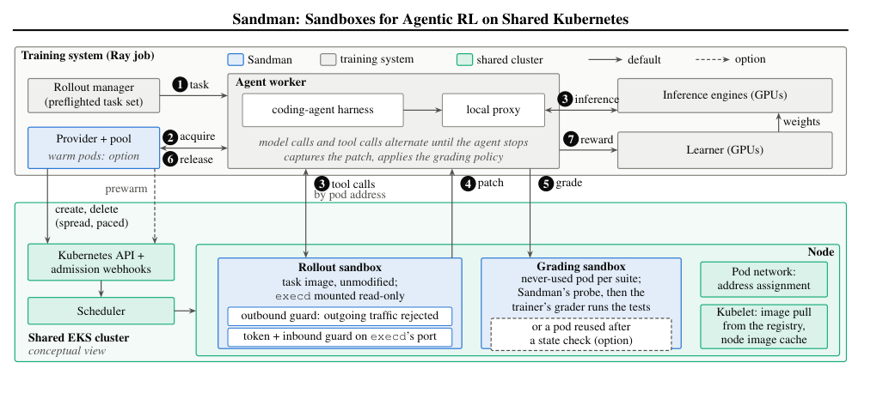

## In this issue

24 papers, 4 technical notes and 1 community readings. Publication dates in source records are separate from this reading date.

<h2 class="daily-paper-title" id="paper-arxiv-2610.38329">01 · A Case Study of a Multi-Agent Kernel-Optimization Loop That Learns a New AI Accelerator</h2>

[A Case Study of a Multi-Agent Kernel-Optimization Loop That Learns a New AI Accelerator](https://arxiv.org/abs/2610.38329) 
Byonggon Chun · 2026-10-30

This RNGD case builds target knowledge from documentation, microbenchmarks and compiler rules, screening legality before repeated device comparisons. A 12-day run optimizes three decode kernels to 9.293× geometric-mean speedup over official baselines.

One chip and one run without ablations cannot attribute component gains. Synthetic inputs and fixed seeds do not validate full-model quality.

<h2 class="daily-paper-title" id="paper-arxiv-2610.38809">02 · Causal Attention on CPU: A Cache-Aware and Load-Balanced Scheduling Kernel for Prefill</h2>

[Causal Attention on CPU: A Cache-Aware and Load-Balanced Scheduling Kernel for Prefill](https://arxiv.org/abs/2610.38809) 
Kwun Fung Lau、Frost Mitchell、Kanya Mo、Emani Ashok · 2026-10-30

CACPU combines multilevel cache blocking with in-kernel dispatch for causal CPU prefill. Two Intel CPU platforms show up to 2.01× kernel speedup and up to 1.74× better Llama-3.1-8B TTFT after SGLang integration.

The desktop lacks AMX and excludes that SGLang baseline; CPU prefill results do not establish replacement of full GPU serving.

<h2 class="daily-paper-title" id="paper-arxiv-2610.38983">03 · Beyond atol and rtol: Sound Test Oracles for Low-Precision GPU Kernels</h2>

[Beyond atol and rtol: Sound Test Oracles for Low-Precision GPU Kernels](https://arxiv.org/abs/2610.38983) 
Xinyi Shi · 2026-10-30

numoracle derives per-element acceptance regions from precision-annotated references, tracking shared rounding and block quantization rather than fixed atol/rtol. Its RTX PRO 6000 campaign detects 116 of 124 effective mutants.

Soundness depends on rounding, hardware, domain and implementation assumptions. Zero observed alarms is not a universal guarantee, and mutants remain undetected.

<h2 class="daily-paper-title" id="paper-arxiv-2610.19792">04 · JetSpec++: Foresight Parallel Drafting with Self Refinements</h2>

[JetSpec++: Foresight Parallel Drafting with Self Refinements](https://arxiv.org/abs/2610.19792) 
Zhaoxiang Feng、Lanxiang Hu、Haoran Yuan、Yu-Yang Qian、Jihui Yang、Peng Zhao、Yibo Zhu、Tajana Rosing、Hao Zhang · 2026-10-30

JetSpec++ drafts the next block on a second GPU and refines it while verification runs. Qwen3-8B reaches up to 1,361 tokens/s in bf16 for a single request; it hides drafting latency rather than eliminating draft computation.

It uses two GPUs. Higher NVFP4 speed is a different precision setting; high batches and larger models need validation, and latency gains are not per-GPU cost gains.

<h2 class="daily-paper-title" id="paper-arxiv-2610.37810">05 · ConfluxServe: Reconciling Resource Utilization and Parallelism Efficiency across Prefill and Decode in LLM Serving</h2>

[ConfluxServe: Reconciling Resource Utilization and Parallelism Efficiency across Prefill and Decode in LLM Serving](https://arxiv.org/abs/2610.37810) 
Wenhao Chen、Hong Zhang · 2026-10-30

ConfluxServe co-executes prefill and decode within one batch using different parallel strategies across operators. It reports 1.26–1.62× goodput over strongest baselines under TTFT/TBT constraints, addressing utilization without forcing uniform phase parallelism.

Goodput depends on SLOs, workload and parallel configuration; it is not a raw-throughput multiplier for every model.

<h2 class="daily-paper-title" id="paper-arxiv-2610.37921">06 · FAD-KV: Adaptive Dictionary KV Caching for Efficient Reasoning Decoding</h2>

[FAD-KV: Adaptive Dictionary KV Caching for Efficient Reasoning Decoding](https://arxiv.org/abs/2610.37921) 
Yuxuan Zhu、David H. Yang、Parisa Shiravani、Mohammad Mohammadi Amiri、Tejaswini Pedapati、Subhajit Chaudhury、Keerthiram Murugesan、Pin-Yu Chen · 2026-10-30

FAD-KV reduces sparse-coding cost with one-shot Top-n screening and light coefficient refinement, then reuses inactive dictionary atoms to adapt to KV drift without unbounded growth. Its target is a quality–efficiency tradeoff under bounded dictionary memory.

Compression is lossy. Append-style baselines can use larger dictionaries, so comparisons must include quality, total cache size and coding cost.

<h2 class="daily-paper-title" id="paper-arxiv-2610.37989">07 · GAUSS: A Workload-Aware Analytical and Monte-Carlo Simulator for LLM Inference Serving</h2>

GAUSS combines prefill/decode latency surfaces, queueing recurrence and Monte Carlo to model TTFT/TBT distributions and explore capacity, segmentation and SRPT. It makes arrival variability and request shapes explicit instead of relying on mean throughput alone.

Limitations: Predictions depend on calibration and queueing assumptions. Broad comparisons with trace methods do not replace independent error validation; the simulator was not run here.

Source: [GAUSS: A Workload-Aware Analytical and Monte-Carlo Simulator for LLM Inference Serving](https://arxiv.org/abs/2610.37989)

<h2 class="daily-paper-title" id="paper-arxiv-2610.38196">08 · GearUp: DAG-aware Acceleration for Serverless Inference Serving via Slack-guided Pre-loading</h2>

[GearUp: DAG-aware Acceleration for Serverless Inference Serving via Slack-guided Pre-loading](https://arxiv.org/abs/2610.38196) 
Qi Qi、Yifan Sui、Hanfei Yu、Hong Zhang、Hao Wang · 2026-10-30

GearUp schedules library, weight and CUDA-kernel loading within upstream DAG slack and reuses initialized instances. Two L40S workflows show 64.5% and 75.9% lower median end-to-end latency than SMIless.

Benefits depend on slack, loading profiles and reuse. Cold-execution and eager-preload comparisons use different baselines and must remain separate.

<h2 class="daily-paper-title" id="paper-arxiv-2610.38355">09 · FlatCake: A Flat KVCache Storage Architecture for LLM Serving</h2>

[FlatCake: A Flat KVCache Storage Architecture for LLM Serving](https://arxiv.org/abs/2610.38355) 
Xin Huang、Teng Ma、Zhuoran Li、Yibo Zhao、Zhaoshi Li、Qianchao Zhu、Wei Yang、Chenxi Wang、Tao Xie、Youwei Zhuo · 2026-10-30

FlatCake treats DRAM and SSD as peer KV media with fixed, session-contiguous placement at creation and GDS streaming into a bounded GPU window. Under high load on a Claude Code trace, cache hits remain 94% versus Mooncake’s 64%.

It relies on immutable blocks and session reuse. Total-token throughput includes inputs and is not generation speed; storage configuration matters.

<h2 class="daily-paper-title" id="paper-arxiv-2610.38968">10 · TableTune: Measured, Self-Correcting Draft-Length Tables for Dynamic Speculative Decoding</h2>

[TableTune: Measured, Self-Correcting Draft-Length Tables for Dynamic Speculative Decoding](https://arxiv.org/abs/2610.38968) 
Abhishek Malvankar、Paul Castro、Nick Mitchell、Lionel Villard · 2026-10-30

TableTune measures batch-size/draft-length combinations on the actual vLLM serving path and updates tables using live acceptance rates, turning draft length from a hand-written constant into a measured, repairable control parameter.

The peak 58% repairs mistuning. Comparisons are only against speculative configurations and do not establish universal gains over non-speculative decoding.

<h2 class="daily-paper-title" id="paper-arxiv-2610.38981">11 · Why Speculative Decoding Works Better Than Predicted on Sparse MoE Models</h2>

[Why Speculative Decoding Works Better Than Predicted on Sparse MoE Models](https://arxiv.org/abs/2610.38981) 
Ekagra Ranjan、Komal K. Teru、Bharat Venkitesh、Acyr Locatelli · 2026-10-30

This study shows that expert bytes alone mispredict fine-grained MoE verification cost: routing overlap, L2 reuse and kernel bandwidth utilization shape low-batch behavior. An IPF model predicts unique expert counts with under 4% error.

Expert-count error is not end-to-end latency error. Some analyses isolate target verification and omit actual drafter cost and acceptance.

<h2 class="daily-paper-title" id="paper-arxiv-2610.39216">12 · PDScope: Breaking the Prefill-Decode Seesaw for Memory-Bound MoE Inference</h2>

[PDScope: Breaking the Prefill-Decode Seesaw for Memory-Bound MoE Inference](https://arxiv.org/abs/2610.39216) 
Enda Yu、Dezun Dong、Zhaoning Zhang、Xiaojian Yang、Weiling Yang、Shaonan Ma、Dongsheng Li、Yongwei Wu、Xiangke Liao · 2026-10-30

PDScope separately optimizes aggressive prefill loading and conservative decode transfers for memory-limited MoE, using expert prediction, cross-layer cost modeling and static-graph pipelines. It reports separate prefill and decode throughput gains.

Phase speedups cannot be multiplied. Model, PCIe, CPU and cache capacity determine results; request-level acceleration may differ.

<h2 class="daily-paper-title" id="paper-arxiv-2610.39562">13 · Raincheck: Deferred Multimodal Prefill for Efficient Multi-Turn MLLM Inference</h2>

[Raincheck: Deferred Multimodal Prefill for Efficient Multi-Turn MLLM Inference](https://arxiv.org/abs/2610.39562) 
Wenjie Huang、Jun Zhang、Hongyaoxing Gu、Haoyang Huang、Tianqi Xu、Xinyue Hao、Xinyi Hu、Xinle Du、Jun Dai、Shuang Ge、Chen Lei、Yue Li、Mingcheng Wan · 2026-10-30

Raincheck initially retains selected multimodal tokens, then prefills omitted tokens during decode and scheduling gaps so later questions can access more original information. Across two models it recovers a substantial share of hard-pruning quality loss.

Systems measurements use one running request and do not reduce modality encoding. Recovered-loss percentages are not absolute improvements over full-input quality.

<h2 class="daily-paper-title" id="paper-arxiv-2610.39621">14 · The Real Cost of Context: Predicting Compute Time and Energy Consumption in LLM Prefill and Decode Phases</h2>

[The Real Cost of Context: Predicting Compute Time and Energy Consumption in LLM Prefill and Decode Phases](https://arxiv.org/abs/2610.39621) 
Lars Krupp、Daniel Geißler、Francisco M. Calatrava-Nicolas、Stefan Gerd Fritsch、Paul Lukowicz、Jakob Karolus · 2026-10-30

This study fits time and energy by input/output length, finding linear and quadratic prefill terms that output-only accounting misses. Proprietary-API energy is inferred using the energy model paired with the closest local timing fit.

Local measurements cover few H100/H200 configurations at batch one with no exact API match. Similar response time does not uniquely identify hardware power.

<h2 class="daily-paper-title" id="paper-arxiv-2610.39999">15 · PhOSv1: Efficient Scaling of Model Sleeping on a Single Server for Autoscaling with GPU-Context Deduplication</h2>

[PhOSv1: Efficient Scaling of Model Sleeping on a Single Server for Autoscaling with GPU-Context Deduplication](https://arxiv.org/abs/2610.39999) 
Tianle Sun、Xingda Wei、Rong Chen · 2026-10-30

PhOSv1 shares duplicated CUDA contexts and kernel binaries across sleeping models through a central daemon and API remoting, reducing resident engine overhead while preserving fast wake-up.

Reported measurements use one GPU despite an eight-GPU server; isolation and multi-tenant implications of context sharing need separate evaluation.

<h2 class="daily-paper-title" id="paper-arxiv-2610.40287">16 · Only Accepted Tokens Count: An Energy Accounting of Speculative Decoding Under Latency Targets</h2>

[Only Accepted Tokens Count: An Energy Accounting of Speculative Decoding Under Latency Targets](https://arxiv.org/abs/2610.40287) 
Bole Ma、Ayesha Afzal、Jan Eitzinger、Harald Koestler、Gerhard Wellein · 2026-10-30

This study accounts for speculation energy per accepted output token. Larger batches already amortize weight reads and can make verification compute-bound; with low acceptance, meeting tighter latency targets can increase energy per token.

Results depend on model, corpus, batch and measurement scope; GPU energy is not whole-datacenter energy.

<h2 class="daily-paper-title" id="paper-arxiv-2610.40292">17 · DolphinRouting: Cluster-Level Binary Routing for Disaggregated LLM Inference Serving</h2>

[DolphinRouting: Cluster-Level Binary Routing for Disaggregated LLM Inference Serving](https://arxiv.org/abs/2610.40292) 
Yishuo Yuan、Shaoyu Yang、Chunrong Fang · 2026-10-30

DolphinRouting clusters requests by raw and cache-adjusted lengths on both worker pools plus output-length information, learning local/remote prefill choices offline and using feature extraction and lookup online.

It assumes a given P/D allocation and available features; obtaining output-length information and handling drift affect deployment.

<h2 class="daily-paper-title" id="paper-arxiv-2610.40305">18 · Rimuru: Unified Memory Management for Modern LLM Serving via Elastic Expert Offloading</h2>

[Rimuru: Unified Memory Management for Modern LLM Serving via Elastic Expert Offloading](https://arxiv.org/abs/2610.40305) 
Zhiyuan Fang、Dingyang Li、Jianfeng Zhong、Bin Wang、Weixi Zhu、Cunshu Ni、Zicong Hong、Wuhui Chen、Zibin Zheng · 2026-10-30

Rimuru shares pages between expert weights and attention states using tensor-specific views, split/merge allocation and MoE kernels that directly access noncontiguous weights, dynamically adjusting memory boundaries.

Large ratios arise under specific memory-constrained baselines, not universally; transfer costs and concurrency determine elastic-offload benefits.

<h2 class="daily-paper-title" id="paper-arxiv-2610.38228">19 · The Endgame of FSDP Communication: Layout-Aware Collectives on Copy Engines, RDMA, and NVSwitch</h2>

[The Endgame of FSDP Communication: Layout-Aware Collectives on Copy Engines, RDMA, and NVSwitch](https://arxiv.org/abs/2610.38228) 
Zejian Wang、Yifan Zhao、Kaihui Ren、Xiaoling Zhou、Yubin Wang、Chenhao Guan、Lin Zhang、Yufeng Li、Zhikang Mo、Zhuoru Ma、Yingtong Xiong、Jihu Guo、Yiqiao Liao、Chengru Song · 2026-10-30

TIDE folds FSDP2 per-parameter layout placement into collectives, using copy engines, RDMA and NVSwitch to reduce copies and SM interference. On 64 GPUs, step time falls by up to 27.1% versus stock FSDP2 and 6% versus SymmMem.

It depends on specific interconnects and NCCL APIs. Maxima from different configurations are not one operating point.

<h2 class="daily-paper-title" id="paper-arxiv-2610.39711">20 · Sandman: bursty training sandboxes on a shared cluster</h2>

**Original:** [Sandman: Building and Operating Sandboxes for Agentic Reinforcement Learning on Shared Kubernetes](https://arxiv.org/abs/2610.39711) 
**Authors:** Yiming Yan, Hongyang Wang, Wenbo Chen, Xuan Wang, Jingguo Liu, Xian Li, Chen Qi, Leo Fan, Siwei Li, Qianli Wu, Yichuan Li, Ruochen Wen, Qian Qu, Zheshen Wang, Benoit Dumoulin · **First published:** 2026-10-29

An agentic RL trajectory repeatedly calls tools, so files and processes must persist between calls. Training also requests environments in bursts: the authors report a peak of 132 creates in one second against a campaign average of 1.8 per second. Sizing for the mean can miss pressure on Kubernetes admission, scheduling, and network address allocation.

Sandman runs each sandbox as an ordinary pod with a small daemon mounted into the unmodified task image. The trainer acquires a sandbox and alternates model inference with tool calls; it extracts the patch and, by default, runs tests in a separate never-used grading pod. A provider creates, paces, spreads, and deletes pods; an optional pool prewarms common images. A key lifecycle detail is that cleanup still has an owner if a caller times out and abandons an acquisition.

<a class="note-image-link" href="/assets/images/digest/2026-10-31/sandman-architecture.png" target="_blank" rel="noopener" aria-label="Sandman training and sandbox components · View original image ↗">View original image ↗</a>

*Reading the diagram: the trainer acquires a rollout sandbox, alternates model and tool calls, and sends the patch to a separate grading sandbox; the provider manages pod lifecycles.*

The authors held 11,858 tiny sandboxes in a scale test and report about 3.13 million creations across four internal SWE-bench Verified training campaigns. These are different workloads: the lightweight-pod test is not a capacity guarantee for real task images. Prewarming reduces acquisition latency but reserves idle resources; image pulls, address allocation, and cleanup after timeouts also matter. The evidence comes from one shared EKS cluster, and some mechanisms postdate the reported production campaigns. For AgentOps, the practical lesson is to consider tail acquisition latency, orphan reclamation, and grading integrity alongside tool execution speed.

<h2 class="daily-paper-title" id="paper-arxiv-2610.39468">21 · Soei: Structured Observability of Evidence and Intent for Multi-Agent AI Software Engineering</h2>

Soei studies 45 coding-agent sessions with an audited classifier, estimating that 23.4% of editing episodes lack independent checks after the final edit and 57.8% of completed todos lack intervening proof. It proposes an event ledger separating acknowledgment, attribution and completion evidence.

Limitations: Classifier errors remain, and missing observed checks do not prove a bad repair. Hash chaining detects tampering, not truth of event content.

Source: [Soei: Structured Observability of Evidence and Intent for Multi-Agent AI Software Engineering](https://arxiv.org/abs/2610.39468)

<h2 class="daily-paper-title" id="paper-arxiv-2610.38610">22 · Repair selection: evaluate with the executor that will act</h2>

**Original:** [Repairs for Whom? Evaluator-Executor Mismatch in Selecting Repairs for Failed LLM Agents](https://arxiv.org/abs/2610.38610) 
**Authors:** Yijun Liao, Fanwei Liang · **First published:** 2026-10-28

A stronger model, deterministic replay, or an environment planner may score candidate repairs. Yet an action’s value depends on how the deployed agent interprets the state, samples its next steps, and spends its remaining budget. An evaluator succeeding from a state does not guarantee that the executor will do the same.

The authors fix failed trajectories and candidate single-action replacements, let different evaluators select repairs, and independently measure the deployed policy’s net gain. This is the success rate after replacement minus the success rate when rerunning the original action; WebShop uses reward differences. The reference selects using the deployed executor’s own rollouts, with separate samples for selection and evaluation. The study distinguishes a change in evaluation target from simply using fewer samples.

On ALFWorld and WebShop failure pools not screened for repair value, greedy replay loses 0.08–0.13 in expected net success gain and 0.06–0.13 in net reward, respectively, relative to matched selection. Using 14B rollouts to select repairs for Qwen2.5-7B loses 0.25 and 0.07, respectively. These are selection losses in this experiment, not a general claim that stronger models are worse. Each unscreened pool contains 60 failed trajectories; the study replaces one action at a time and uses specified candidate sets and replayable environments.

For intervention design, the executor includes the model, prompt, history protocol, and decoding settings. Stronger agents may propose useful candidates, but their own success is not automatically a proxy for the deployed policy’s benefit. The experimental protocol is useful reading for anyone designing repair verification.

<h2 class="daily-paper-title" id="paper-arxiv-2610.38800">23 · When Relevant Code Is Wrong: Runtime-Aware Context for AI Coding Agents</h2>

CASE classifies retrieved artifacts as valid, invalid or unknown using feature flags, deployment configuration and architectural history. Its prototype filters 16 incompatible artifact occurrences across six tasks, 15 artifacts and three deployments.

Limitations: This is feasibility under illustrative application/reference rules, not demonstrated improvement in coding-agent correctness.

Source: [When Relevant Code Is Wrong: Runtime-Aware Context for AI Coding Agents](https://arxiv.org/abs/2610.38800)

<h2 class="daily-paper-title" id="paper-arxiv-2610.39234">24 · AgentHeal: Evaluating Goal-Preserving Resource Recovery of Web Agents under Access Barriers</h2>

[AgentHeal: Evaluating Goal-Preserving Resource Recovery of Web Agents under Access Barriers](https://arxiv.org/abs/2610.39234) 
Zhiyi Liu、Haohua Du、Haoqi Sun、Haisheng Tan · 2026-10-30

AgentHeal tests whether agents find legitimate alternatives without weakening the goal after dead links, authentication walls or rate limits. Across nine snapshot-based barrier families, average success falls from 89.4% to 43.7%, exposing look-alikes, futile retries and policy violations.

Snapshots/replay omit live-web dynamics. Scoring includes an LLM judge, and deterministic checks cover predefined provenance and action rules.

## Community

<h3 id="community-x-vllm-2115985388649242699">Community note</h3>

[vLLM Day-0 RL：Mistral Large 4 + SkyRL（8×GB200 LoRA RL）](https://x.com/vllm_project/status/2115985388649242699)

The official vLLM post reports Mistral Large 4 LoRA RL on eight GB200 nodes using NVFP4 QAT, FP8-KV simulation and routing replay, raising AIME 2024 avg@8 from about 64% to 75% after 75 steps.

This is eight nodes, not eight GPUs. A social report on one evaluation set does not establish broad generalization or exact train–inference consistency.

## Technical notes from this day

- [2026-10-31 | Using GPU Weights as the Parent for Delta Sync](/tech/en/baseten-fastest-delta-weight-syncs/)
- [2026-10-31 | ForgeKernel: Self-Evolving Kernels Catching and Surpassing Experts and Agents](/tech/en/review-openbmb-forgekernel/)
- [2026-10-31 | Radar: open-source Kubernetes UI with built-in MCP server for AI agents](/tech/en/review-skyhook-radar-k8s-ai-sre-mcp/)
- [2026-10-31 | Build a Validated Kubernetes Runtime for NVIDIA Dynamo](/tech/en/review-nvidia-dynamo-validated-kubernetes-runtime/)
