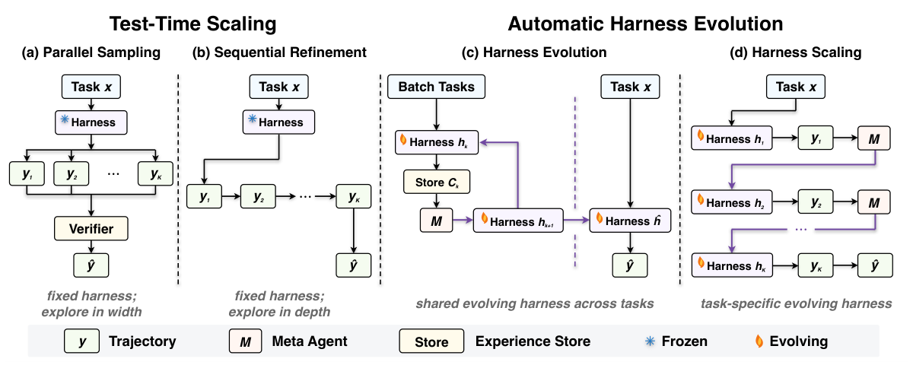

## What matters in this issue

When an agent's score rises, did its capabilities improve, did it receive more attempts, or did its verifier disclose the answer? Two papers separate these possibilities. One audits leakage in fault localization and makes unsupported components abstain from diagnosis. The other compares harness evolution with task-level search under matched budgets, finding weak terminal-task generalization but stronger task-specific adaptation in long-horizon games.

They address different failure mechanisms: the first examines whether evidence construction preserves genuine ambiguity; the second examines baselines and transfer. A community brief follows a draft Hopper decode implementation whose gains depend on a particular model, hardware configuration and concurrency level.

<h2 class="daily-paper-title" id="paper-arxiv-2610.00126">Verifier leakage: establish that a real decision remains</h2>

[A Verifier Can Leak the Answer: Diagnosability Before Optimization in Closed-Loop Agent Debugging](https://arxiv.org/abs/2610.00126)  
Peiying Zhu, Sidi Chang · First published 2026-09-09 · arXiv v1

### A correct optimizer can support an invalid comparison

The subject is a closed-loop decision policy in a simulated demand-and-inventory environment, not an LLM agent. Aggregate trace discrepancies become conflict sets; exact minimum hitting set (MHS) or propagation-aware greedy selection then chooses a low-cost set of components explaining those conflicts. The original hypothesis was that exact optimization could improve localization.

Instead, both solvers returned identical supports in 12/12 development cases, with planted-fault recovery of 9/12 each. Exact-anchor predicates disclosed the planted pair in 9/9 audited cases. Removing those anchors did not remove the second channel: a single-component hard intervention, paired with a predicate over that component, still generated singleton conflicts. Propagation left no residual conflicts in any of the nine cases. The optimizer was solving the supplied problem correctly, but its input had already forced the answer.

### Two gates establish evidence eligibility

The replacement contract first checks clean reference exposure. At least 14 of 15 independent partitions must have a support count of at least 12 before a regime-component unit enters the reference map. At runtime, both reference and current streams must meet the support threshold in the same partition, again in at least 14/15 partitions. Sufficient totals on each side are inadequate if they describe different partitions.

Only admitted units reach signal evaluation; unsupported ones abstain. Signal thresholds are independently calibrated and frozen before the formal study. These gates establish evidence sufficiency and comparability. Probe leakage remains a separate audit obligation: adequate support does not itself prevent disclosure of the target.

### Zero observed false admissions is not zero risk

The preregistered heldout contains 1,440 cases and 21,600 partition rows. Of 72 regime-component units, 55 pass the reference gate and 54 subsequently pass the runtime gate. The independent clean-null arm observes zero stable false admissions among 20 physical components, with a one-sided exact 95% upper bound of **0.1391**. This meets the frozen 0.20 criterion; it does not establish a false-alarm rate below 5%. A large number of simulated trajectories does not replace those 20 components as the statistical units.

Within admitted units, the fraction of clean traffic affected by a fault predicts detection better than the fraction of state cells edited. A large intervention in rarely visited states may remain nearly invisible in aggregate traces.

**Read the falsified optimizer hypothesis and the verification contract together.** For AgentOps and fault injection, the transferable questions are whether a probe reveals the injected location, whether a real choice survives propagation, and whether the policy visited the region being diagnosed. The heldout does not establish localization accuracy or renewed superiority of exact MHS. Its thresholds come from one simulator and should not be transferred directly to language agents.

<h2 class="daily-paper-title" id="paper-arxiv-2607.12227">Harness evolution: what did the extra compute improve?</h2>

[Rethinking the Evaluation of Harness Evolution for Agents](https://arxiv.org/abs/2607.12227v4)  
Yike Wang, Huaisheng Zhu, Zhengyu Hu, Yige Yuan, Zhengyu Chen, Shakti Senthil, Hannaneh Hajishirzi, Yulia Tsvetkov, Noah A. Smith, Pradeep Dasigi, Teng Xiao  
First published 2026-07-14 · Reading the v4 revision dated 2026-10-05

### Better scaffolding or more attempts?

A harness comprises prompts, tools, memory and control logic around a model. Evolution modifies these surfaces using trajectories and scores, but improvement might come from spending more compute searching for answers. Reusing the search tasks for final reporting further obscures whether the changes are reusable.

The study compares four allocations: parallel sampling with a fixed harness, sequential trajectory refinement, shared harness evolution across tasks, and task-specific harness scaling. The last permits adaptation to an individual instance; it does not establish a design that transfers to unseen tasks.

<a class="note-image-link" href="/assets/images/digest/2026-11-02/harness-method.png" target="_blank" rel="noopener" aria-label="Four budget allocations: parallel sampling, sequential refinement, shared harness evolution and task-specific harness scaling · View original image ↗">View original image ↗</a>

*Left to right, extra budget buys independent attempts, trajectory revisions, shared program changes and task-specific program changes. What remains frozen determines which capability the score can support.*

### Terminal tasks need the simple baselines

Terminal-Bench 2.1 experiments use 89 tasks, three models, K=5 attempts and averages over two independent runs. Methods share the initial harness, and AHE's external harness-retrieval component is disabled. Without unit-test feedback, parallel sampling averages 72.3, Harness Evolution 67.4 and direct sampling 68.2. Self-guided program revision does not reliably improve performance.

The more informative transfer experiment separates 45 training, 10 validation and 34 test tasks. Average held-out Pass@1 is **63.2** for both initial and evolved harnesses, with model-specific changes of +1.2, 0.0 and −1.4 percentage points. This is evidence against robust transfer in this experiment, not proof that every harness optimizer is ineffective.

### Games favor feedback-rich adaptation within a task

On 25 public ARC-AGI-3 games with a 2,000-action budget, full harness scaling improves over VISTA* with memory evolution disabled: RHAE rises from 43.3 to 77.5 for Claude Opus 4.8 and from 21.1 to 38.2 for GPT-5.6 Terra, approximately 79% and 81% relative gains. RHAE incorporates completion and action efficiency relative to humans; it is not a win rate. Memory-only evolution in VISTA falls between the two, supporting an additional contribution from editable tools and skills.

Five EdgeBench game/simulator tasks use a 12-hour budget and report the highest score attained, averaged over two runs. The two models improve from 48.3 to 54.7 and from 45.9 to 49.8. These are adaptation results within each task, not held-out transfer, so they do not overturn the earlier generalization finding.

**The evaluation protocol is the central contribution.** Feedback, attempts, editable surfaces and the final test set must be explicit. Terminal-task cost estimates omit harness-editing overhead, so matched budgets do not mean identical total spending. Compare a self-improving system with direct search scaling, then test within-task gains and cross-task reuse separately to establish what the extra complexity buys.

## Community brief: a checkable Hopper decode implementation

[SemiAnalysis post](https://x.com/SemiAnalysis_/status/2116666571728863431) · 2026-10-31 UTC; [vLLM draft PR #64893](https://github.com/vllm-project/vllm/pull/64893)

The Hopper backend targets **DeepSeek-V4.1-Flash, 4×H200, TP4 and DSpark k=5**. PDL kernel chaining, shape-specific CuTe DSL kernels and small-operation fusion reduce fixed overhead at low decode concurrency. Against the same build with the executor disabled, author-run ABBA tests using real prompts, 1,024 output tokens and temperature 0.7 reduce median ITL from 8.76 to 5.40 ms at concurrency 1: a 38.3% reduction, falling to 5.1% at concurrency 32. This measures latency reduction, not a general throughput increase.

The PR remains a draft. Decode steps above 192 rows, prefill and unsupported work fall back to the stock path; a specific weight copy adds roughly 0.36 GB per GPU. Quality checks and kernel tests are author-reported, and CI lacks a 4×H200 end-to-end runner. The useful development is the specialized low-concurrency path and its fallback boundaries; AI assistance with roughly ten thousand lines of kernels alone does not establish a reliable development process.
