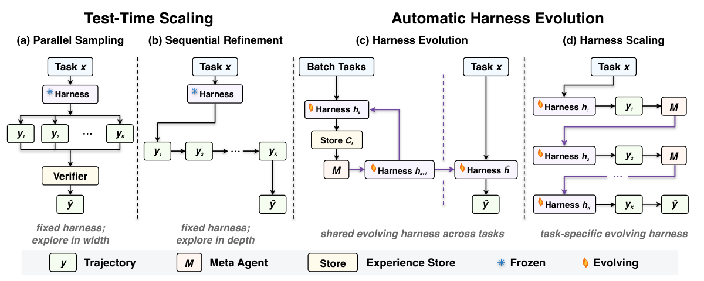

## In this issue

1 paper, 2 technical notes. Publication dates in source records are separate from this reading date.

<h2 class="daily-paper-title" id="paper-arxiv-2607.12227">01 · Harness evolution: what did the extra compute improve?</h2>

[Rethinking the Evaluation of Harness Evolution for Agents](https://arxiv.org/abs/2607.12227v4) 
Yike Wang, Huaisheng Zhu, Zhengyu Hu, Yige Yuan, Zhengyu Chen, Shakti Senthil, Hannaneh Hajishirzi, Yulia Tsvetkov, Noah A. Smith, Pradeep Dasigi, Teng Xiao 
First published 2026-07-14 · Reading the v4 revision dated 2026-10-05

### Better scaffolding or more attempts?

A harness comprises prompts, tools, memory and control logic around a model. Evolution modifies these surfaces using trajectories and scores, but improvement might come from spending more compute searching for answers. Reusing the search tasks for final reporting further obscures whether the changes are reusable.

The study compares four allocations: parallel sampling with a fixed harness, sequential trajectory refinement, shared harness evolution across tasks, and task-specific harness scaling. The last permits adaptation to an individual instance; it does not establish a design that transfers to unseen tasks.

<a class="note-image-link" href="/assets/images/digest/2026-11-02/harness-method.png" target="_blank" rel="noopener" aria-label="Four budget allocations: parallel sampling, sequential refinement, shared harness evolution and task-specific harness scaling · View original image ↗">View original image ↗</a>

*Left to right, extra budget buys independent attempts, trajectory revisions, shared program changes and task-specific program changes. What remains frozen determines which capability the score can support.*

### Terminal tasks need the simple baselines

Terminal-Bench 2.1 experiments use 89 tasks, three models, K=5 attempts and averages over two independent runs. Methods share the initial harness, and AHE's external harness-retrieval component is disabled. Without unit-test feedback, parallel sampling averages 72.3, Harness Evolution 67.4 and direct sampling 68.2. Self-guided program revision does not reliably improve performance.

The more informative transfer experiment separates 45 training, 10 validation and 34 test tasks. Average held-out Pass@1 is **63.2** for both initial and evolved harnesses, with model-specific changes of +1.2, 0.0 and −1.4 percentage points. This is evidence against robust transfer in this experiment, not proof that every harness optimizer is ineffective.

### Games favor feedback-rich adaptation within a task

On 25 public ARC-AGI-3 games with a 2,000-action budget, full harness scaling improves over VISTA* with memory evolution disabled: RHAE rises from 43.3 to 77.5 for Claude Opus 4.8 and from 21.1 to 38.2 for GPT-5.6 Terra, approximately 79% and 81% relative gains. RHAE incorporates completion and action efficiency relative to humans; it is not a win rate. Memory-only evolution in VISTA falls between the two, supporting an additional contribution from editable tools and skills.

Five EdgeBench game/simulator tasks use a 12-hour budget and report the highest score attained, averaged over two runs. The two models improve from 48.3 to 54.7 and from 45.9 to 49.8. These are adaptation results within each task, not held-out transfer, so they do not overturn the earlier generalization finding.

**The evaluation protocol is the central contribution.** Feedback, attempts, editable surfaces and the final test set must be explicit. Terminal-task cost estimates omit harness-editing overhead, so matched budgets do not mean identical total spending. Compare a self-improving system with direct search scaling, then test within-task gains and cross-task reuse separately to establish what the extra complexity buys.

## Technical notes from this day

- <a href="/tech/en/agent-desktop-reliability/">agent-desktop: Identity and Retry Evidence for Desktop Actions</a>
- <a href="/tech/en/particledb-jepsen/">ParticleDB: Testing Database Safety Promises on One Node</a>
