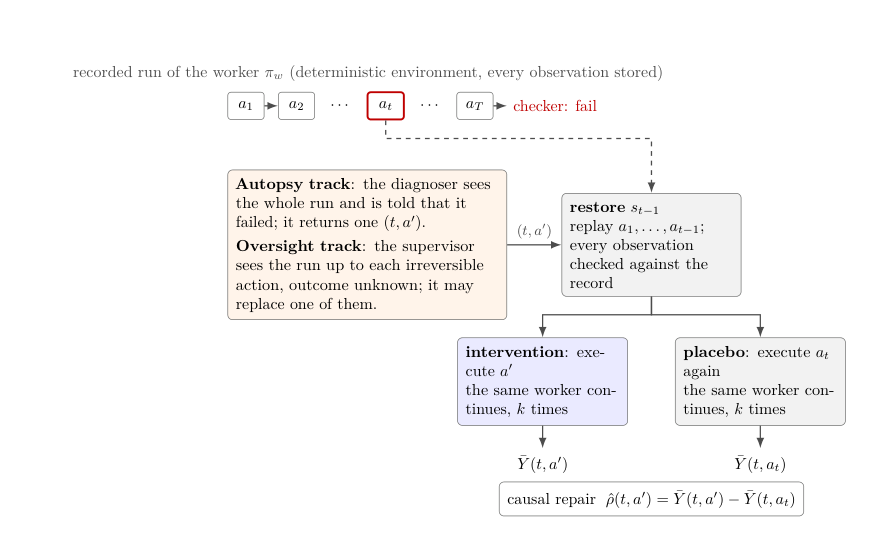

## This issue

Does naming a suspicious step after an agent failure identify an effective repair? ReplayRCA measures the effect of replacing one action with controlled replay and a placebo, separating post-hoc diagnosis from live oversight. AIFaultBench packages real AI software faults, triggers and reproduction records, providing a different kind of evidence: whether an original failure appears under documented conditions.

<h2 class="daily-paper-title" id="paper-replayrca-2026">01 · ReplayRCA: Counterfactual replay for diagnosis and oversight</h2>

[ReplayRCA: Measuring Post-hoc Diagnosis and Live Oversight of Agent Failures by Counterfactual Replay](https://arxiv.org/abs/2610.41025)  
Jeremy Canale, Fabien Soulis · 2026-10-29

### From agreement with labels to intervention outcomes

A long failed task can have multiple effective repair points. A benchmark that compares a selected step with one annotation can mark another successful intervention wrong. ReplayRCA does not claim to invent counterfactual replay; it makes replay the evaluation protocol. A diagnoser chooses a step and replacement tool action, the system restores the prior state, and the original worker continues until a final-state checker judges success.

<a class="note-image-link" href="/assets/images/digest/2026-11-03/replayrca.png" target="_blank" rel="noopener" aria-label="ReplayRCA intervention and control workflow · View original image ↗">View original image ↗</a>

*Reading the diagram: both branches restore the state before the same action. The left executes a replacement; the right replays the original. The original worker continues in both, and their success-rate difference measures intervention benefit.*

The control matters because a stochastic continuation may recover on its own, and restarting can also change the outcome. The authors sample five continuations per branch and subtract the original-action success rate from the replacement-action success rate, calling the difference causal repair. OpsWorld is deterministic: the system re-executes recorded actions from the initial state and checks observations byte for byte before intervening. This is not an experiment that rolls back an irreversible production service.

### Explaining and preventing failure differ

The post-hoc diagnoser sees the entire failed trajectory and knows it failed; it can replace any one action. The live supervisor sees only the trajectory so far and decides before irreversible actions such as refunds or cancellations. It does not know the final outcome, may intervene once, and pays a five-percentage-point interruption cost in the score. Successful runs are included, so unnecessary intervention has consequences.

On 62 calibrated systematic failures, the highest post-hoc causal repair among 13 models was **+51.3 percentage points**. None of the 78 pairwise differences survived multiple-comparison correction, so the ordering is not a reliable ranking. Forcing a strong model to intervene at the last step cost 17.1 points, showing why intervention location matters. Live oversight covered 87 runs; a supervisor that performed well post hoc was weakest live, with a 14.5-point gap on the same runs.

**Reading judgment: a useful evaluation protocol.** It measures whether one replacement changes the outcome, not necessarily the earliest root cause, and does not show that multi-step repairs cannot work. The tasks use a synthetic, verifiably restorable back-office environment; external side effects, complex production services and longer time horizons require further study. Limited samples and differing model reasoning settings also constrain model comparisons.

<h2 class="daily-paper-title" id="paper-aifaultbench-2026">02 · AIFaultBench: Packaging real AI software faults and reproduction evidence</h2>

[AIFaultBench: A Reproducible Benchmark of Real-World Faults in AI Software Systems](https://arxiv.org/abs/2610.41094)  
Mehil B Shah, Mohammad Masudur Rahman, Foutse Khomh · 2026-10-30

The dataset contains 770 faults from 105 repositories across six system classes, including deep learning, LLMs and agents. Each record connects an original report and revision to environment setup, a trigger and execution evidence. The authors allowed up to three hours per fault and required all three executions to meet matching criteria. They report 652 reproduced and 118 not reproduced; obstacles include unavailable hardware or data, version drift and nondeterminism.

It complements ReplayRCA: AIFaultBench provides real software defects and reproduction materials, while ReplayRCA evaluates interventions in a restorable agent environment. Its sample favors active, popular public Python repositories; the reproduction rate is not the prevalence of faults across AI systems. Individual cases can still require external data, hardware or credentials. The paper has no suitable architecture figure to explain the dataset mechanism.

<h2 class="daily-paper-title" id="paper-llm-serving-automation-gaps">03 · LLM Serving: The gap between detecting and mitigating incidents</h2>

[An Empirical Study of Automation Gaps in LLM Serving Systems](https://cloudintelligenceworkshop.org/papers/aiops26-Ranganathan.pdf) 
Bhala Ranganathan, Minghua Ma, Mickey Zhang, Klein Hu, Rakesh Kelkar, Chetan Bansal · AIOps 2026

### Why does recovery still need people after detection?

The authors study **156 high-severity incidents** at one large LLM serving platform during April–June 2025, combining incident records, postmortems, runtime logs and engineers' experience. They assign each incident one primary root-cause category—infrastructure, model configuration, inference engine or operations—and its first effective mitigation. The resulting categories expose primary signals rather than a complete causal chain.

Automated monitoring detected 115 incidents, about 74%, before customer reports. Mitigation still often required human judgment: 44 incidents used manual hotfixes, 15 required added capacity, and 75 involved human verification and monitoring without a technical change. The last group shows why even waiting for a transient problem to clear requires evidence. The detection percentage is not an automatic repair success rate.

### Turning incident categories into recovery opportunities

The authors attribute 94 incidents to the inference engine, predominantly timeouts and resource exhaustion. Cross-tabulating root causes and mitigations highlights candidates for automation, including connection-liveness recovery, traffic failover and node restarts. In a separate February–May 2025 validation period, normalized HTTP 408 errors for one affected customer fell from **2.72% to 0.01%** alongside the rollout of a connection-liveness strategy. This is an observational association and a single-customer example, not a randomized comparison or proof that all incidents can be recovered automatically.

**Reading judgment: useful production evidence for Ops4LLM.** The study distinguishes detection from safe mitigation and maps concrete incident types to recovery opportunities. Its limits include a single platform, a high-severity sample, and simplified single-label and first-effective-action coding; distributions, human decision costs and mitigation effects require validation in other services.

<h2 class="daily-paper-title" id="paper-specula-2607-25333">04 · Specula: Agent-built formal models for system code</h2>

[Specula: Scaling formal specifications for autonomous model checking of system code](https://arxiv.org/abs/2607.25333v2) 
Qian Cheng et al. · arXiv · First submitted 2026-07-28, revised 2026-08-03

Specula uses coding agents to read concurrent and distributed system code, derive correctness properties, generate TLA+ models and run model checking. It decomposes work into scenarios to limit the state space, checks execution traces for model–code conformance and attempts to reproduce counterexamples in the actual code. Feedback loops refine models, properties and scenarios.

The authors report 249 bugs across 48 open-source systems: 207 newly found and 42 known but unfixed. Of 89 reported, developers confirmed 68 and fixed 24. Model checking surfaced 200 of the 249; the remainder emerged while understanding and modeling code. **Found, reported, confirmed and fixed are distinct stages**: the total is not the number of confirmed new bugs.

The work makes the cost of applying formal methods to system code an iterative problem of modeling, trace validation and code-level reproduction. Most generated invariants are safety properties; model abstraction, state space, reproduction conditions and compute cost still limit which bugs can be found. The paper was first submitted in July; this is a later reading rather than a new publication.
