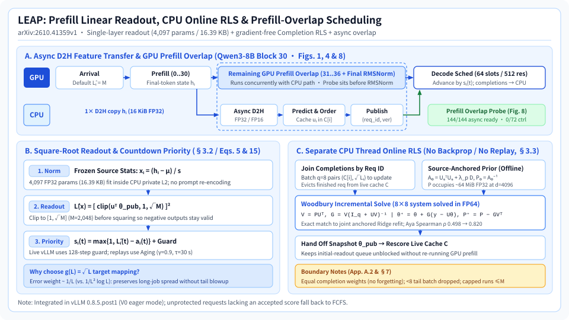
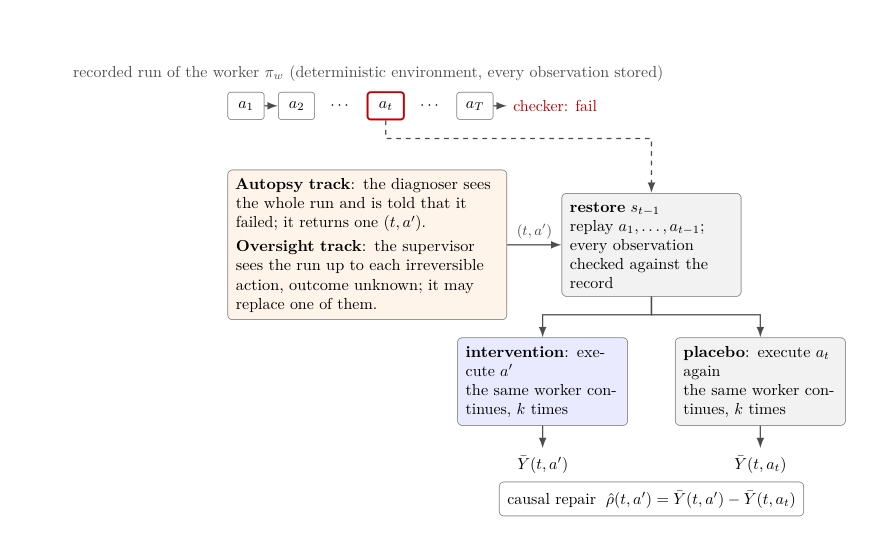
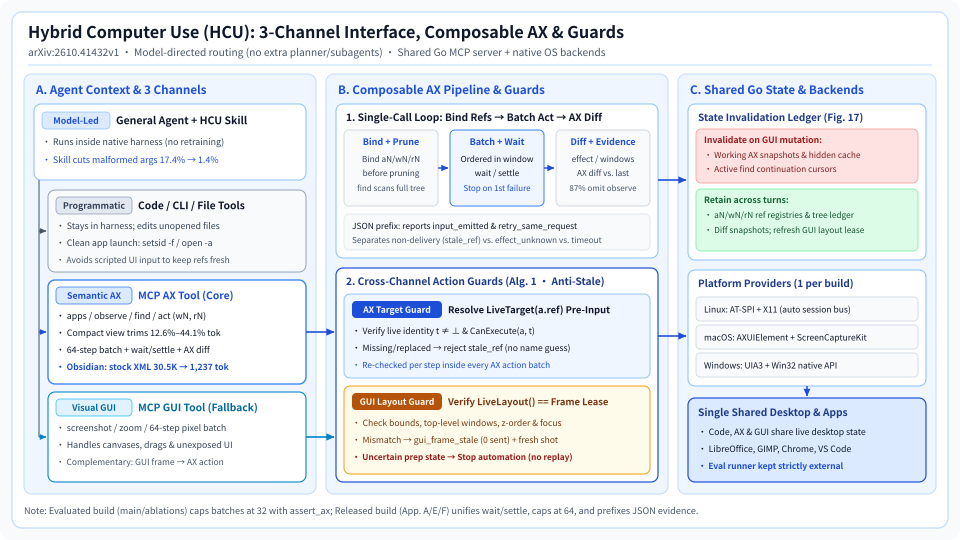
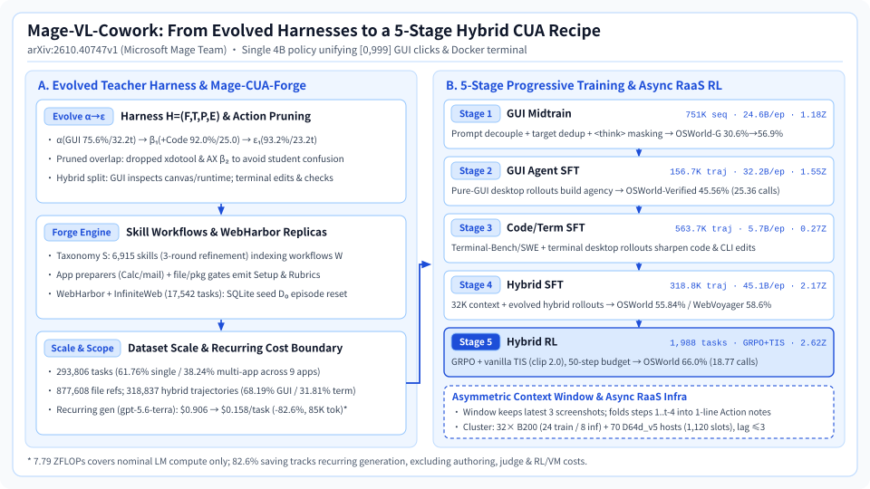
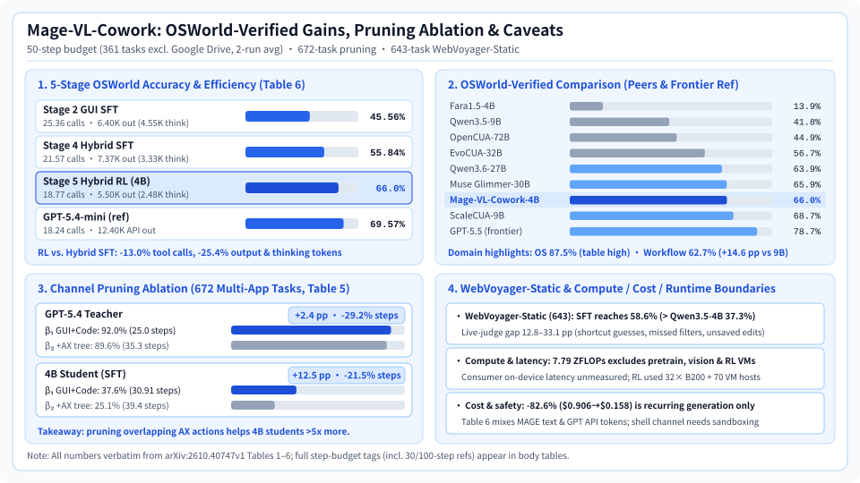

## In this issue

17 papers, 2 technical notes and 1 community reading. Publication dates in source records are separate from this reading date.

<h2 class="daily-paper-title" id="paper-arxiv-2610.41919">01 · Matching Workloads to Blackwell: Power-Resolved Benchmarking of NVIDIA B200 and B300 across HPC and AI Workloads</h2>

[Matching Workloads to Blackwell: Power-Resolved Benchmarking of NVIDIA B200 and B300 across HPC and AI Workloads](https://arxiv.org/abs/2610.41919) 
Mohsen Zand、Trung Dac Nguyen、H. Birali Runesha

This B200/B300 study resolves performance by workload and board power, finding no uniform successor advantage. A development vLLM build alone changes TTFT by 2.1× between otherwise identical B300 nodes.

Drivers and host conditions differ between clusters, so not all gaps are silicon effects. Resident inputs exclude real data-pipeline costs.

<h2 class="daily-paper-title" id="paper-arxiv-2610.41160">02 · ARK: Source-Port Path Reservation for Disaggregated KV Transfers</h2>

[ARK: Avoiding Routing Collisions for KV Cache Transfer in Disaggregated LLM Inference](https://arxiv.org/abs/2610.41160) ([v1 PDF](https://arxiv.org/pdf/2610.41160) · [HTML](https://arxiv.org/html/2610.41160v1) · [ACM DOI](https://doi.org/10.1145/3789240.3828750))  
Hung-Chun Lin\*, Ting-Wei Hsu\*, Chung-En Ho, Ahmed Saeed (Georgia Institute of Technology; \*equal contribution) · `arXiv:2610.41160v1 [cs.NI]` · ACM SIGCOMM 2026 Workshop on Networks for AI Computing (NAIC '26, pp. 2067–2073) · Submitted 2026-10-30 (`v1` only at verification time, with no revision or withdrawal; no public code repository is linked in the paper)

Prefill–decode (PD) disaggregation physically separates prompt ingestion from token generation across GPU pools, turning key–value (KV) cache migration into a critical-path network bottleneck where multi-gigabyte transfers run for hundreds of milliseconds to seconds before the first decoded token can appear. Under commodity Equal-Cost Multi-Path (ECMP) routing, size-oblivious 5-tuple hashing frequently collapses concurrent KV mega-flows onto the same spine link while sibling spines stay idle, inflating flow completion time (FCT) and user-visible time-to-first-token (TTFT). `ARK` avoids switch upgrades and receiver-side packet reordering by exploiting two structural traits of KV transfers—known flow identity at admission and lifetimes long enough to amortize millisecond-scale sync—to pick source ports whose ECMP hashes steer concurrent flows onto disjoint spines. Every metric and boundary below traces directly to `arXiv:2610.41160v1`, keeping author-reported simulation results strictly separate from protocol audit findings and deployment boundaries.

### 1. Why KV-Cache Mega-Flows Break Stateless ECMP and Prior Load Balancers

Modern LLM serving alternates between compute-bound prefill (`Θ(L²)` attention FLOPs) and HBM-bandwidth-bound autoregressive decode, prompting `DistServe`, `Splitwise`, `vLLM`, `SGLang`, `NVIDIA Dynamo`, and `llm-d`—as well as production stacks such as Moonshot AI's `Mooncake` and `SGLang`'s `96`-H100 `DeepSeek-V3` deployment—to decouple prefill and decode pools so each scales to its own SLO axis. That separation creates a radically heavier traffic regime:

- **Orders-of-magnitude larger elephant flows**: Per-token KV footprint scales as `2 · L_h · H_kv · d_h · s`. On `LLaMA-3.1-405B` (`126` layers, `8` KV heads, `d_h = 128`, FP16), each token requires `504 KB`, so a `100K`-token KV cache reaches `48 GB` and saturates a `400 Gbps` link for `960 ms`. Even on the evaluated `LLaMA-3-8B` (`128 KB/token`), a `1.6 GB` mean KV flow occupies a `100 Gbps` spine for at least `128 ms` (`~137 ms` simulated reference)—`3–4` orders of magnitude longer than traditional tens-of-megabyte datacenter elephant flows and millisecond-class TCP flows.
- **Oversubscribed Clos fabrics magnify stateless ECMP collisions**: Production AI clusters (including Meta's RoCE training fabric and Alibaba HPN) retain commodity 5-tuple ECMP (`k_i = H(q_i) mod K`) and routinely oversubscribe the leaf–spine tier for cost (`2:1` in §4.1). Because `H` ignores flow size, colliding mega-flows split one spine's bandwidth for their multi-second lifetimes while sibling spines sit idle, filling switch buffers faster and triggering RDMA retransmissions on buffer overflow.
- **Orthogonality to application-layer KV optimizations**: Multi-tier KV pools (`MemServe`, `LMCache`) and byte-reduction/rerouting techniques (`CacheGen`, `DualPath`, Yue et al.) shrink or shift transferred bytes above the fabric, yet never decide *which* equal-cost spine path admitted bytes traverse; `ARK` compounds directly with those reductions.
- **Mismatch with in-network and reactive host load balancers**: Custom-switch schemes add significant hardware or operational burden—custom congestion-aware leaf ASICs (`CONGA`), programmable ToRs with per-flow reordering buffers (`ConWeave`), switch flowlet detection (`LetFlow`), or packet spraying whose out-of-order delivery imposes heavy CPU reassembly overhead for multi-GB flows. Host-side `PLB` avoids switch changes but is **reactive**: it reroutes only after `M` consecutive ECN-marked rounds and only during idle gaps (because mid-flow IPv6 Flow Label changes induce reordering that RoCEv2 RNICs misread as packet loss). Hardware-paced RDMA KV transfers leave virtually no idle gaps, preventing `PLB` from safely repathing within a flow's lifetime.

KV transfers simultaneously unlock two preconditions that prior schemes could not assume: (1) a `≥128 ms` lifetime easily amortizes sub-millisecond admission coordination below `1%`, and (2) the destination GPU, byte count, and start time are fixed the moment prefill completes, removing any need for runtime elephant detection (`Hedera`) or centralized arbiters/traffic matrices (`Fastpass`, `Flowtune`, `FAST`, `Crux`).

### 2. ARK Design: Boot-Time Hash Inversion, Control/Data Split, and Race Resolution

<figure class="note-figure"><a class="note-image-link" href="/assets/images/digest/2026-11-03/ark-elephant-flow-spine-routing-en.svg" target="_blank" rel="noopener" aria-label="View original ARK collision mechanism and distributed source-port reservation architecture diagram">View original image ↗</a><figcaption>Figure 1 · ARK collision diagnosis and distributed host reservation design (from arXiv:2610.41160v1 §1–§3, Fig. 1, and Algorithm 1): user-space source-port bucket selection isolates concurrent KV flows across spines without switch edits or receiver reordering.</figcaption></figure>

`ARK` formalizes a two-tier spine-leaf Clos with `N_S` spine switches `V_S = {s₁, ..., s_{N_S}}` fully connected to `N_L` leaf (ToR) switches, where each GPU host has one uplink to its leaf, giving every cross-leaf host pair `(h_{i,m}, h_{j,n})` exactly `K = N_S` equal-cost paths `p_k = (h_{i,m} → ℓ_i → s_k → ℓ_j → h_{j,n})` (and extends to deeper multi-tier Clos fabrics such as Meta's RoCE network by inverting ECMP decisions per hop along the path). Two explicit assumptions underpin the protocol: (1) the KV transfer service uses a single well-known `dstPort` across peers so `srcIP`, `dstIP`, `dstPort`, and `proto` remain fixed per peer pair (multi-`dport` deployments extend via a per-`(peer, dport)` table), and (2) host clocks stay synchronized within the broadcast delay—a few microseconds in `ARK`'s deployment, readily met via `PTP`, `Sundial`, or `Huygens`.

Each server runs a user-space controller maintaining an eventually consistent replica of the reservation table `R(t) ⊆ P` mapping occupied paths `p_k ↦ (t, id)` through four steps (Algorithm 1):

1. **Boot-time precomputation (`Initialize`)**: Once at boot, for every peer `h_j ∈ V` and source-port offset `δ = 0, 1, ..., δ_max` (`δ_max = 2¹⁶` in §4.4), the controller evaluates `k ← H(q^δ) mod K` and appends `δ` to bucket `M_{h_j}[p_k]`, reducing runtime port lookup to an `O(1)` static array dereference.
2. **Admission-time reservation and fallback (`OnFlowArrival`)**: When flow `f_i` arrives at timestamp `t_i`, the controller scans at most `K` entries in `R`. If free spines remain, it picks `k_i* = min{k : p_k ∉ R}`, draws any `δ_i* ∈ M_{dst_i}[p_{k_i*}]`, records `R[p_{k_i*}] ← (t_i, id)`, and broadcasts `(p_{k_i*}, RESERVE, t_i, id)` to all peers. When all `K` paths are occupied, `ARK` **falls back to ECMP** by picking a uniform random `k_i* ∈ {1, ..., K}` and corresponding `δ_i*`. It then creates the RDMA queue pair (QP) using `srcPort = δ_i*` and registers `OnFlowCompletion`.
3. **Control/data plane separation and release (`OnFlowCompletion`)**: The data plane ships KV bytes single-path over commodity ECMP switches with zero receiver reordering. The control plane routes tiny, latency-sensitive `RESERVE` and `RELEASE` broadcasts over a separate low-bandwidth or management channel so sync latency stays propagation-bound rather than queued behind elephant data flows (sharing the data fabric still works algorithmically, at the cost of a wider race window under load). Upon flow completion, the host removes `p_{k_i*}` from `R` and broadcasts `RELEASE`.
4. **Deterministic race resolution (`OnRemoteUpdate`)**: Two hosts reserving the same spine within one broadcast delay trigger a conflict resolved by lexicographic comparison of `(t, id)` keys: if incoming `(t_p, id_p) < R[p_k]`, the smaller timestamp key wins `p_k`, and the losing host updates `R[p_k]` and re-invokes `OnFlowArrival(f)` to re-hash its local flow onto another path.

### 3. Packet-Level Evaluation, Spine Utilization, and Controller Microbenchmarks

<figure class="note-figure"><a class="note-image-link" href="/assets/images/digest/2026-11-03/ark-rdma-fct-ttft-eval-en.svg" target="_blank" rel="noopener" aria-label="View original ARK packet-level RDMA evaluation and microbenchmark summary chart">View original image ↗</a><figcaption>Figure 2 · Simulation gains and overhead bounds (from arXiv:2610.41160v1 Fig. 2–4 and Table 1): tail FCT and spine balance improve sharpest in congested pre-saturation regimes, while controller compute stays at 0.0025% of KV transfer time.</figcaption></figure>

The authors couple `SimAI`'s `Vidur` serving simulator (RandomForest regressors trained on per-layer NVIDIA H100 profiles of `LLaMA-3-8B` across token counts, batch sizes, and prefill chunks) with `AstraSim`'s ECMP-enabled `NS-3` packet-level RDMA simulator hosting the `ARK` controller. The topology mirrors Alibaba HPN's two-tier Clos: `16` GPUs across two `8`-GPU servers (`Server 1` GPU 1–8 for prefill; `Server 2` GPU 9–16 for decode), `2` leaf switches, and `4` spines (`K = 4`) connected by `100 Gbps` links, yielding `800 Gbps` leaf ingress against `400 Gbps` spine egress (`2:1` oversubscription). Each `1,000`-request experiment draws prompt lengths from `Zipf(α = 0.7)` (mean `~13,300` tokens → `125 MB` to `6.7 GB`, mean `1.6 GB` at `128 KB/token`), assigns random prefill–decode pairs, and sweeps Poisson arrival rates from `QPS = 1` to `30`.

| Arrival Rate (QPS) | Mean FCT vs. ECMP | P95 FCT vs. ECMP | Mean TTFT vs. ECMP | P95 TTFT vs. ECMP | Regime &amp; Source Attribution |
| :--- | :--- | :--- | :--- | :--- | :--- |
| QPS = 1 | -1.9% (§4.2 text) | -1.2% (§4.2 text) | Curves overlap (Fig. 4a) | Curves overlap (Fig. 4b) | Flows rarely overlap; negligible ECMP collisions |
| QPS = 5 | -12.2% (Fig. 2a label) | -15.1% (Fig. 2b label) | -2.2% (~2% in §4.3) | -0.7% (Fig. 4b label) | Sparse concurrent flows begin colliding |
| QPS = 10 | -21.7% (Fig. 2a label) | -26.2% (Fig. 2b label) | -4.9% (Fig. 4a label) | -4.2% (Fig. 4b label) | Collisions grow; TTFT share expands with `T_KV` |
| QPS = 15 | -24.8% (Fig. 2a label) | -26.5% (Fig. 2b label) | -7.1% (Fig. 4a label) | -6.7% (Fig. 4b label) | Rising spine contention amplifies P95 relief |
| QPS = 20 | -28.9% (Fig. 2a curve label) | -32.0% (Fig. 2b label) | -10.6% (Fig. 4a label) | -10.3% (Fig. 4b label) | Larger % mean FCT drop on plot than QPS=25, smaller ms delta |
| **QPS = 25 (Peak)** | **-27.3%** (headline peak) | **-34.0%** (headline peak) | **-12.9%** (headline peak) | -10.5% (Fig. 4b label) | Congested pre-saturation; ECMP hits `18` flows vs. ARK `< ~8` |
| QPS = 30 | -13.8% (§4.2 text) | -12.4% (§4.2 text) | -8.5% (Fig. 4a label) | **-11.5%** (~12% in §4.3) | Leaf–spine fabric approaches saturation; headroom shrinks |

*Table 1 · Mean and P95 FCT and end-to-end TTFT reductions over vanilla ECMP across the Poisson QPS sweep (combining arXiv:2610.41160v1 §4.2–§4.3 text with direct Fig. 2 and Fig. 4 annotations; note that Fig. 2a labels -28.9% at QPS = 20 while the paper highlights QPS = 25 as peak where absolute millisecond savings, P95 FCT -34.0%, and mean TTFT -12.9% all peak).*

The `QPS = 25` active-flow heatmap (Fig. 3) directly explains the tail speedup: stateless ECMP pins persistent hotspots of up to **`18` concurrent flows** onto `Spine 2` and `Spine 3` while leaving `Spine 1` and `Spine 4` intermittently idle, inflicting queueing delays proportional to competing flows per `100 Gbps` link. `ARK` spreads active flows evenly across all four spines, keeping peaks **`< ~8` concurrent flows** everywhere and delivering `-34.0%` P95 FCT. Mapping FCT into `TTFT = T_prefill(L) + T_KV + T_decode-1(L)` explains why TTFT percentage gains trail FCT gains at low load: GPU prefill (`~840 ms`) and the first decode step (`~10 ms`) form a fixed `~850 ms` compute offset, while only `T_KV` grows with QPS—pushing mean TTFT savings from `~2%` (`-2.2%`) at `QPS = 5` up to **`-12.9%`** at `QPS = 25` (and P95 TTFT to **`-11.5%`**, reported as `~12%`, at `QPS = 30`), leaving GPU-local TPOT untouched.

| Controller Phase / Setup Parameter (Table 1 &amp; §4.1) | Measured Latency / Spec | Engineering Significance vs. KV Transfer |
| :--- | :--- | :--- |
| Hash computation (Intel i9 CPU, 1 thread / 1 core, Table 1) | `4.10 µs` per call | Executed offline at boot or on re-hash, off the fast array lookup path |
| Reservation-table lookup (Intel i9 CPU, 1 thread / 1 core, Table 1) | `0.87 µs` per probe | Scans `R` linearly; bucket `M` access is a static array dereference |
| Boot phase `Initialize` (`δ_max = 2¹⁶`, Table 1) | `~326 ms` per peer | One-time startup cost per peer host |
| Runtime worst-case `OnFlowArrival` (`K = 4` paths, Table 1) | `≤ 3.48 µs` | Equals `4 × 0.87 µs` for the evaluated 4-spine Clos |
| Runtime worst-case `OnFlowArrival` (`K = 1000` paths, Table 1) | `≤ 870 µs` | Linear scan stays sub-millisecond even at `K = 1000` |
| Reference `1.6 GB` KV transfer &amp; `K = 4` overhead ratio (Table 1) | `~137 ms` / **`≈ 0.0025%`** | Admission compute is orders of magnitude below `1%` of flow duration |
| Joint simulation testbed &amp; workload (§4.1) | `16` GPUs, `2` leaves, `4` spines, `100 Gbps` (`2:1`) | `LLaMA-3-8B` H100 `Zipf(α=0.7)` mean `~13.3K` tok (`125 MB–6.7 GB`), `1000` reqs |

*Table 2 · Intel i9 single-core controller microbenchmarks and SimAI/NS-3 simulation baseline parameters (verbatim from arXiv:2610.41160v1 Table 1 and §4.1).*

### 4. Scientific Boundaries, Protocol Audit, and Engineering Takeaways

Translating `ARK` from workshop simulation into production inference clusters requires respecting four explicit boundaries verified against the paper text and Algorithm 1:

1. **Simulation-only scope and absent head-to-head baselines**: All FCT, heatmap, and TTFT results come from `SimAI/Vidur` + `AstraSim/NS-3` on a single small topology (`16` GPUs, `2` leaves, `4` spines, `2:1` oversubscription, `100 Gbps`), a single model (`LLaMA-3-8B`), and `1,000` synthetic Poisson `Zipf` requests per sweep point. The paper reports **no physical RoCEv2/InfiniBand cluster deployment**, **no in-simulator baseline comparison against `CONGA`, `ConWeave`, `LetFlow`, `PLB`, or packet spraying**, and no sensitivity runs across bursty traffic, alternative oversubscription ratios, or multi-tier Clos depths.
2. **Algorithm 1 state granularity and lifecycle edge cases**: Line-by-line inspection of Algorithm 1 surfaces four implementation gaps not evaluated in the paper: (a) `R` tracks only a `K`-element set of occupied spine paths rather than per-spine active flow counts or remaining bytes—once `K = 4` flows are active (`R` reaches size `K`, whereas Fig. 3 reaches `~8` concurrent flows per spine), subsequent arrivals fall back to **uniform random spine selection** (which still breaks deterministic 5-tuple polarization, yet cannot see whether Spine 1 holds `2` flows while Spine 2 holds `7`); (b) `OnFlowCompletion` removes `p_{k_i*}` without a flow-ID guard, so if a random-fallback flow shares `p_k` and completes first, naive removal clears `p_k` prematurely; (c) `OnRemoteUpdate`'s loser re-hash (`OnFlowArrival(f)`) presupposes the flow has not yet transmitted packets onto an active RDMA QP; and (d) Algorithm 1 includes no lease TTL or failure detector to reclaim `p_k` if a sender crashes before broadcasting `RELEASE`.
3. **Unmeasured control-plane and hash-inversion failure modes**: Although `ARK` assumes a known/invertible switch ECMP hash `H(·)` (requiring hash-seed alignment across vendor switches and multi-hop inversion in deeper Clos), sub-broadcast-delay PTP/Sundial clock sync, a single well-known `dstPort` (or `(peer, dport)` expansion), and preferably a separate low-bandwidth control network, the evaluation does not measure degradation under control-packet loss, clock skew exceeding broadcast latency, or elephant-queued shared control channels.
4. **Actionable engineering takeaways**: (1) **Exploit admission knowledge before adding switch complexity**: on commodity ECMP fabrics carrying multi-hundred-millisecond KV transfers, precomputing source-port buckets (`~326 ms` at boot, `≤ 3.48 µs` per flow) captures substantial tail relief (`-34.0%` P95 FCT) and compounds orthogonally with `CacheGen` compression or `LMCache`/`MemServe` prefix reuse; (2) **Upgrade `R` from binary occupancy to byte-weighted leases**: because prefill already knows KV size at admission, tracking `(flow_id, spine_idx, remaining_bytes, lease_ttl)` extends collision avoidance smoothly beyond `K` concurrent flows and prevents zombie reservations after host crashes; (3) **Gate first WQE posting past the broadcast race window**: holding RDMA QP creation or first packet emission by one propagation window lets `(t_i, id)` conflicts settle cleanly before bytes hit the wire, preserving zero receiver reordering.

Source: [ARK: Avoiding Routing Collisions for KV Cache Transfer in Disaggregated LLM Inference](https://arxiv.org/abs/2610.41160)
<h2 class="daily-paper-title" id="paper-arxiv-2610.41177">03 · TraceSpec: Understanding and Improving Speculative Decoding for LLM Agents</h2>

[TraceSpec: Understanding and Improving Speculative Decoding for LLM Agents](https://arxiv.org/abs/2610.41177) 
Jihao Zhao、Shuaishuai Zu、Pengfei Li、Biao Qin、Guanghuan Fang、Ben Feng、Baochuan Yang

TraceSpec resolves agent trajectories by phase and progress: aggregate acceptance growth can hide declining acceptance in late actions. State-conditioned allocation of a fixed drafting-training budget improves replay throughput by 12.5–22.6% over DSpark.

Fixed-prefix replay excludes full tool/search execution and task completion time; gains are not end-to-end agent speedups.

<h2 class="daily-paper-title" id="paper-arxiv-2610.41508">04 · HiState: Hierarchical Prefix Cache Management for Hybrid LLM Serving in Agentic Workloads</h2>

[HiState: Hierarchical Prefix Cache Management for Hybrid LLM Serving in Agentic Workloads](https://arxiv.org/abs/2610.41508) 
Zaifeng Pan、Lucas Wang、Xinwei Qiang、Yanbo Zhou、Chang Chen、Zhengding Hu、Yue Guan、Yufei Ding

HiState exploits hybrid-cache asymmetry: a prefix hit needs all matching KV entries but only one recurrent checkpoint. It retains historical checkpoints on SSD, prioritizes fast memory for KV and jointly controls checkpoint spacing and eviction.

Peak ratios concern p99 TTFT on one model/H100 and fixed budgets, not equal reductions in mean latency for all requests.

<h2 class="daily-paper-title" id="paper-arxiv-2610.41359">05 · LEAP: Generalizable Length Prediction via Prefill Readout and CPU RLS</h2>

[LEAP: Efficient LLM Inference Scheduling with Generalizable Length Prediction](https://arxiv.org/abs/2610.41359) ([v1 PDF](https://arxiv.org/pdf/2610.41359) · [HTML](https://arxiv.org/html/2610.41359v1) · [Anonymous Code](https://anonymous.4open.science/r/LEAP-BBFF/))  
Kwan Yan (Beijing Normal University), Jialun Zhong (Peking University), Yanzeng Li\* (Beijing Normal University; \*corresponding author) · `arXiv:2610.41359v1 [cs.AI]` · Submitted 2026-10-30 (`v1` only at verification time, with no `v2` revision or withdrawal)

Length-aware scheduling reduces head-of-line blocking in LLM serving by prioritizing shorter jobs, yet practical deployments collide with a two-sided bottleneck: heavy auxiliary text encoders or neural prediction heads consume scarce GPU cycles while still degrading when prompt styles, tasks, or languages shift, whereas refreshing predictions during decoding cuts token MAE at the expense of higher end-to-end response latency. `LEAP` addresses both constraints with **a single-layer square-root linear readout over prefill hidden states, gradient-free Recursive Least Squares (RLS) adaptation on CPU from completed requests, and asynchronous CPU execution overlapping the remaining GPU prefill**. Under a cross-lingual shift from `LMSYS` to `Aya`, updating only the `4,097`-parameter readout raises Spearman `ρ` by `64.7%` (`0.498 → 0.820`); in live `vLLM` ShareGPT serving, `LEAP` cuts mean per-token latency (PTL) by `15.9%–40.8%` against all evaluated predictors while raising throughput by `1.9%` over the strongest baseline (`LTR`) using `30,569×` fewer predictor parameters. All metrics and caveats below trace directly to `arXiv:2610.41359v1`, keeping reported results separate from runtime accounting boundaries.

### 1. Why prior predictors stall in practice: the Q1–Q4 diagnosis

Section 2 frames four coupled failure modes behind existing length-prediction pipelines:

1. **Q1 (Domain shift and offline retraining cost)**: Mapping prompts to output lengths changes across tasks, prompt templates, and user populations (most sharply when transferring from English `LMSYS` to non-English `Aya`). Collecting fresh labeled corpora and retraining hundred-million-parameter encoders is operationally slow, even though every completed serving request naturally yields its observed served output length with zero manual labeling.
2. **Q2 (Lower token MAE does not imply lower serving latency)**: In iteration-level continuous batching, scheduling only needs reliable relative orderings—separating a `50`-token job from a `500`-token job matters far more than shaving error from `53` to `50` tokens. Table 2 confirms this directly in paired serving runs: refreshing hidden-state estimates during decoding (`-D`) cuts MAE by `8.2%–36.2%` across ShareGPT and LMSYS, yet **increases mean response time by `8.37%–12.89%`** due to prediction overhead.
3. **Q3 (Why encode the prompt twice)**: Text-based predictors—`TIE` (DeBERTa), `SSJF` (BERT), and `LTR` (separate ranker)—run a separate encoder over raw prompt text prior to prefill. For post-prefill decode scheduling, however, the serving LLM has already computed prefill states conditioned on both the exact prompt and the model generating the response.
4. **Q4 (Why spend GPU resources to save GPU resources)**: GPU-resident predictors compete directly with decode batches for compute and memory. Offloading to CPU helps only if transfer, prediction, and publication keep up: `TRAIL` pools every prompt-token state through an `8.47 MB` MLP that exceeds a CPU core’s private L2 cache, and `EGTP-P` must reconstruct `2.49 GB` of vocabulary logits on CPU to compute token entropy, stalling score delivery under load.

### 2. System mechanism: single-layer square-root readout, CPU RLS, and prefill overlap

<figure class="note-figure"><a class="note-image-link" href="/assets/images/digest/2026-11-03/leap-prefill-rls-length-sched-en.svg" target="_blank" rel="noopener" aria-label="View original LEAP architecture diagram covering prefill linear readout, CPU RLS updates, and prefill overlap">View original image ↗</a><figcaption>Figure 1 · LEAP end-to-end execution flow (from arXiv:2610.41359v1 §3, Fig. 1, Fig. 4 &amp; Algorithm 1): a single late-layer final-token hidden state copies asynchronously to CPU during remaining GPU prefill, while a separate CPU thread performs exact anchored RLS updates via the Woodbury identity.</figcaption></figure>

Integrated into `vLLM 0.8.5.post1` (V0 eager mode) via a native C++ CPU worker, `LEAP` coordinates three lightweight primitives:

- **Mapped single-layer linear readout (§3.2, Appendix A.1)**: LEAP captures only the **final prompt token’s hidden state** <code>h_i ∈ R^d</code> from one late, non-final decoder block (`Qwen3-8B` uses block 30 with `d = 4,096`; `Mistral-7B-Instruct-v0.3` uses block 28; Qwen3 scale models `0.6B/1.7B/4B/8B/14B/32B` use blocks `24/24/32/30/36/60`). Coordinatewise source means `μ` and scales `s` are fitted on `2,880` training requests and frozen (`x_i = (h_i - μ)/s`). Ridge regression fits <code>g(L) = √L</code> with an unpenalized intercept and validation-selected L2 penalty `λ_0 ∈ {10⁻⁴..10}` (`1.0` on ShareGPT, `0.1` on LMSYS for Qwen3-8B). At inference under output budget `M` (`2,048` tokens), LEAP clips before squaring—<code>L̂_0(x) = [ clip(w_0ᵀ x + b_0, 1, √M) ]²</code>—so large negative scores cannot invert into huge positive lengths. Folding source normalization into deployed weights yields **`4,097` parameters (`16.39 KB` FP32)** that stay resident inside a single CPU core’s private L2 cache. Square-root mapping balances tail compression against long-job separation: for small relative error `e`, <code>(log(L+e)-log L)² ≈ e²/L²</code> downweights errors as `1/L²` (collapsing long differences), whereas <code>(√(L+e)-√L)² ≈ e²/(4L)</code> scales as `1/L` while avoiding the extreme-tail dominance of unscaled `L`.
- **Source-anchored, gradient-free online RLS (§3.3, Appendix A.2–A.3)**: Deployed folded coefficients convert back to standardized coordinates via <code>θ_0 = [w̄_0 ⊙ s; b̄_0 + μᵀ w̄_0]</code>, anchored to an offline inverse source-feature precision <code>A_0 = U_sᵀ U_s + λ_p D</code>, <code>P_0 = A_0⁻¹</code> (`λ_p = αd` with `α = 1`, `d = 4,096`, `D = diag(1,...,1,0)`). Completed requests join their observed served length `√L_j` by request ID to cached features <code>u_j = [x_j; 1]</code>, minimizing <code>(θ - θ_0)ᵀ A_0 (θ - θ_0) + Σ (u_jᵀ θ - √L_j)²</code> incrementally without backpropagation or replaying historical samples. Whenever `q = 8` completions finish, a separate CPU update thread stores `P` in **FP32 (`~64 MiB`)**, solves an **`8 × 8` linear system in FP64** (`O(qd² + q²d + q³)`), and updates <code>V = PUᵀ</code>, <code>G = V(I_q + UV)⁻¹</code>, <code>θ⁺ = θ + G(y - Uθ)</code>, <code>P⁺ = P - GVᵀ</code>. In exact arithmetic this matches joint anchored Ridge refitting identically regardless of `q`; Appendix A.3 verifies `< 10⁻¹²` coefficient discrepancy against an independent FP64 solver and maximum token-prediction drift of `0.00024` and `0.00160` tokens across two `4,240`-request FP32/FP64 streams.
- **Asynchronous CPU scoring, versioning, and GPU prefill overlap (§3.4, Algorithm 1)**: Arriving requests initialize at budget `M`. Once prefill reaches block 30, `ASYNCD2H` copies `h_i` (`16 KiB` FP32 or `8 KiB` FP16) once per request while the GPU executes blocks `31..36` and final RMSNorm. The CPU prediction worker caches `u_i` in `C[i]`, publishes initial and snapshot predictions tagged with `(request_id, predictor_version)` so stale results never alter unrelated jobs, and between jobs pulls updated `θ_pub` snapshots to rescore active cached requests in `C` without touching the GPU. At decode step `t`, eligible KV-resident jobs with `a_i(t)` generated tokens rank by remaining-length countdown <code>s_i(t) = max{1, L̂_i(t) - a_i(t)}</code> under starvation protection (`128`-step guard in live `vLLM`; TIE’s exponential Aging rule <code>s̃_i(t) = s_i(t) · γ^{W_i(t)/τ}</code> with `γ = 0.9`, `τ = 30 s` in replay/LMSYS sweeps), falling back to `FCFS` if no accepted score is ready.

### 3. Empirical evaluation: quality, domain shift, serving latency, and ablations

<figure class="note-figure"><a class="note-image-link" href="/assets/images/digest/2026-11-03/leap-domain-shift-latency-eval-en.svg" target="_blank" rel="noopener" aria-label="View original LEAP evaluation chart covering ShareGPT PTL, domain shift recovery, ablations, and CPU throughput bounds">View original image ↗</a><figcaption>Figure 2 · Empirical highlights and scope bounds (from arXiv:2610.41359v1 Tables 2–8, Fig. 5, Fig. 7 &amp; §7): full-cost ShareGPT serving, Aya/MATH domain transfer and P95 tradeoff, static single-layer square-root ablations, and single-core CPU score delivery.</figcaption></figure>

All serving experiments run on one `NVIDIA A800 80GB PCIe` GPU and `8` `Xeon Gold 6348` logical CPUs in `vLLM 0.8.5.post1` eager mode (`512` resident requests, `64` decode slots, `20,592` KV blocks of size `16`, `4,096`-token batch cap, `0.8` GPU memory fraction). Splits exclude normalized-prompt and conversation-parent overlap; test labels are **first-rollout lengths capped at `2,048` tokens** (`LEAP`/`TIE` train on repeated rollouts; `LTR`/`SSJF`/`EGTP` on first rollouts; budgets are `20K` for `TIE`, `10K` for `LTR`/`SSJF`, `2,880` for `LEAP`/`TRAIL`/`EGTP`—and Appendix C.4 Table 9 shows standardizing `SSJF` training targets dramatically repairs that baseline from `779.39/517.79` to `308.89/240.90` MAE and `0.0845/0.1658` to `0.6716/0.7844` `ρ` on Qwen3-8B).

| Model &amp; Dataset (360 val / 1,000 test) | LEAP (ours) MAE ↓ / ρ ↑ | TIE (DeBERTa) MAE ↓ / ρ ↑ | TRAIL-I (MLP) MAE ↓ / ρ ↑ | LTR (ordinal) ρ ↑ | SSJF (BERT) MAE ↓ / ρ ↑ | EGTP (prefix MLP) MAE ↓ / ρ ↑ |
| :--- | :--- | :--- | :--- | :--- | :--- | :--- |
| Qwen3-8B · Alpaca | **71.5 / 0.955** | 161.8 / 0.875 | 114.0 / 0.887 | 0.863 | 139.6 / 0.847 | 241.9 / 0.482 |
| Qwen3-8B · ShareGPT | **171.6 / 0.900** | 316.1 / 0.675 | 278.8 / 0.719 | 0.733 | 280.4 / 0.726 | 428.7 / 0.142 |
| Qwen3-8B · LMSYS | **127.5 / 0.932** | 193.7 / 0.848 | 213.1 / 0.791 | 0.817 | 210.2 / 0.811 | 395.5 / 0.448 |
| Llama-3.1-8B-Instruct · Alpaca | **63.0 / 0.942** | 130.7 / 0.821 | 67.9 / 0.933 | 0.862 | 98.1 / 0.865 | 202.2 / 0.462 |
| Llama-3.1-8B-Instruct · ShareGPT | **145.7 / 0.850** | 214.3 / 0.672 | 160.2 / 0.808 | 0.691 | 196.0 / 0.699 | 276.2 / 0.101 |
| Llama-3.1-8B-Instruct · LMSYS | **105.0 / 0.922** | 177.3 / 0.768 | 135.1 / 0.841 | 0.782 | 149.6 / 0.785 | 287.8 / 0.268 |
| Mistral-7B-Instruct-v0.3 · Alpaca | **65.4 / 0.931** | 105.5 / 0.833 | 81.5 / 0.884 | 0.833 | 90.5 / 0.852 | 145.2 / 0.550 |
| Mistral-7B-Instruct-v0.3 · ShareGPT | **143.9 / 0.784** | 193.4 / 0.618 | 173.9 / 0.667 | 0.640 | 178.3 / 0.646 | 243.1 / 0.243 |
| Mistral-7B-Instruct-v0.3 · LMSYS | **106.9 / 0.896** | 163.5 / 0.792 | 139.7 / 0.808 | 0.805 | 131.9 / 0.808 | 198.9 / 0.500 |

*Table 1 · Initial length prediction across three serving models and three datasets (from arXiv:2610.41359v1 Table 1; LTR outputs signed ordinal scores without token MAE; LEAP attains lowest MAE and highest Spearman ρ in all 9/9 settings, cutting MAE by 7%–39% over the best baseline in each).*

| Scheduler / Predictor | Static Params / FP32 Weights (Table 8) | Live ShareGPT Mean / P90 PTL (ms/tok, Table 3) | Live ShareGPT Mean / P90 TTFT (ms) · Tok/s | Aya Transfer Replay Mean Resp (1.2 / 1.5, s, Table 4) | MATH Transfer Replay Mean Resp (1.2 / 1.5, s, Table 4) |
| :--- | :--- | :--- | :--- | :--- | :--- |
| FCFS (no predictor) | 0 (no head) | 250.97 / 359.96 | **55.10** / 74.85 · 1094.03 | 138.40 / 226.71 | 91.66 / 148.90 |
| EGTP (prefix-entropy MLP) | 8,435,732 (33.74 MB†) | — (not in Table 3) | — | 136.62 / 223.09 | 96.54 / 157.83 |
| TRAIL (full multi-head+filter) | 2,118,184 (8.47 MB) | 107.42 / 189.32 | 67.18 / 90.28 · 944.71 | 125.02 / 201.67 | 77.52 / 123.67 |
| SSJF (BERT proxy) | 109,597,313 (0.438 GB) | 76.07 / 154.50 | 62.27 / 80.34 · 1108.46 | 154.83 / 253.29 | 80.30 / 126.83 |
| LTR (ListMLE ranker) | 125,240,064 (0.501 GB) | 75.62 / 151.95 | 60.40 / 80.17 · 1120.88 | 123.32 / 197.28 | 75.12 / 118.93 |
| TIE (DeBERTa expectation) | 185,211,394 (0.741 GB) | 78.48 / 152.33 | 66.50 / 85.22 · 1089.84 | 119.56 / 190.06 | 75.05 / 118.34 |
| LEAP (frozen head, ours) | **4,097 (16.39 KB)** | **63.58 / 127.47** | 55.27 / **73.43** · **1141.93** | 115.18 / 180.59 | 67.39 / 100.94 |
| LEAP+RLS (online adapt) | 4,097 + ~64 MiB `P` | — (Table 4 transfer only) | — | **108.07 / 161.18** | **64.83 / 94.36** |

*Table 2 · Predictor weight storage (Table 8, excluding serving LLM, activations, cached features, and solver state; † EGTP-P adds 2.49 GB CPU projection), live full-cost ShareGPT serving (Table 3: 500 requests at 2.65 req/s, single host run), and LMSYS-to-Aya/MATH simulated mean response time under matched Aging (γ=0.9, τ=30 s; Table 4: 4,200 requests, excluding predictor runtime cost).*

Across Figures 5–8 and ablation Tables 2, 5, 6, and 7, four empirical takeaways stand out:

- **Full-cost ShareGPT serving and rising-load scaling (Table 3 & Fig. 6)**: On ShareGPT (`2.65 req/s`), `LEAP` achieves `63.58 ms/tok` Mean PTL—reducing Mean PTL by `15.9%` vs. `LTR` (`75.62`), `19.0%` vs. `TIE` (`78.48`), and `40.8%` vs. `TRAIL` (`107.42`)—while raising throughput by `1.9%` over `LTR` (`1141.93` vs. `1120.88 tok/s`) and keeping Mean TTFT close to `FCFS` (`55.27` vs. `55.10 ms`). Across `20–100 req/s` on `1,024` held-out LMSYS requests (`544,047` output tokens, Fig. 6), CPU `LEAP` stays lowest in all four latency panels, holding Mean PTL at roughly half that of the better GPU baseline as load rises (note that this single-run control bundles LEAP’s superior accuracy with GPU offloading, and the `60/80/100 req/s` runs shared the machine with another job on GPU 1 and cores 12–15 while serving held GPU 0 and cores 0–7).
- **Domain-shift resilience and tail-latency tradeoffs (Fig. 5 & Table 4)**: Frozen `LMSYS` LEAP retains top ranking on `Alpaca` and `MATH` (`100.94 s` vs. `TIE` `118.34 s` at `1.5×` MATH load, `-14.7%`), whereas shifting to non-English `Aya` drops Spearman `ρ` to `0.498`. Batch-8 completion RLS restores `Aya` `ρ` to `0.820` (`+64.7%` relative gain) and cuts `1.5×` simulated mean response to `161.18 s` without touching the LLM backbone. Crucially, lower mean response does **not** ensure better tails: RLS raises P95 on `MATH`, and `LEAP`, `LEAP+RLS`, and `TIE` all keep higher P95 than `FCFS`.
- **Static-vs-dynamic, target-map, and single-layer ablations (Tables 2, 5, 6, 7)**: (1) In `128`-request paired serving (Table 2), dynamic hidden-state refreshes (`-D`) reduce MAE (`154.60→141.96` ShareGPT / `111.92→103.82` LMSYS for LEAP) yet worsen mean response (`+9.42%` / `+8.37%`; `+12.89%` / `+9.16%` for `TRAIL-D`; note LEAP `-S` vs. `-D` also differed in repeated vs. round-0 training targets); (2) across Table 6, `√L` outperforms `log L` (`149.6 / 0.9161` vs. `155.9 / 0.9122`, cutting long-job error `310.4 → 279.3`) and raw `L` (`162.7 / 0.8984`, avoiding `105.4` short-job error); (3) concatenating all `36` blocks plus embeddings (Table 7) lowers MAE by only `3.3%` (`149.53 → 144.63`, `ρ 0.9160 → 0.9204`) with negligible zero-cost replay gain (`1,000`-req P95 ranges `-10.36%` to `+8.23%`) while inflating FP32 feature payloads `37×` (`16 KiB → 592 KiB`); (4) across dense `Qwen3` `0.6B–32B` (Table 5, own single-rollout outputs), `ρ` remains `0.836–0.938`, though `0.6B` degrades on long outputs and output differences prevent isolating checkpoint scale.
- **Single-core CPU delivery and prefill-overlap readiness (Figs. 7 & 8)**: On one dedicated CPU prediction core (`batch = 8`), text encoders (`TIE`/`LTR`/`SSJF`) deliver only a few scores/s with tens-of-seconds P95 queues and hidden-state MLPs saturate between `~10` and a few thousand scores/s, whereas `LEAP` tracks offered rates through `10,000 pred/s`, saturates near **`58,000 pred/s`**, and holds **P95 delay `< 3 ms`** throughout. On `Qwen3-8B` (Fig. 8), **all `144/144` asynchronous trials** (`24/24` across batch sizes `1, 8, 32` in FP32 and FP16) finish D2H transfer, scoring, and initial batch ordering before GPU prefill reaches final RMSNorm, while **`0/72`** post-prefill controls are ready (this binary probe establishes readiness, not remaining slack margin).

### 4. Scientific boundaries, prototype constraints, and engineering takeaways

Deploying `LEAP` into production LLM serving requires respecting four explicit empirical and architectural boundaries:

1. **First-rollout `2,048`-token cap and decoding-policy blindness**: Evaluation labels reflect first rollouts capped at `M = 2,048` tokens, and the prefill readout takes no decoding hyperparameters (`temperature`, `top-k`). Stochastic generation variance is absorbed only on average, and capped completions enter RLS at their served `≤ 2,048` length rather than revealing latent uncapped lengths.
2. **Equal-weight RLS dynamics and asynchronous lag**: Per Appendix A.2, RLS assigns equal weight to every incorporated completion without a forgetting factor or sliding window, so sequential multi-regime shifts can eventually dilute adaptation responsiveness. Updates fire only on full `q = 8` batches (incomplete tail batches drop on shutdown), and pending batches leave in-flight or newly arrived requests on `M` or stale `θ_pub` until transfer and publication complete.
3. **`30,569×` fewer predictor weights ≠ proportional total system savings**: Table 8’s `4,097` parameters (`16.39 KB`) exclude the **`~64 MiB` FP32 `P` matrix** (`O(d²)` at `d = 4,096`), `O(Nd)` cached live-request features (`16 KiB/req`), `O(qd² + q²d + q³)` FP64 RLS updates, and PCIe D2H traffic.
4. **Tail fairness and `vLLM V0 eager` single-GPU scope**: Section 7 stresses that prioritizing short jobs degrades tail fairness (`LEAP` and `LEAP+RLS` raise P95 over `FCFS`, and RLS raises P95 on `MATH`). All prototype measurements cover **single-A800 eager mode** only; **multi-GPU parallelism, prefix caching, and chunked prefill remain unverified**—a critical caveat because prefix reuse and chunked prefill directly alter when the final prompt token executes and shrink the remaining-prefill window available to hide CPU transfer. Note also that Table 3/Fig. 6 are single-host measurements, Table 4 omits predictor runtime cost, and the p.12 AI Usage Disclosure reports OpenAI Codex assistance checked by the authors.
5. **Transferable engineering lessons**: (1) **Read once from late prefill states into CPU L2**: replacing auxiliary prompt encoders or multi-layer pools with a single-state `√L` linear readout keeps inference inside private L2 cache (`< 3 ms` P95 at `58k/s`); (2) **Use source-anchored Woodbury RLS for scalar operational feedback**: completion lengths allow millisecond, replay-free domain recovery on CPU (`+64.7%` `ρ` on Aya) with zero GPU interference; (3) **Re-validate prefill overlap under prefix caching and chunked prefill**: before relying on `ASYNCD2H` hiding, re-probe readiness whenever chunking or prefix hits truncate post-layer prefill depth.

Source: [LEAP: Efficient LLM Inference Scheduling with Generalizable Length Prediction](https://arxiv.org/abs/2610.41359) ([v1 PDF](https://arxiv.org/pdf/2610.41359) · [HTML](https://arxiv.org/html/2610.41359v1) · [Anonymous Code](https://anonymous.4open.science/r/LEAP-BBFF/))
<h2 class="daily-paper-title" id="paper-arxiv-2610.41073">06 · bf16 Rounding Silently Discards Most RL Policy Updates: A Hidden Training-Inference Mismatch and an Unbiased One-Line Fix</h2>

[bf16 Rounding Silently Discards Most RL Policy Updates: A Hidden Training-Inference Mismatch and an Unbiased One-Line Fix](https://arxiv.org/abs/2610.41073) 
Andrew Gao、William Gao

Fair Cast identifies small FP32 updates lost during nearest-BF16 export, creating sampler lag. It requires both unbiased export and loss computation on the actual served weights; changing one export line is not the full integration.

Paired small-model results at specified learning rates do not cover all RL. Error feedback adds residual storage, and unbiasedness does not guarantee per-step improvement.

<h2 class="daily-paper-title" id="paper-arxiv-2610.40945">07 · On the Origin and Evolution of Training-Inference Mismatch in LLM Reinforcement Learning</h2>

[On the Origin and Evolution of Training-Inference Mismatch in LLM Reinforcement Learning](https://arxiv.org/abs/2610.40945) 
Yu Li、Yufa Zhou、Tian Lan

DLC separates engine numerical discrepancy from policy lag, centering the former and clipping lag importance ratios while resynchronizing when effective sample size falls. It addresses asynchronous weight feedback, beyond same-weight forward consistency.

Evidence centers on small Qwen models, Countdown and specified optimization settings; the half-ESS threshold is not a universal RL constant.

<h2 class="daily-paper-title" id="paper-arxiv-2610.41525">08 · MemX: Memory-Aware Automatic Parallelism for Cross-Vendor Heterogeneous GPU Training</h2>

[MemX: Memory-Aware Automatic Parallelism for Cross-Vendor Heterogeneous GPU Training](https://arxiv.org/abs/2610.41525) 
Lin Meng、Yuzhong Sun、Jie Zhu

MemX jointly optimizes iteration time, peak memory and memory balance, using a small profiling set and a predictor to reduce heterogeneous-parallelism search cost. The measured cluster has 20 GPUs; larger scales are simulated.

The 17-day profiling baseline is extrapolated and 26.5 seconds excludes full data collection; two anonymous vendors limit reproducibility.

<h2 class="daily-paper-title" id="paper-arxiv-2610.41700">09 · Provisioning Networks for AI Supercomputers: A Trace-Driven Study of Performance Sensitivity at Unprecedented Scale</h2>

[Provisioning Networks for AI Supercomputers: A Trace-Driven Study of Performance Sensitivity at Unprecedented Scale](https://arxiv.org/abs/2610.41700) 
Tommaso Bonato、Amirreza Rastegari、Daniele De Sensi、Timo Schneider、Siyuan Shen、Ales Kubicek、Prabhat Ram、Torsten Hoefler

This study decomposes communication traces and uses linear programming to sweep latency, bandwidth and jitter, identifying workload-specific sensitivity regions and cliffs while preserving recorded collective schedules.

Results are runtime lower bounds under LogGP. The 4,096-GPU analysis is not hardware measurement of every configuration or adaptive schedule behavior.

<h2 class="daily-paper-title" id="paper-arxiv-2610.41094">10 · AIFaultBench: Packaging real AI software faults and reproduction evidence</h2>

[AIFaultBench: A Reproducible Benchmark of Real-World Faults in AI Software Systems](https://arxiv.org/abs/2610.41094) 
Mehil B Shah, Mohammad Masudur Rahman, Foutse Khomh · 2026-10-30

The dataset contains 770 faults from 105 repositories across six system classes, including deep learning, LLMs and agents. Each record connects an original report and revision to environment setup, a trigger and execution evidence. The authors allowed up to three hours per fault and required all three executions to meet matching criteria. They report 652 reproduced and 118 not reproduced; obstacles include unavailable hardware or data, version drift and nondeterminism.

It complements ReplayRCA: AIFaultBench provides real software defects and reproduction materials, while ReplayRCA evaluates interventions in a restorable agent environment. Its sample favors active, popular public Python repositories; the reproduction rate is not the prevalence of faults across AI systems. Individual cases can still require external data, hardware or credentials. The paper has no suitable architecture figure to explain the dataset mechanism.

<h2 class="daily-paper-title" id="paper-aiops26-ranganathan-automation-gaps-llm-serving">11 · LLM Serving: The gap between detecting and mitigating incidents</h2>

[An Empirical Study of Automation Gaps in LLM Serving Systems](https://cloudintelligenceworkshop.org/papers/aiops26-Ranganathan.pdf) 
Bhala Ranganathan, Minghua Ma, Mickey Zhang, Klein Hu, Rakesh Kelkar, Chetan Bansal · AIOps 2026

### Why does recovery still need people after detection?

The authors study **156 high-severity incidents** at one large LLM serving platform during April–June 2025, combining incident records, postmortems, runtime logs and engineers' experience. They assign each incident one primary root-cause category—infrastructure, model configuration, inference engine or operations—and its first effective mitigation. The resulting categories expose primary signals rather than a complete causal chain.

Automated monitoring detected 115 incidents, about 74%, before customer reports. Mitigation still often required human judgment: 44 incidents used manual hotfixes, 15 required added capacity, and 75 involved human verification and monitoring without a technical change. The last group shows why even waiting for a transient problem to clear requires evidence. The detection percentage is not an automatic repair success rate.

### Turning incident categories into recovery opportunities

The authors attribute 94 incidents to the inference engine, predominantly timeouts and resource exhaustion. Cross-tabulating root causes and mitigations highlights candidates for automation, including connection-liveness recovery, traffic failover and node restarts. In a separate February–May 2025 validation period, normalized HTTP 408 errors for one affected customer fell from **2.72% to 0.01%** alongside the rollout of a connection-liveness strategy. This is an observational association and a single-customer example, not a randomized comparison or proof that all incidents can be recovered automatically.

**Reading judgment: useful production evidence for Ops4LLM.** The study distinguishes detection from safe mitigation and maps concrete incident types to recovery opportunities. Its limits include a single platform, a high-severity sample, and simplified single-label and first-effective-action coding; distributions, human decision costs and mitigation effects require validation in other services.

<h2 class="daily-paper-title" id="paper-arxiv-2610.42144">12 · Dittany: Repairing multi-agent workflows while retaining valid work</h2>

[Dittany: Contribution-Guided Repair Framework for MAS Applications](https://arxiv.org/abs/2610.42144) 
Hanqi Sun et al. · arXiv · 2026-10-30

### Repair missing contributions without restarting everything

A multi-agent application can produce useful intermediate results yet leave user requirements unmet. Dittany derives a task contract from the request and application methods, builds a contribution graph connecting expected results and dependencies, and derives acceptance conditions. When one action fails and sufficient inputs remain, it repairs locally. When prerequisites are missing or the plan cannot satisfy the requirements, it revises the unfinished part of the graph. Validated results can be retained for later use.

### Separate detection, recovery and cost

The authors prepare 9,000 application–task instances across 30 open-source applications using six frameworks. Among 8,758 executions with resolved detection labels, reported failure-detection precision is 88.28% and recall is 79.18%. Across all tasks, reported task accuracy is 84.76%, compared with 58.01% for native execution and 63.48% for Reflexion, the strongest aggregate recovery baseline. These results depend on the evaluated applications, tasks, validators and remote-model configuration.

Reported deployment token consumption is 17.92% above native execution, with missing usage partly estimated from comparable calls. Applications can supply domain-specific validators and scenario templates, so the result is not a configuration-free guarantee of general self-healing. Unlike ReplayRCA in this issue, which asks whether an intervention changes an outcome, Dittany focuses on retaining valid work while satisfying unmet task constraints.

<h2 class="daily-paper-title" id="paper-arxiv-2610.41025">13 · ReplayRCA: Counterfactual replay for diagnosis and oversight</h2>

[ReplayRCA: Measuring Post-hoc Diagnosis and Live Oversight of Agent Failures by Counterfactual Replay](https://arxiv.org/abs/2610.41025) 
Jeremy Canale, Fabien Soulis · 2026-10-29

### From agreement with labels to intervention outcomes

A long failed task can have multiple effective repair points. A benchmark that compares a selected step with one annotation can mark another successful intervention wrong. ReplayRCA does not claim to invent counterfactual replay; it makes replay the evaluation protocol. A diagnoser chooses a step and replacement tool action, the system restores the prior state, and the original worker continues until a final-state checker judges success.

<a class="note-image-link" href="/assets/images/digest/2026-11-03/replayrca.png" target="_blank" rel="noopener" aria-label="ReplayRCA intervention and control workflow · View original image ↗">View original image ↗</a>

*Reading the diagram: both branches restore the state before the same action. The left executes a replacement; the right replays the original. The original worker continues in both, and their success-rate difference measures intervention benefit.*

The control matters because a stochastic continuation may recover on its own, and restarting can also change the outcome. The authors sample five continuations per branch and subtract the original-action success rate from the replacement-action success rate, calling the difference causal repair. OpsWorld is deterministic: the system re-executes recorded actions from the initial state and checks observations byte for byte before intervening. This is not an experiment that rolls back an irreversible production service.

### Explaining and preventing failure differ

The post-hoc diagnoser sees the entire failed trajectory and knows it failed; it can replace any one action. The live supervisor sees only the trajectory so far and decides before irreversible actions such as refunds or cancellations. It does not know the final outcome, may intervene once, and pays a five-percentage-point interruption cost in the score. Successful runs are included, so unnecessary intervention has consequences.

On 62 calibrated systematic failures, the highest post-hoc causal repair among 13 models was **+51.3 percentage points**. None of the 78 pairwise differences survived multiple-comparison correction, so the ordering is not a reliable ranking. Forcing a strong model to intervene at the last step cost 17.1 points, showing why intervention location matters. Live oversight covered 87 runs; a supervisor that performed well post hoc was weakest live, with a 14.5-point gap on the same runs.

**Reading judgment: a useful evaluation protocol.** It measures whether one replacement changes the outcome, not necessarily the earliest root cause, and does not show that multi-step repairs cannot work. The tasks use a synthetic, verifiably restorable back-office environment; external side effects, complex production services and longer time horizons require further study. Limited samples and differing model reasoning settings also constrain model comparisons.

<h2 class="daily-paper-title" id="paper-arxiv-2610.41453">14 · Evidence-Guided Recovery: Safely continuing after a tool timeout</h2>

[Evidence-Guided Recovery for AI Agents with Ambiguous Tool Outcomes and Partial Execution](https://arxiv.org/abs/2610.41453) 
Genliang Zhu et al. · arXiv · 2026-10-30

A timed-out tool call may already have created an invoice or may still be in flight. Retrying blindly can duplicate effects; stopping can leave an obligation incomplete. The authors track states compatible with visible evidence, authorized obligations and provider capabilities, then check authorization expiry, dependencies and residual effects before each action. Completion distinguishes the actual outcome from what the available evidence can safely certify; uncertain cases may be handed off.

In a finite-model study of 37 synthetic assignments, the planner and three strong rule-based controls each certified 28 safe completions. Planning saved a few synthetic fee units while adding decision computation; it did not improve completion count against these controls. In a separate preregistered paired local-model comparison, planning advice certified 30 of 58 cases versus 9 of 58 under evidence prompting. Both conditions shared a safety shield, and the comparison does not isolate search depth.

This complements Dittany's treatment of intermediate work by asking whether an **external effect has happened and can be evidenced**. The evaluation assumes declared provider capabilities and controlled synthetic scenarios; it does not guarantee exactly-once execution across arbitrary third-party services.

<h2 class="daily-paper-title" id="paper-arxiv-2610.41432">15 · Hybrid Computer Use: Unifying Code, Semantic AX, and Visual GUI</h2>

[Hybrid Computer Use: A Unified Programmatic, Semantic, and Visual Interface for General Agents](https://arxiv.org/abs/2610.41432) ([v1 PDF](https://arxiv.org/pdf/2610.41432) · [HTML](https://arxiv.org/html/2610.41432v1) · [Project](https://microsoft.github.io/Hybrid-Computer-Use) · [Code](https://github.com/microsoft/Hybrid-Computer-Use))  
Haoqing Wang\*, Xiaoyi Zhang†, Sicheng Fan, Zhexin Zhang, Xinjie Zhang, Jiahao Li, Bin Li, Yan Lu (Microsoft Research, Fudan University, Tsinghua University; \*work done during an internship at MSRA, †project lead `xiaoyizhang@microsoft.com`) · `arXiv:2610.41432v1 [cs.HC]` · Submitted 2026-10-30 (`v1` only at verification time; no `v2` revision or withdrawal)

Most computer-use agents still operate exclusively through screenshots and mouse-and-keyboard inputs—imposing a human-interaction prior on frontier LLMs that forces repeated pixel localization even when files can be edited via CLI or controls can be read and triggered through OS accessibility (`AX`) APIs. `Hybrid Computer Use` (`HCU`) exposes **programmatic (Code/CLI/files)**, **semantic (`AX`)**, and **visual (`GUI`)** channels side by side inside a single general agent’s existing loop via **MCP**, pairing a shared Go state service with **composable batched AX actions and diffs**, **cross-channel action guards**, and a supplementary **HCU skill**, while leaving channel allocation to the model itself. On `OSWorld 2.0` (`108` tasks, `0808` release, `500`-step cap), `HCU` achieves the highest **Partial score (`72.37%` with GPT-6 Astra)** at `$10.03` per task and the highest **Binary score (`35.19%` with Claude Opus 5)** at `20.26%` lower cost than the official leaderboard entry (`72.06%` Partial, `$22.67` vs. `$28.43`). Every claim and limitation below is strictly grounded in `arXiv:2610.41432v1`, keeping author-reported metrics separate from version differences and harness-confounding boundaries.

### 1. Problem Framing: The Human-Interaction Prior and Three Obstacles in AX Control

Modern operating systems natively expose three complementary surfaces: `Code / CLI` tools for direct file and program access, accessibility (`AX`) APIs (`AT-SPI` on Linux, `AXUIElement` on macOS, `UIA3` on Windows) for structured UI control trees, and pixel `GUI` interaction where semantic abstractions fall short. Earlier hybrid designs leave critical gaps across these channels:

- **Cost of pixel-only loops and dual-channel omissions**: Standard OSWorld loops—as well as `ALE`’s GUI-as-Tool and `WeaveBench`’s desktop plugin—omit semantic AX entirely, whereas multi-agent hybrids like `CoAct-1` and `StateAct` route subtasks to separate Programmer or GUI subagents, fragmenting context.
- **Three practical failure modes in AX computer control (§3.1)**: (1) *Incomplete app coverage*: custom-drawn canvases (e.g., GIMP) lack accessible elements, widgets do not always map 1:1 to AX nodes, and virtualized items remain absent until scrolled; meanwhile, returning both the full AX tree and a screenshot on every step (as `CUA Driver` does by default) bloats prompts (`2.181M` input tokens/task in `OSWorld 1.0`, while stock `OSWorld 2.0` Obsidian `/accessibility` XML reaches `30,526` tokens). (2) *Changing targets*: controls share labels, shift, rebuild, or go `defunct`, breaking line-number or label-based addressing across steps. (3) *Invocation vs. verified effect*: `Atspi.Action.do_action` reports dispatch rather than resulting UI state, so delegating postcondition checks and fresh reads to separate tool calls (`CUA Driver`) multiplies LLM round trips.
- **Execution priority vs. background preservation**: Whereas `CUA Driver` prioritizes best-effort background interaction to leave a user’s active desktop undisturbed, `HCU` optimizes for reliable automation completion (native AX operations or focused input) while collapsing observation, batched execution, wait conditions, and diffs into single calls.

### 2. System Architecture: Composable AX, Cross-Channel Action Guards, and HCU Skill

<figure class="note-figure"><a class="note-image-link" href="/assets/images/digest/2026-11-03/hcu-unified-ax-cli-gui-arch-en.svg" target="_blank" rel="noopener" aria-label="View original HCU unified 3-channel interface, composable AX, and cross-channel action guards diagram">View full diagram ↗</a><figcaption>Figure 1 · HCU system architecture and cross-channel consistency pipeline (from arXiv:2610.41432v1 Fig. 2, Algorithm 1, and Appendix E): no extra planner or subagents; a shared Go service enforces reference binding, batched wait checks, AX diffs, and dual action guards.</figcaption></figure>

`HCU` preserves the agent’s native harness (Codex, Claude Code, Gemini CLI, or Grok Build) for programmatic shell, code, and file tools, while exposing `AX` and `GUI` over `stdio MCP`, CLI, or Python SDK backed by a shared Go service (`Appendix E.1 / E.5`, Figs. 13 &amp; 19); the evaluation runner remains strictly external. Three mechanisms govern reliability and efficiency:

1. **Pre-projection reference binding and composable single-call AX (§3.1.1 &amp; Appendix E.2–E.3)**:
   - **Bind before pruning**: From platform-provider records (roles, names, values, states, actions, geometry, relations), `HCU` constructs an internal typed tree and binds short references—apps `aN`, top-level windows `wN`, elements `rN`—**before projecting the compact AX view** shown to the model. Projection strips empty structural wrappers, merges adjacent unreferenced text, deduplicates relation-backed labels, preserves disambiguating context for same-name controls, and summarizes repetitive siblings. Omitted nodes remain intact in acquired state and searchable via `AX find`. On same-capture comparisons (`o200k_base`, Figs. 14–15), projection cuts view tokens by `44.1%` in Chrome (`1,817 → 1,016`, `53/53` refs kept), `14.1%` in Audacity (`439 → 377`, `11/11`), and `12.6%` in Obsidian (`1,374 → 1,201`, `48/48`), dropping from `30,526` stock XML tokens down to `1,237` HCU tokens.
   - **Batched actions, wait steps, and default AX diffs**: `AX act` executes up to `64` ordered actions and wait steps in the released version (`32` in the evaluated build) within one window, supporting `window`, `query`, `ref` (expected value/state/text), `text`, inverted `gone`, and prediction-free `settle` waits alongside `select` (`ref..to_ref` spans). Execution halts immediately on the first action error, timeout, or window change, reporting completed steps. By default (`observe=diff`), calls return per-target `effect:` lines, `windows:` opened/closed/focused transitions, a structured `AX diff` against the last eligible snapshot, and a leading JSON evidence line carrying public error codes (`invalid_argument`, `stale_ref`, `gui_frame_stale`, `wait_timeout`, `window_changed`, `effect_unknown`), recovery hints, `input_emitted`, and `retry_same_request`.
2. **Cross-channel invalidation ledger and dual action guards (§3.2 Algorithm 1 &amp; Appendix E.4 Figs. 17–18)**:
   - Because all three channels mutate one shared desktop, an AX action can dismiss a dialog beneath earlier GUI coordinates, while a GUI click can replace an AX target. `HCU` invalidates working AX snapshots, hidden-element caches, and `find` cursors on any mutating GUI input while preserving `aN/wN/rN` registries and diff baselines; full-desktop screenshots (`GUI screenshot` or `AX observe:"full"`) register the active frame and its `GUI layout lease`.
   - **AX target guard**: Before every step inside an `AX` batch, `LiveTarget(a.ref)` verifies live identity and `CanExecute(a, t)`. Missing, ambiguous, or replaced targets are rejected as `stale_ref` with zero input emitted and no name-similarity fallback.
   - **GUI layout guard**: Before coordinate input, `LiveLayout()` compares current desktop bounds, visible top-level windows, z-stacking order, active window, and target-point window ownership against the frame lease. On mismatch (illustrated in Fig. 18 on LibreOffice Writer after an AX click closes the Character dialog), `HCU` aborts the entire 7-action GUI batch (`gui_frame_stale`, `0` dispatched) and returns a fresh screenshot—enabling the agent to adjust `(628,289)/(224,95)` to `(626,292)/(232,93)` and succeed on retry. If focus or pointer preparation fails ambiguously where an OS event might still fire, desktop automation stops rather than replaying.
3. **Trajectory-distilled HCU skill (§3.3 &amp; Appendix F.2)**:
   - Split into `instructions/base.md` and `instructions/hybrid.md` with zero task-specific answers, the skill encodes **routing by where state lives** (unopened files via Shell format-aware libraries + file parsing; open documents/settings inside the owning app via AX/GUI; browser endpoints probed once else AX/GUI; canvases via GUI pixels + AX menus), Linux `setsid -f` / macOS `open -a` launch hygiene, result-type verification rules, and per-error-code recovery rules.
   - **Evaluated vs. Released build boundary (Appendix B.1)**: Section 4’s main experiments and ablations ran the *evaluated* build (`32`-step batch cap, `assert_ax`, postconditions, `observation_target`), later unified into the *released* build documented in Appendices A, E, and F (`64`-step cap, unified `wait`/`settle`, `apps`, JSON evidence prefix, GUI `zoom`, AX `select`, per-target `effect:`, and per-target-point Linux layout checks).

### 3. Empirical Evaluation: OSWorld 2.0 Frontier, Ablations, Cross-Model Routing, and Cross-Platform Transfer

<figure class="note-figure"><a class="note-image-link" href="/assets/images/digest/2026-11-03/hcu-osworld2-channel-eval-en.svg" target="_blank" rel="noopener" aria-label="View original HCU OSWorld 2.0 Pareto frontier, ablations, cross-model routing, and cross-platform summary diagram">View full diagram ↗</a><figcaption>Figure 2 · Empirical highlights (from arXiv:2610.41432v1 Tables 1–7, 9–11 &amp; Figs. 4–5): OSWorld 2.0 Pareto frontier, GPT-5.4 ablations and skill impact, divergent per-model channel mixes, and cross-platform transfer.</figcaption></figure>

On the full `OSWorld 2.0` set (`108` tasks, `0808` release, `500`-step budget), `HCU` advances both accuracy and the cost–performance frontier against matched `CUA Driver` and published leaderboard entries:

| System (Harness) | Model (Effort) | Partial (%) ↑ | Binary (%) ↑ | Out / 1k ↓ | Cost / Task ↓ | Protocol &amp; Matched Resource Notes (Tables 1 &amp; 9) |
| :--- | :--- | :--- | :--- | :--- | :--- | :--- |
| **HCU** (Codex, Code Mode) | GPT-6 Astra (xhigh) | **72.37** | 32.40 | 25.4 | `$10.03` | `0808` full set; `85` Steps, `78.4` tool calls, `6.9M` input, `38.25 min` mean (`32.95` median); Pareto frontier with StateAct |
| **HCU** (Claude Code) | Claude Opus 5 (max) | 72.06 | **35.19** | 118.29 | `$22.67` | `0808` full set; `75.8` turns, `88.0` Steps, `81.6` calls, `8.16M` input, `113.95 min`; `-20.26%` cost vs. official Opus 5 |
| CUA Driver (Codex, Code Mode) | GPT-6 Astra (xhigh) | 68.82 | 31.50 | 25.8 | `$10.05` | Matched baseline; `94` Steps, `111.7` calls, `6.9M` input, `48.42 min` (`36.80` median); HCU cuts calls by `29.81%` |
| Computer-use loop (Official) | Claude Opus 5 | 68.31 | 31.43 | 102.87 | `$28.43` | Official `0808` leaderboard; HCU adds `+3.75 pp` Partial &amp; `+3.76 pp` Binary |
| Computer-use loop (Official) | Muse Spark 1.3 | 66.90 | 32.00 | — | — | `0808` record; output tokens and cost unreported |
| Computer-use loop (Official) | GPT-5.6 Sol | 62.72 | 27.34 | 36.14 | `$13.94` | Official `0808` leaderboard record |
| StateAct (§ Pre-0808) | Claude Opus 4.8 | 61.60 | 26.90 | ∼100.00 | `∼$7.80` | Uses `0624` release; lowest-cost frontier anchor (`~$2.23` below HCU Astra) |
| Computer-use loop (§ Pre-0808) | Gemini 3.8 Flash / Kimi K3 | 59.00 / 58.30 | — | — | — | Pre-`0808` vendor reports; evaluated task counts unspecified |
| Computer-use loop (\* Subset) | GPT-6 Astra\* | 72.60 | — | — | — | OpenAI internal offline-subset result; grayed out &amp; unranked on full set |

*Table 1 · OSWorld 2.0 main comparison (arXiv:2610.41432v1 Tables 1 &amp; 9; aside from the matched Codex Astra arm, rows combine different models, harnesses, and releases).*

To isolate component contributions and test generality across backbones and OS backends, the authors evaluate `OSWorld 1.0` (`361` tasks excluding 8 Google Drive items, `100`-step / `1,800 s` cap; `360` paired tasks for `Claude Opus 5.5` after one provider cybersecurity refusal) plus four cross-platform suites:

| Study Axis / Model (Native Harness) | Arm / Comparison (Tasks × Runs) | Score (%) ↑ | Steps ↓ | Input / Time | Cost ↓ | Channel Allocation &amp; Attribution (Tables 2–3 &amp; 10–11) |
| :--- | :--- | :--- | :--- | :--- | :--- | :--- |
| Ablation · GPT-5.4 (xhigh, Codex) | **HCU Full** (`361 × 3`) | **65.59 ± 0.61** | **28.60** | `0.941M` / `351.3 s` | `$2.52` | `80.3%` AX desktop calls; `-29.80%` Steps, `-56.85%` Input, `-29.85%` Time, `-55.36%` Cost vs. CUA Driver |
| Ablation · GPT-5.4 (xhigh, Codex) | HCU w/o GUI (`361 × 3`) | 66.08 ± 1.66 | 32.16 | `0.909M` / `352.4 s` | `$2.45` | Per-run deltas flip (`+0.52 / +0.95 / -2.97`), within noise; removes visual savings (`+12.45%` Steps) |
| Ablation · GPT-5.4 (xhigh, Codex) | HCU w/o Skill (`361 × 3`) | 64.00 ± 1.25 | 33.47 | `0.962M` / `385.5 s` | `$2.57` | Malformed-arg rejections surge to `17.37%` (vs. `1.36%`) and repeat chains to `44.69%` (vs. `0.37%`) |
| Ablation · GPT-5.4 (xhigh, Codex) | HCU w/o AX (`361 × 3`) | 62.79 ± 0.65 | 33.28 | `1.051M` / `401.8 s` | `$2.82` | Dropping AX loses `-2.79 pp` Score and raises Cost `+11.9%`; AX drives accuracy &amp; token savings |
| Ablation · GPT-5.4 (xhigh, Codex) | CUA Driver (`361 × 3`) | 62.30 ± 1.12 | 40.74 | `2.181M` / `500.8 s` | `$5.65` | Even `w/o GUI` beats CUA by `+3.79 pp` at `-58.33%` input tokens &amp; `-56.70%` Cost |
| Model · Claude Opus 5.5 (low, C.Code) | HCU (`2` runs) vs. CUA (`360`) | 71.62 vs. 68.68 (**+2.94**) | -1% | Input `-32%` / Time `+6%` | -8% | **94.1% GUI** (`58%` batched), only `2%` post-error switch; `+7.64 pp` on `78.5` HCU-only desktop tasks offsets `-0.73` savings |
| Model · Gemini 3.8 Flash (high, G.CLI) | HCU vs. CUA (`361`) | 67.57 vs. 54.67 (**+12.90**) | -17% | Input `-39%` / Time `-29%` | -44% | `51.3%` AX / `48.7%` GUI; `100`-step limit hits drop `148 → 93`, driving `Writer +43.5`, `Impress +38.3`, `Calc +29.8` |
| Model · Grok 4.7 (xhigh, G.Build) | HCU vs. CUA (`361`) | 74.71 vs. 67.90 (**+6.81**) | -22% | Input `-18%` / Time `-13%` | -13% | `67.6%` AX / `32.3%` GUI; limit hits drop `27 → 6`, `GIMP +26.9`, `Impress +14.2`; `+4.59 pp` from below-limit tasks |

*Table 2 · OSWorld 1.0 component ablations (GPT-5.4, 3-run mean ± SD) and 4-model HCU vs. CUA Driver comparison (arXiv:2610.41432v1 Tables 2, 3, 10 &amp; Appendices C–D).*

Trace-level diagnostics explain where the gains originate:

- **Skill eliminates schema retry spirals (`2,166` pooled traces, `1,083` per arm, Table 11 &amp; Fig. 7)**: Adding the skill cuts malformed-argument rejections from `17.37%` (`2,460/14,160`) to `1.36%` (`147/10,783`), collapses task-runs suffering consecutive schema failures from **`44.69%` (`484/1,083`) to `0.37%` (`4/1,083`)**, and drops same-tool retry failure rates from `64.0%` to `3.0%`. Behaviorally, multi-action AX batching doubles (`10.8% → 21.2%` of task-runs; `233/4,241 → 495/3,496` calls), `assert_ax` rises from `2` to `290` task-runs, calls omitting `observe` to use default `AX diff` surge from **`0.2%` to `87.0%`** (total diff selection `81.25% → 96.02%`), and GUI inputs fall from `4.96` to `1.97`/task (`-14.55%` Steps, `+1.59 pp` Score).
- **Models allocate channels differently yet gain from desktop calls (Figs. 4–5, 8–12)**: `GPT-5.4` (`80.3%`), `Grok 4.7` (`67.6%`), and `Gemini 3.8 Flash` (`51.3%`) route most desktop calls through AX, whereas `Claude Opus 5.5` routes `94.1%` through GUI (`35.1%` obs, `59.0%` exec), batches `58%` of acting calls (vs. `11–21%`), and switches channels after only `1/55` errors (`2%` vs. `25–37%` for the others). Yet on tasks where *both* interfaces invoke desktop tools, `HCU` cuts Steps by `19.1%–40.4%` across all four models; conversely, tasks without any AX/GUI calls contribute only `-0.7` to `+0.1 pp` of the overall Score gain (vs. `+3.4` to `+12.8 pp` from AX/GUI tasks). On `29–31%` of GUI-using tasks for GPT, Gemini, and Grok, all GUI calls are read-only screenshots followed by AX actions (e.g., Fig. 9 GIMP layer naming).
- **GUI vocabulary must fit model conventions (Table 12, Appendix C.3)**: Swapping HCU’s default `GPT-style` GUI primitives for `Claude-style` actions while fixing AX, code, batching, and guards lifts `Claude Opus 5.5` by `+0.82 pp` (`71.70% → 72.51%`, convention errors `92.49 → 48.14` per `1k` calls including eliminating `27` unsupported `triple_click`s) but drops `GPT-5.4` by `-2.03 pp` (`65.59% → 63.56%`, errors `10.44 → 41.48` per `1k`).
- **Cross-platform transfer of the Released HCU build (Appendix A, GPT-5.4, Tables 4–7 &amp; Fig. 6)**: Across all four suites, Released HCU outperforms `CUA Driver`: **OSWorld 1.0** (`360` tasks, `xhigh`) reaches **`70.13%`** (vs. `65.77%` Evaluated HCU and `62.47%` CUA Driver), cutting Steps `-38.6%` (`24.92`) and Shell commands `-60.7%` (`21.66 → 8.52`) while raising desktop calls to `13.10` (`-59.1%` cost from `$0.983` to `$0.402` under Table 4 pricing vs. Table 2’s `$5.65 / $2.52` at comparable `2.17M / 0.93M` input tokens); **WeaveBench** (`114` tasks, `medium`) hits **`53.25%`** (`24/114` `≥ 0.8`) vs. CUA Driver (`46.37%`, `12/114`) and Official OpenClaw (`43.84%`, `23/114`) at `-46.3%` to `-48.6%` cost (`$1.889` vs. `$3.518` / `$3.672`, though OpenClaw runs faster at `21.19` vs. `32.59 min`); **MacAgentBench** (`28`-task UI-dependent macOS subset, `xhigh`) reaches `25/28` (`89.3%` vs. `24/28` `85.7%`) with `-37.8%` Time and `-51.4%` Cost (`$0.7245` vs. `$1.4899`; `49.8%` AX calls); **Windows Agent Arena** (`111` tasks) scores **`80.86%`** (`88` vs. `78` full solves, `+8.97 pp`; still `80.68%` vs. `72.54%` on the `110` tasks excluding one CUA Calc OOM deadlock) with `-36.0%` Time and `-50.6%` Cost (`$0.325` vs. `$0.664`).

### 4. Scientific Boundaries, Methodological Caveats, and Engineering Takeaways

Adopting `HCU` in production agent harnesses requires distinguishing validated interface gains from uncontrolled confounders and domain caveats:

1. **Per-model harness confounding &amp; mixed baseline versions (§4.1 &amp; Table 1)**: Each model always runs inside its native CLI harness (Codex, Claude Code, Gemini CLI, Grok Build). Even with web search, memory, subagents, and planning disabled, harness token and turn mechanics diverge sharply (e.g., Codex Code Mode `25.4k` output tokens / `$10.03` vs. Claude Code `118.29k` / `$22.67` on OSWorld 2.0). Cross-model rows therefore measure `(interface, model, harness)` tuples rather than pure backbone capability. Table 1 also mixes `0808` runs with `StateAct` on `0624`, pre-`0808` vendor numbers with unspecified counts (`Gemini`, `Kimi`), and OpenAI’s unranked offline subset (`72.60%`).
2. **Benchmark size, per-app regressions, and build-version split**: The main `OSWorld 2.0` (`0808`) benchmark contains only **`108` tasks** (single-run main scores without multi-seed variance), and `MacAgentBench` evaluates a `28`-task UI-dependent subset rather than all macOS tasks solvable via AppleScript/CLI. Even on `OSWorld 1.0`, **VS Code (`23` tasks) regresses on 3 of 4 models** (`-10.1 pp` GPT-5.4, `-13.0 pp` Gemini, `-2.2 pp` Opus 5.5; Grok `+8.7 pp`), and `Thunderbird` drops on Opus (`-10.7 pp`) and Grok (`-6.7 pp`), showing that exposing extra GUI/AX pathways can hurt IDE-heavy workflows without better routing. Moreover, main OSWorld 2.0 and ablation runs used the *evaluated* HCU build rather than the upgraded *released* build tested only with `GPT-5.4` in Appendix A, cross-channel prompt-injection security across shared shell/AX/GUI state is untested, and this close reading relies strictly on primary artifacts without locally re-executing the VM suites.
3. **Transferable engineering takeaways**: (1) **Bind references before compacting UI trees**: keeping `aN/wN/rN` addresses bound to acquired state prior to structural pruning cuts `12.6%–44.1%` view tokens (`30,526 → 1,237` vs. stock XML) without breaking `find` or action targeting; (2) **Co-locate wait assertions, diffs, and delivery evidence inside single calls**: unifying `wait`/`settle`, default `AX diff`, and `input_emitted` flags shrinks round trips (`-19%` to `-40%` Steps on shared-desktop tasks) and prevents duplicate blind retries; (3) **Enforce pre-input cross-channel guards and native GUI vocabularies**: always verify `LiveTarget` and `GUI layout lease` immediately before OS input emission, and match GUI action schemas to the target model’s pretraining conventions to avoid silent `0.8–2.0 pp` losses.

Source: [Hybrid Computer Use: A Unified Programmatic, Semantic, and Visual Interface for General Agents](https://arxiv.org/abs/2610.41432)
<h2 class="daily-paper-title" id="paper-arxiv-2610.40747">16 · Mage-VL-Cowork: A Full Training Recipe to Learn Hybrid Computer Use From Evolved Harnesses</h2>

- **Paper**: [Mage-VL-Cowork: A Full Training Recipe to Learn Hybrid Computer Use From Evolved Harnesses](https://arxiv.org/abs/2610.40747) ([v1 PDF](https://arxiv.org/pdf/2610.40747) · [HTML](https://arxiv.org/html/2610.40747v1) · [Project](https://microsoft.github.io/Mage/) · [Code](https://github.com/microsoft/Mage) · [Models](https://huggingface.co/collections/microsoft/mage))
- **Authors**: Xiaoyi Zhang\*†, Haoqing Wang\*, Xinjie Zhang, Xiang Ming, Xing Wang, Senqiao Yang, Kaichen Zhang, Zhaoyang Jia, Andong Tan, Xinjiang Wang, Jinghao Guo, Yifei Shen, Xiao Li, Peng Zhang, Xun Guo, Jiahao Li, Shicheng Zheng, Jinglu Wang, Zongyu Guo, Wenxuan Xie, Bin Li, Yan Lu (Microsoft Mage Team; \*equal contribution, †project lead `xiaoyizhang@microsoft.com`)
- **Venue & Status**: arXiv:2610.40747v1 `[cs.CL]` · Submitted 2026-10-29 (only `v1` exists at verification time; no `v2` revision or withdrawal)

`Mage-VL-Cowork` addresses a core bottleneck for compact desktop agents: how to train a single `4B` multimodal policy that fluidly combines visual screen interaction with persistent terminal code execution rather than isolating GUI and CLI agents. Under a `50`-step interaction budget, `Mage-VL-Cowork-4B` achieves `66.0%` on `OSWorld-Verified` (`361` tasks excluding Google Drive, `2`-run average), surpassing multiple `9B`–`72B` open-weight peers and approaching `GPT-5.4-mini` (`69.57%`). All primary claims below trace directly to `arXiv:2610.40747v1`, with reported scopes and verification boundaries separated explicitly.

### 1. Problem Formulation, Hybrid Action Space & Evolved Teacher Harnesses (α → ε)

Desktop knowledge work mixes two incompatible signal regimes: rendered canvases, live in-memory application state (such as cached browser preferences), and custom UI widgets are observable only in pixels, whereas bulk spreadsheet aggregation, structured document or slide editing, and exact file validation are slow and brittle when executed through raw mouse clicks. The authors therefore unify a single `4B` model across two complementary channels:

1. **Visual GUI Channel**: observes full-desktop screenshots and outputs `[0, 999]` normalized `computer_use` coordinates and actions (`8` primitives evaluated in Single Step Cowork Bench: `click`, `double_click`, `triple_click`, `drag`, `scroll`, `type`, `keypress`, `terminate`; `10` GUI actions in the full agent prompt).
2. **Persistent Docker Terminal Channel**: executes Python, shell commands, and domain libraries (for example modifying PowerPoint slides, shapes, and text runs directly via `python-pptx` rather than unpacking raw OOXML). Across the final retained hybrid SFT corpus `D`, tool invocations split `68.19%` GUI vs. `31.81%` terminal.

Formally, the teacher agent is modeled as $$A_T = (M_T, H)$$ with harness $$H = (F, \mathcal{T}, P, \mathcal{E})$$ comprising the scaffold `F`, tool interface `T`, system prompt `P`, and terminal execution environment `E`. Crucially, harness evolution in `Mage-VL-Cowork` favors **channel pruning over accumulation**:

- **Five-stage harness trajectory (α → ε)**: On the dev benchmark, a GUI-only baseline `α` reaches `75.6%` in `32.19` turns; adding code/terminal (`β₁`, GUI + Code) jumps to `92.0%` in `25.00` turns, whereas keeping accessibility-tree primitives (`β₂`, GUI + Code + AX) regresses to `89.6%` across `35.33` turns. Subsequent scaffold refinement (`γ₁` `92.4%` / `24.40` vs. `γ₂` `89.0%` / `55.05` calls), teacher model updates (`δ₁` `92.8%` / `23.80` vs. `δ₂` `92.0%` / `25.20`), and hybrid routing prompt guidance (`ε₁` `93.2%` / `23.20` vs. `ε₂` `92.5%` / `24.50`) tighten efficiency while pruning redundant tools such as `xdotool` and the AX tree.
- **Compact students amplify tool ambiguity (Table 5)**: Evaluating `672` held-out multi-app tasks under a fixed `GPT-5.4` teacher shows removing AX (`β₁` vs. `β₂`) yields `+2.4 pp` accuracy (`92.0%` vs. `89.6%`) and `-29.2%` steps (`25.0` vs. `35.3`) for the frontier teacher, but expands to **`+12.5 pp`** (`37.6%` vs. `25.1%`) and `-21.5%` steps (`30.91` vs. `39.4`) when distilled into a `4B` SFT student. Small models suffer much sharper routing oscillation whenever overlapping channels express the same intent.

### 2. Mage-CUA-Forge Skill Workflows, WebHarbor Sandboxes & 5-Stage Training Recipe

<figure class="note-figure"><a class="note-image-link" href="/assets/images/digest/2026-11-03/mage-vl-cowork-pipeline-en.svg" target="_blank" rel="noopener" aria-label="View original Mage-VL-Cowork evolved harness, Mage-CUA-Forge synthesis pipeline, and 5-stage training architecture diagram">View original image ↗</a><figcaption>Figure 1 · Mage-VL-Cowork end-to-end pipeline: teacher harness evolution (α → ε) and Mage-CUA-Forge skill synthesis (left), feeding a 5-stage progressive recipe from GUI midtraining to async hybrid GRPO RL (right).</figcaption></figure>

Rather than prompting an LLM to write bespoke setup and verification scripts from scratch per task, `Mage-CUA-Forge` organizes generation around an atomic skill taxonomy `S` expanded and refined across **3 rounds** from student evaluation feedback to **`6,915` atomic skills**. An authoring agent compiles one reusable workflow `W` per skill, coupling LLM nodes with reusable **application/file preparers** (such as LibreOffice Calc workbook builders and Thunderbird mail profiles/stores) and setup utilities to emit (`Instruction`, `Env Setup Script`, `Rubric`), filtered by file-level and package-level verification gates.

For web and cross-app workflows, the team built self-hosted deterministic web replicas combining **InfiniteWeb** (`17,542` tasks) and an extended **WebHarbor** (Flask + SQLite reset before every episode from a read-only seed `D₀`), enforcing strict prompt/oracle asymmetry and judging completion directly on traces plus final SQLite database state. In total, offline synthesis spans **`293,806` tasks** (`61.76%` single-app, `38.24%` multi-app; `419,505` app-task incidences across `9` apps: OS `81,974`, Calc `77,665`, Impress `56,962`, Writer `49,540`, VS Code `44,505`, GIMP `38,727`, Chrome `28,162`, VLC `23,423`, Thunderbird `18,547`; plus `17,542` InfiniteWeb tasks) with **`877,608` task-file references** across `266,030` tasks (`90.5%`, mean `2.99`/task, `278` extensions led by coding `15.6%`/`136,736`, spreadsheets `15.5%`/`135,805`, text/MD `15.3%`/`134,050`, images `15.0%`, presentations `10.7%`/`93,784`, docs `8.4%`/`74,052`, PDF `6.2%`/`53,996`). From the same task pool, specialized teacher harnesses produce pure-GUI rollouts (Stage 2), terminal-only desktop rollouts (Stage 3), and **`318,837` retained hybrid trajectories** (`GPT-5.4-mini` reasoning synthesis, `gpt-5.6-terra` rubric judge).

Across training, Stages 1–4 use a `32,768` sequence window for `2` epochs, totaling `7.787 × 10²¹ FLOPs` (`7.79 ZFLOPs`) in nominal LM compute estimated via $$C \approx 6 N_{\text{LM}} T$$:

- **Asymmetric sliding context & structured turns (Figure 12)**: Every assistant step follows `<think>` + `Action:` + `<tool_call>`. The prompt retains only the **3 most recent screenshots** (`t-3, t-2, t-1`) and `4` responses so the policy can verify pre/post UI transitions and break click loops, while earlier steps `1..t-4` drop images and collapse into one-line imperative `Action:` summaries.
- **Stage 1 (GUI Midtraining) counters answer-machine bias**: By decoupling prompt schemas (`"enum":["click"]` vs. the `10`-action agent prompt), deduplicating repeated same-screenshot targets (`A_k = A_j`), and selectively masking verbose `<think>` tokens (`33` vs. `575` tokens where `69%` = `397` lie inside `<think>`), Stage 1 lifts grounding from `30.6% → 56.9%` on `OSWorld-G` (vs. `Qwen3.5-4B` `54.5%`, `Qwen3-VL-4B` `60.6%`) and `78.8% → 87.2%` on `ScreenSpot-v2` (vs. `Qwen3-VL-4B` `85.3%`, `Qwen3.5-4B` `91.4%`), alongside evaluation on the `342`-step `Single Step Cowork Bench` (`8` primitives).
- **Stages 2 → 3 → 4 SFT & Stage 5 Async RaaS RL**: Stage 2 pure-GUI SFT reaches `45.56%`; Stage 3 adds `563.7k` code/terminal trajectories (Terminal-Bench/SWE-bench plus terminal-only desktop rollouts on Stage 2 tasks); Stage 4 hybrid CUA SFT (`3.988 ZFLOPs` or `51.2%` across Stages 2–4) pushes `Mage-VL-Cowork-SFT` to `55.84%` (`+10.28 pp`) on OSWorld-Verified and `58.6%` (`377/643`) on WebVoyager-Static. Finally, Stage 5 runs online hybrid `GRPO` + `vanilla TIS` (clip cap `2.0`) on `1,988` ScaleCUA tasks using frontier sampling and a `50`-step budget to reach **`66.0%`** (`+10.16 pp`). The RaaS infrastructure pairs PoLar + Slime + SGLang over Azure Relay (separating Control, Inference, and Bulk trajectory streams while keeping weights intra-cluster), running `96` groups × `8` slots = `768` rollout slots across a `4`-batch window with staleness bounded to `≤ 3` updates (observed mean `2.71` over `408` updates, range `0.0–3.0`; `11` post-init updates averaged `570.3 s` or `6.31/hr`; per-update footprint: `18,437.56` turn seqs, `34,973.68` image occurrences, `136.49M` tokens, `2.44 GB` gzipped, `408.25 GiB` CPU pixel tensors).

| Stage | Corpus & Configuration | Sequences / Tokens per Epoch | Nominal LM Compute | OSWorld-Verified (Mean Calls / Out / Think Tokens) |
| :--- | :--- | :--- | :--- | :--- |
| Stage 1 · GUI Midtraining | Grounding, schema decoupling & `<think>` masking | `751,346` seqs · `24.6B tok/ep` | `1.18 ZFLOPs` (`15.2%`) | OSWorld-G `30.6% → 56.9%`; ScreenSpot-v2 `78.8% → 87.2%` |
| Stage 2 · GUI Agent SFT | `156.7k` pure-GUI desktop trajectories (`2` epochs) | `983,462` seqs · `32.2B tok/ep` | `1.55 ZFLOPs` (`19.9%`) | `45.56%` (`25.36` mean / `19` med / `50` P90; `6,401.2` / `4,549.4`) |
| Stage 3 · Code & Term SFT | `563.7k` trajs (Terminal/SWE + terminal desktop) | `174,029` seqs · `5.7B tok/ep` | `0.27 ZFLOPs` (`3.5%`) | Builds Python/CLI and direct file editing reliability |
| Stage 4 · Hybrid CUA SFT | `318,837` hybrid trajs (`68.19%` GUI / `31.81%` term) | `1,377,805` bins · `45.1B tok/ep` | `2.17 ZFLOPs` (`27.9%`) | `55.84%` (`21.57` mean / `15` med / `50` P90; `7,374.4` / `3,327.6`) |
| Stage 5 · Online Hybrid RL | `1,988` ScaleCUA tasks · GRPO + vanilla TIS (`clip 2.0`) | `768` slots · `32 B200` + `70 D64d_v5` | `2.618 ZFLOPs` (`33.6%`) | **`66.0%`** (`18.77` mean / `14` med / `42` P90; `5,498.6` / `2,482.4`) |

### 3. Quantitative Benchmarks, Ablations & Cost / Latency / Evaluation Caveats

<figure class="note-figure"><a class="note-image-link" href="/assets/images/digest/2026-11-03/mage-vl-cowork-eval-cost-en.svg" target="_blank" rel="noopener" aria-label="View original Mage-VL-Cowork OSWorld-Verified comparison, channel pruning ablation, and caveats chart">View original image ↗</a><figcaption>Figure 2 · Empirical performance and scope boundaries: stage-wise OSWorld-Verified gains (Table 6), baseline comparison (Table 2), 672-task pruning ablation (Table 5), and WebVoyager-Static plus cost caveats.</figcaption></figure>

On `OSWorld-Verified` (`361` tasks excluding Google Drive, `50`-step budget, `2`-run average), `Mage-VL-Cowork-4B` reaches **`66.0%`** overall with domain breakdowns of **OS `87.5%`** (highest in Table 2), **Office `64.9%`**, **Daily `65.0%`**, **Professional `66.3%`**, and **Workflow `62.7%`** (`+14.6 pp` ahead of `ScaleCUA-Qwen3.5-9B` at `48.1%`). Moving from Stage 4 Hybrid SFT to Stage 5 Hybrid RL improves accuracy by `+10.16 pp` while reducing mean tool calls by **`13.0%`** (`21.57 → 18.77`; P90 `50 → 42`) and trimming both output tokens (`7,374.4 → 5,498.6`) and thinking tokens (`3,327.6 → 2,482.4`) by **`25.4%`** (Table 6). For frontier context, `GPT-5.4-mini (xhigh)` achieves `69.57%` (`18.24` calls) on a single `50`-step run, emitting `12,397.4` API output tokens (`11,630.6` thinking).

On **WebVoyager-Static** (`643` tasks, Table 4), the authors evaluate the SFT checkpoint **`Mage-VL-Cowork-SFT`**, scoring **`58.6%` (`377/643`)** — above `Qwen3-VL-8B-Thinking` (`53.7%`), `Qwen3.5-9B` (`53.3%`), `OpenWebRL-4B` (`47.1%`), `MolmoWeb-8B` (`46.8%`), `Fara-7B` (`40.4%`), and `Qwen3.5-4B` (`37.3%`), and behind web-specialized `Fara1.5-4B` (`68.0%`). Crucially, comparing deterministic static checks against common `live-judge` pipelines exposes **`12.8–33.1 pp`** of false-positive inflation caused by three failure modes: shortcut guessing, missed multi-constraint filters, and uncommitted stateful edits.

| Evaluation / Ablation Axis | Baselines or Configurations (Source) | Reported Quantitative Results | Scope & Audit Notes |
| :--- | :--- | :--- | :--- |
| OSWorld-Verified Open-Weight Peers (Table 2) | `Fara1.5-4B` / `Qwen3.5-9B` / `OpenCUA-32B` / `DART-GUI-7B` / `OpenCUA-72B` / `ProCUA-SFT` / `ComputerRL-9B` / `Qwen3.5-27B` / `EvoCUA-32B` / `Qwen3.6-27B` / `Muse Glimmer-30B` / `ScaleCUA-Qwen3.5-9B` | `13.9%` / `41.8%` / `35.1%` / `42.1%` / `44.9%` / `45.0%` / `48.0%` / `56.2%` / `56.7%` / `63.9%` / `65.9%` / `68.7%` vs. **4B `66.0%`** | `Mage-VL-Cowork-4B` uses `50` steps (`2`-run avg); `DART-GUI-7B` uses `30` steps; Table 2 also includes `100`-step refs `UI-TARS-2` (`53.1%`), `Seed-1.8` (`61.9%`), `Claude Sonnet 4.5` (`62.9%`) |
| OSWorld-Verified Frontier & Human Refs (Table 2) | `Claude Sonnet 4` / `Agent S2.5 w/ o3` / `GPT-5.4-mini` / `Human` / `Kimi-K2.6` / `GPT-5.4` / `Claude Opus 4.7` / `GPT-5.5` | `43.9%` / `54.2%` / `69.6%` (`69.57%`) / `72.4%` / `73.1%` / `75.0%` / `78.0%` / `78.7%` | Paper explicitly notes `GPT-5.4-mini` reflects `1` run; all OSWorld-Verified numbers exclude Google Drive |
| Channel Pruning Ablation (`672` Tasks, Table 5) | `β₁ (GUI+Code)` vs. `β₂ (GUI+Code+AX)` | `GPT-5.4` teacher: `92.0%` (`25.0` steps) vs. `89.6%` (`35.3` steps); **4B student**: `37.6%` (`30.91` steps) vs. `25.1%` (`39.4` steps) | Holding the teacher fixed, pruning AX boosts `4B` student accuracy by **`+12.5 pp`** (>5× the teacher's `+2.4 pp` delta) |
| WebVoyager-Static (`643` Tasks, Table 4) | `Qwen3.5-4B` / `Fara-7B` / `MolmoWeb-8B` / `OpenWebRL-4B` / `Qwen3.5-9B` / `Qwen3-VL-8B-Thinking` / `Mage-VL-Cowork-SFT` / `Fara1.5-4B` | `37.3%` / `40.4%` / `46.8%` / `47.1%` / `53.3%` / `53.7%` / **`58.6%` (`377/643`)** / `68.0%` | Evaluates the **SFT** checkpoint rather than the RL model; `live-judge` inflates scores by `12.8–33.1 pp` |
| Recurring Synthesis Expenditure (`gpt-5.6-terra`, Table 3) | Per-task scratch authoring vs. `Mage-CUA-Forge` reusable workflows | Cost **`$0.906 → $0.158/task` (`-82.6%`)**; tokens `1,276K → 85K` (`-93.3%`) | Measures **recurring per-task generation only**; excludes one-time workflow authoring/debugging, teacher rollout/judge API spend, and GPU/VM training costs |

Four verification and engineering caveats bound interpretation of these results:
1. **Cost & compute scope**: Both the `-82.6%` cost / `-93.3%` token savings (Table 3) and the `7.79 ZFLOPs` nominal LM figure (estimated via $$6 N_{\text{LM}} T$$) exclude major real-world infrastructure bills — specifically upfront workflow authoring, teacher trajectory generation and rubric judging, base pretraining, vision-encoder compute, gradient recomputation, and VM rollout hosting.
2. **Unmeasured on-device latency**: Although positioned as a compact `4B` policy suitable for lightweight deployment, the paper provides no consumer laptop/desktop tok/s or wall-clock task latency measurements; Stage 5 RL trained on `32 B200` GPUs (`24 train / 8 inf`, also `28/4` tested) plus `70` Azure `Standard_D64d_v5` hosts (`1,120` GUI slots, `8 vCPU / 4 GiB` guests, host caps `INIT=4 / RUN=16 / POSTRUN=8`), with VM episodes observed exceeding `40 min`.
3. **Token accounting asymmetry**: Table 6 compares MAGE's counted text output tokens against `GPT-5.4-mini`'s API output accounting; readers should inspect tool-call counts (`18.77` vs. `18.24`) alongside token totals.
4. **Local verification scope**: This reading faithfully synthesizes and cross-checks `arXiv:2610.40747v1` text and tables; OSWorld-Verified benchmarks and `4B` consumer-hardware latency were not independently re-executed here.

### 4. Engineering Takeaways for AgentOps & Coding Agents

1. **Prune overlapping tools before scaling SFT**: Table 5 proves that adding extra overlapping channels (`xdotool` or AX selectors alongside GUI clicks and shell code) degrades a `4B` student by `12.5 pp` (`+27%` extra steps) even when a frontier teacher absorbs most of the ambiguity. AgentOps stacks serving compact models should consolidate redundant MCP/CLI wrappers early.
2. **Split pixel observation from structured mutation**: `Mage-VL-Cowork` hits `87.5%` on OS and `62.7%` on multi-app Workflow tasks (`+14.6 pp` over a `9B` baseline) by letting screenshots verify live UI/runtime state while delegating bulk data manipulation and self-checks to a shell running `python-pptx` and file assertions. Coding and browser agents benefit from the same clean separation.
3. **Treat hybrid shell access as a prompt-injection boundary**: Giving a visual CUA persistent Docker shell access bridges untrusted screen/email/web inputs directly to local execution. Production deployments must adopt `WebHarbor`-style read-only seed resets (`D₀`), strict credential/egress isolation, and explicit write authorization gates.
4. **Pair asymmetric context folding with state-based verifiers**: Retaining the latest `3` screenshots while compressing older turns to `Action:` summaries controls multi-modal context bloat without losing transition verification, while deterministic SQLite/filesystem checks eliminate the `12.8–33.1 pp` judge inflation endemic to LLM-as-a-judge loops.

Source: [Mage-VL-Cowork: A Full Training Recipe to Learn Hybrid Computer Use From Evolved Harnesses](https://arxiv.org/abs/2610.40747)

<h2 class="daily-paper-title" id="paper-arxiv-2607.25333">17 · Specula: Agent-built formal models for system code</h2>

[Specula: Scaling formal specifications for autonomous model checking of system code](https://arxiv.org/abs/2607.25333v2) 
Qian Cheng et al. · arXiv · First submitted 2026-07-28, revised 2026-08-03

Specula uses coding agents to read concurrent and distributed system code, derive correctness properties, generate TLA+ models and run model checking. It decomposes work into scenarios to limit the state space, checks execution traces for model–code conformance and attempts to reproduce counterexamples in the actual code. Feedback loops refine models, properties and scenarios.

The authors report 249 bugs across 48 open-source systems: 207 newly found and 42 known but unfixed. Of 89 reported, developers confirmed 68 and fixed 24. Model checking surfaced 200 of the 249; the remainder emerged while understanding and modeling code. **Found, reported, confirmed and fixed are distinct stages**: the total is not the number of confirmed new bugs.

The work makes the cost of applying formal methods to system code an iterative problem of modeling, trace validation and code-level reproduction. Most generated invariants are safety properties; model abstraction, state space, reproduction conditions and compute cost still limit which bugs can be found. The paper was first submitted in July; this is a later reading rather than a new publication.

## Community

<h3 id="community-x-yuval728-2117295636223856702">Community note</h3>

[vLLM prefill/decode separation: Inter-token latency versus KV transfer and TTFT](https://x.com/Yuval728/status/2117295636223856702)

Yuval Mehta highlights a prefill/decode tradeoff on a two-L40S PCIe setup: separating phases improved tail inter-token latency but worsened TTFT when KV transfer lacked GPU peer-to-peer copies. The post identifies Qwen2.5-7B and different request rates. It is a configuration-specific diagnostic example; verify the transfer path and compare both latency metrics before generalizing.

## Technical notes from this day

- <a href="/tech/en/review-lmsys-2026-11-02-hicache-distributed-serving/">HiCache Across Multi-Parallelism and Distributed Serving</a>
- <a href="/tech/en/cloudflare-dns-targeted-zone-builds/">How Cloudflare Reduced DNS Build Work While Preserving Correctness</a>
