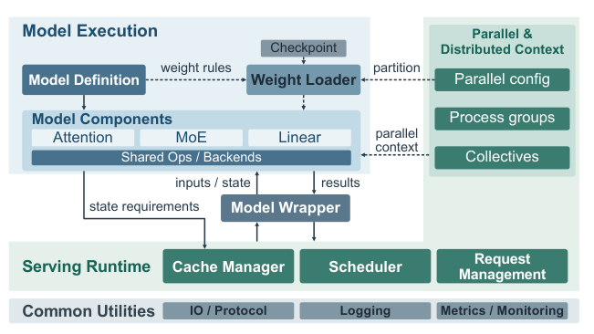
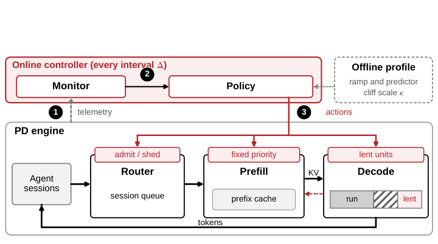
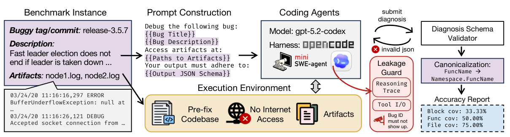
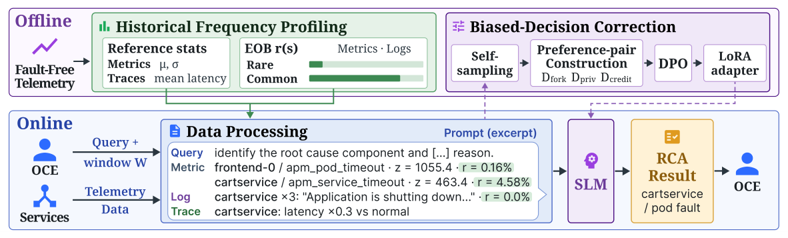
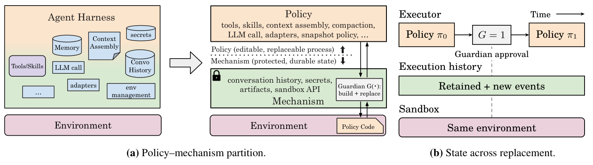

## In this issue

25 papers, 10 technical notes. Publication dates in source records are separate from this reading date.

<h2 class="daily-paper-title" id="paper-arxiv-2611.03517">01 · Ask, Don&#x27;t Equip: Question-Driven Coding Agents for Deep Kernel Optimization</h2>

[Ask, Don't Equip: Question-Driven Coding Agents for Deep Kernel Optimization](https://arxiv.org/abs/2611.03517) 
Gabriele Oliaro、Jaeseong Lee、Zhaoyuan Su、Sreeram Vennam、Zhihao Jia、Samyam Rajbhandari

KernelSeek uses questions within a minimal validation harness to redirect optimization hypotheses, later collecting them into a reusable bank. Hopper and Blackwell attention kernels each pass 182 tested scenarios, with human messages and tool traces released.

Gains following questions are observational, not randomized causal evidence. Human effort matters, and finite tests do not prove all-input correctness.

<h2 class="daily-paper-title" id="paper-arxiv-2611.02501">02 · SpecPilot: Autonomous Algorithm Discovery and Systems Optimization for Speculative Decoding</h2>

[SpecPilot: Autonomous Algorithm Discovery and Systems Optimization for Speculative Decoding](https://arxiv.org/abs/2611.02501) 
Kunjun Li、Wenhao Chai、Yihao Liang、Yuezhou Hu、Shuyao Xu、Yi Pan、William X. Zheng、Kannan Ramchandran、Kurt Keutzer、Jiantao Jiao

SpecPilot uses cost ceilings to locate deployment bottlenecks, with agents exploring and integrating optimizations and token-forcing checks against stock outputs. Results emphasize different mechanisms for single-request and batched serving.

The 10.87× figure is relative to AR, not stock. Finite output checks do not prove distribution equivalence for every input; search cost also matters.

<h2 class="daily-paper-title" id="paper-arxiv-2611.00628">03 · AgentPRO: Coordinating Compiler Optimizations for LLM Agent Workflows</h2>

[AgentPRO: Coordinating Compiler Optimizations for LLM Agent Workflows](https://arxiv.org/abs/2611.00628) 
Jie Ren、Zheng Wang

AgentPRO separates tool execution dependencies from observations needed for generation, merging compatible regions and removing redundant context with runtime guards. It completes 110 of 115 tasks while reducing mean tokens by 41.85%.

The cohort is selected for baseline success, so baseline perfection is by construction. There is one attempt per task, and component time is not total user latency.

<h2 class="daily-paper-title" id="paper-arxiv-2611.00495">04 · Understanding GPU Megakernels: Why Residency Can Mislead</h2>

[Understanding GPU Megakernels: Why Residency Can Mislead](https://arxiv.org/abs/2611.00495) 
Xinwei Qiang、Ziyi Xu、Chang Chen、Zaifeng Pan、Zhongkai Yu、Yue Guan、Yufei Ding

This megakernel study reconstructs separate kernels with the same operator code while controlling launch, prefetch and memory ordering. PDL lowers TK decode-step latency by 5.7%; resident CTAs do not imply useful capacity in the bottleneck resource.

Evidence centers on two implementations and H100; it does not establish universal megakernel inferiority, and ordering-mismatched comparisons are invalid.

<h2 class="daily-paper-title" id="paper-arxiv-2611.01426">05 · FlyWheel: Attention Kernels Built for the TPU</h2>

[FlyWheel: Attention Kernels Built for the TPU](https://arxiv.org/abs/2611.01426) 
Zishuo Bao、Zeshen Zhang、Linkun Chen、Yucheng Lu

FlyWheel restructures softmax and linear attention for TPU, reducing vector work, reusing matrix operands and overlapping independent computation. Peak kernel ratios exceed the up-to-1.56× prefill-throughput gain after vLLM integration.

Chip/TensorCore counts differ on v6e and v7x. Prefill gains are not universal request speedups; numerical approximations still require quality checks.

<h2 class="daily-paper-title" id="paper-arxiv-2611.00967">06 · RTP-LLM: Separate model evolution from state lifecycles</h2>

[RTP-LLM: Building an Evolvable and Reliable LLM Inference Engine at Alibaba Scale](https://arxiv.org/abs/2611.00967) 
Jiarui Guo, Zhi Zhang, Boyu Tan et al. · arXiv · First submitted: 2026-10-31

RTP-LLM documents Alibaba's transition from a Python service layer to C++-first integration, then to separated model execution and serving control. Model semantics now live in Python/PyTorch, while scheduling, KV management, and resource coordination remain in C++, reducing repeated translation of reference implementations.

The reliability mechanisms are especially useful: submitting an asynchronous cache transfer does not make its destination reusable. Requests, transfers, and retained cache entries hold separate references; blocks become available only after every owner releases them. A response timeout does not immediately free KV still used by asynchronous work. New state types can still require changes on both sides of the interface.

Of four model-enablement examples, three change fewer than 100 serving-layer lines, while DeepSeek-V4 requires 5,207, illustrating the boundary of reuse. Production performance covers seven days in one cluster for each of three applications. Reported hourly mean TTFT stays below two seconds and TPOT below 20 milliseconds; these are not per-request or tail-latency guarantees. The report is valuable for Ops4LLM teams studying cancellation, cache consistency, and regression coverage.

<a class="note-image-link" href="/assets/images/digest/2026-11-04/rtp-llm.png" target="_blank" rel="noopener" aria-label="RTP-LLM model execution, shared serving runtime, and state interfaces · View original image ↗">View original image ↗</a>

*Models describe computation, weights, and state needs; the shared runtime handles scheduling, allocation, and reclamation.*

<h2 class="daily-paper-title" id="paper-arxiv-2611.02543">07 · BASIN: Why serving can remain trapped after a traffic surge</h2>

[When Cache Pressure Becomes a Trap: Metastability in Agent Serving](https://arxiv.org/abs/2611.02543) 
Chengzhi Lu, Boxi Zhou, Yanying Lin, Dmitrii Ustiugov · arXiv · First submitted: 2026-11-02

**A surge can end while the serving system continues to deteriorate.** This study connects agent workloads to metastability: service stays degraded at an arrival rate it previously sustained because slower calls increase the population of active sessions, which in turn increases cache pressure.

Agents alternate between model calls and tools, repeatedly reusing growing histories. When a call slows down, its session remains active longer. New sessions continue arriving, expanding the aggregate context working set. Evicted prefixes require more prefill computation on the next turn, delaying departures further. Sessions executing tools still create future reuse demand, so current decode KV occupancy misses part of the pressure. Reserving decode KV before prefill can further amplify waiting.

The real-system experiment replays 216 Terminal-Bench trajectories containing 7,108 calls on SGLang, serving Qwen3.6-35B-A3B in FP8 with one prefill and one decode H100 NVL. At a base rate of 3.3 sessions per minute, a ten-minute doubling of arrivals drives prefix hit rate from about 0.95 to 0.27. For sessions arriving during the following hour, goodput falls from 138 to 17 sessions per hour, roughly 88%. Goodput requires slowdown no greater than four and at least 95% of decode steps meeting a 50 ms inter-token-latency target; it is not simply completed-call throughput. An intervention that terminates residual burst sessions restores service, providing stronger evidence for the feedback mechanism than correlated time series alone.

BASIN coordinates three controls. A fixed priority derived from arrival time and predicted peak context orders admission, prefill, and decode queues consistently. Idle decode memory retains reusable state between calls and is reclaimed preferentially for active decoding. Admission reserves predicted peak working sets, with cache-hit feedback adjusting the budget; sustained excess demand can trigger shedding. The combination protects resident contexts while addressing the long entry queues that ordering alone can leave behind.

The evidence has two layers. The real H200 1P3D prototype uses arrival-time ordering and current-context admission, achieving 1.20–1.70 times Continuum's goodput across four scenarios. Broader evaluation of the full predictor-driven policy uses a calibrated simulator. The fluid model flags all 17 cache-first simulated deployments but also flags eight decode-first deployments, so its classification is conservative rather than exact.

The contribution is a session-level account of overload that includes tool gaps and future cache demand. Benefits depend on the bottleneck: lending helps little when decode saturates first, and a large cache budget can still admit too much decode concurrency. The most useful parts to read are the intervention, session lifecycle, and goodput definition.

<a class="note-image-link" href="/assets/images/digest/2026-11-04/basin.png" target="_blank" rel="noopener" aria-label="BASIN controls session admission, queue priority, and decode-memory lending · View original image ↗">View original image ↗</a>

*The controller coordinates entry, service order, and lent cache capacity rather than treating them as independent controls.*

<h2 class="daily-paper-title" id="paper-arxiv-2611.00391">08 · Rethinking KV Cache Eviction for Agentic LLM Serving</h2>

[Rethinking KV Cache Eviction for Agentic LLM Serving](https://arxiv.org/abs/2611.00391) 
Jiakun Fan、Han Meng、Yuxuan Xia、Hao Mark Chen、Dong Li、Dimitrios S. Nikolopoulos

Penelope preserves shared prefixes and private suffixes, recomputing missing segments rather than evicting costly late-history tokens first. It co-designs eviction, recomputation and GPU/CPU management rather than introducing holes into unchanged prefix-cache logic.

It needs the corresponding correctness/indexing implementation. GPU-only and two-tier maxima use different conditions and cannot be combined.

<h2 class="daily-paper-title" id="paper-arxiv-2611.02082">09 · Fairway: Load-Aware KV Cache Reuse for LLM Prefill Scheduling</h2>

[Fairway: Load-Aware KV Cache Reuse for LLM Prefill Scheduling](https://arxiv.org/abs/2611.02082) 
Hamidreza Alikhani、Nazmul Takbir、Matin Khajavi、Rajat Bhattacharjya、Sangeetha Abdu Jyothi、Nikil Dutt

Fairway uses virtual Fast/Fair lanes to balance KV reuse and normalized waiting time, favoring cheap hits in short queues while protecting expensive requests under congestion. It jointly targets median TTFT and starvation.

Each request generates one token to isolate prefill. Tail-latency ratios do not establish full multi-turn agent completion gains.

<h2 class="daily-paper-title" id="paper-arxiv-2611.00384">10 · Agent Stack for ML Training Lifecycle: Generation, Validation, and Optimization</h2>

[Agent Stack for ML Training Lifecycle: Generation, Validation, and Optimization](https://arxiv.org/abs/2611.00384) 
Jaideep Ray、Daniel Tang、Zejun Lin、Haoyue Tang、Lijuan Zhang、Tao Huang、Tommy Li、Aditya Jain、Ankit Goyal、Harsh Jain、Zhuo Zhi、Youmin Han、Santosh Jha、Shuying Liang、Yujie Ai、Jonathan Hung、Ethan Lyu、Abi Liu、Siddharth Singh、Feng Wen、Mahesh Ravindran、Souvik Ray、Yitong Zhou、Animesh Singh

LinkedIn’s AutoTorch uses executable checks for model generation/migration; AutoResearch uses external experiment orchestration. Of 115 workflows, 92 complete training and 77 meet quality requirements; 28 of a separate 100 optimization pipelines improve.

The roughly 4× migration speedup is a team estimate, not randomized evidence. Training completion and quality success have different denominators.

<h2 class="daily-paper-title" id="paper-arxiv-2611.00646">11 · When Shards Fly: Cross-Tensor In-Flight Conversion for Low-Latency, Low-Memory Weight Updates in Disaggregated RL</h2>

[When Shards Fly: Cross-Tensor In-Flight Conversion for Low-Latency, Low-Memory Weight Updates in Disaggregated RL](https://arxiv.org/abs/2611.00646) 
Jiayu Xiao、Ye Wang、Zhi Zhang、Jiarui Guo、Kan Liu、Tao Lan、Minchen Yu

ShardFly compiles cross-tensor shard plans and fuses conversion, quantization, transfer and in-place writes in a persistent kernel, forwarding transformed bytes across replicas. Large update-only speedups yield 5.49–6.71% end-to-end GRPO response-throughput gains.

It targets synchronous in-place updates with plan reuse under stable configurations; the peak 27.92× update gain is not training acceleration.

<h2 class="daily-paper-title" id="paper-arxiv-2611.03523">12 · DistDebug-Bench: Relevant files are only the start of diagnosis</h2>

[DistDebug-Bench: Can LLM Agents Diagnose Bugs in Distributed Systems?](https://arxiv.org/abs/2611.03523) 
Yuxuan Jiang, Chenglin Liu, John Rose, Mason Miller, Ruthesh Thavamani, Juntao Wu, Yinwei Huang, Jiahao Xu, Peng Huang · arXiv · First submitted: 2026-11-02

**Distributed-system diagnosis requires explaining how causal code produces the observed failure.** Finding an error-bearing file or producing a passing patch does not fully measure that capability. DistDebug-Bench instead provides a pre-fix repository, incident report, and available artifacts, then asks agents to identify the code blocks that embody the failure mechanism.

The benchmark contains 120 historical bugs from 11 production-scale systems in five languages, with 218 gold blocks. Three annotators independently inspect each case before reconciliation, excluding tests, incidental refactoring, and defensive changes unrelated to the minimal cause. Multiple blocks are needed in 45% of incidents, about 23% span files, and the median block is only five lines. Effective diagnosis therefore requires both non-local exploration and precise conclusions.

Evidence is uneven: 83 reports do not name the gold method, and 75 lack a usable project-internal stack trace. Workspaces remove future commits and disable network access. A guard checks visible reasoning and tool records for withheld issue identifiers. These measures reduce answer leakage, but cannot rule out pretraining exposure. Selection also favors bugs diagnosable from issue-side evidence with clearly labelable fixes, limiting representativeness.

Across the complete 120-bug comparison, scores average three valid attempts per bug. GPT-6 Astra with Mini-SWE-Agent reaches 83.9% file coverage, 67.7% block coverage, and 42.7% block precision. The 95% bootstrap interval for block coverage is 60.4–74.9%. This is a gap between reaching relevant code and locating causal regions, not an end-to-end repair success rate. Fifteen bugs still have a block-coverage spread greater than 0.2 across attempts.

Trace analysis makes the failure concrete. Searching within the wrong subdirectory can produce a coherent investigation that never sees the causal file. Reading a log fragment rather than searching for exceptions changes the evidence available to the model. Agents often deepen their first plausible explanation instead of reopening alternatives. Naming more code can raise coverage while reducing precision, making tool behavior and context organization part of what the benchmark measures.

The labels have limits too. A different intervention point can explain the mechanism without matching the minimal gold block. In a human audit of 20 zero-coverage diagnoses, four fell into this category. That motivates reading explanation quality alongside localization scores. For AI SRE research, the useful direction is to evaluate evidence acquisition, hypothesis revision, and final localization separately, and to examine performance by evidence strength rather than only aggregate rank.

<a class="note-image-link" href="/assets/images/digest/2026-11-04/distdebug.png" target="_blank" rel="noopener" aria-label="DistDebug-Bench evaluates causal code localization from pre-fix repositories and incident evidence · View original image ↗">View original image ↗</a>

*Fixes and answer-revealing clues are withheld; structured diagnoses undergo schema checks, symbol normalization, and localization scoring.*

<h2 class="daily-paper-title" id="paper-arxiv-2611.02416">13 · Small-model RCA: Normal-behavior context and decision-level correction</h2>

[Fault-Free Profiles and Decision-Level Training for Root Cause Analysis via Small Language Models](https://arxiv.org/abs/2611.02416) 
Kyoohyun Lee, Woohyeok Park, Taeyoon Kim, Sungyong Baik, Kyungyong Lee · arXiv · First submitted: 2026-11-02

**Large anomaly scores need not identify causes, and a model can disregard its own propagation analysis when choosing an answer.** This study separates input construction from final decision-making. Short reference windows can misclassify routine cycles as anomalies; the model may then prefer the largest score despite reasoning that points elsewhere.

In OpenRCA Bank, one JVM memory signal exceeds a short-window threshold in 97% of fault-free windows. Using statistics from the complete fault-free period reduces that rate to 4%. The root-cause component appears among candidates in 99% of incident windows, but has the largest anomaly score in only 8%. Candidate availability and evidence interpretation are different problems.

Historical Frequency Profiling adds an Expected Outlier Baseline: how often each metric or log signal is flagged during fault-free windows. Prompts show anomaly magnitude alongside this frequency and place normally rare anomalies first; traces are compared with normal latency. Rarity supplies context rather than proving causality. Candidate components still come from metric filtering: logs and traces do not introduce additional candidates, so reasoning cannot recover a cause excluded upstream.

Biased-Decision Correction resamples continuations from the same reasoning prefix to create preference pairs leading to correct and incorrect decisions. DPO applies loss only after that prefix and updates a LoRA adapter. When ordinary sampling never succeeds, privileged hints can help generate offline positive examples; hints are removed from the training input, and selected explanations are checked against the original evidence. A reviewer model participates in offline data construction, even though online diagnosis can remain local.

With a random 60/40 incident split within each system and scores averaged over eight independently graded responses per incident, the 4B system achieves Exact scores of 39.3%, 48.7%, 11.9%, and 21.1% on Telecom, Bank, Market, and AIOps 2025. Exact requires every requested element—component, fault type, and time—to be correct, so it is not interchangeable with component ranking. Market remains difficult. On component-only GAIA, transfer achieves 68.6%, below FoundRoot-14B's 88.6%.

The useful contribution is the separation of normal-behavior context from decision training, rather than a blanket small-model victory. Profiling requires identifiable fault-free intervals and reasonably stable normal behavior. Experiments also use fault-free data before and after incidents, so they do not establish strictly past-only online performance. Profile maintenance under operational drift remains a deployment question.

<a class="note-image-link" href="/assets/images/digest/2026-11-04/fault-free-rca.png" target="_blank" rel="noopener" aria-label="Fault-free frequency profiling and decision preference training support online RCA · View original image ↗">View original image ↗</a>

*Offline profiling estimates normal-period anomaly frequencies and trains a LoRA adapter; online diagnosis combines those frequencies with incident telemetry.*

<h2 class="daily-paper-title" id="paper-arxiv-2611.00463">14 · Exo: Editable harnesses with independent state and replacement controls</h2>

[Exo: An Architecture for Self-Improving Systems at Runtime](https://arxiv.org/abs/2611.00463) 
Alexander Krentsel, Sylvia Ratnasamy, Ion Stoica, Martin Casado, Ankur Goyal · arXiv · First submitted: 2026-10-30

Exo brings harness revision into an ongoing task. The agent can edit tools, context construction, model calls, and its own improvement procedure, then request a replacement executor. Its distinctive concern is continuity while policy changes.

The architecture separates editable policy from protected mechanisms. History is append-only, artifacts retain earlier versions, and an independent guardian controls activation. Replacement preserves the task environment and execution record. Cost and cache annotations expose opportunities for improvement. In SREGym, the agent developed an incident-snapshot tool that gathered unhealthy pods, revision anomalies, and suspicious logs.

Using gpt-5.6-sol against the same starting policy with editing disabled, evaluation after 21 learning incidents on 20 held-out incidents from the same fault families on different applications reduced median diagnosis time from 81 to 53 seconds and mean model cost from $0.892 to $0.584, with comparable correctness reported by the authors.

The protection is conditional: the default guardian checks build success, which does not establish behavioral correctness or improvement. Rollback cannot undo external effects. The useful AgentOps principle is to separate permission to propose a change from permission to activate it.

<a class="note-image-link" href="/assets/images/digest/2026-11-04/exo.png" target="_blank" rel="noopener" aria-label="Editable policy, protected mechanisms, and preserved history in Exo · View original image ↗">View original image ↗</a>

*Policy can change tools and context assembly; history storage and activation checks remain behind an independent boundary.*

<h2 class="daily-paper-title" id="paper-arxiv-2611.02079">15 · ParetoSaddler: Pareto-Guided Optimization of Agent Harnesses for Quality and Cost</h2>

[ParetoSaddler: Pareto-Guided Optimization of Agent Harnesses for Quality and Cost](https://arxiv.org/abs/2611.02079) 
Xingzhi Qian、Sungho Park、Rongyuan Tan、Jianbo Yu、Jue Zhang、Lorenzo Cavallaro、Menglin Xia、Yanzhi Chen、Xinnuo Xu、Yu Kang、Xinran Zheng、Gagan Somashekar、Xuchao Zhang、Chetan Bansal、Qingwei Lin、Victor Rühle

ParetoSaddler retains intermediate quality/cost progress using Bayesian-bootstrap Pareto support rather than pruning with the final deployment preference, then selects deployment candidates separately. Two domain-disjoint benchmarks improve quality and per-task cost.

Repeated evaluation increases search cost. Bootstrap captures run variation on fixed tasks, not task-sampling uncertainty or total optimization expenditure.

<h2 class="daily-paper-title" id="paper-arxiv-2611.02950">16 · Action Verification through Conjecture and Refutation for Language Model Agents</h2>

[Action Verification through Conjecture and Refutation for Language Model Agents](https://arxiv.org/abs/2611.02950) 
Minhyeon Oh、Chiyeong Heo、Geonwoo Noh、Hoyoung Kim、Jangwon Son、Jungseul Ok

BlackSwan predicts an action’s effect, formulates testable suspicions and tries to refute them through observations or non-mutating actions before committing. AppWorld and WebShop experiments show improved action-task outcomes.

Failure to find a counterexample is not proof of safety. Tests add cost and simulated applications/shopping do not cover all real side effects.

<h2 class="daily-paper-title" id="paper-arxiv-2611.03434">17 · Optimize the Harness, Not the Model: Fitting a Minimal Agent to a Self-Hostable LLM for Investigative Analysis</h2>

CLEO starts with a minimal harness, retaining tools, guardrails and memory policies that help expert-validated investigative tasks. In one domain its held-out pass rate is 83.8%, close to the strongest out-of-box SDK baseline.

Limitations: The LLM judge is spot-checked rather than systematically validated. A hundredfold smaller codebase does not prove equal reductions in attack risk or maintenance cost.

Source: [Optimize the Harness, Not the Model: Fitting a Minimal Agent to a Self-Hostable LLM for Investigative Analysis](https://arxiv.org/abs/2611.03434)

<h2 class="daily-paper-title" id="paper-arxiv-2611.03634">18 · WebHarbor: Docking Real Websites for Evolving GUI Agent Environments</h2>

WebHarbor reconstructs 153 executable website environments and 3,518 tasks, expanding workflows through human–agent audits and covering post-login actions under deterministic control. It reduces evaluation drift from live websites.

Limitations: Reconstruction is not full equivalence; dynamic maps and similar behavior use surrogates. Training covers one 4B model, and graders can miss errors.

Source: [WebHarbor: Docking Real Websites for Evolving GUI Agent Environments](https://arxiv.org/abs/2611.03634)

<h2 class="daily-paper-title" id="paper-arxiv-2611.02102">19 · NorthCUA Technical Report: Turbocharging Computer-Use Agents through Experience at Scale</h2>

NorthCUA connects task generation, execution records, evidence-linked outcome checks and staged learning, preserving verified milestones from unfinished tasks. Collection judges can inspect workspaces; benchmark evaluation uses independent scorers.

Limitations: Open-ended judges depend on calibration and predicate coverage. New software/interfaces remain difficult; illustrative evidence chains do not establish aggregate error rates.

Source: [NorthCUA Technical Report: Turbocharging Computer-Use Agents through Experience at Scale](https://arxiv.org/abs/2611.02102)

<h2 class="daily-paper-title" id="paper-arxiv-2611.02849">20 · TLAPS-Bench: Formally Proving Correctness of Real-World System Specifications with TLA+ Proof System</h2>

[TLAPS-Bench: Formally Proving Correctness of Real-World System Specifications with TLA+ Proof System](https://arxiv.org/abs/2611.02849) 
Qian Cheng、Ruize Tang、Saad Mohammad Rafid Pial、Zhizhen Cathy Cai、Yiming Su、Jackson Clark、Munim Thahmid、Mahdiya Rahman Sukanya、Chris Newcombe、Igor Konnov、Stephan Merz、Xudong Sun、Murat Demirbas、Yu Huang、Markus Alexander Kuppe、Tianyin Xu

TLAPS-Bench provides machine-checked proof development for 265 targets from 95 TLA+ specifications. Evaluation uses 70 targets from 12 specifications; the best configuration proves 31 under pass@3.

This is not single-run success across all 265 targets. Proofs concern formal specifications/properties, not complete implementation correctness.

<h2 class="daily-paper-title" id="paper-arxiv-2610.16870">21 · SpecGuardBench: Can Coding Agents Construct Reliable Validation Harnesses from Natural Language Specifications?</h2>

[SpecGuardBench: Can Coding Agents Construct Reliable Validation Harnesses from Natural Language Specifications?](https://arxiv.org/abs/2610.16870) 
Zhiqing Zhong、Mingyu Chen、Aoyang Fang、Yuzhong Zhang、Haoye Tian、Lionel Briand、Boxi Yu、Pinjia He

SpecGuardBench includes violating and valid alternative implementations to test specification-faithful harnesses. No agent exceeds 63% faithfulness across 291 tasks; a key failure is treating reference implementation details as requirements.

Faithfulness is tested against retained benchmark implementations, not every possible program; reference code can induce overfitted checks.

<h2 class="daily-paper-title" id="paper-arxiv-2611.02028">22 · LARK: Lean-Assisted Reasoning for LLM-Generated GPU Kernels</h2>

[LARK: Lean-Assisted Reasoning for LLM-Generated GPU Kernels](https://arxiv.org/abs/2611.02028) 
Zixi Zhang、Jiayi Nie、Haoran Wu、Yujie Yan、Yann Herklotz、Rika Antonova、Robert Mullins、Yiren Zhao、George A. Constantinides、Jianyi Cheng

LARK uses Lean to verify segmentation and functional/memory equivalence against references, concentrating human trust in operator semantics. It verifies nine sampled library kernels and finds a race in another; the appendix explicitly uses pinned-kernel verify-only runs.

Exact-arithmetic guarantees do not establish floating-point equivalence. Semantics remain trusted; results cannot be relabeled as measured full-generation-pipeline success.

<h2 class="daily-paper-title" id="paper-arxiv-2611.00287">23 · VerusWeave: A Benchmark for Proof Repair in Concurrent Verus Programs</h2>

VerusWeave removes proof annotations from four projects while preserving executable code and specifications, checking repairs with Verus and a change checker. Success falls from 75–85% on 75 focused tasks to 29–47% on 17 module variants.

Limitations: Tasks derive from existing proofs and samples are small. They do not represent proving arbitrary concurrent programs from scratch; verifier and specification remain trusted.

Source: [VerusWeave: A Benchmark for Proof Repair in Concurrent Verus Programs](https://arxiv.org/abs/2611.00287)

<h2 class="daily-paper-title" id="paper-arxiv-2611.02779">24 · Stop Handcrafting Your Engine! GenDB-V: Towards AI-Generated and Formally Verified Database Systems</h2>

[Stop Handcrafting Your Engine! GenDB-V: Towards AI-Generated and Formally Verified Database Systems](https://arxiv.org/abs/2611.02779) 
Jiale Lao、Immanuel Trummer

GenDB-V fixes implementation-independent SQLSpec targets before jointly searching code and proofs, checking them in isolation. Template-specialized implementations and a general engine for a supported SQL subset are evaluated separately; the latter gains 1.27–3.4×.

Template gains of 22–61.3× are not full-database acceleration. Guarantees depend on SQLSpec, verification and the supported subset, not every SQL feature.

<h2 class="daily-paper-title" id="paper-arxiv-2611.00002">25 · An Agentic OS Kernel for Flexible and Enhanced Semantics</h2>

IntentOS accepts intents through isyscall, composes micro-syscalls through LLM planning and caches checked execution plans. Cache hits bypass inference, targeting redundant operations imposed by rigid interfaces.

Limitations: Roughly thirty intents and four kernel versions do not prove arbitrary composition safe. PDF dating conflicts with the arXiv identifier; no first-publication date is inferred.

Source: [An Agentic OS Kernel for Flexible and Enhanced Semantics](https://arxiv.org/abs/2611.00002)

## Technical notes from this day

- [2026-11-04 | Progress on provable inference for large language models](/tech/en/review-anthropic-provable-inference/)
- [2026-11-04 | NVIDIA Attribution: Traceable Diagnosis Across Cascading Failures](/tech/en/nvidia-attribution/)
- [2026-11-04 | Pika H3 Flex in FastVideo: 7x Faster, and Near Real Time in 4-bit](/tech/en/review-haoailab-pika-h3-flex/)
- [2026-11-04 | Scaling NVIDIA TensorRT Performance Optimization Beyond a Single Build Route with the Global Performance Tuner, Part 1](/tech/en/review-nvidia-tensorrt-global-performance-tuner-1/)
- [2026-11-04 | open-flapping-airplanes: reproducing the flapping airplanes megakernel](/tech/en/review-github-open-flapping-airplanes/)
- [2026-11-04 | F3 Lightning: How Meta Accelerates Ads ML Features to Production at Scale](/tech/en/review-meta-f3-lightning/)
- [2026-11-04 | Technical reading: Kimi K3.1 Pro Tech Blog: Advancing Open Intelligence](/tech/en/2026-11-04-kimi-k3-1-pro/)
- [2026-11-04 | Technical reading: Lessons from PD Labs: From experimentation to a production-ready SRE Agent](/tech/en/2026-11-04-pagerduty-pd-labs-sre-agent/)
- [2026-11-04 | When Quantized KV Cache Quietly Sends Attention Back to the CPU](/tech/en/llamacpp-kv-fallback/)
- [2026-11-04 | Technical reading: AI Observability & Debugging Leaderboard: APEX-SWE | Mercor](/tech/en/2026-11-04-mercor-apex-swe-observability/)
