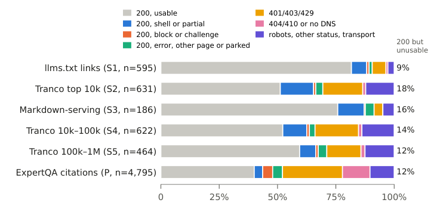

Several studies make agent reliability concrete through inspectable system boundaries. BASIN explains how a brief surge becomes a persistent cache failure. DistDebug-Bench shows why reaching relevant code is insufficient for trustworthy diagnosis. Small-model RCA asks why final decisions can contradict propagation analysis.

Exo and RTP-LLM examine which state and authority should remain stable as policies or models change. A web-fetch study shows that a successful status code need not deliver usable content. Together, these works connect performance and capability claims to state lifecycles, evidence quality, and failure boundaries.

<h2 class="daily-paper-title" id="paper-arxiv-2611.00463">Exo: Editable harnesses with independent state and replacement controls</h2>

[Exo: An Architecture for Self-Improving Systems at Runtime](https://arxiv.org/abs/2611.00463)  
Alexander Krentsel, Sylvia Ratnasamy, Ion Stoica, Martin Casado, Ankur Goyal · arXiv · First submitted: 2026-10-30

Exo brings harness revision into an ongoing task. The agent can edit tools, context construction, model calls, and its own improvement procedure, then request a replacement executor. Its distinctive concern is continuity while policy changes.

The architecture separates editable policy from protected mechanisms. History is append-only, artifacts retain earlier versions, and an independent guardian controls activation. Replacement preserves the task environment and execution record. Cost and cache annotations expose opportunities for improvement. In SREGym, the agent developed an incident-snapshot tool that gathered unhealthy pods, revision anomalies, and suspicious logs.

Using gpt-5.6-sol against the same starting policy with editing disabled, evaluation after 21 learning incidents on 20 held-out incidents from the same fault families on different applications reduced median diagnosis time from 81 to 53 seconds and mean model cost from $0.892 to $0.584, with comparable correctness reported by the authors.

The protection is conditional: the default guardian checks build success, which does not establish behavioral correctness or improvement. Rollback cannot undo external effects. The useful AgentOps principle is to separate permission to propose a change from permission to activate it.

<a class="note-image-link" href="/assets/images/digest/2026-11-04/exo.png" target="_blank" rel="noopener" aria-label="Editable policy, protected mechanisms, and preserved history in Exo · View original image ↗">View original image ↗</a>

*Policy can change tools and context assembly; history storage and activation checks remain behind an independent boundary.*

<h2 class="daily-paper-title" id="paper-arxiv-2611.02543">BASIN: Why serving can remain trapped after a traffic surge</h2>

[When Cache Pressure Becomes a Trap: Metastability in Agent Serving](https://arxiv.org/abs/2611.02543)  
Chengzhi Lu, Boxi Zhou, Yanying Lin, Dmitrii Ustiugov · arXiv · First submitted: 2026-11-02

**A surge can end while the serving system continues to deteriorate.** This study connects agent workloads to metastability: service stays degraded at an arrival rate it previously sustained because slower calls increase the population of active sessions, which in turn increases cache pressure.

Agents alternate between model calls and tools, repeatedly reusing growing histories. When a call slows down, its session remains active longer. New sessions continue arriving, expanding the aggregate context working set. Evicted prefixes require more prefill computation on the next turn, delaying departures further. Sessions executing tools still create future reuse demand, so current decode KV occupancy misses part of the pressure. Reserving decode KV before prefill can further amplify waiting.

The real-system experiment replays 216 Terminal-Bench trajectories containing 7,108 calls on SGLang, serving Qwen3.6-35B-A3B in FP8 with one prefill and one decode H100 NVL. At a base rate of 3.3 sessions per minute, a ten-minute doubling of arrivals drives prefix hit rate from about 0.95 to 0.27. For sessions arriving during the following hour, goodput falls from 138 to 17 sessions per hour, roughly 88%. Goodput requires slowdown no greater than four and at least 95% of decode steps meeting a 50 ms inter-token-latency target; it is not simply completed-call throughput. An intervention that terminates residual burst sessions restores service, providing stronger evidence for the feedback mechanism than correlated time series alone.

BASIN coordinates three controls. A fixed priority derived from arrival time and predicted peak context orders admission, prefill, and decode queues consistently. Idle decode memory retains reusable state between calls and is reclaimed preferentially for active decoding. Admission reserves predicted peak working sets, with cache-hit feedback adjusting the budget; sustained excess demand can trigger shedding. The combination protects resident contexts while addressing the long entry queues that ordering alone can leave behind.

The evidence has two layers. The real H200 1P3D prototype uses arrival-time ordering and current-context admission, achieving 1.20–1.70 times Continuum's goodput across four scenarios. Broader evaluation of the full predictor-driven policy uses a calibrated simulator. The fluid model flags all 17 cache-first simulated deployments but also flags eight decode-first deployments, so its classification is conservative rather than exact.

The contribution is a session-level account of overload that includes tool gaps and future cache demand. Benefits depend on the bottleneck: lending helps little when decode saturates first, and a large cache budget can still admit too much decode concurrency. The most useful parts to read are the intervention, session lifecycle, and goodput definition.

<a class="note-image-link" href="/assets/images/digest/2026-11-04/basin.png" target="_blank" rel="noopener" aria-label="BASIN controls session admission, queue priority, and decode-memory lending · View original image ↗">View original image ↗</a>

*The controller coordinates entry, service order, and lent cache capacity rather than treating them as independent controls.*

<h2 class="daily-paper-title" id="paper-arxiv-2611.03523">DistDebug-Bench: Relevant files are only the start of diagnosis</h2>

[DistDebug-Bench: Can LLM Agents Diagnose Bugs in Distributed Systems?](https://arxiv.org/abs/2611.03523)  
Yuxuan Jiang, Chenglin Liu, John Rose, Mason Miller, Ruthesh Thavamani, Juntao Wu, Yinwei Huang, Jiahao Xu, Peng Huang · arXiv · First submitted: 2026-11-02

**Distributed-system diagnosis requires explaining how causal code produces the observed failure.** Finding an error-bearing file or producing a passing patch does not fully measure that capability. DistDebug-Bench instead provides a pre-fix repository, incident report, and available artifacts, then asks agents to identify the code blocks that embody the failure mechanism.

The benchmark contains 120 historical bugs from 11 production-scale systems in five languages, with 218 gold blocks. Three annotators independently inspect each case before reconciliation, excluding tests, incidental refactoring, and defensive changes unrelated to the minimal cause. Multiple blocks are needed in 45% of incidents, about 23% span files, and the median block is only five lines. Effective diagnosis therefore requires both non-local exploration and precise conclusions.

Evidence is uneven: 83 reports do not name the gold method, and 75 lack a usable project-internal stack trace. Workspaces remove future commits and disable network access. A guard checks visible reasoning and tool records for withheld issue identifiers. These measures reduce answer leakage, but cannot rule out pretraining exposure. Selection also favors bugs diagnosable from issue-side evidence with clearly labelable fixes, limiting representativeness.

Across the complete 120-bug comparison, scores average three valid attempts per bug. GPT-6 Astra with Mini-SWE-Agent reaches 83.9% file coverage, 67.7% block coverage, and 42.7% block precision. The 95% bootstrap interval for block coverage is 60.4–74.9%. This is a gap between reaching relevant code and locating causal regions, not an end-to-end repair success rate. Fifteen bugs still have a block-coverage spread greater than 0.2 across attempts.

Trace analysis makes the failure concrete. Searching within the wrong subdirectory can produce a coherent investigation that never sees the causal file. Reading a log fragment rather than searching for exceptions changes the evidence available to the model. Agents often deepen their first plausible explanation instead of reopening alternatives. Naming more code can raise coverage while reducing precision, making tool behavior and context organization part of what the benchmark measures.

The labels have limits too. A different intervention point can explain the mechanism without matching the minimal gold block. In a human audit of 20 zero-coverage diagnoses, four fell into this category. That motivates reading explanation quality alongside localization scores. For AI SRE research, the useful direction is to evaluate evidence acquisition, hypothesis revision, and final localization separately, and to examine performance by evidence strength rather than only aggregate rank.

<a class="note-image-link" href="/assets/images/digest/2026-11-04/distdebug.png" target="_blank" rel="noopener" aria-label="DistDebug-Bench evaluates causal code localization from pre-fix repositories and incident evidence · View original image ↗">View original image ↗</a>

*Fixes and answer-revealing clues are withheld; structured diagnoses undergo schema checks, symbol normalization, and localization scoring.*

<h2 class="daily-paper-title" id="paper-arxiv-2611.02416">Small-model RCA: Normal-behavior context and decision-level correction</h2>

[Fault-Free Profiles and Decision-Level Training for Root Cause Analysis via Small Language Models](https://arxiv.org/abs/2611.02416)  
Kyoohyun Lee, Woohyeok Park, Taeyoon Kim, Sungyong Baik, Kyungyong Lee · arXiv · First submitted: 2026-11-02

**Large anomaly scores need not identify causes, and a model can disregard its own propagation analysis when choosing an answer.** This study separates input construction from final decision-making. Short reference windows can misclassify routine cycles as anomalies; the model may then prefer the largest score despite reasoning that points elsewhere.

In OpenRCA Bank, one JVM memory signal exceeds a short-window threshold in 97% of fault-free windows. Using statistics from the complete fault-free period reduces that rate to 4%. The root-cause component appears among candidates in 99% of incident windows, but has the largest anomaly score in only 8%. Candidate availability and evidence interpretation are different problems.

Historical Frequency Profiling adds an Expected Outlier Baseline: how often each metric or log signal is flagged during fault-free windows. Prompts show anomaly magnitude alongside this frequency and place normally rare anomalies first; traces are compared with normal latency. Rarity supplies context rather than proving causality. Candidate components still come from metric filtering: logs and traces do not introduce additional candidates, so reasoning cannot recover a cause excluded upstream.

Biased-Decision Correction resamples continuations from the same reasoning prefix to create preference pairs leading to correct and incorrect decisions. DPO applies loss only after that prefix and updates a LoRA adapter. When ordinary sampling never succeeds, privileged hints can help generate offline positive examples; hints are removed from the training input, and selected explanations are checked against the original evidence. A reviewer model participates in offline data construction, even though online diagnosis can remain local.

With a random 60/40 incident split within each system and scores averaged over eight independently graded responses per incident, the 4B system achieves Exact scores of 39.3%, 48.7%, 11.9%, and 21.1% on Telecom, Bank, Market, and AIOps 2025. Exact requires every requested element—component, fault type, and time—to be correct, so it is not interchangeable with component ranking. Market remains difficult. On component-only GAIA, transfer achieves 68.6%, below FoundRoot-14B's 88.6%.

The useful contribution is the separation of normal-behavior context from decision training, rather than a blanket small-model victory. Profiling requires identifiable fault-free intervals and reasonably stable normal behavior. Experiments also use fault-free data before and after incidents, so they do not establish strictly past-only online performance. Profile maintenance under operational drift remains a deployment question.

<a class="note-image-link" href="/assets/images/digest/2026-11-04/fault-free-rca.png" target="_blank" rel="noopener" aria-label="Fault-free frequency profiling and decision preference training support online RCA · View original image ↗">View original image ↗</a>

*Offline profiling estimates normal-period anomaly frequencies and trains a LoRA adapter; online diagnosis combines those frequencies with incident telemetry.*

<h2 class="daily-paper-title" id="paper-arxiv-2611.00967">RTP-LLM: Separate model evolution from state lifecycles</h2>

[RTP-LLM: Building an Evolvable and Reliable LLM Inference Engine at Alibaba Scale](https://arxiv.org/abs/2611.00967)  
Jiarui Guo, Zhi Zhang, Boyu Tan et al. · arXiv · First submitted: 2026-10-31

RTP-LLM documents Alibaba's transition from a Python service layer to C++-first integration, then to separated model execution and serving control. Model semantics now live in Python/PyTorch, while scheduling, KV management, and resource coordination remain in C++, reducing repeated translation of reference implementations.

The reliability mechanisms are especially useful: submitting an asynchronous cache transfer does not make its destination reusable. Requests, transfers, and retained cache entries hold separate references; blocks become available only after every owner releases them. A response timeout does not immediately free KV still used by asynchronous work. New state types can still require changes on both sides of the interface.

Of four model-enablement examples, three change fewer than 100 serving-layer lines, while DeepSeek-V4 requires 5,207, illustrating the boundary of reuse. Production performance covers seven days in one cluster for each of three applications. Reported hourly mean TTFT stays below two seconds and TPOT below 20 milliseconds; these are not per-request or tail-latency guarantees. The report is valuable for Ops4LLM teams studying cancellation, cache consistency, and regression coverage.

<a class="note-image-link" href="/assets/images/digest/2026-11-04/rtp-llm.png" target="_blank" rel="noopener" aria-label="RTP-LLM model execution, shared serving runtime, and state interfaces · View original image ↗">View original image ↗</a>

*Models describe computation, weights, and state needs; the shared runtime handles scheduling, allocation, and reclamation.*

<h2 class="daily-paper-title" id="paper-arxiv-2611.00884">Silent fetch failures: HTTP 200 can contain no usable page</h2>

[When 200 OK Is Not an Answer: Silent Fetch Failures in Agentic Web Content Acquisition](https://arxiv.org/abs/2611.00884)  
Shuyang Zhang · arXiv · First submitted: 2026-10-31

A web agent treating HTTP 200 as successful reading may actually receive an application shell, challenge, or substitute homepage. This study fetches 10,307 URLs over three days using static and rendered clients, including ordinary pages, random nonexistent paths, and ExpertQA citations, then classifies the returned content.

Automatic labels mark 20.9% of static-200 pages unusable. Reweighted review lowers the held-out test estimate from 25.5% to 20.0%. Review primarily used another LLM; an independent human blind check agreed on usability for 82.5% of decidable items, so the dataset is not wholly human-validated. Status-only treatment also inflates apparent citation drift from 5.8% to 21.9%.

Combining text length, random-path similarity, and redirect-to-root checks recalls about 86% of unusable reviewed responses at roughly 6% false alarms. Absolute rates depend on the single vantage point and collection window, and rendering can fail too. The transferable lesson is to report what a fetch contains and distinguish missing content from genuinely changed evidence.

<a class="note-image-link" href="/assets/images/digest/2026-11-04/fetch-outcomes.png" target="_blank" rel="noopener" aria-label="Static fetch outcomes across page populations, including content, shells, blocks, and explicit errors · View original image ↗">View original image ↗</a>

*The chart uses all pages as its denominator; the 20.9% in the text applies only to pages returning 200.*

<h2 class="daily-paper-title" id="paper-arxiv-2611.02079">07 · ParetoSaddler: Pareto-Guided Optimization of Agent Harnesses for Quality and Cost</h2>

[ParetoSaddler: Pareto-Guided Optimization of Agent Harnesses for Quality and Cost](https://arxiv.org/abs/2611.02079) 
Xingzhi Qian、Sungho Park、Rongyuan Tan、Jianbo Yu、Jue Zhang、Lorenzo Cavallaro、Menglin Xia、Yanzhi Chen、Xinnuo Xu、Yu Kang、Xinran Zheng、Gagan Somashekar、Xuchao Zhang、Chetan Bansal、Qingwei Lin、Victor Rühle

ParetoSaddler retains intermediate quality/cost progress using Bayesian-bootstrap Pareto support rather than pruning with the final deployment preference, then selects deployment candidates separately. Two domain-disjoint benchmarks improve quality and per-task cost.

Repeated evaluation increases search cost. Bootstrap captures run variation on fixed tasks, not task-sampling uncertainty or total optimization expenditure.

<h2 class="daily-paper-title" id="paper-arxiv-2611.02849">08 · TLAPS-Bench: Formally Proving Correctness of Real-World System Specifications with TLA+ Proof System</h2>

[TLAPS-Bench: Formally Proving Correctness of Real-World System Specifications with TLA+ Proof System](https://arxiv.org/abs/2611.02849) 
Qian Cheng、Ruize Tang、Saad Mohammad Rafid Pial、Zhizhen Cathy Cai、Yiming Su、Jackson Clark、Munim Thahmid、Mahdiya Rahman Sukanya、Chris Newcombe、Igor Konnov、Stephan Merz、Xudong Sun、Murat Demirbas、Yu Huang、Markus Alexander Kuppe、Tianyin Xu

TLAPS-Bench provides machine-checked proof development for 265 targets from 95 TLA+ specifications. Evaluation uses 70 targets from 12 specifications; the best configuration proves 31 under pass@3.

This is not single-run success across all 265 targets. Proofs concern formal specifications/properties, not complete implementation correctness.

<h2 class="daily-paper-title" id="paper-arxiv-2610.16870">09 · SpecGuardBench: Can Coding Agents Construct Reliable Validation Harnesses from Natural Language Specifications?</h2>

[SpecGuardBench: Can Coding Agents Construct Reliable Validation Harnesses from Natural Language Specifications?](https://arxiv.org/abs/2610.16870) 
Zhiqing Zhong、Mingyu Chen、Aoyang Fang、Yuzhong Zhang、Haoye Tian、Lionel Briand、Boxi Yu、Pinjia He

SpecGuardBench includes violating and valid alternative implementations to test specification-faithful harnesses. No agent exceeds 63% faithfulness across 291 tasks; a key failure is treating reference implementation details as requirements.

Faithfulness is tested against retained benchmark implementations, not every possible program; reference code can induce overfitted checks.

<h2 class="daily-paper-title" id="paper-arxiv-2611.02028">10 · LARK: Lean-Assisted Reasoning for LLM-Generated GPU Kernels</h2>

[LARK: Lean-Assisted Reasoning for LLM-Generated GPU Kernels](https://arxiv.org/abs/2611.02028) 
Zixi Zhang、Jiayi Nie、Haoran Wu、Yujie Yan、Yann Herklotz、Rika Antonova、Robert Mullins、Yiren Zhao、George A. Constantinides、Jianyi Cheng

LARK uses Lean to verify segmentation and functional/memory equivalence against references, concentrating human trust in operator semantics. It verifies nine sampled library kernels and finds a race in another; the appendix explicitly uses pinned-kernel verify-only runs.

Exact-arithmetic guarantees do not establish floating-point equivalence. Semantics remain trusted; results cannot be relabeled as measured full-generation-pipeline success.

<h2 class="daily-paper-title" id="paper-arxiv-2611.03517">11 · Ask, Don&#x27;t Equip: Question-Driven Coding Agents for Deep Kernel Optimization</h2>

[Ask, Don't Equip: Question-Driven Coding Agents for Deep Kernel Optimization](https://arxiv.org/abs/2611.03517) 
Gabriele Oliaro、Jaeseong Lee、Zhaoyuan Su、Sreeram Vennam、Zhihao Jia、Samyam Rajbhandari

KernelSeek uses questions within a minimal validation harness to redirect optimization hypotheses, later collecting them into a reusable bank. Hopper and Blackwell attention kernels each pass 182 tested scenarios, with human messages and tool traces released.

Gains following questions are observational, not randomized causal evidence. Human effort matters, and finite tests do not prove all-input correctness.

<h2 class="daily-paper-title" id="paper-arxiv-2611.02501">12 · SpecPilot: Autonomous Algorithm Discovery and Systems Optimization for Speculative Decoding</h2>

[SpecPilot: Autonomous Algorithm Discovery and Systems Optimization for Speculative Decoding](https://arxiv.org/abs/2611.02501) 
Kunjun Li、Wenhao Chai、Yihao Liang、Yuezhou Hu、Shuyao Xu、Yi Pan、William X. Zheng、Kannan Ramchandran、Kurt Keutzer、Jiantao Jiao

SpecPilot uses cost ceilings to locate deployment bottlenecks, with agents exploring and integrating optimizations and token-forcing checks against stock outputs. Results emphasize different mechanisms for single-request and batched serving.

The 10.87× figure is relative to AR, not stock. Finite output checks do not prove distribution equivalence for every input; search cost also matters.

<h2 class="daily-paper-title" id="paper-arxiv-2611.02846">13 · SpecOPD: Branch-Parallel On-Policy Distillation for Speculative Decoding</h2>

[SpecOPD: Branch-Parallel On-Policy Distillation for Speculative Decoding](https://arxiv.org/abs/2611.02846) 
Tianyu Liu、Jun Zhang、Wenjie Huang、Yuhao Shen、Tianqi Xu、Xinyue Hao、Hongyaoxing Gu、Xuyang Liu、Baolin Zhang、Yating Zhu、Shuang Ge、Jun Dai、Lei Chen、Yue Li、Mingchen Wan

SpecOPD samples fresh drafter branches after reference anchors, sharing trunk computation while preserving branch histories. Its 16.09× supervised-token throughput combines faster updates and more supervision per update; the peak 3.56× AR inference gain is a separate metric.

Native configurations differ and exclude offline reference preparation. Supervision throughput is not equal-quality training acceleration; gains vary by architecture and task.

<h2 class="daily-paper-title" id="paper-arxiv-2611.00628">14 · AgentPRO: Coordinating Compiler Optimizations for LLM Agent Workflows</h2>

[AgentPRO: Coordinating Compiler Optimizations for LLM Agent Workflows](https://arxiv.org/abs/2611.00628) 
Jie Ren、Zheng Wang

AgentPRO separates tool execution dependencies from observations needed for generation, merging compatible regions and removing redundant context with runtime guards. It completes 110 of 115 tasks while reducing mean tokens by 41.85%.

The cohort is selected for baseline success, so baseline perfection is by construction. There is one attempt per task, and component time is not total user latency.

<h2 class="daily-paper-title" id="paper-arxiv-2611.00944">15 · SNAPPerf: Software-Aware Tabular Foundation Model for Retraining-Free Performance Prediction of Configurable Systems</h2>

[SNAPPerf: Software-Aware Tabular Foundation Model for Retraining-Free Performance Prediction of Configurable Systems](https://arxiv.org/abs/2611.00944) 
Amine Lbath、Massih-Reza Amini、Vadim Okun

SNAPPerf pretrains on synthetic configurable systems and uses a few new measurements as context without per-system retraining. Across 12 real systems, error averages 38% below the prior baseline at matched measurement budgets.

No retraining does not mean no measurements. Immediate use after every version change remains a vision; error and sample savings depend on system and budget.

<h2 class="daily-paper-title" id="paper-arxiv-2611.00384">16 · Agent Stack for ML Training Lifecycle: Generation, Validation, and Optimization</h2>

[Agent Stack for ML Training Lifecycle: Generation, Validation, and Optimization](https://arxiv.org/abs/2611.00384) 
Jaideep Ray、Daniel Tang、Zejun Lin、Haoyue Tang、Lijuan Zhang、Tao Huang、Tommy Li、Aditya Jain、Ankit Goyal、Harsh Jain、Zhuo Zhi、Youmin Han、Santosh Jha、Shuying Liang、Yujie Ai、Jonathan Hung、Ethan Lyu、Abi Liu、Siddharth Singh、Feng Wen、Mahesh Ravindran、Souvik Ray、Yitong Zhou、Animesh Singh

LinkedIn’s AutoTorch uses executable checks for model generation/migration; AutoResearch uses external experiment orchestration. Of 115 workflows, 92 complete training and 77 meet quality requirements; 28 of a separate 100 optimization pipelines improve.

The roughly 4× migration speedup is a team estimate, not randomized evidence. Training completion and quality success have different denominators.

<h2 class="daily-paper-title" id="paper-arxiv-2611.00667">17 · Characterizing and Predicting the Longest CI Builds in Machine Learning Projects</h2>

[Characterizing and Predicting the Longest CI Builds in Machine Learning Projects](https://arxiv.org/abs/2611.00667) 
Yonghui Huang、Daniel Alencar da Costa、Mohamed Sami Rakha、Grant Dick

In the studied ML projects, the longest 18% of builds consume 80.30% of build time and 39.09% fail. Recent history and workflow structure help predict long builds; chronological XGBoost evaluation reaches F1 .775.

Thresholds are dataset-specific and associations are not causal; findings do not justify removing tests or canceling builds by predicted failure.

<h2 class="daily-paper-title" id="paper-arxiv-2611.00495">18 · Understanding GPU Megakernels: Why Residency Can Mislead</h2>

[Understanding GPU Megakernels: Why Residency Can Mislead](https://arxiv.org/abs/2611.00495) 
Xinwei Qiang、Ziyi Xu、Chang Chen、Zaifeng Pan、Zhongkai Yu、Yue Guan、Yufei Ding

This megakernel study reconstructs separate kernels with the same operator code while controlling launch, prefetch and memory ordering. PDL lowers TK decode-step latency by 5.7%; resident CTAs do not imply useful capacity in the bottleneck resource.

Evidence centers on two implementations and H100; it does not establish universal megakernel inferiority, and ordering-mismatched comparisons are invalid.

<h2 class="daily-paper-title" id="paper-arxiv-2611.00506">19 · Weights That Stay: On-Chip Megakernels for Serial Heads in Speculative Decoding</h2>

[Weights That Stay: On-Chip Megakernels for Serial Heads in Speculative Decoding](https://arxiv.org/abs/2611.00506) 
Xinwei Qiang、Ziyi Xu、Zaifeng Pan、Chang Chen、Yufei Ding

Weights That Stay retains projection shards on chip across the serial draft walk with GPU-side token/state advancement. Head execution accelerates up to 11.6×, while full SGLang throughput improves at most 12.3%.

B200 tests only the head; end-to-end serving uses H100. Head speedup is not whole-model acceleration.

<h2 class="daily-paper-title" id="paper-arxiv-2611.00391">20 · Rethinking KV Cache Eviction for Agentic LLM Serving</h2>

[Rethinking KV Cache Eviction for Agentic LLM Serving](https://arxiv.org/abs/2611.00391) 
Jiakun Fan、Han Meng、Yuxuan Xia、Hao Mark Chen、Dong Li、Dimitrios S. Nikolopoulos

Penelope preserves shared prefixes and private suffixes, recomputing missing segments rather than evicting costly late-history tokens first. It co-designs eviction, recomputation and GPU/CPU management rather than introducing holes into unchanged prefix-cache logic.

It needs the corresponding correctness/indexing implementation. GPU-only and two-tier maxima use different conditions and cannot be combined.

<h2 class="daily-paper-title" id="paper-arxiv-2611.02082">21 · Fairway: Load-Aware KV Cache Reuse for LLM Prefill Scheduling</h2>

[Fairway: Load-Aware KV Cache Reuse for LLM Prefill Scheduling](https://arxiv.org/abs/2611.02082) 
Hamidreza Alikhani、Nazmul Takbir、Matin Khajavi、Rajat Bhattacharjya、Sangeetha Abdu Jyothi、Nikil Dutt

Fairway uses virtual Fast/Fair lanes to balance KV reuse and normalized waiting time, favoring cheap hits in short queues while protecting expensive requests under congestion. It jointly targets median TTFT and starvation.

Each request generates one token to isolate prefill. Tail-latency ratios do not establish full multi-turn agent completion gains.

<h2 class="daily-paper-title" id="paper-arxiv-2611.00881">22 · LADS: Lease-Aware Delivery Scheduling of Tool Results for Language Model Agents</h2>

[LADS: Lease-Aware Delivery Scheduling of Tool Results for Language Model Agents](https://arxiv.org/abs/2611.00881) 
Yuxuan Hou、Linshan Jiang

LADS schedules tool-result delivery using prefix-lease ownership and estimated resumption delay, freeing extra cache protection when requests resume. It reduces complete-workflow waiting under bursty, constrained return paths.

Benefits depend on delivery bandwidth, concurrency and lease conditions; controlled bursts and web replay do not cover every agent network.

<h2 class="daily-paper-title" id="paper-arxiv-2611.00646">23 · When Shards Fly: Cross-Tensor In-Flight Conversion for Low-Latency, Low-Memory Weight Updates in Disaggregated RL</h2>

[When Shards Fly: Cross-Tensor In-Flight Conversion for Low-Latency, Low-Memory Weight Updates in Disaggregated RL](https://arxiv.org/abs/2611.00646) 
Jiayu Xiao、Ye Wang、Zhi Zhang、Jiarui Guo、Kan Liu、Tao Lan、Minchen Yu

ShardFly compiles cross-tensor shard plans and fuses conversion, quantization, transfer and in-place writes in a persistent kernel, forwarding transformed bytes across replicas. Large update-only speedups yield 5.49–6.71% end-to-end GRPO response-throughput gains.

It targets synchronous in-place updates with plan reuse under stable configurations; the peak 27.92× update gain is not training acceleration.

<h2 class="daily-paper-title" id="paper-arxiv-2611.02975">24 · Introducing Cluster Efficiency to LLM Serving: Pooling Economical Accelerators over Fast Interconnects</h2>

[Introducing Cluster Efficiency to LLM Serving: Pooling Economical Accelerators over Fast Interconnects](https://arxiv.org/abs/2611.02975) 
Youhe Jiang、Pavle Glušac、Binhang Yuan、Eiko Yoneki

This study evaluates economical accelerators at cluster scale: fast links let Blackhole Galaxy reach 1.07–2.24× reference tokens per dollar under a three-year acquisition-plus-electricity model; slower-link emulation removes the advantage.

The cost model is not full TCO and TCP-class links are emulated; throughput must be interpreted with latency, precision and software coverage.

<h2 class="daily-paper-title" id="paper-arxiv-2611.01256">25 · LoRAForge: Co-Designing Post-Hoc Compression and Execution for Efficient Multi-LoRA Serving</h2>

[LoRAForge: Co-Designing Post-Hoc Compression and Execution for Efficient Multi-LoRA Serving](https://arxiv.org/abs/2611.01256) 
Shenghui Li、Thiemo Voigt

LoRAForge connects batched factor construction to rank-specialized serving. Across 85 adapters, a spectral allocation retains about 7.7% of parameters with fleet-average score loss at most 1.2 points.

Compression is lossy and fleet means hide per-adapter regressions; factor construction, runtime and allocation-policy gains need separate accounting.

<h2 class="daily-paper-title" id="paper-arxiv-2611.01089">26 · Scute: Exact Batched Serving for PEFT Adapters Beyond LoRA</h2>

[Scute: Exact Batched Serving for PEFT Adapters Beyond LoRA](https://arxiv.org/abs/2611.01089) 
Thomas Walker、Richard Baraniuk

Scute expresses DoRA, IA3, VeRA, OFT and other adapters through a six-slot normal form in modified batched LoRA kernels, avoiding approximate LoRA conversion and allowing mixed-method batches.

Exact representation is not bitwise floating-point identity; measured error is normalized by adapter effect, and mixed methods still add overhead versus LoRA-only serving.

<h2 class="daily-paper-title" id="paper-arxiv-2611.00652">27 · Inference First, Training Underneath: Layer-Granular LoRA Co-Serving with LayerLoom</h2>

[Inference First, Training Underneath: Layer-Granular LoRA Co-Serving with LayerLoom](https://arxiv.org/abs/2611.00652) 
Zongpu Zhang、Yishu Yin、Xuehai Qian

LayerLoom schedules LoRA backward at layer granularity using inference latency slack, maintaining a staggered microbatch wavefront with host-offloaded activation state so bursty inference takes priority over training.

Evidence uses one 4090, model and rank-16 down_proj setting; SLO percentage-point gains depend on chosen thresholds, not a universal latency ratio.

<h2 class="daily-paper-title" id="paper-arxiv-2611.01022">28 · Jet-QSparse: Accelerating Agentic LLM Inference with 4-Bit Sparse Attention</h2>

[Jet-QSparse: Accelerating Agentic LLM Inference with 4-Bit Sparse Attention](https://arxiv.org/abs/2611.01022) 
Haozhan Tang、Hao Kang、Meng Lu、Yecheng Wu、Zerui Wang、Seokho Han、Haocheng Xi、Shuo Yang、Song Han、Han Cai

Jet-QSparse scans keys in FP4 and aggregates selected value blocks at higher precision. Its 128-block quality setting must be distinguished from the 64-block peak 1.94× decode speedup; they are not one operating point.

No detected quality loss is not losslessness. Smaller budgets regress; applicability depends on Blackwell and tested models/contexts.

<h2 class="daily-paper-title" id="paper-arxiv-2611.03173">29 · PagedMoE: Cross-Precision Expert Caching for Token-Level Dynamic Precision in SSD-Resident MoE Inference</h2>

[PagedMoE: Cross-Precision Expert Caching for Token-Level Dynamic Precision in SSD-Resident MoE Inference](https://arxiv.org/abs/2611.03173) 
Yutong Lin、Yingdi Shan、Shaoyuan Chen、Yuanyong Chen、Yongwei Wu、Mingxing Zhang

PagedMoE represents precision levels as refinable bitplane prefixes, fetching only missing bits and executing compact states directly. Experts execute on CPU; cross-precision sharing is 1.33× faster than independent objects for identical dynamic-precision requests.

The 2.5-bit figure is average lossy expert precision; near-INT4 quality is not universal equivalence, and experts do not execute on GPU.

<h2 class="daily-paper-title" id="paper-arxiv-2611.01859">30 · Apto: Self-Adaptive CPU-GPU Hybrid MoE Inference on Shared PCs</h2>

[Apto: Self-Adaptive CPU-GPU Hybrid MoE Inference on Shared PCs](https://arxiv.org/abs/2611.01859) 
Zihang Zhong、Jiali Wang、Rong Chen

Apto lets CPU and GPU claim experts from opposite queue ends, adapting partitioning to actual progress, with affinity ordering and cancellable tail racing. It targets changing CPU contention on shared PCs rather than fixed offline splits.

Gains depend on contention, core limits and models; larger contended-load ratios do not establish equal standalone performance on every PC.

<h2 class="daily-paper-title" id="paper-arxiv-2611.01393">31 · Layer-wise CPU-GPU Scheduling for LLM Inference on Memory-Limited Consumer GPUs</h2>

[Layer-wise CPU-GPU Scheduling for LLM Inference on Memory-Limited Consumer GPUs](https://arxiv.org/abs/2611.01393) 
Naoto Sugiura、Yuta Tokusashi、Hiroki Matsutani

This scheduler computes selected layers on CPU while asynchronously transferring the next GPU layer, hiding PCIe traffic when CPU work is cheaper than weight movement. Consumer-desktop OPT-30B tests outperform Accelerate and ZeRO-Inference.

Outputs are only 32 tokens and evaluation emphasizes performance. Avoiding compression does not validate exact CPU/GPU numerical agreement or comprehensive quality.

<h2 class="daily-paper-title" id="paper-arxiv-2611.02401">32 · Accelerating LLM Decoding with In-DRAM Parallelism</h2>

[Accelerating LLM Decoding with In-DRAM Parallelism](https://arxiv.org/abs/2611.02401) 
Kevin Xu、Tatsuya Kubo、Daichi Tokuda、Shinya Takamaeda-Yamazaki、Issei Sato

PUD-LLM reformulates projections through residual state to pack cross-layer work into DRAM parallelism, approximating corrections with fewer bit-serial steps. Performance simulations reach 1.41× the PUD baseline.

These are performance simulations, not end-to-end silicon measurements. Approximate corrections trade quality for efficiency and are not lossless GPU replacements.

<h2 class="daily-paper-title" id="paper-arxiv-2611.00421">33 · RankLane: Efficient MoE Prefill on Accelerators with Ranked Expert Capacities</h2>

[RankLane: Efficient MoE Prefill on Accelerators with Ranked Expert Capacities](https://arxiv.org/abs/2611.00421) 
Wentao Ni、Chihao Yu、Hong Cai、Mingu Lee、Hejia Zhang、Fatih Porikli、Jishen Zhao

RankLane assigns experts by current load rank to fixed-capacity lanes, preserving compiled shapes and device ownership while rerunning overflowing chunks at full capacity. It reduces MoE padding on static-plan accelerators.

Results concern batch-one prefill on a four-SoC card. Calibration and recovery are required; prefill ratios do not generalize to decoding.

<h2 class="daily-paper-title" id="paper-arxiv-2611.03577">34 · Sonar-MoE: In-Backward Expert Updates for Memory-Efficient Mixture-of-Experts Training</h2>

[Sonar-MoE: In-Backward Expert Updates for Memory-Efficient Mixture-of-Experts Training](https://arxiv.org/abs/2611.03577) 
Avni Mittal、Avinash Anand、Ashutosh Kumar、Dikshant Kukreja、Kritarth Prasad、Chaitanya Lakhchaura、Rishitej Reddy Vyalla、Erik Cambria、Zhengkui Wang、Rajiv Ratn Shah

Sonar-MoE updates each batched expert tensor during backward and immediately frees its gradients, lowering peak memory by 19–22%. Batched updates avoid per-expert hook overhead.

Bitwise agreement is with baselines without expert-gradient clipping. Global clipping and multi-step accumulation cannot directly preserve their original semantics.

<h2 class="daily-paper-title" id="paper-arxiv-2611.02688">35 · Accelerating LLM Pretraining with Zeroth-Order Curvature on Idle Serving Compute</h2>

[Accelerating LLM Pretraining with Zeroth-Order Curvature on Idle Serving Compute](https://arxiv.org/abs/2611.02688) 
Mingchuan Ma、Dongqi Cai、Daqian Yang、Zhenyan Lu、Chen Chen、Teresa Lv、Yan Gao、Shangguang Wang、Mengwei Xu、Nicholas D. Lane、Yu Huang

ZO-Curv uses idle forward-only devices for curvature estimation alongside first-order pretraining rather than direct noisy zeroth-order gradients. A 770M experiment reaches the specified AdamW validation loss in 3.9 rather than 7.5 hours.

It uses additional compute, so this is not halved cost at equal resources. Model scale and available idle capacity limit deployment extrapolation.

<h2 class="daily-paper-title" id="paper-arxiv-2611.01426">36 · FlyWheel: Attention Kernels Built for the TPU</h2>

[FlyWheel: Attention Kernels Built for the TPU](https://arxiv.org/abs/2611.01426) 
Zishuo Bao、Zeshen Zhang、Linkun Chen、Yucheng Lu

FlyWheel restructures softmax and linear attention for TPU, reducing vector work, reusing matrix operands and overlapping independent computation. Peak kernel ratios exceed the up-to-1.56× prefill-throughput gain after vLLM integration.

Chip/TensorCore counts differ on v6e and v7x. Prefill gains are not universal request speedups; numerical approximations still require quality checks.

<h2 class="daily-paper-title" id="paper-arxiv-2611.01077">37 · Multi-Turn Semantic Caching for Low-Cost LLM Serving</h2>

[Multi-Turn Semantic Caching for Low-Cost LLM Serving](https://arxiv.org/abs/2611.01077) 
Baran Atalar、Selly Beyene、Xutong Liu、Carlee Joe-Wong

This multi-turn semantic cache learns reuse risk from judge feedback and balances avoided generation cost against unacceptable answers. Structured tutoring/ticketing benefit, while only about 1–2% of open-chat follow-ups are safely reusable.

Judges and recurring-state assumptions matter. Latency gains are estimated and do not cover all open chat; semantic similarity alone does not establish valid reuse.

<h2 class="daily-paper-title" id="paper-arxiv-2611.01617">38 · Seeing What Matters, Verifying What Pays: Load-Adaptive Speculative Decoding for Vision-Language Models</h2>

[Seeing What Matters, Verifying What Pays: Load-Adaptive Speculative Decoding for Vision-Language Models](https://arxiv.org/abs/2611.01617) 
Hong Nie、Zhangchi Gao、Yuqian Liang、Jun Yu、Bo Wang、Jianqing Sun、Shengping Liu

Uni-LaSpec selects a few visual tokens using previous verifier attention and switches between tree and truncated-linear verification by GPU load. Eight visual tokens retain at least 98.6% of full-image draft acceptance, not an image-quality score.

There are exceptions to the 123/144 fixed-strategy matches. Peak throughput uses greedy single-concurrency decoding, separate from burst-latency results.

<h2 class="daily-paper-title" id="paper-arxiv-2611.02297">39 · FactorSpec: Serving Exact Relational Constraints as Speculative Drafts</h2>

[FactorSpec: Serving Exact Relational Constraints as Speculative Drafts](https://arxiv.org/abs/2611.02297) 
Jianchang Su、Dawei Xiang、Wei Zhang

FactorSpec compiles JSON Schema and field relations into an exact-feasibility factor graph, drafts constraint-determined tokens and computes masks asynchronously. It optimizes decoding and valid-record production together.

The peak 13.9× is valid records per GPU-second; decoding peaks at 1.43×. Guarantees cover expressible relations and the implemented constraint model.

<h2 class="daily-paper-title" id="paper-arxiv-2611.00779">40 · Who Schedules Agent Memory? A Sidecar Approach to Long-Horizon Tasks</h2>

[Who Schedules Agent Memory? A Sidecar Approach to Long-Horizon Tasks](https://arxiv.org/abs/2611.00779) 
Qijia Zhuang、Rui Liu、Yuxiang Ren

MemSidecar offers event-triggered Hooks and independent predictive Foresight retrieval, reducing main-agent memory-scheduling work. Prefetched results are delivered only when matching actual requests and still valid.

The extra predictor has cost. Modes and benchmarks require separate comparisons; a prefetch hit does not prove memory content correct.

<h2 class="daily-paper-title" id="paper-arxiv-2611.01152">41 · Capacity Planning for Resource-Constrained Clinical LLM Serving</h2>

[Capacity Planning for Resource-Constrained Clinical LLM Serving](https://arxiv.org/abs/2611.01152) 
Yi Tang、Geoffrey Martin、Yiye Zhang、Yifan Peng

This four-GPU study fixes hardware and workloads while varying model mix and routing. Fleet composition causes larger observed shifts in latency and long-context coverage than tested routing changes; capacity-aware routing manages demand within provisioned limits.

These are descriptive systems results across 24 configurations. Long-context coverage is not clinical correctness or evidence for clinical deployment.

<h2 class="daily-paper-title" id="paper-arxiv-2611.01174">42 · TRIAGE: Reliability- and Load-Conditioned Escalation for Two-Tier LLM Serving with a Semantic Evidence Judge</h2>

[TRIAGE: Reliability- and Load-Conditioned Escalation for Two-Tier LLM Serving with a Semantic Evidence Judge](https://arxiv.org/abs/2611.01174) 
Basavaraj R M、Aryan Bharat Kumar

This TRIAGE study retains its failed claim: preregistered corruption detection reaches only AUROC .571; semantic-judge improvements are post hoc. The actual 7B→32B quality gap is small, so the allocator declines escalation—the main end-to-end result is null.

It differs from the published miniTE training controller with the same name. API savings depend on price ratios and do not transfer to open-model pairs or become preregistered evidence.

<h2 class="daily-paper-title" id="paper-arxiv-2611.01233">43 · STLT: A Novel System for Energy-Aware Distributed Inference in the Edge-Cloud-Space Continuum</h2>

[STLT: A Novel System for Energy-Aware Distributed Inference in the Edge-Cloud-Space Continuum](https://arxiv.org/abs/2611.01233) 
Andrija Stanisic、Milos Gravara、Juan Luis Herrera、Stefan Nastic

STLT filters favorable DNN split points offline, then cheaply selects satellite/ground execution using current energy and environmental state, accounting for computation and downlink together.

Real telemetry is not in-orbit execution validation; decision-module energy and total-system energy reductions have different scopes.

<h2 class="daily-paper-title" id="paper-arxiv-2611.02601">44 · Parallelism-Aligned Pruning and Round-Aware Context Reuse for On-Device Multimodal Agents</h2>

[Parallelism-Aligned Pruning and Round-Aware Context Reuse for On-Device Multimodal Agents](https://arxiv.org/abs/2611.02601) 
Peipei Jiao、Mingkang Liu、Weiming Meng、Lichen Pang、Tianyuan Liu、Junyan Li

PARC prunes attention heads to shapes divisible across seven cores and separates persistent text from transient image KV. A parameter-matched control attributes most speedup to core alignment rather than parameter reduction alone.

Task recovery training is required and old images leave persistent cache. No regression on 2,062 actions does not establish preserved semantics for every old-image-dependent task.

<h2 class="daily-paper-title" id="paper-arxiv-2611.01377">45 · A Self-Exploring and Self-Evolving Paradigm for Adaptive Edge AI Development</h2>

[A Self-Exploring and Self-Evolving Paradigm for Adaptive Edge AI Development](https://arxiv.org/abs/2611.01377) 
Leming Shen、Qiang Yang、Xinyu Huang、Zijing Ma、Yuanqing Zheng、Chris Xiaoxuan Lu

SE2 lets agents dynamically choose retrieval, reasoning, coding and testing, with continued model adaptation. Beyond augmented IoTBench, generated programs run on laptops, Jetson Nano and Raspberry Pi under changes such as missing modalities.

Code-embedding similarity is not functional correctness. Model tuning and workflow changes interact; tested cases do not cover arbitrary unseen edge tasks.

<h2 class="daily-paper-title" id="paper-arxiv-2611.02950">46 · Action Verification through Conjecture and Refutation for Language Model Agents</h2>

[Action Verification through Conjecture and Refutation for Language Model Agents](https://arxiv.org/abs/2611.02950) 
Minhyeon Oh、Chiyeong Heo、Geonwoo Noh、Hoyoung Kim、Jangwon Son、Jungseul Ok

BlackSwan predicts an action’s effect, formulates testable suspicions and tries to refute them through observations or non-mutating actions before committing. AppWorld and WebShop experiments show improved action-task outcomes.

Failure to find a counterexample is not proof of safety. Tests add cost and simulated applications/shopping do not cover all real side effects.

<h2 class="daily-paper-title" id="paper-arxiv-2611.00291">47 · When AI Agents Act on Our Behalf: A Taxonomy of Human-Agent Interaction Failure</h2>

[When AI Agents Act on Our Behalf: A Taxonomy of Human-Agent Interaction Failure](https://arxiv.org/abs/2611.00291) 
Canwen Wang、Qing Xiao、Haiyi Zhu、Hong Shen

This study derives 12 interaction failures from 695 documented incidents in two public repositories, examining when users can observe, stop and undo agent actions. All modes occur at both autonomy levels; autonomy changes their form and intervention window.

Public incidents have reporting/selection bias; they cannot establish incidence rates or universal causal primacy of configuration over model capability.

<h2 class="daily-paper-title" id="paper-arxiv-2611.02644">48 · Coati: Host-Grounded Execution for Installable Mobile GUI Agents</h2>

[Coati: Host-Grounded Execution for Installable Mobile GUI Agents](https://arxiv.org/abs/2611.02644) 
Yudou Ying、Pu Shi、Hanlei Shi、Yuhua Zheng

Coati records host-side action effects and cross-app state, marking unauditable completion claims unverified through VerifyLoop. Same-model AndroidWorld evaluation reaches 86.5%, with separate real-phone fast-execution tests.

AndroidWorld uses an Android 13 emulator, not 116 real-phone tasks. Fewer reasoning calls do not establish fully local inference or no network dependence.

<h2 class="daily-paper-title" id="paper-arxiv-2611.01415">49 · Latent Harness: Compiling Agent Behaviors into Post-Block Activation Shifts</h2>

[Latent Harness: Compiling Agent Behaviors into Post-Block Activation Shifts](https://arxiv.org/abs/2611.01415) 
Ran Li、Shimin Di、Zeyu Ren、Ling Yue、Jiachuan Wang、Lei Chen

Latent Harness distills external behavior into low-rank post-block shifts on frozen models, removing repeated harness text while exposing strength, phase and mixing controls. Eight of ten preregistered settings recover the original gains.

Training and adapter execution still cost resources. Only five transfer pairs are positive; shifts cannot replace dynamic permissions or arbitrary harness controls.

<h2 class="daily-paper-title" id="paper-arxiv-2611.01292">50 · Causality-Based Fault Localization</h2>

[Causality-Based Fault Localization](https://arxiv.org/abs/2611.01292) 
Melane Navaratnarajah、Aidan Dakhama、Tom Yaacov、David A. Kelly、Karine Even-Mendoza、Hana Chockler

SoftReX ranks fault locations through actual causal responsibility and mutation distance, penalizing broken passing tests. Better ranking on the same mutants and fewer evaluations through structured generation are separate contributions.

Causality is relative to the program model, tests and mutation space. Ranking is not repair correctness; 2.6× fewer mutants is not total debugging acceleration.

<h2 class="daily-paper-title" id="paper-arxiv-2611.02779">51 · Stop Handcrafting Your Engine! GenDB-V: Towards AI-Generated and Formally Verified Database Systems</h2>

[Stop Handcrafting Your Engine! GenDB-V: Towards AI-Generated and Formally Verified Database Systems](https://arxiv.org/abs/2611.02779) 
Jiale Lao、Immanuel Trummer

GenDB-V fixes implementation-independent SQLSpec targets before jointly searching code and proofs, checking them in isolation. Template-specialized implementations and a general engine for a supported SQL subset are evaluated separately; the latter gains 1.27–3.4×.

Template gains of 22–61.3× are not full-database acceleration. Guarantees depend on SQLSpec, verification and the supported subset, not every SQL feature.

<h2 class="daily-paper-title" id="paper-arxiv-2611.01255">52 · AdapBench: Adaptive Early-Stopping and Prioritization for Efficient Microbenchmarking in Cloud-based CI/CD</h2>

[AdapBench: Adaptive Early-Stopping and Prioritization for Efficient Microbenchmarking in Cloud-based CI/CD](https://arxiv.org/abs/2611.01255) 
Sebastian Koch、Jonas Heisterberg、Nils Japke、Trever Schirmer、David Bermbach

AdapBench prioritizes microbenchmarks near statistical decisions and stops once enough evidence accumulates. Recorded-data replay saves 42% aggregate Java duration at matched detection/false-positive rates and 85% on Go.

The prototype replays data rather than demonstrating a new live CI deployment. Zero observed Go false positives is not zero risk; matched 90% detection retains misses.

## Community: Deterministic simulation for verification

[The Workers IO announcement](https://x.com/chaaai/status/2117331381206516115) describes running systems with their dependencies inside a deterministic hypervisor, injecting network delays, disk errors, clock skew, and process failures, then reproducing failures. It targets verification after rapid code generation. Whole-system exploration and replay are worth following; the claimed millions of scenarios and hardening efficiency remain vendor statements without coverage, overhead, or independent measurements in the short post. The original post was published on 2026-11-02 UTC.

## Community: Paige keeps investigation in a shared evidence space

[PagerDuty's post](https://x.com/pagerduty/status/2117708427682074967) links a [complete engineering article](https://www.pagerduty.com/eng/lessons-from-pd-labs-from-experimentation-to-a-production-ready-sre-agent/), published on 2026-11-03, about SRE Workbench, Deep Investigation, and code-derived topology. Investigations retain competing hypotheses, direct and circumstantial evidence, and rejected explanations, updating as telemetry, incident transcripts, and human guidance arrive. Topology primarily combines static extraction with cross-repository facts; AI helps extend extraction rules offline. The contribution is traceable evidence and hypothesis revision beyond simply adding tools. The authors acknowledge incomplete incident replay and a live benchmark that cannot reproduce all the value of human input. This vendor engineering report does not establish general cross-product superiority.

## Community: Identify where observability tasks fail

[This APEX-SWE discussion](https://x.com/laduramvishnoi/status/2117733057184911567) distinguishes missing evidence, incorrect diagnosis, and failed repair. [Mercor's official leaderboard](https://www.mercor.com/apex/apex-swe-leaderboard/) lists Opus 5.5 at 69.8% in Observability, consistent with the post's description of roughly three in ten tasks not passing. The domain evaluates diagnosis and remediation with production-style telemetry. Its score is not directly comparable to DistDebug-Bench's block coverage, and failed tasks need not share the same diagnostic error. Stage-specific failure records would better indicate whether retrieval, reasoning, or validation needs improvement. The original post was published on 2026-11-03 UTC.

## Technical notes from this day

- [Progress on provable inference for large language models](/tech/en/review-anthropic-provable-inference/)
- [Pika H3 Flex in FastVideo: 7x Faster, and Near Real Time in 4-bit](/tech/en/review-haoailab-pika-h3-flex/)
- [Scaling NVIDIA TensorRT Performance Optimization Beyond a Single Build Route with the Global Performance Tuner, Part 1](/tech/en/review-nvidia-tensorrt-global-performance-tuner-1/)
- [open-flapping-airplanes: reproducing the flapping airplanes megakernel](/tech/en/review-github-open-flapping-airplanes/)
- [F3 Lightning: How Meta Accelerates Ads ML Features to Production at Scale](/tech/en/review-meta-f3-lightning/)
- [Trace linkage: connect the dots between your app traces and database queries](/tech/en/review-grafana-trace-linkage/)
