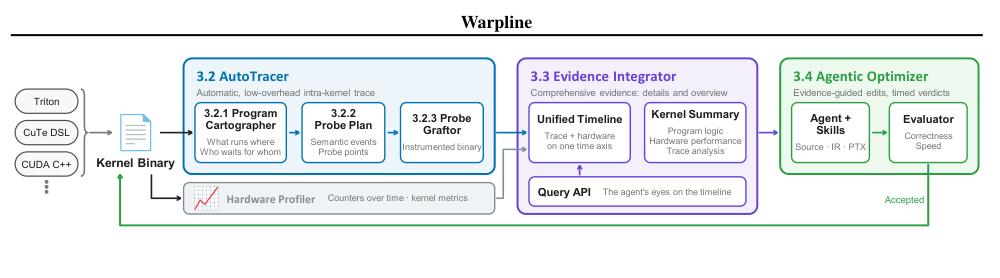
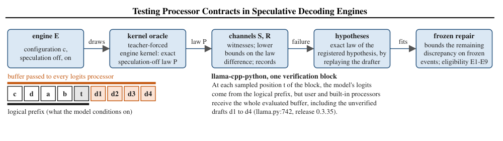
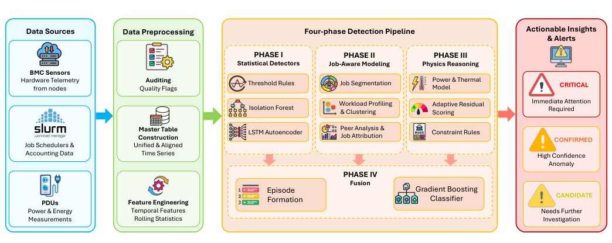
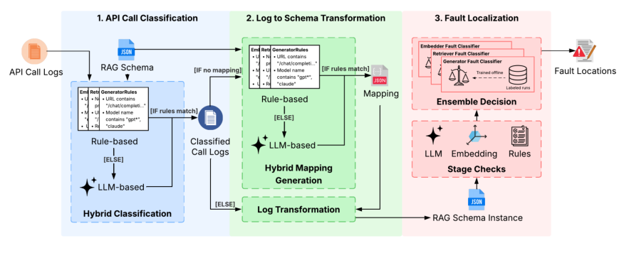
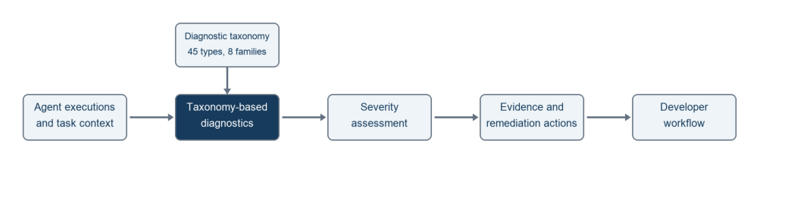
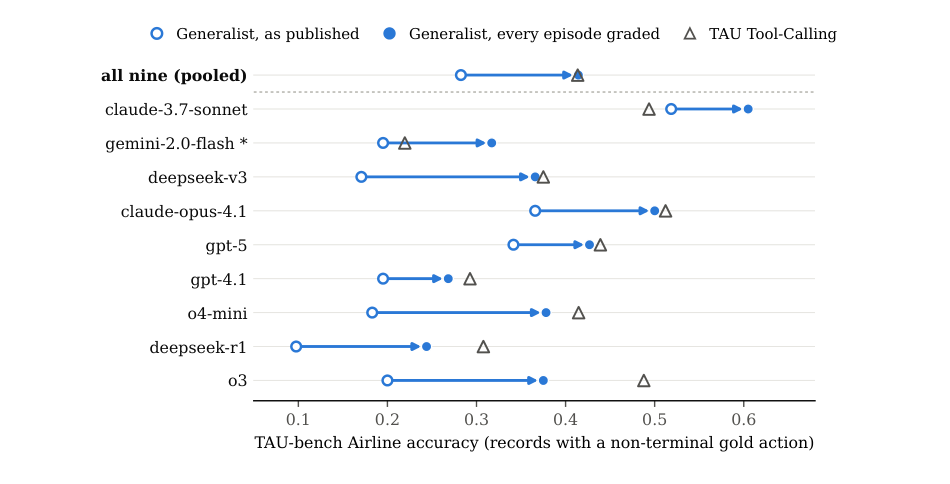

## In this issue

25 papers, 8 technical notes. Publication dates in source records are separate from this reading date.

<h2 class="daily-paper-title" id="paper-arxiv-2611.04401">01 · LiquidCP: Decoupling Attention Tasks from Communication and Kernel Boundaries in Context Parallelism</h2>

[LiquidCP: Decoupling Attention Tasks from Communication and Kernel Boundaries in Context Parallelism](https://arxiv.org/abs/2611.04401) 
Hongyu Chen, Yikang Ruan, Yuhai Long, Ziyu Huang, Yiyu Luo, Liukun Yu, Yangjie Zhou, Zihan Liu, Weihao Cui, Zijun Li, Anbang Wu, Yu Feng, Jing Yang, Jingwen Leng, Bingsheng He, Minyi Guo, Shixuan Sun

LiquidCP expresses attention as tile-dependent transfer, compute and reduction tasks. MegaRing balances token and attention work for training/prefill; MegaDCP plans history-KV splits around dependent reductions. A persistent GPU engine executes both. On eight H100s, the abstract reports 1.08–1.16× Transformer-layer acceleration and 1.22× average TTFT acceleration in vLLM with prefix caching. These are configuration-specific results, not universal serving gains.

Brief based on the primary abstract; full-paper experiments were not independently reproduced.

<h2 class="daily-paper-title" id="paper-arxiv-2611.04331">02 · Warpline: queryable performance evidence with limited tracing disturbance</h2>

**[Warpline: Binary-Level Tracing and Unified Evidence for Agentic GPU Kernel Optimization](https://arxiv.org/abs/2611.04331)** 
Authors：Junyu Yin, Vinod Grover, Keren Zhou · First submitted：2026-11-03

A kernel-writing agent needs to know what to change next. Hardware profiles can reveal falling tensor-core utilization without locating the responsible warp activity. Source instrumentation can trigger recompilation and alter register allocation or scheduling. Warpline combines binary tracing, hardware measurements, and recovered program structure into queryable evidence for the optimization loop.

<a class="note-image-link" href="/assets/images/digest/2026-11-05/warpline.png" target="_blank" rel="noopener" aria-label="Warpline loop from binary instrumentation through evidence integration to agent optimization · View original image ↗">View original image ↗</a>

*Language-specific kernels enter through a shared binary interface. Only candidates passing correctness and speed checks become the next tracing target.*

AutoTracer analyzes final SASS binaries statically and dynamically to recover warp roles, work loops, and barrier dependencies. It selects semantic events and inserts probes without recompilation. Record compaction, wide stores, register selection, and per-warp buffer sizing limit tracing overhead. Dynamically observed values are reused only when static checks establish dependence solely on the kernel and launch configuration.

Hardware measurements come from a separate uninstrumented run. The Evidence Integrator aligns warp lifetime with the profiler’s active-warp series and combines this with barrier dependencies, a kernel summary, and a query API. Agents can inspect a suspected bottleneck and retrieve the underlying events. Correctness checks and interleaved parent/candidate timing gate acceptance; each accepted binary receives fresh evidence for the next round.

On NVIDIA B200, tracing 35 Triton, CuTe DSL, and CUDA C++ kernels adds a median 1.2% overhead while preserving a median 99.9% of executed original instructions’ encodings and relative order. This is limited disturbance, not zero disturbance. Offline analysis and instrumentation take 13–77 seconds per kernel. Three closed-source library kernels are also traced, demonstrating the advantage of working at the binary interface.

The optimization comparison gives each method six rounds of up to 60 minutes on ten SOL-ExecBench problems. Geometric-mean speedups over starting kernels are 7.69× for Warpline, 6.94× for a bare agent, and 6.13× for KDA. Warpline’s additional advantage over the bare agent is therefore about 1.11×, not 7.69×. Mean model requests per round are 44, 54, and 108 respectively, with the last figure including KDA’s reviewer.

The evaluator explicitly handles timing noise. Parent and candidate run in ABBA order, with warm-up, repeated invocations, and an L2 flush before each invocation. Geometric means of batch medians are compared, and acceptance requires an improvement beyond the parent’s variation threshold. Richer explanations cannot replace this trusted timing gate.

One case shows why integrated evidence helps: periodic utilization drops suggested operand starvation, but deeper buffering did not help. The unified timeline instead exposed many CTAs entering epilogues together and bunching output stores. Changing accumulator release and store timing improved latency. Another case located compiler-inserted barriers absent from the source. Evaluation currently targets sm_100a; extension to other architectures remains future work, and correctness tests are not formal proofs. The contribution is a renewable diagnostic view of execution, rather than simply more search iterations.

<h2 class="daily-paper-title" id="paper-arxiv-2611.04998">03 · ForgeKernel: Self-Evolving Kernels Catching and Surpassing Experts and Agents</h2>

[ForgeKernel: Self-Evolving Kernels Catching and Surpassing Experts and Agents](https://arxiv.org/abs/2611.04998) 
Yaojian Chen, Dazhi Peng, Yiyun Zheng, Zhui Zhu, Shengye Xiang, Leshan Li, Zhen Li, Xianglong Deng, Haojun Sun, Qingfeng He, Shangzhan Li, Yifei Shen, Lin Gan, Yuxuan Li, Xu Han, Zhiyuan Liu

ForgeKernel carries validated hardware knowledge between optimization runs and promotes a correct, faster kernel into the next reference. This lets later searches revisit architecture instead of only tuning a fixed design. The abstract reports matching or beating expert references on 25 of 29 NVIDIA input configurations, with a 10% geometric-mean gain. Separate Ascend evaluations use different operators and baselines; leaderboard positions are dated claims.

Brief based on the primary abstract; full-paper experiments were not independently reproduced.

<h2 class="daily-paper-title" id="paper-arxiv-2611.04104">04 · ModelBlaster: Closing the Performance Gap through Learning-Augmented Agents Across Models, Kernels and Hardware Backends</h2>

[ModelBlaster: Closing the Performance Gap through Learning-Augmented Agents Across Models, Kernels and Hardware Backends](https://arxiv.org/abs/2611.04104) 
Shengjun Kris Dong, Dima Nikiforov, Sahil Modi, Sana Damani, Edward C Lin, Siva Kumar Sastry Hari, Christos Kozyrakis

ModelBlaster stores performance states, attempted changes, outcomes and constraints in an inference-time knowledge base. Textual actor–critic updates support kernel and whole-model optimization across CUDA, OpenCL and RISC-V vector targets. The reported gains depend on each platform’s baseline and workload. Reusing the optimization loop does not eliminate target-specific lowering, measurement or correctness checks.

Brief based on the primary abstract; full-paper experiments were not independently reproduced.

<h2 class="daily-paper-title" id="paper-arxiv-2611.04222">05 · GC-MoE: Overlapping Expert-Parallel Token Dispatch with FP8/FP4 Grouped GEMM via CUDA Green Contexts</h2>

[GC-MoE: Overlapping Expert-Parallel Token Dispatch with FP8/FP4 Grouped GEMM via CUDA Green Contexts](https://arxiv.org/abs/2611.04222) 
Yong Li, Kan Liu, Tao Lan

GC-MoE uses CUDA Green Contexts to reserve separate GPU resources for token dispatch and grouped GEMM. A token-ring handshake starts computation before all transfers finish; double-buffered counters avoid a trailing cross-rank barrier. The abstract reports matched-accuracy improvements over Mega MoE on H20 and B300 configurations. This is a MoE operator result with explicit resource partitioning, not an end-to-end gain for every model.

Brief based on the primary abstract; full-paper experiments were not independently reproduced.

<h2 class="daily-paper-title" id="paper-arxiv-2611.04042">06 · BADC: speculative decoding needs the right processor history</h2>

**[Testing Processor Contracts in Speculative Decoding Engines](https://arxiv.org/abs/2611.04042)** 
Authors：Tianyu Ding, Yaocheng Tong, Muzhi Yang, Lei Yang, Fei Jiang · First submitted：2026-11-02

Speculative decoding preserves a target distribution only when the surrounding engine supplies the right processed distribution at each verification position. Logits processors enforce minimum lengths, penalties, grammar constraints, or guidance. Correct model logits are insufficient if a processor sees unverified drafts or retains state from work that sequential decoding would never perform.

<a class="note-image-link" href="/assets/images/digest/2026-11-05/badc.png" target="_blank" rel="noopener" aria-label="BADC testing pipeline and processor input containing unverified drafts · View original image ↗">View original image ↗</a>

*The upper pipeline moves from samples to hypotheses and intervention checks. Orange draft tokens below show why the physical buffer differs from the current logical prefix.*

BADC makes this boundary explicit with a processor-prefix contract. A processor must receive the logical prefix for the current position, and a stateful processor must have state observationally equivalent to sequential execution at that prefix. Rolling back the target model’s KV cache does not establish either property. In the llama-cpp-python case, callbacks receive the evaluated buffer, including unverified drafts. A minimum-length processor can therefore release the end-of-sequence mask too early. In Transformers, candidate processing can advance state that is not subsequently restored.

The testing workflow separates detection from explanation. Tiny random models with vocabularies of 7–10 tokens and horizons of 3–4 allow enumeration of a sequential reference. BADC compares speculation-on and speculation-off samples, checks explicit contract violations, and constructs simultaneous bounds for predefined output events. Executable hypotheses represent suspected faulty schedules. Frozen interventions are then tested with fresh samples to assess whether the remaining event differences shrink.

The main study covers 26 configurations across five pinned builds, including Transformers 5.17.0 and llama-cpp-python 0.3.19/0.3.35, confirming two causes. A follow-up using SmolLM2-135M-Instruct and one pilot-selected prompt collected 1,024 fresh requests per arm. A fixed first-token event occurred in 80.37% of ordinary-decoding requests and 14.16% of native prompt-lookup requests. Under within-arm i.i.d. sampling, nominal simultaneous 95% bounds put the event-probability gap at at least 60.26 percentage points. This is a result for a particular prompt, checkpoint, processor configuration, and event; it does not estimate production failure prevalence.

The negative comparison matters too. Directed configuration selection showed no cause-recovery advantage over random selection, and a permutation test detected each tested family at least as often. BADC’s contribution is its contract, bounded event evidence, and intervention-supported mechanisms, without demonstrated detection superiority. Historical vLLM experiments likewise do not establish defects in current releases.

The study also checks whether speculation actually runs. One parameter combination proposes no drafts and is classified as inconclusive, not conformant. Likewise, non-rejection on a finite event family does not prove whole-engine conformance. Recording these non-results is important for regression testing.

For inference reliability, the transferable lesson is to validate prefix views, processor state, stopping rules, and probability records together. The contract and repair-confirmation conditions are the most useful parts to read: they explain what a fast path must preserve beyond its central sampling formula.

<h2 class="daily-paper-title" id="paper-arxiv-2611.04032">07 · ROCm InferaSim: Cut LLM Serving Trial Costs and Deploy the Best Configuration</h2>

[ROCm InferaSim: Cut LLM Serving Trial Costs and Deploy the Best Configuration](https://arxiv.org/abs/2611.04032) 
Anshu Raina, Yao Fu, Zhang Jiejing, Peyman Razaghi, Shiksha Patel, Ravi Gupta, Deval Shah, Adeem Jassani, Subhajit Dutta Chowdhury, Lorri Rao, Kailash Gogineni, Zhenyu Gu, Onil Gunawardana, Emad Barsoum

ROCm InferaSim measures representative kernel sets once and analytically transfers those anchors to related serving configurations. Traffic replay and search then rank candidates. The abstract reports 11 anchors costing 9.1 GPU-hours versus 204 GPU-hours for 226 measured configurations, and 8.1% median output-token-time error on 172 configurations. Prediction savings depend on shared kernel behavior and calibration; shortlisted deployments still require measurement.

Brief based on the primary abstract; full-paper experiments were not independently reproduced.

<h2 class="daily-paper-title" id="paper-arxiv-2611.04382">08 · Beyond Compression Ratio: High-Throughput KV Compression for Disaggregated LLM Serving</h2>

[Beyond Compression Ratio: High-Throughput KV Compression for Disaggregated LLM Serving](https://arxiv.org/abs/2611.04382) 
Junhong Wu, Zedong Liu, Xinyang Ma, Yuhan Chen, Guangming Tan, Dingwen Tao

This work targets the execution cost of KV compression, not compression ratio alone. It fuses distribution transformation and low-bit quantization to avoid intermediate tensors, then searches an extensible lossless backend. The abstract reports up to 2.04× shorter job completion time in evaluated workloads. Peak kernel/backend rates are separate measurements; faster networks make compression overhead especially important.

Brief based on the primary abstract; full-paper experiments were not independently reproduced.

<h2 class="daily-paper-title" id="paper-arxiv-2611.04671">09 · LeanSparse: Memory-Efficient Serving for Native Sparse-Attention LLMs</h2>

[LeanSparse: Memory-Efficient Serving for Native Sparse-Attention LLMs](https://arxiv.org/abs/2611.04671) 
Zaifeng Pan, Chris Wu, Xinwei Qiang, Zhengding Hu, Zhongkai Yu, Yufei Ding

LeanSparse reduces both prefill scratch space and persistent decode state. It streams layer histories through two GPU buffers and uses compact coarse indexing before fetching original keys for refinement, with separate key and KV caches. In SGLang on DeepSeek-V4-Flash at 950K context, the abstract reports 2.95× concurrency and 2.14× decode throughput over HiSparse. Separate multi-turn results use ECHO as baseline; these comparisons should not be combined.

Brief based on the primary abstract; full-paper experiments were not independently reproduced.

<h2 class="daily-paper-title" id="paper-arxiv-2611.03917">10 · Silent Degradation during Auto-Vectorization of bf16/fp16 on RISC-V Under LLVM</h2>

[Silent Degradation during Auto-Vectorization of bf16/fp16 on RISC-V Under LLVM](https://arxiv.org/abs/2611.03917) 
Vaishnavi Kouru, Robert Chun

The study compares LLVM auto-vectorization of a multiply–accumulate loop across fp32, int8, bf16 and fp16 on RISC-V. Without relevant target extensions, narrow floating-point types fall back to scalar work or software conversion. QEMU instruction counts rise 17.0× for bf16 and 75.9× for fp16 relative to extension-enabled variants. These are emulated instruction counts, not measured hardware latency; diagnostics also fail to clearly distinguish flag-remediable and intrinsic conversion costs.

Brief based on the primary abstract; full-paper experiments were not independently reproduced.

<h2 class="daily-paper-title" id="paper-arxiv-2611.05121">11 · An Investigation on Numerical Bugs in GPU Programs Towards Automated Bug Detection</h2>

[An Investigation on Numerical Bugs in GPU Programs Towards Automated Bug Detection](https://arxiv.org/abs/2611.05121) 
Ravishka Rathnasuriya, Nidhi Majoju, Zihe Song, Wei Yang

The authors classify 397 GPU numerical bugs by causes, symptoms, triggering inputs, oracles and repairs. Their preliminary GPU-NBDetect covers six categories and reports 226 detected bugs across 186 mathematical functions in four libraries, of which 60 were developer-confirmed. Detection reports and confirmations are different denominators; the study motivates targeted numerical tests rather than proving complete coverage.

Brief based on the primary abstract; full-paper experiments were not independently reproduced.

<h2 class="daily-paper-title" id="paper-arxiv-2611.04057">12 · Look Before You Launch: Learned Throughput Prediction for Hardware Selection in a Production Training Fleet</h2>

[Look Before You Launch: Learned Throughput Prediction for Hardware Selection in a Production Training Fleet](https://arxiv.org/abs/2611.04057) 
Hossein Askari, Wei Sun, Chenguang Zhu, Bin Zan, Sreen Tallam, Keyu Man

LEAP predicts training throughput from submission-time configuration and prior job throughput, then ranks hardware by throughput per cost. The production report covers hundreds of model types and more than 20 hardware types, estimating about 3% computational-cost savings. Its reported 77% accuracy uses the paper’s prediction criterion; it is not a universal hardware-selection success rate or a guarantee for unseen workloads.

Brief based on the primary abstract; full-paper experiments were not independently reproduced.

<h2 class="daily-paper-title" id="paper-arxiv-2611.04897">13 · TapeSAC: Automated, Pareto-Optimal Fine-Grained Memory Management for Large Model Training</h2>

[TapeSAC: Automated, Pareto-Optimal Fine-Grained Memory Management for Large Model Training](https://arxiv.org/abs/2611.04897) 
Kaihui Ren, Yifan Zhao, Zejian Wang, Yingtong Xiong, Xiaoling Zhou, Daohong Xu, Chenhao Guan, Zhikang Mo, Jihu Guo, Zhuoru Ma, Yufeng Li, Lin Zhang, Yiqiao Liao, Chengru Song

TapeSAC records forward operations at the PyTorch dispatcher and replays only producers needed by backward. A planner chooses saved tensors using measured recomputation costs under a peak-memory budget. The abstract reports 8–11% training-time reductions over 500 real-data steps and a separate 397B-model comparison with 2.7% faster execution and 14% less memory. Benefits depend on kernels, batch size and baseline checkpoint policy.

Brief based on the primary abstract; full-paper experiments were not independently reproduced.

<h2 class="daily-paper-title" id="paper-arxiv-2611.04449">14 · Near-Zero Token Embeddings Silently Stall Training in Gated Sequence Models</h2>

[Near-Zero Token Embeddings Silently Stall Training in Gated Sequence Models](https://arxiv.org/abs/2611.04449) 
Xin Liu, Boyuan Sun, Yuxin Wang, Haoran Song, Mingjian Zhao, Mengyu Liu

Near-zero untied embeddings can suppress gated-model readout and amplify gradients through repeated normalization. FP32 global-norm clipping may overflow and erase a batch update. The paper distinguishes surveyed checkpoint prevalence from a Telugu continual-pretraining experiment with roughly 20% discarded updates. GroupClip changes clipping for existing checkpoints; GateFloor changes gates during pretraining. The remedies address a specific failure chain, not all training instability.

Brief based on the primary abstract; full-paper experiments were not independently reproduced.

<h2 class="daily-paper-title" id="paper-arxiv-2611.03875">15 · INSIGHT-HPC: interpreting anomalies through workload and physics</h2>

**[INSIGHT-HPC: An Interpretable System Intelligence for Global HPC Telemetry](https://arxiv.org/abs/2611.03875)** 
Authors：Rupak Kadel, Jie Li, Yong Chen · First submitted：2026-11-02

INSIGHT-HPC aligns BMC, Slurm, and PDU telemetry by node and minute. Statistical anomalies, job segments and peer comparisons, power/thermal residuals, and physical constraints feed a supervised gradient-boosting model that produces episode-level alerts. A power increase at job startup can thus be explained by workload rather than automatically treated as a fault.

<a class="note-image-link" href="/assets/images/digest/2026-11-05/insight-hpc.png" target="_blank" rel="noopener" aria-label="INSIGHT-HPC architecture integrating statistical, workload, and physical evidence · View original image ↗">View original image ↗</a>

*Three evidence paths feed episode-level fusion. Alert tiers use thresholds selected on validation data.*

The authors replay 79 days from 118 compute nodes using chronological splits. The test set combines 29 operator-recorded failures with 140 injected events. At the primary threshold, precision is 0.913 and F1 is 0.862; separately reported event recall is 0.805. This is retrospective detection, not demonstrated real-time warning: classification uses complete-episode features, and headline results mix real and injected faults. AUROC candidate pools also differ across methods. The transferable idea is to combine workload explanations and physical inconsistencies as distinct evidence in alert fusion.

<h2 class="daily-paper-title" id="paper-arxiv-2611.03725">16 · RAGLog: a correct answer can conceal upstream faults</h2>

**[From Logs to Faults: Reference-Free Fault Localization for Retrieval-Augmented Generation Pipelines](https://arxiv.org/abs/2611.03725)** 
Authors：Hira Naveed, Scott Barnett, Stefanus Kurniawan, John Grundy, Chetan Arora, Hourieh Khalajzadeh, Omar Haggag · First submitted：2026-11-01

A final RAG answer is an incomplete health signal. Retrieval can miss necessary evidence while the generator answers from prior knowledge; reranking can discard useful material and make the generator appear responsible. RAGLog localizes faults across rewriting, embedding, retrieval, reranking, and generation using execution logs. Online requests need no reference answer, but the method still needs sufficiently complete call inputs and outputs.

<a class="note-image-link" href="/assets/images/digest/2026-11-05/raglog.png" target="_blank" rel="noopener" aria-label="RAGLog call classification, schema mapping, and stage fault classification · View original image ↗">View original image ↗</a>

*Logs are normalized before rule, embedding, and LLM checks are combined. The classifiers on the right are trained on labeled data offline.*

It first classifies API calls using rules for familiar interfaces and an LLM fallback for unfamiliar ones. Reusable field mappings transform heterogeneous logs into a common RAG schema. Rules check lost entities, numbers, and dates; embedding similarities measure drift; five parallel LLM checks examine evidence availability, exclusion, grounding, and other semantic properties. Separate stage classifiers combine these measurements instead of treating an unconstrained LLM diagnosis as the final verdict.

“Reference-free” does not mean label-free. Online analysis sees only traces, while the stage classifiers and thresholds are trained offline on labeled runs. RAGLog Faults contains 3,134 runs. The main evaluation separates 1,500 natural runs from 480 injected runs across five open-source pipelines and three question-answering datasets. A live proxy modifies actual calls so downstream stages respond to disturbances, rather than merely labeling edited logs as failures.

With Claude Haiku 5.5, stage-level pooled F1 on natural runs is 0.73, versus 0.58 for Claude Code and 0.52 for Codex. On injected runs the scores are much closer: 0.84, 0.80, and 0.82. Of 551 naturally faulty runs, 202 still produce correct answers. The authors report roughly $0.005 and 4.6–4.7 seconds per run for the Haiku variant, with parallel checks keeping latency bounded.

Higher recall carries an operational cost. Run-level false-positive rates are 13.6% for RAGLog, versus 5.4% and 4.0% for the agent baselines. Holding out an entire pipeline reduces natural-run pooled F1 from 0.73 to 0.67. Labels are primarily generated by LLM judges, without independent human validation of test labels. The method also does not currently support agentic RAG with dynamically selected or repeated stages.

Ablations help locate the gains: removing LLM checks has the largest effect on natural faults. Removing the evidence-flow check has a smaller but significant effect on both natural and injected sets. Not every added classifier or cross-stage feature provides a statistically significant benefit, so architectural complexity is not evidence of necessity.

The especially useful contribution for AIOps is the separation between an injected disturbance, a manifested stage fault, and an incorrect final answer. Many injections are absorbed downstream; counting all injected runs as faulty would corrupt the evaluation. Read the evidence-flow checks and post-injection labeling procedure for a concrete way to make generative-system diagnosis more precise while exposing its false-alarm and annotation costs.

<h2 class="daily-paper-title" id="paper-arxiv-2611.04507">17 · Signals: grouping trace findings into engineering issues</h2>

**[Signals: Continuous Diagnostics of AI Agents](https://arxiv.org/abs/2611.04507)** 
Authors：Amey Rambatla, Vatsal Goel, Sagar Gaur, Siddhant Loya, Anurag Mishra, Asif Mohammad · First submitted：2026-11-03

Signals targets wrong decisions and wasted work even when tools and infrastructure operate normally. Its taxonomy contains 45 problem types across eight families. Individual occurrences are grouped into engineering issues with evidence, severity, and remediation checks, separating realized defects, reachable risks, and inefficiencies. A shared label alone does not establish a shared root cause.

<a class="note-image-link" href="/assets/images/digest/2026-11-05/signals.png" target="_blank" rel="noopener" aria-label="Signals workflow from trace diagnosis to severity and remediation suggestions · View original image ↗">View original image ↗</a>

*The taxonomy constrains diagnosis before evidence and proposed actions reach developers. Repair effectiveness still requires subsequent validation.*

On public benchmark executions, the GPT-6.1 Sol workflow achieves 91.43% Signal-matching F1 versus 73.69% for one-pass generation using the same model and taxonomy. Matching checks components and problem types, not descriptions, evidence spans, severity, or repair effectiveness. Reference labels were produced by LLMs under human oversight. Compared with RAGLog’s stage-level verdicts, Signals emphasizes issue management across executions. Its evidence boundaries are especially useful for avoiding diagnoses based solely on rejected calls, long traces, or missing telemetry.

<h2 class="daily-paper-title" id="paper-arxiv-2611.04399">18 · Auditing the evaluator: a 13-point gap caused by missing grades</h2>

**[Silent Instrument Errors Reorder Agent Leaderboards](https://arxiv.org/abs/2611.04399)** 
Authors：Yangze Liu · First submitted：2026-11-03

Leaderboard scores are often treated as direct evidence of model and harness capability. This audit instead examines the infrastructure that produces them: grading triggers, cost aggregation, action provenance, and versioned replay. Recomputing public HAL and tau2-bench artifacts without rerunning agents reveals four failures that still produce plausible numbers.

<a class="note-image-link" href="/assets/images/digest/2026-11-05/instrument-errors.png" target="_blank" rel="noopener" aria-label="Generalist scores after grading previously ungraded HAL records · View original image ↗">View original image ↗</a>

*Arrows show changes after applying the same reward rule to ungraded records. The pooled row reaches the triangle, without reversing every individual model comparison.*

The clearest case concerns HAL’s airline tasks. Generalist finishes its own conversation loop without necessarily triggering the benchmark’s termination event. Ungraded records are then stored as failures. Tool-Calling has a graded fraction of 98%, compared with 51% for Generalist. Applying the pinned environment and original reward rule to previously ungraded records raises Generalist’s pooled accuracy from 0.30 to 0.43 on 41 tasks with non-terminal reference actions across nine models, closing the published 13-point gap.

That does not reverse every model-level comparison or establish that doing nothing completes a task. On tasks requiring database writes, accuracy rises from 0.28 to 0.33; all 23 newly passing ungraded episodes contain the required write. The scaffolds still differ in prompt placement and step budgets. The correction removes unequal grading coverage, not every experimental difference.

Two other failures arise in observability infrastructure. Cost aggregation sums both wrapper and provider-client spans containing the same response, double-counting some client paths but not others. Archived trajectories also include the grader’s reference actions: these occur in 68% of 2,334 airline records and sometimes appear in the middle. Removing a fixed suffix cannot reliably clean them. Behavioral analysis or training on these logs can therefore attribute grader work to the agent.

The fourth failure concerns replay versions. Even a properly announced grading correction changes rankings. Separately, a telecom replay path misidentifies solo mode and omits user-side tools. It continues after tool-not-found results and returns scores 59–82 points lower for four files. The paper distinguishes legitimate criterion updates from implementation errors: re-grading is itself a new measurement.

Code fixes do not update historical numbers or downloaded traces. HAL maintainers confirmed three issues and added disclosures, while the archives remained unchanged. The paper therefore recommends machine-readable errata inside datasets so copies traveling beyond the leaderboard retain the affected-record scope and correction rules.

The audit does not estimate error prevalence across all leaderboards, and the HAL re-grades cover database and output criteria. Its reusable checks are concrete: publish the graded fraction, deduplicate costs by root spans or response IDs, identify who produced each action, and pin evaluator and task-data versions with per-task re-grade differences. For AgentOps, these checks establish whether a small score difference is evidence worth acting on.

<h2 class="daily-paper-title" id="paper-arxiv-2611.04321">19 · ATC: Agent Trajectory Control for Role-Contract Enforcement in Black-Box Multi-Agent Systems</h2>

[ATC: Agent Trajectory Control for Role-Contract Enforcement in Black-Box Multi-Agent Systems](https://arxiv.org/abs/2611.04321) 
Maisha Maliha, Vishal Pramanik, Sumit Kumar Jha

ATC treats role drift as a breach of an explicit role contract. Before admitting a message into a multi-agent conversation, it scores unauthorized functions and speech acts, requests constrained regeneration and checks the revision. The abstract reports improved task and role-consistency outcomes in tested teams. Message-level governance does not by itself enforce permissions on external tools or prove semantic correctness.

Brief based on the primary abstract; full-paper experiments were not independently reproduced.

<h2 class="daily-paper-title" id="paper-arxiv-2611.03931">20 · Beyond Division of Labor: How Roles Shape Feedback and Recovery in Multi-Agent Systems</h2>

[Beyond Division of Labor: How Roles Shape Feedback and Recovery in Multi-Agent Systems](https://arxiv.org/abs/2611.03931) 
Chih-Hsuan Yang, Xinyang Li, Rajeev Thakur, Feng Yan

This controlled role-prompt comparison finds that reviewer approval can reduce submission and therefore access to corrective feedback. Removing roles does not lower first-pass accuracy in the studied settings; recovery differences shrink when verdict counts are matched. A 400-problem intervention raises recovery from 0.198 to 0.613 by forcing submissions while retaining roles. The result concerns systems with reliable external feedback, not a universal argument against specialization.

Brief based on the primary abstract; full-paper experiments were not independently reproduced.

<h2 class="daily-paper-title" id="paper-arxiv-2611.04277">21 · Harness-S: Learning from Sibling Harnesses for Generalizable Agent Training</h2>

[Harness-S: Learning from Sibling Harnesses for Generalizable Agent Training](https://arxiv.org/abs/2611.04277) 
Kangning Zhang, Wenxiang Jiao, Bowen Fang, Shuai Shao, Jiachen Zhu, Rong Shan, Shijian Wang, Hao Wang, Yuan Lu, Weiwen Liu, Weinan Zhang

Harness-S builds a fixed pool of complementary harness variants. When base-harness attempts all fail, selected siblings generate replacement rollouts for policy training; routing profiles are refreshed as the policy changes. The trained policy is evaluated again under its original harness on AppWorld, SWE-Gym and DBBench. Additional routing gains and transferred policy gains are distinct; equal executor rollouts do not imply equal total routing cost.

Brief based on the primary abstract; full-paper experiments were not independently reproduced.

<h2 class="daily-paper-title" id="paper-arxiv-2611.05139">22 · Meta$^2$: Precomputing Reusable Knowledge for Online Harness Evolution in Long-Horizon Agents</h2>

[Meta$^2$: Precomputing Reusable Knowledge for Online Harness Evolution in Long-Horizon Agents](https://arxiv.org/abs/2611.05139) 
Lingzhi Yuan, Yiguang Cai, Weize Liu, Siqi Yang, Feijiang Han, Yongkyun Lee, Udari Madhushani Sehwag, Furong Huang

Meta² learns reusable guidance for when to keep or edit a harness by contrasting training trajectories with and without an evolver and privileged training feedback. At test time, the frozen guidance combines with the current trajectory to make task-local edits without resetting progress. The abstract reports 81.00% on Terminal-Bench 2.1 and 44.44% on DeepSWE 1.1 with GPT-5.6-Terra. These scores concern the evaluated setup; test-time verifier access is explicitly excluded.

Brief based on the primary abstract; full-paper experiments were not independently reproduced.

<h2 class="daily-paper-title" id="paper-arxiv-2611.04142">23 · Interpretable Early Termination of Web Navigation Agents via Closed Sequential Pattern Mining</h2>

[Interpretable Early Termination of Web Navigation Agents via Closed Sequential Pattern Mining](https://arxiv.org/abs/2611.04142) 
Sergio Talavera, Magdalini Eirinaki

Closed sequential pattern mining extracts interpretable early failure signatures from web-agent traces. On 1,544 MiniWoB++ traces from three open-weight models, the reported policy saves 26.3% of tokens at 92% precision. The evaluation removes zero-step crashes and trivially separable successes to reduce trace-length artifacts. Early stopping still risks discarding recoverable runs; benchmark traces do not establish production savings.

Brief based on the primary abstract; full-paper experiments were not independently reproduced.

<h2 class="daily-paper-title" id="paper-arxiv-2611.04447">24 · Formalizing PTX in Lean to Prove GPU Kernel Correctness</h2>

[Formalizing PTX in Lean to Prove GPU Kernel Correctness](https://arxiv.org/abs/2611.04447) 
Luk Koska, Tom Koska, Ben Koska

This work formalizes PTX behavior in Lean, including synchronization, asynchronous operations, tensor cores and multi-kernel pipelines. It proves simple WGMMA GEMM, FlashAttention and three-kernel MoE implementations against that model. The abstract establishes proof examples, not complete PTX coverage or correctness of arbitrary GPU programs; hardware/model correspondence remains a separate obligation.

Brief based on the primary abstract; full-paper experiments were not independently reproduced.

<h2 class="daily-paper-title" id="paper-arxiv-2611.04701">25 · Proving the Wrong Program: Miscompilations as a Threat to zkVM Guarantees</h2>

[Proving the Wrong Program: Miscompilations as a Threat to zkVM Guarantees](https://arxiv.org/abs/2611.04701) 
Hui Xuan Tan, Stefanos Chaliasos, Alastair F. Donaldson

A zkVM proves execution of a compiled binary, so compiler miscompilation can break correspondence with verified source. Among 88 known Rust/LLVM bugs with reproducers, the study finds wrong committed outputs for 48 on SP1 and 46 on Jolt. Most existing guest programs tested are not accidentally affected, but crafted source-preserving patches can trigger known defects. This separates compiler trust from proof-system correctness and does not show that every guest is vulnerable.

Brief based on the primary abstract; full-paper experiments were not independently reproduced.

## Technical notes from this day

- <a href="/tech/en/2026-11-05-together-polymorphic-inference/">Polymorphic Inference: self-tuning inference for open models</a>
- <a href="/tech/en/skydiscover-jitengine/">JITEngine: different optimizations for the same model on different Macs</a>
- <a href="/tech/en/2026-11-05-vllm-bangkok-serving-agentic-workload/">Serving the agentic workload: Simon Mo on what AI agents change in vLLM</a>
- <a href="/tech/en/nvidia-ai-agents-ai-factory-operations/">NVIDIA cluster agents: cross-layer investigation with read-only access</a>
- <a href="/tech/en/nvidia-nemo-agent-failures-to-tests/">NeMo: turning trace evidence into testable harness repairs</a>
- <a href="/tech/en/azure-failure-prediction-detection/">Azure AFPD: prediction must connect to migration and repair</a>
- <a href="/tech/en/2026-11-05-openai-thousand-fewer-paths-to-root/">A thousand fewer paths to root</a>
- <a href="/tech/en/google-cost-per-task-routing/">Model routing: establish a genuinely cheaper execution path</a>