## In this issue

20 papers, 6 technical notes. Publication dates in source records are separate from this reading date.

<h2 class="daily-paper-title" id="paper-arxiv-2611.04401">01 · LiquidCP: Decoupling Attention Tasks from Communication and Kernel Boundaries in Context Parallelism</h2>

[LiquidCP: Decoupling Attention Tasks from Communication and Kernel Boundaries in Context Parallelism](https://arxiv.org/abs/2611.04401) 
Hongyu Chen, Yikang Ruan, Yuhai Long, Ziyu Huang, Yiyu Luo, Liukun Yu, Yangjie Zhou, Zihan Liu, Weihao Cui, Zijun Li, Anbang Wu, Yu Feng, Jing Yang, Jingwen Leng, Bingsheng He, Minyi Guo, Shixuan Sun

LiquidCP targets two mismatches in context parallelism. Training attention work grows roughly quadratically with sequence length while many other layer operations scale with token count, so attention balance can worsen whole-layer balance. In decoding, short queries over long KV histories create tails in separately launched communication, attention and reduction stages; mixed prefill can make batch-wide heuristics leave long-history decode unsplit.

The method represents work as Transfer, Compute and Reduction tasks with tile-level dependencies. MegaRing's BuddyRing placement constrains both token and attention loads using aligned GPU groups of different sizes while limiting short-sequence fragmentation. Transfers remain fine-grained, but computation coalesces ready, unassigned KV across communication blocks, decoupling its boundaries from ring steps.

MegaDCP retains evenly sharded history and models attention plus dependent-reduction completion when selecting splits. More splits expose parallelism but add task and reduction overhead; a split plan needs a modeled improvement of at least 10% over NoSplit. A shared persistent GPU engine advances consumers when their dependencies are ready. The planning model omits some transfer and final-reduction costs, so it is a latency proxy rather than an exact execution model.

All experiments use one eight-H100 node. Across five variable-length datasets, geometric-mean core-attention gains are 1.23/1.18 times for forward/backward; Qwen3-30B-A3B Transformer-layer gains are 1.08–1.16 times, not complete training throughput. End-to-end vLLM replay preloads history KV, measures 1,000 requests and includes host planning, yielding average TBT and TTFT gains around 1.04 and 1.22 times. Some configurations do not improve, and long uniform sequences benefit less. The useful insight is to choose splitting versus coalescing from readiness, task overhead and dependent reductions rather than isolated attention peaks.

<h2 class="daily-paper-title" id="paper-arxiv-2611.04331">02 · Warpline: queryable performance evidence with limited tracing disturbance</h2>

**[Warpline: Binary-Level Tracing and Unified Evidence for Agentic GPU Kernel Optimization](https://arxiv.org/abs/2611.04331)** 
Authors：Junyu Yin, Vinod Grover, Keren Zhou · First submitted：2026-11-03

A kernel-writing agent needs to know what to change next. Hardware profiles can reveal falling tensor-core utilization without locating the responsible warp activity. Source instrumentation can trigger recompilation and alter register allocation or scheduling. Warpline combines binary tracing, hardware measurements, and recovered program structure into queryable evidence for the optimization loop.

<a class="note-image-link" href="/assets/images/digest/2026-11-05/warpline.png" target="_blank" rel="noopener" aria-label="Warpline loop from binary instrumentation through evidence integration to agent optimization · View original image ↗">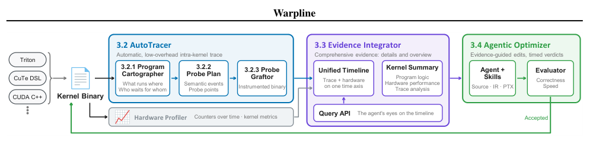View original image ↗</a>

*Language-specific kernels enter through a shared binary interface. Only candidates passing correctness and speed checks become the next tracing target.*

AutoTracer analyzes final SASS binaries statically and dynamically to recover warp roles, work loops, and barrier dependencies. It selects semantic events and inserts probes without recompilation. Record compaction, wide stores, register selection, and per-warp buffer sizing limit tracing overhead. Dynamically observed values are reused only when static checks establish dependence solely on the kernel and launch configuration.

Hardware measurements come from a separate uninstrumented run. The Evidence Integrator aligns warp lifetime with the profiler’s active-warp series and combines this with barrier dependencies, a kernel summary, and a query API. Agents can inspect a suspected bottleneck and retrieve the underlying events. Correctness checks and interleaved parent/candidate timing gate acceptance; each accepted binary receives fresh evidence for the next round.

On NVIDIA B200, tracing 35 Triton, CuTe DSL, and CUDA C++ kernels adds a median 1.2% overhead while preserving a median 99.9% of executed original instructions’ encodings and relative order. This is limited disturbance, not zero disturbance. Offline analysis and instrumentation take 13–77 seconds per kernel. Three closed-source library kernels are also traced, demonstrating the advantage of working at the binary interface.

The optimization comparison gives each method six rounds of up to 60 minutes on ten SOL-ExecBench problems. Geometric-mean speedups over starting kernels are 7.69× for Warpline, 6.94× for a bare agent, and 6.13× for KDA. Warpline’s additional advantage over the bare agent is therefore about 1.11×, not 7.69×. Mean model requests per round are 44, 54, and 108 respectively, with the last figure including KDA’s reviewer.

The evaluator explicitly handles timing noise. Parent and candidate run in ABBA order, with warm-up, repeated invocations, and an L2 flush before each invocation. Geometric means of batch medians are compared, and acceptance requires an improvement beyond the parent’s variation threshold. Richer explanations cannot replace this trusted timing gate.

One case shows why integrated evidence helps: periodic utilization drops suggested operand starvation, but deeper buffering did not help. The unified timeline instead exposed many CTAs entering epilogues together and bunching output stores. Changing accumulator release and store timing improved latency. Another case located compiler-inserted barriers absent from the source. Evaluation currently targets sm_100a; extension to other architectures remains future work, and correctness tests are not formal proofs. The contribution is a renewable diagnostic view of execution, rather than simply more search iterations.

<h2 class="daily-paper-title" id="paper-arxiv-2611.04998">03 · ForgeKernel: cross-run hardware knowledge and architectural self-evolution for kernels</h2>

[ForgeKernel: Self-Evolving Kernels Catching and Surpassing Experts and Agents](https://arxiv.org/abs/2611.04998) ([v1 PDF](https://arxiv.org/pdf/2611.04998) · [GitHub](https://github.com/OpenBMB/ForgeKernel))  
Yaojian Chen\*, Dazhi Peng\*, Yiyun Zheng\*, Zhui Zhu, Shengye Xiang, Leshan Li, Zhen Li, Xianglong Deng, Haojun Sun, Qingfeng He, Shangzhan Li, Yifei Shen, Lin Gan, Yuxuan Li†, Xu Han†, Zhiyuan Liu† (Tsinghua University, ModelBest Inc., University of Chinese Academy of Sciences, Harbin Institute of Technology; \*equal contribution, †corresponding authors) · `arXiv:2611.04998v1 [cs.DC]` · Submitted 2026-11-03 (`v1` only at verification time, with no revision or withdrawal)

As new operator families—such as sparse attention indexers (DSA), gated delta networks (GDN), and multi-head latent attention (MLA)—continue to proliferate, automated kernel agents face a dual ceiling beyond emitting valid code: retaining probe-verified hardware insights across optimization runs and reopening early structural choices when local tuning stalls. `ForgeKernel` splits architectural planning from contract-bound coding, distills newly discovered mechanisms into a target-GPU probe-certified knowledge base (`hw_kb`), and seals accepted kernels as **source-hidden, measurable black-box references** for subsequent optimization runs so structural decisions can be revisited rather than patched incrementally. All measurements, tables, and boundaries below trace directly to `arXiv:2611.04998v1` (Tables 1–6, Figures 1–8, Appendices A–E), keeping track-specific baselines distinct from audit caveats.

### 1. Core bottlenecks: early architectural lock-in and cross-run amnesia in kernel agents

Sections 1, 2, and 5 (Figure 1) diagnose why existing kernel optimization loops (`GEAK`, `STARK`, `Astra`, `AlphaEvolve`, RL-trained `Kevin`/`CUDA-L1`, skeleton-preserving `EGG`/`CuBridge`, and human-steered `AKO`) plateau behind hand-tuned expert libraries or fail to compound progress across tasks:

- **Early architectural lock-in and single-agent context entanglement**: Traces of underperforming kernel searches reveal that foundational structural decisions—work partitioning across thread blocks and threads, data layout across memory tiers, and compute-transfer pipeline scheduling—solidify in the earliest attempts. Later iterations tune instructions, synchronization, or resource knobs inside that frozen skeleton rather than questioning the skeleton itself. Merging design and coding inside one agent worsens this bias: compilation errors, debugging, and local edits rapidly fill the context window and anchor subsequent steps to the existing code structure.
- **Cross-run amnesia and expert-source imitation**: Standard goal-mode loops yield a fast kernel at the end of a run while discarding the underlying hardware findings, forcing the next run or operator to re-discover the same execution behaviors from static pretraining priors (Figure 1a). Even recent memory-augmented frameworks (`KernelClaw`, `KLineage`) primarily extract reusable memories or simplified skills from **expert reference implementations**, rather than distilling hardware mechanisms discovered during optimization, validating them via standalone target-GPU probes, and citing them during architectural planning across operators.

### 2. System design: arch-vs-coding separation, reference sealing, and probe-certified hardware knowledge

<figure class="note-figure"><a class="note-image-link" href="/assets/images/digest/2026-11-05/forgekernel-evolution-loop-en.svg" target="_blank" rel="noopener" aria-label="View ForgeKernel dual-loop architecture and probe-certified knowledge base diagram">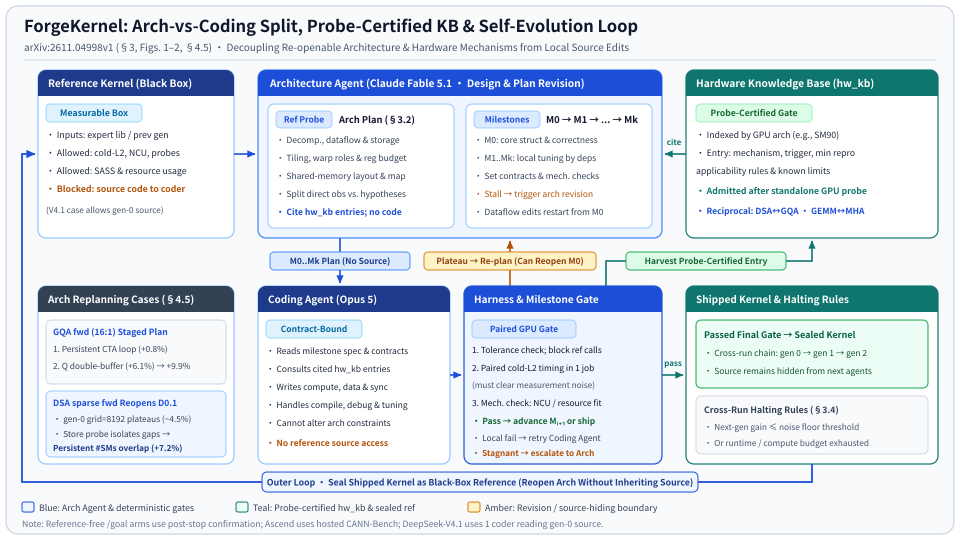View full diagram ↗</a><figcaption>Figure 1 · ForgeKernel architecture and dual-loop self-evolution (from arXiv:2611.04998v1 §3, Figs. 1–2, §4.5): inner plateaus trigger architectural replanning (reopening M0 when needed), while outer reference sealing prevents source inheritance across generations.</figcaption></figure>

To break both ceilings simultaneously, `ForgeKernel` couples three mechanisms (§3, §4.1, Figure 1):

1. **Strict role and source-visibility separation (§3.1–§3.3)**:
   - **Architecture Agent (`Claude Fable 5.1`)**: Owns design decisions and plan revisions. Given the operator spec, input shape, target hardware, `hw_kb`, and profiling evidence from the reference (`NCU` counters, timeline probes, and `SASS` disassembly, without requiring source access), it sets structural choices—kernel decomposition, data dependencies, intermediate storage, tiling, thread roles, register budgets, and shared-memory layouts—while explicitly separating **direct observations** from **hypotheses to test**. It structures execution into an ordered milestone sequence `M0, M1, ..., Mk`: `M0` establishes core structure and correctness without an absolute speed threshold, whereas `M1..Mk` sequence dependency-ordered tuning inside that design via interface contracts and validation conditions, containing zero implementation code.
   - **Coding Agent (`Claude Opus 5`)**: Realizes the current milestone using only the milestone spec, interface contracts, and cited `hw_kb` entries, handling compilation, debugging, and local tuning within plan constraints. By default, the harness enforces **no reference source access** (and blocks any call or delegation to the reference kernel), preventing source copying.
   - **Execution Harness & Triple Milestone Gate (§3.3, §4.1, Appendix A)**: Candidates first pass source-matched tolerance judges—FlashInfer-Bench or FlashAttention tests, DeepGEMM aggregate GEMM bounds, relative max-abs bounds for attention gradients, and scaled tolerance plus cosine similarity (augmented with correlated-key and long-memory inputs to catch state-decay shortcuts) for `GDN`/`KDA`. Next, whenever candidate and reference can co-execute, the harness runs **paired cold-L2 timing in the same GPU job** (`S = T_ref / T_candidate`, gain `(S - 1) × 100%`; reference-free `/goal` arms use separate post-stop confirmation channels) and checks whether gains clear the measurement noise floor. Finally, **mechanism validation** verifies via resource/execution counters that the implementation exhibits the intended architectural behavior before advancing to `Mi+1`.
2. **Dual-loop self-evolution via within-run `M0` replanning and cross-run reference sealing (§3.4, §4.5)**:
   - **Within-run plan revision**: When optimization stagnates, milestone actions run dry, or mechanism checks block progress, trajectories, measurements, and supplementary probes return to the Architecture Agent. Local adjustments resume mid-plan; **structural changes to computation organization or dataflow restart from the earliest affected decision, including `M0` when necessary**. Unattributed edits are reverted with failure conditions recorded.
   - **Cross-run reference sealing**: A `Shipped Kernel` passing final acceptance is sealed as a measurable, **source-hidden black-box reference** for the next run (`gen 0 → gen 1 → gen 2`). Because the next run's agents cannot inherit the prior generation's code, the Architecture Agent profiles the sealed binary fresh and can reopen previously frozen structural choices. Cross-run evolution halts when a subsequent generation's gain stays within the measurement noise floor or the budget expires.
   - **Two architectural replanning case studies (§4.5, Figure 7)**: (a) On H100 `GQA fwd (16:1)`, `gen 0` runs one query block per CTA and exits. In round 1, the Architecture Agent plans a two-step dependency chain: persistent CTA execution with cross-block state management yields a modest **`+0.8%`** local gain, unlocking `Q` double buffering for a **`+6.1%`** local step and **`+9.9%`** total round improvement (non-additive due to concurrent edits); (b) on H100 `DSA sparse attn fwd`, `gen 0` uses a non-persistent `grid = 8192` (`1 CTA/SM`), gains `~4.5%` under local tuning in the next run, and stalls. A diagnostic probe removing output stores shifts runtime by `~6.0%`, exposing uncovered Q-load, initial KV-fill, and store gaps at CTA boundaries; the Architecture Agent reopens `D0.1` to adopt a persistent loop (`grid = #SMs`), overlapping item `n`'s write-out with item `n+1`'s loads for a **`+7.2%`** gain over `gen 0`.
3. **Probe-certified hardware knowledge base `hw_kb` (§3.5, §4.4, Figure 6, Figure 8, Appendix E)**:
   - Organized by target GPU architecture, each `hw_kb` entry records five fields: **hardware mechanism, applicability conditions, trigger symptoms, minimal runnable example, and known limitations**. Candidate entries enter `hw_kb` only after passing **independent probe validation** on the target GPU with supporting measurements, and milestone gates still verify their effect on each citing task.
   - Across the 23-recipient SM90 provenance cohort (Figure 6a, deduplicated from milestone citations and decision-delivery snapshots with self-reuse excluded), adoption spans `0–5` entries (`17.4%`), **`6–10` entries (`43.5%`, modal)**, `11–15` (`13.0%`), `16–20` (`8.7%`), `21–25` (`8.7%`), and `26–30` (`8.7%`). Knowledge also flows **reciprocally across operator boundaries** (Figure 6b): `DSA sparse attn fwd` contributes fixed-container reuse and handoff synchronization to `GQA bwd (8:1)`, which later returns elementwise latency scheduling to subsequent `DSA` runs; similarly, `FP16 GEMM` contributes TMA epilogue stores and accumulator writeback to `MHA bwd`, which feeds WGMMA deferred wait back to `FP16 GEMM`.

### 3. Quantitative evaluation: NVIDIA baselines, Ascend & leaderboard tracks, self-evolution, and ablations

<figure class="note-figure"><a class="note-image-link" href="/assets/images/digest/2026-11-05/forgekernel-benchmark-boundaries-en.svg" target="_blank" rel="noopener" aria-label="View ForgeKernel track-separated empirical summary, self-evolution, and ablations chart">View full diagram ↗</a><figcaption>Figure 2 · Empirical benchmarks and ablation caveats (from arXiv:2611.04998v1 §4.2–§4.4, Tables 1–3, Figs. 3–6, App. D–E): tracks are isolated by baseline definition, alongside precision and input anomalies in Table 3.</figcaption></figure>

Because the NVIDIA per-operator comparisons, public hosted competitions, and Ascend tracks evaluate disjoint operator sets under distinct timers (cold-L2 GPU time vs. `msprof`) and baselines (expert libraries vs. `Scoring Baseline` vs. hardware bounds), Table 1 separates every track cleanly (§4.2, Table 1, Figures 3–5, Appendices B/D, Tables 5–6):

| Track &amp; Hardware Platform | Baseline Definition &amp; Timing Protocol (Date) | Coverage &amp; Pass Record | Headline Measurements | Scope &amp; Interpretive Notes |
| :--- | :--- | :--- | :--- | :--- |
| NVIDIA H100 / B200 vs. Expert Libs (Fig. 3) | Pinned `FlashAttention-4`, `cuDNN 9`, `DeepGEMM`, `FlashMLA`, `FlashInfer`, `FlashQLA`; cold-L2 paired timing | `22` configs (`18` H100 + `4` B200) | **`18/22`** match or beat ref (`3` more within `1%`); geo-mean **`+1.6%`** | Peaks include H100 `Conv3D fwd +7.6%`, `DSA score recompute +6.2%`, `MHA bwd +5.1%`; B200 `MLA prefill (sparse)` trails by **`-1.3%`** |
| NVIDIA H100 / B200 vs. Kernel Agents (Fig. 4) | Re-timed released artifacts from `K-Search` (`4` H100), `KDA-v0.5` (`2` B200), `CAKE` (`1` B200); cold-L2 | `7` configs across 3 systems | **`7/7`** match or beat ref; geo-mean **`+39.4%`** | Vs. `K-Search` on H100: `MLA decode (paged) +170.6%`, `MLA prefill (paged) +146.1%`; combined with row above (`27` ops / `29` configs): `25/29` parity/win, **`1.10×` (`+10%`)** geo-mean |
| SOL-ExecBench FlashInfer-Bench (Table 1, Table 6) | NVIDIA `B200` (eval stack `v1.1`), Sub `76892` (as of `2026-10-30`); vs. official **Scoring Baseline** | **`26/26`** kernels, **`660`** workloads (Norm, GEMM, GQA/MLA, MoE) | Rank **`#1`**, `SOL Score = 0.815204`, `Fast1 = 647/660` (**`98.03%`**), `Avg Speedup = 5.54×` | Appendix D notes `5.54×` (range `1.1265×` to `159.3385×`) is measured against the **Scoring Baseline**, not the Reference Implementation or SOL Bound |
| CANN-Bench Season 1 v1.1 A3 (Table 1, Table 5) | Hosted `Ascend 910C` `msprof`; benchmark ref / HW-bound baselines (final S1 checked `2026-10-15`) | **`53`** ops (L1–L4); Standard `1,060/1,060`, Hidden **`4,185/4,240`** | Rank **`#1`**, total **`8566.1110`** (Std `4362.7547`, Hid `4203.3563`); combined **`1.835×`** (`1.759×` std / `1.854×` hid, `20%/80%`) | Table 5 retains `<1×` slowdowns (e.g., HW-bound `LSTM 0.184×`, `GRU 0.262×`, `SparseFlashAttention 0.306×`); **`55`** hidden cases failed |
| CANN-Bench S1 L4 Public Best &amp; 2.0 (Fig. 5) | `Ascend 910C` S1 final `8` L4 ops × `20` public cases vs. **per-op public best**; CANN-Bench 2.0 (`2026-10-30`) | All `8` L4 ops (S1); 3 tracks on CANN-Bench 2.0 (`910C/950DT/950PR`) | S1 L4 **`8/8`** beat public best, **`+25.1%`** geo-mean (`GRU +44.8%`, `GQA +41.8%`, `GMM-SwiGLU-Quant +32.2%`, `LSTM +9.8%`); 2.0 **`#1`** on all 3 | `GRU`/`LSTM` score `0.262×`/`0.184×` vs. HW-bound baselines in S1 A3 yet `+44.8%`/`+9.8%` vs. public-best in S1 L4—demonstrating baselines cannot be mixed; 2.0 ranks are dated snapshots |

In **multi-round self-evolution experiments (§4.3, Table 2)**, the authors test two trajectories (using the default source-hidden protocol except in the explicitly marked `DeepSeek-V4.1` study):
- **Path 1 (Reference-free `/goal` initialization → `ForgeKernel` optimization)**: Using `Claude Fable 5.1` on one H100 (24 h budget, no reference), initial `/goal` kernels are handed to `ForgeKernel`. `GDN prefill fwd` starts at `+82.6%` over the expert library and adds `+9.5%` in Round 1 to reach **`~+100%`**; `GQA fwd (16:1)` improves from `+22.8%` by `+5.0%` to **`~+29%`**. On B200, the complex `DeepSeek-V4.1 fused sparse-attention prefill` (`Q RoPE`, sparse MQA with attention sink, conjugate output RoPE, and FP8 cast; `s_q=4096, h_q=128, s_kv=32768, topk=640`) switches to a **single coding agent (`Claude Opus 5.5`, high effort, `~24 h/gen`) allowed to read `gen 0` source (without optimization notes)** while holding `FlashMLA` for evaluation only: `gen 0` starts at `+5.3%` (median of 3 same-card retests), Round 1 adds `+10.0%`, and the final kernel reaches **`+15.5%`** over `FlashMLA` (medians of 4 acceptance checks).
- **Path 2 (Expert-library reference → Multi-round self-evolution)**: Running `ForgeKernel` throughout, `DSA sparse attn fwd` climbs from `-0.5%` (`gen 0`) by `+7.2%` to **`~+7%`**; `GDN prefill bwd` moves from `+1.1%` by `+2.0%` to **`~+3%`**; and an independent three-generation `GQA fwd (16:1)` chain advances from `+0.3%` (`gen 0`) through Round 1 (`+9.9%`) and Round 2 (`+4.2%`) to **`~+15%`** over the expert library.

In **component ablations (§4.4, Table 3)**, each cell evaluates a **single optimization run** on H100 relative to the expert reference; Table 2 records the exact figures alongside the precision and input caveats flagged in §4.4:

| Ablated Configuration (Table 3, 1 Run / Cell) | Attn bwd | GDN prefill fwd | DSA sparse fwd | 3-Task Geo. Mean | Protocol &amp; Anomaly Notes from §4.4 |
| :--- | :--- | :--- | :--- | :--- | :--- |
| `Full ForgeKernel` | `+0.6%` | `-1.5%` | `+2.0%` | **`+0.4%`** | Full baseline configuration |
| `No milestone template` | **`+16.2%†`** | `-16.2%` | `+1.4%` | `-0.4%` | `†` `Attn bwd` passed output-error checks by **lowering internal precision**; `GDN` drops sharply |
| `First milestone only` (no plan revision) | `-1.0%` | `-4.7%` | `-1.2%` | **`-2.3%`** | **Only ablation degrading all 3 operators**, supporting feedback-driven architectural revision |
| `No SASS (NCU kept)` | `-10.2%` | `+16.2%` | `-5.1%` | `-0.3%` | Hurts both attention tasks while exceeding full system on `GDN` in this single run |
| `No knowledge base` | `+0.3%` | `-16.4%` | `+6.2%` (diff. inputs) | `-3.8%` | `GDN` drops to `-16.4%`; §4.4 explicitly notes `DSA` used **different inputs** and cannot be directly compared |

### 4. Scientific boundaries, protocol caveats, and engineering takeaways

Before applying this architecture to production GPU/NPU compiler or agent stacks, five primary boundaries must stay explicit:

1. **Best-run selection, single-run ablations, and protocol shifts**: Section 4.1 selects the **best optimization run** per configuration, while `hw_kb` accumulates across runs so starting knowledge varies over time. Table 3 ablations run once per cell without multi-seed variance—explaining why `No SASS` spikes `+16.2%` on `GDN`, `No knowledge base` alters `DSA` inputs, and the `DeepSeek-V4.1` B200 experiment replaces the dual-agent source-hidden loop with single-agent `Claude Opus 5.5` reading `gen-0` code. Similarly, Appendix E cautions that `hw_kb` provenance snapshots reflect milestone citations and decision delivery rather than certifying final-code retention or causal attribution.
2. **Tolerance checks do not prove numerical or semantic equivalence**: `No milestone template` on `Attn bwd` demonstrates that passing finite output tolerances can still mask lowered internal precision (`+16.2%†`), and `CANN-Bench S1` still leaves `55/4,240` hidden cases failing. Automated acceptance gates must pair tolerance bounds with precision/accumulator audits and domain-specific anti-shortcut suites (such as Appendix A's correlated-key and long-memory tests for `GDN`).
3. **Non-interchangeable baselines and dated leaderboard snapshots**: `SOL-ExecBench`'s `5.54×` reflects the `Scoring Baseline` rather than expert libraries or `SOL Bound`; `CANN-Bench` mixes hardware-bound and public-best baselines across tracks; and all leaderboard `#1` placements (`SOL-ExecBench`, `CANN-Bench 2.0`) are snapshots as of **`2026-10-30`**.
4. **Candidate-generation limits, microarchitecture specificity, and unmeasured cost (§6)**: Architecture reassessment cannot exceed the agents' hypothesis space and can still settle in local optima; `hw_kb` mechanisms bind to specific architectures (`SM90` `WGMMA`/`TMA`) and applicability conditions, requiring fresh probing when migrating to `B200` or `Ascend`. Total API token/dollar spend across the 29 ForgeKernel runs and exact noise-floor thresholds are omitted (this close reading also did not independently execute benchmarks on H100/B200/910C).
5. **Transferable engineering takeaways**: (1) **Break source anchoring via contract separation and black-box sealing**: Isolating architecture planning (profiler metrics only) from code editing, and sealing shipped artifacts before the next generation, forces stalled pipelines to reconsider grid/dataflow choices (`DSA D0.1`); (2) **Store probe-certified mechanisms instead of code patches**: Requiring trigger symptoms, applicability rules, minimal runnable repros, and standalone GPU probe evidence before admitting entries to `hw_kb` turns ephemeral run traces into cross-operator leverage; (3) **Anchor acceptance on paired in-job timing and anti-shortcut judges**: Co-scheduled cold-L2 measurement and precision-aware judges are prerequisites for trustworthy self-evolution.

Source: [ForgeKernel: Self-Evolving Kernels Catching and Surpassing Experts and Agents](https://arxiv.org/abs/2611.04998)
<h2 class="daily-paper-title" id="paper-arxiv-2611.04222">04 · GC-MoE: Splitting MoE Dispatch and Grouped GEMM onto Dedicated SMs</h2>

[GC-MoE: Overlapping Expert-Parallel Token Dispatch with FP8/FP4 Grouped GEMM via CUDA Green Contexts](https://arxiv.org/abs/2611.04222) ([v1 PDF](https://arxiv.org/pdf/2611.04222) · [GitHub](https://github.com/Bruce-Lee-LY/gc-moe))  
Yong Li, Kan Liu, Tao Lan (Alibaba Group, `alibaba-inc.com`) · `arXiv:2611.04222v1 [cs.DC]` · Submitted 2026-11-03 (manuscript dated November 2, 2026; `v1` only at verification time, with no revision or withdrawal; evaluated release `0.3.1`, commit `9bdb81f`)

Under expert-parallel (EP) LLM serving, interactive decode leaves each GPU rank holding only `1–256` tokens per MoE layer: cross-rank token dispatch latency and streaming quantized expert weights from HBM dominate runtime while tensor cores sit severely underutilized. State-of-the-art fused operators such as `DeepGEMM`’s `Mega MoE` already overlap dispatch with GEMMs, yet do so by warp-specializing a single persistent kernel across every SM on the GPU—forcing dispatch warps and compute warps to share every SM’s register file and shared memory, locking all phases into one device-wide synchronization domain, and paying a workspace clean plus a cross-rank `tag-2` barrier after each replay. `GC-MoE` reverses that monolithic design using `CUDA Green Contexts`: it partitions the GPU at the driver level into a small communication partition (`20` of `148` SMs on `B300`) and a large compute partition (`128` SMs), launches dispatch and grouped GEMM as concurrent root nodes of a three-node child CUDA Graph (`four` on Hopper with fused shared experts), starts compute on the first filled token-ring block, and eliminates the inter-replay barrier with parity-double-buffered receive counters. All measurements below trace directly to `arXiv:2611.04222v1` on `8×H20` and `8×B300`, keeping operator-level decode speedups distinct from whole-model serving claims and noting missing controlled ablations.

### 1. Why monolithic all-SM fusion stalls MoE decode

Equation `(1)` computes a top-k weighted sum of routed `SwiGLU` experts plus an optional shared expert. Sharding `E` routed experts evenly (`e = E/P` local experts per rank) decomposes each layer into four steps: all-to-all `dispatch`, Grouped GEMM 1 with fused `SwiGLU`, Grouped GEMM 2, and weighted `combine`. On `GLM-5.2` (`E=256`, `P=8`, `top-8`), balanced routing delivers `T · k · P / E = T / 4` tokens per expert—only **`0.25` tokens per expert** at `T = 1`, making the grouped GEMM’s padded `M` dimension nearly all padding. Consequently, **dispatch is bound by cross-rank NVLink latency and atomic accounting, while the grouped GEMM is bound by HBM weight streaming and small-`M` issue latency**, leaving extra SMs unable to buy useful arithmetic throughput.

By contrast, `DeepGEMM Mega MoE` on `B300` (`148` SMs) packs all roles into one persistent kernel occupying every SM, slicing one CTA’s `64,512` registers and `227 KB` shared memory across `4` dispatch warps (`128` threads), `4` non-epilogue warps (`2` TMA-load warps, plus `1` MMA-issue and `1` scheduler warp in each two-CTA cluster’s leader), and `8` epilogue/combine warps (`256` threads). Equation `(2)` expresses its critical path:

`T_mega = t_pro + max(T_pull^shared, T_gemm^shared) + max(T_combine, t_clean + t_tag2)`

Three concrete penalties follow, explaining why three conventional alternatives also fall short:

- **Three fusion penalties**: (1) **Intra-SM resource carve-out**—dispatch warps and staging buffers permanently reserve registers and SMEM on every SM even when idle, reducing per-SM GEMM occupancy and pipeline depth; (2) **Device-wide sync domain and trailing `tag-2` barrier**—prologue and tail grid syncs span all `148` SMs (waiting for the slowest CTA), and every replay appends a cross-rank NVLink `tag-2` round trip after workspace cleaning whenever `t_clean + t_tag2` outlasts `T_combine`; (3) **Coupled CTA budgets**—tuning dispatch latency or expanding the GEMM epilogue requires rebalancing the entire kernel and preserving every role’s barriers.
- **Why three straw-man designs fail**: (1) **Plain multi-stream concurrency**—conventional full-device kernels saturate all SMs, forcing a concurrent dispatch kernel to wait or steal SMs without hardware co-residency guarantees; (2) **Deeper single-kernel warp specialization**—a running kernel cannot repartition SMs across roles mid-flight without draining, leaving shared-SM carve-outs and trailing workspace barriers intact; (3) **Cross-microbatch or cross-layer pipelining**—hides latency behind unrelated work without shortening a single layer’s critical path, while altering numerical scheduling.

### 2. Green-Context SM partitioning, token-ring handshake, and barrier-free replay

<figure class="note-figure"><a class="note-image-link" href="/assets/images/digest/2026-11-05/gc-moe-green-context-split-en.svg" target="_blank" rel="noopener" aria-label="View full GC-MoE Green-Context SM partitioning and 3-node CUDA Graph architecture diagram">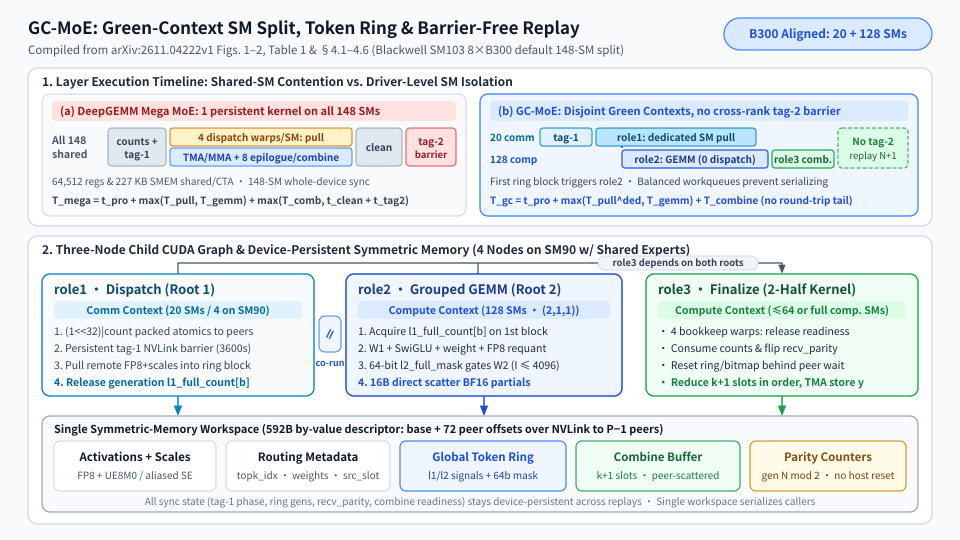View full diagram ↗</a><figcaption>Figure 1 · GC-MoE driver-aligned SM split timeline and three-node child CUDA Graph architecture (compiled from arXiv:2611.04222v1 Figs. 1–2, Table 1 &amp; §4.1–4.6): disjoint SMs run dispatch and GEMM as concurrent graph roots while parity-buffered counters eliminate inter-replay barriers.</figcaption></figure>

Using driver-level `CUDA Green Contexts` (introduced in CUDA `12.4`), `GC-MoE` builds a static, replay-deterministic execution graph without an MPS daemon (§4.1–4.6):

1. **Driver-aligned SM split with verified balanced workqueues (§4.2)**: Created once per CUDA context and cached thread-locally, initialization queries device SM resources (`cuDeviceGetDevResource`), computes `⌊(total − requested) / alignment⌋ · alignment` compute SMs, and splits via `cuDevSmResourceSplitByCount`. On `148`-SM `B300`, the default `GC_MOE_DISPATCH_SMS=16` aligns to **`20` communication SMs + `128` compute SMs** (`13.5%` ceded to dispatch; Hopper SM90 defaults to `4` requested SMs). Crucially, the runtime requests `sharingScope=CU_WORKQUEUE_SCOPE_GREEN_CTX_BALANCED` with `wqConcurrencyLimit=1` and **reads back the resource to verify enforcement**—without balanced workqueues, two contexts can silently land on one hardware queue and serialize the very kernels intended to overlap. Runtime checks enforce even compute SMs `≥ 32`, dispatch SMs `≥ 2`, and sum equal to total device SMs.
2. **Three-node child CUDA Graph and six-step dispatch (§4.1, §4.3)**: One MoE layer executes as a child graph attached to the caller’s capture (`4` nodes on SM90 when fused shared experts add `role4`). **`role1` (dispatch)** runs on the communication green context and **`role2` (grouped GEMM)** runs on the compute green context as **independent concurrent roots**; **`role3` (finalize)** depends on both on the compute context (`min(compute_sms, 64)` blocks for `T ≤ 128`, `compute_sms` above, tightened with shared experts to `max(min(compute_sms, e+1), ⌈T · combine_chunks / 8⌉)`). All cross-rank buffers reside in one PyTorch symmetric-memory allocation mapped via a **`592`-byte by-value peer descriptor** (base + `72` `int64` offsets + rank index). `role1` proceeds in six steps: per-warp scanning (`32/k` tokens/iter) in SMEM; packed `64`-bit atomic add encoding contributor count in the high 32 bits and token count in the low word; peer-writing source indices; grid sync across only the `20` dispatch SMs before `block 0` publishes per-expert counts and prefix sums; a persistent, phase-encoded NVLink `tag-1` barrier with a `3600 s` trap timeout; and global-cursor walking with warp-private double-buffered SMEM staging that pulls FP8 activations and scales into `MN-major` ring blocks.
3. **Token-ring handshake and parity-double-buffered barrier removal (§4.3, §4.6)**: Rather than per-expert buffers, `role1` fills a globally reused `BM`-token ring (`⌈assignments / BM⌉ + e` logical pool blocks, live blocks bounded from actual `compute_sms` and L1/L2 cluster waves). Four persistent signals per block coordinate stages: `l1_full_count` (`acquire` wait on `BM · (generation + 1)` starts `role2` on the first filled block), `l1_empty_count`, a `64`-bit `l2_full_mask` bitmap (each `W2 K128` tile waits only on its two `W1 N128` bits—imposing the hard `2I/128 ≤ 64`, `I ≤ 4096` limit), and `l2_empty_count`. Leader-CTA scheduler warps pre-publish initial `L1` waves, then enforce one-in-one-out pacing via `32`-byte DSMEM-broadcast descriptors. Between replays, **`tag-2` is removed completely**: `W2` scatters `16`-byte BF16 partials directly into source-rank `(topk_slot, src_token)` combine slots, while `role3` splits concurrently—its first `4` bookkeeping warps publish combine readiness, validate `dispatch_sms · P` arrivals, flip **`recv_parity`** (`N mod 2` receive-counter buffering), and reset ring signals/bitmaps while combine warps wait on peers and reduce into `y` via TMA, cutting the critical path to `T_gc = t_pro + max(T_pull^ded, T_gemm) + T_combine`.

### 3. Dual-architecture FP8×FP4 grouped GEMM, fused shared experts, and JIT ABI

Because Hopper and Blackwell expose incompatible low-precision matrix pipelines, `GC-MoE` ships separate kernels (`1,935` device LOC for `SM103`, `1,305` for `SM90`; §4.4–4.5, §5, Table 2):

- **Blackwell (`SM103` / `sm_103f`) block-scaled `tcgen05` & `K128` tile prepacking**: Two-CTA clusters issue `tcgen05.mma.cta_group::2.kind::mxf8f6f4.block_scale` (`BN=BK=128`, FP32 TMEM accumulators up to `512` columns). Like the baseline, operands are swapped (`A`=weights, `B`=activations) so MMA `N` tracks valid block tokens rounded to `16` to avoid full-block waste. Since `CuTe DSL`’s public op requires identical `A/B` dtypes, an inline-PTX user op selects FP4 routed weights (`E2M1`, format `5`) or FP8 shared weights (`E4M3`, format `0`) dynamically, fed by `UTCCP` scale transfers (`tcgen05.cp.cta_group::2.32x128b.warpx4`, `512 B/stage`) across four `K32` MMAs per `K128` stage (or once per four `K128` blocks under the `(1,128,128)` shared recipe). `GC-MoE` adds **asynchronous `K128` tile-contiguous weight prepacking** (`[E, rows, K/2] → [E, kb, rows, 64]`), turning `128` row-strided segments into a single `8 KB` (`16 KB` for FP8 shared) contiguous TMA burst with `EVICT_FIRST` cache hints. The `W1` epilogue fuses clamping, `SwiGLU` (with optional fast-math polynomial `exp`/reciprocal), routing weight multiplication, warp-group `amax` reduction, `UE8M0+E4M3` requantization, and `stmatrix` transposition (double-buffered registers at `BM=240`), while the host picks `BM ∈ {16, 32, 64, 96, 128, 192, 240}` to cover `m̂ + √m̂` (`16–32` at small batch).
- **Hopper (`SM90` / `sm_90a`) windowed rescaling & in-register FP4 decode**: Lacking hardware FP4 MMA and block scaling, `SM90` takes `E4M3FN` activations with contiguous `FP32 K128` scales and `MXFP4` weights. Host preprocessing fits an expert-wise exponent window (`≤ 11` steps), downshifts out-of-window FP4 magnitudes via a 4-bit power-of-two lookup table with per-expert compensation, and lane-permutes bytes; at runtime, `LDS.128` plus `PRMT/LOP3` bit ops decode `FP4 → E4M3` in registers before `WGMMA m64nNk32`, applying `K32` block scales via fused multiply-adds outside the MMA with `×64` scale headroom (`BM ∈ {8, 16, 32, 64}`; `384`-thread pipelined or `256`-thread non-pipelined).
- **Zero-copy shared experts & fail-closed by-value PTX rewrite (§4.5, §5)**: Fused shared experts alias local activations without dispatch, stage `K32` shared scales once into `shared_l1_acts_sf` (`⌈T_max/8⌉ · 128` rows via Eq. `3`) to reuse the exact routed TMA/`UTCCP` map, interleave or trail routed `L2` work by size, and write into combine slot `k` (`role4` on `SM90`). Built on `CUTLASS DSL 4.8.1` + `ptxas 13.2` (`-O3`, register level `10`, no RDC) with binary and capture-key caches, a post-generation PTX pass rewrites `18` TMA tensor-map pointers and the `592`-byte peer table into `128`-byte-aligned and `.b8` by-value CUDA Graph formals via `cvta.param.u64`—failing closed if generated PTX shape drifts.

### 4. Empirical evaluation on 8×H20 and 8×B300, throughput models, and numerical parity

<figure class="note-figure"><a class="note-image-link" href="/assets/images/digest/2026-11-05/gc-moe-decode-speedup-boundaries-en.svg" target="_blank" rel="noopener" aria-label="View full GC-MoE decode speedup curves, dual-architecture paths, and audit boundaries diagram">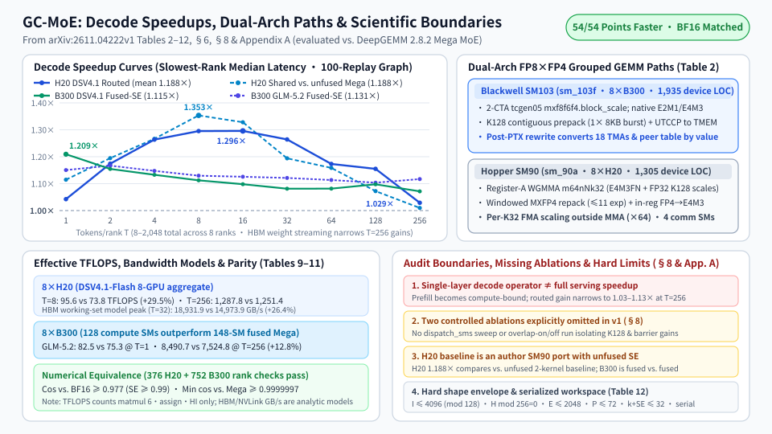View full diagram ↗</a><figcaption>Figure 2 · Empirical decode speedups, dual-architecture implementations, analytic bandwidth models, and audit boundaries (compiled from arXiv:2611.04222v1 Tables 2–12): GC-MoE wins all 54 tested points while leaving H20 unfused baselines and missing partition ablations explicit.</figcaption></figure>

Evaluations (Tables 3–4) run on `8×NVIDIA H20` (`sm_90a`) and `8×NVIDIA B300` (`sm_103f`) under `CUDA 13.2`, `ptxas 13.2.78`, `PyTorch 2.11.0 (cu130)`, and `CUTLASS DSL 4.8.1` against `DeepGEMM 2.8.2+fcad603`. On `B300`, comparisons target public `fp8_fp4_mega_moe` (with feature-matched `num_shared_experts=1` when enabled); because `DeepGEMM` ships SM100 only, `H20` compares against the authors’ reference `SM90` port `sm90_fp8_fp4_mega_moe`, whose shared-expert baseline runs two **unfused** kernels. Workloads cover `GLM-5.2` (`H=6144, I=2048, E=256, top-8`, shared `K=128`) and `DeepSeek-V4.1-Flash` (`H=5120, I=2304, E=384, top-6`, shared `K=32`) at capacity `256` across `T ∈ {1..256}` (`8–2,048` total tokens). Idle-GPU checks (`0%` utilization, `≥ 51,200 MiB` free over 3 samples in 10 s) precede `10` warmup + `30` measured windows of `100` CUDA Graph replays (L2 flushed between windows), reporting slowest-rank median latency and arithmetic means of per-point ratios:

| Tokens/rank `T` (Total) | `8×H20` DSV4.1 Routed (Mega → GC / Speedup) | `8×H20` DSV4.1 Shared (Mega-unfused / GC-unfused → GC-se) | `8×B300` GLM-5.2 Routed (Mega → GC / Speedup) | `8×B300` GLM-5.2 Fused-SE (Mega-se → GC / Speedup) | `8×B300` DSV4.1 Routed (Mega → GC / Speedup) | `8×B300` DSV4.1 Fused-SE (Mega-se → GC / Speedup) |
| :--- | :--- | :--- | :--- | :--- | :--- | :--- |
| `1` (`8`) | `120.061 → 115.161 µs` (`1.0425×`) | `161.804 / 156.866 → 145.171` (`1.1146× / 1.0806×`) | `64.184 → 58.601 µs` (`1.0953×`) | `68.739 → 59.752 µs` (`1.1504×`) | `70.630 → 59.387 µs` (**`1.1893×`**) | `73.541 → 60.816 µs` (**`1.2092×`**) |
| `2` (`16`) | `169.340 → 144.259 µs` (`1.1739×`) | `214.191 / 188.566 → 179.286` (`1.1947× / 1.0518×`) | `87.457 → 79.228 µs` (`1.1039×`) | `93.033 → 79.730 µs` (**`1.1669×`**) | `84.022 → 74.758 µs` (`1.1239×`) | `87.140 → 75.478 µs` (`1.1545×`) |
| `4` (`32`) | `256.018 → 202.589 µs` (`1.2637×`) | `299.391 / 248.009 → 236.353` (`1.2667× / 1.0493×`) | `108.085 → 98.225 µs` (`1.1004×`) | `113.672 → 99.059 µs` (`1.1475×`) | `105.265 → 95.373 µs` (`1.1037×`) | `108.908 → 96.132 µs` (`1.1329×`) |
| `8` (`64`) | `368.254 → 284.310 µs` (`1.2953×`) | `409.599 / 328.262 → 302.667` (**`1.3533×`** / `1.0846×`) | `125.241 → 115.041 µs` (`1.0887×`) | `130.904 → 115.870 µs` (`1.1297×`) | `139.955 → 127.732 µs` (`1.0957×`) | `143.151 → 128.697 µs` (`1.1123×`) |
| `16` (`128`) | `442.722 → 341.689 µs` (**`1.2957×`**) | `482.938 / 384.421 → 363.640` (`1.3281× / 1.0571×`) | `131.652 → 121.385 µs` (`1.0846×`) | `136.624 → 121.372 µs` (`1.1257×`) | `161.549 → 148.495 µs` (`1.0879×`) | `164.977 → 150.251 µs` (`1.0980×`) |
| `32` (`256`) | `472.090 → 373.393 µs` (`1.2643×`) | `511.952 / 422.456 → 428.722` (`1.1941× / 0.9854×`) | `133.215 → 121.493 µs` (`1.0965×`) | `138.641 → 123.645 µs` (`1.1213×`) | `170.546 → 156.371 µs` (`1.0907×`) | `174.223 → 161.154 µs` (`1.0811×`) |
| `64` (`512`) | `507.207 → 432.383 µs` (`1.1731×`) | `547.238 / 465.376 → 472.348` (`1.1585× / 0.9852×`) | `137.227 → 123.694 µs` (`1.1094×`) | `143.096 → 128.534 µs` (`1.1133×`) | `173.747 → 158.264 µs` (`1.0978×`) | `179.868 → 166.320 µs` (`1.0815×`) |
| `128` (`1024`) | `569.604 → 493.194 µs` (`1.1549×`) | `613.336 / 556.513 → 572.091` (`1.0721× / 0.9728×`) | `144.344 → 129.517 µs` (`1.1145×`) | `150.360 → 136.231 µs` (`1.1037×`) | `178.495 → 161.271 µs` (`1.1068×`) | `184.979 → 168.524 µs` (`1.0976×`) |
| `256` (`2048`) | `695.010 → 675.370 µs` (`1.0291×`) | `786.631 / 786.387 → 779.019` (`1.0098× / 1.0095×`) | `164.383 → 145.683 µs` (**`1.1284×`**) | `170.763 → 152.883 µs` (`1.1170×`) | `186.200 → 171.051 µs` (`1.0886×`) | `192.473 → 179.688 µs` (`1.0712×`) |
| **Mean (9 pts)** | **`1.1881×`** | **`1.1880×`** vs. Mega (**`1.0307×`** vs. `gc-unfused`) | **`1.1024×`** | **`1.1306×`** | **`1.1094×`** | **`1.1154×`** |

*Table 1 · Decode latency and speedup across all 54 measured points on 8×H20 and 8×B300 (arXiv:2611.04222v1 Tables 5–8; overall B300 mean is `1.1059×` routed across 18 points and `1.1230×` fused-shared across 18 points; H20 shared column includes the within-operator `gc-unfused` ablation).*

- **Regime behavior & absence of straggler artifacts**: On `8×H20`, routed speedup climbs from `1.043×` at `T=1` to a **`1.26–1.30×` plateau** across `T=4–32`—where dispatch traffic warrants isolation while small-`M` issue latency and Eq. `(2)`’s tail still dominate—before tapering to `1.029×` at `T=256` as weight streaming saturates. On `8×B300`, `128` dedicated compute SMs outperform `148` shared SMs at every single point (`1.106×` routed mean, `1.123×` fused-shared mean), with tight per-rank clustering (`59.21–59.39 µs` across all `8` ranks vs. `70.22–70.63 µs` for Mega MoE on `DSV4.1-Flash` at `T=1`) ruling out straggler-rank bias. On `GLM-5.2`, absolute savings grow with batch from `5.6 µs` (`T=1`) to `18.7 µs` (`T=256`), reflecting dedicated-SM and `K128`-prepacked GEMM gains scaling with work.
- **Within-operator H20 shared-expert ablation (Table 7)**: Fusing the shared expert beats `gc-unfused` by `1.031×` on average (`6/9` points), being nearly free at small batches via interleaving, while dipping to **`0.973–0.985×`** at `T=32–128` when the scheduler queues large shared tasks serially after routed work.

| Evaluation Dimension (Tables 9–11 & §6.4–6.5) | Platform / Workload & Scope | Reported Measurements (Mega MoE vs. GC-MoE) | Accounting & Physical Interpretation |
| :--- | :--- | :--- | :--- |
| Effective matmul throughput (8-GPU agg.) | `8×H20` DSV4.1-Flash (Table 9) | `T=8`: `73.805` → **`95.597` TFLOPS** (`+29.5%`); `T=256`: `1,251.393` → `1,287.785` | Counts matmul work only (`6 × assignments × H × I`) over slowest-rank latency |
| Effective matmul throughput (8-GPU agg.) | `8×B300` GLM-5.2 / DSV4.1 (Table 10) | GLM-5.2: `75.280 → 82.453` (`T=1`); `7,524.828` → **`8,490.679` TFLOPS** (`T=256`, `+12.8%`) | `128` uncontended compute SMs exceed `148` dispatch-shared SMs |
| Analytic HBM & NVLink bandwidth models | `8×H20` DSV4.1-Flash (Table 9) | HBM peak (`T=32`): `14,973.9` → **`18,931.9 GB/s`** (`+26.4%`); NVLink (`T=256`): `239.719 → 246.690 GB/s` (`+2.9%`) | **Analytic models, not hardware PMU counters**: same bytes finish faster without SM contention or `tag-2` |
| `8×H20` routed accuracy suite (Table 11) | `47` cases (`9` default / `23` boundary / `15` asymmetric incl. empty ranks), `376` rank checks | Min cos vs. BF16 identical (`0.977039–0.977837`); min `GC/Mega` cos **`0.99999976`**; max proc. diff `1.80×10⁻⁵` | Identical max abs error (`0.109375`) and max rel L2 (`0.00600836`) at BF16 precision; repeat diff `0` |
| `8×H20` SE & `8×B300` accuracy checks (§6.5) | H20 SE `47` cases (`376` checks); B300 `94` cases (`752` checks) | H20 SE `GC/BF16 ≥ 0.99`, min `GC/Mega` `0.9999997` (max abs `0.0625`, rel L2 `5.81×10⁻⁵`); B300 `≥ 0.97` routed / `≥ 0.99` SE | Identical permuted scale layout and slot-ordered FP32 accumulation preserve baseline accuracy |

*Table 2 · Effective TFLOPS, analytic bandwidth models, and numerical equivalence checks (arXiv:2611.04222v1 Tables 9–11 & §6.4–6.5).*

### 5. Scientific boundaries, missing ablations, and engineering takeaways

Adopting `GC-MoE` in a serving stack requires separating proven kernel behavior from unmeasured scope and hard constraints:

1. **Single-operator decode vs. whole-model serving & prefill**: All benchmarks replay one isolated MoE layer using pre-quantized activations at capacity `256`—not full-model `TPOT`/`TTFT` inside vLLM or SGLang alongside attention, quantization, and scheduling. Gains shrink to `1.029–1.128×` already by `T=256`, and in compute-bound **prefill** the reduced `128`-SM compute partition becomes the limiting factor rather than communication overlap (§8).
2. **Two missing ablations & H20 shared-expert baseline asymmetry (§8)**: Section 8 explicitly notes that `v1` omits both a **controlled partition-size (`dispatch_sms`) sweep** and an **overlap-on/off ablation**—leaving the exact breakdown between Green-Context isolation, `K128` tile prepacking, and `tag-2` barrier removal unresolved. Moreover, `H20` compares against an author-built `SM90` reference port whose shared-expert baseline (`1.188×`) is **unfused**, unlike the feature-matched fused comparison on `B300` (`1.123×`).
3. **Hard shape envelope & single-workspace serialization (Appendix A Table 12)**: Fixed bitmaps, by-value descriptors, and persistent signals restrict inputs to `I ≤ 4096` (`I mod 128 = 0`), `H mod 256 = 0`, `k + 1[shared] ≤ 32`, `E ≤ 2048` globally (`≤ 512`/rank, `E mod P = 0`), `P ≤ 72` ranks, routed `(1,1,32)` `SwiGLU`, one process per NVLink-peer-accessible GPU, and **strict serialization across callers sharing a workspace**.
4. **Verification scope**: This close reading audited the full `arXiv:2611.04222v1` PDF (Tables 1–12, Algorithm 1) and confirmed the linked GitHub repository URL (`https://github.com/Bruce-Lee-LY/gc-moe`), without executing multi-GPU H20/B300 kernels locally.
5. **Transferable engineering takeaways**: (1) For bandwidth- or latency-bound decode kernels (`T=1–32`), statically ceding `~13.5%` of SMs to a dedicated Green Context avoids intra-CTA register/SMEM crowding without starving arithmetic; (2) Always enable **and read back** `CU_WORKQUEUE_SCOPE_GREEN_CTX_BALANCED` (`wqConcurrencyLimit=1`), or hardware workqueue contention will silently serialize partitioned streams; (3) Replacing inter-replay `tag-2` rendezvous barriers with parity-double-buffered receive counters (`N mod 2`) and signal resets hidden inside `combine` removes a full cross-rank round trip from every layer.

Source: [GC-MoE: Overlapping Expert-Parallel Token Dispatch with FP8/FP4 Grouped GEMM via CUDA Green Contexts](https://arxiv.org/abs/2611.04222)
<h2 class="daily-paper-title" id="paper-arxiv-2611.04042">05 · BADC: speculative decoding needs the right processor history</h2>

**[Testing Processor Contracts in Speculative Decoding Engines](https://arxiv.org/abs/2611.04042)** 
Authors：Tianyu Ding, Yaocheng Tong, Muzhi Yang, Lei Yang, Fei Jiang · First submitted：2026-11-02

Speculative decoding preserves a target distribution only when the surrounding engine supplies the right processed distribution at each verification position. Logits processors enforce minimum lengths, penalties, grammar constraints, or guidance. Correct model logits are insufficient if a processor sees unverified drafts or retains state from work that sequential decoding would never perform.

<a class="note-image-link" href="/assets/images/digest/2026-11-05/badc.png" target="_blank" rel="noopener" aria-label="BADC testing pipeline and processor input containing unverified drafts · View original image ↗">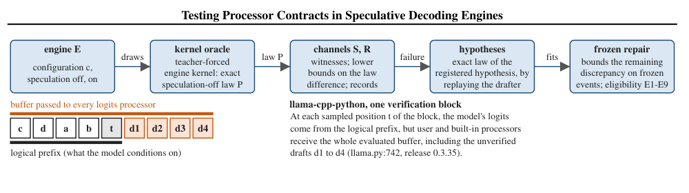View original image ↗</a>

*The upper pipeline moves from samples to hypotheses and intervention checks. Orange draft tokens below show why the physical buffer differs from the current logical prefix.*

BADC makes this boundary explicit with a processor-prefix contract. A processor must receive the logical prefix for the current position, and a stateful processor must have state observationally equivalent to sequential execution at that prefix. Rolling back the target model’s KV cache does not establish either property. In the llama-cpp-python case, callbacks receive the evaluated buffer, including unverified drafts. A minimum-length processor can therefore release the end-of-sequence mask too early. In Transformers, candidate processing can advance state that is not subsequently restored.

The testing workflow separates detection from explanation. Tiny random models with vocabularies of 7–10 tokens and horizons of 3–4 allow enumeration of a sequential reference. BADC compares speculation-on and speculation-off samples, checks explicit contract violations, and constructs simultaneous bounds for predefined output events. Executable hypotheses represent suspected faulty schedules. Frozen interventions are then tested with fresh samples to assess whether the remaining event differences shrink.

The main study covers 26 configurations across five pinned builds, including Transformers 5.17.0 and llama-cpp-python 0.3.19/0.3.35, confirming two causes. A follow-up using SmolLM2-135M-Instruct and one pilot-selected prompt collected 1,024 fresh requests per arm. A fixed first-token event occurred in 80.37% of ordinary-decoding requests and 14.16% of native prompt-lookup requests. Under within-arm i.i.d. sampling, nominal simultaneous 95% bounds put the event-probability gap at at least 60.26 percentage points. This is a result for a particular prompt, checkpoint, processor configuration, and event; it does not estimate production failure prevalence.

The negative comparison matters too. Directed configuration selection showed no cause-recovery advantage over random selection, and a permutation test detected each tested family at least as often. BADC’s contribution is its contract, bounded event evidence, and intervention-supported mechanisms, without demonstrated detection superiority. Historical vLLM experiments likewise do not establish defects in current releases.

The study also checks whether speculation actually runs. One parameter combination proposes no drafts and is classified as inconclusive, not conformant. Likewise, non-rejection on a finite event family does not prove whole-engine conformance. Recording these non-results is important for regression testing.

For inference reliability, the transferable lesson is to validate prefix views, processor state, stopping rules, and probability records together. The contract and repair-confirmation conditions are the most useful parts to read: they explain what a fast path must preserve beyond its central sampling formula.

<h2 class="daily-paper-title" id="paper-arxiv-2611.04032">06 · ROCm InferaSim: replacing cluster trial-and-error with single-node kernel anchors</h2>

[ROCm InferaSim: Cut LLM Serving Trial Costs and Deploy the Best Configuration](https://arxiv.org/abs/2611.04032) ([v1 PDF](https://arxiv.org/pdf/2611.04032) · anchors, corpora & scripts slated for camera-ready release)  
Anshu Raina, Yao Fu, Zhang Jiejing, Peyman Razaghi, Shiksha Patel, Ravi Gupta, Deval Shah, Adeem Jassani, Subhajit Dutta Chowdhury, Lorri Rao, Kailash Gogineni, Zhenyu Gu, Onil Gunawardana, Emad Barsoum (Advanced Micro Devices Inc. (AMD)) · `arXiv:2611.04032v1 [cs.AI]` · Submitted 2026-11-02 (`v1` only at verification time, no revision or withdrawal; Appendix I JSON schema uploaded separately and reproduction artifacts slated for camera-ready release)

Deploying frontier LLMs—especially large MoE models—requires jointly tuning the serving engine, parallelism (`TP`/`EP`/`DP`/`PP`), precisions, scheduler limits, speculative decoding depth, host-DRAM KV offloading, and prefill–decode (P/D) disaggregation. Operators today largely find configurations through live benchmarks that hold one or more nodes for a median of `3.4` minutes plus engine startup: measuring the `226` fixed-length configurations in this study consumed `204` GPU-hours, and exhaustively benchmarking the `192` searches (`56,328` candidates) in §5.11 would take roughly `25,000` GPU-hours. `ROCm InferaSim` separates **anchor-defining choices** that alter GPU kernels from **transferable choices** that change only per-GPU work or scheduling. It benchmarks each distinct kernel set once on at most one node (an *anchor*), applies *reduce–measure–restore* scaling laws, and runs a discrete-event simulator (DES) and two-phase tuning agent on CPUs. On `8× AMD Instinct MI355X` nodes across `vLLM`, `SGLang`, and `ATOM`, `11` anchors collected in `9.1` GPU-hours cover `172` scored fixed-length configurations at `8.1%` median TPOT error, and predict `159` unseen P/D-disaggregated deployments within `5.5%` median throughput error without a single disaggregated anchor. All claims below trace directly to `arXiv:2611.04032v1`, separating measured validations from unmeasured modes and scope limits.

### 1. Why trial-and-error, operator-level simulators, and roofline heuristics fail

Prior alternatives to exhaustive GPU benchmarking fail for three distinct structural reasons established in §1, §5.3, §6, and Table 18:

1. **Operator-level simulators break across builds and miss AMD GPUs**: Simulators such as `Vidur`, `APEX`, `AIConfigurator`, `Frontier`, and `KernelSight-LM` assemble step times operator by operator. Every new model, engine image, or kernel library requires re-collecting the operator database; moreover, `Vidur` models dense layers only and ships no AMD GPU data. When the authors ported `Vidur` to `MI355X` and evaluated it on `30` `SGLang Llama-3.1-8B` runs (Table 12), `Vidur` suffered **`34%` TTFT, `40%` TPOT, and `40%` throughput** median errors (versus `14%`, `7.2%`, and `7.4%` for `ROCm InferaSim`) because it times its own `FlashInfer` kernels and omits graph padding, fused kernels, host overhead, and pipeline hops.
2. **Naive roofline and linear scaling erase fixed per-step overhead**: Pure analytical models scale compute and memory down with GPU count while overlooking the unsharded per-step floor `f` caused by kernel launches (`4.98 µs` per kernel measured from a `TP1–8` sweep), synchronization, sampling, and scheduling. Naively halving a measured `DeepSeek-V4-Pro` `TP4` decode step to predict `TP8` across `batch=1–64` yields **`44.1%`** median error (Table 18). Even subtracting simulate mode's predicted `TP4→TP8` drop from the `TP4` step still leaves **`18.5%`** error because simulate mode shards the fixed cost too; keeping `f` unsharded via Eq. (1) cuts median error to **`0.9%`** (max `3.5%`).
3. **Average-step and serial pipeline models miss tail stalls and stage hops**: Under continuous batching, each admitted prefill stalls every active decode request—in one `64`-client measurement, `p99.9` ITL jumped to **`1,392 ms`** despite a `21.7 ms` median ITL. Likewise, because inference has no backward pass, a naive serial pipeline model predicts constant TPOT across pipeline depth `p`, yielding `14.9%–26.1%` median error on `SGLang` (`PP 1–8`), whereas measured TPOT grows by `920–1,130 µs` per stage from the last-stage-to-stage-0 token return hop and disabled host-scheduling overlap.

### 2. Core mechanism: kernel-set anchors, reduce–measure–restore laws, and DES/agent search

<figure class="note-figure"><a class="note-image-link" href="/assets/images/digest/2026-11-05/rocm-inferasim-anchor-scaling-en.svg" target="_blank" rel="noopener" aria-label="View full diagram of ROCm InferaSim kernel-set anchors, reduce-measure-restore laws, and dual-mode search">View full diagram ↗</a><figcaption>Figure 1 · ROCm InferaSim architecture (from arXiv:2611.04032v1 §3–§4, Figs. 3–4, Tables 1 &amp; 4): separating kernel-changing choices (†) from transferable scaling lets one ≤1-node anchor drive analytical restoration and CPU-only DES search.</figcaption></figure>

At the core of `ROCm InferaSim` sits a unified **step cost model** calibrated either by a sparse anchor (`anchored mode`) or analytical kernel models (`simulate mode`), feeding both an analytical predictor and a discrete-event simulator:

1. **Choice Taxonomy & Five Harvest Hygiene Rules (§3.1, Appendices E & I)**:
   - **Anchor-defining** (`†` in Table 4) covers model checkpoint, weight/activation/KV/expert dtypes (`BF16`/`FP8`/`FP4`), attention/MoE backends (`aiter`, Triton, CK, sparse top-k, DeepEP, fused kernels), graph capture (`none`/`piecewise`/`full`), speculative method (`MTP`, `EAGLE-3`, `DSpark`, `n-gram`), decode context parallelism (`DCP`, which modifies attention kernels), engine build, and GPU architecture. Cross-engine or cross-GPU reuse is refused outright.
   - **Transferable** choices encompass batch size, concurrency `C`, prompt/context length, `TP` (`1–8`), `EP`, attention `DP`, `PP`, replicas, arrival process, host-DRAM KV tiers, draft depth (`0–8`), P/D split pools, and scheduler settings (`running cap`, `token budget`, `chunk size`, `KV share`).
   - **Single-node harvester invariants**: Running real weights on idle `≤1`-node GPUs, the harvester records `75` cached JSON anchors across the study: (a) a **single-wave decode sweep** over every captured graph size—read as a staircase rather than interpolated (`batch=33` pays for `40`), and harvested without concurrent prefills so the DES does not double-count stalls (feeding mean TPOT inflated `C=16/32/64` predictions by `+13%/+23%/+31%`, App. G.1); (b) a 5-length concurrency-1 prefill fit `T(n) = F + c₁n + c₂n²` with **prefix caching OFF** (leaving caching ON flattened `DeepSeek-V4-Pro` `1k–8k` prefill to `68–89 ms` vs true `143–782 ms`); (c) **real checkpoint weights** (random weights eliminated router skew and made `GLM-5.2` `batch=64` decode `1.337×` too fast); (d) prompt-length tagging (`8192`-token anchor applied at `1024` tokens overestimated `vLLM` dense MLA by `+41%`, vs `≤3%` on `SGLang` top-k); and (e) packed-prefill self-checks (`0.63–1.39×` single-sequence time vs `3.59×/7.06×` serialized failures).
2. **Reduce–Measure–Restore Analytical Laws (§3.1.2–3.2, Appendix B)**:
   - **TP decode & prefill transfer (Eq. 1)**: Targets wider than a node or split across pools are first reduced (removing `PP`, narrowing `EP`/`TP`, colocating one replica). Decode scaling preserves the anchor's unsharded `batch=1` floor `f` and scales only the excess: <code>s_w'(b) = f + (s_w(b) - f) · ρ_{w→w'}(b)</code>. Where the stack was also harvested at `w/2`, `ρ` is measured per doubling and clamped to `[0.5, 1]` (`0.50` ideal on `DeepSeek-V4-Pro` ATOM `TP4→8`, vs `0.55–0.69` on `GLM-5.2` SGLang, `0.68–0.71` on `DeepSeek-V4-Flash`, and `0.76` on `MiniMax-M2.7` ATOM). Prefill similarly preserves fixed intercept `F` (`146.90 ms` at `4k` vs `145.86 ms` at `8k`, within `1%`) while scaling `c₁, c₂`.
   - **Two-sided MoE imbalance & grouped-GEMM bandwidth penalty (App. B.3, Table 6)**: Each MoE checkpoint's router distribution is logged once on `SGLang TP8` and replayed offline to tabulate busiest-rank token skew <code>I_n = E[max_r n_r]/n̄</code> and distinct-expert skew <code>I_d = E[max_r d_r]/d̄</code>, including EPLB hot-expert replication `I' = 1 + (I - 1) · E/(E + R)` (Eq. 3). Crucially, `ROCm InferaSim` evaluates `I_n, I_d` **at both the anchor's EP and the target's EP** so ratios never cancel, and prices HBM under-utilization when an EP rank reads only 1–2 experts (`25%` peak HBM at 1 expert on DeepSeek FP8, `14%` on gpt-oss MXFP4, saturating near `16` experts).
   - **Multi-node pipelines (Eq. 4, App. B.4), two-tier collectives & analytical HBM cap (App. B.2, B.5)**: Eq. (4) prices a full pipeline cycle as <code>s_PP(C) = s(C/p) + p(t_p2p + o) + p · H(C/p)</code>, charging `p` hops (`p-1` activations plus token return from last stage to stage `0`, `o = 970 µs`/hop) and un-overlapped per-stage host scheduling `H(b) = 0.33 + 0.0063 b` ms. Collectives (`α + m/B`) model intra-node decode messages (`≤8 MiB` vLLM custom 1-/2-shot all-reduce; `≤32 MiB` RCCL all-to-all), intra-node `>8 MiB` xGMI mesh with a single fitted node bandwidth `B_node = 600 GB/s`, and cross-node `400 Gb/s` Pollara RoCE NICs (`45.1 GB/s`, adding `<10 µs` marginal wire cost inside a step vs `970 µs` engine hop cost). Analytical memory accounting (`0.0%` KV-bytes/token discrepancy on `GLM-5.2 BF16` and `MiniMax-M3 FP8`, `2%` on `GLM-5.2 FP8`) strictly caps concurrency to HBM-feasible regimes.
3. **Dual Modes, DES Traffic Replay & Two-Phase Tuning Agent (§3.4–§4.1, Appendices A & J)**:
   - **Anchored vs. Simulate mode**: Simulate mode runs with zero GPU measurements by reconstructing step ops from engine model code using `Origami` for GEMMs plus analytical attention/communication/PP models (`4.98 µs`/kernel floor); because candidates on one engine share fixed per-step costs, simulate mode is used **exclusively for intra-engine ranking**.
   - **DES queueing, leaf-first LRU & P/D KV hand-off**: Replaying Mooncake/AgentX traces through engine-specific schedulers (chunked prefill, mixed steps, ATOM prefill-only steps, attention-DP lockstep ranks), each replica manages a radix-style block cache with **leaf-first LRU eviction**—on `AgentX` at `256` clients (`DeepSeek-V4`), flat LRU thrashes to **`0%`** prefix hits whereas leaf-first eviction achieves **`90.6%`** (matching the trace's published `~92%`). Host-DRAM offload (`HiCache`, `LMCache`, `vLLM CPU offload`, `MoRI UMBP`) models a second cache tier with rank-level host-link transfer queues. Disaggregated deployments instantiate one DES pool per phase from colocated anchors, billing KV hand-off (`MoRI` layer-streamed exposing only the final layer at `47.9 GB/s` + `120 µs`, `NIXL` `400 GB/s` + `5 µs`, `Mooncake` `200 GB/s` + `10 µs`) plus half the anchor's host time on prefill admission.
   - **Tuning agent & Mix planner**: Each CPU prediction (`10 × C` DES requests) takes **`0.17–0.48 s`**. Exploring **`36` levers** across **`24` objectives**, Phase 1 runs deterministic one-lever seeds and Phase 2 runs a `DSPy ReAct` loop reading the latest `40` ledger rows to propose `5–8` partial configs and `6` named kernel fusions (Table 21, priced at `75%–100%` ideal savings when `≥2%` decode gain). The LLM **never estimates scores**: every proposal goes through structural, `90%`-HBM, and SLO checks. Across four latency tiers, the `Mix Planner` enforces a **0.5× TTFT safety cap** (`≤0.5×` limit) to absorb TTFT noise and outputs a **five-candidate shortlist** within `5%` of top GPU throughput.

### 3. MI355X empirical evaluation: fixed-length, agentic coding, disaggregated serving, and ablations

<figure class="note-figure"><a class="note-image-link" href="/assets/images/digest/2026-11-05/rocm-inferasim-accuracy-cost-en.svg" target="_blank" rel="noopener" aria-label="View full diagram of ROCm InferaSim MI355X empirical savings, cross-suite errors, and key ablations">View full diagram ↗</a><figcaption>Figure 2 · MI355X empirical evidence (arXiv:2611.04032v1 §5, Fig. 1, Tables 2–3, 7–18): GPU-hour compression, cross-workload errors, mechanistic ablations, and high-error outliers.</figcaption></figure>

Experiments ran on `8× AMD Instinct MI355X` (`288 GB HBM3E` per GPU, `Infinity Fabric`, `ROCm 7`, graph capture enabled) covering `13` models (`DeepSeek-V4-Pro/Flash`, `GLM-5/5.2`, `Kimi-K3`, `MiniMax-M2.7/M3`, `Qwen3.5`, `DeepSeek-R1-0528`, `Qwen3-14B`, `gpt-oss-120b`, `Llama-3.1-8B`) across `vLLM`, `SGLang`, and `ATOM`. Because agentic metrics span two orders of magnitude, §5.1 reports geometric-mean error factors `max(ŷ/y, y/ŷ)` (`1.00` exact, `1.08` ≈ `8%` miss). Tables 1 and 2 compile the validation corpora and component ablations:

| Validation Set / Baseline | Sample Size | Anchor & Scope Condition | Throughput Error | TPOT / ITL / Interactivity | TTFT & Key Notes |
| :--- | :--- | :--- | :--- | :--- | :--- |
| Fixed-length all (Table 10) | `172` configs (8 models, 3 engines) | `11` anchors (9.1 GPU-h; TP2–8) | `8.8%` (88% ≤20%) | `8.1%` TPOT (93% ≤20%) | `13.6%` TTFT; `8k/1k` subset drops all 3 errors to `6.3%–6.9%` |
| Narrower anchors TP4→TP8 (Table 14) | `90` configs (6 model subsets) | Projected from TP4 anchors | `9.7%` (r=0.994) | `9.3%` TPOT | `16.5%` TTFT vs `6.1% / 5.5% / 11.0%` at anchor's own width |
| p99 tail latencies (§5.4) | `88` runs (≥160 requests) | DES request-level queueing | — | `10.7%` TPOT / `13.8%` ITL | `9.8%` E2E latency (vs `1%–4%` repeat run-to-run variance) |
| Two-node pipelines (Table 8) | `24` configs (TP1–8 × PP2) | Single-node PP1 anchors only | `11.6%` | `11.6%` TPOT | `TP8×PP2` outlier reaches `21.7%` TPOT / `33.8%` throughput |
| AgentX coding trace (Table 2) | `95` covered (184 total runs) | `28` anchors, ≤4× session count | `1.08×` factor (~8%) | `1.14×` ITL (~14%) | `1.23×` TTFT; covers `5` added-host runs (`1.06×`) & `9` DCP (`8%/12%`) |
| InferenceX disaggregated (Table 16) | `159` splits (8–24 GPUs) | `16` colocated anchors (0 split anchors) | `5.5%` | `5.3%` interactivity | `16.9%` TTFT (vLLM+NIXL `7.1%` vs SGLang+MoRI `22.2%`) |
| AgentX disaggregated (§5.10) | `13` splits (7 SGLang, 6 vLLM) | Colocated anchors (no end-to-end residual) | `1.08×` factor (~8%) | `1.12×` ITL (~12%) | Planner selects DEP8 split, avoiding `43%–46%` colocated-only loss |
| Speculative MTP (§5.9) | `43` runs (draft depth 2–8) | Anchored mode + acceptance curves | `8.9%` | `12.2%` interactivity | Median `2.05×` (`0.86–4.73×`) tput/GPU gain at `50 tok/s/user` |
| Pareto frontiers (Table 13) | `25` charts (529 measured pts) | 11 fixed + 8 InferenceX + 6 AgentX | `7.0%` | `6.5%` interactivity | Spearman `ρ=0.99`; `170/206` (`83%`) frontier hit (`0.7%` p90 tput loss) |
| Ported Vidur baseline (Table 12) | `30` runs (Llama-3.1-8B) | Dense-only, SGLang PP1–8 | `40%` (InferaSim `7.4%`) | `40%` TPOT (InferaSim `7.2%`) | `34%` TTFT (InferaSim `14%`); lacks MoE, host & stage overhead |

*Table 1 · Consolidated MI355X accuracy across five validation corpora and baseline comparison (arXiv:2611.04032v1 §5–§6, Tables 1–2, 8–16; AgentX rows report geometric-mean error factors and all others report median absolute percentage errors).*

| Ablation / Decision Study | Baseline vs. Mechanism | Measured Outcome | Engineering Implication & Caveat |
| :--- | :--- | :--- | :--- |
| TP4→TP8 decode transfer (Table 18) | Halving step vs simulate-drop vs Eq. 1 keeping `f` | `44.1%` vs `18.5%` vs **`0.9%`** median error (max `3.5%`) | Unsharded step floor `f` must stay invariant; >1 doubling flagged as extrapolated |
| SGLang PP 1–8 error (Table 7) | Serial model vs Eq. 4 (`970 µs` hop + host `H`) | `Llama-8B / Qwen3-14B / Qwen3.6-35B`: `18.1%/14.9%/26.1%` → **`7.2%/2.3%/9.2%`** | Captures token-return hop and un-overlapped host scheduling per stage |
| Prefix eviction & harvest rules (App. A.1, E) | Flat LRU vs leaf-first LRU; harvest cache ON vs OFF | 256-client hit rate: `0%` → **`90.6%`** (trace ~92%); cache ON compressed prefill to `68–89 ms` (true `143–782 ms`) | Tree-aware leaf eviction and cache-free length sweeps prevent corrupted fits |
| MoE load & EP transfer (Tables 1, 6, App. B.3) | Uniform router vs two-sided `I_n, I_d` + few-expert HBM penalty | `9` vLLM EP runs **`2.2%`** TPOT / `2.1%` tput; `3` SGLang EP within `-2.2%..+2.5%` (uniform) / `+10.5%` (recorded) | Random-token benchmarks skew hottest prefill expert to `46×` fair share vs real code |
| Choice-ranking fidelity (Table 11, §5.7) | Anchored mode vs zero-GPU simulate mode | 42 fixed sets tput pairs **`93.4%`** vs **`89.0%`** (AgentX 41 sets: `90.9%` vs `81.8%`); Anchored Top-1 `73%` | `0.2%` p90 tput regret in anchored mode; simulate mode ranks intra-engine only |
| Disaggregated vs colocated tiers (Table 3) | 1k/1k vs 8k/1k prompts (14 non-speculative charts) | InferenceX right call: `1k/1k` **`19/21`**, `8k/1k` **`23/27`**; 8k wins `7/7` responsive & `3/4` interactive (`1.14–2.72×`) | Colocation wins or ties on 1k prompts (and `97.8%` prefix-hit agentic turns); 8k splits prevent prefill stalls |
| 6-model × 4-tier mix planner (Table 15, §5.11) | Top-1 prediction vs Top-5 shortlist (23 feasible slots) | Top-1 hits best `14/23` (`16/23` ≤12%, `2` miss); **Top-5 shortlist hits best `21/23`, ≤12% in `22/23`, `0` tier misses** | Planner caps TTFT at `≤0.5×` limit; GPU verification of shortlist remains mandatory |

*Table 2 · Mechanistic ablations, ranking fidelity, and deployment decision accuracy on MI355X (arXiv:2611.04032v1 §5.7–§5.11, Tables 3, 6–7, 11, 15, 18, Appendices A.1 & E).*

Three fine-grained results sharpen the practical interpretation of Tables 1 and 2:
- **Search compression & scale**: Measuring all `226` fixed-length configs (`671` runs) consumed `204` GPU-hours versus **`9.1` GPU-hours** (`22.4×` savings) for `11` anchors. In §5.11 / Appendix D.3, `192` deterministic seed searches (`4` models × `24` objectives × with/without SLO on a `130k/900` agentic shape, **`56,328`** candidates) finished in `3–8` CPU-hours (`0` GPU-hours), matching the measured `DeepSeek-V4-Pro` throughput optimum (`TP8`, attention DP, FP4, `256` clients) within **`0.3%`**; separately, simulate mode ranked `287` configs (`248` GPU-hours to measure) with zero GPU time.
- **Why disaggregation wins or loses**: Appendix D.4 shows naive token-ratio heuristics (`130k/900`) would assign `144` of `145` GPUs to prefill. On `AgentX`, however, a median **`97.8%`** prefix-cache hit leaves only `~10,400` uncached prompt tokens per turn while decode holds full KV caches across `900` steps—so **HBM capacity**, not decode FLOPs, sizes the decode pool, and accurately modeling all five pool/budget rules is required to hit `19/21` (`1k/1k`) and `23/27` (`8k/1k`) tier decisions.
- **Transparent outlier breakdowns**: Table 17 exposes worst-case pockets behind the `1.08 / 1.14` AgentX averages: `DeepSeek-V4-Pro` on `SGLang FP4` (`n=4`) spikes to **`2.01×`** ITL (`1.35×` throughput) error factor, and `SGLang + HiCache` (`n=12`) hits `1.40×` ITL. In fixed-length ranking, all three throughput misorderings occur on `GLM-5.2 SGLang 8k/256` clients where repeat measurements themselves vary by **`25%–63%`**, and `TP8×PP2` two-node pipelines exhibit `33.8%` throughput error (Table 8)—explaining why the planner emits a five-candidate shortlist rather than claiming zero-touch deployment.

### 4. Scientific boundaries, unverified assumptions, and engineering takeaways

Adopting `ROCm InferaSim` for serving capacity planning requires separating verified MI355X behavior from unmeasured regimes:

1. **Single-hardware & pinned-container scope**: Section 7 explicitly notes all measurements come from `AMD Instinct MI355X` nodes (`ROCm 7`, Pollara NICs) and pinned container builds (Appendix K). Cross-vendor validation on NVIDIA GPUs is unmeasured future work, and any engine version bump, attention/MoE backend swap, or `DCP` toggle invalidates existing anchors.
2. **Coverage bounds & unmeasured speculative/fusion predictions**: Quantitative error bounds hold only for `"covered"` configurations (matching engine build, same or narrower full-sweep TP layout, within **4× anchor concurrency**, and at most **1 TP doubling**—`GLM-5.2` prefill scaling drops from `1.80×` `TP2→4` to `1.32×` `TP4→8`, invisible to a `TP4` anchor). Crucially, `EAGLE-3`, `DSpark`, and `n-gram` drafters (§5.9) plus all `6` kernel fusions (§4, Table 21) are **modeled predictions only without MI355X measurements** in this draft, and simulate mode offers **intra-engine ranking only**.
3. **TTFT variance, open-artifact status & verification scope**: Because host HTTP/tokenization queueing (`5–11 µs/token`) and dual-server host penalties compound across pools, TTFT errors remain materially noisier (`13.6%` fixed, `16.9%` split, `1.23×` agentic, up to `-89%` on `Qwen3.6-35B-A3B` PP rows in Table 20) than TPOT/throughput. Appendix I was uploaded separately and anchors/corpora/scripts are slated for camera-ready release (Appendix K); the AI Usage Disclosure (p. 19) notes Cursor/LLM coding assistants helped refactor code and draft prose while scripts computed every reported figure from recorded logs. This close reading verified all 37 pages of `arXiv:2611.04032v1` without executing MI355X runs locally.
4. **Transferable engineering lessons**: (1) **Benchmark kernel sets once rather than configurations**: separate kernel-defining knobs from work-scaling knobs and never linearly shard the unsharded per-step floor `f`; (2) **Model queueing and tree-structured prefix eviction in a DES for agentic workloads**: leaf-first LRU (`90.6%` vs `0%`) and single-wave anchors (avoiding `1.14–1.41×` stall double-counting) determine tail accuracy; (3) **Constrain LLM search agents behind deterministic evaluators and shortlist verification**: `DSPy` proposals across `36` levers stay safe only when deterministic HBM/SLO gates price every trial and a Top-5 shortlist undergoes final GPU confirmation.

Source: [ROCm InferaSim: Cut LLM Serving Trial Costs and Deploy the Best Configuration](https://arxiv.org/abs/2611.04032) (`arXiv:2611.04032v1`)
<h2 class="daily-paper-title" id="paper-arxiv-2611.04382">07 · Beyond Compression Ratio: High-Throughput KV Compression for Disaggregated LLM Serving</h2>

[Beyond Compression Ratio: High-Throughput KV Compression for Disaggregated LLM Serving](https://arxiv.org/abs/2611.04382) 
Junhong Wu, Zedong Liu, Xinyang Ma, Yuhan Chen, Guangming Tan, Dingwen Tao

FastKVComp addresses a simple break-even condition: saved transfer time must exceed encoding and decoding cost, and faster networks leave less room for that overhead. It preserves KVServe's policies and quantization semantics while changing execution. A TileLang sender kernel fuses Hadamard transformation, statistics and low-bit conversion into preallocated multi-layer output; receiver-side fusion avoids full intermediate dequantized tensors.

The lossless backend uses composable LC GPU primitives, selecting Pareto candidates offline from encode time, decode time and size. The chosen pipeline stays fixed online and accepts lower compression ratio for faster coding. The ablation is important: LC alone changes throughput by at most 2.1% versus original KVServe in the local SHM setting; fusion supplies most of the gain, and Fused Only differs from the full system by at most 1.3%. Component peaks cannot be multiplied into an end-to-end speedup.

Local tests use two RTX 5090 GPUs with host-staged NCCL SHM over PCIe Gen5 x16. Remote tests use RTX PRO 6000 prefill, H100 decode and 200-Gb/s InfiniBand. Llama-3.1-8B-Instruct and Qwen2.5-7B-Instruct process 50 requests per configuration, inputs up to 20K, and only eight local or up to 64 remote output tokens, excluding compilation and warmup. Remote JCT falls 30.2–38.6% versus raw transfer, distinct from the roughly twofold local maximum. The paper supports optimizing the complete compression path, with limited evidence for longer-generation workloads or other networks.

<h2 class="daily-paper-title" id="paper-arxiv-2611.04671">08 · LeanSparse: Memory-Efficient Serving for Native Sparse-Attention LLMs</h2>

[LeanSparse: Memory-Efficient Serving for Native Sparse-Attention LLMs](https://arxiv.org/abs/2611.04671) 
Zaifeng Pan, Chris Wu, Xinwei Qiang, Zhengding Hu, Zhongkai Yu, Yufei Ding

<a class="note-image-link" href="/assets/images/digest/2026-11-05/leansparse-architecture.png" target="_blank" rel="noopener" aria-label="LeanSparse Figure 5: double-buffered prefill and coarse-to-fine decode indexing">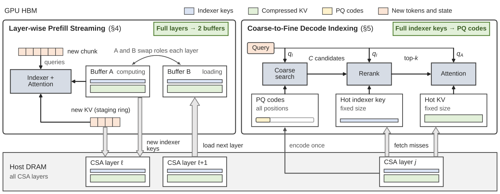View original ↗</a>

*Original Figure 5. The left alternates layer-history buffers; the right screens PQ codes before fetching indexer keys and attention KV through separate caches.*

Native sparse attention reads only part of history at each step but must retain state that future queries may select. LeanSparse identifies two remaining memory costs: full GPU-resident indexer keys after attention-KV offloading, and temporary prefill history that blocks admission even when decode state would fit. It optimizes both phases rather than only shrinking the KV pool.

Prefill streams historical keys and KV through two reusable GPU buffers, overlapping the next layer's transfer with current CSA and intervening HCA computation. Reuse waits for consumers and host writeback. Decode scans compact PQ32 codes, keeps 2,048 candidates and fetches original keys to refine to 512 selections. Separate indexer-key and attention-KV caches reflect different reuse sets. Refinement cannot recover candidates discarded earlier, so this is not exact equivalence.

Experiments use four H100s, SGLang and DeepSeek-V4-Flash. Multi-turn Open-SWE replay compares against the authors' adapted ECHO implementation, with 128 sessions, 20 measured calls per session, sequential dependencies and tool waits. HiSparse is used only for decode comparisons because it does not support this shared-phase setup. Median TTFT falls from 21.6 to 0.6 seconds and session time by 17.7%, but median TPOT rises from 66.4 to 81.7 milliseconds as earlier prefill and larger batches share execution.

At 950K context, decode capacity reaches 2.95 times HiSparse and throughput 2.14 times; quality evaluation instead has a 256K limit. Its four scores remain within 0.5 percentage points of original SGLang. Offline top-512 recall rises from 77.41% with direct PQ selection to 99.49% with refinement, not 100%. The useful lesson is joint accounting for persistent state and temporary admission memory, with TTFT, TPOT and session time reported separately.

<h2 class="daily-paper-title" id="paper-arxiv-2611.05121">09 · Empirical anatomy of GPU numerical bugs and automated detection with GPU-NBDetect</h2>

[An Investigation on Numerical Bugs in GPU Programs Towards Automated Bug Detection](https://arxiv.org/abs/2611.05121) ([v1 PDF](https://arxiv.org/pdf/2611.05121) · [DOI](https://doi.org/10.1145/3728950) · [Dataset Site](https://gpu-program-bug-study.github.io/Comprehensive-Study-on-GPU-Program-Numerical-Issues.github.io/))  
Ravishka Rathnasuriya, Nidhi Majoju, Zihe Song, Wei Yang (University of Texas at Dallas) · `arXiv:2611.05121v1 [cs.SE]` · Submitted 2026-11-03 (PDF carries prior publication record `Proc. ACM Softw. Eng. 2, ISSTA, Article ISSTA073`, July 2025; received 2025-02-27, accepted 2025-03-31)

Silent numerical errors in GPU kernels and libraries rarely crash immediately, yet corrupt scientific computations and deep-learning gradients without raising hardware traps. Analyzing **397 real-world GitHub GPU numerical bugs (GPU-NBs)**, this study builds a symptom-to-cause-to-fix taxonomy and introduces **GPU-NBDetect**, a preliminary differential-testing prototype covering six bug categories across 186 mathematical functions in four libraries—flagging **226 issues**, of which **60 were developer-confirmed** on the NVIDIA forum. Keeping **raw detection reports (226)** distinct from **developer confirmations (60)** is essential: `GPU-NBDetect` currently targets only `FP32`/`FP64` scalar math APIs and leaves mixed-precision, operator, and hardware-generation regressions uncovered. All figures and audit notes below trace strictly to `arXiv:2611.05121v1`.

### 1. Why CPU and DL numerical bug detectors miss GPU arithmetic bugs

Sections 1 and 2 establish three structural reasons why neither CPU floating-point checkers nor model-level deep-learning (DL) fuzzers localize hardware- and library-level GPU-NBs:

- **Missing hardware exception registers and programmable rounding**: CPUs expose `fenv.h` exception status flags and frequently compute intermediate operations in 80-bit extended precision. GPUs omit exception status flags and hardware rounding-mode controls, rounding more frequently in fixed 32-bit/64-bit modes across thousands of concurrent threads and silently substituting default values on invalid casts. In Figure 1’s parallel reduction sum, C yields `799.9694` vs. CUDA `794.6185` on `0.0008`, `499999.5000` vs. `499884.4375` on `0.4999`, and `999999.7500` vs. `999939.2500` on `0.9999`.
- **Opaque proprietary libraries and undocumented type contracts**: Core NVIDIA libraries (`cuFFT`, `cuBLAS`, `CUDA Math`, `cuRAND`, `cuSOLVER`, `cuSPARSE`, `cuTENSOR`) are closed-source, blocking LLVM/Clang instrumentation and obscuring supported types and edge-case semantics.
- **Blind spots of whole-model DL testing**: DL differential/metamorphic tools perturb neural architectures and hyperparameters, searching an enormous combinatorial space where low-level kernel arithmetic deviations may remain masked across layers while still compromising HPC and scientific workloads.

### 2. Taxonomy of 397 real-world GitHub bugs: causes, symptoms, and manual repairs

<figure class="note-figure"><a class="note-image-link" href="/assets/images/digest/2026-11-05/gpu-nbdetect-bug-taxonomy-en.svg" target="_blank" rel="noopener" aria-label="View full diagram of 397 real-world GPU numerical bugs taxonomy">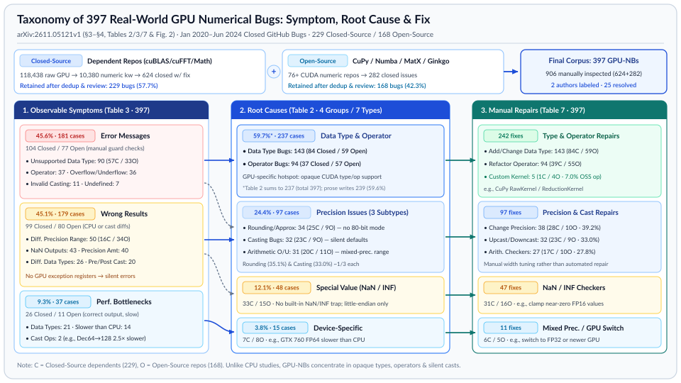View full diagram ↗</a><figcaption>Figure 1 · Corpus filtering funnel and symptom-to-cause-to-fix mapping across 397 GPU numerical bugs (compiled from arXiv:2611.05121v1 §3–§4, Tables 2, 3, 7 &amp; Fig. 2): unlike CPU bug corpora dominated by precision and exceptions, nearly 60% of GPU-NBs stem from unsupported data types and operators.</figcaption></figure>

Covering GitHub issues from **January 2020 to June 2024** (§3.1–§3.3), the authors collect bugs via two pipelines: indirectly via dependent projects for closed-source libraries (`118,438` broad GPU reports → `10,380` keyword matches → `624` closed numerical issues with documented fixes), and directly across `76+` CUDA/numeric repositories (`CuPy`, `Numba`, `MatX`, `Ginkgo`, and user projects) yielding `282` closed issues. Manually inspecting all **`906`** (`624 + 282`) candidates and deduplicating leaves **`397` unique GPU-NBs** (`229` closed-source dependents, `168` open-source). Two authors independently labeled all cases and jointly resolved `25` disagreements, adapting Franco et al.’s CPU taxonomy into four top groups and seven subtypes (with only special-value bugs overlapping prior CPU studies):

| Dimension &amp; Category (Source) | Subcategory / Manifestation | Closed-Source (229) | Open-Source (168) | Total (397) | Share &amp; Key Empirical Characteristics |
| :--- | :--- | :--- | :--- | :--- | :--- |
| **Cause · Data Type &amp; Op (Table 2)** | Data Type Bugs | 84 | 59 | 143 | 36.0% · Missing dtype support or interface dtype mismatch |
| **Cause · Data Type &amp; Op (Table 2)** | Operator Bugs | 37 | 57 | 94 | 23.7% · Subtotal `237` (Table 1 F-4 / §4.2 print `239`, `59.6%`) |
| **Cause · Precision (Table 2)** | Rounding / Approximation | 25 | 9 | 34 | 8.6% · Lack of 80-bit extended mode &amp; rounding controls |
| **Cause · Precision (Table 2)** | Casting Bugs | 23 | 9 | 32 | 8.1% · Out-of-range casts silently emit default values |
| **Cause · Precision (Table 2)** | Arithmetic Operation (O/U) | 20 | 11 | 31 | 7.8% · Precision subtotal `97` (`24.4%`) |
| **Cause · Special &amp; Device (Table 2)** | Special Value (NaN / INF) | 33 | 15 | 48 | 12.1% · No built-in NaN/INF trap; little-endian only |
| **Cause · Special &amp; Device (Table 2)** | Device-Specific Bugs | 7 | 8 | 15 | 3.8% · Older GPUs lack mixed precision or fast FP64 |
| **Symptom · Observable (Table 3)** | Error Messages | 104 | 77 | 181 | **45.6%** · Type `90`, Op `37`, O/U `36`, Cast `11`, Undef `7` |
| **Symptom · Observable (Table 3)** | Wrong Results | 99 | 80 | 179 | **45.1%** · Prec. range `50`, NaN `43`, Prec. amt `40`, Type `26`, Cast `20` |
| **Symptom · Observable (Table 3)** | Performance Bottlenecks | 26 | 11 | 37 | **9.3%** · Data types `21`, vs. CPU `14`, Cast ops `2` |
| **Repair · Manual Patches (Table 7)** | Add / Change Data Type | 84 | 59 | 143 | 36.0% · Mirrors Data Type bugs 1-to-1 |
| **Repair · Manual Patches (Table 7)** | Refactor Op + Custom Kernel | 40 | 59 | 99 | Refactor `94` (39C/55O) + Custom Kernel `5` (1C/4O; `7.0%` OSS op) |
| **Repair · Manual Patches (Table 7)** | Precision / Cast / Arith. Check | 68 | 29 | 97 | Precision `38` (39.2%), Up/Downcast `32` (33.0%), Checkers `27` (27.8%) |
| **Repair · Manual Patches (Table 7)** | NaN Checkers + Mixed/Switch | 37 | 21 | 58 | NaN checkers `47` (31C/16O) + Mixed prec./GPU switch `11` (6C/5O) |

*Table 1 · Distribution of root causes (Table 2), symptoms (Table 3), and manual fixes (Table 7) across 397 GPU numerical bugs (arXiv:2611.05121v1; Closed-Source and Open-Source columns sum exactly to `229`, `168`, and `397`).*

Case studies in §4 highlight concrete GPU-specific failure modes:
1. **Low-width promotion overflow (CuPy #6047)**: Convolving `uint64([[257]])` with `uint8([[1]])`, SciPy promotes to `uint64` (`[[257]]`), whereas CuPy computes in `uint8` and silently overflows to `[[1]]` (reversing argument order corrupts the output `dtype` to `uint8` as well).
2. **Rounding-intrinsic divergence (CuPy #4550)**: On `0.5` coordinates in `map_coordinates`, CuPy calls `rint()` (round-to-nearest-even) instead of SciPy’s `floor(double)`, yielding systematic output mismatches.
3. **Silent garbage casts and 2.5× cast slowdown (cuDF #7689 / #9597)**: `libcudf.unary.cast` converts `Decimal64(-72462.12)` to `int32` as `13437` and `int32(-48938)` to `Decimal64(10,5)` as `-5988.32704` without exception checks; separately, casting `Decimal64` to `Decimal128` takes `4134 ms` vs. `1598 ms` (`2.5×` faster) for `Decimal128` to `Decimal128`.
4. **Dtype/operator contract gaps (cuDF #9065 / CuPy #3909)**: Creating a `cudf.Series` from a `float16` CuPy array fails because `__cuda_array_interface__` expects `np.dtype` rather than `cudf.dtype`; passing `cupy.mean` to `generic_filter` triggers `bad type error` where `np.mean` succeeds, repaired using a custom CuPy `ReductionKernel` (`4/57` open-source operator fixes use `RawKernel`/`ReductionKernel`/`ElementwiseKernel`).
5. **FP16 underflow-to-NaN and endianness limits (PyTorch #43211 / CuPy #3652)**: `torch.Tensor([1e-4]).cuda().half().norm(3).backward()` overflows intermediates to `INF` and `NaN` gradients (fixed by clamping near-zero `float16` inputs); big-endian NumPy arrays yield unexpected `NaN`s on little-endian-only GPU execution.
6. **Hardware-generation inversion (CuPy #4891)**: FP64 `matmul` on a weak-FP64 `GeForce GTX 760` runs slower in CuPy (`1.0382 s`) than NumPy CPU (`0.7268 s`), flipping back when cast to FP32 (`0.156 s` vs. `0.255 s`).

### 3. GPU-NBDetect: bit-level boundary mutation and nine manifestation oracles

Guided by Findings F-7 (structured boundary fuzzing) and F-8 (CPU cross-checking) in Table 1, **GPU-NBDetect** (§5.1–§5.3) dynamically emits paired C (`math.h`) and CUDA (host memory management + device kernel) harnesses from Python templates for user-specified math APIs, compiling and executing both via Python `subprocess`:

1. **Valid-range seeding and IEEE-754 bit mutators**: To suppress false positives caused by invalid extreme inputs (`1.3400e+221`, `9.2579e+282`) emitted by prior tools like `XScope` and `GPU-FPX`, GPU-NBDetect seeds random values within documented API ranges (excluding edge inputs flagged as known bugs in CUDA Math documentation) and perturbs boundaries such as `0.5`, `0.499999`, and `0.50000001`. Although the prose refers to "seven mutation operators," Section 5.3 explicitly lists eight bullets: `bitflip_s` (50% sign flip), `bitflip_e`, `bitflip_m`, `add_e` / `sub_e` (add/subtract `1–32` in the exponent), `add_m` / `sub_m` (add/subtract `2^(p-1)` with `p ∈ [1, 33]` in the mantissa), and `random_bit`.
2. **Nine manifestation assertions (Table 4) vs. six evaluated categories**: Empirical deviation profiling calibrates nine rules, of which only the first six appear in the benchmark tables:
   - **Evaluated in Tables 5–6**: S1 Overflow (`A > MAX(FP)` or `A < -MAX(FP)`), S2 Underflow (printed as `A < MIN(FP) or A > -MIN(FP)`; conceptually `abs(A) < MIN(FP)`), S3 Special Value (`A == NaN`), S4 Rounding (CPU `A` vs. GPU `B`: `abs(A - B) > 1E-7`), S5 Casting (pre- vs. post-cast: `abs(B - A) > 0.9`), and S6 Data Type (cross-dtype GPU runs: `abs(A - B) > 0.01`).
   - **Omitted from Tables 5–6**: S7 cast slowdown (`avg 2.5×`), S8 lower-dtype slowdown (`nearly 3×`), and S9 CPU faster than GPU (device-specific). The authors note that timing-based strategies (S7–S9) can still produce false positives from execution variance.
3. **Multi-cycle filtering**: Each function runs `100` inputs across `3` independent test cycles, retaining only alerts that consistently cross thresholds.

### 4. Four-library evaluation across 186 math functions and the 226-vs-60 confirmation gap

<figure class="note-figure"><a class="note-image-link" href="/assets/images/digest/2026-11-05/gpu-nbdetect-detection-results-en.svg" target="_blank" rel="noopener" aria-label="View full diagram of GPU-NBDetect pipeline, oracles, and 4-library evaluation">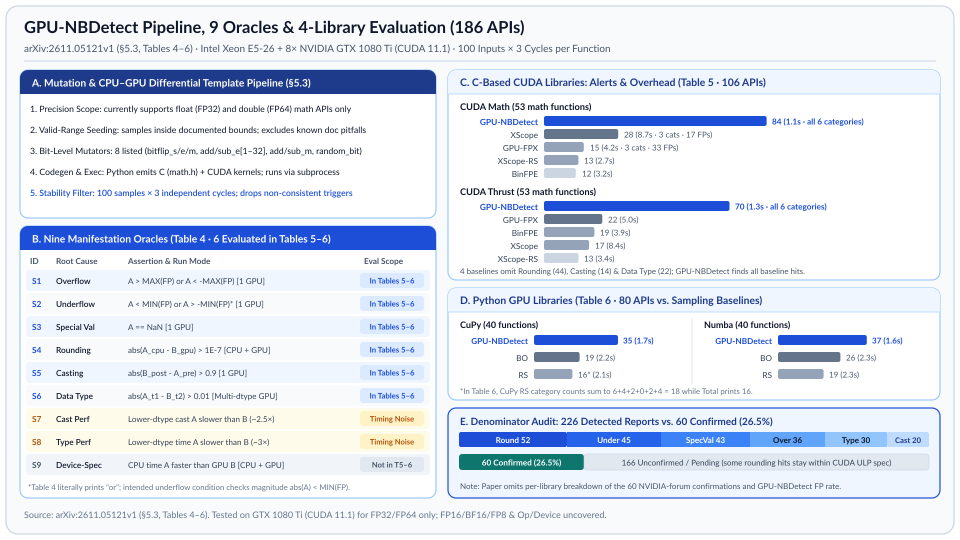View full diagram ↗</a><figcaption>Figure 2 · GPU-NBDetect workflow, nine oracle assertions, and four-library benchmark results across 186 math functions (from arXiv:2611.05121v1 §5.3, Tables 4–6): prior C tools test only 3 categories, while only 60 of 226 alerts (26.5%) carry confirmed developer verdicts.</figcaption></figure>

Evaluated on an `Intel Xeon E5-26` server with `8× NVIDIA GTX 1080 Ti` GPUs (`CUDA 11.1`) across **`186` mathematical functions** (excluding non-numeric ops like `Min`/`Max`: `53` in `CUDA Math`, `53` in `CUDA Thrust`, `40` in `CuPy`, `40` in `Numba`), GPU-NBDetect is compared against C tools (`XScope`, `XScope-RS`, and NVBit-based `BinFPE` / `GPU-FPX` paired with random inputs) and Python sampling baselines (`RS`, `BO`):

| Library (APIs) | Tool / Baseline | Overflow | Underflow | Rounding | Casting | Data Type | Special Value | Total Alerts | Overhead (s) |
| :--- | :--- | :--- | :--- | :--- | :--- | :--- | :--- | :--- | :--- |
| **CUDA Math (53)** | XScope | 8 | 8 | - | - | - | 12 | 28 | 8.7 |
| **CUDA Math (53)** | XScope-RS | 4 | 5 | - | - | - | 4 | 13 | 2.7 |
| **CUDA Math (53)** | BinFPE | 5 | 2 | - | - | - | 5 | 12 | 3.2 |
| **CUDA Math (53)** | GPU-FPX | 6 | 4 | - | - | - | 5 | 15 | 4.2 |
| **CUDA Math (53)** | **GPU-NBDetect** | **10** | **14** | **24** | **10** | **14** | **12** | **84** | **1.1** |
| **CUDA Thrust (53)** | XScope | 4 | 7 | - | - | - | 6 | 17 | 8.4 |
| **CUDA Thrust (53)** | XScope-RS | 4 | 4 | - | - | - | 5 | 13 | 3.4 |
| **CUDA Thrust (53)** | BinFPE | 5 | 6 | - | - | - | 8 | 19 | 3.9 |
| **CUDA Thrust (53)** | GPU-FPX | 5 | 8 | - | - | - | 9 | 22 | 5.0 |
| **CUDA Thrust (53)** | **GPU-NBDetect** | **8** | **16** | **20** | **4** | **8** | **14** | **70** | **1.3** |
| **CuPy (40)** | RS | 6 | 4 | 2 | 0 | 2 | 4 | 16\* | 2.1 |
| **CuPy (40)** | BO | 7 | 4 | 2 | 0 | 2 | 4 | 19 | 2.2 |
| **CuPy (40)** | **GPU-NBDetect** | **9** | **7** | **4** | **3** | **4** | **8** | **35** | **1.7** |
| **Numba (40)** | RS | 6 | 3 | 2 | 1 | 3 | 4 | 19 | 2.3 |
| **Numba (40)** | BO | 7 | 5 | 3 | 2 | 3 | 6 | 26 | 2.3 |
| **Numba (40)** | **GPU-NBDetect** | **9** | **8** | **4** | **3** | **4** | **9** | **37** | **1.6** |

*Table 2 · Detected alerts and average detection overhead across four libraries (arXiv:2611.05121v1 Tables 5–6; 100 inputs × 3 cycles on 8× GTX 1080 Ti / CUDA 11.1; `-` marks categories omitted by C baselines; \*CuPy RS category counts sum to `18` while Table 6 prints `16`).*

- **Breadth and runtime**: GPU-NBDetect reports **`226` total alerts** (`84 + 70 + 35 + 37`) at `1.1–1.7 s` overhead (`2.1–8.7 s` for baselines), subsumes every bug detected by the four C baselines, and adds `52` rounding (`27.9%` of `186` functions; `CuPy`/`Numba` show far fewer rounding alerts than `CUDA Math`/`Thrust`), `20` casting (`14` in C libraries), and `30` data-type alerts. Concrete examples verified against CPU include `cosh(3.6864e+4)` overflow, `erfc(6.7076092e+7)` underflow, and `__float2int_rd(1.101256458240e+11)` casting to 32-bit `INT_MAX`.
- **The 226-vs.-60 denominator separation**: Submitting findings to the NVIDIA developer forum yielded **`60` confirmed bugs (`26.5%` of `226`)**. Critically, NVIDIA developers noted on rounding cases that *"although the results are within the supported ULP range, these deviations represent errors from the true values."* Thus, exceeding `1e-7` relative to CPU `math.h` does not automatically constitute a CUDA specification violation. Moreover, the paper omits a per-library or per-category breakdown of the `60` confirmations and does not quantify `GPU-NBDetect`’s own false-positive count (whereas it reports `17` FPs for `XScope` and `33` for `GPU-FPX`).

### 5. Scientific boundaries, primary-source audit, and engineering takeaways

Applying these findings in GPU numerical testing requires accounting for four explicit boundaries:

1. **Mismatch between tool scope and real-world bug hotspots**: `GPU-NBDetect` supports only **`float` (`FP32`) and `double` (`FP64`)** scalar math APIs across `4` libraries on a legacy **`GTX 1080 Ti` (`CUDA 11.1`)** node. Consequently, the empirical study’s dominant real-world failures—`FP16`/`BF16`/`Decimal` precision issues, missing tensor/array `Operator` semantics, and cross-generation `Device-specific` hardware behavior—remain outside the evaluated detector.
2. **Fixed empirical thresholds and stochastic mutation**: Thresholds (`1e-7`, `0.9`, `0.01`, `2.5×`/`3×`) do not scale by bit-width or ULP budget, meaning valid CUDA ULP tolerances can trigger alerts. The authors also acknowledge timing-sensitivity FPs in Strategies 7–9 and randomness across the `100 × 3` bit-mutation cycles.
3. **Corpus selection bias and PDF table audit**: Restricting GitHub collection (`Jan 2020–Jun 2024`) to closed issues with documented fixes misses silent production errors without public reports and samples closed-source libraries only indirectly. Auditing the primary PDF also reveals minor internal discrepancies preserved faithfully here: Table 2 sums `143 + 94 = 237` Data Type + Operator bugs whereas Table 1 (F-4) and §4.2 write `239 (59.6%)`; Table 6 CuPy `RS` entries sum to `18` while Total prints `16`; Table 4 Row 2 prints `A < MIN(FP) or A > -MIN(FP)` (where `or` appears instead of `and` for subnormal `abs(A) < MIN(FP)`); and §5.3 calls the mutator list "seven mutation operators" while enumerating eight bullets.
4. **Actionable engineering takeaways**: (1) **Constrain seeds to documented valid ranges and enforce multi-cycle repeatability** to avoid `XScope`/`GPU-FPX`-style out-of-range noise; (2) **place explicit software checks (`NaN`/`INF`, cast bounds, `dtype` assertions)** at kernel and interface boundaries because GPUs will silently emit defaults rather than trap; (3) **triage CPU differential alerts (`> 1e-7`) against CUDA’s per-function ULP contract** before counting alerts as defects.

Source: Based on the full text of `arXiv:2611.05121v1` (`Proc. ACM Softw. Eng. 2, ISSTA, Article ISSTA073`, July 2025) and frozen abstract metadata; neither the GitHub corpus extraction nor the `GTX 1080 Ti` `GPU-NBDetect` runs were independently reproduced.
<h2 class="daily-paper-title" id="paper-arxiv-2611.04057">10 · Look Before You Launch: submission-time throughput prediction for training hardware selection</h2>

[Look Before You Launch: Learned Throughput Prediction for Hardware Selection in a Production Training Fleet](https://arxiv.org/abs/2611.04057) ([v1 PDF](https://arxiv.org/pdf/2611.04057) · [arXiv HTML](https://arxiv.org/html/2611.04057v1))  
Hossein Askari, Wei Sun\*, Chenguang Zhu, Bin Zan, Sreen Tallam\*, Keyu Man (Meta; \*work done at Meta) · <code>arXiv:2611.04057v1 [cs.AI]</code> · Submitted 2026-11-02 (PDF date reads November 4, 2026; <code>v1</code> only at verification time, with no revision or withdrawal)

In mixed-vendor training fleets spanning multiple accelerator generations, fungible jobs can execute on several hardware types whose compute cost and measured throughput (QPS) diverge sharply. Because jobs placed on suboptimal accelerators still finish without raising errors, compute waste stays silent unless hardware routing estimates per-candidate throughput before launch. Meta’s `LEAP` (Learned Performance Prediction Service) predicts each job’s throughput on every eligible hardware type at submission time and returns a cost-normalized preference ranking to the cluster scheduler across roughly `25,000` daily job attempts, `~660` production model types, and more than `20` hardware types. All figures and caveats below trace directly to `arXiv:2611.04057v1` (§1–7, Figures 1–8, Tables 1–4), separating author-reported production measurements from operational boundaries.

### 1. Why lookup tables and static model-to-hardware rules fail

Fungible jobs account for roughly half of the fleet’s half-year GPU-hours and training compute cost. Submission-time routing cannot rely on prior performance predictors that demand live profiling runs or computation graphs (`Habitat`, `DNNPerf`), nor on schedulers (`Gavel`, `Sia`) that assume per-type throughput is pre-specified or discovered post-launch. Meta’s previous non-ML lookup table keyed on `(model_type, num_trainers, batch_size, hardware_type)` broke down along four quantitative dimensions:

- **A long tail of model types defeats hand-maintained tables (Figure 1)**: Across `~25,000` daily attempts and `~660` model types, the top `19` model types account for `37%` of attempts and the top `100` for `78%`, leaving **`22%`** of daily attempts in the `560` least frequent model types. Because the legacy lookup table held entries for only `19` model types, `93%` of model types on a held-out day (`7,131` jobs, `276` model types) had no table entry, restricting coverage to **`13.3%`** (`946 / 7,131` jobs) versus **`100%`** for `LEAP`.
- **The four-tuple key under-determines throughput**: Across `56%` of job attempts, the `p10`-to-`p90` throughput range sharing the attempt’s own `(model_type, num_trainers, batch_size, hardware_type)` key spans more than `1.5×`, making it impossible for any single stored value to stay within `±20%`. Even on the `946` jobs explicitly covered by the table (Table 1), the rule engine reaches only **`53.2%` `w20`** (`33.4%` `w10`, median predicted-to-actual ratio `1.11`), whereas `LEAP` achieves **`85.1%` `w20`** (`72.1%` `w10`, ratio `1.00`).
- **One model type does not map to one best accelerator (Figure 7)**: Tracking one week of launches across `10` model types shows that **every model type has multiple #1-ranked hardware types**. For Model Type 1 (`5,527` launches), four hardware types each win `16–31%` of launches; in `4/10` model types, no hardware exceeds `50%`; and even the two most concentrated types (Types 4 and 7) split `77%` vs. `23%` as trainer count, batch size, job history, and eligible hardware sets vary per launch.
- **Seven orders of magnitude and 701× within-hardware skew (Figure 5)**: On a `22,495`-row partition, measured QPS spans `7` orders of magnitude (single digits to over `10^6`, with `91%` in two decades). Even *within* a single hardware type, the `p95/p5` ratio spans **`42×` to `701×`** (`133×` overall; Hardware B’s median is `~3×` Hardware D’s). Raw-scale regression is dominated by extreme large-QPS jobs (`R²` stays near `0` on nights where `w20 > 75%`), while `MAPE` is dominated by low-QPS jobs.

### 2. System design: in-launcher inference, 250k-family snapshots, and the 13-bin EM cascade

<figure class="note-figure"><a class="note-image-link" href="/assets/images/digest/2026-11-05/leap-fleet-throughput-routing-en.svg" target="_blank" rel="noopener" aria-label="View original LEAP production fleet throughput prediction and hardware routing closed-loop diagram">View full diagram ↗</a><figcaption>Figure 1 · LEAP closed loop (from arXiv:2611.04057v1 §2 &amp; Figs. 2–4, 6–7): inference runs inside the job launcher process on CPU using embedded 250k-family snapshots and a 13-bin EM-GBDT cascade, refreshed nightly on a rolling 30-day window and gated by next-day holdout evaluation.</figcaption></figure>

`LEAP` splits latency-critical launch serving from heavyweight nightly training across four components (§2.1–2.4):

1. **In-process serving & soft scheduler handoff (§2, §2.3)**: Linked directly into the job launcher as a library, `LEAP` executes as a local function call with no network RPC. After the launcher filters eligible accelerators, `LEAP` builds one row per candidate, scores `predicted_QPS / job_compute_cost`, strips premium hardware unless predicted utilization is efficient, and returns a descending preference list. The **cluster scheduler treats this list as a soft preference rather than a binding constraint**, resolving placement against live capacity (in a 6-day August 2026 slice of `~200k` jobs, top-ranked placements accounted for `19.9%` of jobs, `30.0%` of GPU-hours, and `26.2%` of cost-weighted usage). Per-`model_type` runtime switches enable safe rollout/rollback, while any missing feature or artifact error degrades cleanly to an empty list ("no opinion").
2. **Shared feature pipeline & 250k-family history snapshot (§2.1–2.2, Figure 4)**: One shared extraction codebase joins launch configs, cluster allocation logs, and a static hardware table (`12` numeric specs—compute peak, memory capacity/bandwidth, interconnect bandwidth, L1 cache, process node—plus `1` vendor ID) into **`73` columns** (`56` numeric, `17` categorical). Because querying live databases for prior job throughput would stall the launch path, `LEAP` embeds a snapshot of **`5` prior-throughput statistics** (previous log QPS, running mean and std, observation count `hist_n_prior`, days since last run) for up to **`250,000` job families** keyed by normalized job name (run IDs stripped). Only recency is recomputed at launch; unseen families receive an **explicit imputed cold-start value rather than `0`** (since `ln q = 0` encodes `1 QPS`). Averaged over `10` held-out permutation shuffles (Figure 4), job scale/parallelism (`33.2%`, led by `args_num_trainers` `30.2` pts and `args_batch_size` `27.6` pts) and job history (`29.8%`, led by `hist_prior_log_qps_mean` `36.7` pts and `hist_prior_log_qps` `25.3` pts) account for `63%` of total importance, followed by model architecture (`21.1%`), config/package (`10.2%`), and hardware specs (`5.8%`, understated because correlated specs across ~20 hardware types shield one another under single-column shuffling; `18/73` columns show no measurable effect).
3. **Log-median pinball objective & 13-bin EM-GBDT cascade (§2.2, Equations 1–4, Figure 6)**: `LEAP` predicts `y = ln q` under median pinball loss `ℓ_0.5(u) = u · (0.5 - 1[u < 0]) = 0.5 · abs(u)` so that `exp(f(x))` recovers the conditional median of `q`. Because a single regressor struggles at distribution tails, training partitions `ln q` into **`K = 13` equal-frequency bins** and runs up to **`3` EM-like iterations** (halting early if `<2%` of rows switch bins): fitting one `HistGradientBoostingRegressor` (`≤3,000` trees, `255` leaves, `lr = 0.03`) per bin and reassigning each row to `argmin_k abs(y_i - f_k(x_i))`, followed by a final refit (`≤52` expert fits per night) and a GBDT bin classifier `g(x)`. At serving time, `LEAP` predicts `k̂ = argmax_k g_k(x)` and returns `q̂(x) = exp(f_k̂(x))`.
4. **Nightly 30-day rolling retraining & pointer swap (§2.4)**: Each night’s job trains on the last **`30` days** (`~750,000` completed attempts), dropping only missing or `q = 0` rows (**no outlier removal or target clipping**), using a relative date window to survive table retention limits. After scoring on the unseen next day, it writes an immutable versioned blob artifact (`13` experts + `g(x)` + `250k` snapshot) and updates a stable production pointer without code changes.

### 3. Ablation evidence: what actually moves accuracy—and why LLMs and GNNs lost

<figure class="note-figure"><a class="note-image-link" href="/assets/images/digest/2026-11-05/leap-fleet-accuracy-drivers-en.svg" target="_blank" rel="noopener" aria-label="View original LEAP accuracy drivers, unadopted models, and generalization limits 4-panel chart">View full diagram ↗</a><figcaption>Figure 2 · Empirical ablations and generalization boundaries (from arXiv:2611.04057v1 §3–4, Tables 1–4, Fig. 8): domain summary features and deeper histogram trees add +11.0 pp on a fixed held-out day, generative and encoder LLMs stumble on numeric scale, graph NNs add negligible gain at high serving cost, and neither model extrapolates to unseen hardware.</figcaption></figure>

Because workload mix shifts daily, every head-to-head table fixes an identical held-out evaluation day within each cohort (§3.1, §4). Table 1 consolidates Tables 1–3 from the primary paper while explicitly separating evaluation cohorts:

| Evaluation Cohort &amp; Model Variant | Held-Out Cohort &amp; Inputs | `w5` (%) | `w10` (%) | `w20` (%) | Key Delta / Serving Cost |
| :--- | :--- | :--- | :--- | :--- | :--- |
| Rule-based lookup table (Table 1) | Held-out subset (`946 / 7,131` jobs; `13.3%` coverage) | — | `33.4` | `53.2` | `w15 = 45.0%`, pred/actual ratio `1.11` (`93%` models absent) |
| `LEAP` cascade (Table 1 covered set) | Same `946` jobs (`100%` coverage across all `7,131` jobs) | — | **`72.1`** | **`85.1`** | `w15 = 80.6%`, ratio **`1.00`** (**`+31.9 pp`** over table) |
| `GBDT` baseline (Table 2 top) | Fixed Aug 2026 day (launch config + HW specs only) | — | — | `72.3` | `sklearn` default GBDT (`τ = 0.5` pinball loss) |
| `+` job-history features (`5`) | Same Aug day + prior `ln q`, mean, std, count, recency | — | — | `74.8` | `+2.5 pp` |
| `+` throughput-ratio features | Same Aug day + total batch, reader-to-trainer ratios | — | — | `76.6` | `+1.8 pp` |
| `+` architecture features (`44`) | Same Aug day + layer counts, arithmetic intensity, etc. | — | — | `80.7` | **`+4.1 pp`** (single largest feature gain) |
| `+` deeper histogram `GBDT` | Same Aug day + `HistGBDT` (`≤3k` trees, `255` leaves, `lr=0.03`) | — | — | `82.8` | `+2.1 pp` |
| `+` 13-bin EM cascade (Table 2 final) | Same Aug day + `13` EM experts + bin classifier `g(x)` | — | — | **`83.3`** | `+0.5 pp` (**`+11.0 pp`** total over baseline) |
| `TabPFN v2` (Table 2 mid) | Same Aug day, baseline features + retrieved nearest rows | — | — | `79.1` | `-4.2 pp` vs. cascade; needs **serving GPU + retrieval** |
| `LightGBM` (Table 2 mid) | Same Aug day, identical feature set | — | — | `69.4` | `-13.9 pp` vs. cascade (below `sklearn` baseline) |
| `Gemma 3 27B` (LoRA) | Same Aug day, aggressively pruned text (`≤12k` tokens) | — | — | `69.0` | `-14.3 pp` vs. cascade; heavy GPU LLM inference |
| `Llama 4 Scout` (LoRA) | Same Aug day, `80k` jobs pruned to `≤12k` text tokens | — | — | `50.8` | `-32.5 pp` vs. cascade |
| Baseline `GBDT` cascade (Table 3) | Fixed §4.3 held-out day (CPU in-launcher baseline) | **`42.9`** | **`68.9`** | **`77.3`** | `MdAPE = 6.9%` |
| `Qwen3-Embedding 0.6B` (frozen) | Table 3 day, `1,024`-dim text vec + standardized num → MLP | `30.4` | `52.4` | `68.1` | `MdAPE = 11.5%` |
| `Qwen3-Embedding 0.6B` (LoRA) | Table 3 day, joint LoRA + MLP under Huber loss | `26.1` | `45.2` | `73.6` | `MdAPE = 9.3%` (best encoder, `-3.7 pp`; larger head `72.7%`) |
| `Qwen3-Embedding 4B` (LoRA) | Table 3 day, `~7×` larger encoder | `26.6` | `48.4` | `70.7` | `MdAPE = 10.5%` (`-2.9 pp` worse than `0.6B`) |
| `GBDT + 0.6B embedding` | Appends `1,024`-dim embedding to `GBDT` features | `30.2` | `50.3` | `72.4` | `MdAPE = 9.9%` (**hurt** `GBDT` by `-4.9 pp` + encoder latency) |
| Cascade vs. `DNNPerf` (Table 2 bottom) | 3 other days × 10 seeds: cascade / no-graph / `+graph GNN` | — | — | `77.4 / 77.1 / 77.4` | Graph delta **`+0.25 pp`** (`95% CI [-0.21, 0.71]`); GPU + **`~400 GB`** cache |

*Table 1 · Consolidated accuracy and serving comparison across rule tables, incremental tree engineering, unadopted models, and graph NNs (from arXiv:2611.04057v1 Tables 1–3; `—` indicates metrics omitted in the respective table; absolute numbers are comparable only within each cohort).*

Three decisive engineering findings emerge from Sections 4.1–4.3:

1. **Feature engineering and tree capacity beat switching model families**: Adding `44` summary architecture features extracted from model definitions produced the single largest jump (`+4.1 pp`), followed by prior job history (`+2.5 pp`), deeper histogram trees (`+2.1 pp`), throughput ratios (`+1.8 pp`), and the 13-bin cascade (`+0.5 pp`, reaching `+11.0 pp` overall), while `LightGBM` (`69.4%`) and GPU+retrieval `TabPFN v2` (`79.1%`) both underperformed.
2. **Both generative LLMs and text encoders struggle with numerical magnitude**: Generative LoRA fine-tuning (`50.8%` on Llama 4 Scout, `69.0%` on Gemma 3 27B) failed severely; even encoding serialized configs with `Qwen3-Embedding` alongside standardized numeric features in an MLP peaked at `73.6%` (`0.6B LoRA`), collapsed at tighter tolerance (`w5` `26.1–30.4%` vs. `42.9%` for cascade), worsened when scaled 7× to `4B` (`70.7%`), and degraded the `GBDT` by `4.9 pp` when concatenated (`72.4%`). Subword tokenization blurs numerical scale for dominant drivers like trainer count and batch size.
3. **Computation-graph GNNs deliver zero net gain at high serving overhead**: Reimplementing `DNNPerf` (operator-graph attention GNN + piecewise linear numeric encodings + Huber ResNet) across `3` evaluation days × `10` seeds yielded `77.4%` with the graph versus `77.1%` without (`+0.25 pp`, `95% CI [-0.21, 0.71]`), matching—not beating—the CPU cascade (`77.4%`). Deploying it across tens of thousands of launches would add serving GPUs, per-job graph extraction, and a **`~400 GB`** 30-day graph cache for no accuracy gain on known workloads.

### 4. OOD generalization, production fleet impact, and audit boundaries

| Stress Test / Production Slice | Source Location &amp; Protocol | Measured Outcome | Operational Implication &amp; Caveat |
| :--- | :--- | :--- | :--- |
| Hold out `3` hardware types (`Graph-based`) | Table 4 (`3` days × `10` seeds; specs stay **within training range**) | **`-37.0 pp`** (vs. `-1.7 pp` random drop of same size) | Neither model generalizes zero-shot to unseen accelerators |
| Hold out `3` model families (`Graph-based`) | Table 4 (`3` days × `10` seeds) | **`-22.2 pp`** | Significant accuracy degradation on unseen model families |
| Hold out `1` model family (head-to-head) | Table 4 (`312` attempts, `1` day) | Cascade **`-49.7 pp`** vs. Graph **`-37.0 pp`** | Bin classifier lacks signal for novel families; GNN degrades `12.7 pp` less |
| `30` consecutive nightly retrains | Figure 8 (`08-25` to `09-23`, next-day holdout) | Median **`77.0%`** `w20` (range **`73.5%–80.6%`**) | `~7 pp` night-to-night spread renders `1–2 pp` single-day gaps inconclusive |
| `1H 2026` fleet coverage &amp; cost impact | §3.2.1 (`1H 2026` + Aug `6`-day slice, `~200k` jobs) | Ranked GPU-h **`58% → 95%`** (`77M` GPU-h); est. **`~3%`** savings | `19.9%` jobs / `30.0%` GPU-h / `26.2%` cost-weighted usage ran on `#1` |
| In-window data leakage hazard | §6 (prior internal eval vs. next-day OOT eval) | In-window eval overstated accuracy by **`> +20 pp`** | Time-series deployment predictors must strictly evaluate out-of-time |

*Table 2 · Out-of-distribution generalization failures, multi-night variance, production fleet adoption, and evaluation boundaries (from arXiv:2611.04057v1 §3.1, §3.2.1, §4.4, §6, Table 4, Fig. 8).*

Adopting `LEAP`’s evidence outside Meta requires keeping five explicit scientific boundaries in view:

1. **Zero-shot failure on new hardware (`-37.0 pp`) and novel model families (`-49.7 pp`)**: Table 4 demonstrates that even when a held-out accelerator’s specs lie inside the training envelope, predicting its throughput unseen costs `37 pp`; new hardware must execute live or small bootstrap jobs first before the next nightly retrain can rank it. On genuinely unfamiliar computation graphs, the cascade loses `49.7 pp` (bin classifier blindness), making selective fallback to a graph model an explicit future work item (§6).
2. **Soft preference gap and observational cost estimate (§2.3, §3.2.1)**: Because cluster capacity constrains placement, only `19.9%` of jobs (`30.0%` of GPU-hours) in the August slice actually landed on the #1 ranked hardware. The **`~3%`** total fleet training cost reduction over `1H 2026` (covering the ~half of fleet training cost that is fungible) is an observational fleet estimate rather than a randomized A/B cluster experiment.
3. **Attempt-weighted `w20` under-weights rare giant jobs (§3.1, §6)**: By Equation 6, `w20` weights every job attempt equally, so headline `77.0%` reflects numerous small jobs far more than a handful of massive multi-node jobs that dominate total GPU-hours.
4. **Online serving feature skew & unmeasured label-noise floor (§6)**: Section 6 acknowledges that the serving path currently omits some parallelism and scaling arguments used by the offline model, requiring daily online-vs-offline feature checks; additionally, the irreducible noise floor from shared network/storage contention remains unmeasured.
5. **Audit scope**: This close reading verified all numbers, equations, and caveats against `arXiv:2611.04057v1`; code, datasets, and proprietary fleet telemetry are not publicly released, and no experiments were independently re-executed.

### 5. Transferable engineering lessons for fleet-scale predictors

1. **Protect the launch hot path with CPU-only in-process trees and embedded history snapshots**: Shipping a `≤250k`-family history dictionary inside a versioned model artifact eliminates live database lookups, serving GPUs, and `400 GB` graph caches while preserving an empty-list fallback when inputs fail.
2. **Match target transforms and metrics to multi-decade skew**: Under `42×–701×` within-hardware spreads, fitting log-scale conditional medians (`τ = 0.5` pinball loss) inside an equal-frequency binned cascade and tracking tolerance accuracy (`w20`, `w10`, `MdAPE`) avoids raw-scale `R²` and `MAPE` pathologies.
3. **Enforce out-of-time validation, multi-day baselines, and online feature audits**: In-window scoring inflates metrics by `>20 pp`, and `7 pp` daily workload shifts drown out `1–2 pp` comparisons; compare candidates on identical future held-out days across multi-night spans, and audit served vs. logged features daily.
4. **Bootstrap new hardware explicitly rather than assuming spec-sheet extrapolation**: Even full physical specs and operator graphs drop `37 pp` on held-out hardware types; seed new accelerators with controlled benchmark runs into the nightly loop, and reserve heavyweight graph predictors exclusively as targeted fallbacks for unseen model families.

Source: [Look Before You Launch: Learned Throughput Prediction for Hardware Selection in a Production Training Fleet](https://arxiv.org/abs/2611.04057)
<h2 class="daily-paper-title" id="paper-arxiv-2611.04449">11 · Near-Zero Token Embeddings Silently Stall Gated Model Training</h2>

[Near-Zero Token Embeddings Silently Stall Training in Gated Sequence Models](https://arxiv.org/abs/2611.04449) ([v1 PDF](https://arxiv.org/pdf/2611.04449) · [HTML](https://arxiv.org/html/2611.04449v1) · [Ancillary Files](https://arxiv.org/src/2611.04449v1/anc))  
Xin Liu, Boyuan Sun, Yuxin Wang, Haoran Song, Mingjian Zhao, Mengyu Liu (corresponding emails span Washington University in St. Louis and Nankai University; sixth author lists Gmail without an institutional header) · `arXiv:2611.04449v1 [cs.LG; cs.CL]` · Submitted 2026-11-03 (`v1` only in the frozen primary snapshot, with no revision or withdrawal)

When practitioners adapt open-weight gated or hybrid sequence models (such as Mamba, Nemotron-H, Falcon-H1, or Kimi-Linear) to new scripts or chat templates, full-parameter training can discard entire batch updates without raising an exception or producing a single `NaN` loss. Across `291` surveyed HuggingFace repositories (`280` distinct embedding tables), the authors trace an end-to-end failure chain linking pretraining weight decay, sequence architecture, and 32-bit gradient clipping: **`52.6%` (`20/38`) of untied gated and hybrid checkpoints contain reachable near-zero input rows (`‖e_v‖₂ < 10⁻⁶`), compared with `0%` (`0/101`) of weight-tied models**. Encountering a single near-zero token collapses bias-free current-token readout gates or linear queries to zero, trapping consecutive Pre-RMSNorm layers in their `sub-ε` regime where backward gradients multiply by up to `10³×` per layer (compounding past `10³⁰` to `10³⁵`). Once any gradient entry exceeds `√FLT_MAX = 1.84 × 10¹⁹`, FP32 global-norm clipping in PyTorch, Hugging Face Trainer, and FSDP2 overflows to `+∞` and multiplies all current-batch gradients by `0.0`. Every figure and caveat below comes strictly from `arXiv:2611.04449v1` (Tables 1–7, Figures 1–6, Appendices A–F), keeping verified measurements separate from operational boundaries.

### 1. Pretraining Origin & 291-Repo Census: Why Untied Embeddings Shrink Below 10⁻⁶

Standard English evaluation benchmarks rarely expose near-zero tokens: evaluation prompts seldom contain low-resource subwords or unused chat tags, and output rows `E_out` retain normal norms so next-token logits look healthy at inference time. In §2 and Appendix F, the authors filter the October 2026 top-500 downloaded HuggingFace text-generation repositories (removing quantized, adapter, and test repos while adding major base/gated checkpoints) and issue HTTP byte-range requests to read `safetensors` headers and compute FP64 row norms for `E_in` and `E_out` across **`291` unique repositories (`101` weight-tied, `190` untied; `280` distinct tables after matching `11` Transformer mirrors)**. Following Land & Bartolo (2024), any row with `‖e_v‖₂ < 10⁻⁶` is decoded and re-tokenized alone and across `8` phrase templates (using official tokenizers for `Kimi-Linear-48B-A3B-Base` and `Mamba-Codestral-7B`) to exclude alignment padding (e.g., `50,257 → 50,304`) or unreachable byte entries:

- **Weight tying cleanly separates occurrence (Figure 3a)**: While `92` repositories contain raw rows below `10⁻⁶`, **`67/291` (`23.0%`)** harbor reachable near-zero tokens. Occurrence splits sharply by architecture and weight tying: **`0/101` (`0%`) of weight-tied checkpoints** (`0/80` Transformers and `0/21` gated/hybrid models) have reachable near-zero rows, versus `67/190` (`35.3%`) of untied checkpoints—comprising `47/152` (`30.9%`) untied Transformers (`Llama-3.1-8B`, `OLMoE-1B-7B`) and **`20/38` (`52.6%`) untied gated/hybrid models** (`Nemotron-3-Nano-4B`, `Falcon-H1-1.5B/7B`, `Mamba-Codestral-7B`, `Kimi-Linear-48B-Base`, `Nemotron-H-4B-Base`, `Bamba-9B-v2`, etc.; fine-tuned and distilled derivatives inherit these rows). Affected tokens are ordinary strings such as Telugu and Basque subwords in Nemotron, Cyrillic Mongolian words in Falcon-H1, CRLF code fragments (`});\r`) in Mamba-Codestral, `<|im_user|>`/`<|im_end|>` chat tags in Kimi-Linear-48B-Base, and `<s>` in Nemotron-H-4B-Base, spanning `0.001%–0.25%` of each model's vocabulary (median **`0.040%`**).
- **Why untied AdamW decays `E_in` while leaving `E_out` intact (Equation 1 & Appendix A)**: Because softmax normalization spans every vocabulary row `V`, output matrix `E_out` receives non-zero softmax gradients on every training step even for unseen tokens. When `E_in ≠ E_out`, an unseen token row receives exact zero gradient in `E_in`, so decoupled AdamW weight decay shrinks it geometrically via `‖e_v^(T)‖₂ = ‖e_v^(0)‖₂ ∏_{t=1}^T (1 − η_t λ)`—down to `10⁻¹²` at `η_max = 4×10⁻⁴` (`λ = 0.1`) and `10⁻³⁵` (down to `10⁻³⁶`) at `η_max = 1.2×10⁻³`. Two checks confirm Equation (1): (1) in a **2×2 controlled Mamba ablation** (`4` layers, `d = 256`, `V = 4,096`, `500` unseen tokens, `3,000` AdamW steps), only the untied `λ = 0.1` run shrinks all `500` unseen input rows uniformly to five significant figures (`CV = 0.0085`), whereas tied weights or `λ_emb = 0` leave zero near-zero rows; (2) on **`OLMoE-1B-7B`**, streaming `364M` tokens uniformly across all seven subsets of `OLMoE-mix-0924` observes **`0/251`** occurrences of its near-zero rows (every observed token stays in `[0.11, 0.60]`), while `250/251` cluster tightly in `[3.23, 3.50] × 10⁻¹²` (mean `3.36 × 10⁻¹²`, `CV = 0.0159` matching Gaussian init spread `1/√(2d) = 0.0156`; outlier `id=34761` at `6.50 × 10⁻⁷`), matching cumulative log-decay `≈ −26.3` over `OLMoE`'s `5.13T`-token cosine schedule (`∑ η_t λ ≈ 26–27`). Across `979` sampled reachable near-zero tokens, **`92%` (`901/979`)** retain `E_out` norms at least `0.3×` the vocabulary median (Figure 3c).

### 2. Failure Chain: Vanishing Readout Gates, Pre-RMSNorm Amplification & FP32 Clip Overflow

<figure class="note-figure"><a class="note-image-link" href="/assets/images/digest/2026-11-05/nearzero-embedding-overflow-chain-en.svg" target="_blank" rel="noopener" aria-label="View original diagram of near-zero untied embedding gradient blowup and FP32 silent zeroing">View original image ↗</a><figcaption>Figure 1 · From near-zero input rows to silent batch zeroing (from arXiv:2611.04449v1 §§2–4, Figs. 1–5, Tables 1 &amp; 4–7): without raising exceptions or NaN losses, FP32 clip overflow discards roughly one-fifth of Nemotron Telugu continual-pretraining steps.</figcaption></figure>

Sections 3 and 4 explain why untied Transformers survive mid-sequence near-zero tokens while gated models suffer `> 30`-order gradient amplification that silently zeroes optimizer steps:

1. **Pre-RMSNorm sub-`ε` backward multiplier (Equation 2)**: Pre-RMSNorm normalizes `h` by `√((1/d)‖h‖₂² + ε)` (`ε = 10⁻⁶` or `10⁻⁵`). Whenever `‖h‖₂ ≪ √(εd)`, the denominator clamps at `√ε`, yielding `h̃ ≈ ε⁻¹/²(w ⊙ h)` and multiplying backward gradients by **`1,000×` (`ε = 10⁻⁶`) or `316×` (`ε = 10⁻⁵`) per layer**.
2. **Single-layer Attention rescue vs. zero-at-origin gated readout shrinkage (Equation 3 & Proposition 1)**: At `t > 0` (or with BOS), Layer 0 Softmax Attention distributes non-zero weights over prior normal-scale tokens `0…t−1` even when query `t` is near zero, adding `Θ(√d)` value vectors onto `h_t^(0)` and keeping `Llama-3.1-8B` gradients at `56–98`. By contrast, gated blocks multiply historical state readout `y_t^(ℓ)` by a bias-free current-token factor `φ_ℓ(h̃_t^(ℓ))` with `φ_ℓ(0) = 0`:
   - In `Mamba`, `Mamba-2`, and `Gated DeltaNet`, `φ_ℓ(h̃) = SiLU(W_{z,ℓ} h̃)` vanishes at `0` (and internal gated RMSNorm `N_ℓ` in `Mamba-2`/`Nemotron-H`/`Granite` likewise acts linearly in the sub-`ε` regime);
   - In `mLSTM` (`xLSTM-7B`), even though the Sigmoid gate satisfies `σ(0) = 0.5`, matrix readout `C_{t-1} q_t` projects `q_t = W_{q,ℓ} h̃_t` without bias, vanishing at `0`.
   Historical readout shrinks as `O(r)`, leaving residuals below `√(εd)` across `K` consecutive gated blocks before Layer `K` Attention. **Proposition 1 (Equation 4)** proves the two-regime law `‖∇_{e_t} L‖₂ = Θ(min(√(εd)/r, G_{min(K,L)}))`, predicting an `∝ 1/r` slope until either hidden norms exceed `√(εd)` or Layer `K` Attention caps growth at `G_K`. Pretrained probes (Figure 4a, Table 1) match this law: `K = 0` baselines stay flat (`Llama-3.1-8B` `56–98`, `RWKV-4-1.5B` `8.5`); sequential hybrids saturate at `G_K` (`Bamba-9B-v2` `K=9`: `2.3×10²`; `LFM2.5-1.2B` `K=2`: `6.2×10²`; `AI21-Jamba-Reasoning-3B` `K=7`: `2.8×10¹²`; `Zamba2-1.2B` `K=5`: `2.5×10¹⁵`; `Granite-4.0-H-1B` `K=5`: `2.2×10¹⁶`); `Nemotron-3-Nano-4B` (`K = 7` Mamba blocks before Layer 12 Attention, `ε = 10⁻⁵`, `√(εd) = 0.177`) tracks `≈ 0.18/r` across `[10⁻³⁰, 10⁰]` down to `r ≈ 10⁻³⁴`, peaking at `4.5×10³⁴` (`2.12×10³⁵` on native token `tid=25304`); parallel hybrid `Falcon-H1-1.5B` caps spikes near `3.5×10⁶` (`∝ ε⁻¹`, `4.75×10⁶` native); and pure gated `Falcon-Mamba-7B` (`1.3×10³⁰`) and `xLSTM-7B` (`1.0×10³²`, slope `-1.07`) climb unboundedly across `[10⁻³⁰, 10⁰]`.
3. **Sequence-initial (`t = 0` without BOS) boundary & 2×2 causal gate patching (Tables 1, 4 & 5)**: Without prior context (`s_{-1} = 0`), `Kimi-Linear-48B-Base`—whose `t−3…t` causal conv keeps `q_t` non-zero at `t > 0` (`88` normally, `207` on `<|im_user|>`)—jumps to `2.1×10⁷` at `t = 0` (`8×10³⁰` at `r = 10⁻³⁰`); bias-free Pre-RMSNorm Transformers also scale as `O(1/r)` at `t = 0`, whereas `xLSTM-7B` drops to `35` because `C_{-1} = 0` removes `C_{t-1} q_t`. Using a decoupled straight-through gate hook `ẑ_t^(ℓ) = z_fwd^(ℓ) + (z_bwd^(ℓ) − sg(z_bwd^(ℓ)))` at `t = 3` (Tables 4–5), detaching Layer 0's gate backward alone (`l0_orig_cut`) on `Nemotron-3-Nano-4B` leaves `‖h_t^(1)‖₂ = 2.05×10⁻³² ≪ 0.177` and `1.74×10³¹` (`inf`) via the residual skip connection; conversely, opening only Layer 0's forward gate to `"the"` while keeping **every backward derivative intact** (`l0_norm_keep_st`) lifts `‖h_t^(1)‖₂` to `0.607 > 0.177` and drops `‖∇_{e_t} L‖∞` by **`34` orders of magnitude** to `6.71`. Cutting all `21` Mamba backward gates (`orig_cut`) drops gradients to `4.45`, confirming via Equation (7) that 100% of `J_ℓ(0) − I` routes through gate derivative `D_ℓ = ∂φ_ℓ/∂h̃`.
4. **FP32 clip overflow & stale-momentum masking (Section 4.1, Appendices C–D, Tables 6–7)**: PyTorch `clip_grad_norm_` (`error_if_nonfinite=False`), HuggingFace `Accelerator.clip_grad_norm_`, and PyTorch `FSDP2` sum squared master-weight gradients in FP32 (`FLT_MAX ≈ 3.40×10³⁸`). Any entry exceeding **`√FLT_MAX = 1.84 × 10¹⁹`** overflows `g_i²` to `+∞`, turning `clip_coef = 1.0 / (inf + 1e-6)` into exact `0.0` and silently zeroing all model gradients without `NaN` or error (Megatron-Core raises only if `check_for_nan_in_grad` is enabled, otherwise `get_grad_norm_fp32` zeroes silently; forward activations remain finite throughout, unlike Mamba-2 Issue #529). Decomposing fused AdamW steps (`∆θ_t(g_t) = ∆θ_t(0) + δθ_t^batch` at `0.0` max ULP error across all `3.56B` backbone weights, Table 7) reveals why the bug hides: **on overflow steps, backbone weights still move by `‖∆θ_other‖₂ = 0.245`, but `100%` comes from stale momentum and weight decay (`∆θ_other(0)`), while fresh-batch displacement `‖δθ_other^batch‖₂ = 0.000` (`0` of `3,562,515,040` weights differ from `g_t = 0`, vs. `42.6%` fresh share and `99.91%` weights updated on clean steps)**; meanwhile, newly encountered near-zero rows (`m_0 = v_0 = 0`) receive zero gradient, decay slightly (`1.26×10⁻⁴¹`), stay trapped at `6.58×10⁻³⁶` at step 300, and overflow on every subsequent hit. Across `8,000` sampled documents from `15` corpora (`14` models, Figure 5b), `128`-sequence batch hit rates are `0.0%` on English web/SFT/code/math, yet hit **`10.6%–18.8%` on Aya, `70.5%–97.4%` on Thai, `95.4%` on Nemotron-4B Telugu, and `100%` on Falcon-H1 Mongolian and Kimi-Linear Chat SFT**. Frozen-embedding Rank-16 LoRA (`0/9` overflows, norms `3.7–10.3`) and on-policy RL rollouts via healthy `E_out` (`0` near-zero tokens across `16,384` Mongolian/Telugu rollout tokens) escape this clipping trap, though full-parameter RL still triggers on prompts with near-zero chat tags.

### 3. Two Targeted Mitigations: GroupClip for Released Checkpoints and GateFloor for Pretraining

<figure class="note-figure"><a class="note-image-link" href="/assets/images/digest/2026-11-05/groupclip-gatefloor-remedies-en.svg" target="_blank" rel="noopener" aria-label="View original diagram comparing GroupClip and GateFloor mitigations and benchmark results">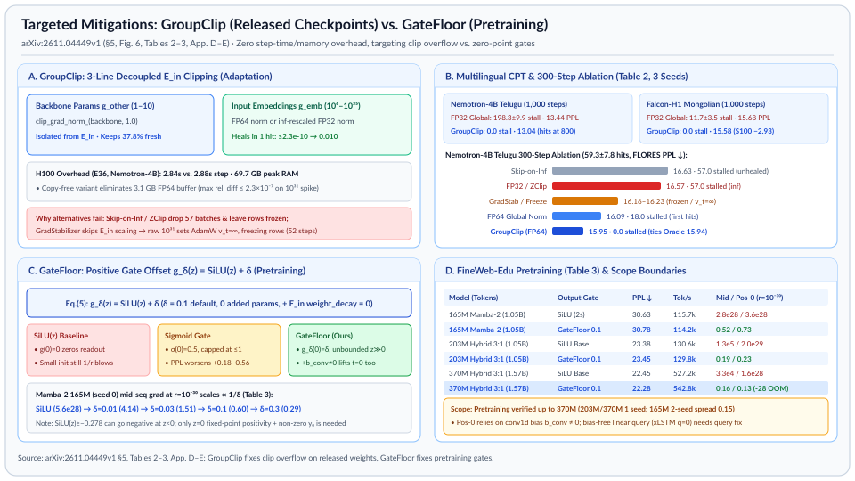View original image ↗</a><figcaption>Figure 2 · Targeted remedies and empirical verification (arXiv:2611.04449v1 §5, Fig. 6, Tables 2–3, App. D–E): GroupClip decouples embedding clipping for existing checkpoints, whereas GateFloor plus zero embedding weight decay prevents amplification during pretraining.</figcaption></figure>

Because disabling weight decay on released checkpoints cannot prevent Step-1 blowups, while from-scratch pretraining can still experience `1/r` blowups under small-norm initialization (`10⁻⁴`) or vocabulary expansion, the authors pair two zero-overhead fixes:

1. **Adapting released checkpoints with `GroupClip` (§5.1 & Appendix D)**: Because amplification is confined to `E_in` while backbone norms sit around `1–10`, `GroupClip` clips `backbone_params` with `clip_grad_norm_(..., max_norm=1.0)` separately from `embed_tokens.weight.grad`, computing the embedding norm either in FP64 (`grad.double().norm().item()`) or via a **copy-free rescaled FP32 variant** (dividing `g` by `m = norm(g, inf).clamp_min(1e-30)` so all entries are `≤ 1` before taking the FP32 norm, matching FP64 within `2.3×10⁻⁷` relative error while removing the `3.1 GB` transient FP64 buffer). On clean batches with `G_emb ≪ G_other`, backbone clipping matches standard global clipping while AdamW's second moment absorbs the constant scale on `E_in`; on trigger batches, `GroupClip` keeps full fresh-batch backbone displacement (`37.8%` on Nemotron-4B, `27.1%` on Falcon-H1) while scale-invariant AdamW steps heal every hit row in one step. On one H100 with `Nemotron-3-Nano-4B` (`E_in ∈ R^(131,072×3,136)`), median step time is **`2.84 s` (FP64) / `2.85 s` (copy-free) vs. `2.88 s` global clipping** (`21.2 / 20.8 ms` vs. `18.8 ms` clip call), with identical **`69.7 GB` peak memory**.
2. **Pretraining from scratch with `GateFloor` (§5.2 & Appendix E)**: Setting `weight_decay = 0` on `E_in` prevents unseen-token shrinkage during pretraining, while replacing the recurrent output gate inside `MambaRMSNormGated` with `g_δ(z) = SiLU(z) + δ` (`δ ∈ [0.01, 0.1]`, zero added parameters) keeps `g_δ(0) = δ > 0` without capping positive outputs at `1` like `Sigmoid` (which hurts PPL by `0.18–0.56`). Although `SiLU(z) ≥ −0.278` can still be negative for `z < 0`, breaking amplification requires positivity only at the `z = 0` fixed point: `s_{t-1}^(ℓ) ≠ 0` supplies signal at `t > 0`, while Mamba-2/Bamba's default `use_conv_bias=True` (`b_conv ≠ 0`) keeps `y_0^(ℓ) ≠ 0` at `t = 0`, lifting Layer 0 out of the sub-`ε` regime (`K = 0`) at both positions.

### 4. Quantitative Evaluation: Multilingual CPT (Table 1) and From-Scratch Pretraining (Table 2)

Continual pretraining experiments adapt `Nemotron-3-Nano-4B-BF16` to `FineWeb-2` Telugu (`tel_Telu`) and `Falcon-H1-1.5B-Base` to `FineWeb-2` Mongolian (`khk_Cyrl`) across `3` seeds (`32 × 512 = 16,384` tok/step, FP32 master weights, BF16 autocast, AdamW `λ = 0.1`, peak `η = 2×10⁻⁵`, H100 80GB) using identical per-seed batch orderings and evaluating on `FLORES-200` devtest (`1,012` sentences). **Table 1** reports all runs from Paper Table 2 alongside Paper Table 6 trigger-funnel context:

| Model &amp; Steps (Hit Batches) | Optimization / Clipping Method | Stalled Steps (`α_eff,other < 10⁻⁴`) | FLORES-200 PPL ↓ (Mean ± SD, 3 Seeds) | Observed Mechanism &amp; Side Effects (Tables 2 &amp; 7) |
| :--- | :--- | :--- | :--- | :--- |
| `Nemotron-3-Nano-4B` Telugu `1,000` (`225.0±9.5` = `22.5%`) | `FP32 Global Clip` (Baseline) | `198.3 ± 9.9` (`88.1%` of hits `inf`) | `13.44 ± 0.17` | Discards `19.8%` of all steps; traps all 29 seen rows at `6.58×10⁻³⁶` |
| `Nemotron-3-Nano-4B` Telugu `1,000` | `Oracle Mask` (Pre-scan) | `0.0 ± 0.0` | `13.04 ± 0.19` | Requires upfront corpus/vocab scan and permanently freezes target subwords |
| `Nemotron-3-Nano-4B` Telugu `1,000` | `GroupClip (FP32)` | `0.0 ± 0.0` | `13.05 ± 0.18` | Protects backbone updates; `E_in` still overflows FP32 on `> 1.84×10¹⁹` spikes |
| `Nemotron-3-Nano-4B` Telugu `1,000` | **`GroupClip (FP64, Ours)`** | **`0.0 ± 0.0`** | **`13.04 ± 0.19`** | Matches 1,000-step baseline by step 800; heals all `30.7±0.6` hit rows on contact (med `0.010`) |
| `Falcon-H1-1.5B` Mongolian `1,000` (`965.7±5.1` = `96.6%`) | `FP32 Global Clip` (Baseline) | `11.7 ± 3.5` (`0.0` `inf` overflows) | `15.68 ± 0.11` | `~10⁶` sub-overflow spikes cut early fresh backbone displacement `335×` (step-100 PPL `40.40`) |
| `Falcon-H1-1.5B` Mongolian `1,000` | `Oracle Mask` (Pre-scan) | `0.0 ± 0.0` | `15.63 ± 0.10` | Freezes target Mongolian tokens, trailing self-healing updates |
| `Falcon-H1-1.5B` Mongolian `1,000` | **`GroupClip (Ours)`** | **`0.0 ± 0.0`** | **`15.58 ± 0.10`** | Cuts step-100 PPL to `37.47`; grows Mongolian subwords `1.1×10⁻⁷ → 1.8×10⁻²` |
| `Nemotron-4B` Telugu `300`-step ablation (`59.3±7.8` hits) | `FP32 Global Clip` | `57.0 ± 7.5` | `16.57 ± 0.39` | Identical-batch control: repeated `inf` overflows zero batch updates |
| Same `300`-step ablation | `Skip-on-Inf` | `57.0 ± 7.5` | `16.63 ± 0.36` | Skips `optimizer.step()`, losing the same 57 batches and leaving rows unhealed |
| Same `300`-step ablation | `ZClip` (Adaptive Spike Clip) | `57.0 ± 7.5` | `16.57 ± 0.39` | Global norm still accumulates in FP32 and overflows to `inf` |
| Same `300`-step ablation | `GradientStabilizer` | `0.0 ± 0.0` (skips `E_in` `52.0±8.2` steps) | `16.23 ± 0.30` | Updates backbone but passes raw `10³¹` into AdamW, setting `v_t = inf` and permanently freezing `E_in` |
| Same `300`-step ablation | `Freeze E_in` | `0.0 ± 0.0` | `16.16 ± 0.24` | Avoids blowup by freezing embeddings, hurting target-language adaptation |
| Same `300`-step ablation | `FP64 Global Norm` | `18.0 ± 1.0` | `16.09 ± 0.35` | Heals rows in 1 hit yet zeroes fresh backbone updates on all 18 first-hit steps (`α_eff ~ 10⁻³¹`) |
| Same `300`-step ablation | `Mean Re-init` | `0.0 ± 0.0` | `15.96 ± 0.24` | Alters rare-token logits (tail NLL `3.8 → 9.8` on `Falcon3-7B`) |
| Same `300`-step ablation | `Oracle Mask` | `0.0 ± 0.0` | `15.94 ± 0.26` | Needs upfront vocabulary scan and prevents target-token learning |
| Same `300`-step ablation | `GroupClip (FP32)` | `0.0 ± 0.0` | `15.97 ± 0.26` | Decouples backbone clipping, leaving `E_in` unrescaled above `1.84×10¹⁹` |
| Same `300`-step ablation | **`GroupClip (FP64, Ours)`** | **`0.0 ± 0.0`** | **`15.95 ± 0.25`** | Matches `Oracle Mask` while healing target tokens with zero logits perturbation |

*Table 1 · Multilingual continual pretraining & 10-method optimization ablation (from `arXiv:2611.04449v1` Tables 2 &amp; 6 and §5.1; on 900-question Belebele at step 1,000, `Nemotron-4B` `GroupClip FP64` scores `30.67 ± 0.51%` vs. `29.78%` zero-shot, while English FLORES NLL varies within `0.01 nats`).*

For from-scratch pretraining (**Table 2**, Paper Table 3), `14` models are trained on `FineWeb-Edu` (`V = 50,304` untied with unused padding IDs `50,257…50,303`, sequence length `1,024`, `Pre-RMSNorm ε = 10⁻⁵`, CUDA/Triton Mamba-2 SSD kernels) spanning `24`-layer `Mamba-2 165M` (`1.05B` tokens, sweeping `δ ∈ {0.01, 0.03, 0.1, 0.3}`), `16`-layer `3:1` `Hybrid 203M` (`1.05B` tokens, `K = 3`), and `20`-layer `3:1` `Hybrid 370M` on `8×H100` (`1.57B` tokens, `K = 3`):

| Model Scale (Tokens / Topology) | Output Gate Variant | Val PPL ↓ | Throughput (tok/s) | Mid Gradient (`t=64`, `r=10⁻³⁰`) | Pos-0 Gradient (`t=0`, `r=10⁻³⁰`) |
| :--- | :--- | :--- | :--- | :--- | :--- |
| `Mamba-2 165M` (`1.05B`, Pure Gated) | `SiLU (Base, 2 seeds)` | `30.63` | `115.7k` | `2.8×10²⁸` | `3.6×10²⁸` |
| `Mamba-2 165M` (`1.05B`) | `Sigmoid` (paired seed 0) | `31.19` | `115.3k` | `0.20` | `0.73` |
| `Mamba-2 165M` (`1.05B`) | `GateFloor (δ=0.01)` (seed 0) | `30.67` | `113.1k` | `4.14` | `4.53` |
| `Mamba-2 165M` (`1.05B`) | `GateFloor (δ=0.03)` (seed 0) | `30.67` | `112.9k` | `1.51` | `2.88` |
| `Mamba-2 165M` (`1.05B`) | **`GateFloor (δ=0.1, 2 seeds)`** | `30.78` | `114.2k` | **`0.52`** | **`0.73`** |
| `Mamba-2 165M` (`1.05B`) | `GateFloor (δ=0.3)` (seed 0) | `30.82` | `110.5k` | `0.29` | `0.46` |
| `Hybrid 203M` (`1.05B`, `3:1`, `K=3`) | `SiLU (Base)` | `23.38` | `130.6k` | `1.3×10⁵` | `2.0×10²⁹` |
| `Hybrid 203M` (`1.05B`, `3:1`, `K=3`) | `Sigmoid` | `23.56` | `131.0k` | `0.17` | `0.44` |
| `Hybrid 203M` (`1.05B`, `3:1`, `K=3`) | **`GateFloor (δ=0.1)`** | `23.45` | `129.8k` | **`0.19`** | **`0.23`** |
| `Hybrid 370M` (`1.57B`, `3:1`, `K=3`) | `SiLU (Base)` | `22.45` | `527.2k` | `3.3×10⁴` | `1.6×10²⁸` |
| `Hybrid 370M` (`1.57B`, `3:1`, `K=3`) | `Sigmoid` | `22.66` | `546.4k` | `0.19` | `0.18` |
| `Hybrid 370M` (`1.57B`, `3:1`, `K=3`) | **`GateFloor (δ=0.1)`** | **`22.28`** | **`542.8k`** | **`0.16`** | **`0.13`** |

*Table 2 · 14-run FineWeb-Edu pretraining evaluation (from `arXiv:2611.04449v1` Table 3; `Mamba-2 165M` paired seed-0 baseline PPL is `30.71` with `5.6×10²⁸` mid gradient, and baseline seeds differ by `0.15`; `203M` and `370M` are single-seed runs).*

Table 2 establishes two clean patterns: on `Mamba-2 165M` seed 0, `r = 10⁻³⁰` mid-sequence gradients scale inversely as `∝ 1/δ` (`4.14 → 1.51 → 0.60 → 0.29`); and at `δ = 0.1` up to `370M`, `GateFloor` reduces `r = 10⁻³⁰` gradients by **more than `28` orders of magnitude** (`1.6×10²⁸ → 0.13`), matches throughput (`542.8k vs. 527.2k tok/s`), and keeps validation perplexity within `±0.17` of the baseline while avoiding `Sigmoid`'s `0.18–0.56` PPL degradation.

### 5. Scientific Boundaries, Uncovered Regimes & Engineering Takeaways

Adopting these findings in production training stacks requires distinguishing validated mechanisms from open boundaries:

1. **Scale and seed boundaries in from-scratch pretraining**: While the checkpoint census and gradient probes reach `48B` (`Kimi-Linear-48B-Base`) and continual pretraining covers `1.5B–4B` (`3` seeds), from-scratch `GateFloor` runs reach only **`370M` parameters (`1.05B–1.57B` tokens, `1–2` seeds)**, with `203M` and `370M` run on a single seed—where the `165M` two-seed baseline variance (`0.15` PPL) is already comparable to the `±0.17` differences across runs. Multi-billion-parameter pretraining behavior and downstream long-context retention beyond `1,024` tokens remain untested.
2. **Architectural preconditions for `GateFloor`**: Keeping `t = 0` out of the sub-`ε` regime depends on a non-zero `conv1d` bias `b_conv ≠ 0` (`use_conv_bias=True` in `Mamba2Config`/`BambaConfig`) so `y_0^(ℓ) ≠ 0`. Moreover, architectures whose `t > 0` blowup comes from a **bias-free linear query** rather than a SiLU gate—such as `xLSTM`'s `C_{t-1} q_t` (`1.0 × 10³²` despite a `Sigmoid` gate)—are not directly fixed by offsetting a SiLU output gate alone unless Layer-0 query/readout pathways also remain non-zero at the origin.
3. **Census visibility and non-universal instability scope**: Of `313` HuggingFace candidates, `57` were unreadable (access-gated, non-`safetensors`, or embedding tensors `> 3 GB`). Meanwhile, `GroupClip` intentionally changes the relative clipping budget between `E_in` and backbone parameters rather than addressing weight-decay origins, and neither `GroupClip` nor `GateFloor` remedies general activation spikes, attention sinks, or depth-wise Mamba state growth (Issue #529; Feng et al., 2026).
4. **Verification scope**: This close reading audited the frozen `arXiv:2611.04449v1` 16-page PDF (including Appendices A–F) and arXiv abstract/ancillary file listing (`2026-11-05` snapshot) without locally executing the HuggingFace census scan or re-running training jobs.
5. **Actionable engineering checklist**: (1) **Audit `E_in` before post-training**: whenever adapting an untied gated/hybrid model to a new script, code domain, or chat template, scan `E_in` row norms and check reachability under the target tokenizer rather than relying on English evals or `NaN` detectors; (2) **Deploy copy-free or FP64 `GroupClip` for full-parameter adaptation**: do not rely on `Skip-on-Inf`, FP32 `ZClip`, or `GradientStabilizer` (which silently stalls batches or sets `v_t = ∞` on `E_in`); (3) **Exclude `E_in` from weight decay and avoid zero-at-origin gates when pretraining**: pair `weight_decay = 0` on `E_in` with `GateFloor` (`δ = 0.1`) and `b_conv ≠ 0` to eliminate the amplification channel at the root.

Source: [Near-Zero Token Embeddings Silently Stall Training in Gated Sequence Models](https://arxiv.org/abs/2611.04449)
<h2 class="daily-paper-title" id="paper-arxiv-2611.03875">12 · INSIGHT-HPC: interpreting anomalies through workload and physics</h2>

**[INSIGHT-HPC: An Interpretable System Intelligence for Global HPC Telemetry](https://arxiv.org/abs/2611.03875)** 
Authors：Rupak Kadel, Jie Li, Yong Chen · First submitted：2026-11-02

INSIGHT-HPC aligns BMC, Slurm, and PDU telemetry by node and minute. Statistical anomalies, job segments and peer comparisons, power/thermal residuals, and physical constraints feed a supervised gradient-boosting model that produces episode-level alerts. A power increase at job startup can thus be explained by workload rather than automatically treated as a fault.

<a class="note-image-link" href="/assets/images/digest/2026-11-05/insight-hpc.png" target="_blank" rel="noopener" aria-label="INSIGHT-HPC architecture integrating statistical, workload, and physical evidence · View original image ↗">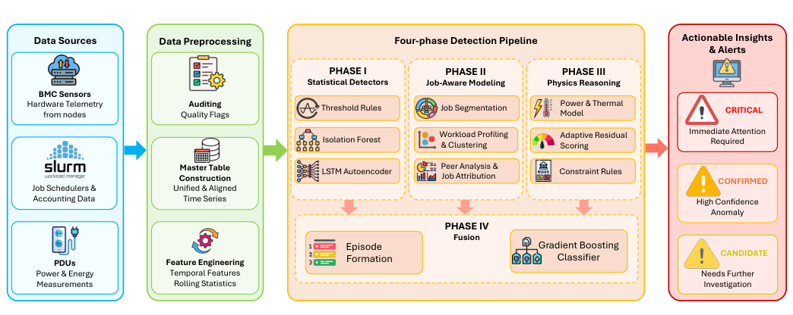View original image ↗</a>

*Three evidence paths feed episode-level fusion. Alert tiers use thresholds selected on validation data.*

The authors replay 79 days from 118 compute nodes using chronological splits. The test set combines 29 operator-recorded failures with 140 injected events. At the primary threshold, precision is 0.913 and F1 is 0.862; separately reported event recall is 0.805. This is retrospective detection, not demonstrated real-time warning: classification uses complete-episode features, and headline results mix real and injected faults. AUROC candidate pools also differ across methods. The transferable idea is to combine workload explanations and physical inconsistencies as distinct evidence in alert fusion.

<h2 class="daily-paper-title" id="paper-arxiv-2611.03725">13 · RAGLog: a correct answer can conceal upstream faults</h2>

**[From Logs to Faults: Reference-Free Fault Localization for Retrieval-Augmented Generation Pipelines](https://arxiv.org/abs/2611.03725)** 
Authors：Hira Naveed, Scott Barnett, Stefanus Kurniawan, John Grundy, Chetan Arora, Hourieh Khalajzadeh, Omar Haggag · First submitted：2026-11-01

A final RAG answer is an incomplete health signal. Retrieval can miss necessary evidence while the generator answers from prior knowledge; reranking can discard useful material and make the generator appear responsible. RAGLog localizes faults across rewriting, embedding, retrieval, reranking, and generation using execution logs. Online requests need no reference answer, but the method still needs sufficiently complete call inputs and outputs.

<a class="note-image-link" href="/assets/images/digest/2026-11-05/raglog.png" target="_blank" rel="noopener" aria-label="RAGLog call classification, schema mapping, and stage fault classification · View original image ↗">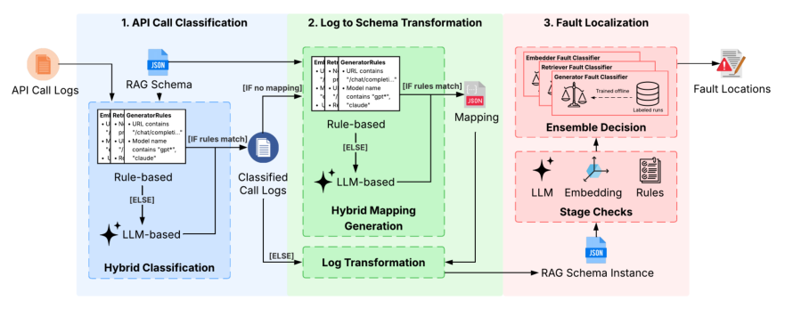View original image ↗</a>

*Logs are normalized before rule, embedding, and LLM checks are combined. The classifiers on the right are trained on labeled data offline.*

It first classifies API calls using rules for familiar interfaces and an LLM fallback for unfamiliar ones. Reusable field mappings transform heterogeneous logs into a common RAG schema. Rules check lost entities, numbers, and dates; embedding similarities measure drift; five parallel LLM checks examine evidence availability, exclusion, grounding, and other semantic properties. Separate stage classifiers combine these measurements instead of treating an unconstrained LLM diagnosis as the final verdict.

“Reference-free” does not mean label-free. Online analysis sees only traces, while the stage classifiers and thresholds are trained offline on labeled runs. RAGLog Faults contains 3,134 runs. The main evaluation separates 1,500 natural runs from 480 injected runs across five open-source pipelines and three question-answering datasets. A live proxy modifies actual calls so downstream stages respond to disturbances, rather than merely labeling edited logs as failures.

With Claude Haiku 5.5, stage-level pooled F1 on natural runs is 0.73, versus 0.58 for Claude Code and 0.52 for Codex. On injected runs the scores are much closer: 0.84, 0.80, and 0.82. Of 551 naturally faulty runs, 202 still produce correct answers. The authors report roughly $0.005 and 4.6–4.7 seconds per run for the Haiku variant, with parallel checks keeping latency bounded.

Higher recall carries an operational cost. Run-level false-positive rates are 13.6% for RAGLog, versus 5.4% and 4.0% for the agent baselines. Holding out an entire pipeline reduces natural-run pooled F1 from 0.73 to 0.67. Labels are primarily generated by LLM judges, without independent human validation of test labels. The method also does not currently support agentic RAG with dynamically selected or repeated stages.

Ablations help locate the gains: removing LLM checks has the largest effect on natural faults. Removing the evidence-flow check has a smaller but significant effect on both natural and injected sets. Not every added classifier or cross-stage feature provides a statistically significant benefit, so architectural complexity is not evidence of necessity.

The especially useful contribution for AIOps is the separation between an injected disturbance, a manifested stage fault, and an incorrect final answer. Many injections are absorbed downstream; counting all injected runs as faulty would corrupt the evaluation. Read the evidence-flow checks and post-injection labeling procedure for a concrete way to make generative-system diagnosis more precise while exposing its false-alarm and annotation costs.

<h2 class="daily-paper-title" id="paper-arxiv-2611.04507">14 · Signals: grouping trace findings into engineering issues</h2>

**[Signals: Continuous Diagnostics of AI Agents](https://arxiv.org/abs/2611.04507)** 
Authors：Amey Rambatla, Vatsal Goel, Sagar Gaur, Siddhant Loya, Anurag Mishra, Asif Mohammad · First submitted：2026-11-03

Signals targets wrong decisions and wasted work even when tools and infrastructure operate normally. Its taxonomy contains 45 problem types across eight families. Individual occurrences are grouped into engineering issues with evidence, severity, and remediation checks, separating realized defects, reachable risks, and inefficiencies. A shared label alone does not establish a shared root cause.

<a class="note-image-link" href="/assets/images/digest/2026-11-05/signals.png" target="_blank" rel="noopener" aria-label="Signals workflow from trace diagnosis to severity and remediation suggestions · View original image ↗">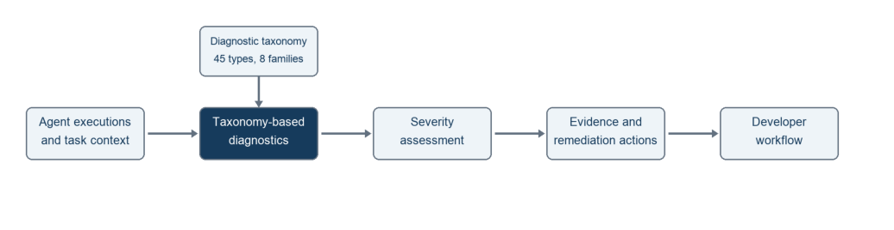View original image ↗</a>

*The taxonomy constrains diagnosis before evidence and proposed actions reach developers. Repair effectiveness still requires subsequent validation.*

On public benchmark executions, the GPT-6.1 Sol workflow achieves 91.43% Signal-matching F1 versus 73.69% for one-pass generation using the same model and taxonomy. Matching checks components and problem types, not descriptions, evidence spans, severity, or repair effectiveness. Reference labels were produced by LLMs under human oversight. Compared with RAGLog’s stage-level verdicts, Signals emphasizes issue management across executions. Its evidence boundaries are especially useful for avoiding diagnoses based solely on rejected calls, long traces, or missing telemetry.

<h2 class="daily-paper-title" id="paper-arxiv-2611.04399">15 · Auditing the evaluator: a 13-point gap caused by missing grades</h2>

**[Silent Instrument Errors Reorder Agent Leaderboards](https://arxiv.org/abs/2611.04399)** 
Authors：Yangze Liu · First submitted：2026-11-03

Leaderboard scores are often treated as direct evidence of model and harness capability. This audit instead examines the infrastructure that produces them: grading triggers, cost aggregation, action provenance, and versioned replay. Recomputing public HAL and tau2-bench artifacts without rerunning agents reveals four failures that still produce plausible numbers.

<a class="note-image-link" href="/assets/images/digest/2026-11-05/instrument-errors.png" target="_blank" rel="noopener" aria-label="Generalist scores after grading previously ungraded HAL records · View original image ↗">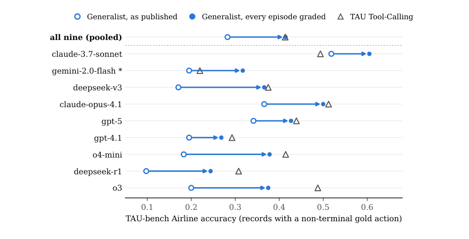View original image ↗</a>

*Arrows show changes after applying the same reward rule to ungraded records. The pooled row reaches the triangle, without reversing every individual model comparison.*

The clearest case concerns HAL’s airline tasks. Generalist finishes its own conversation loop without necessarily triggering the benchmark’s termination event. Ungraded records are then stored as failures. Tool-Calling has a graded fraction of 98%, compared with 51% for Generalist. Applying the pinned environment and original reward rule to previously ungraded records raises Generalist’s pooled accuracy from 0.30 to 0.43 on 41 tasks with non-terminal reference actions across nine models, closing the published 13-point gap.

That does not reverse every model-level comparison or establish that doing nothing completes a task. On tasks requiring database writes, accuracy rises from 0.28 to 0.33; all 23 newly passing ungraded episodes contain the required write. The scaffolds still differ in prompt placement and step budgets. The correction removes unequal grading coverage, not every experimental difference.

Two other failures arise in observability infrastructure. Cost aggregation sums both wrapper and provider-client spans containing the same response, double-counting some client paths but not others. Archived trajectories also include the grader’s reference actions: these occur in 68% of 2,334 airline records and sometimes appear in the middle. Removing a fixed suffix cannot reliably clean them. Behavioral analysis or training on these logs can therefore attribute grader work to the agent.

The fourth failure concerns replay versions. Even a properly announced grading correction changes rankings. Separately, a telecom replay path misidentifies solo mode and omits user-side tools. It continues after tool-not-found results and returns scores 59–82 points lower for four files. The paper distinguishes legitimate criterion updates from implementation errors: re-grading is itself a new measurement.

Code fixes do not update historical numbers or downloaded traces. HAL maintainers confirmed three issues and added disclosures, while the archives remained unchanged. The paper therefore recommends machine-readable errata inside datasets so copies traveling beyond the leaderboard retain the affected-record scope and correction rules.

The audit does not estimate error prevalence across all leaderboards, and the HAL re-grades cover database and output criteria. Its reusable checks are concrete: publish the graded fraction, deduplicate costs by root spans or response IDs, identify who produced each action, and pin evaluator and task-data versions with per-task re-grade differences. For AgentOps, these checks establish whether a small score difference is evidence worth acting on.

<h2 class="daily-paper-title" id="paper-arxiv-2611.04321">16 · ATC: enforcing explicit role contracts at the multi-agent message boundary</h2>

**[ATC: Agent Trajectory Control for Role-Contract Enforcement in Black-Box Multi-Agent Systems](https://arxiv.org/abs/2611.04321)** ([v1 PDF](https://arxiv.org/pdf/2611.04321) · [HTML](https://arxiv.org/html/2611.04321v1) · [GitHub](https://github.com/VishalPramanik/ATC)) 
Maisha Maliha¹, Vishal Pramanik², Sumit Kumar Jha² (¹University of Oklahoma; ²University of Florida) · `arXiv:2611.04321v1 [cs.AI; cs.MA]` · Submitted 2026-11-03 (Accepted at EMNLP 2026; `v1` only at verification time, with no revision or withdrawal)

Multi-agent LLM workflows divide labor across specialized roles—planning, evidence retrieval, verification, memory management, and execution—yet that division holds only if each agent stays within its authorized scope at every turn. Over extended conversations, an agent can emit a message that is **locally fluent and even factually sound, while exercising authority reserved for another role**: a verifier that starts planning, a retriever that asserts unsupported decisions, or an executor that modifies unapproved state. Formalizing this turn-level contract breach as **role drift**, **Agent Trajectory Control (ATC)** operates at the message boundary before candidate outputs enter the shared conversation `cₜ`. Without inspecting generator activations, ATC scores four drift signals, computes a closed-form leakage-regularized target `ẑᵢ,ₜ`, constrains regeneration, and re-scores the revised text prior to admission. This close reading traces `arXiv:2611.04321v1` (Sections 1–9, Tables 1–15, Figures 1–5, Algorithm 1, Appendices A1–A4), separating author-reported findings from operational boundaries.

### 1. Why multi-agent labor splits erode: directional role drift and baseline blind spots

In long multi-agent runs, every agent conditions on a shared conversation `cₜ` increasingly populated by planning, retrieval, verification, and execution outputs, while its role prompt stays static. That imbalance invites imitation of other agents' dominant language patterns. The authors hypothesize that **role drift is directional—moving toward other roles' functions rather than arbitrary incoherence**—and intensifies in longer, more heterogeneous teams.

Because `EntCollabBench` and `MultiAgentBench` lack native turn-level role-drift labels, Section 2 conducts a pilot study annotating uncorrected candidate turns under a fixed role-consistency rubric using the unnormalized Eq. (8) weights (`α = 1.00, β = 1.00, γ = 0.50, δ = 0.75`). Table 1 reports sharp class-conditional separation between stable and drifted turns across out-of-role deviation `D_out` (`0.18 → 0.57`), cross-role leakage `D_leak` (`0.11 → 0.49`), linguistic violations `D_ling` (`0.07 → 0.36`), and logical contract breaches `D_logic` (`0.05 → 0.31`), lifting raw per-turn energy `Eᵢ,ₜ` from `0.36` to `1.47`. Crucially, `D_out` and `D_leak` correlate strongly (**`r = 0.76`**), confirming that drifting agents migrate into neighboring role spaces rather than merely wandering off-topic. (The Table 1 caption notes these descriptive pilot means on uncorrected turns do not set upper/lower bounds for benchmark-wide `RDE` averaged over released turns.) Once such an output enters `cₜ`, downstream agents treat it as valid shared state, compounding initial authority breaches across subsequent turns.

Prior runtime controls each leave the shared-conversation admission point unguarded:
- **Prompting & structured tags (`Prompt-Only` / `Struct-Role`)**: Declare responsibilities at input time or attach a role field per message, but never verify whether realized outputs stayed within authorized scope.
- **Agentic memory (`A-MEM`)**: Organizes and links shared experience across turns, yet memory structures do not govern which agent is entitled to retrieve, approve, or mutate state.
- **Hidden-state activation editing (`CAA` / `SEA`)**: Steers model activations along contrastive or spectral directions during generation, requiring white-box weight/activation access unavailable in proprietary APIs, and steering globally without decoupling role alignment from cross-role leakage or checking discrete contracts.
- **Workflow ordering (`SOP-Role` / MetaGPT-style)**: Enforces who speaks when, yet a role-violating utterance can still be generated inside an otherwise valid turn and contaminate `cₜ` unchecked.

### 2. ATC mechanism: four-signal drift energy and closed-form leakage-regularized correction

<figure class="note-figure"><a class="note-image-link" href="/assets/images/digest/2026-11-05/atc-role-contract-gate-en.svg" target="_blank" rel="noopener" aria-label="View original ATC message-boundary control loop diagram">View original image ↗</a><figcaption>Figure 1 · ATC message-boundary control loop (from arXiv:2611.04321v1 §3, Fig. 1, Algorithm 1 &amp; Appendix A1): all projections, energy scoring, and target computation sit outside the generator and mandate post-regeneration re-scoring before updating shared context.</figcaption></figure>

ATC wraps proposed outputs `yᵢ,ₜ` before they enter `cₜ` in a uniform turn trajectory (Algorithm 1): **precomputed role projectors → behavior encoding → 4-signal drift scoring → closed-form target projection → constrained regeneration → re-evaluation → admission**. In black-box deployments, regeneration calls constrained text revision on the same or another LLM; in open-weight deployments, the exact same target can also guide decoding or latent steering without altering the controller.

1. **Precomputed role subspaces & closed-form operators (§3.1, Algorithm 1)**: Across `n` agents `{A₁, …, Aₙ}` with roles `{r₁, …, rₙ}`, each role basis `Uᵢ ∈ R^(d×kᵢ)` (`kᵢ = 16` in main experiments; behavior encoder `f` defaults to `BAAI/bge-large-en-v1.5`) is built from role descriptions and role-consistent demonstrations. Because columns of `Uᵢ` can be linearly dependent, ATC uses the Moore–Penrose pseudoinverse to form two orthogonal projectors (validated via Proposition 1 in Appendix A1.1):
   - **Assigned role projector**: <code>Pᵢ = Uᵢ(UᵢᵀUᵢ)†Uᵢᵀ</code>, decomposing encoded behavior `zᵢ,ₜ = f(yᵢ,ₜ, hᵢ,ₜ, cₜ) ∈ Rᵈ` into role-aligned `Pᵢzᵢ,ₜ` and out-of-role `(I − Pᵢ)zᵢ,ₜ`.
   - **Forbidden-role projector**: `Vᵢ` spans all other agents' role bases `[Uⱼ]_{j≠i}`, giving <code>Qᵢ = Vᵢ(VᵢᵀVᵢ)†Vᵢᵀ</code> (or `0` if no other roles exist).
   - **Precomputed correction operator**: <code>Mᵢ = UᵢᵀUᵢ + λUᵢᵀQᵢUᵢ</code> and <code>Rᵢ = Mᵢ†Uᵢᵀ</code>. Since role bases stay fixed at evaluation time, `Pᵢ`, `Qᵢ`, and `Rᵢ` are computed once upfront with zero iterative optimization during rollout.

2. **Four-signal turn-level role-drift energy `Eᵢ,ₜ` (Eqs. 3–8)**: Each proposed turn is scored across geometric, linguistic, and symbolic dimensions:
   - **Out-of-role deviation `D_out` (Eq. 3)**: <code>D_out = ∥(I − Pᵢ)zᵢ,ₜ∥₂²</code> (`α = 1.00`), measuring squared distance outside `Sᵢ = col(Uᵢ)`.
   - **Cross-role leakage `D_leak` (Eq. 5)**: <code>D_leak = ∥Qᵢzᵢ,ₜ∥₂²</code> (`β = 1.00`), softly penalizing projection onto other roles' combined space `Fᵢ` instead of forcing hard orthogonality, because roles legitimately share reasoning, clarification, and evidence-citation directions.
   - **Linguistic speech-act violation `D_ling` (Eq. 6)**: A fixed classifier `ℓᵢ,ₜ = L(yᵢ,ₜ) ∈ [0, 1]ᵐ` scores interaction modes (`ASSERT`, `RETRIEVE`, `VERIFY`, `EXECUTE`, `DELEGATE`, `SUMMARIZE`, `REFUSE`, questioning) against an allowed binary mask `bᵢ ∈ {0, 1}ᵐ`, yielding <code>D_ling = ∥(1 − bᵢ) ⊙ ℓᵢ,ₜ∥₁</code> (`γ = 0.50`).
   - **Logical contract violation `D_logic` (Eq. 7)**: A symbolic predicate mapper `sᵢ,ₜ = S(yᵢ,ₜ, hᵢ,ₜ, cₜ)` sums triggered prohibitions (`φ ∈ Bᵢ` satisfied by `sᵢ,ₜ`) and unmet obligations (`ψ ∈ Oᵢ` violated by `sᵢ,ₜ`) under contract `Cᵢ = (Oᵢ, Bᵢ)` (`δ = 0.75`).
   - **Combined and discounted trajectory drift**: <code>Eᵢ,ₜ = αD_out + βD_leak + γD_ling + δD_logic</code>, with per-agent discounted drift <code>Dᵢ(T) = ∑_{t=1}^T ρ^(T−t) Eᵢ,ₜ</code> (`ρ = 0.95`) and system drift <code>D_sys(T) = ∑ᵢ Dᵢ(T)</code>.

3. **Closed-form leakage-regularized target, constrained regeneration, and mandatory re-check (Eqs. 9–12, Appendices A1.2–A1.4)**: To stay within `Sᵢ` while suppressing leakage into `Fᵢ`, ATC minimizes (Eq. 9):
   <code>ẑᵢ,ₜ = argmin_{z' ∈ Sᵢ} ∥z' − zᵢ,ₜ∥₂² + λ∥Qᵢz'∥₂²</code> (`λ = 0.50` tuned on validation). Writing `z' = Uᵢc`, Proposition 2 gives the closed-form minimum-norm solution <code>ĉᵢ,ₜ = Rᵢzᵢ,ₜ</code> and <code>ẑᵢ,ₜ = Uᵢĉᵢ,ₜ</code>. Constrained regeneration <code>ŷᵢ,ₜ = g(yᵢ,ₜ, ẑᵢ,ₜ, rᵢ, Cᵢ, bᵢ, cₜ)</code> then rewrites the candidate while preserving task intent, and **re-evaluates `Êᵢ,ₜ`** with the exact same `f, L, S` before admitting `ŷᵢ,ₜ` to `cₜ`. Appendix A1.4 explicitly states why re-scoring is non-optional: Proposition 3 (Eq. 12) proves `ẑᵢ,ₜ` never underperforms pure projection `Pᵢzᵢ,ₜ` on the continuous vector-correction objective, yet **that guarantee does not automatically extend to post-regeneration text**, whose discrete `D_ling` and `D_logic` terms depend on realized wording from `g`.

4. **Turn-level qualitative repairs (Appendix A3 Table 12, Figs. 4–5)**: On `EntCollabBench S3: Het-12`, a `Verifier` output reading *"We should assign the retrieval task to the Memory-Reader, then ask the Executor to submit the final answer"* is fluent yet leaks directly into `Planner` authority (`D_out = 0.57`, `D_leak = 0.49`, `D_ling = 0.36`, `D_logic = 0.31`). ATC rewrites it to *"The proposed plan requires verification. I will check whether the retrieval step matches the task constraints and whether the Executor has sufficient evidence before finalization"*, cutting all four signals to `0.20 / 0.14 / 0.12 / 0.09` (Fig. 5). Table 12 illustrates analogous turn-level repairs when a `Retriever` infers a final approval, an `Executor` tries to mutate shared memory directly, or a `Memory-Writer` issues policy recommendations.

### 3. Evaluation across homogeneous/heterogeneous teams, ablations, stress tests, and gated trade-offs

<figure class="note-figure"><a class="note-image-link" href="/assets/images/digest/2026-11-05/atc-drift-evidence-en.svg" target="_blank" rel="noopener" aria-label="View original ATC empirical evidence 4-panel chart">View original image ↗</a><figcaption>Figure 2 · Empirical highlights (from arXiv:2611.04321v1 Tables 2–6, 8, 13–15 &amp; Fig. 5): heterogeneous teams amplify ATC's lead as baselines degrade, soft leakage beats hard orthogonality, and energy gating smoothly trades latency for stability.</figcaption></figure>

Experiments span three team settings: `S1: Hom-10` (ten cooperative roles sharing one instruction-tuned backbone: `COORDINATOR`, `PLANNER`, `RETRIEVER`, `MEMORY-WRITER`, `MEMORY-READER`, `VERIFIER`, `CRITIC`, `EXECUTOR`, `MONITOR`, `SUMMARIZER`), `S2: Het-10` (same 10 roles assigned across `5` distinct model families), and `S3: Het-12` (`12` agents across `5+` model families, adding `POLICY-AUDITOR` and `DOMAIN-SPECIALIST`). All methods share identical role prompts, tool access, retrieval budget (`top-k = 10`), context budget (`128K` tokens), decoding (`Temp = 0.2`, `Top-p = 0.95`, `512` max output tokens/turn, `200` max turns/episode, summary every `20` turns), stopping rules, and role demonstrations (including `CAA` and `SEA`). Table 1 summarizes three-seed means on task score (`Primary ↑`), fixed-rubric Role Consistency (`RC ↑`), and average Role-Drift Energy (`RDE ↓`).

| Setting &amp; Method (Table 2, 3-seed means) | EntCollabBench Primary ↑ | EntCollabBench RC ↑ | EntCollabBench RDE ↓ | MultiAgentBench Primary ↑ | MultiAgentBench RC ↑ | MultiAgentBench RDE ↓ | SWE-bench Verified Primary ↑ | SWE-bench Verified RC ↑ | SWE-bench Verified RDE ↓ |
| :--- | :--- | :--- | :--- | :--- | :--- | :--- | :--- | :--- | :--- |
| `S1: Hom-10` · `Single-Agent` / `Prompt-Only` | `54.8` / `61.3` | `68.1` / `72.6` | `0.39` / `0.34` | `49.6` / `55.2` | `65.4` / `70.8` | `0.42` / `0.36` | `27.4` / `31.8` | `63.2` / `68.7` | `0.45` / `0.39` |
| `S1: Hom-10` · `Struct-Role` / `A-MEM` | `64.7` / `66.5` | `78.9` / `77.3` | `0.28` / `0.27` | `58.4` / `60.1` | `76.1` / `75.6` | `0.31` / `0.30` | `33.9` / `35.6` | `74.5` / `73.8` | `0.33` / `0.32` |
| `S1: Hom-10` · `CAA` / `SEA` | `65.2` / `66.9` | `79.8` / `81.4` | `0.26` / `0.24` | `59.3` / `60.8` | `78.4` / `79.7` | `0.29` / `0.27` | `34.8` / `36.1` | `76.2` / `77.5` | `0.31` / `0.29` |
| `S1: Hom-10` · `SOP-Role` / **`ATC`** | `68.1` / **`74.6`** | `82.6` / **`91.8`** | `0.23` / **`0.13`** | `61.9` / **`68.7`** | `80.2` / **`90.4`** | `0.26` / **`0.15`** | `36.9` / **`42.3`** | `78.6` / **`88.7`** | `0.28` / **`0.17`** |
| `S2: Het-10` · `Single-Agent` / `Prompt-Only` | `55.6` / `60.5` | `66.9` / `69.7` | `0.41` / `0.38` | `50.4` / `54.8` | `64.1` / `67.9` | `0.44` / `0.40` | `28.1` / `31.2` | `62.5` / `65.8` | `0.46` / `0.43` |
| `S2: Het-10` · `Struct-Role` / `A-MEM` | `63.8` / `66.1` | `75.2` / `74.5` | `0.32` / `0.31` | `57.9` / `60.6` | `73.4` / `72.8` | `0.34` / `0.33` | `33.4` / `35.9` | `71.2` / `70.6` | `0.37` / `0.36` |
| `S2: Het-10` · `CAA` / `SEA` | `64.9` / `66.8` | `77.6` / `79.1` | `0.29` / `0.27` | `59.2` / `61.3` | `75.7` / `77.8` | `0.31` / `0.29` | `34.7` / `36.5` | `73.4` / `75.1` | `0.34` / `0.32` |
| `S2: Het-10` · `SOP-Role` / **`ATC`** | `67.5` / **`75.8`** | `80.4` / **`92.7`** | `0.26` / **`0.12`** | `62.1` / **`70.2`** | `78.5` / **`91.6`** | `0.28` / **`0.14`** | `36.8` / **`43.6`** | `76.3` / **`89.9`** | `0.31` / **`0.16`** |
| `S3: Het-12` · `Single-Agent` / `Prompt-Only` | `55.1` / `59.2` | `65.8` / `67.4` | `0.43` / `0.41` | `49.9` / `53.6` | `63.5` / `65.9` | `0.46` / `0.43` | `27.9` / `30.7` | `61.8` / `64.1` | `0.48` / `0.45` |
| `S3: Het-12` · `Struct-Role` / `A-MEM` | `62.9` / `65.7` | `72.6` / `72.1` | `0.35` / `0.34` | `56.8` / `60.3` | `70.4` / `70.2` | `0.37` / `0.36` | `32.6` / `35.5` | `68.9` / `68.5` | `0.40` / `0.39` |
| `S3: Het-12` · `CAA` / `SEA` | `64.1` / `66.3` | `74.8` / `76.6` | `0.32` / `0.30` | `58.5` / `61.0` | `72.7` / `74.9` | `0.34` / `0.32` | `34.1` / `36.2` | `70.3` / `72.4` | `0.37` / `0.35` |
| `S3: Het-12` · `SOP-Role` / **`ATC`** | `66.8` / **`76.4`** | `78.2` / **`93.5`** | `0.29` / **`0.11`** | `61.5` / **`71.1`** | `76.1` / **`92.8`** | `0.31` / **`0.13`** | `36.4` / **`44.2`** | `74.0` / **`91.2`** | `0.33` / **`0.15`** |

*Table 1 · Primary task score, Role Consistency (RC), and average Role-Drift Energy (RDE) across three benchmarks and team configurations (from arXiv:2611.04321v1 Table 2; pairs list baseline vs. counterpart/ATC with best per suite/setting in bold).*

Table 1 reveals a sharp divergence as teams grow more diverse (`Hom-10 → Het-10 → Het-12`): **all baselines drop in `RC` and climb in `RDE`**, flattening or hurting task success (`SOP-Role` on `EntCollabBench` slides `68.1 → 67.5 → 66.8` while `RDE` climbs `0.23 → 0.26 → 0.29`). `ATC`, by contrast, improves steadily (`74.6 → 75.8 → 76.4`), expanding its lead over `SOP-Role` from **`+6.5 / +6.8 / +5.4`** in `S1` to **`+8.3 / +8.1 / +6.8`** in `S2` and **`+9.6 / +9.6 / +7.8`** in `S3`. Distinct model families contribute complementary strengths, yet only unlock higher team performance when message-level drift control prevents style differences from collapsing into authority confusion (scaling further to `Het-16` in Table 7 trims `Primary` slightly to `75.1` from inter-agent communication overhead while maintaining `RC` at `91.4%`).

Table 2 consolidates ablations, stress perturbations, overlap audits, gated deployment curves, and encoder scaling on the hardest regime (`EntCollabBench S3: Het-12`):

| Analysis Dimension (EntCollabBench S3: Het-12) | Evaluated Variants / Perturbations | Quantitative Outcomes (Primary ↑ / RC ↑ / RDE ↓ or Specific Metric) | Mechanism Takeaways |
| :--- | :--- | :--- | :--- |
| Component ablation (Table 3) | `Full ATC` vs. dropping `D_out`, regen `g`, `D_leak`, `D_logic`, `D_ling` | `76.4 / 93.5 / 0.11`; w/o `D_out` `68.2 / 80.1 / 0.27`; w/o `g` `69.7 / 82.9 / 0.24`; w/o `D_leak` `70.4 / 84.3 / 0.22`; w/o `D_logic` `71.6 / 86.8 / 0.20`; w/o `D_ling` `72.1 / 87.5 / 0.19` | Role subspace `D_out` is the primary driver (`-8.2` Primary, `-13.4` RC); detection without regeneration (`g`) loses `6.7` pts; speech-act and symbolic checks act as complementary guards |
| Target rule &amp; `λ` overlap audit (Tables 4, 6, 15) | No fix / Hard reminder / Pure `Pᵢz (λ=0)` / Hard `⊥Fᵢ` / Soft `λ=0.50` vs. `λ=2.00` | None `59.2 / 67.4 / 0.41`; Reminder `62.9 / 72.6 / 0.35`; `Pᵢz` `71.3 / 86.1 / 0.20`; Hard `⊥Fᵢ` `69.8 / 87.0 / 0.18`; `λ=0.25/0.50/1.00/2.00` yield `74.2 / 76.4 / 75.8 / 73.6`; 100-turn valid overlap audit: `λ=0.50` harmful edits **`5.6%`**, content kept **`94.3%`** vs. `λ=2.00` **`18.4%`** harmful, `82.1%` kept | Hard orthogonality and excessive `λ` strip valid shared reasoning, evidence use, and clarification; moderate `λ = 0.50` balances leakage suppression against preservation |
| Role-drift stress tests (Table 5) | `Prompt-Only` / `Struct-Role` / `A-MEM` / `SEA` / `SOP-Role` / **`ATC`** | `Role-confuse`: `42.5 / 49.3 / 51.1 / 54.7 / 57.9` vs. **`70.8`** (`+12.9`); `Authority-swap`: `39.8 / 46.7 / 48.5 / 51.6 / 55.2` vs. **`68.4`** (`+13.2`); `Late-correction`: `44.1 / 50.2 / 55.8 / 56.3 / 58.6` vs. **`72.1`** (`+13.5`) | Outperforms strongest baseline `SOP-Role` by greater than `12` pts on all three perturbations, with largest margin on `Authority-swap` (routing valid outputs via unauthorized agents) |
| Cost, latency &amp; energy gating (Tables 8, 14, Fig. 2) | `Prompt-Only` / `SOP-Role` / `ATC-Gated (τ=0.50, 0.35, 0.20)` / `Full ATC` | `Prompt-Only`: `12.4` calls, `116.0K` tok, `24.3 s`; `SOP-Role`: `13.6` calls, `126.2K` tok, `28.5 s`, `RCG/C = 0.86`; `τ=0.50/0.35/0.20` repair `24.7%/46.8%/72.6%` turns yielding `71.3/73.9/75.6`; `Full ATC`: `15.2` calls, `132.8K` tok, `32.4 s`, **`RCG/C = 1.97`** | Full `ATC` adds `+6.6K` tokens and `+3.9 s` over `SOP-Role` (`+9.6` Primary) and more than doubles cost-normalized gain (`RCG/C 1.97 vs. 0.86`); `τ=0.20` keeps `75.6` while skipping `27.4%` of repairs |
| Encoder scale &amp; team size (Tables 7, 13) | `BGE-large/base/small-en-v1.5`; `Hom-5` through `Het-16` | `bge-large` `76.4 / 93.5 / 0.11 (1.00×)`; `bge-base` `75.2 / 91.8 / 0.14 (0.62×)`; `bge-small` `73.6 / 89.4 / 0.17 (0.34×)`; `Hom-5` `72.9`, `Hom-10` `74.6`, `Het-10` `75.8`, `Het-12` `76.4`, `Het-16` `75.1` (`RC 91.4`) | Cutting encoder size to `bge-small` removes ~2/3 of encoding latency while still outperforming `SOP-Role` (`66.8`) by `+6.8` pts |

*Table 2 · Component/objective ablations, explicit stress tests, gated latency trade-offs, and encoder scaling on `EntCollabBench S3: Het-12` (from arXiv:2611.04321v1 Tables 3–8 &amp; 13–15; `RCG/C = (RCₘ − RC_Prompt) / (Tokₘ / 10)`).*

### 4. Scientific boundaries, undisclosed assumptions, and multi-agent engineering takeaways

Adopting `ATC` in production multi-agent systems requires holding five boundaries clearly in view:

1. **Message-boundary governance does not replace external tool IAM or prove semantic truth**: `ATC` intercepts candidate *messages* before they enter `cₜ`. If an agent already executes an external write/mutation tool call inside its turn prior to emitting its natural-language response, rewriting the text afterward cannot undo an external side effect—hard tool permissions must still be enforced at the API/tool gateway (e.g., RBAC, sandboxing, or action-gating DSLs like `AgentSpec`). Likewise, Section 8 stresses that a 100% role-consistent response can still be factually wrong, incomplete, biased, or unsafe.
2. **Manual role-artifact authoring & implementation details deferred to code configs**: Deploying `ATC` in a new domain requires authoring role descriptions, role-consistent demonstrations, speech-act masks `bᵢ`, and symbolic predicates `Cᵢ = (Oᵢ, Bᵢ)`. Appendix A4.5 explicitly notes future specifications should log per-role demo counts, predicate counts, and curation hours—figures omitted from the PDF itself. Similarly, exact LLM checkpoint IDs/providers for `S1–S3` and the internal architecture/accuracy of speech-act classifier `L` and symbolic mapper `S` are deferred to repository config files rather than tabulated in the paper. Even when generator weights are black-box, `f`, `L`, `S`, and contract definitions remain inspectable components that require calibration and maintenance.
3. **Static role assumptions, automated judging, and missing spread statistics**: Evaluation focuses on fixed predefined roles (`10–12` roles) rather than fluid or dynamically negotiated responsibilities. `RC` depends on a fixed rubric and automated `Judge(yᵢ,ₜ, rᵢ)` without human verification or multi-judge robustness checks (§8). Main tables average `3` seeds without reporting standard deviations or confidence intervals, and `CAA`/`SEA` comparisons inherently require white-box activation access that would not exist in purely proprietary-API teams.
4. **Local monotonicity gap & over-correction hazard**: Appendix A1.4 proves Eq. (12) bounds only the pre-regeneration continuous vector `ẑᵢ,ₜ`, not the discrete realized text `ŷᵢ,ₜ`. Over-constraining contracts or raising `λ` aggressively (`λ = 2.00` triples harmful edits from `5.6%` to `18.4%`) risks suppressing constructive disagreement and uncertainty expression.
5. **Verification scope**: This close reading audited the full `arXiv:2611.04321v1` paper extraction (`1,183` lines covering Sections 1–9, Tables 1–15, Figures 1–5, Algorithm 1, Appendices A1–A4) and verified arXiv metadata and the cited GitHub URL without locally re-executing multi-agent episodes.

For practitioners building multi-agent orchestrators, three engineering lessons transfer directly:
- **Separate "off-role drift" from "cross-role leakage" using soft penalties rather than hard orthogonality**: Hard orthogonal projection (`69.8`) and heavy regularization (`λ = 2.00`) destroy legitimate shared reasoning and evidence citation; validation-tuned soft regularization (`λ = 0.50`) curbs role usurpation while keeping `94.3%` of valid overlapping content intact.
- **Pair drift detection with constrained repair and mandatory re-scoring before committing to `cₜ`**: Dropping regeneration `g` loses `6.7` task points because logging drift after admission cannot stop downstream conditioning on unauthorized state claims; re-scoring realized text ensures `g` did not trade vector alignment for a discrete contract violation.
- **Use drift-energy gating (`Eᵢ,ₜ > τ`) and lightweight encoders to stay within latency budgets**: Switching `bge-large` to `bge-small` cuts encoding latency by two-thirds with modest accuracy loss (`76.4 → 73.6`), and gating regeneration at `τ = 0.20` skips `27.4%` of repairs while holding `75.6` task score and `92.1%` role consistency—while leaving irrevocable external tool authorization to dedicated gateway RBAC.

Source: [ATC: Agent Trajectory Control for Role-Contract Enforcement in Black-Box Multi-Agent Systems](https://arxiv.org/abs/2611.04321)
<h2 class="daily-paper-title" id="paper-arxiv-2611.03931">17 · Beyond Division of Labor: How Roles Shape Feedback and Recovery in Multi-Agent Systems</h2>

[Beyond Division of Labor: How Roles Shape Feedback and Recovery in Multi-Agent Systems](https://arxiv.org/abs/2611.03931) ([v1 PDF](https://arxiv.org/pdf/2611.03931) · [Project Page](https://chihhsuan-yang.github.io/AAMAS2027-AgentProtocols/) · [Dataset](https://huggingface.co/datasets/AgentsSci/AAMAS2027-Roles))  
Chih-Hsuan Yang\*†, Xinyang Li\* (co-first authors), Rajeev Thakur, Feng Yan (Argonne National Laboratory & University of Houston) · `arXiv:2611.03931v1 [cs.MA]` · Submitted 2026-11-02 (`v1` only at verification time, with no revision or withdrawal; PDF header reads `Preprint, 22 October 2026, Online`)

In `Planner–Executor–Reviewer` (PER) multi-agent teams, role prompts are routinely treated as instructions for **division of labor**. This controlled study demonstrates that role prompts also allocate **decision rights**—specifically, whether the Reviewer approves an answer for external evaluation and thereby unlocks corrective feedback. Holding agent count, interaction order, call budget, decoding parameters, and the ground-truth evaluator (`gpt-oss-120b`) constant across `Omni-MATH` (`1,600` sampled problems) and `SciBench` (`574` text-only problems), the authors perturb team organization in two opposite directions: deleting all role clauses versus enforcing division of labor via typed JSON schemas. Across three open-weight actor models, removing roles largely destroys functional specialization without lowering first-pass accuracy. After an incorrect first answer, however, a role-structured Reviewer frequently withholds approval, starving its team of repair hints; once external feedback is equally accessible to both teams, the role-free team recovers more often and achieves higher final accuracy in all five model–benchmark settings. The close reading below strictly follows `arXiv:2611.03931v1` and its 11-page supplement, separating pre-registered frozen tests from post-freeze exploratory follow-ups and boundary caveats.

### 1. The core problem: why role ablations confound labor division with feedback gating

Prompted LLM teams encode both work assignments and control policies inside natural-language instructions. Sections 1 and 3 identify three measurement traps that make raw accuracy comparisons ambiguous:

- **Role prompts govern external submission gates as well as task splits**: Beyond stating who plans or executes, the PER Reviewer controls when the pipeline exits internal deliberation via `[Agree]` versus looping internally via `[Continue]`. A cautious Reviewer conserves external evaluations, yet under a fixed cycle cap it also blocks error signals that could repair a flawed draft. Final accuracy alone conflates reasoning specialization with submission frequency.
- **Rewriting prompts during ablation can silently sever the feedback channel**: External verdicts and repair hints normally arrive inside role-specific template slots. If a role-ablation rewrite removes those slots without providing an equivalent channel, the experiment actually tests *missing external feedback* rather than *missing roles*. Section 3.1 defines an organizational component as **load-bearing** only when altering it reproducibly degrades phase-specific performance under matched **call and information budgets**.
- **First-pass solving and post-failure repair require separate accounting**: Even when roles add no first-pass advantage, they could help or hurt revision after a failure. Because conditional recovery depends on a post-treatment variable (which problems each arm missed on pass one), the authors treat recovery rates as descriptive and report unconditional paired final accuracy alongside matched analyses.

### 2. Controlled design: bidirectional role manipulation, information audits, and the Reviewer gate

<figure class="note-figure"><a class="note-image-link" href="/assets/images/digest/2026-11-05/roles-feedback-gate-mechanism-en.svg" target="_blank" rel="noopener" aria-label="View original PER roles, Reviewer submission gate, and information-channel audit diagram">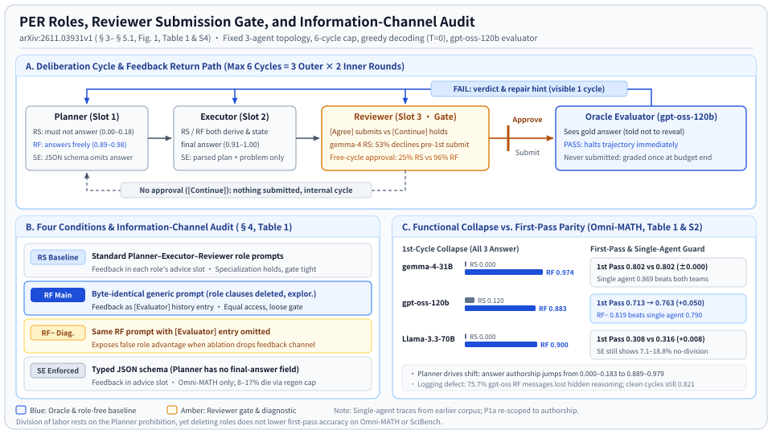View full diagram ↗</a><figcaption>Figure 1 · Controlled deliberation loop, four-arm information-channel audit, and first-pass parity (from arXiv:2611.03931v1 §3–§5.1, Fig. 1 &amp; Table 1): the Reviewer gate governs access to external hints, whereas removing roles collapses specialization without reducing initial accuracy.</figcaption></figure>

Every condition fixes the three-agent pipeline (`Planner → Executor → Reviewer`), a **6-cycle cap** (3 outer rounds of 2 inner cycles), greedy decoding (`temperature = 0`), identical `max_tokens` and retry limits, and a single pinned `vLLM` server. One actor model plays all three agents (`gemma-4-31B-it`, `gpt-oss-120b`, or `Llama-3.3-70B-Instruct`), evaluated across all cells by `gpt-oss-120b` with reference answers in view (stopping immediately on `PASS`, or returning `FAIL` plus a hint instructed not to reveal the gold answer). Never-submitted trajectories are graded once on their final held answer at budget exhaustion as their first pass. Free-response math (`Omni-MATH`) and college science (`SciBench`) were chosen over multiple-choice benchmarks to avoid `1/3` random-guess recovery inflation.

From this shared baseline, Section 4 contrasts four organizational arms plus two diagnostic controls, auditing every runtime template input:

1. **RS (Role-Structured baseline)**: Standard PER role prompts. A `must not` prohibition bars the Planner from computing or stating an answer; the Reviewer is instructed to `[Agree]` only on complete, well-formed solutions and to route back (`[Continue]`) rather than approve in any cycle receiving `FAIL`. Feedback enters each role prompt's `advice` slot for one cycle.
2. **RF (Role-Free with feedback — post-freeze exploratory main comparison)**: All three agents receive a byte-identical generic prompt stating only shared collaboration, problem, history, and slot index (`1–3`), with a footer requesting a `\boxed{}` answer and `[Agree]`/`[Continue]`. All role prohibitions are removed. `FAIL` verdicts and hints appear as a bare `[Evaluator]` history entry for one cycle, matching feedback access to `RS`.
3. **RF− (Role-Free, feedback withheld — pre-registered diagnostic)**: Identical to `RF` except the `[Evaluator]` entry is omitted, exposing what a naive role ablation measures when prompt rewriting silently deletes external verification.
4. **SE (Structurally Enforced — pre-registered intervention, Omni-MATH only)**: Typed JSON schemas enforce role separation at the interface—the Planner schema has no final-answer field, the Executor receives only the parsed plan and problem (hiding raw Planner text and shared history, with a partial 400-problem context-restored control for `gemma-4` and `gpt-oss`), and the Reviewer promotes the Executor's answer by reference. Malformed or out-of-bounds outputs consume regeneration retries and terminate the trajectory upon exhaustion.
5. **Direct gate & parity controls**: A **400-problem forced-submission run** on `gemma-4` keeps `RS` prompts byte-for-byte intact while submitting the team's answer in every cycle regardless of the Reviewer's tag; an earlier **single-agent corpus** matched by problem ID and call cap (Table S11) tests whether collapsed teams behave identically to one agent.

### 3. Empirical findings: collapse parity, verdict matching, the 400-problem intervention, and enforcement attrition

The pre-registered frozen snapshot comprises **`11,600` trajectories, `83,320` role messages, and `17,486` gradings** (`1,600` Omni-MATH problems each for `gemma-4` and `gpt-oss`, `400` for `Llama-3.3`, plus `574` SciBench problems). Post-freeze `RF` runs add `4,748` trajectories (including an independent second run of both `gemma-4` `RF` cells 13 hours apart, Table S3). Paired comparisons use problem-clustered bootstrap 95% confidence intervals and exact McNemar tests (with Holm step-down correction for `P3`/`P4`).

<figure class="note-figure"><a class="note-image-link" href="/assets/images/digest/2026-11-05/roles-recovery-intervention-en.svg" target="_blank" rel="noopener" aria-label="View original empirical results chart on recovery rates, budget spend, 400-problem forced submission, and enforcement attrition">View full diagram ↗</a><figcaption>Figure 2 · Empirical highlights (arXiv:2611.03931v1 §5.2–§5.4, Fig. 2, Fig. S4, Tables 2, S5, S6 &amp; S8): feedback exposure drives recovery across all five settings, while strict schema enforcement trades recovery gains for regeneration attrition.</figcaption></figure>

- **Roles enforce specialization, but removing them never lowers first-pass accuracy (§5.1, Table 1, Fig. S1, Table S11)**: Deleting role instructions causes first-cycle functional collapse (all three agents asserting final answers) to jump from `0.000` (`gemma-4`), `0.120` (`gpt-oss`), and `0.000` (`Llama-3.3`) under `RS` to **`0.974 / 0.883 / 0.900`** under `RF` (`0.976 / 0.846 / 0.872` under `RF−`; rubric judge `0.000` → `0.857–1.000`). Per-role breakdowns (Fig. S1) isolate this shift to the **Planner**, whose answer authorship jumps from `0.000 / 0.183 / 0.000` to `0.979 / 0.898 / 0.889`, accompanied by excess Planner–Executor number overlap rising from `+0.145–0.167` to `+0.432–0.449` (`gemma-4` & `Llama-3.3`). Yet solving redundantly causes zero first-pass loss: `gemma-4` ties at `0.802` vs `0.802` (`+0.0000`, 95% CI `[-0.0156, +0.0150]`), `Llama-3.3` stays flat (`0.308` vs `0.316`, `+0.0077`), and `gpt-oss` **improves `+0.0503`** (`0.763` vs `0.713`, `[+0.0339, +0.0666]`); `SciBench` replicates this parity. Single-agent benchmarks (Table S11) rule out trivial single-agent equivalence: collapsed `gpt-oss` `RF−` (`0.8194`) beats its single agent (`0.7900`, `p = 0.000678`), whereas `gemma-4`'s single agent (`0.8688`) beats both `RS` (`0.8462`) and `RF−` (`0.8125`).

| Actor, Benchmark (n) | Collapse RS / RF | Recovery RS / RF / RF− | Paired Both-Wrong (n: RS / RF only, p) | Verdict-Matched RS / RF (p) | Final Accuracy RS / RF (p) | Submissions RS / RF (RS Never) |
| :--- | :--- | :--- | :--- | :--- | :--- | :--- |
| gemma-4, Omni-MATH (1,600) | 0.000 / 0.974 | 0.222 / **0.609** / 0.051 | 236: 4 / **89** (p = 6.2×10⁻²²) | 0.165 / 0.153 (p = 0.69) | 0.846 / **0.921** (p = 1.7×10⁻²⁴) | 1.27 / 3.20 (84/316) |
| gpt-oss, Omni-MATH (1,600) | 0.120 / 0.883 | 0.324 / **0.552** / 0.247 | 319: 17 / **101** (p = 1.0×10⁻¹⁵) | 0.229 / 0.216 (p = 0.72) | 0.803 / **0.894** (p = 2.7×10⁻²⁸) | 2.10 / 3.53 (51/463) |
| Llama-3.3, Omni-MATH (400) | 0.000 / 0.900 | 0.014 / **0.147** / 0.015 | 250: 1 / **26** (p = 4.2×10⁻⁷) | 0.012 / 0.008 (p = 1.0) | 0.315 / **0.415** (p = 1.6×10⁻⁷) | 0.32 / 2.71 (205/276) |
| gemma-4, SciBench (574) | — | 0.254 / **0.419** / 0.051 | 100: 7 / **21** (p = 0.013) | 0.230 / 0.190 (p = 0.48) | 0.847 / **0.880** (p = 0.0054) | 1.95 / 3.62 (3/118) |
| gpt-oss, SciBench (574) | — | 0.315 / **0.483** / 0.231 | 93: 7 / **18** (p = 0.043) | 0.215 / 0.247 (p = 0.68) | 0.852 / **0.892** (p = 1.9×10⁻⁴) | 2.68 / 3.95 (1/124) |

*Table 1 · Main comparison across all five actor–benchmark cells (from arXiv:2611.03931v1 Table 1 & Table 2; RS vs. RF is post-freeze exploratory, RF− is the pre-registered feedback-withheld diagnostic, and p values come from paired exact McNemar tests).*

- **With equal feedback channels, `RF` wins all five cells—while `RF−` exposes false role credit (§5.2–§5.3, Tables S2–S4)**: Across every setting, `RF` recovers substantially more failed trajectories and yields higher final accuracy (`gemma-4` Omni-MATH `0.609` vs `0.222` recovery; `0.921` vs `0.846` final; independent `gemma-4` Run 2 reproduces `0.586` / `0.922` on Omni-MATH and `0.878` final on SciBench with paired recovery `p = 0.052`). Almost every recovery reflects a genuine answer change (`541/547` across `RF` cells differ from the rejected first answer; verbatim gold-answer leakage occurs in `≤ 2.3%` of `FAIL` hints, and excluding those traces leaves `gemma-4` Omni-MATH recovery at `0.599` vs `0.212`). Conversely, comparing `RS` only against `RF−`—where `gemma-4` submits `5.80` times blindly, repeats one distinct answer in `84.5%` of failed runs, and recovers `0.051`—creates the false impression that roles drive repair (`37` vs `3`, `p = 1.95×10⁻⁸`).
- **Reviewer restraint stems from critique disposition more than prompt rules (§5.3, Table S4)**: On `gemma-4` Omni-MATH failed runs, `RS` spends `4.25` cycles declining internally against `1.27` submissions (`84/316` never submit at all); on `Llama-3.3`, **`205/276` (`74.3%`)** never submit. Remarkably, `53%` of `gemma-4` `RS` declines happen **before the very first submission** (before any `FAIL` exists), and the prompt clause banning approval right after a `FAIL` accounts for only `4%–37%` of declines on Omni-MATH (`19%` for `gemma-4`). Even in unconstrained free cycles, the `RS` Reviewer approves only `25%` (`gemma-4`), `53%` (`gpt-oss`), and `1%` (`Llama-3.3`) of the time versus `96% / 68% / 82%` for `RF`'s third agent. On `SciBench`, `RS` submits almost always (`≤ 3` non-submissions), narrowing the gap.
- **Verdict matching, 400-problem forced submission, and brittle enforcement (§5.3–§5.4, Tables S5–S9)**: First, truncating `RF` trajectories post hoc to match `RS` verdict counts (`n = 998` paired) shrinks the pooled recovery delta (`RS − RF`) to **`+0.009`** (95% CI `[-0.014, +0.033]`), leaving all five cells non-significant (same under `≥ 2` verdict subsets or symmetric cuts, though see §7 recoding sensitivity below). Second, in the 400-problem `gemma-4` intervention, bypassing only the submission gate while keeping `RS` prompts byte-identical lifts recovery from `0.198` (`18/91`) to **`0.613`** (`57/93`, `p = 3.0×10⁻⁶`) and final accuracy from `0.818` to **`0.910`**, matching `RF` (`7` vs `7`, `p = 1`). Third, structural enforcement (`SE`) successfully zeroes Planner answer authorship (`0.000`) and loosens the gate (`Llama-3.3` recovery jumps ~10× from `0.014` to `0.139`), yet `7.1%–18.8%` of first cycles still show no functional division (Planner still computes without an answer field), and schema regeneration exhaustion kills **`8.0%`**, **`9.9%`**, and **`17.0%`** of trajectories. Counting unfinished runs as incorrect per pre-registration yields zero or negative final-accuracy change (`-0.0225` on `gemma-4`), proving that positive "as-graded" deltas (`+0.0190` to `+0.0453`) are survivorship bias.

| Intervention / Condition (Scope) | 1st Pass / Attrition | Verdicts or Approvals | Post-Failure Recovery | Final Accuracy or SE − RS [95% CI] | Paired Test / Key Finding |
| :--- | :--- | :--- | :--- | :--- | :--- |
| RS frozen subset (gemma-4, 400 Omni-MATH) | 1st pass 0.795 | 1.41 verdicts (1.15 appr.) | 0.146 (12/82) | 0.825 | Frozen baseline slice |
| RS post-freeze re-run (gemma-4, same 400) | 1st pass 0.773 | 1.44 verdicts (1.13 appr.) | 0.198 (18/91) | 0.818 | No significant temporal drift (p = 0.75) |
| RS + Forced Submission (gemma-4, same 400) | 1st pass 0.768 | 4.20 verdicts (0.98 appr.) | **0.613** (57/93) | **0.910** (vs re-run p = 2.5×10⁻⁸) | Paired recovery 26/2 (p = 3.0×10⁻⁶); vs RF 7/7 (p = 1) |
| RF with feedback (gemma-4, same 400) | 1st pass 0.795 | 3.34 verdicts (3.34 appr.) | 0.549 (45/82) | 0.908 | Indistinguishable from forced submission |
| SE enforced (gemma-4, 1,600 Omni-MATH) | 8.0% attrition | 2.02 appr. (vs RS 1.27) | 0.314 (vs RS 0.222) | Pre-reg **-0.0225** [-0.0387, -0.0063] | As-graded +0.0190 (survivorship bias) |
| SE enforced (gpt-oss, 1,600 Omni-MATH) | 9.9% attrition | 2.33 appr. (vs RS 2.10) | 0.395 (vs RS 0.324) | Pre-reg -0.0050 [-0.0219, +0.0112] | As-graded +0.0361 (survivorship bias) |
| SE enforced (Llama-3.3, 400 Omni-MATH) | 17.0% attrition | 1.84 appr. (vs RS 0.32) | **0.139** (vs RS 0.014) | Pre-reg +0.0175 [-0.0200, +0.0550] | Recovery ~10× (p = 3.8×10⁻⁶); as-graded +0.0453 |

*Table 2 · Direct 400-problem forced-submission intervention (arXiv:2611.03931v1 Table S6) and Omni-MATH structural enforcement SE (Table S8), contrasting pre-registered scoring (unfinished = wrong) against survivorship-biased as-graded scoring.*

### 4. Scientific boundaries, disclosures, and engineering takeaways

Applying these findings to production agent harnesses requires honoring the study's exact experimental boundaries and disclosed limitations:

1. **Oracle-gated recovery assumption**: Every reported recovery relies on a reference-aware evaluator returning reliable `PASS`/`FAIL` verdicts plus repair hints and halting immediately on `PASS`—mechanically rewarding teams that query the oracle most often while masking hypothetical regressions after a correct pass. In deployments where external checks are expensive, noisy, or unavailable (intrinsic self-correction), an internal conservative Reviewer may still serve an essential cost-control role; the paper maps one side of that trade-off rather than opposing specialization universally.
2. **Pre-registration status & disclosed defects (§4.1, §5.1, §7)**: (1) Primary pre-registered endpoint `P4` (actor × enforcement interaction) is null after Holm correction (`p = 0.166–0.29`), yet only `gpt-oss` vs `gemma-4` (`MDE80% = 0.0325`) is an informative null whereas `Llama-3.3` contrasts lack statistical power; `P1a` (computation abstention) failed as specified and was re-scoped to answer authorship. (2) Both `RS vs RF` and the 400-problem forced-submission run are **post-freeze exploratory additions** (the latter tested once on one model/domain, removing the entire gate rather than only the post-`FAIL` clause), and feedback presentation differs structurally (`advice` slot vs bare `[Evaluator]` history). (3) Two instrumentation defects are openly documented: `75.7%` of `gpt-oss` `RF` messages lost hidden reasoning traces in logs (though clean first cycles still collapse at `0.821`), and a **runner scoring discrepancy** graded the last *submitted* answer while logging the last *held* answer (`17%` mismatch on `gemma-4` Omni-MATH `RS` failed runs). Recoding those shifts the pooled verdict-matched difference from `+0.009` to **`+0.029` (`[+0.004, +0.054]`)** favoring `RS` (non-significant `+0.026` on `≥ 2`-verdict runs). Furthermore, `gpt-oss-120b` served as both an actor and the universal evaluator.
3. **Actionable engineering rules**: (1) **Audit information channels alongside token/call budgets** whenever ablating prompts so deleted role instructions do not silently drop verifier or tool feedback; (2) **Decouple submission policy from specialization**—when reliable unit tests, compilers, or verifiers exist, do not let an over-skeptical Reviewer throttle external feedback cycles; (3) **Report phase-conditioned recovery and attrition explicitly**—count schema/retry exhaustion against total accuracy rather than trimming unfinished trajectories into survivorship bias.

Source: Synthesized from `arXiv:2611.03931v1` main paper and supplementary material, the primary arXiv record, and author-linked project artifacts; no independent model reruns were executed.
<h2 class="daily-paper-title" id="paper-arxiv-2611.05139">18 · Meta²: precomputing reusable knowledge for task-local online harness evolution</h2>

[Meta²: Precomputing Reusable Knowledge for Online Harness Evolution in Long-Horizon Agents](https://arxiv.org/abs/2611.05139) ([v1 PDF](https://arxiv.org/pdf/2611.05139) · [v1 HTML](https://arxiv.org/html/2611.05139v1))  
Lingzhi Yuan\*, Yiguang Cai\*, Weize Liu, Siqi Yang, Feijiang Han, Yongkyun Lee, Udari Madhushani Sehwag, Furong Huang (University of Maryland; University of Washington; University of Illinois at Urbana-Champaign; Scale AI; All Purpose AI; \*equal contribution) · <code>arXiv:2611.05139v1 [cs.AI]</code> · Submitted 2026-11-03 (<code>v1</code> preprint only at frozen verification time, with no revision or withdrawal notice; PDF cites project URL <code>https://meta-square.github.io/</code>, with no indexed active code repository found in search)

Long-horizon agents depend not only on frozen foundation-model weights but also on a surrounding **harness** of prompts, context policies, tools, skills, memory, and hooks. Automated harness optimization routinely runs into a bind: offline methods optimize a single shared harness from completed training trajectories and deploy it statically, risking training-task overfitting while staying blind to issues exposed mid-run; online evolution adapts around or during execution, yet often relies on held-out verifier signals unavailable at test time, improvises every checkpoint intervention from scratch, or leaks task-specific patches into unrelated future tasks. <code>Meta²</code> moves offline optimization "one level up." Instead of freezing one shared harness, it learns a reusable textual **Meta-Skill** <code>ℳ</code> offline by contrasting training rollouts of the same task agent under three conditions (no evolver, current Meta-Skill evolver, and training-only privileged verifier evolver). At test time, <code>ℳ</code> is frozen, every run resets to the shared seed harness <code>h(0)</code>, and an online evolver applies reset-free, task-local edits that are discarded when the run ends. All claims, figures, and boundaries below trace strictly to <code>arXiv:2611.05139v1</code> and Appendices A–I.

### 1. Core bottleneck: why offline shared harnesses and unguided online edits stall

In §2 and Appendix G (Tables 6–7), the authors formalize a task instance as <code>ξ = (x, E_x, V_x) ~ D</code>—comprising public instruction <code>x</code>, interactive environment <code>E_x</code>, and verifier <code>V_x</code>—where an agent samples <code>a_t ~ π_θ(· ; x, τ_≤t, h_t)</code> and receives terminal score <code>y = V_x(s_T)</code>. Categorizing harness evolution by edit selection timing, observable evidence, and affected runs clarifies where existing methods stall:

- **Offline pre-deployment optimization**: Methods such as <code>Meta-Harness</code>, <code>AHE</code>, <code>TF-GRPO</code>, and <code>GEPA</code> optimize over training split <code>S_tr</code> and freeze one shared harness <code>h*</code>. Once deployed on an unseen task, <code>h*</code> cannot react to newly discovered tool gaps, hidden constraints surfaced in artifacts, or inconsistent intermediate checks, while training-driven edits risk overgeneralization.
- **Pre-run and after-run online evolution**: Pre-run customization (<code>JIT-Agent</code>) selects edits at <code>t = 0</code> from the prompt alone before execution evidence exists. After-run evolution updates memory or harnesses only after an episode completes—too late to rescue the failing run, often dependent on test-time outcome signals (<code>Harness-R1</code>), or prone to cross-task contamination when task-stream updates persist (<code>ACE</code>, <code>Continual Harness</code>).
- **Unguided within-run evolution**: Systems including <code>Continual Harness</code>, <code>PILOT</code>, and <code>Live-SWE-agent</code> modify prompts, tools, or memory inside an uninterrupted episode, yet either require test-time verifiers (<code>PILOT</code>) or decide every intervention from scratch without distilled guidance—risking premature redirections, wasted message quotas, and elevated online reasoning costs.

<code>Meta²</code> therefore targets a focused design question: **how can verified training experience (including privileged verifier access) supply reusable evolution guidance for selective within-run edits without leaking held-out verifiers or carrying task-specific edits across runs?**

### 2. Mechanism: offline 3-arm contrastive Meta-Skill learning and reset-free online evolution

<figure class="note-figure"><a class="note-image-link" href="/assets/images/digest/2026-11-05/meta2-contrastive-harness-evolution-en.svg" target="_blank" rel="noopener" aria-label="View full diagram of Meta² offline 3-arm Meta-Skill distillation and online task-local evolution">View full diagram ↗</a><figcaption>Figure 1 · Meta² architecture (from arXiv:2611.05139v1 §3, Fig. 2, Appendices B &amp; H): offline distillation turns training contrasts into de-lexicalized Meta-Skill ℳ, while online evolution isolates realized harness edits to a single run.</figcaption></figure>

At runtime, the **same frozen backbone LLM** instantiates two isolated roles: a **Task Agent (worker)** acting in the sandbox and an **Evolver (supervisor)** intervening at checkpoints. The worker never sees the supervisor’s conversation or plain-text `reasoning` logs, perceiving only updates delivered through bounded channels:

1. **Offline component (A/B/C rollouts and contrastive batch distillation, §3.2, Algorithm 1, Appendices H.2–H.5)**
   - **Three-condition sampling per training task**: Holding the backbone model and <code>NexAU</code> seed <code>h(0)</code> fixed, each training task <code>ξ</code> collects rollouts under three arms: **Arm A** (task agent alone, unsegmented, simpler prompt without check/probe middleware, collected once and reused); **Arm B** (evolver guided by current <code>ℳ(r-1)</code> with checkpoint tools and channels, no verifier access, resampled per batch <code>r</code>); and **Arm C** (evolver given privileged training-time acceptance criteria and verifier source at checkpoint 1, collected once and reused).
   - **Anti-leakage enforcement on Arm C**: Arm C’s system prompt forbids relaying hidden acceptance values or verifier contents to the worker, and post-execution leakage audits exclude violating C rollouts before pairing. In addition, <code>REFLECT</code> must emit <code>no_supervisor_effect</code> whenever C’s advantage depended on knowing a hidden verifier threshold rather than evidence derivable from <code>statement / worker_output / workspace_state / supervisor_read</code>.
   - **Five outcome-conditioned contrast directions (BUILDCONTRASTS)**: Pairing terminal pass/fail outcomes creates directional—non-causal—signals across runs: <code>effective</code> (A-fail → B-pass) and <code>informed</code> (B-fail → C-pass, supplying recoveries when both A and B fail on hard tasks) support <code>act</code>; <code>harmful</code> (A-pass → B-fail) and <code>overreach</code> (B-pass → C-fail) support <code>avoid</code>; and <code>unnecessary</code> (A-pass + B-pass with edits, paired with mechanical lists of self-recovered non-zero exits in A and ignored edits in B) supports <code>hold</code>.
   - **Three-stage LLM pipeline (Eq. 4)**: Each training batch updates <code>ℳ(r) = f_upd(ℳ(r-1), f_agg(f_ref(G(r), V(r))))</code>. First, <code>REFLECT</code> calls <code>read_run</code> / <code>search_run</code> to inspect raw turns, writes schema-constrained candidates, and rates cited rules with <code>entry_credit</code> (<code>helped / misled / ignored_when_relevant / irrelevant</code>). Second, <code>AGGREGATE</code> groups entries inside each `(type, time_point)` cell by observable trigger, enforces a hard **at least two distinct training tasks** (<code>≥ 2</code>) support threshold (dropping singletons), strips task names, file paths, commands, packages, numbers, and domain nouns into at most 3 reference examples, and retains conflicting `act` vs. `hold`/`avoid` candidates together to sharpen decision boundaries. Third, <code>UPDATE</code> applies <code>ADD / MERGE / REFINE / DELETE / NONE</code> (permitting deletion only after an entry is judged <code>misled</code> in <code>≥ 2</code> batch runs with no workable qualifier), followed by training-only misfire, provenance, and leakage audits before freezing <code>ℳ</code>.
   - **Learned Meta-Skill size (Appendix I.2)**: Each entry records <code>ID/title</code>, <code>Type (act/hold/avoid)</code>, <code>Time point (start/during/end)</code>, <code>When to refer</code>, <code>Guidance</code>, <code>Why</code>, and <code>Reference examples</code>. Terminal-Bench 2.1 produces **14 entries** (9 <code>act</code>, 2 <code>hold</code>, 3 <code>avoid</code>); DeepSWE 1.1 produces **9 entries** (7 <code>act</code>, 2 <code>hold</code>, 0 <code>avoid</code>).
2. **Online component (frozen ℳ, evidence accumulation, and 8 bounded channels, §3.1, §3.3, Algorithm 2, Appendix H.1)**
   - **Per-task reset & zero verifier access**: Every held-out task begins inside an E2B cloud sandbox from the shared seed <code>h(0)</code> with frozen <code>ℳ</code> (<code>start</code> entries delivered at checkpoint 1; <code>during</code>/<code>end</code> entries embedded in the system prompt). Held-out verifier source and outcomes are completely hidden from both roles.
   - **Checkpoint cadence & information state <code>I(k)</code> (Eq. 2)**: The first checkpoint fires immediately after **step 1** (before an unconstrained first command destroys recoverable evidence or narrows scope), regular checkpoints fire **every 5 steps** (<code>L = 5</code>), and a **terminal checkpoint** fires when the worker stops invoking tools to submit. Within one run, the evolver keeps a continuous chat and appends trace deltas <code>Δτ(k)</code> (reasoning summaries and command returns capped at 1,500 chars, with untruncated logs readable on disk), read-only observations <code>ω(k)</code> (restricted to <code>/app</code>, <code>/nexau-workspace</code>, <code>/tmp/nexau_bash_tool_results/&lt;id&gt;/</code>, and trial logs), prior-edit status <code>σ(k-1)</code> (loaded, retained, or rolled back), plus runner-computed **Repeated procedures** (`≥ 3` near-identical commands) and **channel budgets**. At the terminal stop, the runner appends referenced paths, created/modified files, newly listening TCP ports, and live background processes (DeepSWE submits committed Git diffs to a separate evaluation container and discards uncommitted edits).
   - **Binary decision & 8 bounded channels (Eq. 3 & Appendix H.1)**: The evolver selects <code>u(k) ∈ {KEEP, EVOLVE(δ(k))}</code> and records cited Meta-Skill IDs inside its private `complete_task` JSON `reasoning` field. Edits flow strictly through eight bounded channels: <code>notice</code> (one-turn advisory read once, capped at **1 per checkpoint** and **2 while working**; terminal send-backs draw on a separate `notice` budget capped at **2 send-backs**), <code>append/rewrite_worker_prompt</code> (persistent standing instructions), <code>register_check</code> (Python stdlib read-only check appended to every command output), <code>register_probe</code> (bash probe executed in the worker environment), <code>add_tool</code>, <code>add_skill</code>, <code>add_middleware</code>, and <code>rollback</code>. Any edit whose rebuilt harness fails to load automatically rolls back and immediately re-prompts the evolver. Both mid-run edits and terminal send-backs **preserve the active sandbox state and partial trajectory** <code>τ_≤t_k</code> **without reset**; when the run terminates, all <code>δ(k)</code> and checkpoint logs are discarded so the next task starts clean from <code>h(0)</code>.

### 3. Empirical evaluation: dual benchmarks, backbone robustness, checkpoint tradeoff, and ablations

<figure class="note-figure"><a class="note-image-link" href="/assets/images/digest/2026-11-05/meta2-benchmark-ablation-en.svg" target="_blank" rel="noopener" aria-label="View full diagram of Meta² benchmarks, ablations, checkpoint interval tradeoff, and cost breakdown">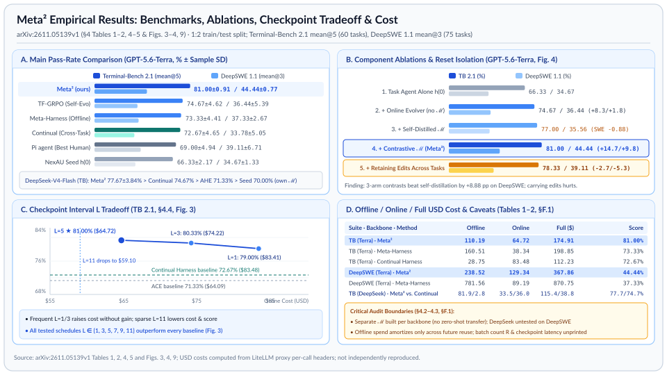View full diagram ↗</a><figcaption>Figure 2 · Quantitative evaluation (arXiv:2611.05139v1 Tables 1–2, 4–5 &amp; Figs. 3–4, 9): Meta² ranks first on both suites with lower run-to-run variance, backed by ablations of contrastive learning and task-local isolation.</figcaption></figure>

Experiments span two long-horizon benchmarks partitioned roughly **1:2** into fixed train/test splits (Table 4): **Terminal-Bench 2.1** (89 containerized CLI tasks covering SWE, sysadmin, data processing, training, security, and scientific computing; **29 train / 60 test**, evaluated as `mean@5` = 300 runs/method) and **DeepSWE 1.1** (113 tasks across 91 open-source TypeScript, Go, Python, JavaScript, and Rust repos; **38 train / 75 test**, evaluated as `mean@3` = 225 runs/method). All self-evolution and harness-evolution baselines start from the shared <code>NexAU</code> seed, and all LLM calls route through one LiteLLM proxy billed via per-call response headers (USD). Primary experiments run on <code>GPT-5.6-Terra</code> (medium reasoning), supplemented by <code>DeepSeek-V4-Flash-0731</code> (high reasoning) on Terminal-Bench 2.1.

| Method Family &amp; Name | TB 2.1 Score (% ± SD) | TB Delta vs. Seed (pp) | TB Off / On / Full Cost (USD) | DeepSWE 1.1 Score (% ± SD) | SWE Delta vs. Seed (pp) | SWE Off / On / Full Cost (USD) |
| :--- | :--- | :--- | :--- | :--- | :--- | :--- |
| **NexAU Seed (shared h(0))** | 66.33 ± 2.17 | Baseline | – / 34.09 / 34.09 | 34.67 ± 1.33 | Baseline | – / 62.67 / 62.67 |
| Codex CLI (human) | 68.33 ± 5.14 | +2.00 | – / 56.59 / 56.59 | 31.11 ± 3.08 | -3.56 | – / 136.53 / 136.53 |
| mini-swe-agent (human) | 67.33 ± 4.18 | +1.00 | – / 41.08 / 41.08 | 29.33 ± 3.53 | -5.34 | – / 68.87 / 68.87 |
| Pi agent (human) | 69.00 ± 4.94 | +2.67 | – / 37.98 / 37.98 | 39.11 ± 6.71 | +4.44 | – / 82.50 / 82.50 |
| DeepSeek Harness (human) | 68.00 ± 3.42 | +1.67 | – / 31.90 / 31.90 | 34.22 ± 4.68 | -0.45 | – / 41.37 / 41.37 |
| ReasoningBank (self-evo) | 68.00 ± 3.61 | +1.67 | 16.04 / 55.60 / 71.64 | 33.33 ± 2.31 | -1.34 | 55.87 / 85.64 / 141.51 |
| ACE (self-evo) | 71.33 ± 2.74 | +5.00 | 81.55 / 64.09 / 145.64 | 32.00 ± 4.62 | -2.67 | 238.10 / 82.29 / 320.39 |
| TF-GRPO (self-evo) | 74.67 ± 4.62 | +8.34 | 92.55 / 42.62 / 135.17 | 36.44 ± 5.39 | +1.77 | 322.50 / 86.16 / 408.66 |
| AHE (offline harness evo) | 70.67 ± 4.65 | +4.34 | 209.44 / 38.91 / 248.35 | 34.67 ± 4.62 | 0.00 | 793.48 / 69.41 / 862.89 |
| Meta-Harness (offline evo) | 73.33 ± 4.41 | +7.00 | 160.51 / 38.34 / 198.85 | 37.33 ± 2.67 | +2.66 | 781.56 / 89.19 / 870.75 |
| Continual Harness (cross-task) | 72.67 ± 4.65 | +6.34 | 28.75 / 83.48 / 112.23 | 33.78 ± 5.05 | -0.89 | 46.11 / 155.61 / 201.72 |
| **Meta² (ours, frozen ℳ)** | **81.00 ± 0.91** | **+14.67** | 110.19 / 64.72 / 174.91 | **44.44 ± 0.77** | **+9.77** | 238.52 / 129.34 / 367.86 |

*Table 1 · Primary benchmark scores and offline/online/full USD spend with GPT-5.6-Terra (medium reasoning) on Terminal-Bench 2.1 (mean@5) and DeepSWE 1.1 (mean@3) (synthesized from arXiv:2611.05139v1 Table 1 &amp; Appendix E.1 Table 5).*

- **Primary gains & stability (RQ1)**: With <code>GPT-5.6-Terra</code>, <code>Meta²</code> leads all 11 baselines on both benchmarks: **81.00 ± 0.91%** on Terminal-Bench 2.1 (**+14.67 pp** over <code>NexAU</code> seed, **+6.33 pp** over strongest baseline <code>TF-GRPO</code>) and **44.44 ± 0.77%** on DeepSWE 1.1 (**+9.77 pp** over seed, **+5.33 pp** over strongest human harness <code>Pi agent</code>, and **+7.11 pp** over <code>Meta-Harness</code>). Table 5 further shows markedly lower run-to-run standard deviation (**0.91 pp** on TB and **0.77 pp** on DeepSWE vs. 2.17–6.71 pp across baselines). On DeepSWE, <code>ReasoningBank</code> (-1.34), <code>ACE</code> (-2.67), and <code>Continual Harness</code> (-0.89) all drop below the seed, whereas privileged-verifier Arm C equips <code>Meta²</code> to learn rescue guidance on hard tasks.
- **Backbone robustness & amortization economics (RQ1–RQ2, Table 2 & Table 5)**: On Terminal-Bench 2.1 with <code>DeepSeek-V4-Flash-0731</code> (high reasoning), <code>Meta²</code> again places first at **77.67 ± 3.84%** (+7.67 pp over seed `70.00 ± 2.64%`), outperforming <code>Continual Harness</code> (`74.67 ± 4.62%`), <code>AHE</code> (`71.33 ± 3.98%`), and <code>Meta-Harness</code> (`71.00 ± 2.53%`), while all three self-evolution methods trail the seed (`ReasoningBank 69.33%`, `TF-GRPO 66.33%`, `ACE 65.00%`). Cost splits highlight an important operational boundary: versus offline optimizers (`AHE`, `Meta-Harness`), <code>Meta²</code> achieves both higher accuracy and lower full cost on <code>GPT-5.6-Terra</code> (forming the upper-right Pareto frontier in Fig. 9). Relative to online <code>Continual Harness</code>, however, <code>Meta²</code> carries substantially higher **one-time offline construction spend** (`$110.19` vs. `$28.75` on TB Terra; `$238.52` vs. `$46.11` on SWE Terra; `$81.90` vs. `$2.84` on TB DeepSeek) in exchange for lower **online execution spend** (`$64.72` vs. `$83.48`; `$129.34` vs. `$155.61`; `$33.51` vs. `$35.98`). Consequently, over a single 300-run DeepSeek evaluation, <code>Meta²</code>’s full bill (`$115.41`) remains above <code>Continual Harness</code> (`$38.82`)—offline precomputation pays back strictly as reuse scales across further deployments.
- **Checkpoint-frequency tradeoff (RQ3, Fig. 3)**: Sweeping fixed interval <code>L ∈ {1, 3, 5, 7, 9, 11}</code> on Terminal-Bench 2.1 peaks at <code>L = 5</code> (**81.00%** at `$64.72` online). More frequent checkpoints raise cost and slightly lower accuracy (<code>L = 3</code>: `80.33%` at `$74.22`; <code>L = 1</code>: `79.00%` at `$83.41`), whereas <code>L = 11</code> cuts online cost to `$59.10` at the expense of delayed correction. Across all six schedules, <code>Meta²</code> still exceeds every baseline including <code>Continual Harness</code> (`72.67%`) and <code>ACE</code> (`71.33%`).

| Ablation Variant (GPT-5.6-Terra, Fig. 4) | TB 2.1 (%) | TB Stepwise Delta | DeepSWE 1.1 (%) | SWE Stepwise Delta | Mechanistic Interpretation |
| :--- | :--- | :--- | :--- | :--- | :--- |
| 1. Task Agent Alone (seed h(0)) | 66.33 | Baseline | 34.67 | Baseline | Static harness with zero within-run adaptation |
| 2. + Online Evolver (no Meta-Skill) | 74.67 | +8.34 pp | 36.44 | +1.77 pp | Checkpoint observability + bounded channels add baseline recovery |
| 3. + Self-Distilled Meta-Skill | 77.00 | +2.33 pp | 35.56 | **-0.88 pp** | Without contrasts or Arm C, hard SWE tasks gain nothing / regress |
| **4. + Contrastive Meta-Skill (Meta², reset h(0))** | **81.00** | **+4.00 pp** | **44.44** | **+8.88 pp** | **A/B/C contrastive distillation drives the hard-task jump** |
| 5. + Retaining Online Edits Across Tasks | 78.33 | -2.67 pp (vs. Meta²) | 39.11 | -5.33 pp (vs. Meta²) | Carrying task-specific patches across tasks degrades later runs |

*Table 2 · Component contributions and task-local reset ablation with GPT-5.6-Terra (from arXiv:2611.05139v1 §4.5 &amp; Fig. 4).*

- **Paired case studies (Appendix D Figs. 5–8)**: Four paired comparisons illustrate each guidance type—(1) early/mid-run <code>act</code>: in <code>configure-git-webserver</code> (Fig. 5), <code>E-02</code> pins an end-to-end <code>clone/commit/push/curl :8080</code> requirement at turn 1 instead of allowing a temp-sandbox test; in DeepSWE <code>obsidian-linter-link-format-conversion</code> (Fig. 6), <code>E-02</code> catches an unverified image-conversion branch at <code>t3</code>, raising hidden tests from 58/60 to 60/60; (2) <code>avoid</code> restraint: in <code>winning-avg-corewars</code> (Fig. 7), <code>E-06</code> blocks premature redirection away from an improving <code>rave.red</code> search that otherwise ends at a 74/75 failure; (3) <code>hold</code> quota preservation: in <code>path-tracing-reverse</code> (Fig. 8), <code>E-04</code> withholds a notice across an isolated missing-tool failure at <code>t1</code>, leaving the two working `notice` slots intact for reference-preservation and output-mismatch checks at <code>t4–t5</code> (authors explicitly caution that this trace illustrates intervention timing rather than proving withholding the early notice alone caused success).

### 4. Scientific boundaries, undisclosed setup details, and engineering takeaways

Adopting this pattern in production agent harnesses requires distinguishing validated findings from methodological and disclosure boundaries:

1. **Run-level contrasts are directional, not checkpoint counterfactuals (§3.2, §F.1)**: Arms A, B, and C are independently sampled rollouts that often diverge prior to any intervention; outcome differences therefore cannot establish causal effects for individual checkpoint decisions without controlled branching from shared mid-run states.
2. **Scaffolding and cross-backbone asymmetries (§4.2, Appendix H.3)**: Appendix H.3 notes that Arm A executes unsegmented with a single-tool prompt (“your only tool”) and without check/probe middleware, whereas Arms B and C run segmented with middleware. Relying on `REFLECT` prompts to discount these differences lacks an explicit segmented-without-evolver baseline. Similarly, <code>DeepSeek-V4-Flash-0731</code> trains a **separate per-backbone Meta-Skill** (evaluating pipeline robustness rather than zero-shot transfer of <code>GPT-5.6-Terra</code>’s <code>ℳ</code>) and excludes DeepSWE 1.1 and human harnesses.
3. **Omitted training parameters, latency, and repository verification (§4.3, Appendix B.1, §F.1)**: The manuscript omits offline batch count <code>R</code>, batch size, per-arm training rollout repetitions, and wall-clock latency added by checkpoint calls. Additionally, the PDF-cited project page <code>https://meta-square.github.io/</code> showed no indexed active codebase in search, so reimplementation currently rests on Appendix H prompt contracts.
4. **Domain, verifier, and privilege scope (§F.1–F.2)**: Benchmarks focus on CLI and repository tasks with inspectable workspace artifacts and deterministic pass/fail verifiers; transfer to open-ended research, GUI/embodied control, or non-verifiable rubrics remains untested. In deployment, §F.2 recommends pairing read-only observation paths and bounded edit scopes with mandatory human approval before any edit expands tool permissions or authorizes external actions.
5. **Transferable engineering takeaways**—(1) **Separate reusable meta-knowledge from task-local patches**: resetting <code>h(0)</code> between tasks prevents `-2.67/-5.33 pp` cross-task interference while retaining guidance reuse; (2) **Use privileged training-only counterfactuals on hard tasks**: where self-distillation slips (`-0.88 pp` on DeepSWE), audited verifier-informed rollouts uncover rescue cues expressible in public observations; (3) **Make abstention (`hold`) and restraint (`avoid`) first-class options**: under tight runtime budgets (`2` active notices / `2` send-backs), withholding noisy interrupts protects high-leverage corrections later in the trajectory.

Source: Synthesized directly from [arXiv:2611.05139v1](https://arxiv.org/abs/2611.05139) and Appendices A–I; author-reported benchmarks and LiteLLM proxy costs were not independently reproduced.
<h2 class="daily-paper-title" id="paper-arxiv-2611.04142">19 · Interpretable Early Termination of Web Navigation Agents via Closed Sequential Pattern Mining</h2>

[Interpretable Early Termination of Web Navigation Agents via Closed Sequential Pattern Mining](https://arxiv.org/abs/2611.04142) 
Sergio Talavera, Magdalini Eirinaki

This work makes early-stop evidence inspectable through sequential patterns. Offline, actions, selectors, observations and reasoning intent are symbolized; BIDE+ mines closed patterns from K-step training prefixes and filters them by failure precision. Online ordered-subsequence matches produce a coverage score and return patterns, positions and manually assigned categories when a threshold triggers. Repeated clicks alone do not mandate termination.

Evaluation uses 1,544 traces from three 3–7B open-weight models on ten MiniWoB++ tasks, separating zero-step errors, timeouts and natural failures. The recommended setting retains timeouts but excludes errors on a natural-prevalence test set. At K=5 and threshold 0.15 it terminates 50 traces: 46 failures and four would-be successes, saving 26.3% of tokens with a 3.2% successful-trace kill rate. The abstract's 88% means at least one pattern matches a failure within three steps, not operational recall at this threshold; that recall is 38%.

Bi-LSTM can outperform patterns with longer prefixes, results vary substantially by model, and WebArena transfer is limited. Estimates use one fixed split without multi-seed significance analysis. Interpretability is structural, without a user study establishing effective repair advice. The method fits short-prefix, auditable stopping, but savings must be considered alongside terminating recoverable runs.

<h2 class="daily-paper-title" id="paper-arxiv-2611.04447">20 · Formalizing PTX in Lean to Prove GPU Kernel Correctness</h2>

[Formalizing PTX in Lean to Prove GPU Kernel Correctness](https://arxiv.org/abs/2611.04447) 
Luk Koska, Tom Koska, Ben Koska

Modern GPU synchronization includes asynchronous copies, tensor-core operations and memory proxies, not just barriers. This work models PTX executions in Lean: each thread follows deterministic small-step semantics given an oracle for external values, then memory-consistency and synchronization constraints select admissible executions. Data-dependent branches need not be reduced to a fixed control-flow path beforehand.

For asynchronous WGMMA, oracle results become constrained to the matrix operation only when the required synchronization holds. The model does not silently repair missing synchronization. Sequential kernel composition uses one completed kernel's output memory as the next kernel's initial state, supporting a three-stage MoE pipeline as well as isolated operators.

The demonstrations use simplified handwritten PTX: pipelined TMA/WGMMA matmul, scalar FlashAttention, two-expert top-1 MoE and an atomic-ticket megakernel. Their 454 instructions require 34,034 proof lines plus shared lemmas, not automated verification of an existing optimized library. Each variant has both a universal result for consistent completed executions and a constructive execution witness to avoid vacuous correctness.

Crucially, floats are modeled as exact reals, so the proofs do not establish rounding, quantization or training stability. These are partial-correctness results without termination guarantees. Applying them to hardware assumes ISA-level freedom from undefined behavior and correct ptxas/hardware implementations; the former is not proved. Coverage is 81 instruction forms, without concurrent kernels, concurrent host writes or multi-GPU communication. The contribution makes synchronization and data-dependent reasoning checkable while exposing proof effort and the trusted assumptions.

## Technical notes from this day

- <a href="/tech/en/2026-11-05-together-polymorphic-inference/">Polymorphic Inference: self-tuning inference for open models</a>
- <a href="/tech/en/skydiscover-jitengine/">JITEngine: different optimizations for the same model on different Macs</a>
- <a href="/tech/en/2026-11-05-vllm-bangkok-serving-agentic-workload/">Serving the agentic workload: Simon Mo on what AI agents change in vLLM</a>
- <a href="/tech/en/nvidia-ai-agents-ai-factory-operations/">NVIDIA cluster agents: cross-layer investigation with read-only access</a>
- <a href="/tech/en/nvidia-nemo-agent-failures-to-tests/">NeMo: turning trace evidence into testable harness repairs</a>
- <a href="/tech/en/google-cost-per-task-routing/">Model routing: establish a genuinely cheaper execution path</a>
