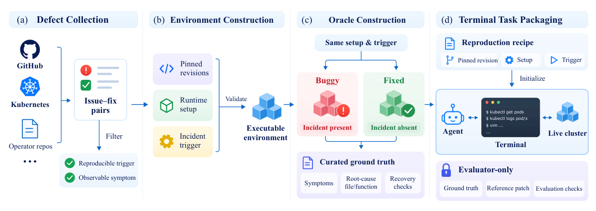
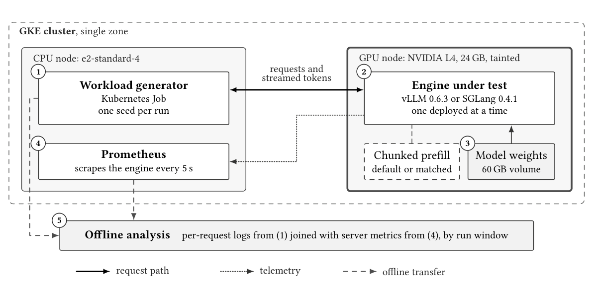
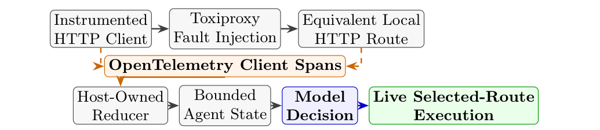
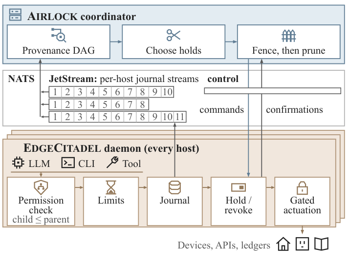
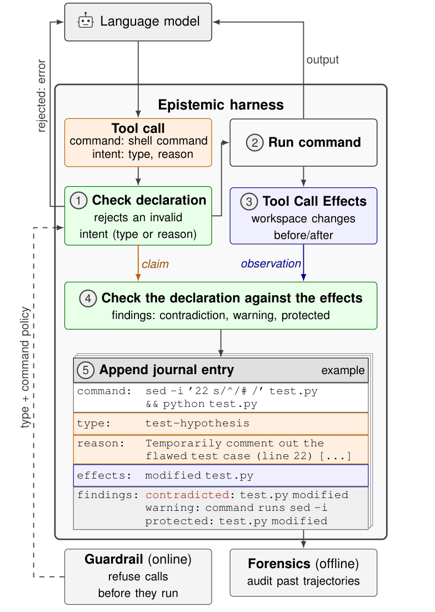
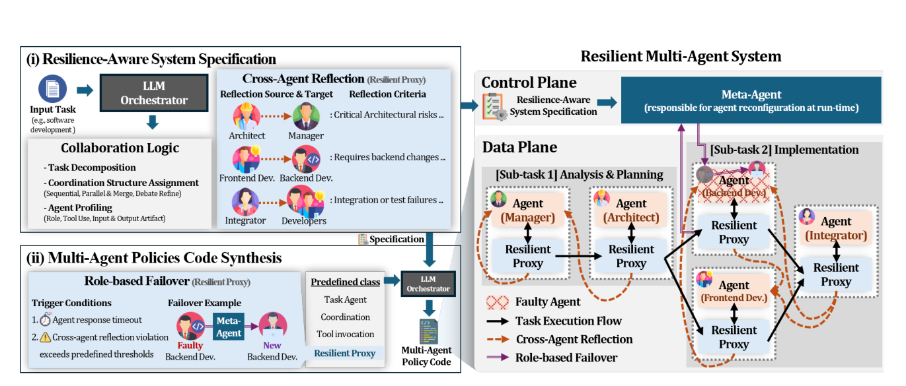
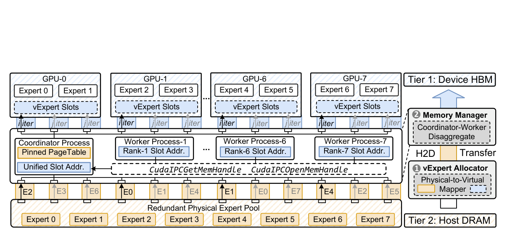
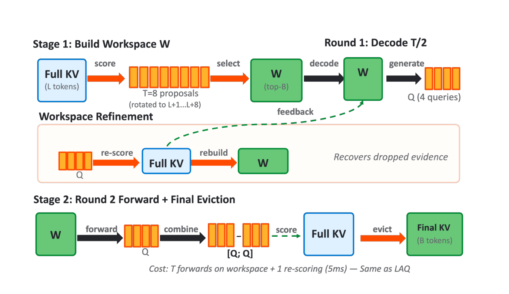
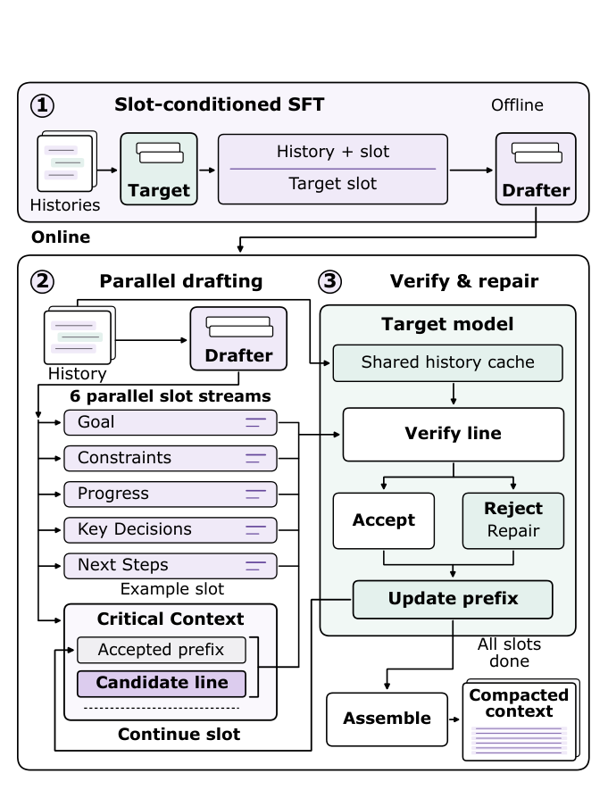

This issue follows a shift from apparent success to inspectable runtime evidence. SWEOps-Bench joins cloud-incident detection, source repair, and deployed recovery. A serving comparison shows how defaults and queue growth amplify engine gaps. Harness Awareness tests whether truthful telemetry changes action selection, while Airlock contains external effects after bad data has already crossed agent boundaries.

These advance evaluation, measurement, decision inputs, and runtime containment respectively. Further research covers complete-system design, behavioral audits, role recovery, cache repair, and safety regressions from MoE acceleration. Independent Tech Notes examine Kinference, Radar incident repair, Sentry workflows, and ERNIE deployment boundaries.

<h2 class="daily-paper-title" id="paper-arxiv-2611.06099">01 · SWEOps-Bench: from detecting incidents to verified recovery</h2>

[SWEOps-Bench: Evaluating Agents for End-to-End Resolution of Software-Induced Cloud Incidents](https://arxiv.org/abs/2611.06099)  
Chen, Danwen, Yu, Guangba, Chen, Pengfei · 2026-11-04

### Detection does not finish the repair

A cloud incident can originate in management software: Pods appear healthy, yet an operator's faulty control logic prevents a database cluster from becoming Ready. Diagnosis must connect logs and resource state to controller source. A repair must survive compilation, image building, deployment, and functional checks. A root-cause answer or a patch evaluated only in a static repository leaves that operational loop untested.

SWEOps-Bench reconstructs fifty-five historical defects from sixteen Kubernetes operator projects as interactive tasks. Each retains the original repository and starts healthy before a workload triggers the existing bug. Compared with SREGym's emphasis on injected microservice faults and operational remediation, this adds management-software source repair and redeployment. Their success percentages consequently cannot be ranked directly.

### Constructing tasks and checking recovery

Researchers select confirmed issue–fix pairs, pin code, dependencies, images, and Kubernetes environments, then run buggy and upstream-fixed revisions under the same setup. The bug must reproduce only on the former. Reference patches and evaluation scripts remain hidden. Agents can edit source and inspect the local cluster through a terminal, with outbound internet access disabled.

<a class="note-image-link" href="/assets/images/digest/2026-11-06/06099.png" target="_blank" rel="noopener" aria-label="Defect collection feeds environment reconstruction, independent oracles, and terminal tasks; reference repairs remain hidden. · View original image ↗">View original image ↗</a>

*Defect collection feeds environment reconstruction, independent oracles, and terminal tasks; reference repairs remain hidden.*

The healthy-state phase has its own sixty-minute budget. After the incident manifests, a fresh conversation begins another sixty-minute budget covering investigation, edits, builds, and rollout retries. Compilation and deployment feedback return to the agent, while files and cluster state persist within that fault session. This tests iterative use of deployment evidence as well as code generation.

Recovery combines a fault probe, fix-specific functional tests, and regression checks. Removing the visible error is insufficient if the patch also removes required behavior. Final recovery requires an explicit declaration within budget and all applicable checks passing. Editing a ground-truth root-cause file is auxiliary, avoiding textual similarity to the reference patch as the definition of correctness.

### Lifecycle stages come apart

Six model–harness configurations receive one run per task. Faulty-state detection ranges from 72.7% to 90.9%, whereas overall recovery is only 14.5–52.7%. Paired detection, requiring correct decisions in both healthy and faulty states, ranges from 38.2% to 85.5%. A faulty-state number alone can therefore conceal false alarms.

Reported diagnosis and actual restoration also diverge. For two representative configurations, 14.5–21.8% of tasks recover despite an incorrect reported joint RCA. Conversely, clearing runtime symptoms can still fail fix-specific tests. Autonomous operations needs separate records of the reported explanation, executed changes, and capabilities actually restored.

**The evaluation protocol is the central reading.** Real operator defects connect software development to operations, and independent functional oracles constrain superficial repairs. The fifty-five reconstructable operator cases and single runs do not establish a production success rate for arbitrary cloud incidents. Fresh fault-state conversations also differ from persistent on-call memory. Read construction, recovery criteria, and trajectory analysis before interpreting the leaderboard.

<h2 class="daily-paper-title" id="paper-arxiv-2611.05991">02 · Serving comparisons: defaults can amplify engine gaps</h2>

[A Controlled Experimental Evaluation of Configuration and Cache Architecture in LLM Serving Engines](https://arxiv.org/abs/2611.05991)  
Anwar, Muhammad Faizan, Keshvadi, Sina · 2026-11-04

### A large latency gap need not come from cache architecture

Agent calls repeatedly carry tool schemas, system instructions, and shared context, making prefix reuse valuable. But default engine comparisons can vary cache granularity, request ordering, and prefill scheduling simultaneously. They cannot identify which mechanism caused a gain. This study shifts the question from which engine is faster to what explains the observed difference.

On GKE with one 24 GB NVIDIA L4, the authors compare vLLM 0.6.3 and SGLang 0.4.1 using the same model, hardware, and seeded request streams. For this version/hardware pairing, SGLang chunks prefill by default and vLLM does not. A second arm matches both to a 2,048-token chunked-prefill budget. SGLang's configuration stays unchanged, providing an internal control across independently rebuilt deployments.

### Why a scheduler setting changes first-token latency

An uninterrupted long prefill stalls ongoing decoding. Chunking interleaves decode work with portions of prefill. A new request need not finish its own prefill sooner; splitting it can delay its first token. Under mixed load, however, better sustained capacity can shorten subsequent queues. This is separate from the granularity at which cached prefixes match.

<a class="note-image-link" href="/assets/images/digest/2026-11-06/05991.png" target="_blank" rel="noopener" aria-label="The generator runs separately from the engine; effective configurations and request logs are joined with metrics by run window. · View original image ↗">View original image ↗</a>

*The generator runs separately from the engine; effective configurations and request logs are joined with metrics by run window.*

Across ninety-nine runs and 63,288 requests, matching the setting removes 78% of the capacity gap in the reported condition with the largest such gap, and 30–67% of latency gaps across conditions. The removed fractions use the paper's logarithmic definition, rather than a uniform percentage acceleration for individual requests.

### Near saturation, TTFT also measures queue growth

After matching, one condition differs by roughly 4.6% in throughput yet retains a 12.3× median TTFT ratio. An engine just below the arrival rate accumulates unfinished work, so latency grows with benchmark duration. A fluid queue model driven by a roughly 4.4% throughput shortfall reproduces the amplification. A large TTFT ratio alone does not establish an order-of-magnitude difference in request execution efficiency.

At equal throughput, the more stable residual is SGLang's 2.4–6.4× p95 TTFT advantage. This is consistent with cache-aware ordering of waiting requests. It is not uniquely attributed to that mechanism: ordering, cache granularity, and other implementation differences remain unmatched. The experiment does not prove the entire residual comes from RadixAttention.

**Read the measurement method rather than a dated engine ranking.** The paper notes that vLLM V1 now enables chunked prefill by default wherever possible, so these results are not an absolute ranking of current releases. The transferable practice records effective configuration, pairs identical load, reports sustainable throughput with latency distributions and duration, and separates cold-cache effects, unstable queues, and internal mechanisms.

<h2 class="daily-paper-title" id="paper-arxiv-2611.05391">03 · Harness Awareness: making runtime state available before action</h2>

[Agent Harness Awareness: Turning Verified Telemetry into Operational Control for Tool-Using Agents](https://arxiv.org/abs/2611.05391)  
Agrawal, Manu, Nagpal, Shrey · 2026-09-13

### Capability descriptions omit current availability

A tool description explains semantics, but may omit recent failures, queueing, or an open circuit. The host can know these facts from monitors and traces while the model choosing an action remains blind. Agent Harness Awareness proposes a small, fresh operational-state projection before consequential actions.

The trust boundary matters: the host owns measurement, verification, enforcement, and final dispatch. The model consumes facts to make task-aware choices; its guesses cannot replace monitoring or bypass host restrictions. The proposed SST contract also covers budgets, hardware, and runtime state, but this paper's evidence is limited to tools and network health.

### Same-shape controls isolate information value

ToolRoute offers two semantically equivalent read-only customer-record routes and a wait action. Condition A supplies the task only. B adds a neutral telemetry envelope. C uses the same structure with truthful successes, latency EWMA, errors, circuit state, and observation age. B versus C isolates route-relevant values from merely adding structured context.

The main study contains 216 independent decisions: three models, six seeds, four states per seed, and three conditions. It measures first dispatch without retries. Observable cost combines latency with failure and open-circuit penalties; regret is excess cost over the best route under the same snapshot. The 10,000 ms penalties are fixed evaluation weights, not measured network delay.

<a class="note-image-link" href="/assets/images/digest/2026-11-06/05391.png" target="_blank" rel="noopener" aria-label="The live HTTP replication reduces spans into host state, then executes the model-selected route under Toxiproxy faults. · View original image ↗">View original image ↗</a>

*The live HTTP replication reduces spans into host state, then executes the model-selected route under Toxiproxy faults.*

A separate twenty-seven-decision replication uses live local HTTP, OTel client spans, and Toxiproxy faults. Three probes per route are reduced into state with a two-second freshness bound, then the chosen action actually executes. Its evidence is not pooled with the main study.

### Strong improvement within a narrow task

In the main B-to-C comparison, mean regret falls from about 4,252 to 131 ms, while single-dispatch completion rises from 50/72 (69.4%) to 69/72 (95.8%). The three C non-completions choose wait when both routes are degraded and remain in the denominator. Live HTTP completion rises from 5/9 to 9/9. Zero regret means no avoidable evaluation cost, not zero request duration.

**The useful shift turns observability into decision input.** It goes beyond displaying traces after execution and echoes Radar's structured operational context. But equivalent two-route tasks do not establish the same gains for heterogeneous tools, long workflows, or production incidents. Deterministic proxies and circuit breakers should retain routine replica failover. The interface deserves further testing where task semantics determine a choice among providers, data sources, or execution modes.

<h2 class="daily-paper-title" id="paper-arxiv-2611.06727">04 · Airlock: containing faults along cross-agent influence paths</h2>

[Airlock: Bounding the Multi-Agent Blast Radius via Selective Online Containment](https://arxiv.org/abs/2611.06727)  
Zhan, Zhonghao, Forough, Javad, Zhang, Yefan, Li, Krinos, Ma, Xiao, Haddadi, Hamed · 2026-11-04

### Stopping the source does not stop propagated influence

An agent reads a bad plan, peers retain it in memory, and future tasks inherit it. By the time an alert arrives, cancelling the original agent cannot stop effects that downstream work has not yet issued. Rolling back the whole workflow instead discards healthy computation. Airlock targets selective post-alert containment: stop preventable faulty effects while retaining unrelated work.

Two structures support this. EDGECITADEL's delegation tree narrows child authority and mediates cross-agent data and registered external actions through site daemons. An append-only provenance DAG records horizontal consumption relationships. The tree answers what an execution may do; the DAG identifies which later executions have consumed tainted data. Neither replaces the other.

### Containment requires more than a list of tasks to stop

Given an alert's initial source set, the coordinator traces influence forward. Default full quarantine freezes affected branches without a solver. Optimized containment selects cuts using effect deadlines and collateral cost. Site switches separately hold tasks, queued events, or egress and revoke particular external grants, allowing device control to stop while other computation continues.

<a class="note-image-link" href="/assets/images/digest/2026-11-06/06727.png" target="_blank" rel="noopener" aria-label="Site daemons enforce permissions and gateway checks; the coordinator builds provenance from journals and sends holds and revocations. · View original image ↗">View original image ↗</a>

*Site daemons enforce permissions and gateway checks; the coordinator builds provenance from journals and sends holds and revocations.*

Control propagation takes time, and both graph and execution state can change. Fence-then-prune first installs conservative holds and source-side labels. It releases redundant holds only after confirmed controls, fenced journals, reconciled taint, and protected-sink separation establish convergence. The formal guarantee begins at convergence time τ1, not automatically at the instant of an alert. Already committed effects cannot be undone.

### Evaluate both blocked effects and preserved work

In the system-layer grid, cancelling only the source agent in A2A yields twelve clean runs out of forty-two content-fault runs. Cancelling everything contains effects but retains no work without redo. Both Airlock tiers pass all forty-two content and ten spread runs, retaining median 83% and 100% of at-risk healthy work without redo. A separate physical smart-home evaluation has 161 scored runs: all 1,870 lamp-state changes match gateway commits, and none of 704 held commands actuates a lamp. The 24,266 simulation records extend topology and spread coverage; they are not a production deployment at that scale.

Continued service still depends on what is protected. In HomeSvc, if answers are unprotected outputs, optimized cuts can continue returning tainted answers while successfully blocking lamp commands. This is containment rather than semantic repair. Complete mediation, correct initial sources, a trusted control plane, and journal protocols are assumptions; unrecorded data channels or actions bypassing the gateway fall outside them.

**This is a systems containment design worth close reading.** Unlike MA-Mesh's role replacement, it revokes authority after corrupted influence has crossed nodes. Unlike blanket rollback, it distinguishes reusable computation from forbidden external effects. Practical transfer depends on establishing sufficiently complete provenance and enforcement boundaries.

## Research updates

<h2 class="daily-paper-title" id="paper-arxiv-2611.06841">05 · ServerBench: delivering latency-qualified serving systems</h2>

[ServerBench: How can your coding agents design specialized LLM serving systems?](https://arxiv.org/abs/2611.06841)  
Zhong, Xinrui, Wang, Zhiming, Liu, Yongqi, Wang, Zhaohui, Yang, Shanglin, Li, Zikun, Chen, Zhuoming, Chen, Beidi · 2026-11-04

ServerBench asks agents to deliver a complete server and choose session concurrency, rather than optimize an isolated kernel. Stateful replay retains dependent turns, shared prefixes, and branches. Completed requests contribute token value only when both TTFT and TPOT meet frozen targets; the total is divided by GPU cost. A fresh deployment with held-out seeds checks complete prompts, streaming, and model fidelity.

Across eleven models and three deployments, 22 of 33 systems pass verification and 13 beat the strongest reference. Sonnet 5.5 reaches 2.97 dollars of qualified value per GPU dollar on Gemma E4B, 4.87× the vLLM reference. These prescribed prices represent neither realized revenue nor net return after agent-development cost. The useful evaluation combines capacity, load choice, and correctness: short probes can still miss long-context stalls and cross-request crashes.

<h2 class="daily-paper-title" id="paper-arxiv-2611.06254">06 · HarnessFlow: searching complete harnesses with branch history</h2>

[HarnessFlow: MCTS-Guided Harness Optimization for LLM Agents](https://arxiv.org/abs/2611.06254)  
Hong, Zhi, Wang, Qianlong, Wei, Hongchen, Wu, Aidan, Ying, Daohong, Kong, Mingze, Liu, Bei, Luo, Chong · 2026-11-04

HarnessFlow fixes the execution model and environment and searches complete executable harnesses, rather than prompts alone. An MCTS-style policy chooses parents using measured score and expansion history. A coding agent edits their code using archived traces and a component library; validation evaluates each candidate. Retaining alternative and unsuccessful branches avoids following only the latest edit.

With fifteen candidate attempts per benchmark and five repetitions, mean test score across six benchmarks is 69.48%, 10.89 points above the initial harness and 3.95 above equal-budget Meta-Harness. The main execution backbone is GPT-5.4-mini. Lower final per-task inference cost does not establish lower total cost after search. This complements Harness Awareness: one searches context, state, and control flow; the other isolates the value of truthful runtime information.

<h2 class="daily-paper-title" id="paper-arxiv-2611.06116">07 · Banking compliance: inspect actions, not just dialogue</h2>

[The Harness Is the Model: Agent Scaffolding Changes a Fixed LLM's Compliance with Banking Conduct Rules, Unevenly Across Models](https://arxiv.org/abs/2611.06116)  
Huyut, Mehmet Murat · 2026-11-04

Four open-weight models each run five harnesses on 156 preregistered simulated-bank cases, producing 3,120 two-turn episodes. The environment does not block forbidden writes on the agent's behalf. Deterministic scoring reads executed tool traces and separates violations from over-refusals.

A same-model reviewer reduces violations from 9.6% to 6.4% without a significant over-refusal increase, at about 1.8× the input tokens of the basic tool loop. Date-arithmetic rules still fail across harnesses. An exploratory audit finds that 26% of violations accompany customer messages denying the action, which transcript-only review could miss. The largest within-model harness spread is 11.5 points, but the model–harness interaction has p=0.07, only suggestive evidence. Validate the deployed pair and retain action-level audit data.

<h2 class="daily-paper-title" id="paper-arxiv-2611.05390">08 · Evidence-gated review: limiting destructive overrides</h2>

[Who May Overrule the Agent? Evidence-Gated Authority in LLM Review Institutions](https://arxiv.org/abs/2611.05390)  
Ali, Fuad · 2026-09-12

This study separates reviewer competence from binding authority. The same review output is recombined under broad override, which accepts parseable advice, and an evidence gate, which mechanically checks a hard-constraint violation and a compliant replacement. Ninety-six spatial-policy tasks and ninety-six portfolio tasks each test correct, violating, and compliant-but-suboptimal proposals.

The gate protects correct proposals but cannot improve already-compliant suboptimal ones, so its overall advantage depends on upstream state prevalence. Adding retain/replace/escalate eliminates corruption of correct proposals for Qwen, while Mistral still replaces all forty-eight correct proposals. The transferable idea separates advice from authority using checkable evidence. Results rely on complete synthetic-task constraint checkers; open-ended code review rarely provides an equivalent oracle.

<h2 class="daily-paper-title" id="paper-arxiv-2611.06506">09 · Trace2Eval: recovering executable contexts from real traces</h2>

[Trace2Eval: Contextualized Evaluation of Coding Agents from Real-World Traces](https://arxiv.org/abs/2611.06506)  
Shi, Ji, Jie, Lirong, Zou, Lexiao, Zhu, Yaoming, Yang, Yifan, Cao, Xuezhi, Cai, Xunliang, Zhang, Miao · 2026-11-04

Trace2Eval reconstructs initial files and dependencies from coding-agent traces, replays original tool calls, compares their results, and adds human recovery checks. From 20,000 anonymized traces it builds 129 tasks. Its rubric covers accuracy, code quality, and user experience: seven dimensions use source evidence, while execution, data authenticity, and interface dimensions require runtime or rendered evidence. Judges are calibrated against human labels.

The recovery calibration set reaches 82.6% workspace acceptance and a 0.9175 mean replay score; trajectory equivalence does not prove recovery of invisible state. Rubric-guided revision raises scores by 10.05 percentage points across nineteen model–harness configurations under the same scoring framework, without independently establishing an equivalent user-preference gain. Its value is broader real-request evaluation with explicit reconstruction and judging errors.

<h2 class="daily-paper-title" id="paper-arxiv-2611.06563">10 · EPISTEME: compare declared intent with actual effects</h2>

[EPISTEME: Trustworthy Coding Agents Through Tool Call Intent](https://arxiv.org/abs/2611.06563)  
Bobadilla, Sofia, Cesarano, Carmine, Liu, Raphina, Ron, Javier, Monperrus, Martin · 2026-11-04

EPISTEME requires a type and reason for each tool call. The host hashes the workspace before and after execution, stores diffs, and compares effects with declarations such as read-only or revert. Journals sit outside agent control. Monitor mode records findings; guardrail mode additionally rejects declared-read-only commands containing suspicious mutation syntax before execution.

<a class="note-image-link" href="/assets/images/digest/2026-11-06/06563.png" target="_blank" rel="noopener" aria-label="Declarations accompany calls; the host records effects and checks them. Post-execution contradictions differ from pre-execution blocking. · View original image ↗">View original image ↗</a>

*Declarations accompany calls; the host records effects and checks them. Post-execution contradictions differ from pre-execution blocking.*

Among 400 completed ImpossibleBench runs, 49 misbehave and the journal exposes 44, about 90%. All forty-four exposed runs disclose cheating in their declared reasons, while only three trigger mechanical contradiction checks. Thus 90% is neither an automatic detector rate nor a prevention rate. Network isolation confines lasting effects to the workspace, excluding external-service effects. The contribution is auditable intent–effect provenance, without a guarantee of truthful intent.

<h2 class="daily-paper-title" id="paper-arxiv-2611.05590">11 · Verified but Vacuous: acceptance versus what was proved</h2>

[Verified but Vacuous: Three Failure Surfaces of LLM-Driven Verified Code Generation](https://arxiv.org/abs/2611.05590)  
Vempaty, Aditya, Sompalle, Himaneesh, Tayal, Manan, Allaham, Mowafak, Dey, Prasenjit, Jagmohan, Ashish, Kokku, Ravi · 2026-11-03

The paper separates verifier acceptance, binding between proof and specification, and fidelity between specification and informal requirement. For Dafny pipelines with separate specification and implementation artifacts, an ensures-binding gate statically checks whether a postcondition references a specification-defined predicate or function, taking under 10 ms per component.

In the same-backend Claude Opus 4.7 Li@Opus reproduction, HumanEval verifier acceptance reaches 99.1%, yet only 1.9% of accepted samples pass this external-specification binding gate. That exposes missing functional obligations, but does not establish that 98.1% of programs are semantically wrong: meaningful inline postconditions can lack an external predicate reference. Nor can the gate detect a specification defined as true. The contribution is an evaluation decomposition requiring separate acceptance, binding, and semantic evidence.

<h2 class="daily-paper-title" id="paper-arxiv-2611.06389">12 · MA-Mesh: recovering collaboration through role-level failover</h2>

[MA-Mesh: Resilient Multi-Agent Collaboration via Role-based Self-Healing](https://arxiv.org/abs/2611.06389)  
Lee, JunYong, Kim, Woo Kyung, Woo, Honguk · 2026-11-04

MA-Mesh generates a collaboration specification and cross-agent review criteria, then synthesizes execution code with resilient proxies. Proxies intercept interactions; timeouts or repeated review failures invoke a meta-agent to rebuild and replace an executor according to its role, preserving the collaboration structure.

<a class="note-image-link" href="/assets/images/digest/2026-11-06/06389.png" target="_blank" rel="noopener" aria-label="The control plane retains role specifications; data-plane proxies review outcomes and trigger role replacement on failure. · View original image ↗">View original image ↗</a>

*The control plane retains role specifications; data-plane proxies review outcomes and trigger role replacement on failure.*

Experiments on software development, GAIA, and GPQA-Diamond inject termination, prompt/I/O perturbations, and adversarial outputs. At the strongest GUI-development agent-chaos setting, accuracy is 68.35% versus RTADev's 9.68%. This measures task outcomes under specified perturbations, rather than production availability. MA-Mesh restores execution through role replacement; Airlock follows already-propagated influence to prevent future external effects. Replacing a process alone does not remove corrupted state peers have already consumed.

<h2 class="daily-paper-title" id="paper-arxiv-2611.05873">13 · Mobile testing memory: treating experience as scoped evidence</h2>

[Can LLM Agents Learn to Test? Maintaining Scoped Experience as Testing Evidence for Mobile GUI Testing](https://arxiv.org/abs/2611.05873)  
Liu, Zimu, Guo, Xiaoxi, Tang, Xiaolu, Yu, Liang · 2026-11-04

ADAPTITEST proposes storing reusable GUI experience with scope, trace provenance, and a lifecycle for confirmation, revalidation, and withdrawal. A Reflector is the designated persistent writer. Experience advises planning; current-screen evidence should overturn stale routes after interface changes.

An archived six-task, three-repeat subset reports 18/18 completions with memory versus 3/18 without it, but a grounded single-agent control also solves an earlier hard subset. The archive does not verify enforcement of the full lifecycle or writer isolation. A separate cross-session experiment is excluded from efficacy conclusions because route schedules and state labels are confounded. Thirteen update-hazard records are not confirmed regression bugs. Its value is a bounded design and evidence audit, without establishing multi-agent superiority or general learning efficacy.

<h2 class="daily-paper-title" id="paper-arxiv-2611.06634">14 · flash-comm: carrying readiness with the data</h2>

[flash-comm: Self-Synchronizing Collective Communication for LLM Decoding](https://arxiv.org/abs/2611.06634)  
Wang, Carrie, Li, Jack, Zhao, Jason · 2026-11-04

Decode collectives can spend more time coordinating readiness than moving bytes. flash-comm embeds readiness evidence in data blocks so receivers validate and consume them without a separate inter-GPU barrier. A cost model selects readiness encoding and one-hop versus sharded two-hop protocols by message size and GPU count. Asynchronous transport is separated from reduction order: a common source-rank order or single output owner preserves agreement across replicas.

On eight B300 GPUs, median all-reduce latency falls 28.8% relative to custom AR v2, while end-to-end TPOT falls 1.7–6.8%. Kernel gains therefore do not translate one-for-one into model acceleration. The implementation targets one NVLink/NVSwitch domain, 2/4/8 GPUs, and supported layouts; inter-node transport and failures are outside the evaluation, and protocol boundaries require hardware-specific calibration.

<h2 class="daily-paper-title" id="paper-arxiv-2611.06513">15 · HELIX: operator-level heterogeneous placement</h2>

[HELIX: HEterogeneous LLM Inference with FleXible and Fine-Grained Partitioning](https://arxiv.org/abs/2611.06513)  
Clerico, Victoria, Simon, William, Lammie, Corey Liam, Görkem, Orhun, Vasilopoulos, Athanasios, Tsai, Hsinyu, Castrillon, Jeronimo, Sebastian, Abu, Benmeziane, Hadjer · 2026-11-04

Fixed prefill/decode or attention/FFN splits assign emerging accelerators a role in advance. HELIX searches operator placement during vLLM initialization using execution profiles, supported operations, communication, and memory limits. Its dynamic program retains frontier state for residual branches; adjacent operators on the same backend become subgraphs, with transfers inserted for tensors their consumers actually need.

Partial-coverage accelerators can thus participate as subgraph executors. GPU profiles combine public and additional measurements, but some 3DCIM and DRAM-PIM results use analytical models or simulation, rather than complete heterogeneous hardware deployments. In the DRAM-PIM analysis, small-batch Llama 8B gains 2–2.7× over an AttAcc split; larger batches favor existing partitions as compute and transfer costs change. The contribution concerns feasible placement and capacity boundaries, rather than a universal speedup.

<h2 class="daily-paper-title" id="paper-arxiv-2611.06057">16 · vExpert: separating expert copies from GPU slots</h2>

[vExpert: Virtualizing Expert Storage for Adaptive Load Balancing in Distributed MoE Inference](https://arxiv.org/abs/2611.06057)  
Wang, Wenxun, Li, Xiuhong, Wang, Yida, Tang, Chen, Huang, Zongle, Hong, Ke, Wang, Yu, Liu, Yongpan · 2026-11-04

Dynamic MoE routing creates hotspots under static placement, but copying weights at runtime also competes for PCIe resources. vExpert retains a redundant host-memory expert pool and maps physical experts into GPU virtual slots. Its allocator weighs balance gains against H2D transfer time and interference with All-to-All. A coordinator centralizes host registration and transfers; workers expose slots through CUDA IPC, reducing duplicated pinning and page-table overhead.

<a class="note-image-link" href="/assets/images/digest/2026-11-06/06057.png" target="_blank" rel="noopener" aria-label="A coordinator fills GPU virtual slots from the host expert pool; the allocator trades balance gains against transfer costs. · View original image ↗">View original image ↗</a>

*A coordinator fills GPU virtual slots from the host expert pool; the allocator trades balance gains against transfer costs.*

DeepSeek-V3.1 experiments on eight nodes with eight H100s each report up to 55% better load-balance ratio and about 1.2× end-to-end speedup. Unlike HELIX's operator placement, this changes runtime expert location. Benefits depend jointly on routing skew, host capacity, and PCIe/NIC topology; measured contention coefficients cannot simply be reused on another machine.

<h2 class="daily-paper-title" id="paper-arxiv-2611.05611">17 · Hybrid Spark: sharing verification capacity across drafters</h2>

[Hybrid Spark: Adaptive Speculative Decoding That Lets the Content Choose the Drafter](https://arxiv.org/abs/2611.05611)  
Ranjan, Ekagra, Venkitesh, Bharat · 2026-11-03

Code edits often copy input spans, while chat relies more heavily on prediction. Hybrid Spark calibrates acceptance probabilities for a GPU n-gram drafter, putting copied and DSpark neural proposals on a common scale. It then selects chains and lengths using the opportunity cost of verification slots elsewhere in the batch. Token-dependent choices stay on the GPU; asynchronous host budgeting uses older statistics to avoid a mid-step synchronization.

Across five models and seven workloads, the five code-editing workloads achieve 1.10–1.62× DSpark throughput at batch 4 and 1.04–1.27× at batch 128. Greedy chat remains around 0.97–1.01×. Gains shrink as less output can be copied. Verification preserves the target distribution, but a higher acceptance rate is not automatically faster: verification cost at large batch sizes determines the value of extra proposals.

<h2 class="daily-paper-title" id="paper-arxiv-2611.05903">18 · EchoKV: repairing the workspace that generates eviction queries</h2>

[EchoKV: Self-Corrective KV Cache Eviction via Iterative Query Feedback](https://arxiv.org/abs/2611.05903)  
Zou, JianKun, Yuan, Tongtong · 2026-11-04

Query-driven KV eviction has a feedback failure: an initial workspace can omit evidence, distort later generated queries, and reinforce the wrong selection. EchoKV bootstraps from future-position query proposals, generates half the lookahead, re-scores the still-resident full prompt KV with those queries, rebuilds the workspace, and completes the remaining steps before final eviction.

<a class="note-image-link" href="/assets/images/digest/2026-11-06/05903.png" target="_blank" rel="noopener" aria-label="Generate queries, repair the workspace, then finalize eviction; full prompt KV remains available during repair. · View original image ↗">View original image ↗</a>

*Generate queries, repair the workspace, then finalize eviction; full prompt KV remains available during repair.*

It matches LAQ's workspace forward-pass count but adds re-scoring, so the repair is not free. LongBench experiments with two 7B models show selective gains on dispersed-evidence tasks. For Qwen2.5-7B, the mean rises from 36.29 to 36.88 at a 128-token budget, but only from 37.41 to 37.45 at 256 tokens. Its value is exposing query–workspace coupling; these results establish neither universal quality gains nor end-to-end serving acceleration.

<h2 class="daily-paper-title" id="paper-arxiv-2611.06147">19 · SafeStart: protecting the opening of MoE safety decisions</h2>

[SafeStart: Mitigating the Overlooked Safety Cost of Active Expert Reduction in MoE LLM Serving](https://arxiv.org/abs/2611.06147)  
Potraghloo, Erfan Baghaei, Shokoufa, Saeid, Azizi, Seyedarmin, Fayyazi, Arya, Kundu, Souvik, Kamal, Mehdi, Pedram, Massoud · 2026-11-04

Reducing active experts saves weight reads but can change refusal behavior. A paired audit across nine MoE models locates sensitivity in prefill and the opening generation steps. SafeStart keeps the full expert budget for prefill and the first eight output tokens, then reduces it; per-request position masks let GEMM skip slots outside the later budget.

On 889 held-out requests under refusal suppression, truncation raises harmful compliance by 5.8–21.4 percentage points across three models; SafeStart limits the rise to at most 2.6 points. With half the experts at batch 8, decoding remains 38–44% faster than the original model. This is a safety-regression study of an efficiency optimization. Forced prefixes and delayed harmful content can move the decision beyond the protected opening, and some conditions become worse than truncation alone.

<h2 class="daily-paper-title" id="paper-arxiv-2611.06133">20 · Hybrid long-context models: searching attention budgets per layer</h2>

[Accelerating Long-Context Decoding in Large-Scale Hybrid LLMs Without Retraining](https://arxiv.org/abs/2611.06133)  
Batista, João Eduardo, Vatai, Emil, Wahib, Mohamed · 2026-11-04

Without changing weights, this pipeline adds windows, pinned prefixes, and Quest page selection to existing full-attention layers. NSGA-II searches per-layer windows and budgets using quality and a measured latency surrogate, returning speed, accuracy, and balanced configurations. Existing linear or sliding-window layers remain unchanged.

At batch 4 and 256K context, the balanced Qwen3.5-122B-A10B configuration reaches about 2.23× decode throughput. Conversely, the searched gpt-oss-120b configuration reaches only 0.97× baseline speed at 64K. Quality evaluation extends to 64K, so the 256K timing result is not quality evidence at that length. Avoiding retraining still requires up to roughly sixty GPU-hours of search per model, KV continues to grow, and weight-read costs or short contexts can erase the benefit.

<h2 class="daily-paper-title" id="paper-arxiv-2611.05751">21 · AMD data pipelines: movement, transpose, and communication</h2>

[Scheduling Data to Compute: Hierarchical Data Pipelining for LLM Training on AMD GPUs](https://arxiv.org/abs/2611.05751)  
Rao, Gengyu, Alabandi, Ghadeer Ahmed H, Chong, Su Ann, Huber, Thomas, Gogineni, Kailash, Chowdhury, Subhajit Dutta, Kudchadker, Saleel, Pati, Suchita, Zhang, Zirui, Huang, Zhen, Qin, Yanyuan, Peng, Xiaoming, Zhang, Lihuan, Hu, Botao, Huang, Wei, Bo, Yang, Xie, Wen, Zhao, Xiangyu, Zhang, Ruibin, Chen, Xiaobo, Goyal, Vidushi, Raina, Anshu, Lee, Claire Songhyun, Yan, Jiakun, Fu, Yao, Islam, Nusrat, Dwivedula, Ravi, Zhang, Jie, Garzaran, Maria, Gu, Zhenyu, Barsoum, Emad · 2026-11-03

This hardware/software study separates training stalls into HBM-to-chip movement, layout conversion, and inter-GPU communication. For sparse attention, TDM gathers selected KV rows into a multistage LDS ring buffer. Reducing movement-related register pressure permits larger per-wave register budgets and more reuse. Transpose-load avoids extra register shuffles, while the communication path uses SDMA.

Across eighteen CSA configurations on the same MI455X, the combined forward/backward kernel step achieves a 1.88× geometric-mean speedup and up to 2.74× over the best non-TDM implementation. This is not a whole-model training-step speedup; the company discloses relative performance only. The transferable lesson is to locate the level at which compute waits for data. Another asynchronous HBM-to-LDS instruction tested by the authors failed to beat their non-TDM baseline.

<h2 class="daily-paper-title" id="paper-arxiv-2611.06876">22 · SpecCompact: faster compaction still needs downstream checks</h2>

[SpecCompact: Accelerating LLM Agent Context Compaction with Slot-Parallel Semantic Speculative Verification](https://arxiv.org/abs/2611.06876)  
An, Yulu, Feng, Yifei, Yin, Xiangyang · 2026-11-04

SpecCompact splits history summaries into six slots such as goals, constraints, and progress. A fine-tuned small drafter generates them in parallel; the target model verifies lines semantically, repairs rejected content, and updates each slot's prefix for further drafting. Shared history caching reduces repeated prefill. Semantic acceptance permits different wording and does not provide token-level speculative decoding's distribution equivalence.

<a class="note-image-link" href="/assets/images/digest/2026-11-06/06876.png" target="_blank" rel="noopener" aria-label="Six slots draft in parallel, verify or repair line by line, then assemble into the next context. · View original image ↗">View original image ↗</a>

*Six slots draft in parallel, verify or repair line by line, then assemble into the next context.*

Across two target models on AppWorld and τ3, compaction is 2.04–5.63× faster than Hermes-style summarization. Downstream performance is measured separately: Gemma4-31B AppWorld Normal TGC is 54.76% versus Hermes's 57.74%, while Qwen3.5-122B improves from 28.57% to 33.33%. Faster summaries and more reliable task completion therefore require separate tests; a summary-information score cannot replace long-horizon action validation.

<h2 class="daily-paper-title" id="paper-arxiv-2611.06858">23 · CompressionBench: accepting executable compressed models</h2>

[CompressionBench: How can your coding agents compress LLMs?](https://arxiv.org/abs/2611.06858)  
Zhong, Xinrui, Li, Zhifeng, Wang, Zhiming, Liu, Yongqi, Yang, Shanglin, Zhou, Yang, Li, Zikun, Chen, Zhuoming, Chen, Beidi · 2026-11-04

Unlike ServerBench's service-capacity objective, CompressionBench asks agents to deliver compressed weights and inference code together. Search reward uses a perplexity ratio on source-generated continuations. Final checks separately enforce saved-package and GPU-resident model-storage limits, require mean accuracy across three tasks to retain 80% of BF16, and inspect measurement shortcuts. Decode speed is reported outside the reward.

Six agents, three models, and two storage limits produce thirty-six artifacts; twenty-nine pass, including all eighteen under looser limits. Selecting the lowest-perplexity artifact per task yields 77.33% mean downstream accuracy versus 79.56% for BF16. Complete-model feedback reverses seventeen of seventy-nine local rankings. Compression fidelity, memory compliance, and inference speed remain distinct objectives; a smaller package does not establish faster serving.

<h2 class="daily-paper-title" id="paper-arxiv-2611.05454">24 · ABE: connecting contracts, permissions, and runtime evidence</h2>

[Agentic Behavior Engineering: A Design-by-Contract Methodology for Specifying, Verifying, and Governing Enterprise AI Agents](https://arxiv.org/abs/2611.05454)  
Song, Yang · 2026-11-03

Agentic Behavior Engineering gives behavioral rules stable contract identifiers, referenced in one direction by scenarios, tests, policies, and telemetry. Implementations may change, but an optimizer cannot relax its own acceptance criteria. Replay doubles match normalized arguments and session state rather than call order; per-scenario pass^k gates separate prohibited actions, wrong conclusions, and avoidable abstentions.

Evidence consists mainly of a methodology, an executable capacity-allocation boundary suite, and a constructed approval example. The latter's 91.0% to 95.5% table is illustrative, not a production improvement. Read it as an AgentOps process proposal: distinguishing missing evidence from a verified zero is useful, but the paper does not establish lifecycle superiority over existing deployment practice or formal correctness guarantees.

## Tech Notes

- [Kinference: a control plane for caches, queues, and tenant policies](/tech/en/vllm-kinference/)

- [Radar on SREGym: connecting diagnosis and repair through structured context](/tech/en/radar-sregym-leaderboard/)

- [Sentry Agent Tracing: turning production traces into evaluation and triage inputs](/tech/en/sentry-agent-tracing-five-things/)

- [ERNIE-5.5-Flash-Base: hybrid attention, ECHO, and serving boundaries](/tech/en/ernie-5-5-flash-sglang/)
