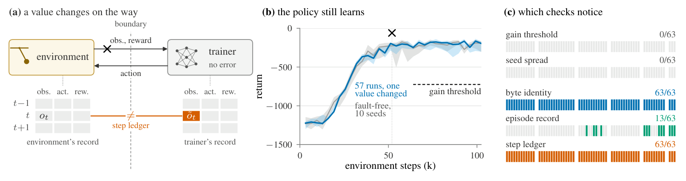

Two apparently successful failures stand out: an RL policy keeps learning after boundary data have changed, and an API repair passes typical-input tests while violating hidden obligations. The studies move observation toward execution, through records on both sides of a protocol and inputs that expose migration semantics. For inference, FastAFD’s hardware measurements and SiliconForge’s deployment model answer different questions: saturated decode efficiency versus a whole service including prefill, power and SLOs. The remaining work brings comparable attention to evidence into database testing, log detection, harness evolution and long-horizon coding, exposing distinctions hidden by aggregate scores.

<h2 class="daily-paper-title" id="paper-arxiv-2611.08144">01 · Silent RL faults: a healthy learning curve can hide a broken boundary</h2>

[Detecting Silent Faults at the Environment-Trainer Boundary in Reinforcement Learning](https://arxiv.org/abs/2611.08144)  
Zuo Gou, Chenhao Lu · 2026-11-05

### Why reward curves cannot establish boundary correctness

Robot RL often runs environments in another process, machine or language. A trainer can keep receiving correctly shaped data and learn an apparently healthy policy even when observations, actions, rewards or termination flags are altered in transit. The paper makes this boundary an explicit protocol and asks whether both sides recorded the same interaction.

An infer message carries environment indices, step IDs and observations. The server returns an action chunk; feedback then carries its summed reward, end flags and final observation. The environment resets locally, with termination distinguished from time-limit truncation. Structural errors are rejected, and missing steps must not be filled with fabricated feedback. These conventions expose semantic differences otherwise hidden inside adapters.

### Put independent observations on both sides of the fault

Using SB3 PPO on Pendulum, HalfCheetah, Hopper and Pusher, the authors inject up to 23 boundary faults and two trainer-log faults. Doses range from one changed value to fractions or all values. Faults include zeros, stale values, another environment’s data, reduced-precision rounding and incorrect episode-end flags.

Unless every value is wrong, a learning-gain threshold detects at most one run in ten; comparison with ten fault-free seeds detects at most 21%. Clean evaluation of all 1,060 final policies gives a similar warning: among 728 boundary-fault runs passing both curve checks, 723 remain within three standard deviations below the fault-free mean. **Little apparent quality loss does not establish a correct experiment.** Weights and logged returns can already have changed enough to distort comparisons.

<a class="note-image-link" href="/assets/images/digest/2026-11-07/rl-boundary.png" target="_blank" rel="noopener" aria-label="Boundary records, apparently healthy learning curves and fault detection by each check · View original image ↗">View original image ↗</a>

*Read left to right: reconcile the same step across the boundary, observe that learning still improves, then compare which checks detect the altered execution.*

A step ledger wraps the environment and the trainer interface separately, recording observations, applied actions and returned results. A fault between those points produces a disagreement at a particular step and field. It detects every injected boundary fault in the tested Pendulum, Hopper and Pusher runs, with no differences in fault-free runs. Median training-time overhead is 3% on Pendulum. A separate environment-side episode record checks logged returns, lengths and counts, but cannot cover every observation or action fault.

### From successful training to reconcilable execution

The contribution is localized execution evidence rather than another learned anomaly detector. It also demonstrates the limits of final-weight byte identity: twelve Hopper final-observation faults leave weights unchanged because the trainer never reads those values. Across machines, numerical differences make final-weight identity unsuitable in the first place.

The experiments cover four state-based, dense-reward simulators, one training algorithm and three injection seeds. They do not establish the same outcome for images, sparse rewards or real robots. Ledger comparison is post-run, with about 150 MB per Hopper run, rather than a lightweight online service. A wrapper also cannot detect an environment’s internal mistake. The transferable reliability idea is to specify boundary semantics and retain independently reconcilable evidence on both sides.

<h2 class="daily-paper-title" id="paper-arxiv-2611.08269">02 · Accepted but Wrong: release gates need inputs that exercise the migration</h2>

[Accepted but Wrong: Silent Failures of LLM Code Repairs after API Migrations](https://arxiv.org/abs/2611.08269)  
Xiaobo Chen, Genliang Zhu, Ziyuan Wang, Chu Wang · 2026-11-05

### What can go wrong after execution succeeds

After a runtime or API upgrade, a repair can exit normally, return correctly typed output and pass every business assertion on typical inputs while violating the original obligation. Accepted but Wrong studies the release gate: how to prevent known-wrong repairs from being accepted.

The study constructs 73 tasks covering 60 documented changes in CPython, Node.js and SQLite, including seven unchanged controls. Programs are assembled from predefined fragments and executed on the real old and new runtimes. Hidden contracts check business outputs and file preservation. Exhaustive evaluation of this finite space separates gate inadequacy from a model’s choice of repair. This is not a free-form model-written-code experiment.

### Exercise the change described in the release note

Across the complete finite repair space of 52 affected test tasks in 49 change clusters, all consumer assertions on typical inputs release a task-mean 41.0% of hidden-wrong programs. Adding one author-written release-note edge input reduces this to 6.5%, while false rejection remains 1.0%. On fifteen newly added test clusters, the corresponding rate falls to 6.1%. The denominator is wrong programs, not all model calls or production incidents.

A second route uses a blind input writer that sees the requirement, release note and visible contract, but neither program, candidate fragments nor hidden inputs. It supplies up to three data inputs; the old program on the old runtime supplies expected outputs. GPT-5.6-luna’s inputs reduce wrong-program acceptance to 7.0%. Three generated inputs exactly match hidden inputs; removing those raises the result to 9.0%, so overlap contributes to the effect.

### A conservative-looking guard can discard the useful evidence

A preregistered guard asks the writer which old outputs remain binding after migration and retains only inputs marked legacy-binding. It performs worse: 15.7% wrong acceptance, with no false-rejection improvement. It removes precisely the inputs that expose the change. Deciding which legacy behavior remains an obligation can reproduce the original misunderstanding of the release note.

Further frozen stages enlarge the menu to 1,491 fragments and add 233 difficult distractors that mimic legacy output on typical inputs. Edge inputs and the frontier-model writer still help, but respectively admit 16.8% and 15.3% of the hard wrong programs. Two local-model writers fail their preregistered tests, and repairer self-tests do not consistently match the stronger writer.

The practical mechanism is to anchor test generation to specific migration semantics and obtain expected values from actual runtimes. Its limits matter: authors construct tasks, fragments and hidden contracts. A blind AI audit flags 34 contracts as overly strict; removing disputed checks changes no verdicts, but class-label disputes remain and there is no human contract review. The evidence supports coverage improvements in a finite repair setting, not a safety guarantee for automatic release of arbitrary generated patches.

<h2 class="daily-paper-title" id="paper-arxiv-2611.07149">03 · FastAFD: wide EP puts disaggregation gains in perspective</h2>

[FastAFD: When Does Attention-FFN Disaggregation Pay on Rack-Scale NVLink?](https://arxiv.org/abs/2611.07149)  
Yichao Fu, Yuxuan Zhang, Minshen Zhang, Ruitian Wang, Junda Chen, Hao Zhang · 2026-11-04

FastAFD separates attention and expert pools on GB200 NVL72, alternating two microbatches to overlap local attention with remote MoE. GPU-initiated one-sided communication, a fused expert kernel and whole-step CUDA graphs reduce host overhead exposed by the fast fabric.

The baseline changes the conclusion. vLLM tunes EP4–EP64 separately at 4K–16K contexts, and every expert-pool GPU is charged. Gains of 1.30–2.36× over EP4 narrow to 0.99–1.17× over the best wide EP. The explanation factors throughput into batch gain, overlap gain and dedicated-expert cost; the analytical predictor is within about 3% on the authors’ measurements. These are saturated steady-state decode measurements, excluding prefill, queueing and a full serving SLO. Speculation uses a simulated fixed acceptance rate. SiliconForge below studies a different, deployment-level denominator, so the two sets of ratios should not be compared directly.

<h2 class="daily-paper-title" id="paper-arxiv-2611.08299">04 · SiliconForge: faster decode need not improve the whole deployment</h2>

[Should You Split Decode? Disaggregation Across Future Models and Accelerators](https://arxiv.org/abs/2611.08299)  
Ramyad Hadidi · 2026-11-05

SiliconForge searches serving decomposition and hardware assignment separately. Under a common power budget it compares P/D with P/D+AFD in SLO goodput per kW, including prefill replicas, KV capacity, cross-pool transfers and queueing. Main comparisons across four model directions, four accelerator classes and two fabrics establish no robust deployment-level AFD advantage. The largest nominal lead comes from fitting one additional prefill replica.

This complements FastAFD’s measured decode results. A faster FFN may be hidden behind attention, and power or pool-sizing granularity can consume its benefit. Calibration checks also expose TTFT and absolute-throughput prediction problems; paired cross-class hardware measurements are absent. Read it as capacity planning and sensitivity analysis rather than verified future-hardware rankings. Adjustable mappings and pool sizes are its most useful operational implication.

<h2 class="daily-paper-title" id="paper-arxiv-2611.07754">05 · GraphWeave: execution plans reveal ineffective metamorphic tests</h2>

[Uncovering Systematic Blind Spots in Graph Database Testing through Integration and Process-Level Analysis](https://arxiv.org/abs/2611.07754)  
Tinghan Li, Aoyang Fang, Longbin Lai, Zifan Xie, Hongbo Zhao, Yu Shao, Ying Zhang, Pinjia He · 2026-11-05

After integrating eight graph-database testing methods, GraphWeave records states, queries, results and execution plans rather than counting reports alone. Equivalent metamorphic queries can collapse to the same optimized plan on the same graph state, eliminating the intended contrast. Dialect differences meanwhile create false positives.

Rule gating, capability-aware clustering and multi-agent analysis organize reports and feed known-issue rules and dialect adaptations back into testing. Plan-aware triage identifies collapsed comparisons. On NeuG 0.1.1 the platform finds nineteen previously unknown bugs, all developer-confirmed. Each method–system campaign runs for twelve hours, and two authors independently review automated dispositions. The contribution is process evidence for testing effectiveness; nineteen defects are not a completeness claim, and plan-hash analysis remains specific to the studied Cypher systems.

<h2 class="daily-paper-title" id="paper-arxiv-2611.07760">06 · Log anomaly detection: data and preprocessing resist a universal ranking</h2>

[Fast Unsupervised Anomaly Detection Methods on Software Logs - An Empirical Study](https://arxiv.org/abs/2611.07760)  
Jesse Nyyssölä, Mika Mäntylä, Yuqing Wang · 2026-11-05

The study crosses seven datasets, four unsupervised methods, words/trigrams/parsed-event representations and preprocessing switches for anomaly filtering, shuffled sampling and message extraction. Regression relates these factors to AUCROC, F1 and runtime. No configuration wins universally: parsing helps some datasets and removes useful information in others; OOV detection particularly depends on clean training data.

For AIOps, the negative findings and cost breakdown are useful. Random training selection does not consistently inflate performance in the tested unsupervised methods, unlike the supervised comparison. This does not license shuffling arbitrary temporal evaluations. Word features with OOV, KMeans or RarityModel are faster options, but event-level versus sequence-level labels and unequal sampling fractions constrain transfer.

<h2 class="daily-paper-title" id="paper-arxiv-2611.07140">07 · Multi-agent reliability: account for the voter and shared failures</h2>

[More Agents, More Reliable? System-Level Reliability of Multi-Agent LLMs under Operational-Profile Uncertainty](https://arxiv.org/abs/2611.07140)  
Burkay Tunçtürk, Koorosh Aslansefat, Yiannis Papadopoulos, Bao Nguyen · 2026-11-04

This work propagates single-agent failure-probability envelopes through a Bayesian network of system failure logic, explicitly representing the operational profile, shared-cause errors and voter failures. In chemical-hazard extraction, three-model majority voting protects against the weakest model but does not clearly outperform the best individual model. Assuming a voter failure rate of 5% largely removes its advantage over the middle model.

The contribution is a defensible composition of reliability evidence. Nine substances repeatedly queried provide few independent demands; the usage profile is declared, while shared-cause and voter probabilities are sensitivity parameters. A two-replica fallback causes the sole observed voting failure. The result motivates testing aggregation and fallback logic, not treating the modeled envelopes as measured production failure rates.

<h2 class="daily-paper-title" id="paper-arxiv-2611.07624">08 · Agent evolution: new successes can conceal lost capabilities</h2>

[Beneath the Surface: What We Overlook When We Talk About Agent Evolution](https://arxiv.org/abs/2611.07624)  
Xiaobo Wang, Zimu Wang, Siyu Ye, Jiaqi Li, Min Tang, Jun Bai, Yuling Shi, Ruobing Wang, Jingjing Zhang, Chaofan Wang, Kai Wu, Mengnan Qi, Kai Cai, Xiaodong Gu, Qi Liu, Zilong Zheng · 2026-11-05

Beneath the Surface fixes GPT-5.4 and compares four harness-evolution methods across two harnesses and general/coding tasks, evaluating frozen champions eight times. All sixteen lineages gain new task coverage while losing old coverage. One general-task configuration gains 5.2 percentage points in average reliability yet loses ten previously covered tasks.

Interventions examine parent selection, component combinations and admission gates. The highest-scoring parent does not necessarily yield the largest subsequent mean gain, and stricter admission can reject useful alternatives. Most reliability gains increase deployment cost; transfer preserves benefits selectively. This complements Multi-step SWE: one measures preservation across evolved versions, the other continuity on an evolving codebase. These findings concern the tested model, harnesses and benchmarks, not inevitable regression from every evolution method.

<h2 class="daily-paper-title" id="paper-arxiv-2611.08417">09 · Terminal-Bench 2.1: benchmarks accumulate maintenance debt</h2>

[Benchmarks as Software: Terminal-Bench and the Case for Continuous Benchmarks](https://arxiv.org/abs/2611.08417)  
E. Kelly Buchanan, Crystal Zhou, Scott W. Linderman, Christopher Ré · 2026-11-05

This paper treats instructions, environments, reference solutions, verifiers and budgets as maintained software. A workflow gathers static files, prior trajectories and community reports, proposes evidence-backed repairs, reruns the reference solution and leaves adjudication to maintainers. Twenty-eight of Terminal-Bench 2.0’s 89 tasks are revised for environment issues, instruction–verification mismatches or dependency drift.

Re-evaluating nineteen agents preserves high 2.0/2.1 rank correlation, 0.958, while moving individual scores and close rankings. Extending time budgets closes much of the tested harness gap. High correlation does not make the old measurements unbiased. The reported 57.1% precision and 71.4% recall against the final release are retrospective agreement because the workflow helped construct that repair set. This is evidence for maintainer-assisted triage, not independent defect-detector validation.

<h2 class="daily-paper-title" id="paper-arxiv-2611.07166">10 · Multi-step SWE: later requests inherit the agent’s own code</h2>

[Multi-step SWE: Can Coding Agents Keep Building on Their Own Code Over Long Horizons?](https://arxiv.org/abs/2611.07166)  
Xiangkai Zeng, Zheng Liu, Zihao Lin · 2026-11-04

Multi-step SWE chains five to fifteen dependent steps in each of 69 tasks, spanning optimization, feature work, version upgrades and migration across nine languages. Each step inherits the agent’s cumulative workspace, carrying earlier design choices and errors forward. Verification runs in a separate container, and later steps are scored even after an earlier failure.

Across nine model–harness combinations and four runs per task, the best full-chain solve rate is 18.5%, versus 56.8% of individual steps passed and 31.9% of tasks solved at least once within four runs. These denominators are different. No model solves 38 tasks. This measures continuity closer to ongoing development, but an isolated-step baseline starting from correct reference prefixes is future work, so later failures cannot all be attributed to accumulated errors. C/C++ also accounts for 38 of 69 tasks.

## Related notes

- [Reshard: transfer the shards RL inference actually needs](/tech/en/reshard-rl-refit/)
- [Zero Mismatch: remove numerical drift before correcting policy lag](/tech/en/zero-mismatch-async-rl/)
- [Agent memory: separate capture, correction and retrieval](/tech/en/components-agent-memory/)
- [XM-Sparse: sparse reads still need full-cache capacity and bandwidth](/tech/en/xm-sparse-xmem/)
- [Bits Investigation: simpler loops and tool-side evidence processing](/tech/en/bits-investigation-efficiency/)
