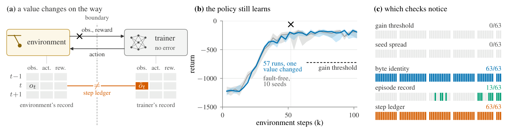
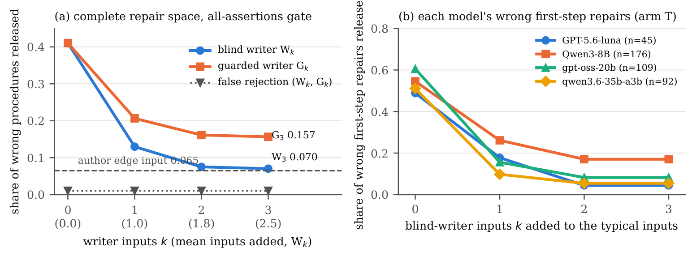

Two apparently successful failures stand out: an RL policy keeps learning after boundary data have changed, and an API repair passes typical-input tests while violating hidden obligations. The studies move observation toward execution, through records on both sides of a protocol and inputs that expose migration semantics. For inference, FastAFD’s hardware measurements and SiliconForge’s deployment model answer different questions: saturated decode efficiency versus a whole service including prefill, power and SLOs. The remaining work brings comparable attention to evidence into database testing, log detection, harness evolution and long-horizon coding, exposing distinctions hidden by aggregate scores.

<h2 class="daily-paper-title" id="paper-arxiv-2611.08144">01 · Silent RL faults: a healthy learning curve can hide a broken boundary</h2>

[Detecting Silent Faults at the Environment-Trainer Boundary in Reinforcement Learning](https://arxiv.org/abs/2611.08144)  
Zuo Gou, Chenhao Lu · 2026-11-05

### Why reward curves cannot establish boundary correctness

Robot RL often runs environments in another process, machine or language. A trainer can keep receiving correctly shaped data and learn an apparently healthy policy even when observations, actions, rewards or termination flags are altered in transit. The paper makes this boundary an explicit protocol and asks whether both sides recorded the same interaction.

An infer message carries environment indices, step IDs and observations. The server returns an action chunk; feedback then carries its summed reward, end flags and final observation. The environment resets locally, with termination distinguished from time-limit truncation. Structural errors are rejected, and missing steps must not be filled with fabricated feedback. These conventions expose semantic differences otherwise hidden inside adapters.

### Put independent observations on both sides of the fault

Using SB3 PPO on Pendulum, HalfCheetah, Hopper and Pusher, the authors inject up to 23 boundary faults and two trainer-log faults. Doses range from one changed value to fractions or all values. Faults include zeros, stale values, another environment’s data, reduced-precision rounding and incorrect episode-end flags.

Unless every value is wrong, a learning-gain threshold detects at most one run in ten; comparison with ten fault-free seeds detects at most 21%. Clean evaluation of all 1,060 final policies gives a similar warning: among 728 boundary-fault runs passing both curve checks, 723 remain within three standard deviations below the fault-free mean. **Little apparent quality loss does not establish a correct experiment.** Weights and logged returns can already have changed enough to distort comparisons.

<a class="note-image-link" href="/assets/images/digest/2026-11-07/rl-boundary.png" target="_blank" rel="noopener" aria-label="Boundary records, apparently healthy learning curves and fault detection by each check · View original image ↗">View original image ↗</a>

*Read left to right: reconcile the same step across the boundary, observe that learning still improves, then compare which checks detect the altered execution.*

A step ledger wraps the environment and the trainer interface separately, recording observations, applied actions and returned results. A fault between those points produces a disagreement at a particular step and field. It detects every injected boundary fault in the tested Pendulum, Hopper and Pusher runs, with no differences in fault-free runs. Median training-time overhead is 3% on Pendulum. A separate environment-side episode record checks logged returns, lengths and counts, but cannot cover every observation or action fault.

### From successful training to reconcilable execution

The contribution is localized execution evidence rather than another learned anomaly detector. It also demonstrates the limits of final-weight byte identity: twelve Hopper final-observation faults leave weights unchanged because the trainer never reads those values. Across machines, numerical differences make final-weight identity unsuitable in the first place.

The experiments cover four state-based, dense-reward simulators, one training algorithm and three injection seeds. They do not establish the same outcome for images, sparse rewards or real robots. Ledger comparison is post-run, with about 150 MB per Hopper run, rather than a lightweight online service. A wrapper also cannot detect an environment’s internal mistake. The transferable reliability idea is to specify boundary semantics and retain independently reconcilable evidence on both sides.

<h2 class="daily-paper-title" id="paper-arxiv-2611.08269">02 · Accepted but Wrong: release gates need inputs that exercise the migration</h2>

[Accepted but Wrong: Silent Failures of LLM Code Repairs after API Migrations](https://arxiv.org/abs/2611.08269)  
Xiaobo Chen, Genliang Zhu, Ziyuan Wang, Chu Wang · 2026-11-05

### What can go wrong after execution succeeds

After a runtime or API upgrade, a repair can exit normally, return correctly typed output and pass every business assertion on typical inputs while violating the original obligation. Accepted but Wrong studies the release gate: how to prevent known-wrong repairs from being accepted.

The study constructs 73 tasks covering 60 documented changes in CPython, Node.js and SQLite, including seven unchanged controls. Programs are assembled from predefined fragments and executed on the real old and new runtimes. Hidden contracts check business outputs and file preservation. Exhaustive evaluation of this finite space separates gate inadequacy from a model’s choice of repair. This is not a free-form model-written-code experiment.

### Exercise the change described in the release note

Across the complete finite repair space of 52 affected test tasks in 49 change clusters, all consumer assertions on typical inputs release a task-mean 41.0% of hidden-wrong programs. Adding one author-written release-note edge input reduces this to 6.5%, while false rejection remains 1.0%. On fifteen newly added test clusters, the corresponding rate falls to 6.1%. The denominator is wrong programs, not all model calls or production incidents.

A second route uses a blind input writer that sees the requirement, release note and visible contract, but neither program, candidate fragments nor hidden inputs. It supplies up to three data inputs; the old program on the old runtime supplies expected outputs. GPT-5.6-luna’s inputs reduce wrong-program acceptance to 7.0%. Three generated inputs exactly match hidden inputs; removing those raises the result to 9.0%, so overlap contributes to the effect.

<a class="note-image-link" href="/assets/images/digest/2026-11-07/accepted-but-wrong-release-gates.png" target="_blank" rel="noopener" aria-label="View figure">View figure ↗</a>

*Figure 1. The left panel covers the full finite repair space; the right separates first-step wrong repairs by model. The axes show the number of additional inputs and the share of wrong repairs accepted.*

### A conservative-looking guard can discard the useful evidence

A preregistered guard asks the writer which old outputs remain binding after migration and retains only inputs marked legacy-binding. It performs worse: 15.7% wrong acceptance, with no false-rejection improvement. It removes precisely the inputs that expose the change. Deciding which legacy behavior remains an obligation can reproduce the original misunderstanding of the release note.

Further frozen stages enlarge the menu to 1,491 fragments and add 233 difficult distractors that mimic legacy output on typical inputs. Edge inputs and the frontier-model writer still help, but respectively admit 16.8% and 15.3% of the hard wrong programs. Two local-model writers fail their preregistered tests, and repairer self-tests do not consistently match the stronger writer.

The practical mechanism is to anchor test generation to specific migration semantics and obtain expected values from actual runtimes. Its limits matter: authors construct tasks, fragments and hidden contracts. A blind AI audit flags 34 contracts as overly strict; removing disputed checks changes no verdicts, but class-label disputes remain and there is no human contract review. The evidence supports coverage improvements in a finite repair setting, not a safety guarantee for automatic release of arbitrary generated patches.

<h2 class="daily-paper-title" id="paper-arxiv-2611.07149">03 · FastAFD: wide EP puts disaggregation gains in perspective</h2>

[FastAFD: When Does Attention-FFN Disaggregation Pay on Rack-Scale NVLink?](https://arxiv.org/abs/2611.07149)  
Yichao Fu, Yuxuan Zhang, Minshen Zhang, Ruitian Wang, Junda Chen, Hao Zhang · 2026-11-04

FastAFD separates attention and expert pools on GB200 NVL72, alternating two microbatches to overlap local attention with remote MoE. GPU-initiated one-sided communication, a fused expert kernel and whole-step CUDA graphs reduce host overhead exposed by the fast fabric.

The baseline changes the conclusion. vLLM tunes EP4–EP64 separately at 4K–16K contexts, and every expert-pool GPU is charged. Gains of 1.30–2.36× over EP4 narrow to 0.99–1.17× over the best wide EP. The explanation factors throughput into batch gain, overlap gain and dedicated-expert cost; the analytical predictor is within about 3% on the authors’ measurements. These are saturated steady-state decode measurements, excluding prefill, queueing and a full serving SLO. Speculation uses a simulated fixed acceptance rate. SiliconForge below studies a different, deployment-level denominator, so the two sets of ratios should not be compared directly.

<h2 class="daily-paper-title" id="paper-arxiv-2611.08299">04 · SiliconForge: faster decode need not improve the whole deployment</h2>

[Should You Split Decode? Disaggregation Across Future Models and Accelerators](https://arxiv.org/abs/2611.08299)  
Ramyad Hadidi · 2026-11-05

SiliconForge searches serving decomposition and hardware assignment separately. Under a common power budget it compares P/D with P/D+AFD in SLO goodput per kW, including prefill replicas, KV capacity, cross-pool transfers and queueing. Main comparisons across four model directions, four accelerator classes and two fabrics establish no robust deployment-level AFD advantage. The largest nominal lead comes from fitting one additional prefill replica.

This complements FastAFD’s measured decode results. A faster FFN may be hidden behind attention, and power or pool-sizing granularity can consume its benefit. Calibration checks also expose TTFT and absolute-throughput prediction problems; paired cross-class hardware measurements are absent. Read it as capacity planning and sensitivity analysis rather than verified future-hardware rankings. Adjustable mappings and pool sizes are its most useful operational implication.

<h2 class="daily-paper-title" id="paper-arxiv-2611.07754">05 · GraphWeave: execution plans reveal ineffective metamorphic tests</h2>

[Uncovering Systematic Blind Spots in Graph Database Testing through Integration and Process-Level Analysis](https://arxiv.org/abs/2611.07754) ([v1 PDF](https://arxiv.org/pdf/2611.07754) · [HTML](https://arxiv.org/html/2611.07754v1) · [DOI](https://doi.org/10.48550/arXiv.2611.07754))  
Tinghan Li, Aoyang Fang (The Chinese University of Hong Kong, Shenzhen), Longbin Lai (Alibaba Group), Zifan Xie (Chongqing University), Hongbo Zhao (Beijing University of Posts and Telecommunications), Yu Shao (Alibaba Group), Ying Zhang (Zhejiang Gongshang University), Pinjia He (The Chinese University of Hong Kong, Shenzhen) · `arXiv:2611.07754v1 [cs.SE]` · Submitted 2026-11-05 (`v1` only at verification time, with no revision or withdrawal; PDF notes an author preprint submitted to ACM TOSEM, not yet peer reviewed or accepted; no standalone `GraphWeave` repository URL is published in the preprint)

Automated database testing methods cannot be judged solely by runtime hours or raw alert counts; what determines developer usability is how many genuine defects survive noise and how many test pairs retain actual fault-finding power after query optimization. `GraphWeave` unifies capabilities from **eight graph-database testing methods** spanning differential, statement-metamorphic, and graph-derived testing under one execution skeleton while logging graph states, derivation traces, semantic assumptions, output rows, and `EXPLAIN` execution plans as first-class artifacts. Process-level analysis reveals two systematic blind spots: 12-hour campaigns across three mature systems emit `4,114` raw reports of which **`76.2%` (`3,136`) are false positives** and most remaining alerts are duplicates; simultaneously, **`5.50%–34.21%`** of comparable equivalence-metamorphic query pairs compile to the **exact same execution plan** on the same graph state, eliminating oracle contrast by construction. Realizing five distilled guidelines into plan-aware triage, an evidence-gated multi-agent pipeline, and dual feedback channels, `GraphWeave` uncovers **19 previously unknown, developer-confirmed bugs** (`13` already fixed) in `NeuG 0.1.1`, a recently open-sourced industrial embedded graph DBMS untested by prior work. All measurements and audit boundaries below trace strictly to `arXiv:2611.07754v1` (Tables 1–7, Figures 1–10).

### 1. Why naive method stacking fails: 4,114 raw reports and optimizer plan collapse

Despite diverse construction heuristics, all eight integrated methods reduce in `Algorithm 1` to varying one axis of <code>O = execute(S, Q, t)</code> (database snapshot <code>S</code>, Cypher statement <code>Q</code>, and target system <code>t</code>, returning normalized rows alongside execution plans): **graph-derived testing** (`Gamera`, `GSlicer`) varies `S` via <code>δ = f(S)</code>; **statement metamorphic testing** (`GDBMeter`, `Gamera`, `GraphGenie`, `GraspDB`, `GRev`, `Dinkel`, with `Gamera` spanning both query- and graph-derived capabilities) varies `Q` via <code>δ = g(Q)</code>; and **differential testing** (`GDsmith`) varies `t` over systems <code>T</code>. Running 12-hour isolated containerized campaigns with default optimizers enabled against `Neo4j 2026.03.1` (DB-Engines Rank 1, 16.8k stars), `Memgraph 3.9.0` (Rank 13, 4.2k stars), and `FalkorDB 4.16.0` (Rank 22, 4.7k stars)—plus one joint differential campaign for `GDsmith`—exposes two blind spots invisible to verdict-only harnesses:

- **Blind Spot 1 (RQ1–RQ2)**: **false-positive and duplicate floods**. Manual inspection of all `4,114` raw reports confirms `3,136` false positives (`76.2%`). Even after removing false positives, redundancy dominates: `GraphGenie` on `FalkorDB` emits `527` raw reports (`249` FPs), where all **`278` remaining reports map to 1 unique bug**; `Gamera` on `Memgraph` emits `234` raw reports (`123` FPs), where all **`111` remaining reports map to 1 bug**; and `GraspDB` yields `100%` FPs on both `Neo4j` (`40/40`) and `FalkorDB` (`35/35`). Table 3 categorizes false positives into four root causes: `Impl.` (divergences between a ported reference tool and its paper spec, driving `59.2%` of `GraphGenie` FPs and `35.8%` of `GDBMeter` FPs), `Graph Sem.` (graph pattern-matching semantic mismatches affecting 5 of 8 methods and exceeding half of FPs in `Gamera` `75.6%`, `Dinkel` `56.2%`, and `GDsmith` `51.1%`), `Null/Pipe` (null/clause-pipeline assumptions, `41.1%` in `GSlicer` and `34.7%` in `GraspDB`), and `Dialect` (syntax incompatibilities, `70.8%` in `GRev` and `64.2%` in `GDBMeter`).
- **Five legitimate pattern-matching profiles across eight Cypher systems (§2.2 & Table 4)**: Formalizing a match within uniqueness scope <code>U</code> via its visible edge sequence <code>ρ = ⟨e₁, …, eₖ⟩</code> and bag multiplicity <code>m(ρ) = #{ω : vis(ω) = ρ}</code> over traversal witnesses <code>ω</code> exposes three orthogonal choices: (1) **legality** (`no reuse` in `Neo4j`, `Memgraph`, `ArcadeDB`, `Apache AGE`, `NebulaGraph` vs. `edge reuse` in `FalkorDB`, `NeuG`, `Kuzu`); (2) **multiplicity** (`single` in `Neo4j`, `Apache AGE`, `NebulaGraph`, `FalkorDB`, `length-amplified` under variable-length traversal in `Memgraph` and `ArcadeDB`, or `per-direction` emitting two witnesses on a one-hop undirected self-loop in `NeuG` and `Kuzu`); and (3) **reset boundary** (`MATCH clause` in `Neo4j`/`Memgraph`/`ArcadeDB` vs. `comma-pattern` in `Apache AGE`/`NebulaGraph`; `n/a` when edge reuse is allowed). Across eight systems, these choices form **five distinct profiles**. Cross-system divergence between internally consistent profiles yields false positives (e.g., Fig. 2 `GDsmith` anonymous two-hop pattern on one self-loop: `Neo4j` `0` vs. `FalkorDB` `1`; Fig. 3 `Dinkel` `[*2..2]` vs. `[*1..1]-()-[*1..1]` on two self-loops: `Neo4j` `2/2` vs. `Memgraph` `4/8` due to bag-semantic direction amplification). Conversely, **intra-system contradiction across equivalent forms signals a genuine bug** (Finding 5, Fig. 4): on `FalkorDB`, exact-length `[*2..2]` matches `Neo4j` and `Memgraph` with `2` rows, whereas explicit two-hop and split forms admit repeated edges `[r1, r1]` and `[r3, r3]` and return `5` rows.
- **Blind Spot 2 (RQ3)**: **5.50%–34.21% optimizer-induced plan collapse**. Across three independent seeds capped at `5,000` comparable pairs per `(method, system)` run (agreeing within `1.3` percentage points), Table 5 shows that `5.50%–34.21%` of equivalence-metamorphic pairs compile to identical plan hashes on the same graph state. Identical plans executed on identical state `S` produce identical results by construction—wasting testing budget and staying silent even when the shared plan itself is buggy. Resolving `Neo4j` into `54` equivalence-preserving transformations (Fig. 5) reveals that **`33` never collapse (`0%`)** while `21` collapse up to `100%` based on syntactic/semantic structure rather than originating tool. Controlled tests on a skewed graph (<code>card(A)=5, card(B)=500, card(C)=50</code> with `500` `R`- and `500` `S`-edges) isolate two collapse mechanisms and one survival mechanism: (1) **rule-based collapse (data-independent, Fig. 6)**—reversing `(a)-[:R]->(b)` to `(b)<-[:R]-(a)` plus `WHERE true` always canonicalizes to `NodeByLabelScan(a:A)`; (2) **cost-based collapse (cardinality-driven, Fig. 7)**—comma-pattern reordering converges to anchor on rarest label `A`, shifting the shared anchor to `Z` when a symmetric `P→Q→Z` chain puts <code>card(Z)=5</code> at the opposite end; and (3) **collapse resistance (Finding 7, Fig. 8)**—`GraspDB` injects net-zero write sequences (`CREATE (c0 {id:-1}) DELETE c0`), which rule rewriting cannot drop as dead code and which force `Neo4j` to insert an `Eager` read/delete barrier blocking cost reordering (the higher `26.67%` / `33.24%` collapse rates for `GraspDB` on `Memgraph` / `FalkorDB` reflect dialect rejection of write-bearing variants rather than stronger optimizers).

| Method (Year & Family) | Raw Reports (N / M / F Sum) | False Positives & Rate (Table 2) | Unique Bugs (N / M / F) | FP Breakdown (Table 3: Impl. / Graph Sem. / Null-Pipe / Dialect) | Same-Plan Collapse (Table 5: Neo4j / Memgraph / FalkorDB) |
| :--- | :--- | :--- | :--- | :--- | :--- |
| `Gamera` (2023, Graph-derived + Stmt Meta) | `510` (`98 / 234 / 178`) | `333` (`65.3%`) | `1 / 1 / 2` | `10.8% / 75.6% / 0% / 13.6%` | N/A (non-equivalence) |
| `GSlicer` (2025, Graph-derived cutting) | `902` (`128 / 362 / 412`) | `647` (`71.7%`) | `1 / 1 / 1` | `11.9% / 43.0% / 41.1% / 4.0%` | N/A (subgraph slice) |
| `GDBMeter` (2023, Stmt Meta · non-equiv) | `146` (`0 / 12 / 134`) | `134` (`91.8%`) | `0 / 1 / 0` | `35.8% / 0% / 0% / 64.2%` | N/A (non-equivalence) |
| `GraphGenie` (2024, Equiv. Stmt Meta) | `714` (`54 / 133 / 527`) | `436` (`61.1%`) | `0 / 0 / 1` (F: 278 dupes) | `59.2% / 0% / 24.5% / 16.3%` | `11.29% / 15.34% / 18.94%` |
| `GraspDB` (2024, Equiv. + Net-Zero Write) | `75` (`40 / 0 / 35`) | `75` (`100.0%`) | `0 / 0 / 0` | `32.0% / 18.7% / 34.7% / 14.6%` | `5.50% / 26.67% / 33.24%` |
| `GRev` (2024, Equiv. Stmt Meta) | `79` (`9 / 60 / 10`) | `24` (`30.4%`) | `0 / 1 / 1` | `29.2% / 0% / 0% / 70.8%` | `13.71% / 5.79% / 19.76%` |
| `Dinkel` (2026, Equiv. Stmt Meta) | `104` (`22 / 36 / 46`) | `48` (`46.2%`) | `3 / 3 / 1` | `0% / 56.2% / 0% / 43.8%` | `27.44% / 17.44% / 34.21%` |
| `GDsmith` (2023, Joint 3-DBMS Differential) | `1,584` (joint run) | `1,439` (`90.8%`) | `2` (joint) | `4.9% / 51.1% / 31.0% / 13.0%` | N/A (differential) |
| **Empirical Study Total (12h × 3 DBMSs)** | **`4,114`** | **`3,136` (`76.2%`)** | Per-cell above | `Graph Sem.` affects `5/8` methods | **`5.50%–34.21%`** (3-seed mean) |

*Table 1 · 12-hour integrated study across eight testing methods on Neo4j 2026.03.1 (N), Memgraph 3.9.0 (M), and FalkorDB 4.16.0 (F) (from `arXiv:2611.07754v1` Tables 1–3 and Table 5; per-method aggregate sums and percentages such as `65.3%` are summed directly from Table 2 counts, matching the reported totals `4,114` and `3,136 [76.2%]`; Table 5 averages 3 seeds × 5,000 comparable pairs with ≤1.3 pp spread).*

### 2. GraphWeave architecture: plan-aware triage, multi-agent diagnosis & dual feedback

<figure class="note-figure"><a class="note-image-link" href="/assets/images/digest/2026-11-07/graphweave-plan-aware-testing-en.svg" target="_blank" rel="noopener" aria-label="View original GraphWeave architecture diagram showing unified execution, plan-aware triage, and dual-channel multi-agent feedback">View original image ↗</a><figcaption>Figure 1 · GraphWeave architecture and feedback channels (from arXiv:2611.07754v1 §§3–5 &amp; Fig. 9): EXPLAIN triage drops optimizer-collapsed pairs before result execution while evidence-gated agents separate dialect adaptation from issue-gate deduplication.</figcaption></figure>

Translating five study guidelines (`G1` preserve process data, `G2` separate semantic FPs via intra-system contradiction, `G3` encode graph semantics as explicit oracle preconditions, `G4` skip optimizer-collapsed follow-ups, `G5` favor optimization-surviving transforms), `GraphWeave` combines two tightly coupled mechanisms:

1. **Plan-Aware Triage of Metamorphic Pairs (§5.4)**: Before running result comparisons on an equivalence pair, `GraphWeave` fetches and compares `EXPLAIN` execution plans across three routes: (1) **same plan on the same graph state**—results agree by construction, so the pair is **skipped before execution**, reclaiming the `5%–34%` wasted budget with zero forfeited discoverable bugs; (2) **different plans, identical results**—the correctness oracle passes, yet divergent plans on equal inputs indicate potential missed optimizations, so execution times are logged for performance tracking; (3) **different plans, differing results**—oracle power holds, routing the candidate logic bug into postprocessing. Because triage reads only fields already captured on §3's shared execution path, every equivalence-based tool benefits without per-method modification.
2. **Rule-Based Issue Gating & Capability-Aware Clustering (§5.1)**: Standardized artifacts (violation records, construction traces, oracle assumptions, `EXPLAIN` plans, and outputs) first hit an **Issue Gate** that matches known root-cause families. Surviving reports are grouped by originating capability tags and refined with report embeddings; each cluster is summarized by its **medoid** (smallest average cosine distance) and **farthest outlier** to stay within LLM context limits.
3. **Evidence-Gated Multi-Agent Analysis (§5.2)**: Implemented on `Claude Code` backed by `claude-sonnet-4-6` (default decoding), a **Coordinator Agent** dispatches three prompt-specialized sub-agents and audits evidence completeness (triggering re-runs when support is missing) before accepting any disposition:
   - **Cluster-Splitting Agent**: compares the medoid and farthest outlier, splitting heterogeneous clusters into two sub-clusters;
   - **Deep-Analysis Agent**: pairs a human-distilled **delta debugging** skill [43] (shrinking the witness graph and query while preserving failure signal) with source-level **dynamic debugging** attached to a target debug build and a §4 semantic-ambiguity skill. Classifying a cluster as a `known issue` or `new bug` strictly requires dynamic-debugging runtime evidence, supporting documentation, and a filtering rule with positive and negative validation cases; classifying a semantic false positive requires explicit proof of internal profile consistency;
   - **Rules-Synthesis & Spec Applier Agents**: activate only after coordinator sign-off to emit validated gate or adapter specifications.
4. **Two Non-Interchangeable Feedback Channels (§5.3)**: `GraphWeave` strictly separates **request-level adapter updates** (for dialect FPs, rewriting or lowering the full `[target DB, graph state, query]` request—or rejecting unsupported request shapes—strictly within evidence bounds without altering test intent) from **root-cause-level gate updates** (for confirmed bugs and duplicates, registering multiple symptom patterns under an `Issue Family` solely for noise reduction rather than automated bug repair). Cross-routing breaks testing: sending a real bug to the adapter alters valid inputs and hides future defects, whereas sending a dialect FP to the gate keeps generating invalid queries.

### 3. Empirical evaluation on NeuG 0.1.1: workload reduction, human audits & 19 confirmed bugs

<figure class="note-figure"><a class="note-image-link" href="/assets/images/digest/2026-11-07/graphweave-neug-bug-triage-eval-en.svg" target="_blank" rel="noopener" aria-label="View original GraphWeave empirical evaluation chart across three mature systems and NeuG 0.1.1">View original image ↗</a><figcaption>Figure 2 · Empirical audit summary (from arXiv:2611.07754v1 Tables 2–7, Fig. 10 &amp; §§4–7): baseline false-positive funnel and plan collapse, NeuG batch compression, 100-sample validation recalls, and method-level bug saturation.</figcaption></figure>

Section 6 applies the complete eight-method platform to **`NeuG 0.1.1`**, an industrial embedded graph database open-sourced by Alibaba's GraphScope team (`118` GitHub stars in June 2026, default optimizer enabled, untouched by prior graph DB testing work). Campaigns follow the identical 12-hour containerized setup; automated dispositions serve solely as reviewer aids, with **two authors independently auditing every report** (resolving disagreements via discussion) before checking duplicates and reporting new defects upstream.

| Evaluation Slice & Source | Filtering & Clustering Flow | Quantitative Outcomes | Operational & Audit Interpretation |
| :--- | :--- | :--- | :--- |
| Continuous `Batch #1` (Table 6) | `26` raw → `13` kept → `3` clusters → `4` units | `2` adapter / `1` gate / `1` bug family; **`84.6%` reduction** | Cluster mixing `>2` root causes left `1` bug unexamined until surfacing in `Batch #3` |
| Continuous `Batch #2` (Table 6) | `17` raw → `13` kept → `3` clusters → `3` units | `1` adapter / `2` gate / `0` bug families; **`82.4%` reduction** | Homogeneous 1:1 cluster-to-unit mapping; zero real defects dropped |
| Continuous `Batch #3` (Table 6) | `12` raw → `9` kept → `3` clusters → `4` units | `1` adapter / `2` gate / `1` bug family; **`66.7%` reduction** | Across batches, cuts human review volume to roughly **1/6 to 1/3** of raw output |
| Analyzed Reports Audit (Table 7a, `n=100`) | Random sample of `100` agent-analyzed reports vs. two-author ground truth | Agreement **`91%`** (`91/100`); Real-bug recall **`100%`** (`29/29`); FP recall **`87.3%`** (`62/71`) | `29` retained bug reports deduplicate to **`3` unique bugs**; deliberate conservative bias escalates `9` FPs to avoid unrecoverable bug drops |
| Issue-Gate Exclusions Audit (Table 7b, `n=100`) | Random sample of `100` gated-out reports checked for missed new defects | Duplicate issues **`100%`** (`100/100`); Missed new bugs **`0%`** (`0/100`) | Narrowly scoped gate rules eliminate duplicate triage without suppressing novel defects |
| 8-Method Saturation on `NeuG` (Fig. 10) | Run each method until unique-bug count plateaus (new hits gated as dupes) | `Dinkel` `9`, `GraspDB` `4`, `GraphGenie` `3`, `GSlicer` `3`, `GDBMeter` `3`, `GDsmith` `2`, `GRev` `2`, `Gamera` `2`; **Union `19`** | All **`19` reported & confirmed** upstream (`13` fixed); no single method finds `>9/19` (e.g., `Dinkel` still misses `GSlicer` bugs) |

*Table 2 · Postprocessing workload reduction, 100-sample human validation audits, and 8-method bug discovery saturation on `NeuG 0.1.1` (verbatim metrics from `arXiv:2611.07754v1` Tables 6–7 and Fig. 10).*

Two design interactions explain why compression avoids losing genuine defects. First, although centroid-plus-outlier sampling can miss a third root cause inside an overly mixed cluster in a single batch, retaining un-gated triggers lets that missed bug resurface cleanly as an outlier in a subsequent batch (`Batch #1 → Batch #3`). Second, the multi-agent system's `87.3%` false-positive recall reflects an intentional safety bias (`9/71` FPs escalated as potential bugs), trading minor extra review effort for `100%` recall across audited genuine defect reports.

### 4. Scientific boundaries, threats to validity & engineering takeaways

Section 7 and the empirical protocol establish four explicit scientific boundaries separating validated evidence from out-of-scope claims:

1. **Decision support rather than autonomous oracle**: All bug counts on `NeuG` rely on two-author independent inspection and upstream developer confirmation; `claude-sonnet-4-6` remains imperfect (`91%` human agreement), and dynamic debugging assumes access to a target **debug build** capable of attaching a source-level debugger (unavailable for closed black-box deployments).
2. **`19` confirmed bugs ≠ completeness; missing `NeuG`-specific collapse & API cost metrics**: Reaching duplicate saturation within 12-hour budgets reflects a per-version discovery ceiling under those methods rather than total residual defect density. Moreover, while Table 5 quantifies `5.50%–34.21%` plan collapse on `Neo4j`/`Memgraph`/`FalkorDB`, Section 6 omits a `NeuG`-specific collapse percentage or end-to-end ablation isolating `EXPLAIN` triage savings on `NeuG`, and does not publish token consumption, API cost, or wall-clock latency of the `claude-sonnet-4-6` postprocessing pipeline.
3. **Cypher-only scope & conservative plan-hash lower bound**: Results cover four Cypher systems (`Neo4j`, `Memgraph`, `FalkorDB`, `NeuG 0.1.1`, plus static semantic profiles on four more Cypher engines in Table 4) and cannot transfer automatically to multi-option GQL path semantics or Gremlin/RDF engines. Section 7 construct validity further notes that within-system plan-hash matching only flags identical plan representations, making `5.50%–34.21%` a **conservative lower bound**—and equivalence metamorphic pairs still cannot detect bugs residing inside a shared compiled plan.
4. **Reference implementation noise & artifact availability**: Table 3 reveals substantial `Impl.` false positives when porting existing tools (`59.2%` in `GraphGenie`, `35.8%` in `GDBMeter`); Section 4.3's FP cause analysis is qualitative over single 12-hour campaigns rather than multi-seed rate estimation; and the `v1` TOSEM-submitted preprint does not yet link a public `GraphWeave` code repository.

For **automated DBMS testing and reliability agent engineering**, three lessons transfer directly: (1) **promote execution plans and derivation traces to first-class test logs**—equivalence oracles without plan comparison waste up to a third of testing budget on optimizer-canonicalized no-ops; (2) **codify target semantic profiles and test for intra-system self-contradiction**—cross-system disagreements across underspecified `legality × multiplicity × reset boundary` dimensions are weak bug signals compared to a single engine contradicting itself across equivalent query shapes; and (3) **restrict LLM agents to evidence-backed triage and rule synthesis over isolated feedback channels**—requiring delta-minimized witnesses plus dynamic debugger traces while strictly isolating dialect adaptation from root-cause deduplication gates makes high-volume fuzzing practical with modest human review effort.

Source: [Uncovering Systematic Blind Spots in Graph Database Testing through Integration and Process-Level Analysis](https://arxiv.org/abs/2611.07754)
<h2 class="daily-paper-title" id="paper-arxiv-2611.07760">06 · Log anomaly detection: data and preprocessing resist a universal ranking</h2>

[Fast Unsupervised Anomaly Detection Methods on Software Logs - An Empirical Study](https://arxiv.org/abs/2611.07760)  
Jesse Nyyssölä, Mika Mäntylä, Yuqing Wang · 2026-11-05

The study crosses seven datasets, four unsupervised methods, words/trigrams/parsed-event representations and preprocessing switches for anomaly filtering, shuffled sampling and message extraction. Regression relates these factors to AUCROC, F1 and runtime. No configuration wins universally: parsing helps some datasets and removes useful information in others; OOV detection particularly depends on clean training data.

For AIOps, the negative findings and cost breakdown are useful. Random training selection does not consistently inflate performance in the tested unsupervised methods, unlike the supervised comparison. This does not license shuffling arbitrary temporal evaluations. Word features with OOV, KMeans or RarityModel are faster options, but event-level versus sequence-level labels and unequal sampling fractions constrain transfer.

<h2 class="daily-paper-title" id="paper-arxiv-2611.07624">07 · Agent evolution: new successes can conceal lost capabilities</h2>

[Beneath the Surface: What We Overlook When We Talk About Agent Evolution](https://arxiv.org/abs/2611.07624)  
Xiaobo Wang, Zimu Wang, Siyu Ye, Jiaqi Li, Min Tang, Jun Bai, Yuling Shi, Ruobing Wang, Jingjing Zhang, Chaofan Wang, Kai Wu, Mengnan Qi, Kai Cai, Xiaodong Gu, Qi Liu, Zilong Zheng · 2026-11-05

Beneath the Surface fixes GPT-5.4 and compares four harness-evolution methods across two harnesses and general/coding tasks, evaluating frozen champions eight times. All sixteen lineages gain new task coverage while losing old coverage. One general-task configuration gains 5.2 percentage points in average reliability yet loses ten previously covered tasks.

Interventions examine parent selection, component combinations and admission gates. The highest-scoring parent does not necessarily yield the largest subsequent mean gain, and stricter admission can reject useful alternatives. Most reliability gains increase deployment cost; transfer preserves benefits selectively. This complements Multi-step SWE: one measures preservation across evolved versions, the other continuity on an evolving codebase. These findings concern the tested model, harnesses and benchmarks, not inevitable regression from every evolution method.

<h2 class="daily-paper-title" id="paper-arxiv-2611.08417">08 · Terminal-Bench 2.1: benchmarks accumulate maintenance debt</h2>

[Benchmarks as Software: Terminal-Bench and the Case for Continuous Benchmarks](https://arxiv.org/abs/2611.08417)  
E. Kelly Buchanan, Crystal Zhou, Scott W. Linderman, Christopher Ré · 2026-11-05

This paper treats instructions, environments, reference solutions, verifiers and budgets as maintained software. A workflow gathers static files, prior trajectories and community reports, proposes evidence-backed repairs, reruns the reference solution and leaves adjudication to maintainers. Twenty-eight of Terminal-Bench 2.0’s 89 tasks are revised for environment issues, instruction–verification mismatches or dependency drift.

Re-evaluating nineteen agents preserves high 2.0/2.1 rank correlation, 0.958, while moving individual scores and close rankings. Extending time budgets closes much of the tested harness gap. High correlation does not make the old measurements unbiased. The reported 57.1% precision and 71.4% recall against the final release are retrospective agreement because the workflow helped construct that repair set. This is evidence for maintainer-assisted triage, not independent defect-detector validation.

<h2 class="daily-paper-title" id="paper-arxiv-2611.07166">09 · Multi-step SWE: later requests inherit the agent’s own code</h2>

[Multi-step SWE: Can Coding Agents Keep Building on Their Own Code Over Long Horizons?](https://arxiv.org/abs/2611.07166)  
Xiangkai Zeng, Zheng Liu, Zihao Lin · 2026-11-04

Multi-step SWE chains five to fifteen dependent steps in each of 69 tasks, spanning optimization, feature work, version upgrades and migration across nine languages. Each step inherits the agent’s cumulative workspace, carrying earlier design choices and errors forward. Verification runs in a separate container, and later steps are scored even after an earlier failure.

Across nine model–harness combinations and four runs per task, the best full-chain solve rate is 18.5%, versus 56.8% of individual steps passed and 31.9% of tasks solved at least once within four runs. These denominators are different. No model solves 38 tasks. This measures continuity closer to ongoing development, but an isolated-step baseline starting from correct reference prefixes is future work, so later failures cannot all be attributed to accumulated errors. C/C++ also accounts for 38 of 69 tasks.

## Related notes

- [Reshard: transfer the shards RL inference actually needs](/tech/en/reshard-rl-refit/)
- [Zero Mismatch: remove numerical drift before correcting policy lag](/tech/en/zero-mismatch-async-rl/)
- [Agent memory: separate capture, correction and retrieval](/tech/en/components-agent-memory/)
- [XM-Sparse: sparse reads still need full-cache capacity and bandwidth](/tech/en/xm-sparse-xmem/)
- [Bits Investigation: simpler loops and tool-side evidence processing](/tech/en/bits-investigation-efficiency/)
