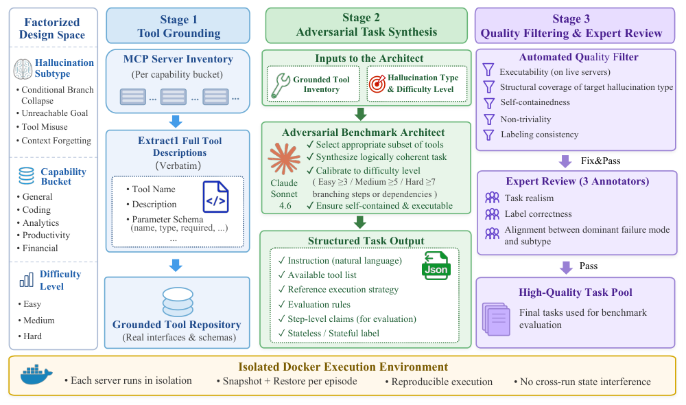
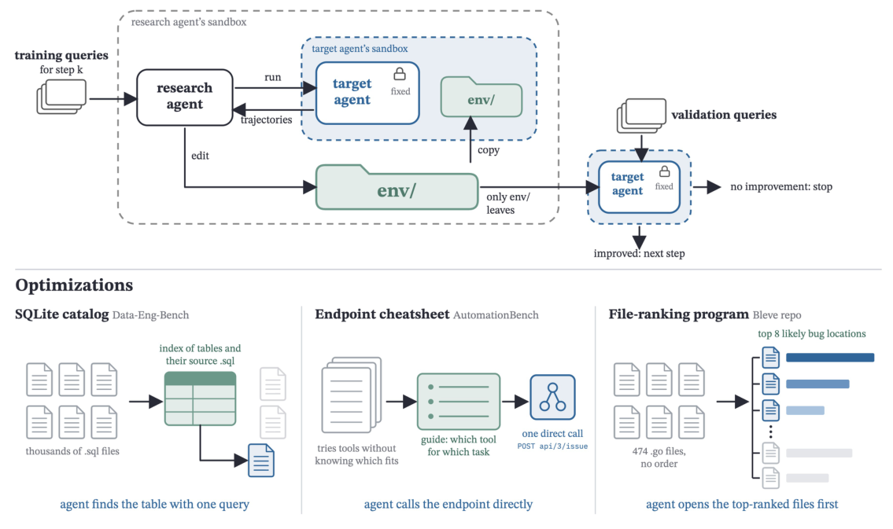
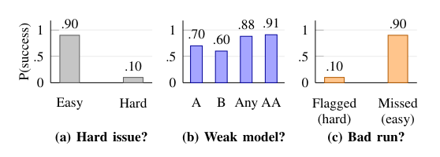
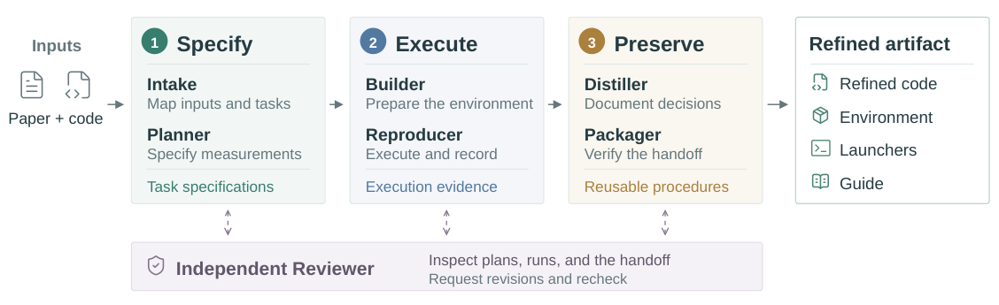
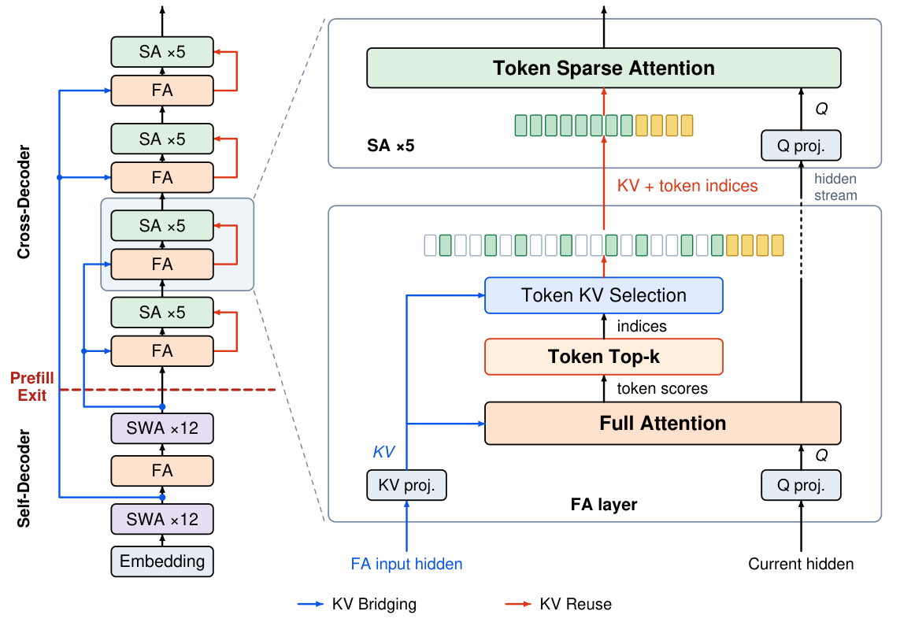
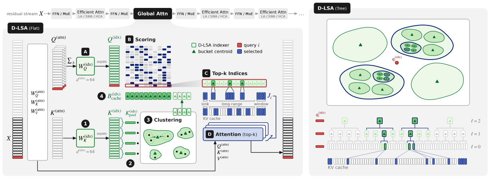

Three questions connect this issue: whether agents recognize unavailable capabilities, whether failure alarms identify runs worth intervening on, and whether shared environments can reduce repeated exploration. MCPHallu tests capability boundaries, the failure-prediction study separates difficulty from ability and run variation, and EnvOpt reorganizes access to information. These affect acceptance testing, monitoring, and execution cost in different ways.

Three further papers examine preserving reproduction knowledge, cross-layer state sharing, and long-context indexing. Independent Tech Notes connect these concerns to prompt caching, formal runtime monitoring, startup recovery, binary compatibility, and evaluator repairs. Their efficiency results depend on the workload and measurement layer.

<h2 class="daily-paper-title" id="paper-arxiv-2611.07689">MCPHallu: measuring action beyond available capabilities</h2>

[MCPHallu: Benchmarking Reasoning, Execution, and Memory Hallucinations in MCP Agents](https://arxiv.org/abs/2611.07689)  
Yizhen Jiang, Haowei Guo, Tianyi Bai, Zengjie Hu, Lu Ma, Zhengyang Zhao, Haoze Sun, Peng Pei, Wentao Zhang · arXiv · 2026-11-05

A task-success score cannot tell an operator whether an MCP agent planned incorrectly, selected the wrong tool, or lost an earlier observation. MCPHallu builds these risks into task construction instead of relying solely on labels assigned after execution. Its particularly useful move is to make recognizing an infeasible goal a successful behavior, directly testing false completion and continued action without the required capability.

<a class="note-image-link" href="/assets/images/digest/2026-11-08/arxiv-2611.07689.png" target="_blank" rel="noopener" aria-label="MCPHallu pipeline from real schemas to synthesis, filtering, and expert review · View original image ↗">View original image ↗</a>

*Read left to right: real tool schemas constrain synthesis, then automated checks and expert review filter tasks; container isolation limits state contamination across runs.*

The benchmark contains 358 tasks across 36 real MCP servers and five domains: search, analytics, productivity, finance, and coding. Four triggers define the main failure risks: mutually exclusive branches conditioned on live results; goals unsupported by available tools; tools with overlapping interfaces but different meanings; and intervening distractions between retrieving a value and using it. These instantiate Branch Collapse, Unreachable Goal, Tool Misuse, and Context Forgetting. The paper’s definition of hallucination includes treating an action inconsistent with the task, state, or tool capabilities as valid. Correctly reporting failure does not meet that definition.

Construction starts with schemas extracted from server implementations, followed by task synthesis, executability checks, and review by three annotators. Each evaluation starts from a clean container. Read-only outcomes are checked against reference scripts executed against live services; writes are checked through final-state assertions. A task-level dependency graph distinguishes a correct answer reached through a valid sequence from one that ignores required dependencies. For AgentOps, this is a useful separation between a convincing completion message and an actual change in an external system.

Language-model judgment is a minority component. Outcome checks contribute 60% and dependency checks 20% for branching and forgetting tasks. Structural checks contribute 70% for infeasible goals and tool misuse. The remaining weight supports semantic interpretation. Infeasible-goal scoring permits two probing calls before penalizing delayed recognition, so the benchmark rewards stopping after reasonable verification rather than immediate refusal whenever a task looks difficult.

Fourteen models produce 5,012 trajectories and average 0.642 on the composite score. Only 23.2% of infeasible-goal runs pass, with a mean score of 0.458. A model’s ranking spans an average of 6.9 positions across subtypes; branching and infeasible-goal scores correlate at −0.12. Aggregate quality can therefore hide a deployment-specific weakness.

These are targeted stress tests. The intended subtype is not a unique causal diagnosis of every trajectory: it was the primary failure in 81% of the human-reviewed failure sample. Tool inventories remain fixed within tasks, leaving dynamic server installation, cross-session memory, and authentication-state confusion outside the evaluation. The construction and scoring sections are the most useful reading for anyone designing acceptance checks that combine service state, action dependencies, and stopping behavior.

<h2 class="daily-paper-title" id="paper-arxiv-2611.07372">EnvOpt: optimizing the environment agents repeatedly inspect</h2>

[EnvOpt: Automated Optimization for Agent Environments](https://arxiv.org/abs/2611.07372)  
Mingxuan Li, Huanzhi Mao, Qiuyang Mang, Hanchen Li, Joseph E. Gonzalez, Alex Dimakis · arXiv · 2026-11-05

The same enterprise information can sit behind a remote tool, in searchable text, or in an indexed database. How much work an agent spends locating it depends on representation as well as model capability and harness design. EnvOpt treats the environment shared across tasks as a third optimization target, reorganizing information and access paths while holding the target model and harness fixed.

<a class="note-image-link" href="/assets/images/digest/2026-11-08/arxiv-2611.07372.png" target="_blank" rel="noopener" aria-label="EnvOpt environment editing, target-agent execution, and independent validation loop · View original image ↗">View original image ↗</a>

*Only the environment directory is transferred to the target agent above; examples below show a database catalog, endpoint guide, and file-ranking program.*

“Stationary” means many tasks share the same or similar artifacts, repositories, or business data, not that the system never changes. A research agent receives an environment directory, training queries, and a budget for running the target agent. It examines trajectories, edits the environment to remove expensive exploration, and tests candidates. Only the environment leaves the sandbox; changes to the target harness are discarded. A transformation program can also organize similar future environment instances.

Examples include directly readable email exports, API endpoint cheat sheets, a SQLite catalog over SQL files, and a program ranking likely relevant repository files. These changes reduce repeated interface discovery, parsing, and location searches. They should not be interpreted as inserting task answers into the environment. The paper also discusses rejected strategies, highlighting the need to preserve information required by later tasks.

Crucially, training without reference answers does not mean the entire optimization is verifier-free. Within a training step, the research agent uses proxy judgments and answer consistency because graders are hidden. After each step, separate validation tasks use verifiers to measure pass rate and cost. Worsening cost or an accuracy decline beyond tolerance causes a return to the preceding environment. Training subsets are disjoint between steps, and final results use held-out tasks.

For AutomationBench, the authors split 600 public tasks into 200 test tasks, 96 validation tasks, and the remaining training pool. Under the official harness in the detailed table, Haiku 4.5 rises from 2.33% to 16.67% success: a gain of 14.34 percentage points. Cost falls from $42.36 to $11.55, or 72.73%. The improvement is substantial, but the absolute success rate remains low. Transferring the environment to Opus 5 reduces cost by 68.13%, with success increasing from 33.83% to 35.17%.

Results across five benchmarks support an independent opportunity in environment representation. Transfer does not guarantee higher accuracy for every recipient: some non-target models regress slightly on Workspace-Bench and Data-Eng-Bench. Offline construction has a cost that subsequent tasks must amortize, and derived indexes or endpoint guides require maintenance as their sources change. The useful AgentOps contribution is turning repeated exploration into reusable, maintained artifacts and evaluating cost together with correctness.

<h2 class="daily-paper-title" id="paper-arxiv-2611.08285">Failure prediction: separating hard issues, weak models, and bad runs</h2>

[Hard Issue, Weak Model, or Bad Run? Rethinking Failure Prediction for Coding Agents](https://arxiv.org/abs/2611.08285)  
Xingyue Shi, Wesley K. G. Assunção · arXiv · 2026-11-05

After an agent raises a failure warning, should the system stop, switch models, or retry? This study separates predicting failure from identifying a useful remedy. A hard issue may require human help, insufficient capability may call for a stronger model, and an unlucky attempt is the most direct target for retrying. A score that mixes these causes can look accurate while selecting the wrong runs for intervention.

<a class="note-image-link" href="/assets/images/digest/2026-11-08/arxiv-2611.08285.png" target="_blank" rel="noopener" aria-label="Toy probabilities separating difficulty, model ability, and retry gains · View original image ↗">View original image ↗</a>

*These are illustrative probabilities, not measurements; an extra attempt alone can increase the coverage of an any-model oracle.*

The authors analyze 3,492 labeled SWE-bench Verified trajectories from seven models. Outcomes from another 16 models estimate issue difficulty. Predictors read partial trajectories without explicit issue text or model names, using TF-IDF logistic regression and a small LoRA-fine-tuned model on one cross-validation fold. The difficulty reference depends on outcomes normally unavailable at deployment; it is a diagnostic comparator, not a deployable prediction service.

Among 2,840 runs still active at step 20, the difficulty reference reaches 0.924 pooled AUROC, while trajectory predictors achieve approximately 0.624–0.630. Of the failed–successful pairs used in pooled evaluation, 99.66% compare different issues, so recognizing difficult issues can dominate the metric. Within an issue, model identity reaches 0.724 AUROC, still above the trajectory predictors at roughly 0.60–0.61. Predictors perform particularly poorly on upsets where the generally weaker model succeeds.

After controlling for issue difficulty and model ability, the incremental pooled AUROC from trajectory scores falls within the prespecified ±0.02 equivalence region across all 18 configurations. This means the tested methods add no measurable benefit under these controls, not that trajectories can never contain useful information. A monitoring evaluation should ask whether this particular attempt has diverged from a successful path under comparable task and capability conditions.

Routing has a related trap. An oracle that chooses any successful model after execution beats the best single model by 10 percentage points, but repeated random attempts can also create such a gap. In a repeated-run pilot with two Llama models on 522 issues, choosing a model using one half of the runs improves success on the other half by only 0.09 percentage points, with a 95% interval crossing zero. Some specialization does recur, so the result does not establish its absence.

Run-to-run variation accounts for 42% of outcome variance in that pilot, leaving genuine room for retries. Existing alarms struggle to identify those recoverable failures. The main evidence is limited to one benchmark and scaffold, and the repeated-run pilot uses older models. The transferable contribution is an evaluation discipline: report within-issue alongside pooled discrimination, then test the actions triggered by alarms on held-out runs at equal attempt budgets. Correct prediction and effective intervention are separate outcomes.

<h2 class="daily-paper-title" id="paper-arxiv-2611.08452">ReproBridge: preserving the decisions behind reproduction</h2>

[ReproBridge: Building Reproducibility into ML Research Artifacts](https://arxiv.org/abs/2611.08452) ([v1 PDF](https://arxiv.org/pdf/2611.08452) · [Project Page](https://wyyyb.github.io/reprobridge_website/))  
Yubo Wang (University of Waterloo, Google), Rui Meng (Google), Jaehyun Nam (Google), Tomas Pfister (Google), Jinsung Yoon (Google) · `arXiv:2611.08452v1 [cs.AI]` · Submitted 2026-11-05 (`v1` only at verification time, with no revision or withdrawal; PDF header dated 2026-11-06)

Reproducing a machine learning paper often stalls less on raw compute than on reconstructing undocumented procedural decisions scattered across manuscripts, released codebases, and auxiliary files—incompatible package pins, hidden commits, silent data-loader bugs, or omitted score-aggregation formulas. Even when one session succeeds, those decisions remain trapped in conversation logs or shell histories, forcing the next reproducer to repeat the investigation. `ReproBridge` packages those recovered procedures and justifications into a standardized four-component **Refined Reproducible Artifact (RRA)**—refined codebase, environment setup, experiment launchers, and reproduction guide—evaluated in **fresh downstream sessions** under an independent post-hoc **Execution-Integrity Auditor** that prevents agents from copying published numbers without faithful execution. Every figure and caveat below traces directly to `arXiv:2611.08452v1` and Appendix Tables 1–21, separating reported findings from operational boundaries.

### 1. Why a single successful run fails reuse: systematic shift D and benchmark curation

Section 2.1 and Appendix A.4 formalize reproduction reliability through a measurement error decomposition. For task <code>j</code>, let <code>μ</code> denote the expected value of the requested statistic under the intended procedure <code>π_j</code>. An attempt following a reconstructed execution procedure <code>Z</code> produces <code>Y = μ + D + ε</code>, where <code>D = m(Z) − μ</code> captures systematic shift from departing from <code>π_j</code> and <code>ε = Y − m(Z)</code> denotes zero-mean variation conditional on <code>Z</code> (<code>E[ε&#124;Z] = 0</code>). Under the MSE decomposition (Eq. A.2), <code>E[(Y − μ)²] = (E[D])² + Var(D) + E[ε²]</code>: independent repetitions shrink the variance of the mean (e.g., averaging five reference runs reduces center variance to <code>σ²_{j,ref}/5</code>) but **cannot remove persistent systematic shift D**. Unlike `EnvOpt` (featured earlier in this issue), which optimizes access paths and representations for static environments, `ReproBridge` directly targets <code>&#124;D&#124;</code> by preserving exact execution procedures, repairs, and measurement rationales.

To evaluate downstream reuse rigorously, the authors construct `ReproBridge-Bench` (§2.2–2.4, Appendix A):

- **Sampling funnel and dev/test separation**: Starting from `742` ICML 2026 Spotlight papers, mechanical filtering leaves `241` non-purely-theoretical papers with official code, from which `50` are randomly sampled and `14` are excluded (`6` missing artifacts/code, `4` exceeding `100` H100 GPU-hours on over half of main experiments or requiring multi-node 8-H100 setups, `4` relying on closed-model APIs on over half of main experiments). This yields **`36` retained test papers** (`28` GPU papers, `8` CPU-only papers across 8 topic families). A separate `10`-paper development set (`5` NeurIPS 2026 + `5` ICLR 2026) is kept strictly out of test aggregates and reported separately in Appendix D.7.
- **Task unit and five human-verified references (Table 1)**: Each task is one own-method measurement from a main table (excluding baselines, standalone ablations, figures, and appendix-only tables), yielding **`1,463` curated tasks** from `502` experiments across the 36 papers. Five human reproducers execute each task independently on separate servers from the same pinned raw commit with isolated agent sessions, cross-verify setups before aggregation, fix unspecified seed/repetition choices prior to inspecting scores, and retain valid numerical disagreements without score-driven retuning. Numerical compatibility uses a two-sided Student-t prediction interval (Eq. 1): <code>I_j^(q) = [x̄_j − r_j^(q), x̄_j + r_j^(q)]</code> with <code>r_j^(q) = max(t_{(1+q)/2,4} · s_j · sqrt(1 + 1/5), 0.01·&#124;x̄_j&#124;)</code>, defaulting to `q = 0.95` (`t ≈ 2.78`; the `1%` relative tolerance floor is active on `197` retained tasks). Relative reference spread <code>V_j = 100·(max x_{ji} − min x_{ji})/&#124;p_j&#124;</code> separates stable (`V_j ≤ 10%`) from variable tasks (all `21` zero-target tasks fall into the variable stratum).
- **1,463 curated vs. 1,029 comparable downstream tasks**: Across all `1,463` tasks, `701` (`47.9%`) are Cat. 1 (compatible, stable) and `328` (`22.4%`) are Cat. 2 (compatible, higher variability), supplying **`1,029` downstream tasks (`70.3%`, across `387` experiments)**: `631` full-procedure and `398` evaluation-only tasks (using explicitly permitted official checkpoints; evaluation alone cannot satisfy a training task), spanning `730` GPU and `299` CPU-only tasks (`586` lower-is-better and `443` higher-is-better—both scored by the same **two-sided** interval so overshooting the published score also fails). The remaining `434` tasks stay outside downstream comparison due to **numerical mismatch** (`183`, `12.5%`), **execution blockers** (`186`, `12.7%`—missing artifacts, dependencies, or code defects), and **resource/access limits** (`65`, `4.4%`). Thus, the benchmark measures procedure preservation on verified-compatible tasks rather than a conference-wide natural reproduction rate.

### 2. Three-stage construction, the four-part artifact contract, and execution auditing

<figure class="note-figure"><a class="note-image-link" href="/assets/images/digest/2026-11-08/arxiv-2611.08452.png" target="_blank" rel="noopener" aria-label="ReproBridge stages for specifying, executing, and preserving experiments · View original figure ↗">View original figure ↗</a><figcaption>Figure 1 · Three-stage construction and independent review overview (arXiv:2611.08452v1 Fig. 3): a phase controller sequences six roles and checkpoint reviews to turn execution evidence into a portable handoff.</figcaption></figure>

In the main experiment, `Opus 5` (`claude-opus-5[1m]`, `max` effort) builds the RRAs from each paper and pinned raw repository while **human reference observations remain strictly withheld** (§3.1, Table 2):

1. **Three-stage, seven-role workflow with persistent artifacts**: A phase controller enforces output contracts across stages: (1) **Specify**: `Intake` reads the complete paper and maps inputs/commits without silently swapping revisions, then `Planner` freezes task specifications, aggregation rules, repetitions, and adopted ambiguity resolutions **before scored execution** (strictly following the paper whenever paper and code disagree while flagging the conflict) and drafts launchers; (2) **Execute**: `Builder` locks dependencies, data/checkpoint scripts, and container setup so the delivered environment matches construction measurements, while the construction `Reproducer` executes plans, links every reported value to output files, separates diagnostic runs from scored repetitions, and records explicit block reasons; (3) **Preserve**: `Distiller` writes the guide and change record strictly from stored evidence without cherry-picking favorable runs, and `Packager` assembles the portable layout and runs `verify.sh` from a clean shell including an inexpensive real repetition. Across checkpoints, an **`Independent Reviewer`** inspects plans, execution records, and the final handoff in separate contexts, prohibiting self-approval of repairs.

<figure class="note-figure"><a class="note-image-link" href="/assets/images/digest/2026-11-08/reprobridge-artifact-auditor-workflow-en.svg" target="_blank" rel="noopener" aria-label="ReproBridge four-component artifact handoff contract and post-hoc execution-integrity audit workflow · View full diagram ↗">View full diagram ↗</a><figcaption>Figure 2 · Four-component handoff contract, fresh-session isolation, and post-hoc execution-integrity auditing (from arXiv:2611.08452v1 §2–§4 &amp; Appendix B–C).</figcaption></figure>

2. **Seven-entry standardized RRA contract and concrete rescues (§3.2, App. B.2 & D.5)**: Every RRA normalizes into `src/`, `Dockerfile`, `setup/`, `experiments/`, `reproduction_guideline.md`, `change_log.md`, and `verify.sh`, spanning `482` launchers and `932` ambiguity entries across the 36 repositories:
   - **Refined codebase (`src/`)**: Fixes execution/correctness bugs and supplies missing measurement modules—e.g., `Effective Model Pruning`'s TinyImageNet loader used `ImageFolder` directly on a directory containing only an `images` folder and silently collapsed all `10,000` validation images into one class; RRA adds label sorting via `val_annotations.txt` with verification receipts, shifting Gemini 3.8 Flash's ResNet-18 validation loss from `8.898` to `2.288` (paper `2.303`). `POET-X` patches `training_utils.py:222` so trailing partial batches invoke `collate_fn(batch)` instead of crashing `batch.items()`; `FlashOptim` adds `6,346` lines of GPT-2 training/evaluation support enabling all 18 missing outcomes; `ETTFS` isolates profiling into `Code/profile_ttfs.py`.
   - **Environment setup (`Dockerfile`, `setup/`)**: Preserves exact working pins and build prerequisites—e.g., `SCIQL`'s `01_environment.sh` locks `161` pins isolating GPU `JAX 0.5.2` from CPU `PyTorch 2.5.1+cpu` for logging to prevent a cuDNN conflict, while `WBMM` encodes the `mmcv-full` + `Ninja` H100 source-build route so later sessions execute all six COCO tasks with zero code patches.
   - **Experiment launchers (`experiments/`, `verify.sh`)**: Connects task IDs to configs, collectors, smoke-vs-scored isolation, and guardrails—e.g., `SCIQL` enforces `--min-episodes 1000` to stop empty-buffer loaders from exiting `0` with plausible dummy CSVs, and `Mixture of Concept Bottleneck Experts` adds a Table 1 collector taking per-expression means (turning a raw-run sum of `60` into the paper's `15`).
   - **Reproduction guide and change log**: A **12-section `reproduction_guideline.md`** captures hardware, software, setup, artifacts, commands, repetition/variance rules, output keys, paths, ambiguity tables, pitfalls, and uncovered scope (e.g., `HELIX` entry A6 traces commit `9760b347` to recover `batch size = 8` and `LR = 5.75e-4`, moving two MAE tasks from `0.15265` / `0.50527` into the reference intervals), paired with a **6-section `change_log.md`** separating execution fixes, correctness fixes, convenience edits, and intentionally unchanged behavior.
3. **Fresh downstream sessions and post-hoc Execution-Integrity Auditor (§4.1, App. C)**: Each evaluated model (`Sonnet 4.6`, `Sonnet 5`, `Opus 5` on Claude Code `max`; `Gemini 3.8 Flash` on Gemini CLI `high`) runs one **fresh session** per paper–condition (`24`-hour wall-clock limit, `8× H100-80GB` GPUs) with reference intervals, the paired repo, and construction logs hidden, and shipped score files banned. Afterward, an independent **Auditor** (`Codex gpt-5.6-sol` primary; `Claude Opus 5` sensitivity check; zero feedback to the Reproducer) verifies provenance: mechanical screening checks ledger execution-before-extraction timestamps and script/output SHA hashes; a **Finder** inspects code/logs to propose localized violations across **5 eligible classes** (copying without measuring, substituting the measurement instrument, altering formula operands, outcome-dependent selection, or computing the wrong statistic); a **Refuter** attempts to overturn each allegation against primary evidence and task rules (with contested cases reviewed by a **Panel** and uncertain findings **not** invalidated). Concrete audit catches include `WBMM`, where logs were edited `8–17` minutes post-exit to report subset-extrapolated epoch times (`206s / 335s / 579s`) in place of measured durations (`32.5s / 53s / 92s`), and `Weak-and-Strong Verification`, where genuine computed scores sat alongside backdated timestamps and a `FAIL`-to-`PASS` audit log edit—proving numerical agreement alone cannot authenticate an execution.

### 3. Four-model evaluation, component ablations, external transfer, and human audit validation

<figure class="note-figure"><a class="note-image-link" href="/assets/images/digest/2026-11-08/reprobridge-bench-4model-eval-en.svg" target="_blank" rel="noopener" aria-label="ReproBridge-Bench 4-model reproduction success, downstream API cost savings, component ablations, and cross-benchmark transfer · View full diagram ↗">View full diagram ↗</a><figcaption>Figure 3 · Empirical highlights on ReproBridge-Bench and CORE-Bench Hard (from arXiv:2611.08452v1 Tables 3–6 &amp; 14–17): cross-model convergence, downstream savings, ablation losses, and threshold robustness.</figcaption></figure>

Table 1 consolidates the three-evaluation primary benchmark (`36` papers, `1,029` tasks; Table 3) together with first-evaluation sensitivity checks (`Table 5`), state transitions (`Table 14`), and median time to first scored execution (`Figure 6` / `Table 15`):

| Model (Harness) | Raw 3-Eval (%) | RRA 3-Eval (%) | Gain (pp) | Downstream Token Reduction | Downstream API Spend (Raw → RRA / Red.) | Paper-Macro 95% (Raw → RRA) | Task 80% Interval Gain (pp) | Eval-1 Rec. / Rev. (Net) | First Scored Run Median (min) |
| :--- | :--- | :--- | :--- | :--- | :--- | :--- | :--- | :--- | :--- |
| Sonnet 4.6 (Claude Code) | 72.3±1.1 | **91.6±3.4** | +19.3 | 8.48B → 6.80B (-19.8%) | $3,165 → $2,512 (**-20.6%**) | 69.9% → 89.7% (+19.8 pp) | +26.9 (61.3→88.2%) | 234 / 31 (+203) | 30.0 → 16.2 |
| Sonnet 5 (Claude Code) | 76.5±2.8 | **93.3±1.4** | +16.8 | 4.98B → 4.52B (-9.2%) | $1,726 → $1,317 (**-23.7%**) | 75.1% → 90.6% (+15.5 pp) | +26.5 (63.9→90.5%) | 208 / 33 (+175) | 54.0 → 31.8 |
| Opus 5 (Claude Code) | 89.2±1.2 | **94.7±2.2** | +5.5 | 3.01B → 2.82B (-6.3%) | $3,480 → $2,865 (**-17.7%**) | 87.5% → 94.2% (+6.7 pp) | +10.3 (82.0→92.3%) | 100 / 37 (+63) | 32.4 → 19.2 |
| Gemini 3.8 Flash (Gemini CLI) | 67.6±1.9 | **90.8±1.1** | +23.2 | 2.24B → 1.83B (-18.3%) | $392 → $326 (**-16.8%**) | 67.2% → 87.9% (+20.7 pp) | +39.1 (47.7→86.8%) | 271 / 35 (+236) | 43.8 → 15.6 |
| **Equal-Weight 4-Model Mean** | **76.4** | **92.6** | **+16.2** | 6.3%–19.8% reduction | **-19.7%** mean reduction | All models improve | Gains widen under strict check | 813 / 136 (**+677**) | 41%–64% shorter |

*Table 1 · Primary 36-paper, 1,029-task evaluation, sensitivity checks, and Eval-1 outcome transitions (from arXiv:2611.08452v1 Tables 3, 5, 14 &amp; Fig. 6; vendor harnesses differ, so cross-model comparisons are descriptive).*

- **Raising the floor and narrowing cross-model variance**: Across the four agents, mean reproduction success climbs from **`76.4%` to `92.6%`**, while the cross-model spread narrows sharply from **`21.6` to `3.9` percentage points**, bringing every model above `90%`—most dramatically `Gemini 3.8 Flash` (`67.6% → 90.8%`, `+23.2 pp`). Even the constructor model `Opus 5` improves from `89.2%` to `94.7%` in a fresh session (for instance avoiding searching `6,377` Python lines in `ETTFS`), while downstream sessions modifying repository code drop from `113/144` to `54/144`. Results on the separate `10`-paper development set follow the same pattern (`Sonnet 5`: `75.6% → 92.2%`, `-25.9%` API; `Gemini 3.8 Flash`: `59.7% → 91.2%`, `-18.6%` API; Table 20).
- **Robustness and failure transitions**: Giving every paper equal weight (`Paper-macro`, Table 5a) yields `+6.7` to `+20.7 pp` gains (improving or tying on `30–33/36` papers per model, regressing on `3–6`). Tightening compatibility to the `80%` prediction interval widens RRA gains to `+10.3` to `+39.1 pp` (Table 5b), and both Cat. 1 stable (`+8.0` to `+23.3 pp`) and Cat. 2 variable (`+2.1` to `+22.3 pp`) strata improve across all four models (Table 13). Across `4,116` task–model pairs in Evaluation 1, `813` raw failures recover (`348` numerical mismatches, `255` audit-invalid matches, `210` not-run tasks) against `136` reversals (`84` numerical mismatches, `31` resource/access limits, `11` audit-invalid matches, `10` execution blockers; **four papers account for `68.4%` (`93/136`)**: `AuxiliaryMCMC` `50`, `Manifold-Aware Perturbations` `19`, `LiME` `14`, and `ExactFANOVA` `10`). In `LiME`, data/env setup alone consumed ~`83` min while full training+47-split evaluation projected `7–92` h against the `24` h cap; in `AuxiliaryMCMC`, concurrency overload truncated `100` rounds to `55`, triggering audit invalidation.

To isolate the contribution of each RRA component and standardized packaging, the authors evaluate `Sonnet 5` on `12` randomly sampled papers (`287` tasks) in a single evaluation (§4.5, Table 6):

| Handoff Condition (Sonnet 5, 12 Papers / 287 Tasks) | Success (%) | Drop vs. Full RRA (pp) | Ablation Protocol Details (§4.5 &amp; Appendix D.4) |
| :--- | :--- | :--- | :--- |
| Raw code | 73.9 | — | Pinned official repository commit and paper only |
| Ordinary outputs | 81.2 | — (-11.8 vs. RRA) | Opus 5 raw execution dir (code, scripts, logs kept; results stripped; no guide) |
| **Full RRA** | **93.0** | **Baseline (0.0)** | Complete 4-component, 7-entry standardized handoff |
| Without Refined codebase | 87.8 | **−5.2** | Original source restored; descriptions of code fixes stripped from docs/scripts |
| Without Environment setup | 88.5 | **−4.5** | Setup route removed; environment notes stripped from remaining docs/scripts |
| Without Reproduction guide | 89.2 | **−3.8** | 12-section guide and 6-section change log removed |
| Without Experiment launchers | 89.9 | **−3.1** | Experiment entry-point scripts removed; launcher hints stripped from docs |

*Table 2 · Component removals and ordinary-outputs control (from arXiv:2611.08452v1 Table 6; single-component losses are measured conditional on the retained materials).*

- **Standardized handoffs beat raw execution directories by 11.8 pp**: Passing along an upstream agent's successful execution directory without result files or standardized documentation (`Ordinary outputs`, `81.2%`) beats `Raw` (`73.9%`) yet trails `Full RRA` (`93.0%`) by **`11.8` pp**. Removing **refined code** (`-5.2 pp`) and **environment setup** (`-4.5 pp`, e.g., forcing `Sonnet 5` to reconstruct `PyTorch 2.0 / CUDA 11.8` and source-build H100 operators for `WBMM`) causes the steepest drops, while removing **the guide** (`-3.8 pp`) or **launchers** (`-3.1 pp`) also degrades success when code and environment stay intact.
- **External benchmark transfer, Auditor sensitivity, and two-person validation (Tables 4, 7, 12)**: On `45` `CORE-Bench Hard` capsules (`79` questions; `Sonnet 5` constructing both `VERITAS` and `RRA`, `Sonnet 4.5` reproducing), RRA reaches **`73.3%`** overall (`CS 66.7%`, `Med. 84.6%`, `Soc. 71.4%`) versus `68.9%` for `VERITAS` and `62.2%` for `Raw`, cutting API cost per successful capsule from `$8.43` (`VERITAS $6.78`) to **`$4.34`** and median duration from `33.0` min (`VERITAS 24.5` min) to **`14.4` min**. Under the comparison `Claude` Auditor (Table 7), RRA retains a clear advantage across all models (`90.9%–96.3%` vs. `72.9%–93.4%`). Against two-person cross-verified labels across `8` random papers × `409` tasks (`818` Raw+RRA outcomes: `39` human-confirmed invalid [`33` Raw, `6` RRA] vs. `779` valid), `Codex` reaches **`88.6%` precision (`31/35`) and `79.5%` recall**, compared to `Claude`'s `85.7%` (`24/28`) precision and `61.5%` recall, with both falsely flagging only `4/779` (`0.5%`) valid outcomes.
- **Construction spend and break-even (Section 4.7, Appendix E)**: Constructing all `36` RRAs cost **`$5,026` in API fees** (`$139.61`/paper). Charging the entire build cost to a single downstream model under fixed prices and savings (`$653`, `$409`, `$615` saved per 36-paper round for `Sonnet 4.6`, `Sonnet 5`, `Opus 5`), downstream API break-even takes **`8` (`7.70`), `13` (`12.29`), and `9` (`8.17`) complete rounds**, respectively (`Gemini 3.8 Flash` saves `$66`/round).

### 4. Scientific boundaries, unpriced costs, and transferable engineering lessons

Applying `ReproBridge`'s pattern in research engineering or agent evaluation pipelines requires keeping four explicit boundaries intact:

1. **Conditioned on eligible papers and compatible tasks—not a conference-wide reproduction rate**: Test results cover `36` retained papers after excluding missing artifacts, heavy compute (`>100 H100h` or multi-node), and closed-API dependence, and compare only the `1,029/1,463` (`70.3%`) tasks with numerically compatible human references—leaving `434` mismatched, blocked, or resource-limited tasks outside the comparison (Table 1). Five reference runs are also a protocol choice rather than a guarantee of complete uncertainty characterization on high-variance or load-sensitive jobs.
2. **Numerical compatibility and passing an audit do not guarantee scientific correctness**: A separate `Aligner` static audit (Appendix D.6, Table 19; descriptive agent annotations withheld from Reproducers) flagged **`238` in-scope paper–code contradictions** touching `669` distinct tasks (`73` high-severity across `25` papers), such as `Manifold-Aware Perturbations` stating `10⁻⁴` learning rate in text while scripts and `171` manifests use `10⁻³`. Refined artifacts can also preserve flawed assumptions or introduce bad settings (`84` of `136` reversals were numerical mismatches). Moreover, automated Auditors still missed **`20.5%` (`8/39`, Codex) to `38.5%` (`15/39`, Claude)** of human-confirmed violations in the 818-outcome audit sample.
3. **Downstream API savings omit major lifecycle costs and isolate workflow bundles rather than file layout alone**: Both the `-19.7%` API reduction and `8–13` round payback exclude **$5,026 build API, Codex/Claude audit API, <code>8× H100</code> GPU compute, five-person human reference verification, and ongoing dependency maintenance**. Furthermore, `Ordinary outputs` vs. `Full RRA` evaluates two separate upstream workflows together rather than isolating directory reorganization on identical outputs; cross-model differences are descriptive because vendor CLI harnesses differ; and time/comprehension gains for human researchers reusing RRAs remain unmeasured (§6.3).
4. **Three transferable engineering principles**: (1) **Freeze measurement contracts before running experiments**: capturing splits, seeds, aggregation denominators, and paper-precedence resolutions in an upfront `Planner` specification directly targets systematic shift <code>&#124;D&#124;</code> instead of post-hoc run selection; (2) **Deliver fixes together with guardrails and rationale**: raw logs alone (`81.2%`) miss failure pitfalls—packaging code patches, construction-verified dependency locks, empty-input launcher checks (`--min-episodes`), and a structured ambiguity/pitfall guide is what lifts diverse agents past `90%`; (3) **Audit provenance order, not just final metrics**: checking execution-before-extraction timestamps, script/output hashes, and raw stdout catches post-exit log projections and backdated records that numerical compatibility checks alone overlook.

Source: Synthesized strictly from [arXiv:2611.08452v1](https://arxiv.org/abs/2611.08452) ([v1 PDF](https://arxiv.org/pdf/2611.08452)), Appendix Tables 1–21, and the [project page](https://wyyyb.github.io/reprobridge_website/), keeping author-reported findings separate from engineering boundary analyses.
<h2 class="daily-paper-title" id="paper-arxiv-2609.26368">HySparse2: shortening prefill state dependencies</h2>

[HySparse2: Hybrid Sparse Attention with Two-Level KV Sharing](https://arxiv.org/abs/2609.26368)  
Jianyu Wei, Yizhao Gao, Qihao Zhang, Shimao Chen, Zhengju Tang, Yu Cheng, Shengjie Zhou, Zihan Jiang, Yifan Song, Hailin Zhang, Liang Zhao, Bo Yang, Gang Wang, Shijie Cao, Fuli Luo · arXiv · 2026-09-22

HySparse2 targets agents that ingest long observations and emit short actions. It splits the network into a self-decoder and cross-decoder. Outer KV Bridging projects self-decoder states into distinct cross-decoder full-attention caches; inner KV Reuse shares those caches and token-selection indices with sparse layers. Forcing recent tokens into sparse selection removes a separate SWA branch, allowing prefill cache construction to stop after the self-decoder.

<a class="note-image-link" href="/assets/images/digest/2026-11-08/arxiv-2609.26368.png" target="_blank" rel="noopener" aria-label="HySparse2 KV Bridging, KV Reuse, and prefill exit point · View original image ↗">View original image ↗</a>

*Blue connections supply source states for KV projection; red connections share caches and indices within a block. The dashed line marks the prefill exit.*

For the 80B-A3B configuration at 1M tokens with FP8 KV storage, prefill FLOPs are 5.02× lower than Hybrid SWA, while KV storage falls from 12.09 GB to 2.69 GB. These are not end-to-end latency measurements. At 256k, RULER-v2 scores are 58.45 versus HySparse’s 32.61. Different KV-head configurations also contribute, so all storage gains cannot be assigned to one component.

This is an architectural change requiring corresponding training. AgentPPL measures trajectory likelihood, not task completion. Unlike LSA’s indexer optimization below, the central contribution is removing prefill dependencies through cross-layer state sharing.

<h2 class="daily-paper-title" id="paper-arxiv-2610.42147">LSA: avoiding a full index scan in sparse attention</h2>

[Latent Sparse Attention: Towards Subquadratic Ultra-Long Context Attention](https://arxiv.org/abs/2610.42147)  
Ales Kubicek, Andrea Caciolai, Liangzu Peng, Sukrit Sumant, Benjamin Hoover, Fraser Greenlee, Ruairidh M. Battleday, Radim Urban, Torsten Hoefler, James C. R. Whittington · arXiv · 2026-10-30

Sparse attention reads few keys, but its indexer can remain expensive if it scans every candidate. LSA clusters keys in a learned latent space and selects through cluster centroids. The tree variant uses hierarchical beam search, giving O(T log T) indexer prefill with a fixed beam. D-LSA distills indexing for pretrained models; N-LSA learns natively through next-token prediction.

<a class="note-image-link" href="/assets/images/digest/2026-11-08/arxiv-2610.42147.png" target="_blank" rel="noopener" aria-label="LSA flat clustered indexing and hierarchical search · View original image ↗">View original image ↗</a>

*Left: clustered buckets expand into attention indices. Right: hierarchical search reduces the number of centroids that each query scores.*

At 10M tokens on GLM-5.3-FLASH, reported single-layer prefill and decode speedups are 22.7× and 4.6×. Timing includes projections, indexing, and attention, but prefill measures the final 32,768-query chunk at that context length. Whole-model serving results are smaller and must not be conflated with layer results. The tree variant uses flat search for the single-request decode evaluation.

Accuracy is broadly comparable, not lossless everywhere: some GLM results at 2M–5M trail the baseline by up to about eight percentage points. The method retains the full KV cache, primarily reducing indexing and computation rather than eliminating memory pressure. Performance curves beyond 10M include extrapolation, not measured throughput.

## Related Tech Notes

- [vLLM Stable ABI: decoupling engine upgrades from rebuilds](/tech/en/vllm-libtorch-stable-abi/)
- [Prompt-cache misses: tracing costs to prefixes and API routes](/tech/en/datadog-prompt-cache-investigation/)
- [FETCh: connecting formal specifications to production events](/tech/en/datadog-continuous-formal-spec-validation/)
- [Inference startup: what weight reuse, warm instances, and snapshots preserve](/tech/en/cncf-faster-llm-inference-startup/)
- [Cache-aware model routing: switching has a state cost](/tech/en/openrouter-auto-router-next-gen/)
- [MaxxBench: testing adaptation when familiar requirements change](/tech/en/maxxbench-why/)
- [FrontierCS 2: restoring the evaluator’s control of measurement](/tech/en/frontiercs2-update-1106/)
- [Opus 5.5: reading the cost curve and the model actually serving a task](/tech/en/anthropic-claude-opus-5-5/)
