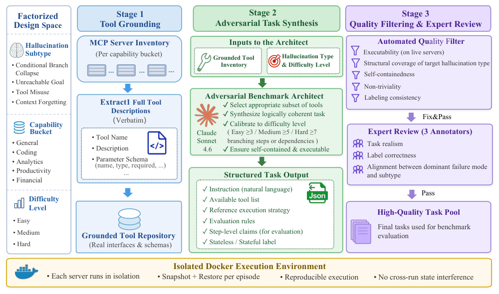
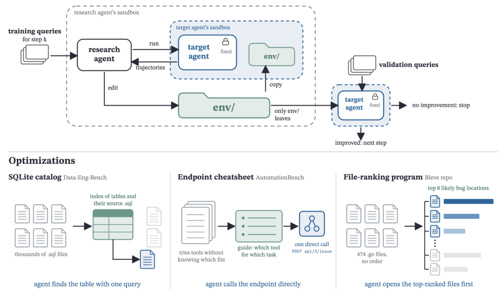
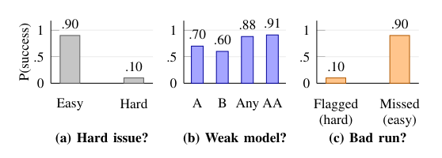
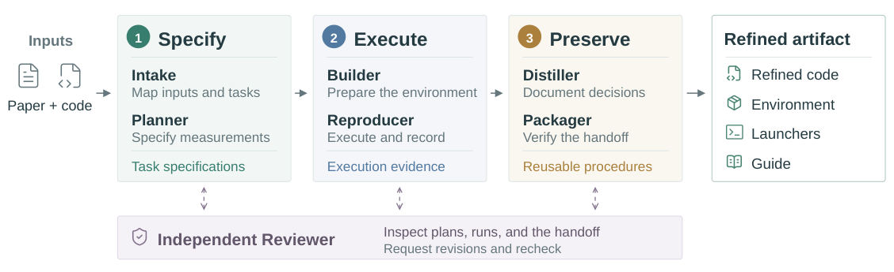
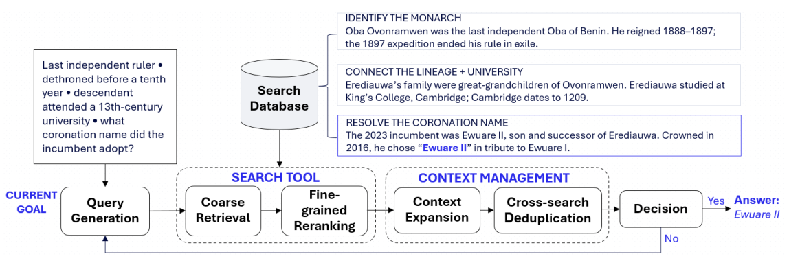
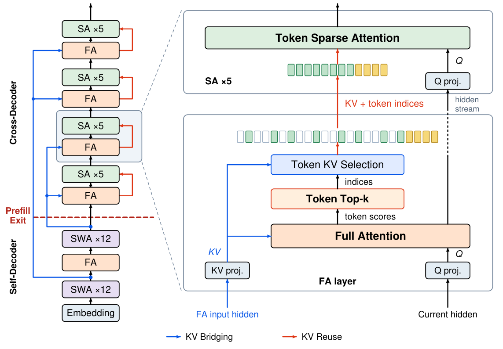
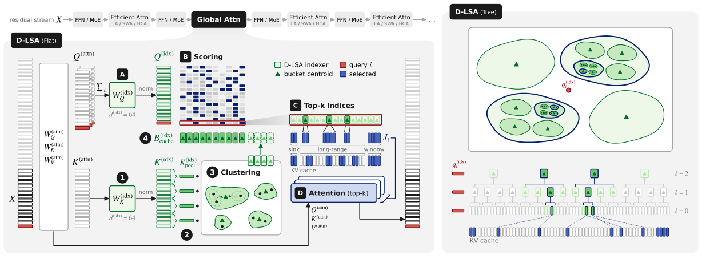

Three questions connect this issue: whether agents recognize unavailable capabilities, whether failure alarms identify runs worth intervening on, and whether shared environments can reduce repeated exploration. MCPHallu tests capability boundaries, the failure-prediction study separates difficulty from ability and run variation, and EnvOpt reorganizes access to information. These affect acceptance testing, monitoring, and execution cost in different ways.

Four further papers examine preserving reproduction knowledge, controlling evidence admitted into context, cross-layer state sharing, and long-context indexing. Independent Tech Notes connect these concerns to prompt caching, formal runtime monitoring, startup recovery, binary compatibility, and evaluator repairs. Their efficiency results depend on the workload and measurement layer.

<h2 class="daily-paper-title" id="paper-arxiv-2611.07689">MCPHallu: measuring action beyond available capabilities</h2>

[MCPHallu: Benchmarking Reasoning, Execution, and Memory Hallucinations in MCP Agents](https://arxiv.org/abs/2611.07689)  
Yizhen Jiang, Haowei Guo, Tianyi Bai, Zengjie Hu, Lu Ma, Zhengyang Zhao, Haoze Sun, Peng Pei, Wentao Zhang · arXiv · 2026-11-05

A task-success score cannot tell an operator whether an MCP agent planned incorrectly, selected the wrong tool, or lost an earlier observation. MCPHallu builds these risks into task construction instead of relying solely on labels assigned after execution. Its particularly useful move is to make recognizing an infeasible goal a successful behavior, directly testing false completion and continued action without the required capability.

<a class="note-image-link" href="/assets/images/digest/2026-11-08/arxiv-2611.07689.png" target="_blank" rel="noopener" aria-label="MCPHallu pipeline from real schemas to synthesis, filtering, and expert review · View original image ↗">View original image ↗</a>

*Read left to right: real tool schemas constrain synthesis, then automated checks and expert review filter tasks; container isolation limits state contamination across runs.*

The benchmark contains 358 tasks across 36 real MCP servers and five domains: search, analytics, productivity, finance, and coding. Four triggers define the main failure risks: mutually exclusive branches conditioned on live results; goals unsupported by available tools; tools with overlapping interfaces but different meanings; and intervening distractions between retrieving a value and using it. These instantiate Branch Collapse, Unreachable Goal, Tool Misuse, and Context Forgetting. The paper’s definition of hallucination includes treating an action inconsistent with the task, state, or tool capabilities as valid. Correctly reporting failure does not meet that definition.

Construction starts with schemas extracted from server implementations, followed by task synthesis, executability checks, and review by three annotators. Each evaluation starts from a clean container. Read-only outcomes are checked against reference scripts executed against live services; writes are checked through final-state assertions. A task-level dependency graph distinguishes a correct answer reached through a valid sequence from one that ignores required dependencies. For AgentOps, this is a useful separation between a convincing completion message and an actual change in an external system.

Language-model judgment is a minority component. Outcome checks contribute 60% and dependency checks 20% for branching and forgetting tasks. Structural checks contribute 70% for infeasible goals and tool misuse. The remaining weight supports semantic interpretation. Infeasible-goal scoring permits two probing calls before penalizing delayed recognition, so the benchmark rewards stopping after reasonable verification rather than immediate refusal whenever a task looks difficult.

Fourteen models produce 5,012 trajectories and average 0.642 on the composite score. Only 23.2% of infeasible-goal runs pass, with a mean score of 0.458. A model’s ranking spans an average of 6.9 positions across subtypes; branching and infeasible-goal scores correlate at −0.12. Aggregate quality can therefore hide a deployment-specific weakness.

These are targeted stress tests. The intended subtype is not a unique causal diagnosis of every trajectory: it was the primary failure in 81% of the human-reviewed failure sample. Tool inventories remain fixed within tasks, leaving dynamic server installation, cross-session memory, and authentication-state confusion outside the evaluation. The construction and scoring sections are the most useful reading for anyone designing acceptance checks that combine service state, action dependencies, and stopping behavior.

<h2 class="daily-paper-title" id="paper-arxiv-2611.07372">EnvOpt: optimizing the environment agents repeatedly inspect</h2>

[EnvOpt: Automated Optimization for Agent Environments](https://arxiv.org/abs/2611.07372)  
Mingxuan Li, Huanzhi Mao, Qiuyang Mang, Hanchen Li, Joseph E. Gonzalez, Alex Dimakis · arXiv · 2026-11-05

The same enterprise information can sit behind a remote tool, in searchable text, or in an indexed database. How much work an agent spends locating it depends on representation as well as model capability and harness design. EnvOpt treats the environment shared across tasks as a third optimization target, reorganizing information and access paths while holding the target model and harness fixed.

<a class="note-image-link" href="/assets/images/digest/2026-11-08/arxiv-2611.07372.png" target="_blank" rel="noopener" aria-label="EnvOpt environment editing, target-agent execution, and independent validation loop · View original image ↗">View original image ↗</a>

*Only the environment directory is transferred to the target agent above; examples below show a database catalog, endpoint guide, and file-ranking program.*

“Stationary” means many tasks share the same or similar artifacts, repositories, or business data, not that the system never changes. A research agent receives an environment directory, training queries, and a budget for running the target agent. It examines trajectories, edits the environment to remove expensive exploration, and tests candidates. Only the environment leaves the sandbox; changes to the target harness are discarded. A transformation program can also organize similar future environment instances.

Examples include directly readable email exports, API endpoint cheat sheets, a SQLite catalog over SQL files, and a program ranking likely relevant repository files. These changes reduce repeated interface discovery, parsing, and location searches. They should not be interpreted as inserting task answers into the environment. The paper also discusses rejected strategies, highlighting the need to preserve information required by later tasks.

Crucially, training without reference answers does not mean the entire optimization is verifier-free. Within a training step, the research agent uses proxy judgments and answer consistency because graders are hidden. After each step, separate validation tasks use verifiers to measure pass rate and cost. Worsening cost or an accuracy decline beyond tolerance causes a return to the preceding environment. Training subsets are disjoint between steps, and final results use held-out tasks.

For AutomationBench, the authors split 600 public tasks into 200 test tasks, 96 validation tasks, and the remaining training pool. Under the official harness in the detailed table, Haiku 4.5 rises from 2.33% to 16.67% success: a gain of 14.34 percentage points. Cost falls from $42.36 to $11.55, or 72.73%. The improvement is substantial, but the absolute success rate remains low. Transferring the environment to Opus 5 reduces cost by 68.13%, with success increasing from 33.83% to 35.17%.

Results across five benchmarks support an independent opportunity in environment representation. Transfer does not guarantee higher accuracy for every recipient: some non-target models regress slightly on Workspace-Bench and Data-Eng-Bench. Offline construction has a cost that subsequent tasks must amortize, and derived indexes or endpoint guides require maintenance as their sources change. The useful AgentOps contribution is turning repeated exploration into reusable, maintained artifacts and evaluating cost together with correctness.

<h2 class="daily-paper-title" id="paper-arxiv-2611.08285">Failure prediction: separating hard issues, weak models, and bad runs</h2>

[Hard Issue, Weak Model, or Bad Run? Rethinking Failure Prediction for Coding Agents](https://arxiv.org/abs/2611.08285)  
Xingyue Shi, Wesley K. G. Assunção · arXiv · 2026-11-05

After an agent raises a failure warning, should the system stop, switch models, or retry? This study separates predicting failure from identifying a useful remedy. A hard issue may require human help, insufficient capability may call for a stronger model, and an unlucky attempt is the most direct target for retrying. A score that mixes these causes can look accurate while selecting the wrong runs for intervention.

<a class="note-image-link" href="/assets/images/digest/2026-11-08/arxiv-2611.08285.png" target="_blank" rel="noopener" aria-label="Toy probabilities separating difficulty, model ability, and retry gains · View original image ↗">View original image ↗</a>

*These are illustrative probabilities, not measurements; an extra attempt alone can increase the coverage of an any-model oracle.*

The authors analyze 3,492 labeled SWE-bench Verified trajectories from seven models. Outcomes from another 16 models estimate issue difficulty. Predictors read partial trajectories without explicit issue text or model names, using TF-IDF logistic regression and a small LoRA-fine-tuned model on one cross-validation fold. The difficulty reference depends on outcomes normally unavailable at deployment; it is a diagnostic comparator, not a deployable prediction service.

Among 2,840 runs still active at step 20, the difficulty reference reaches 0.924 pooled AUROC, while trajectory predictors achieve approximately 0.624–0.630. Of the failed–successful pairs used in pooled evaluation, 99.66% compare different issues, so recognizing difficult issues can dominate the metric. Within an issue, model identity reaches 0.724 AUROC, still above the trajectory predictors at roughly 0.60–0.61. Predictors perform particularly poorly on upsets where the generally weaker model succeeds.

After controlling for issue difficulty and model ability, the incremental pooled AUROC from trajectory scores falls within the prespecified ±0.02 equivalence region across all 18 configurations. This means the tested methods add no measurable benefit under these controls, not that trajectories can never contain useful information. A monitoring evaluation should ask whether this particular attempt has diverged from a successful path under comparable task and capability conditions.

Routing has a related trap. An oracle that chooses any successful model after execution beats the best single model by 10 percentage points, but repeated random attempts can also create such a gap. In a repeated-run pilot with two Llama models on 522 issues, choosing a model using one half of the runs improves success on the other half by only 0.09 percentage points, with a 95% interval crossing zero. Some specialization does recur, so the result does not establish its absence.

Run-to-run variation accounts for 42% of outcome variance in that pilot, leaving genuine room for retries. Existing alarms struggle to identify those recoverable failures. The main evidence is limited to one benchmark and scaffold, and the repeated-run pilot uses older models. The transferable contribution is an evaluation discipline: report within-issue alongside pooled discrimination, then test the actions triggered by alarms on held-out runs at equal attempt budgets. Correct prediction and effective intervention are separate outcomes.

<h2 class="daily-paper-title" id="paper-arxiv-2611.08452">ReproBridge: preserving the decisions behind reproduction</h2>

[ReproBridge: Building Reproducibility into ML Research Artifacts](https://arxiv.org/abs/2611.08452)  
Yubo Wang, Rui Meng, Jaehyun Nam, Tomas Pfister, Jinsung Yoon · arXiv · 2026-11-05

A successful reproduction can leave repaired dependencies without preserving why they were chosen. ReproBridge packages refined code, environment setup, launchers, and a guide through three stages: specify the task, execute it, and preserve the procedure. Independent review checks the evidence. Downstream agents start fresh sessions, while an auditor traces each reported value to output files, scripts, and execution rather than accepting copied scores.

<a class="note-image-link" href="/assets/images/digest/2026-11-08/arxiv-2611.08452.png" target="_blank" rel="noopener" aria-label="ReproBridge stages for specifying, executing, and preserving experiments · View original image ↗">View original image ↗</a>

*The three stages carry task definitions and execution evidence into the handoff; independent review checks construction, while downstream reproduction uses fresh sessions.*

The downstream comparison covers 1,029 tasks with compatible reference results from 36 papers, each anchored by five human-verified observations. Mean success across four models rises from 76.4% to 92.6%, and downstream API spending falls 19.7%. Numerical compatibility is combined with execution-integrity checks.

Unlike EnvOpt’s focus on access and representation, this work preserves experimental procedures and measurement decisions. The result is not a conference-wide reproduction rate: the original 1,463 curated tasks also include numerical disagreement, execution blockers, and resource limits outside this comparison. Artifact construction, GPU execution, and human verification are separate costs from the reported downstream API savings.

<h2 class="daily-paper-title" id="paper-arxiv-2611.07859">CORE: broad retrieval with precise evidence admission</h2>

[CORE: Coarse-to-Fine Search with Context Management for Deep Research](https://arxiv.org/abs/2611.07859)  
Hoang Tran Vuong, Ngoc Quan Pham, Hung Bui, Fatih Porikli, Dat Quoc Nguyen · arXiv · 2026-11-05

Long passages help retrieval but can inflate context during iterative research. CORE retrieves 300 candidate passages with a dense model, then reranks them using late interaction. It reuses token similarities to locate relevant snippets without an extra summarization model. Agents can expand context within previously retrieved documents; repeated snippets become short references without rewriting earlier history.

<a class="note-image-link" href="/assets/images/digest/2026-11-08/arxiv-2611.07859.png" target="_blank" rel="noopener" aria-label="CORE retrieval, snippet selection, expansion, and deduplication · View original image ↗">View original image ↗</a>

*Retrieval uses broad passages but returns relevant snippets; expansion supplies additional source context when needed.*

Across three models and three fixed-corpus benchmarks, CORE leads the compared harnesses on answer accuracy and evidence recall. On BrowseComp-PlusCM’s 553 million documents, GPT-5.4 achieves 68.42% accuracy versus OpenResearcher’s 56.14%; this benchmark contains only 57 questions. In the component study, coarse retrieval, adding fine-grained snippets, and adding context management yield 62.61%, 70.84%, and 80.12% accuracy respectively.

The transferable idea is controlling evidence admission into context. Dynamic web search and open-ended reports are outside the evaluation. Relative to OpenResearcher, not every configuration reduces search calls or peak context, so shorter snippets do not guarantee lower total cost.

<h2 class="daily-paper-title" id="paper-arxiv-2609.26368">HySparse2: shortening prefill state dependencies</h2>

[HySparse2: Hybrid Sparse Attention with Two-Level KV Sharing](https://arxiv.org/abs/2609.26368)  
Jianyu Wei, Yizhao Gao, Qihao Zhang, Shimao Chen, Zhengju Tang, Yu Cheng, Shengjie Zhou, Zihan Jiang, Yifan Song, Hailin Zhang, Liang Zhao, Bo Yang, Gang Wang, Shijie Cao, Fuli Luo · arXiv · 2026-09-22

HySparse2 targets agents that ingest long observations and emit short actions. It splits the network into a self-decoder and cross-decoder. Outer KV Bridging projects self-decoder states into distinct cross-decoder full-attention caches; inner KV Reuse shares those caches and token-selection indices with sparse layers. Forcing recent tokens into sparse selection removes a separate SWA branch, allowing prefill cache construction to stop after the self-decoder.

<a class="note-image-link" href="/assets/images/digest/2026-11-08/arxiv-2609.26368.png" target="_blank" rel="noopener" aria-label="HySparse2 KV Bridging, KV Reuse, and prefill exit point · View original image ↗">View original image ↗</a>

*Blue connections supply source states for KV projection; red connections share caches and indices within a block. The dashed line marks the prefill exit.*

For the 80B-A3B configuration at 1M tokens with FP8 KV storage, prefill FLOPs are 5.02× lower than Hybrid SWA, while KV storage falls from 12.09 GB to 2.69 GB. These are not end-to-end latency measurements. At 256k, RULER-v2 scores are 58.45 versus HySparse’s 32.61. Different KV-head configurations also contribute, so all storage gains cannot be assigned to one component.

This is an architectural change requiring corresponding training. AgentPPL measures trajectory likelihood, not task completion. Unlike LSA’s indexer optimization below, the central contribution is removing prefill dependencies through cross-layer state sharing.

<h2 class="daily-paper-title" id="paper-arxiv-2610.42147">LSA: avoiding a full index scan in sparse attention</h2>

[Latent Sparse Attention: Towards Subquadratic Ultra-Long Context Attention](https://arxiv.org/abs/2610.42147)  
Ales Kubicek, Andrea Caciolai, Liangzu Peng, Sukrit Sumant, Benjamin Hoover, Fraser Greenlee, Ruairidh M. Battleday, Radim Urban, Torsten Hoefler, James C. R. Whittington · arXiv · 2026-10-30

Sparse attention reads few keys, but its indexer can remain expensive if it scans every candidate. LSA clusters keys in a learned latent space and selects through cluster centroids. The tree variant uses hierarchical beam search, giving O(T log T) indexer prefill with a fixed beam. D-LSA distills indexing for pretrained models; N-LSA learns natively through next-token prediction.

<a class="note-image-link" href="/assets/images/digest/2026-11-08/arxiv-2610.42147.png" target="_blank" rel="noopener" aria-label="LSA flat clustered indexing and hierarchical search · View original image ↗">View original image ↗</a>

*Left: clustered buckets expand into attention indices. Right: hierarchical search reduces the number of centroids that each query scores.*

At 10M tokens on GLM-5.3-FLASH, reported single-layer prefill and decode speedups are 22.7× and 4.6×. Timing includes projections, indexing, and attention, but prefill measures the final 32,768-query chunk at that context length. Whole-model serving results are smaller and must not be conflated with layer results. The tree variant uses flat search for the single-request decode evaluation.

Accuracy is broadly comparable, not lossless everywhere: some GLM results at 2M–5M trail the baseline by up to about eight percentage points. The method retains the full KV cache, primarily reducing indexing and computation rather than eliminating memory pressure. Performance curves beyond 10M include extrapolation, not measured throughput.

## Related Tech Notes

- [vLLM Stable ABI: decoupling engine upgrades from rebuilds](/tech/en/vllm-libtorch-stable-abi/)
- [Prompt-cache misses: tracing costs to prefixes and API routes](/tech/en/datadog-prompt-cache-investigation/)
- [FETCh: connecting formal specifications to production events](/tech/en/datadog-continuous-formal-spec-validation/)
- [Inference startup: what weight reuse, warm instances, and snapshots preserve](/tech/en/cncf-faster-llm-inference-startup/)
- [Cache-aware model routing: switching has a state cost](/tech/en/openrouter-auto-router-next-gen/)
- [MaxxBench: testing adaptation when familiar requirements change](/tech/en/maxxbench-why/)
- [FrontierCS 2: restoring the evaluator’s control of measurement](/tech/en/frontiercs2-update-1106/)
- [Opus 5.5: reading the cost curve and the model actually serving a task](/tech/en/anthropic-claude-opus-5-5/)
