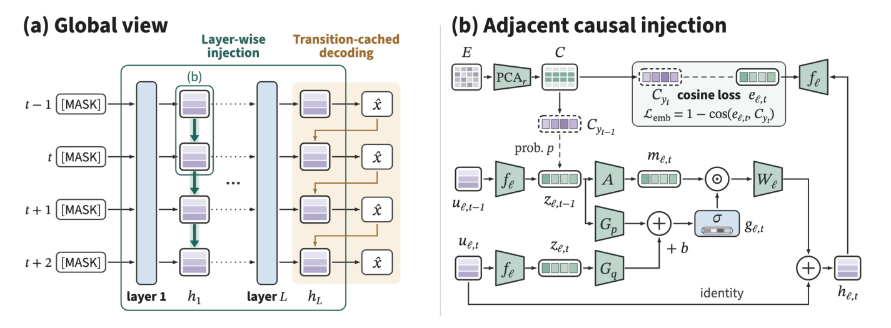
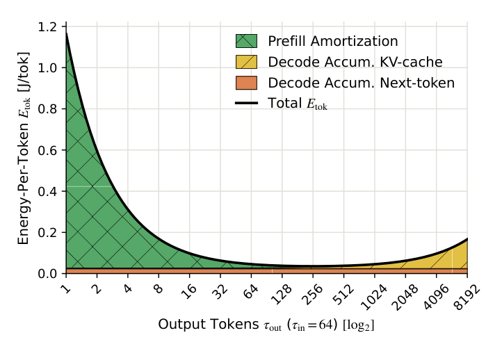

Inference optimization faces several different costs: wasted draft work after rejected tokens, KV reads that grow with context, and bandwidth consumed by weights. DSpine injects predecessor information early into a parallel drafter to advance more tokens per verification. SIMPLE explains energy through architecture and sequence length, including the attention reads that remain after a prefix-cache hit. The accompanying nf12 note examines another trade-off: smaller weights can still produce slower serving at high concurrency. The useful connection is how local savings reach end-to-end metrics, and under which operating conditions they stop helping.

<h2 class="daily-paper-title" id="paper-arxiv-2609.36173">DSpine: conditioning parallel drafts through depth</h2>

[Draft in Parallel, Condition Through Depth: Adjacent Causal Injection for Speculative Decoding](https://arxiv.org/abs/2609.36173)  
Haohui Zhang, Keyu Chen, Haocheng Sun, Weibo Gu, Ruizhi Qiao, Xing Sun, Bo Jiang · First submitted 2026-09-28; reviewed version revised 2026-10-10.

### Individually plausible tokens must form a valid prefix

Speculative decoding uses a small drafter and a larger verifier. Parallel drafting avoids a separate forward pass per candidate, but independently selected tokens can be incompatible. Verification accepts in prefix order, so one early rejection wastes later proposals. Domino and DSpark chiefly add conditioning after the backbone; DFlash2 also mixes adjacent hidden states inside it. DSpine explicitly extracts predictive predecessor features and injects them into successors from the first layer, letting dependencies form through network depth.

### Parallel updates within a layer, propagation across layers

Each layer projects position states into a shared transfer space. Predecessor and receiver features jointly gate a message written into the receiver's residual stream. Every message reads pre-update states, preserving parallel execution within the layer. The next layer can propagate information received earlier. Block-causal attention follows the same direction. The transfer space is constructed from target output embeddings, and layer-wise cosine supervision encourages early predictive features without forcing every intermediate layer to classify the full vocabulary.

<a class="note-image-link" href="/assets/images/digest/2026-11-09/dspine.png" target="_blank" rel="noopener" aria-label="DSpine layer-wise adjacent injection and gating · View original image ↗">View original image ↗</a>

*Left: predecessor information propagates through depth. Right: predecessor and receiver jointly gate how much predictive information enters the residual stream.*

At token selection, the selected predecessor's embedding refines the final write again. A transition cache avoids recomputing matrix operations sequentially: it precomputes pairwise scores between the top-16 candidates at adjacent positions, then selection follows cached entries in order. Additional scoring buys a shorter serial computation chain, while fused kernels reduce the launches and memory traffic introduced by layer-wise injection.

### Acceptance and serving time answer different questions

The paper evaluates Qwen3-4B/8B with thinking disabled, matched training data, five-layer drafters and 15 proposed tokens per round. On Qwen3-8B at temperature zero, mean advancement across seven math, code and chat benchmarks rises from DFlash's 3.77 to 4.82. This measure includes the additional correction or target token. Relative to the stronger DFlash2 baseline at 4.39, the gain is about 10.0%. Across four math/code serving workloads and concurrency 2–32, the authors report mean throughput improvements of 11.1% over DFlash2 and 23.3% over DFlash. The latter is not the improvement over the strongest baseline.

Removing final refinement reduces acceptance length by 6.6–7.1%; removing injection as well increases the drop to 8.8–10.7%. Verification consumes 72–76% of round time in the reported breakdown, so better drafting must pay for its own overhead. The useful contribution is the timing of information transfer and its implementation cost, beyond simply lengthening draft blocks.

The [official 27B model card](https://huggingface.co/tencent/Qwen3.8-27B-DSpine-b16) also reports WorkBuddy Office tool-history replay at low reasoning effort. With concurrency 8, SGLang 0.5.22 and BF16, throughput rises from 664.77 to 805.53 tok/s. DSpine uses blocks of 16 versus DFlash2's 8, with dynamic verification and ReplaySSM enabled. The roughly 21.2% gain cannot be attributed solely to layer-wise injection, and replay throughput does not establish better task success for an interactive agent.

<h2 class="daily-paper-title" id="paper-arxiv-2611.03330">SIMPLE: separating the costs behind token energy</h2>

[The SIMPLE Law for Energy Cost of LLM Inference](https://arxiv.org/abs/2611.03330)  
Hiari Pizzini Cavagna, Andrea Proia, Daniele Cesarini, Zeynep Kiziltan, Andrea Bartolini · First submitted 2026-11-02.

### Equal token counts do not imply equal costs

Each generated token adds KV state for later attention reads. Estimates based only on token counts or parameter counts obscure input length, hidden dimension and MHA/GQA differences. SIMPLE starts from computation and memory-access complexity, then selects and groups terms into a four-coefficient model for prefill, KV reads and next-token computation. Its contribution is a shared, architecture-aware expression across models, rather than a hardware law requiring no measurements.

Let d be hidden dimension, L layer count, R the KV-to-query head ratio, and I/O input/output lengths. Total energy is:

$$E=\theta_1d^2LI+\theta_2dLR(IO+O^2/2)+(\theta_0+\theta_3dL)O.$$

The first term processes the prompt. The second captures growing KV reads during generation. The last accumulates linearly with output length. Dividing by O produces declining prefill amortization and increasing KV cost, creating a minimum in energy per output token. **That is not a minimum in total request energy, nor a reason to generate unnecessary text to save power.**

<a class="note-image-link" href="/assets/images/digest/2026-11-09/simple.png" target="_blank" rel="noopener" aria-label="SIMPLE prefill amortization and decode energy components · View original image ↗">View original image ↗</a>

*With a fixed 64-token input, predicted prefill amortization falls while KV cost grows. Their balance creates a minimum in the black energy-per-output-token curve.*

### Cross-model prediction differs from per-model fitting

The authors reuse measurements from TensorRT-LLM on one H100 per run, with BF16 weights and KV, covering 13 dense models from six families. Input and output lengths each take seven values from 64 to 4096 tokens: 49 combinations with 1,000 requests each. Throughput mode uses concurrency 1,000 and a maximum batch size of 1,024. GPU power is sampled every 500 ms, and batch energy is allocated across requests.

The full-data fit reaches R²=0.969 and MAPE=11.974%. Held-out-model validation, more informative for transfer, reaches R²=0.944 and MAPE=13.252%. However, separately fitted SweetSpot models achieve an in-sample MAPE of 1.841%, better than SIMPLE. The trade-off is shared coefficients and less calibration work with interpretable architecture terms, rather than universally lowest error.

### Prefix caching does not remove later attention reads

For a modeled Llama 3.1 8B request with 68K input tokens, 247 output tokens and a 63K cached prefix, predicted energy falls from 1787.7 J uncached to 668.7 J cached. The comparison request with a 5K input costs 138.1 J. Caching removes approximately 93% of the prefill term, but decode still attends to the full context; KV reads account for 86% of remaining energy. These are estimates from the architecture, lengths and fitted coefficients, not online Copilot power measurements. The 68K input also lies beyond the fitting data's input range.

For Ops4LLM, this gives a concrete explanation for expensive requests despite high cache-hit rates. Its boundaries are explicit: batch size and concurrency are not modeled as variables, coefficients belong to the H100/TensorRT-LLM setting, and MoE, multi-GPU communication and other attention structures remain outside validation. Read the cost decomposition and held-out-model evaluation before applying the long-context extrapolations.

## Community observations

**Searching optimizations against serving targets.** In its [November 8 post](https://x.com/togethercompute/status/2119280344704725245), Together AI says agents searched MoE routing, scheduling, kernels, speculative decoding and sparse attention against StepFun's TTFT/TPS targets, benchmarking each change before proceeding. It reports more than tripling Step 5 throughput. The interesting practice is the incremental feedback loop around candidate optimizations. The short post does not provide hardware, request distributions, tail latency or ablations; the multiplier remains a vendor report and does not establish transfer to other workloads.

**What should transfer between automated NOCs?** In a [post dated November 9 in Shanghai](https://x.com/l4rz/status/2119529451478548528), l4rz describes deploying packet-core anomaly detection in three days and expanding it over two weeks into service-failure diagnosis and drafts of emails to partner NOCs. The proposed reusable asset is a recipe of standards references, rules, guardrails and prompts. That shifts attention toward diagnostic knowledge in cross-operator AIOps. However, the post supplies no detector design, labeled data, false-positive measurements or root-cause validation. It cannot establish deployment reliability or demonstrate that rewriting code beats implementation reuse.

## Companion note

- [nf12: why lossless weight compression can speed up or slow down serving](/tech/en/nf12/)
