## What matters in this issue

Returning traffic to normal or cancelling requests may not restore an overloaded service. Retries can multiply executions, while multi-turn sessions can remain trapped in cache misses. Two studies explain these different feedback loops and separate user delivery, reuse, and observed throughput.

On the agent side, Cloud-OpsBench distinguishes correct diagnoses from closed evidence chains. BOXBOX revises harnesses during long tasks, while PatternOps shows how ordinary reloads and consent operations silently alter policy paths. These five deserve close reading. Other papers improve efficiency through program semantics, hybrid state, distributed caching, low-precision computation, and automatic planning.

Companion technical notes examine H200 hybrid-model serving, TPU state transport, monitoring costs, AI SRE evaluation, and a model release, keeping mechanisms, operating points, and evidence boundaries distinct.

## In depth

<h2 class="daily-paper-title" id="paper-arxiv-2611.08684">01 · Why cancellation fails to restore overloaded serving</h2>

[Cancellation Is Not Enough: What Retries Leave Behind in an Overloaded LLM Engine](https://arxiv.org/abs/2611.08684)  
Xindan Zhang, Fei Wang · 2026-11-05

### One logical call can create four engine executions

A timed-out client retries; cancellation is supposed to stop computation for clients that have left. This paper counts logical calls, client attempts, and engine executions separately. Its finding is that stopping old work is only part of the problem. When each retry creates another execution, the queue keeps replenishing. A retry can finally begin prefill just before its own deadline, consume work, and then be aborted itself.

The authors test three models on one H100 80GB running vLLM 0.30.0. Synthetic open-loop arrivals start at 0.6 times calibrated capacity, rise to 2.7 times capacity for 107 seconds, and return to the original rate. Each attempt has a 120-second deadline and up to three retries. The pulse creates more queued work than one deadline can accommodate, while leaving spare capacity afterward if retries do not amplify demand.

### Bound executions while preserving reconnection

<a class="note-image-link" href="/assets/images/digest/2026-11-10/retry-executions.png" target="_blank" rel="noopener" aria-label="Why cancellation fails to restore overloaded serving · View original image ↗">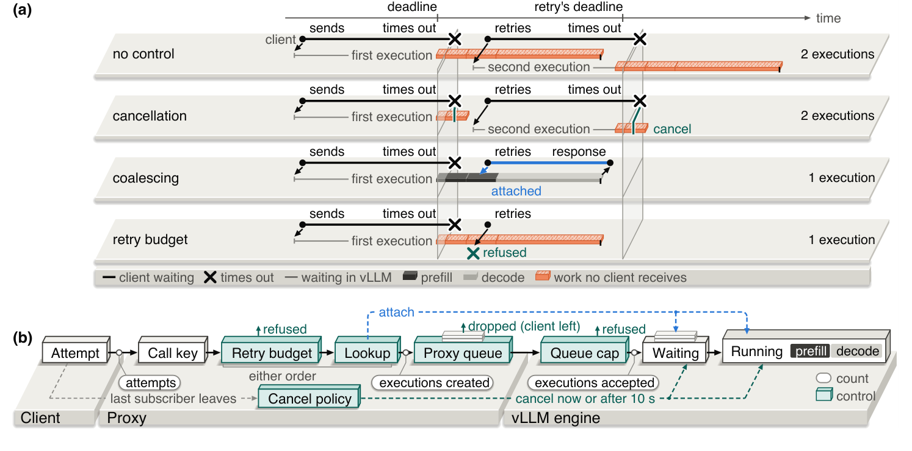View original image ↗</a>

*The top follows timeouts and retries of one call; the bottom locates execution creation, attachment, budgeting, and cancellation.*

Without controls, disconnected clients leave orphaned executions and retries submit new ones. Immediate cancellation shortens an old execution but cannot recall GPU steps already issued. It also destroys the live execution that a retry could rejoin. Request coalescing instead uses the logical call identifier and complete generation parameters to attach a retry to the same live execution. It does not combine unrelated calls with similar prompts.

Composition order consequently matters. Looking up a live execution before applying a retry budget avoids rejecting reconnections that create no additional engine work. The authors also defer cancellation for ten seconds, longer than their clients’ 0.25–3-second retry backoff, preserving a reconnection window.

### Computation completed is not an answer delivered

With retries enabled, immediate cancellation never restored service within the diagnostic observation window. Roughly 12–38% of post-pulse calls were eventually delivered, including the mixed-prompt experiment. Qwen2.5-7B traces attribute 79–85% of computed prompt tokens to executions later aborted. Scheduled retries typically first run less than half a second before their own deadline. These are token and scheduler-step measurements, rather than GPU kernel-time measurements.

Coalescing delivered every pulse and subsequent call in its experiments, some late; immediate cancellation removed that benefit. Deferral restored attachment, but no execution was ultimately cancelled in those runs, leaving permanent-disconnection cleanup untested. Retry budgets restored subsequent service by sacrificing some pulse calls. **Recovery and delivery must be measured separately:** shorter queues and more completed tokens cannot establish that users received their answers.

<h2 class="daily-paper-title" id="paper-arxiv-2611.08902">02 · When cache collapse makes throughput a misleading recovery signal</h2>

[Inside the Trap: A Renewal Law for Prefix-Cache Collapse in LLM Agent Serving](https://arxiv.org/abs/2611.08902)  
Akshat Valse, Ali Jannesari · 2026-11-06

### Returning traffic to its old level does not guarantee recovery

An agent’s next turn brings earlier context back to the server. With prefix reuse, those repeated tokens are cheap. A burst expands the active-session population and lengthens waits; before a session returns, other requests overwrite its KV. More misses create more prefill work, further extending waits and sustaining the trap.

Paired tests separate this behavior from an ordinary burst backlog. Across registered experiments on two engines, two GPU types, and two models, a 200-session burst left follow-up hits at zero in all 30 burst runs. Matched no-burst and session-capped runs remained healthy. The stricter rule, which also checks backlog growth, passed at nine of ten tested rates; zero hits in 30 runs should not be confused with universal satisfaction of every trap criterion.

### Served turns cease to represent the stationary workload

<a class="note-image-link" href="/assets/images/digest/2026-11-10/cache-trap.png" target="_blank" rel="noopener" aria-label="When cache collapse makes throughput a misleading recovery signal · View original image ↗">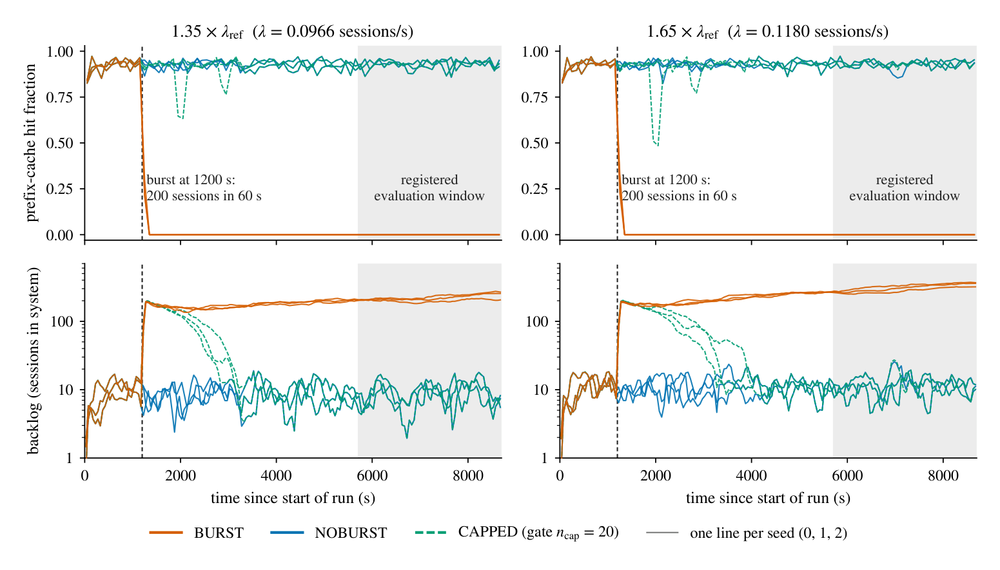View original image ↗</a>

*After the burst, orange traces lose reuse and accumulate sessions; no-burst and capped controls retain cache hits.*

The analysis idealizes an all-miss, work-conserving FIFO fluid server whose sessions immediately return to the queue after each turn. Later turns have longer, more expensive prompts. As the backlog grows, the turns actually served become disproportionately young and short. A linear renewal recursion along FIFO orbits characterizes the growing inter-turn gap and the shifted turn distribution.

The operational consequence is a “youth premium”: session completions can exceed the stationary all-miss capacity while unfinished work keeps accumulating. Reducing arrivals below observed trapped throughput can therefore still leave arrivals above the true drain threshold. A respectable completion rate need not imply spare capacity for all the future turns already committed to.

### Reduce cache competition to restore reuse

The theory was developed after early traces had been inspected. In a retrospective comparison with 57 stuck runs, it predicted mean served-prompt length within 3% in 50 runs. Individual gap-growth estimates scatter substantially; aggregate agreement is not precise per-run prediction. Later outcome-blind tests probe arrival cuts and a different turn budget.

At unchanged offered load, a session cap rescued nine of nine established traps without shedding sessions. The engine remained healthy after the cap was released. Restricting the concurrent population competing for cache, while holding other sessions outside, restores reuse; it does not establish lossless operation at arbitrary demand.

**This complements the retry study.** There the feedback creates multiple executions of one logical call; here inter-turn delay and cache turnover reinforce one another. The fluid model omits engine concurrency, tool delays, and detailed scheduling, and the paper does not prove that real engines converge to it. Read the distinction between recovery threshold and measured throughput, together with the separate paired, retrospective, and outcome-blind evidence.

<h2 class="daily-paper-title" id="paper-arxiv-2603.00468">03 · Cloud-OpsBench: a correct root cause still needs a complete investigation</h2>

[Cloud-OpsBench: A Reproducible Benchmark for Agentic Root Cause Analysis in Cloud Systems](https://arxiv.org/abs/2603.00468)  
Yilun Wang, Guangba Yu, Haiyu Huang, Yujie Huang, Zirui Wang, Pengfei Chen, Michael R. Lyu · 2026-02-28 · v3 revised 2026-11-06

### Make the choice of diagnostic actions comparable

Static logs support repeatable experiments but do not test whether an agent knows which service to query next. Live fault injection preserves interaction, yet load, scheduling, and retries can change how the same fault manifests. Cloud-OpsBench realizes and verifies incidents in a real cluster, then freezes observable evidence for tool-mediated investigation by different agents.

The version considered here is v3, revised November 6; the initial submission was February 28. Across OnlineBoutique and TrainTicket, it contains 754 cases spanning 57 application and Kubernetes fault types. Of 800 candidate plans, 46 were rejected because they did not produce stable, diagnosable symptoms. Successfully executing an injection command is therefore not sufficient for admitting a case.

### Verify the incident, freeze observations, annotate diagnostic facts

<a class="note-image-link" href="/assets/images/digest/2026-11-10/cloud-opsbench.png" target="_blank" rel="noopener" aria-label="Cloud-OpsBench: a correct root cause still needs a complete investigation · View original image ↗">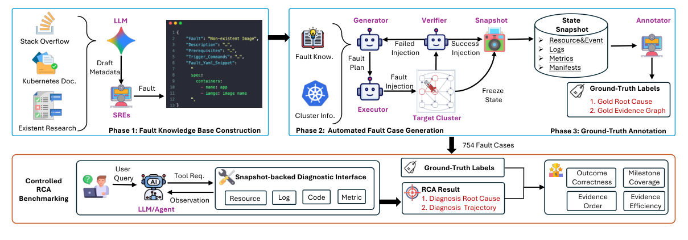View original image ↗</a>

*Fault knowledge feeds runtime verification and snapshots; the tool interface supports separate outcome and evidence-process evaluation.*

A knowledge-grounded pipeline generates concrete fault plans. After restoring a clean deployment and confirming health, it injects the fault and verifies the activated mechanism, local failure, and required upstream manifestation. Accepted incidents retain resources, configuration, logs, events, metrics, and source evidence. Twelve diagnostic tool types map supported arguments to captured responses; agents cannot directly inspect the entire snapshot repository.

Process labels are the more consequential addition. An evidence graph specifies facts that must be established, admitting different tools, arguments, and alternative evidence bundles rather than prescribing one expert command sequence. After finding a Service without endpoints, an agent might inspect selectors and Pod labels separately or retrieve configuration containing both. Necessary prerequisite relations are recorded separately from the completion logic.

### The same correct answer can conceal different investigations

With eleven LLMs under a common ReAct scaffold, maximum Joint RCA Accuracy reaches 0.78 and 0.68 on the two workloads. For GPT-5, however, 33.1% and 29.4% of all evaluated cases respectively have a correct diagnosis without evidence closure. The denominator is all cases, not only correct answers, and incomplete evidence does not prove that a diagnosis was guessed.

An investigation may omit backend labels, fail to confirm database state, or stop at a conspicuous downstream error. Final labels alone cannot distinguish a completed investigation from a correct but insufficiently verified conclusion. More queries and higher token expenditure do not automatically improve closure either.

**The transferable AIOps lesson is to separate evaluation targets:** component localization, mechanism identification, evidence coverage, and investigation efficiency. Snapshots support a finite captured query space, rather than arbitrary shell operations, remediation, or a system evolving during investigation. Closure also depends on annotation and evidence coverage; it is not a general proof of production causality.

<h2 class="daily-paper-title" id="paper-arxiv-2611.09218">04 · BOXBOX: revising the harness inside a long-running task</h2>

[BOXBOX: Recursive Harness Self-Improvement for Long-Running Performance Optimization](https://arxiv.org/abs/2611.09218v1) ([v1 PDF](https://arxiv.org/pdf/2611.09218v1))  
Yuhao Tan, Hanyun Jiang, Fangkai Yang, Yuan Yao, Taolue Chen, Bo Qiao, Yu Kang, Lu Wang, Pu Zhao, Xiaoxing Ma, Qingwei Lin · 2026-11-06 (v1)

**Paper status note**: On November 9, 2026, the authors temporarily withdrew this submission in the [arXiv v2 record](https://arxiv.org/abs/2611.09218v2), stating that they were withdrawing it “temporarily to add a clarification regarding the use of Claude Code, in accordance with our company’s compliance requirements.” All mechanisms and figures analyzed below come strictly from the archived 47-page `arXiv:2611.09218v1` PDF as a historical technical reading; its quantitative numbers should not be treated as active comparative rankings, and a compliance-clarification withdrawal alone does not establish experimental misconduct.

### PerfRace task construction and shadow verification

Existing repository optimization benchmarks (such as GSO, SWE-Perf, SWE-fficiency, and FormulaCode) typically derive targeted microbenchmarks from historical pull requests and score only a single final state. In real performance engineering, however, bottlenecks are unknown upfront, and multi-hour runs surface harness limitations—noisy timing loops, polling overhead, or bloated trajectories—that offline tuning did not anticipate. To evaluate agents under those conditions, the authors build PerfRace around end-to-end project workloads with no reference patch, allowing iterative submissions within a shared `B = 4h` budget.

PerfRace is curated through a five-stage funnel. First, querying ClickHouse `github_events` (May–August 2026) for pull requests (6,390 repositories) and branch pushes (112,127 repositories) by coding-agent accounts yields 118,517 repositories, 104,428 with metadata, and 103,475 accessible candidates. Next, a two-stage Filter (Table 9) applies deterministic checks—retaining 7,257 projects with 10–4,999 GitHub stars (excluding 93,992 under 10 stars and 1,134 inaccessible), redistributable licenses, and tracked trees at most 500 MiB and 25,000 entries—followed by `GPT-5.6-Luna` source assessment over setup path, evaluable finite process, Linux x86-64 commodity CPU feasibility, and optimization potential (excluding 4,462 for low potential and 3,066 for non-evaluable processes), leaving 239 candidates for Agent–Human Pair Verification.

During Pair Verification, the agent proposes grounded workloads and verifiers while human reviewers gate four stages—Realism (132 rejected), Reliability (6 rejected), Integrity (0 rejected), and Finalize (1 rejected)—producing 100 accepted tasks. Curating each accepted task took an average of 9.1 hours (median 4.5 h), 12 agent–human interactions (median 8), and $11.35 in agent cost (median $8.83). The 100 tasks span seven domains (developer tools 30, data systems 25, scientific computing 15, media processing 9, geometry 8, machine learning 7, security 6) and 16 primary languages (led by Rust 25, Python 18, TypeScript 15, C++ 11), with medians of 886 files and 14.56 MiB. All 99 wall-clock tasks achieve an unmodified-baseline coefficient of variation (CV) below 10% (84 below 6%), while `metamorpho--reallocate` uses deterministic EVM gas (874,508 gas). Every task passed explicit red-team tests against no-ops, skipped work, hard-coded outputs, cached shortcuts, protected-input tampering, and hidden-data leaks (40 tasks tested with at least two red-team attacks; for instance, `rust-clippy--cargo-package-lint` touches `clippy-driver` and inspects Cargo JSON non-fresh artifacts to defeat warm-cache bypassing). The benchmark splits into 40 training, 10 validation (for offline baselines), and 50 held-out test tasks.

For evaluation, the Judge runs Shadow Verification: each submission triggers `docker compose commit` on the paused agent container and executes hidden `tests/test.sh` and held-out correctness cases inside an isolated shadow container. Baseline Judge runs take a median of 4.9 minutes (mean 6.1 min, 20-min cap), and all verification time counts against `B = 4h`, with a final delivery prompt 5 minutes before timeout. Correct submissions score baseline-over-candidate speedup `s_i` (incorrect or timed-out submissions score 0; unmodified baseline sets `t_0 = 0, s_0 = 1`), tracked by best-so-far correct speedup `S(t) = max_{i: t_i <= t} s_i`.

### BOXBOX runtime kernel: pit-stop review, hot reloading, and state boundaries

<a class="note-image-link" href="/assets/images/digest/2026-11-10/boxbox-runtime-kernel-en.svg" target="_blank" rel="noopener" aria-label="BOXBOX runtime kernel, context transfer, and recovery boundaries · View original image ↗">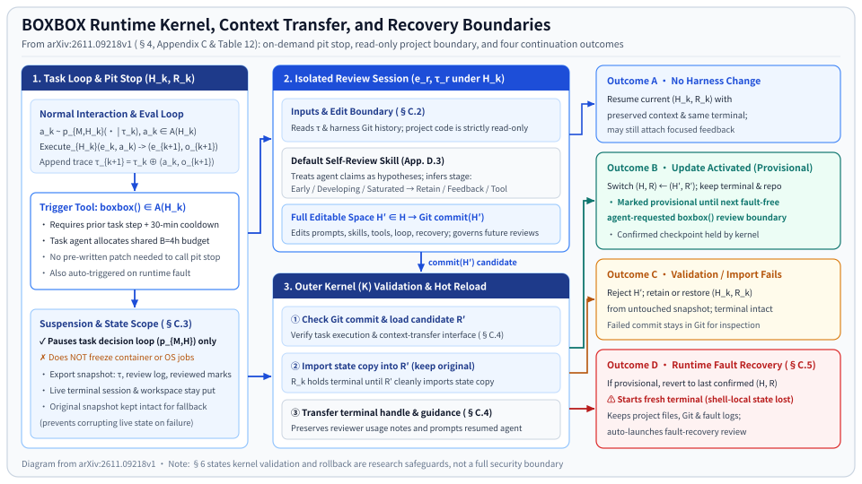View original image ↗</a>

*From arXiv:2611.09218v1 Section 4 and Appendix C: the task agent calls an on-demand pit stop, an isolated review edits the full harness while keeping project code read-only, and an outer kernel handles snapshot copying, terminal reattachment, and rollback.*

Formally, BOXBOX holds the base model `M` fixed while letting the active harness `H_k` govern both input construction `p_{M,H_k}(· | τ_k)` and tool execution `Execute_{H_k}(e_k, a_k)`. Rather than restricting edits to a predefined subset `H_bounded ⊆ H`, BOXBOX exposes the full executable harness `H'_k ∈ H`—covering prompt rules, review feedback, skills, tools, execution-loop logic, and fault recovery—tracked as Git commits. Because an activated `H_{k+1}` governs subsequent task steps as well as subsequent review sessions (Appendix C.1), the architecture enables recursive self-improvement.

When ready, the task agent calls `boxbox() ∈ A(H_k)` without needing a pre-authored patch. After intervening task activity and a 30-minute cooldown, the agent decides when spending shared budget `B` on harness revision will pay off. Crucially, yielding to the outer kernel **suspends the task decision loop only—it does not freeze the Docker container or background OS processes**. The kernel exports a runtime snapshot (task trajectory `τ`, review history, reviewed-entry markers) while leaving the live terminal session and workspace untouched. It then launches an isolated review session `(e_r, τ_r)` under current `H_k`, granting read access to `τ` and Git history while keeping project code strictly read-only. Guided by the default Self-Review Skill (Appendix D.3), the reviewer treats the task agent’s diagnoses as unverified hypotheses, infers execution stage (`Early`, `Developing`, or `Saturated`), and chooses between retention, focused feedback, or reusable tool/loop edits.

Once the review calls `commit(H')`, the kernel validates the Git commit, loads candidate runtime `R'`, verifies execution and state-transfer interfaces, and imports a **copied** state snapshot while preserving the original snapshot and keeping the existing terminal attached to `R_k` until import succeeds. Table 12 and Appendix C.5 specify the four continuation paths:

| Review & activation outcome | Runtime transition & state handling | Terminal & recovery boundary |
|---|---|---|
| No harness change | Resume current `(H_k, R_k)` with preserved conversation and review markers | Existing terminal and workspace continue uninterrupted; may carry focused feedback |
| Successful update activation | Switch `(H, R) ← (H', R')` in **provisional** status | Reattaches the same live terminal and workspace; promotes to confirmed only upon reaching the next agent-requested `boxbox()` without a runtime fault |
| Validation or import failure | Reject `H'`; retain or restore `(H_k, R_k)` from untouched original snapshot | Terminal and workspace remain intact; failed commit stays in Git for later diagnosis |
| Runtime fault | If provisional, roll back to last confirmed `(H, R)` | Starts a **fresh terminal** (shell-local state such as env vars and background jobs is lost), preserves project files, Git history, and fault logs, and auto-launches fault-recovery review |

Across 620 nonempty applied updates in 150 BOXBOX runs (Fig. 5(c)), edits spanned prompt rules (42.9%), review feedback (40.8%), tool functionality (16.9%), skills (16.6%), fault fixes (12.7%), and execution logic (4.7%, non-exclusive categories). Case studies in Appendix A.4 show how these edits work in practice: on `ccc--compile-speed`, three reviews built a timing helper, added stage breakdowns, and enforced alternating A/B runs—catching a spurious 9.4% batch-order speedup before cutting SQLite compile time from 6.321 s to 5.792 s (1.748×). On `rust-clippy--cargo-package-lint`, reviews extended internal command polling to `AUTO_COMMAND_WAIT_SEC = 180` to eliminate empty wait turns and replaced a shell-exit exception with `ensure_agent_session()` recovery that avoids replaying uncertain commands. On `trixi-framework-trixi-jl--self-gravitating-sedov-amr`, where late turns reached ~145,000 input tokens, the agent added proactive compaction triggered at 64+ messages and +24 message increments.

### Controlled comparisons, ablations, and failure/metric caveats (v1 record)

<a class="note-image-link" href="/assets/images/digest/2026-11-10/perfrace-harness-comparison-en.svg" target="_blank" rel="noopener" aria-label="PerfRace curation funnel, controlled baselines, and ablation boundaries · View original image ↗">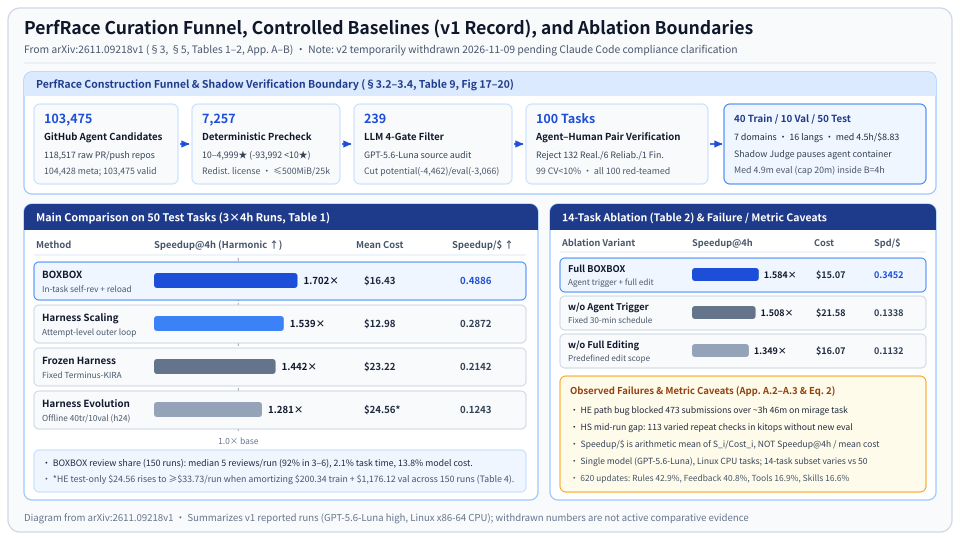View original image ↗</a>

*From arXiv:2611.09218v1 Tables 1–2 and Appendices A–B: summarizes the PerfRace curation funnel, 50-task main runs, and 14-task ablations; treated strictly as a v1 historical record after the v2 withdrawal.*

Experiments ran on an Azure `Standard_D96ads_v5` VM (96 vCPU AMD EPYC 7763, 384 GiB RAM, Ubuntu 24.04 + Docker) starting from `Terminus-KIRA`, using `GPT-5.6-Luna` at high reasoning effort ($1.00/M uncached input, $0.10/M cached input, $6.00/M output) across three independent 4-hour runs per task (600 main test runs total). Equation (2) summarizes each task’s three runs via geometric mean `S_i`, then takes the **harmonic mean** across 50 tasks for `Speedup@4h` (limiting outlier distortion) and the **arithmetic mean** of per-task `S_i / Cost_i` for `Speedup/$`. The table below collects Table 1 (50 test tasks) and Table 2 (14-task ablation subset):

| Study & Method (arXiv:2611.09218v1) | Scope | Speedup@4h (Harmonic) | Mean Model Cost | Speedup/$ (Task Mean) | Mechanism & Observed Boundary |
|---|---|---|---|---|---|
| BOXBOX (Main, Table 1) | 50 tasks × 3 runs | 1.702× | $16.43 | 0.4886 | In-task revision + context-preserving hot reload; climbs from 1.530× (2 h) to 1.702× (4 h) |
| Harness Scaling (HS, outer loop) | 50 tasks × 3 runs | 1.539× | $12.98 | 0.2872 | 2,132 attempts (median 12/run, 3.37-min transition gap); context reset cuts tokens but forces rediscovery |
| Frozen Harness (FROZEN, fixed) | 50 tasks × 3 runs | 1.442× | $23.22 | 0.2142 | Fixed `Terminus-KIRA` (~965 steps mean); largely plateaus in hours 2–4 (1.410× to 1.442×) |
| Harness Evolution (HE, offline `h24`) | 50 tasks × 3 runs | 1.281× | $24.56 (≥$33.73 amortized) | 0.1243 | Offline 40-train/10-val selection fails to transfer; adds $200.34 train + $1,176.12 val across 150 runs |
| Full BOXBOX (Ablation, Table 2) | 14 sampled tasks | 1.584× | $15.07 | 0.3452 | Combines agent-triggered pit stops with full executable harness editing |
| w/o Agent Triggering (30-min timer) | 14 sampled tasks | 1.508× | $21.58 | 0.1338 | Scheduled interruptions disrupt active code edits and spend calls when no change is needed |
| w/o Full Editing (bounded scope) | 14 sampled tasks | 1.349× | $16.07 | 0.1132 | Predefined edit bounds block cross-component loop or recovery adaptations |

Across 150 test runs, BOXBOX invokes a median of 5 reviews per run (92% between 3 and 6, including fault recoveries), consuming a median 2.1% of task time and 13.8% of model cost (Fig. 5). Two quantitative caveats deserve explicit note: first, BOXBOX’s $16.43 mean cost cuts Frozen’s $23.22 by 29.3% yet exceeds HS’s $12.98, because HS clears conversation history between attempts; second, `Speedup/$` averages per-task `S_i / Cost_i` rather than dividing `Speedup@4h` by mean cost, making it sensitive to tasks with high speedup and low spend—so higher `Speedup/$` does not mean lowest dollar cost.

Trajectory audits in Appendices A.2–A.3 illustrate how baselines fail on long runs. In HE, a training-iteration-5 promotion gate (`git rev-parse HEAD` plus `.autoresearch/promotion.json`) inspected the parent workspace rather than the editable repo directory on `mirage-kubernetes-triage`, blocking 473 consecutive submissions across roughly 3 hours 46 minutes; HE’s 45-minute training runs (in 5-task mini-batches) also differ structurally from 4-hour test evaluation. Meanwhile, HS’s external controller added a naive check warning after three consecutive identical command batches on `kitops-minilm-pack`, yet the agent varied its shell syntax and executed 113 consecutive redundant verification commands without new measurements because HS could only patch between attempts.

### Engineering implications, security limits, and applicability

Within this issue, BOXBOX complements `DeCAF` (offline dimension-wise search and end-to-end composition) and pairs directly with `PatternOps` (which demonstrates how runtime reloads can silently reorder callbacks and bypass policy checks): kernel schema checks and Git rollback validate startup interfaces, **not** authorization invariants or security policies. Section 6 explicitly cautions that letting an agent rewrite its own executable harness while working inside untrusted repositories can weaken safeguards, introduce regressions, or expand capabilities unintended by operators; thus BOXBOX remains a research prototype requiring strict OS sandboxing, access controls, security review, and human approval before production use.

External validity is further bounded by evaluation scope: all `v1` experiments rely on a single model (`GPT-5.6-Luna`, high effort), a single seed harness (`Terminus-KIRA`), and commodity Linux x86-64 CPU tasks—excluding GPU kernels, distributed clusters, or live production services—while the 14-task ablation subset scores notably lower (`1.584×`) than the full 50-task split (`1.702×`). Together with the November 9 `v2` withdrawal for Claude Code compliance clarification, the enduring takeaway is the runtime design—on-demand pit stops, read-only project boundaries during review, and copied-state hot swapping—rather than treating `v1` numbers as settled comparative standings.

<h2 class="daily-paper-title" id="paper-arxiv-2611.09088">05 · PatternOps: active plugins can still leave policy bypassed</h2>

[When Routine Operations Break Architectural Pattern Relationships in LLM Agent Harnesses](https://arxiv.org/abs/2611.09088)  
Boming Xia, Qinghua Lu, Dino Sejdinovic, Liming Zhu · 2026-11-06

### Execution relationships can break without a code change

One plugin evaluates policy, another asks for approval, and the host orders their callbacks. Individually functioning components do not guarantee that every tool action reaches policy first. This study examines five relationships involving Guardrail Enforcement Point, Autonomy Controller, and Blackboard patterns across five released harnesses and fourteen main-sample plugins.

PatternOps traces pattern requirements, provider promises, and deployment-specific demands to responsible components and deciding runtime records. Controlled tool sequences establish comparisons; selected paths also use live models. The central evidence joins a particular tool call to its policy decision, approval, and final effect, rather than counting plugin errors.

### Reapplication and saved consent change the path

<a class="note-image-link" href="/assets/images/digest/2026-11-10/patternops.png" target="_blank" rel="noopener" aria-label="PatternOps: active plugins can still leave policy bypassed · View original image ↗">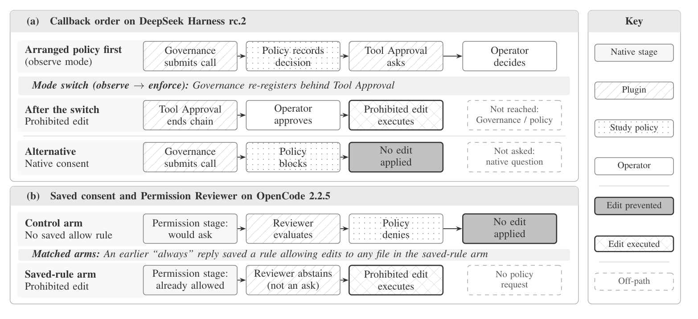View original image ↗</a>

*Reapplication changes callback order above; saved consent changes review eligibility below. Either can bypass the designated policy component.*

In one DeepSeek Harness composition, reapplying the initially first policy plugin unregisters its old callback and appends the replacement. The approval plugin then runs first and ends the chain after the operator responds. A policy-prohibited edit executes following approval. Both plugins remain active and policy can still block reads, leaving ordinary health checks unable to reveal the missing edit-path evaluation.

In an OpenCode case, saving an enduring allow rule makes subsequent edits already permitted. A reviewer that evaluates only requests needing a question abstains. This is not simply a broken plugin promise: a promise to review asks is narrower than a deployment requirement to evaluate every edit.

### Define the relationship before choosing placement

The study compares native consent, fixed callback ordering, in-place updates, and checks closer to tool execution. A repair that survives reapplication may still fail at a cold start. Preventing every prohibited effect does not imply that policy evaluated edits rejected earlier by another component. “Policy decides every execution,” “every edit is evaluated,” and “escalation renews approval” require different placements and state behavior.

In a concrete live-model comparison, five API models made 28 reads and 28 edits under the approval-plugin composition: policy evaluated every read and no edit. This is evidence for particular versions, configurations, and operation sequences, not a harness-wide failure rate or a ranking of model propensity to bypass policy.

**The AgentOps contribution is to evaluate runtime history alongside configuration.** Read how joined records establish participation and why alternatives must be assessed against explicit requirements. BOXBOX in this issue supplies an online-update mechanism; this study shows relationships that such updates must preserve. Their contributions remain distinct.

## Research developments

<h2 class="daily-paper-title" id="paper-arxiv-2611.08638">06 · MORTIS: infer cache lifetimes from program variables</h2>

[MORTIS: Compiler-Guided KV-Cache Management for LLM Agent Programs](https://arxiv.org/abs/2611.08638)  
Xiaoyu Ma, Jayanaka L. Dantanarayana, Savini Kashmira, Baichuan Li, Lingjia Tang, Jason Mars · 2026-11-05

Conventional prefix caching treats everything after the first differing token as an opaque suffix. For agents that construct prompts through typed LLM function calls, MORTIS analyzes definitions, appends, and overwrites to infer component sharing and lifetimes. Runtime branch and inter-call observations refine prompt ordering, retention, eviction, and prefetching.

<a class="note-image-link" href="/assets/images/digest/2026-11-10/mortis.png" target="_blank" rel="noopener" aria-label="MORTIS: infer cache lifetimes from program variables · View original image ↗">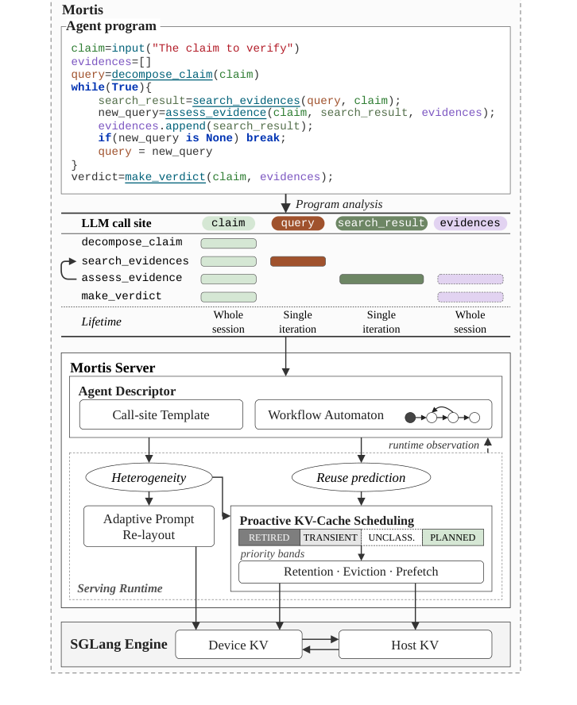View original image ↗</a>

*Variable lifetimes and workflow analysis produce a descriptor used for prompt layout and cache priorities.*

Eviction distinguishes retired volatile tails, transient content in active sessions, unclassified entries, and planned reusable prefixes. Across four agent workloads, geometric-mean improvements over SGLang are 1.45× for job completion time and 1.49× for throughput, with maxima of 1.99× and 1.97×. The mechanism exposes better prefix reuse through program semantics rather than arbitrary position-independent segment reuse. Unresolved values receive conservative classifications; prompt-reordering quality also needs validation.

<h2 class="daily-paper-title" id="paper-alphaxiv-2611-flashstate">07 · FlashState: reusable KV needs a matching recurrent checkpoint</h2>

[FlashState: Unlocking Flexible Hybrid State Management for Agentic LLM Serving](https://www.alphaxiv.org/abs/2611.flashstate)  
Chenxi Li, Weili Xu, Tianyi Zhang, Jue Wang, Zhongzhu Zhou, Chenfeng Xu · 2026-11-09

Hybrid attention needs both cached KV and a recurrent checkpoint at the resume position. FlashState decouples checkpoint placement from KV-block boundaries and captures the true processed endpoint when a request completes. Backend state export and a unified dependency- and cost-aware admission/eviction policy avoid retaining KV whose required checkpoint has already disappeared.

On coding-agent traces with two B200s per engine and equal cache budgets, peak prefill improvements over vLLM are 3.14×, 2.27×, and 1.54× for GLM-5.3-Flash, Nemotron 3 Super, and Qwen3.8-Flash-Next; GLM p90 TTFT falls by up to 88.4%. These depend on context and concurrency. The mechanism complements MORTIS’s variable analysis and the H200 note’s decode KV sharing; their gains cannot simply be multiplied.

<h2 class="daily-paper-title" id="paper-arxiv-2611.09109">08 · DARIC: allocate recomputation using deviation patterns</h2>

[DARIC: A Position-Independent KV Cache Reuse System with Distribution-Aware Recomputation](https://arxiv.org/abs/2611.09109)  
Weikang Wang, Haiyang Liu, Xin Zhou, Jun Liu, Weifeng Zhang · 2026-11-06

Position-independent KV reuse misses cross-chunk attention when independently computed documents appear under new prefixes. DARIC observes larger deviations near chunk beginnings, increasing deviation in later chunks, and the importance of the latest window. It allocates recomputation to these regions instead of performing expensive online ranking across every token.

Standard sub-requests preserve existing inference-engine scheduling and execution paths. Evaluation covers RAG, function calling, and agentic coding; the headline TTFT improvement over advanced alternatives is 1.1–4.5×. Larger speedups against full recomputation use a different denominator. The contribution is inexpensive selection and integration, without a universal zero-quality-loss guarantee. Nebula addresses cluster-wide management instead, so the two contributions remain separate.

<h2 class="daily-paper-title" id="paper-arxiv-2611.09474">09 · Nebula: make position-independent caching cluster-wide</h2>

[Nebula: Distributed Position-Independent Caching for LLM Serving](https://arxiv.org/abs/2611.09474)  
Yifei Liu, Junbin Pan, Junhao Hu, Yang Liu, Junyi Chen, Juntong Wu, Chen Chen, Haiyuan Zhao, Xiaoxu Chen, Weihang Chen · 2026-11-06

Local segment reuse does not locate remote KV or distribute uncached segment computation to idle workers. Nebula makes application-marked PIC segments distributed objects: match the full prefix first, locate remaining segments, scatter independent prefill, then gather at a combine worker for required recomputation.

Optimistic accounting and event updates track asynchronous state. Ghost hits tune capacity shares between prefix and PIC caches; scheduling models queueing, computation, and transfer together. Main evaluation across four models and four RAG/agent workload families reports a 61.4% average reduction in median TTFT versus the strongest baseline, recovering 76.1% of tokens missed by prefix caching. Accuracy trade-offs remain with the pluggable PIC backend: cluster management does not make independently computed KV exact full-context state.

<h2 class="daily-paper-title" id="paper-arxiv-2611.08770">10 · ReKV: transfer early-layer KV while recomputing later layers</h2>

[ReKV: Overlapping Quantized KV Transfer and Suffix Recomputation](https://arxiv.org/abs/2611.08770)  
Guangjian Dong · 2026-11-05

ReKV’s prefix and suffix refer to model layers, not portions of prompt text. Prefill sends quantized KV for earlier layers plus one BF16 boundary hidden state. Decode recomputes a contiguous later-layer suffix while earlier-layer KV is in flight, selecting the cut according to transfer and compute costs.

A model-shaped synthetic benchmark on cross-node H100s at 8K reports 2.36–3.65× Q8 handoff speedups over full BF16 transfer. A separate real-weight BF16 experiment measures only prefill-to-first-token return and achieves 1.16–1.63×; it does not validate subsequent decoding from reconstructed Q8 caches. Faster links or short prompts can favor transfer alone. This is a useful overlap prototype with explicit evidence boundaries, rather than a production serving-stack speedup.

<h2 class="daily-paper-title" id="paper-arxiv-2611.09722">11 · FOSCAR: move per-element affine work off the critical path</h2>

[FOSCAR: Accelerating Decode Attention over 2- and 4-Bit KV Caches through Affine Folding](https://arxiv.org/abs/2611.09722)  
Donglin Zhuang, Pragaash Ponnusamy, Xiaoxia Wu, Shuaiwen Leon Song, Zhongzhu Zhou · 2026-11-06

Two-bit KV reduces traffic but can bottleneck on conversion and per-element scale/offset instructions. FOSCAR factors affine transformations through matrix products. Depending on token-wise or channel-wise grouping, it applies scales to the other operand or accumulator and expresses offsets as output corrections, combining this with bit manipulation and Hopper/Blackwell pipelines.

<a class="note-image-link" href="/assets/images/digest/2026-11-10/foscar.png" target="_blank" rel="noopener" aria-label="FOSCAR: move per-element affine work off the critical path · View original image ↗">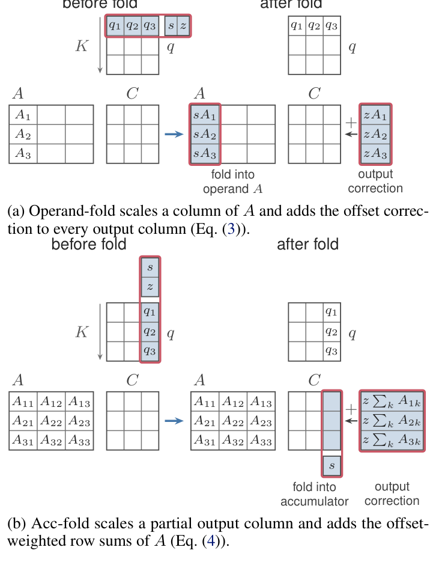View original image ↗</a>

*The scale-sharing dimension determines whether scaling moves into an input or accumulator, with a separate offset correction.*

H100 INT2/INT4 kernels achieve geometric-mean speedups of 3.36×/2.83× over FlashInfer BF16. Against native TensorRT-LLM NVFP4 on B200, the corresponding gains narrow to 1.16×/1.00×. Folding preserves dequantized results in exact arithmetic but does not remove low-bit cache error. Separate SGLang long-context throughput gains also depend on capacity and concurrency, so kernel speedups cannot substitute for serving measurements.

<h2 class="daily-paper-title" id="paper-arxiv-2611.09825">12 · BitDecoding-FP4: native FP4 decoding needs accuracy and softmax co-design</h2>

[BitDecoding-FP4: Native FP4 KV Cache Decoding via Algorithm-System Co-Design](https://arxiv.org/abs/2611.09825)  
Dayou Du, Woon Yee Ng, Guangming Sheng, Nick Lau, Jianyi Cheng, Luo Mai · 2026-11-06

Native FP4 Tensor Cores avoid expanding cached values to a higher precision, but queries, keys, and probabilities can all introduce error. BitDecoding-FP4 represents each query with FP4 base and residual terms, combines outlier-aware keys with underflow-aware probability scaling, and transposes softmax so threads work across keys. Residual queries occupy otherwise padded matrix-tile space.

<a class="note-image-link" href="/assets/images/digest/2026-11-10/bitdecoding-fp4.png" target="_blank" rel="noopener" aria-label="BitDecoding-FP4: native FP4 decoding needs accuracy and softmax co-design · View original image ↗">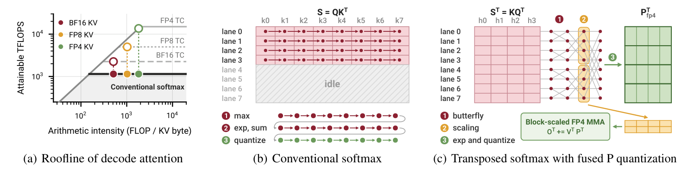View original image ↗</a>

*Assigning threads to keys exposes parallel reductions and reuses their intermediate maxima for FP4 probability scaling.*

Its vLLM integration retains BF16 sink/recent tokens and promotes full pages to FP4. Across evaluated long-context and reasoning benchmarks, NVFP4 averages within 0.5 points of BF16; peak Qwen3 serving throughput on B300 is 2.4–3.0× BF16. These are configuration-dependent averages and operating points, not a per-task accuracy bound or an entirely FP4 path without high-precision buffers.

<h2 class="daily-paper-title" id="paper-arxiv-2611.08713">13 · ResServe: use spare skinny-matrix capacity for residual correction</h2>

[ResServe: Accurate and Efficient FP4 LLM Inference with Residue Compensation](https://arxiv.org/abs/2611.08713)  
Shuo Rong, Ruibo Fan, Jiawen Wen, Xiaowen Chu · 2026-11-05

ResServe splits activations into an FP4 base and a quantized residual, multiplies both by the same weights, and folds outputs on-chip. Skinny decode matrices leave tile capacity that residual rows can use. Attention combines query-base and residual scores before softmax; wider prefill computations compensate only selected channels to limit added work.

On B200 with 8K input, 256 output tokens, and one request per second, evaluated NVFP4 configurations add at most 3.4% latency over W4A4 and reduce latency 22.4–53.3% versus W4A8. The five-model mean code-generation gain of 15.04% is relative, not percentage points. Unlike BitDecoding’s attention focus, this also covers linear layers and shape-aware spare capacity. Residual computation is not free at arbitrary batch sizes or during prefill.

<h2 class="daily-paper-title" id="paper-arxiv-2611.09225">14 · Fused-Softmax: move vector work after low-precision GEMMs accelerate</h2>

[Fused-Softmax for efficient quantized attention](https://arxiv.org/abs/2611.09225)  
Tianxing Wu, Juuso Korhonen, Jesus Carabano Bravo · 2026-11-06

As low-precision matrix throughput outpaces vector units, softmax becomes attention’s bottleneck. Fused-Softmax freezes a speculative maximum with rollback when required, folds an affine exponential approximation into score GEMM and conversion, and computes the denominator using matrix multiplication. Most steady-state vector work leaves the critical path.

On MI355X, MXFP8/6/4 attention achieves approximately 2.1×/2.8×/3.2× BF16 speedups. A hybrid MXFP6/4 Wan2.2 video-generation schedule reaches up to 2.05× end-to-end; that is not an autoregressive decode result. Additional approximation error falls below quantization error in the tested distributions. Thresholds still depend on numerical range and sequence length, and the method is not exact softmax equivalence for arbitrary inputs.

<h2 class="daily-paper-title" id="paper-arxiv-2512.24637">15 · MSched: prepare the next GPU working set before switching tasks</h2>

[Towards Fully-fledged GPU Multitasking via Proactive Memory Scheduling](https://arxiv.org/abs/2512.24637)  
Weihang Shen, Yinqiu Chen, Rong Chen, Haibo Chen · 2025-12-31 · v3 revised 2026-11-06

With oversubscribed GPU memory, demand paging fragments large working sets into costly faults, while whole-process swapping moves much data not immediately needed. MSched predicts working sets from parameterized kernel-access templates, prior execution, and fault feedback, preparing them during context switching. Scheduling and memory management share future access order to guide replacement.

Across scientific, deep-learning, and LLM workload combinations, maxima are 186.69× over demand paging and 8.63× over whole-process-swapping Nixie. The largest gains occur in the H20 large-memory/large-footprint configuration, not as an average across ordinary tasks. Dynamic MoE accesses still require feedback. Initially submitted December 31, 2025, the paper was revised to v3 on November 6.

<h2 class="daily-paper-title" id="paper-arxiv-2607.00466">16 · ELDR: route decode requests by expert-use similarity</h2>

[ELDR: Expert-Locality-Aware Decode Routing for PD-Disaggregated MoE Serving](https://arxiv.org/abs/2607.00466)  
Sangjin Choi, Sukmin Cho, Yifan Xiong, Ziyue Yang, Youngjin Kwon, Peng Cheng · 2026-07-01 · v3 revised 2026-11-06

ELDR records discrete MoE expert activations during prefill, then applies IDF weighting, layer selection, and normalization to form a request signature. Routing similar signatures to the same decode worker reduces the distinct experts touched by a batch. Balanced clustering and locality-band routing constrain hotspots and tail latency.

On vLLM and MI300X, the main topology is 8P16D; the largest 235B configuration spans 40 GPUs. Reported mean reductions in median TPOT are 5.4–14.5%, up to 17.8%. Benefits depend on prefill–decode activation correlation. Layer masks, IDF weights, and expert placement remain fixed after calibration rather than being fully relearned online. It is a workload/locality and load-balancing co-design, not a universal mixed-traffic guarantee.

<h2 class="daily-paper-title" id="paper-arxiv-2611.08669">17 · ChainFlow: short latent transport for speculative drafts</h2>

[ChainFlow: Few-Step Latent Flow Matching for Speculative Decoding](https://arxiv.org/abs/2611.08669)  
Selim Aktas, Yusuf Erdem Erdem, Ahmed Zeer, Himmet Toprak Kesgin, Muzaffer Kaan Yuce, Mehmet Fatih Amasyali · 2026-11-05

ChainFlow conditions on recent target hidden states, compresses them with a VAE, extrapolates future starting points, and transports a block through a few flow steps. Lightweight Markov/path heads restore dependence on selected tokens before tree candidates undergo target verification. The main serving configuration uses one step after two-step training, despite the two-step illustration.

On B300, vLLM 0.31.0, Qwen3.5-4B, batch one, and greedy decoding, the headline tree configuration averages 1.87× autoregressive speed, versus 1.35×/1.69× for similarly sized EAGLE-3/DFlash drafters: about 39%/11% relative gains. The chain-only variant reaches just 1.23×, highlighting tree and dependency mechanisms. Drafter training, verification cost, concurrency, and workload distribution remain material constraints.

<h2 class="daily-paper-title" id="paper-arxiv-2611.08660">18 · AutoParallel: automatic plans that remain ordinary PyTorch</h2>

[AutoParallel: Composable, PyTorch-Native Automatic Parallelism for Production Training](https://arxiv.org/abs/2611.08660)  
Kaijian Wang, Sanket Purandare, Aditya Venkataraman, Will Constable, Ivan Kobzarev, Elias Ellison, Simon Fan, Edward Z. Yang, Davide Italiano, Patrick Labatut, Yuke Wang, Francisco Massa · 2026-11-05

AutoParallel traces forward and backward into an ATen graph, enumerates legal DTensor strategies, jointly optimizes computation and redistribution costs, and materializes an inspectable, replayable PyTorch module. Approximate search controls high-dimensional meshes. Dynamic MoE or custom context-parallel regions remain user-controlled through local_map placement contracts.

Across dense, hybrid, and MoE training on up to 128 H100s, it matches or exceeds expert TorchTitan recipes in most configurations, with up to 18.3% higher throughput. Composability and maintainability matter alongside the maximum gain. Cost models, representative inputs, and memory feasibility still influence plans; changed sequence lengths can warrant replanning rather than reusing one strategy universally.

<h2 class="daily-paper-title" id="paper-arxiv-2611.08723">19 · DeCAF: isolate experiments, then validate their composition</h2>

[Divide, Diagnose, and Compose: Optimizing Agentic Pipelines and Harnesses](https://arxiv.org/abs/2611.08723)  
Divij Handa, Christopher Tensmeyer, Jihyung Kil, Vlad I. Morariu · 2026-11-05

DeCAF derives optimization dimensions such as prompts, topology, model assignment, and tool policy from a task and seed pipeline. Restricted editing sessions start from the same seed, test diverse hypotheses, record failures as well as successes, and retain non-dominated quality/cost/latency candidates. A synthesis stage re-evaluates combinations end to end rather than assuming individually useful edits compose.

Role-specific trajectory evaluation checks correctness, compliance, and downstream use to localize likely problems, not exact causal contributions. Across AppWorld, LiveCodeBench, AgentDojo, and PostTrainBench, reported averages versus the strongest overall baseline are +2.58 performance points, −4.30% inference cost, and −42.45% latency. These are resulting inference expenses, not free optimization. Unlike BOXBOX, the contribution organizes offline experimentation and synthesis.

<h2 class="daily-paper-title" id="paper-arxiv-2611.09048">20 · LeanDojo-v2: connect proof data, training, and search</h2>

[LeanDojo-v2: A Comprehensive Library for AI-Assisted Theorem Proving in Lean](https://arxiv.org/abs/2611.09048) ([v1 PDF](https://arxiv.org/pdf/2611.09048v1))  
Ryan Hsiang, William Adkisson, Robert Joseph George, Anima Anandkumar · arXiv · 2026-11-06 (v1 · accepted to NeurIPS 2025 MATH-AI Workshop)

**Paper status and scope note**: As verified on November 15, 2026, [arXiv:2611.09048](https://arxiv.org/abs/2611.09048) remains at `v1` only (submitted `2026-11-06T06:21:06Z` UTC, 11 pages including appendices, 7 figures), with no `v2` revision or withdrawal. All workflow claims, APIs, and build-time figures below follow `arXiv:2611.09048v1` strictly; where concrete implementation symbols (`DynamicDatabase`, `BaseProver.search()`, `build_deps`, `ProgressTrainer`) are referenced for precision, they are cross-checked against the authors’ public companion repositories `lean-dojo/LeanDojo-v2` and `lean-dojo/lean4code` and explicitly distinguished from statements inside the PDF.

### 1. From LeanDojo-v1 fragmentation to unified extraction and architecture

Large language models solve many mathematical problems in natural language, yet unconstrained text reasoning cannot be mechanically verified and remains prone to hallucinations and logical errors. Pairing ML models with proof assistants such as Lean turns proof generation into machine-checked verification. Prior to LeanDojo-v2, however, tooling across the ecosystem remained fragmented across separate research repositories: LeanDojo (NeurIPS 2023, `arXiv:2306.15626`) handled repository extraction, ReProver trained retrieval-augmented provers, LeanCopilot (`arXiv:2404.12534`) brought local C++ inference into the Lean 4 VSCode extension, LeanAgent (ICLR 2025, `arXiv:2410.06209`) added cross-domain curriculum learning, and ImProver (`arXiv:2410.04753`), `ntp-toolkit`, `Lean4trace`, `LeanNavigator`, Pantograph (`arXiv:2410.16429`), and Kimina Lean Server (`arXiv:2504.21230`) lived as distinct packages. Maintaining those tools separately created dependency drift and high setup barriers for mathematicians, while off-the-shelf pretrained LLMs still faltered on specialized mathematical subfields without domain-specific fine-tuning.

<figure class="note-figure"><a class="note-image-link" href="/assets/images/digest/2026-11-10/leandojo-v2-architecture-en.svg" target="_blank" rel="noopener" aria-label="View original LeanDojo-v2 end-to-end architecture diagram">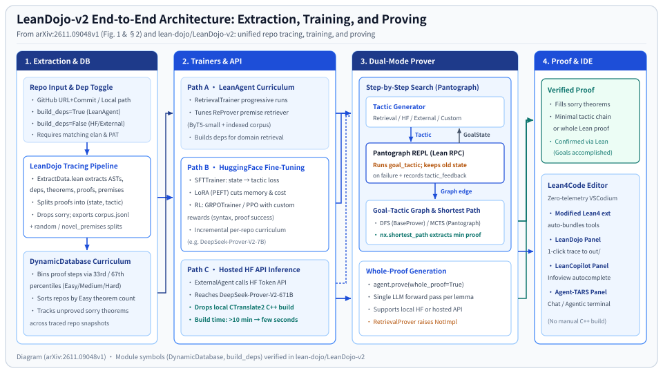View original image ↗</a><figcaption>Figure 1 · LeanDojo-v2 end-to-end architecture: grounded in arXiv:2611.09048v1 Figure 1 and Section 2, with companion codebase modules (DynamicDatabase, build_deps, Prover/Trainer classes) verified in lean-dojo/LeanDojo-v2.</figcaption></figure>

LeanDojo-v2’s main contribution is unifying repository data extraction, model training or hosted inference, REPL-backed proof search, whole-proof generation, and IDE delivery under standardized APIs. At the extraction stage, a user specifies one or more GitHub repository URLs and commit hashes (with `setup_local_repository()` also exposed in the companion codebase for local checkouts). LeanDojo traces the repository via Lean instrumentation (`ExtractData.lean` and `trace.py` in the codebase) to extract abstract syntax trees (ASTs), file and premise dependencies, theorem statements, proofs, and premises.

For downstream LLM adaptation, LeanDojo-v2 decomposes each traced proof into a sequence of `(state_before, tactic)` pairs—feeding the proof state as the input prompt and predicting the associated tactic as the target. In the companion repository, `DynamicDatabase` persists repository metadata, filters out `sorry` placeholders and `"no goals"` terminal states, exports `corpus.jsonl` alongside `random` and `novel_premises` splits, and tracks unproved `sorry` theorems for automated proving. Crucially, `build_deps` controls whether premises from external dependencies are extracted: `LeanAgent` defaults `build_deps=True` to populate its retrieval corpus, whereas `HFAgent` and `ExternalAgent` default `build_deps=False` to avoid heavy dependency tracing when fine-tuning or querying directly on target files.

### 2. Progressive curriculum training, fine-tuning/RL, and hosted API inference

To support both domain specialization on smaller models and zero-training access to frontier provers, LeanDojo-v2 abstracts the end-to-end workflow under `BaseAgent` (`setup_github_repository()` → `train()` → `prove()`) with three concrete execution tracks:

1. **LeanAgent retrieval curriculum**: Categorizes extracted theorems into `easy`, `medium`, and `hard` using the **33rd and 67th percentiles** of proof lengths measured by number of proof steps (`difficulty.py` scores proofs via `math.exp(len(proof_steps))`, marking `sorry` as `inf`). Repositories are sorted by their count of easy theorems, and ReProver’s dense premise retriever (`kaiyuy/leandojo-lean4-retriever-tacgen-byt5-small` by default in the codebase) is trained progressively from easiest to hardest repositories.
2. **HuggingFace SFT, LoRA, and RL fine-tuning**: `SFTTrainer` fine-tunes any HuggingFace causal LM on decomposed `(proof state, tactic)` transitions (`SFTConfig(completion_only_loss=True)` in the codebase), with `LoRA` (PEFT) support to reduce GPU memory and cost. `GRPOTrainer` and PPO (described in Section 2.1) support reinforcement learning with user-defined reward functions such as syntax correctness and proof success. Multi-repository HuggingFace training reuses the same difficulty-sorted progressive schedule across repositories—demonstrated in Section 2.2’s concise quickstart and Appendix B’s GRPO recipe on `DeepSeek-Prover-V2-7B`.
3. **Hosted HuggingFace Inference API**: Because flagship models such as `DeepSeek-Prover-V2-671B` are prohibitively large to fine-tune locally, `ExternalAgent` calls HuggingFace inference providers directly with a HuggingFace token (`deepseek-ai/DeepSeek-Prover-V2-671B:novita`), powering both CLI proving and Lean4Code Infoview autocompletion. Section 2.1 reports that replacing LeanCopilot’s local C++ inference stack (`CTranslate2`) with HuggingFace API calls cuts **build time from over ten minutes to just a few seconds** and eliminates local inference hardware requirements—trading local self-containment for external API latency and token dependency.

| Agent Entry Point | Companion Trainer / Inference | Paired Prover & Retrieval | Default `build_deps` | Intended Models & Scope |
|---|---|---|---|---|
| `LeanAgent` | `RetrievalTrainer` (33rd/67th percentile progressive curriculum) | `RetrievalProver` (ReProver dense premise retrieval + tactic generation; no whole-proof mode) | `True` (builds dependencies to populate `corpus.jsonl`) | Lifelong retrieval-augmented proving across mathematical repositories |
| `HFAgent` | `SFTTrainer` / `GRPOTrainer` (LoRA + custom rewards; PPO noted in paper) | `HFProver` (local full or LoRA checkpoint; supports search and whole-proof generation) | `False` (traces target repo `state → tactic` pairs) | Domain adaptation of open models such as `DeepSeek-Prover-V2-7B` |
| `ExternalAgent` | None (zero-training HuggingFace Inference API calls) | `ExternalProver` (hosted inference API; supports search and `whole_proof=True`) | `False` (extracts unproved `sorry` targets and context) | Fast zero-GPU setup calling `DeepSeek-Prover-V2-671B` without `CTranslate2` |
| `BaseAgent` / `BaseProver` (abstract base) | Subclass hooks (`_get_build_deps()`, custom trainer integration) | Subclass `next_tactic()` and `generate_whole_proof()` | Defined by subclass | Custom ML or non-ML heuristic provers and search extensions |

### 3. State-preserving REPL search (`goal–tactic` graph) and `Lean4Code` IDE

For theorem proving, LeanDojo-v2 supports both **whole-proof generation**—emitting a complete proof in one LLM forward pass (`agent.prove(whole_proof=True)`)—and **step-by-step tactic search** backed by Pantograph (`arXiv:2410.16429`) as the Lean 4 REPL. Step-by-step proving models search explicitly as a directed **`goal–tactic` graph** whose nodes represent `GoalState`s and whose edges represent tactics, starting from the theorem’s initial goal until reaching a terminal node with zero remaining goals (`Goals accomplished!`).

<figure class="note-figure"><a class="note-image-link" href="/assets/images/digest/2026-11-10/leandojo-v2-search-ide-en.svg" target="_blank" rel="noopener" aria-label="View original Pantograph goal-tactic search and Lean4Code workflow diagram">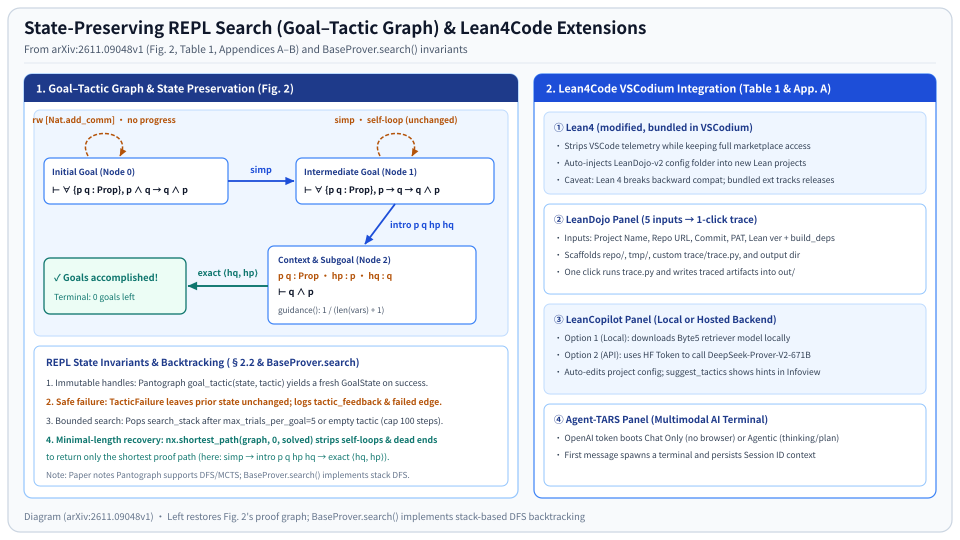View original image ↗</a><figcaption>Figure 2 · State-preserving REPL search and IDE integration: left reproduces paper Figure 2 and BaseProver's rollback invariants; right summarizes the four bundled Lean4Code extensions from Table 1 and Appendix A.</figcaption></figure>

The core operational guarantee is **non-destructive state preservation on tactic failure**. Tracing Figure 2’s concrete example (`⊢ ∀ {p q : Prop}, p ∧ q → q ∧ p`):

1. When a candidate tactic fails or errors—such as applying `rw [Nat.add_comm]` to the root goal—Pantograph raises `TacticFailure` or returns an unchanged state while **leaving the prior `GoalState` completely intact**. In `BaseProver.search()`, the prover stores the error message in `search_state.tactic_feedback`, logs a `failed=True` edge in `nx.DiGraph`, and keeps the current `GoalState` untouched so the next tactic candidate can run cleanly.
2. When a tactic advances the proof—`simp` transitions to `⊢ ∀ {p q : Prop}, p → q → q ∧ p` (while a redundant `simp` self-loops unchanged), `intro p q hp hq` introduces `p q : Prop`, `hp : p`, `hq : q` with goal `⊢ q ∧ p`, and `exact ⟨hq, hp⟩` closes all goals—Pantograph returns a fresh immutable `next_goal_state` pushed onto `search_stack` with a forward graph edge.
3. If per-goal attempts hit the budget (`max_trials_per_goal = 5`, within `max_steps = 100`) or no tactic is returned, search pops `search_stack` to backtrack to the parent goal state. Once solved, `nx.shortest_path(search_graph, 0, solved_node_id)` reconstructs the minimal-length tactic path, stripping self-loops and dead-end explorations. One **paper-vs-code verification note** is worth flagging: Section 2.2 states that Pantograph supports both DFS and MCTS, whereas `BaseProver.search()` in the public repository currently implements stack-based DFS using a variable-count goal heuristic (`1.0 / (len(goal.variables) + 1)`) without an active MCTS loop.

To remove CLI and environment setup friction for mathematicians, Section 3 and Appendix A introduce **Lean4Code**, built atop open-source **VSCodium** (disabling VSCode’s default telemetry while preserving full VSCode extension marketplace access). Pre-bundling a modified `Lean4` extension makes Lean4Code a native Lean 4 editor that automatically embeds a `LeanDojo-v2` configuration directory into every newly created Lean project, paired with three custom panels not yet on the public marketplace (Table 1):

- **LeanDojo panel (Figs. 3–4)**: Prompts for five fields (project name, GitHub URL, commit hash, GitHub PAT, Lean version) plus a `build_deps` toggle (default `False`), creates the workspace folder (`repo/`, `tmp/`, custom `trace/trace.py`, `out/`), and triggers one-click tracing.
- **LeanCopilot panel (Figs. 5–6)**: Offers either local `Byte5` model download or a HuggingFace token calling remote `DeepSeek-Prover-V2-671B`, edits project configuration/dependencies automatically, and renders tactic suggestions in Lean Infoview when calling `suggest_tactics`.
- **Agent-TARS panel (Fig. 7)**: Accepts an OpenAI token to launch ByteDance’s Agent-TARS in `Chat Only Mode` (browser control disabled) or `Agentic Mode` (browser control, thinking, and planning enabled), spawning a dedicated terminal upon the first message and persisting a `Session ID` for multi-turn context.

### 4. Empirical boundaries, code audit, and agent engineering takeaways

A disciplined reading of `arXiv:2611.09048v1` must preserve its evidentiary scope: **this is a library, workflow, and IDE integration paper (NeurIPS 2025 MATH-AI Workshop), not a benchmark evaluation establishing higher proof-success rates over prior provers**. The table below separates primary paper claims, verified repository behavior, and unbenchmarked boundaries:

| Evaluation Dimension | Reported in `arXiv:2611.09048v1` | Companion Codebase Audit (`lean-dojo/LeanDojo-v2`) | Unverified / Out-of-Scope Boundaries |
|---|---|---|---|
| Theorem-proving benchmark accuracy | No unified quantitative `pass@k` comparison table on miniF2F, ProofNet, or Mathlib | `HFAgent`, `ExternalAgent`, and `LeanAgent` demos target small example repos (`lean4-example`) | Paper does not establish superior theorem-proving accuracy over ReProver, Pantograph, or standalone provers |
| Setup & build overhead | Section 2.1 reports replacing local `CTranslate2` C++ setup with HF API cuts build time from **over 10 min to a few seconds** | `external_api` offloads inference via HTTP; `Lean4Code` automates local project scaffolding | Offloading shifts reliance to HuggingFace API tokens, network availability, and external provider latency |
| Training & search implementation | Describes SFT, LoRA, GRPO, PPO, plus DFS/MCTS graph search and shortest-path recovery | `SFTTrainer` / `GRPOTrainer` exist; GRPO example uses a dummy `1.0` reward; `BaseProver.search()` runs stack DFS | End-to-end PPO and `LeanProgress` (dataset/trainer scripts in repo, listed as future work in §4) lack empirical studies |
| Toolchain & version coupling | Section 3.2 notes newer Lean 4 releases often break backward compatibility; Lean4Code tracks the latest `LeanDojo-v2` Lean version | Tracing requires matching local `elan` toolchains, `GITHUB_ACCESS_TOKEN`, and large disk cache (`RAID_DIR`) | Multi-version repository mixing remains brittle; `Agent-TARS` panel requires an external OpenAI token |

Even without new benchmark leaderboards, LeanDojo-v2 offers four transferable engineering patterns for verifier-in-the-loop coding and system agents (complementing runtime isolation themes in `BOXBOX` and `DeCAF` in this same issue): first, **immutable verifier state handles with zero-corruption failure handling**—binding each step to an immutable `GoalState` handle where `TacticFailure` returns feedback without mutating state is substantially safer than mutating a shared container and attempting ad-hoc rollback; second, **graph logging plus shortest-path distillation**—storing both valid transitions and `failed=True` dead ends in a `DiGraph` and extracting `nx.shortest_path` upon completion prevents exploratory thrashing from polluting downstream SFT trajectories; third, **decoupling thin local orchestration from heavy inference dependencies**—trading ten-minute C++ builds for remote inference while keeping `build_deps` explicitly opt-in lowers iteration friction; and fourth, **difficulty-percentile curricula paired with IDE verifier surfaces**—ordering multi-repo training via `33rd/67th` step percentiles while exposing suggestions inside the native Lean Infoview tightens the human-agent verification loop.

## Companion notes

- [GLM-5.3-Flash: separate state semantics and balance prefill with decode](/tech/en/glm53-h200/)
- [TPU Sync: asynchronous model-state movement across memory tiers](/tech/en/tpu-sync/)
- [Grafana Watchers: calibrate once, make one narrow decision per check](/tech/en/grafana-watchers/)
- [Evaluating AI SRE: separate diagnosis, evidence, and operational responsibility](/tech/en/ai-sre-evaluation/)
- [Claude Fable / Mythos 5.2: capability, inference cost, and access boundaries](/tech/en/claude-fable-mythos-52/)
