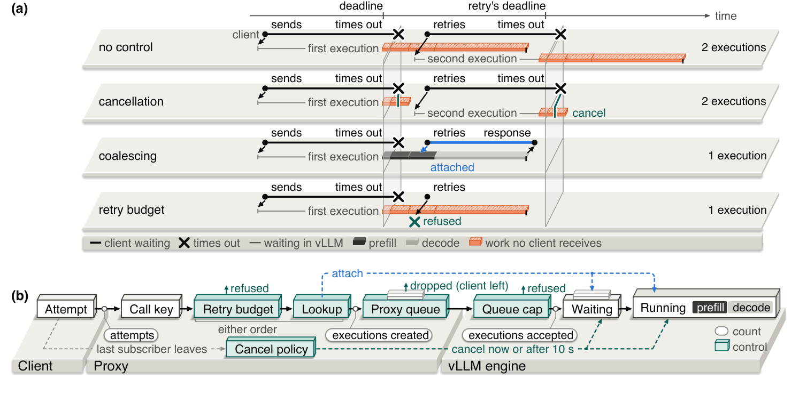
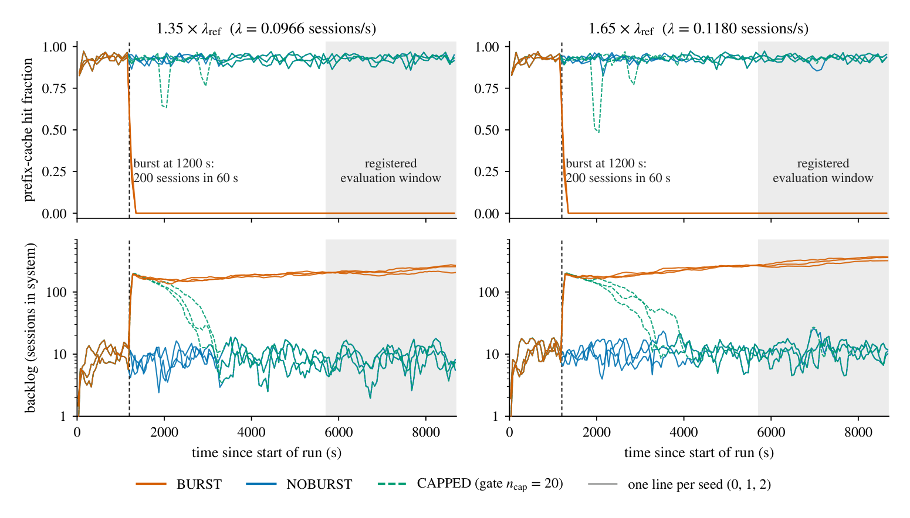
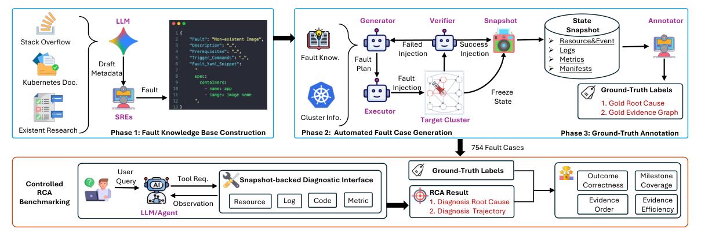
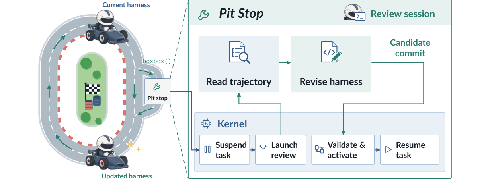
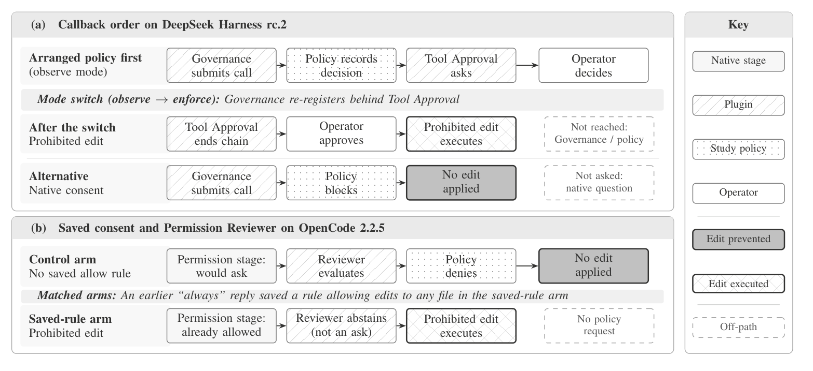
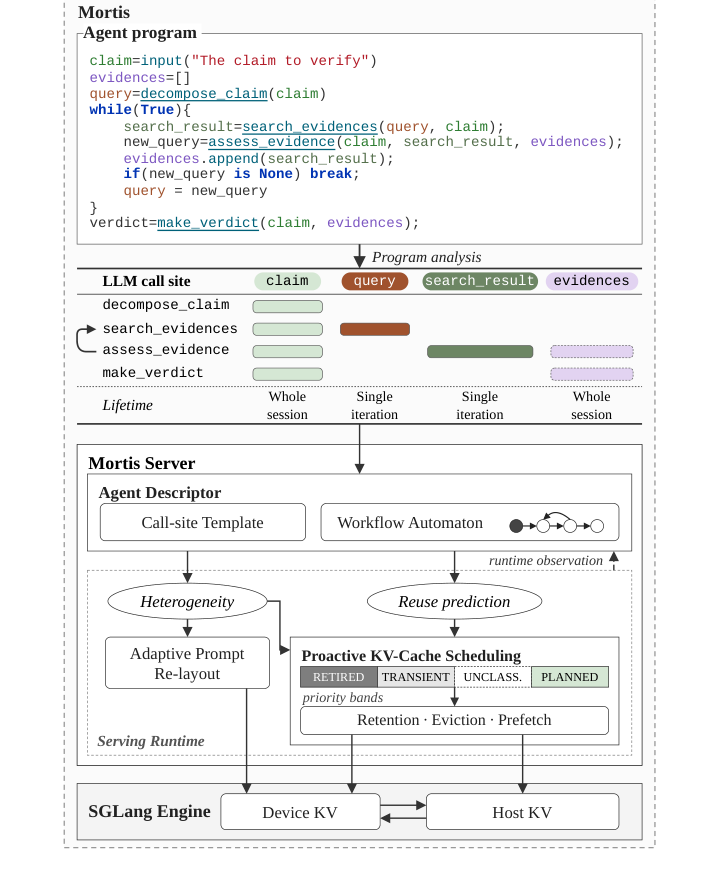
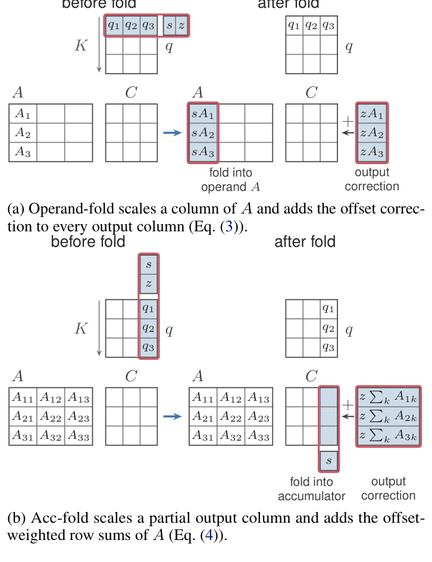
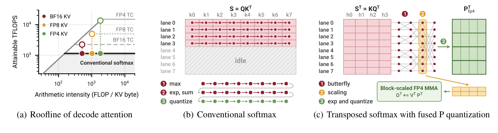

## What matters in this issue

Returning traffic to normal or cancelling requests may not restore an overloaded service. Retries can multiply executions, while multi-turn sessions can remain trapped in cache misses. Two studies explain these different feedback loops and separate user delivery, reuse, and observed throughput.

On the agent side, Cloud-OpsBench distinguishes correct diagnoses from closed evidence chains. BOXBOX revises harnesses during long tasks, while PatternOps shows how ordinary reloads and consent operations silently alter policy paths. These five deserve close reading. Other papers improve efficiency through program semantics, hybrid state, distributed caching, low-precision computation, and automatic planning.

Companion technical notes examine H200 hybrid-model serving, TPU state transport, monitoring costs, AI SRE evaluation, and a model release, keeping mechanisms, operating points, and evidence boundaries distinct.

## In depth

<h2 class="daily-paper-title" id="paper-arxiv-2611.08684">01 · Why cancellation fails to restore overloaded serving</h2>

[Cancellation Is Not Enough: What Retries Leave Behind in an Overloaded LLM Engine](https://arxiv.org/abs/2611.08684)  
Xindan Zhang, Fei Wang · 2026-11-05

### One logical call can create four engine executions

A timed-out client retries; cancellation is supposed to stop computation for clients that have left. This paper counts logical calls, client attempts, and engine executions separately. Its finding is that stopping old work is only part of the problem. When each retry creates another execution, the queue keeps replenishing. A retry can finally begin prefill just before its own deadline, consume work, and then be aborted itself.

The authors test three models on one H100 80GB running vLLM 0.30.0. Synthetic open-loop arrivals start at 0.6 times calibrated capacity, rise to 2.7 times capacity for 107 seconds, and return to the original rate. Each attempt has a 120-second deadline and up to three retries. The pulse creates more queued work than one deadline can accommodate, while leaving spare capacity afterward if retries do not amplify demand.

### Bound executions while preserving reconnection

<a class="note-image-link" href="/assets/images/digest/2026-11-10/retry-executions.png" target="_blank" rel="noopener" aria-label="Why cancellation fails to restore overloaded serving · View original image ↗">View original image ↗</a>

*The top follows timeouts and retries of one call; the bottom locates execution creation, attachment, budgeting, and cancellation.*

Without controls, disconnected clients leave orphaned executions and retries submit new ones. Immediate cancellation shortens an old execution but cannot recall GPU steps already issued. It also destroys the live execution that a retry could rejoin. Request coalescing instead uses the logical call identifier and complete generation parameters to attach a retry to the same live execution. It does not combine unrelated calls with similar prompts.

Composition order consequently matters. Looking up a live execution before applying a retry budget avoids rejecting reconnections that create no additional engine work. The authors also defer cancellation for ten seconds, longer than their clients’ 0.25–3-second retry backoff, preserving a reconnection window.

### Computation completed is not an answer delivered

With retries enabled, immediate cancellation never restored service within the diagnostic observation window. Roughly 12–38% of post-pulse calls were eventually delivered, including the mixed-prompt experiment. Qwen2.5-7B traces attribute 79–85% of computed prompt tokens to executions later aborted. Scheduled retries typically first run less than half a second before their own deadline. These are token and scheduler-step measurements, rather than GPU kernel-time measurements.

Coalescing delivered every pulse and subsequent call in its experiments, some late; immediate cancellation removed that benefit. Deferral restored attachment, but no execution was ultimately cancelled in those runs, leaving permanent-disconnection cleanup untested. Retry budgets restored subsequent service by sacrificing some pulse calls. **Recovery and delivery must be measured separately:** shorter queues and more completed tokens cannot establish that users received their answers.

<h2 class="daily-paper-title" id="paper-arxiv-2611.08902">02 · When cache collapse makes throughput a misleading recovery signal</h2>

[Inside the Trap: A Renewal Law for Prefix-Cache Collapse in LLM Agent Serving](https://arxiv.org/abs/2611.08902)  
Akshat Valse, Ali Jannesari · 2026-11-06

### Returning traffic to its old level does not guarantee recovery

An agent’s next turn brings earlier context back to the server. With prefix reuse, those repeated tokens are cheap. A burst expands the active-session population and lengthens waits; before a session returns, other requests overwrite its KV. More misses create more prefill work, further extending waits and sustaining the trap.

Paired tests separate this behavior from an ordinary burst backlog. Across registered experiments on two engines, two GPU types, and two models, a 200-session burst left follow-up hits at zero in all 30 burst runs. Matched no-burst and session-capped runs remained healthy. The stricter rule, which also checks backlog growth, passed at nine of ten tested rates; zero hits in 30 runs should not be confused with universal satisfaction of every trap criterion.

### Served turns cease to represent the stationary workload

<a class="note-image-link" href="/assets/images/digest/2026-11-10/cache-trap.png" target="_blank" rel="noopener" aria-label="When cache collapse makes throughput a misleading recovery signal · View original image ↗">View original image ↗</a>

*After the burst, orange traces lose reuse and accumulate sessions; no-burst and capped controls retain cache hits.*

The analysis idealizes an all-miss, work-conserving FIFO fluid server whose sessions immediately return to the queue after each turn. Later turns have longer, more expensive prompts. As the backlog grows, the turns actually served become disproportionately young and short. A linear renewal recursion along FIFO orbits characterizes the growing inter-turn gap and the shifted turn distribution.

The operational consequence is a “youth premium”: session completions can exceed the stationary all-miss capacity while unfinished work keeps accumulating. Reducing arrivals below observed trapped throughput can therefore still leave arrivals above the true drain threshold. A respectable completion rate need not imply spare capacity for all the future turns already committed to.

### Reduce cache competition to restore reuse

The theory was developed after early traces had been inspected. In a retrospective comparison with 57 stuck runs, it predicted mean served-prompt length within 3% in 50 runs. Individual gap-growth estimates scatter substantially; aggregate agreement is not precise per-run prediction. Later outcome-blind tests probe arrival cuts and a different turn budget.

At unchanged offered load, a session cap rescued nine of nine established traps without shedding sessions. The engine remained healthy after the cap was released. Restricting the concurrent population competing for cache, while holding other sessions outside, restores reuse; it does not establish lossless operation at arbitrary demand.

**This complements the retry study.** There the feedback creates multiple executions of one logical call; here inter-turn delay and cache turnover reinforce one another. The fluid model omits engine concurrency, tool delays, and detailed scheduling, and the paper does not prove that real engines converge to it. Read the distinction between recovery threshold and measured throughput, together with the separate paired, retrospective, and outcome-blind evidence.

<h2 class="daily-paper-title" id="paper-arxiv-2603.00468">03 · Cloud-OpsBench: a correct root cause still needs a complete investigation</h2>

[Cloud-OpsBench: A Reproducible Benchmark for Agentic Root Cause Analysis in Cloud Systems](https://arxiv.org/abs/2603.00468)  
Yilun Wang, Guangba Yu, Haiyu Huang, Yujie Huang, Zirui Wang, Pengfei Chen, Michael R. Lyu · 2026-02-28 · v3 revised 2026-11-06

### Make the choice of diagnostic actions comparable

Static logs support repeatable experiments but do not test whether an agent knows which service to query next. Live fault injection preserves interaction, yet load, scheduling, and retries can change how the same fault manifests. Cloud-OpsBench realizes and verifies incidents in a real cluster, then freezes observable evidence for tool-mediated investigation by different agents.

The version considered here is v3, revised November 6; the initial submission was February 28. Across OnlineBoutique and TrainTicket, it contains 754 cases spanning 57 application and Kubernetes fault types. Of 800 candidate plans, 46 were rejected because they did not produce stable, diagnosable symptoms. Successfully executing an injection command is therefore not sufficient for admitting a case.

### Verify the incident, freeze observations, annotate diagnostic facts

<a class="note-image-link" href="/assets/images/digest/2026-11-10/cloud-opsbench.png" target="_blank" rel="noopener" aria-label="Cloud-OpsBench: a correct root cause still needs a complete investigation · View original image ↗">View original image ↗</a>

*Fault knowledge feeds runtime verification and snapshots; the tool interface supports separate outcome and evidence-process evaluation.*

A knowledge-grounded pipeline generates concrete fault plans. After restoring a clean deployment and confirming health, it injects the fault and verifies the activated mechanism, local failure, and required upstream manifestation. Accepted incidents retain resources, configuration, logs, events, metrics, and source evidence. Twelve diagnostic tool types map supported arguments to captured responses; agents cannot directly inspect the entire snapshot repository.

Process labels are the more consequential addition. An evidence graph specifies facts that must be established, admitting different tools, arguments, and alternative evidence bundles rather than prescribing one expert command sequence. After finding a Service without endpoints, an agent might inspect selectors and Pod labels separately or retrieve configuration containing both. Necessary prerequisite relations are recorded separately from the completion logic.

### The same correct answer can conceal different investigations

With eleven LLMs under a common ReAct scaffold, maximum Joint RCA Accuracy reaches 0.78 and 0.68 on the two workloads. For GPT-5, however, 33.1% and 29.4% of all evaluated cases respectively have a correct diagnosis without evidence closure. The denominator is all cases, not only correct answers, and incomplete evidence does not prove that a diagnosis was guessed.

An investigation may omit backend labels, fail to confirm database state, or stop at a conspicuous downstream error. Final labels alone cannot distinguish a completed investigation from a correct but insufficiently verified conclusion. More queries and higher token expenditure do not automatically improve closure either.

**The transferable AIOps lesson is to separate evaluation targets:** component localization, mechanism identification, evidence coverage, and investigation efficiency. Snapshots support a finite captured query space, rather than arbitrary shell operations, remediation, or a system evolving during investigation. Closure also depends on annotation and evidence coverage; it is not a general proof of production causality.

<h2 class="daily-paper-title" id="paper-arxiv-2611.09218">04 · BOXBOX: revising the harness inside a long-running task</h2>

[BOXBOX: Recursive Harness Self-Improvement for Long-Running Performance Optimization](https://arxiv.org/abs/2611.09218)  
Yuhao Tan, Hanyun Jiang, Fangkai Yang, Yuan Yao, Taolue Chen, Bo Qiao, Yu Kang, Lu Wang, Pu Zhao, Xiaoxing Ma, Qingwei Lin · 2026-11-06

**Paper status update:** The authors temporarily withdrew this submission on November 9, 2026 to clarify Claude Code usage for compliance. See the [current arXiv record](https://arxiv.org/abs/2611.09218v2). The following is a historical reading of the earlier version; its numbers are not treated as current comparative evidence. Withdrawal alone does not establish experimental misconduct.

### Optimize the execution environment as well as project code

Long performance-engineering runs expose limitations in the agent’s own tooling: oversized outputs, repeated waiting, or recurring operations that lack reusable tools. An offline-tuned harness may not anticipate these problems, while restarting loses useful execution context. BOXBOX lets the task agent decide when to pause for a harness review.

Its companion benchmark, PerfRace, builds tasks around real projects and end-to-end workloads without known target patches. The released set contains 100 tasks checked for realism, stable measurement, and reward hacking; the main comparison uses 50 held-out tasks. Agents must discover bottlenecks and preserve correctness rather than merely rewrite a preselected slow function.

### An outer kernel manages harness replacement

<a class="note-image-link" href="/assets/images/digest/2026-11-10/boxbox.png" target="_blank" rel="noopener" aria-label="BOXBOX: revising the harness inside a long-running task · View original image ↗">View original image ↗</a>

*The task agent requests a pit stop; a review proposes edits while an outer kernel validates, activates, and preserves context.*

Calling boxbox() yields control to a kernel, which suspends the task interaction loop, preserves trajectory, terminal session, and workspace, and launches a review. That session examines execution evidence and revises prompts, tools, or runtime logic with versioned changes. The kernel validates the candidate, activates the new runtime, transfers context, and reattaches the terminal. Failed validation or activation retains or restores the previous runtime.

Context preservation thus has a concrete scope. It supports continuing the same task after a control-code update; it does not mean every background process pauses or that arbitrary edits are semantically safe. Reviews share the task’s time and model budget, requiring a judgment about whether fixing the harness will repay its cost before the run ends.

### Read the comparison and metric carefully

Starting from the same harness, with GPT-5.6 Luna at high effort, three runs per task, and a four-hour budget per run, BOXBOX reaches Speedup@4h of 1.702×. Frozen Harness reaches 1.442× and the strongest baseline, Harness Scaling, 1.539×. After aggregating runs within tasks, this metric takes a harmonic mean across 50 tasks. It measures optimized project performance relative to the original project, rather than the speed of the agent itself.

Mean model cost is $16.43 for BOXBOX, below Frozen’s $23.22 but above Harness Scaling’s $12.98. Better speedup per dollar is not the lowest total spend among all baselines. Median reviews consume 2.1% of task time and 13.8% of model cost. Ablations on fourteen tasks support on-demand triggering and full editing, without establishing a universally optimal control policy.

**The contribution is a runtime mechanism for within-task adaptation.** Unlike DeCAF’s offline dimension-wise search in this issue, the current task agent chooses when to revise its harness. PatternOps also cautions that runtime reloads can change policy relationships: BOXBOX’s rollback mechanism does not replace verification of permission, state, and interface invariants.

<h2 class="daily-paper-title" id="paper-arxiv-2611.09088">05 · PatternOps: active plugins can still leave policy bypassed</h2>

[When Routine Operations Break Architectural Pattern Relationships in LLM Agent Harnesses](https://arxiv.org/abs/2611.09088)  
Boming Xia, Qinghua Lu, Dino Sejdinovic, Liming Zhu · 2026-11-06

### Execution relationships can break without a code change

One plugin evaluates policy, another asks for approval, and the host orders their callbacks. Individually functioning components do not guarantee that every tool action reaches policy first. This study examines five relationships involving Guardrail Enforcement Point, Autonomy Controller, and Blackboard patterns across five released harnesses and fourteen main-sample plugins.

PatternOps traces pattern requirements, provider promises, and deployment-specific demands to responsible components and deciding runtime records. Controlled tool sequences establish comparisons; selected paths also use live models. The central evidence joins a particular tool call to its policy decision, approval, and final effect, rather than counting plugin errors.

### Reapplication and saved consent change the path

<a class="note-image-link" href="/assets/images/digest/2026-11-10/patternops.png" target="_blank" rel="noopener" aria-label="PatternOps: active plugins can still leave policy bypassed · View original image ↗">View original image ↗</a>

*Reapplication changes callback order above; saved consent changes review eligibility below. Either can bypass the designated policy component.*

In one DeepSeek Harness composition, reapplying the initially first policy plugin unregisters its old callback and appends the replacement. The approval plugin then runs first and ends the chain after the operator responds. A policy-prohibited edit executes following approval. Both plugins remain active and policy can still block reads, leaving ordinary health checks unable to reveal the missing edit-path evaluation.

In an OpenCode case, saving an enduring allow rule makes subsequent edits already permitted. A reviewer that evaluates only requests needing a question abstains. This is not simply a broken plugin promise: a promise to review asks is narrower than a deployment requirement to evaluate every edit.

### Define the relationship before choosing placement

The study compares native consent, fixed callback ordering, in-place updates, and checks closer to tool execution. A repair that survives reapplication may still fail at a cold start. Preventing every prohibited effect does not imply that policy evaluated edits rejected earlier by another component. “Policy decides every execution,” “every edit is evaluated,” and “escalation renews approval” require different placements and state behavior.

In a concrete live-model comparison, five API models made 28 reads and 28 edits under the approval-plugin composition: policy evaluated every read and no edit. This is evidence for particular versions, configurations, and operation sequences, not a harness-wide failure rate or a ranking of model propensity to bypass policy.

**The AgentOps contribution is to evaluate runtime history alongside configuration.** Read how joined records establish participation and why alternatives must be assessed against explicit requirements. BOXBOX in this issue supplies an online-update mechanism; this study shows relationships that such updates must preserve. Their contributions remain distinct.

## Research developments

<h2 class="daily-paper-title" id="paper-arxiv-2611.08638">06 · MORTIS: infer cache lifetimes from program variables</h2>

[MORTIS: Compiler-Guided KV-Cache Management for LLM Agent Programs](https://arxiv.org/abs/2611.08638)  
Xiaoyu Ma, Jayanaka L. Dantanarayana, Savini Kashmira, Baichuan Li, Lingjia Tang, Jason Mars · 2026-11-05

Conventional prefix caching treats everything after the first differing token as an opaque suffix. For agents that construct prompts through typed LLM function calls, MORTIS analyzes definitions, appends, and overwrites to infer component sharing and lifetimes. Runtime branch and inter-call observations refine prompt ordering, retention, eviction, and prefetching.

<a class="note-image-link" href="/assets/images/digest/2026-11-10/mortis.png" target="_blank" rel="noopener" aria-label="MORTIS: infer cache lifetimes from program variables · View original image ↗">View original image ↗</a>

*Variable lifetimes and workflow analysis produce a descriptor used for prompt layout and cache priorities.*

Eviction distinguishes retired volatile tails, transient content in active sessions, unclassified entries, and planned reusable prefixes. Across four agent workloads, geometric-mean improvements over SGLang are 1.45× for job completion time and 1.49× for throughput, with maxima of 1.99× and 1.97×. The mechanism exposes better prefix reuse through program semantics rather than arbitrary position-independent segment reuse. Unresolved values receive conservative classifications; prompt-reordering quality also needs validation.

<h2 class="daily-paper-title" id="paper-alphaxiv-2611-flashstate">07 · FlashState: reusable KV needs a matching recurrent checkpoint</h2>

[FlashState: Unlocking Flexible Hybrid State Management for Agentic LLM Serving](https://www.alphaxiv.org/abs/2611.flashstate)  
Chenxi Li, Weili Xu, Tianyi Zhang, Jue Wang, Zhongzhu Zhou, Chenfeng Xu · 2026-11-09

Hybrid attention needs both cached KV and a recurrent checkpoint at the resume position. FlashState decouples checkpoint placement from KV-block boundaries and captures the true processed endpoint when a request completes. Backend state export and a unified dependency- and cost-aware admission/eviction policy avoid retaining KV whose required checkpoint has already disappeared.

On coding-agent traces with two B200s per engine and equal cache budgets, peak prefill improvements over vLLM are 3.14×, 2.27×, and 1.54× for GLM-5.3-Flash, Nemotron 3 Super, and Qwen3.8-Flash-Next; GLM p90 TTFT falls by up to 88.4%. These depend on context and concurrency. The mechanism complements MORTIS’s variable analysis and the H200 note’s decode KV sharing; their gains cannot simply be multiplied.

<h2 class="daily-paper-title" id="paper-arxiv-2611.09109">08 · DARIC: allocate recomputation using deviation patterns</h2>

[DARIC: A Position-Independent KV Cache Reuse System with Distribution-Aware Recomputation](https://arxiv.org/abs/2611.09109)  
Weikang Wang, Haiyang Liu, Xin Zhou, Jun Liu, Weifeng Zhang · 2026-11-06

Position-independent KV reuse misses cross-chunk attention when independently computed documents appear under new prefixes. DARIC observes larger deviations near chunk beginnings, increasing deviation in later chunks, and the importance of the latest window. It allocates recomputation to these regions instead of performing expensive online ranking across every token.

Standard sub-requests preserve existing inference-engine scheduling and execution paths. Evaluation covers RAG, function calling, and agentic coding; the headline TTFT improvement over advanced alternatives is 1.1–4.5×. Larger speedups against full recomputation use a different denominator. The contribution is inexpensive selection and integration, without a universal zero-quality-loss guarantee. Nebula addresses cluster-wide management instead, so the two contributions remain separate.

<h2 class="daily-paper-title" id="paper-arxiv-2611.09474">09 · Nebula: make position-independent caching cluster-wide</h2>

[Nebula: Distributed Position-Independent Caching for LLM Serving](https://arxiv.org/abs/2611.09474)  
Yifei Liu, Junbin Pan, Junhao Hu, Yang Liu, Junyi Chen, Juntong Wu, Chen Chen, Haiyuan Zhao, Xiaoxu Chen, Weihang Chen · 2026-11-06

Local segment reuse does not locate remote KV or distribute uncached segment computation to idle workers. Nebula makes application-marked PIC segments distributed objects: match the full prefix first, locate remaining segments, scatter independent prefill, then gather at a combine worker for required recomputation.

Optimistic accounting and event updates track asynchronous state. Ghost hits tune capacity shares between prefix and PIC caches; scheduling models queueing, computation, and transfer together. Main evaluation across four models and four RAG/agent workload families reports a 61.4% average reduction in median TTFT versus the strongest baseline, recovering 76.1% of tokens missed by prefix caching. Accuracy trade-offs remain with the pluggable PIC backend: cluster management does not make independently computed KV exact full-context state.

<h2 class="daily-paper-title" id="paper-arxiv-2611.08770">10 · ReKV: transfer early-layer KV while recomputing later layers</h2>

[ReKV: Overlapping Quantized KV Transfer and Suffix Recomputation](https://arxiv.org/abs/2611.08770)  
Guangjian Dong · 2026-11-05

ReKV’s prefix and suffix refer to model layers, not portions of prompt text. Prefill sends quantized KV for earlier layers plus one BF16 boundary hidden state. Decode recomputes a contiguous later-layer suffix while earlier-layer KV is in flight, selecting the cut according to transfer and compute costs.

A model-shaped synthetic benchmark on cross-node H100s at 8K reports 2.36–3.65× Q8 handoff speedups over full BF16 transfer. A separate real-weight BF16 experiment measures only prefill-to-first-token return and achieves 1.16–1.63×; it does not validate subsequent decoding from reconstructed Q8 caches. Faster links or short prompts can favor transfer alone. This is a useful overlap prototype with explicit evidence boundaries, rather than a production serving-stack speedup.

<h2 class="daily-paper-title" id="paper-arxiv-2611.09722">11 · FOSCAR: move per-element affine work off the critical path</h2>

[FOSCAR: Accelerating Decode Attention over 2- and 4-Bit KV Caches through Affine Folding](https://arxiv.org/abs/2611.09722)  
Donglin Zhuang, Pragaash Ponnusamy, Xiaoxia Wu, Shuaiwen Leon Song, Zhongzhu Zhou · 2026-11-06

Two-bit KV reduces traffic but can bottleneck on conversion and per-element scale/offset instructions. FOSCAR factors affine transformations through matrix products. Depending on token-wise or channel-wise grouping, it applies scales to the other operand or accumulator and expresses offsets as output corrections, combining this with bit manipulation and Hopper/Blackwell pipelines.

<a class="note-image-link" href="/assets/images/digest/2026-11-10/foscar.png" target="_blank" rel="noopener" aria-label="FOSCAR: move per-element affine work off the critical path · View original image ↗">View original image ↗</a>

*The scale-sharing dimension determines whether scaling moves into an input or accumulator, with a separate offset correction.*

H100 INT2/INT4 kernels achieve geometric-mean speedups of 3.36×/2.83× over FlashInfer BF16. Against native TensorRT-LLM NVFP4 on B200, the corresponding gains narrow to 1.16×/1.00×. Folding preserves dequantized results in exact arithmetic but does not remove low-bit cache error. Separate SGLang long-context throughput gains also depend on capacity and concurrency, so kernel speedups cannot substitute for serving measurements.

<h2 class="daily-paper-title" id="paper-arxiv-2611.09825">12 · BitDecoding-FP4: native FP4 decoding needs accuracy and softmax co-design</h2>

[BitDecoding-FP4: Native FP4 KV Cache Decoding via Algorithm-System Co-Design](https://arxiv.org/abs/2611.09825)  
Dayou Du, Woon Yee Ng, Guangming Sheng, Nick Lau, Jianyi Cheng, Luo Mai · 2026-11-06

Native FP4 Tensor Cores avoid expanding cached values to a higher precision, but queries, keys, and probabilities can all introduce error. BitDecoding-FP4 represents each query with FP4 base and residual terms, combines outlier-aware keys with underflow-aware probability scaling, and transposes softmax so threads work across keys. Residual queries occupy otherwise padded matrix-tile space.

<a class="note-image-link" href="/assets/images/digest/2026-11-10/bitdecoding-fp4.png" target="_blank" rel="noopener" aria-label="BitDecoding-FP4: native FP4 decoding needs accuracy and softmax co-design · View original image ↗">View original image ↗</a>

*Assigning threads to keys exposes parallel reductions and reuses their intermediate maxima for FP4 probability scaling.*

Its vLLM integration retains BF16 sink/recent tokens and promotes full pages to FP4. Across evaluated long-context and reasoning benchmarks, NVFP4 averages within 0.5 points of BF16; peak Qwen3 serving throughput on B300 is 2.4–3.0× BF16. These are configuration-dependent averages and operating points, not a per-task accuracy bound or an entirely FP4 path without high-precision buffers.

<h2 class="daily-paper-title" id="paper-arxiv-2611.08713">13 · ResServe: use spare skinny-matrix capacity for residual correction</h2>

[ResServe: Accurate and Efficient FP4 LLM Inference with Residue Compensation](https://arxiv.org/abs/2611.08713)  
Shuo Rong, Ruibo Fan, Jiawen Wen, Xiaowen Chu · 2026-11-05

ResServe splits activations into an FP4 base and a quantized residual, multiplies both by the same weights, and folds outputs on-chip. Skinny decode matrices leave tile capacity that residual rows can use. Attention combines query-base and residual scores before softmax; wider prefill computations compensate only selected channels to limit added work.

On B200 with 8K input, 256 output tokens, and one request per second, evaluated NVFP4 configurations add at most 3.4% latency over W4A4 and reduce latency 22.4–53.3% versus W4A8. The five-model mean code-generation gain of 15.04% is relative, not percentage points. Unlike BitDecoding’s attention focus, this also covers linear layers and shape-aware spare capacity. Residual computation is not free at arbitrary batch sizes or during prefill.

<h2 class="daily-paper-title" id="paper-arxiv-2611.09225">14 · Fused-Softmax: move vector work after low-precision GEMMs accelerate</h2>

[Fused-Softmax for efficient quantized attention](https://arxiv.org/abs/2611.09225)  
Tianxing Wu, Juuso Korhonen, Jesus Carabano Bravo · 2026-11-06

As low-precision matrix throughput outpaces vector units, softmax becomes attention’s bottleneck. Fused-Softmax freezes a speculative maximum with rollback when required, folds an affine exponential approximation into score GEMM and conversion, and computes the denominator using matrix multiplication. Most steady-state vector work leaves the critical path.

On MI355X, MXFP8/6/4 attention achieves approximately 2.1×/2.8×/3.2× BF16 speedups. A hybrid MXFP6/4 Wan2.2 video-generation schedule reaches up to 2.05× end-to-end; that is not an autoregressive decode result. Additional approximation error falls below quantization error in the tested distributions. Thresholds still depend on numerical range and sequence length, and the method is not exact softmax equivalence for arbitrary inputs.

<h2 class="daily-paper-title" id="paper-arxiv-2512.24637">15 · MSched: prepare the next GPU working set before switching tasks</h2>

[Towards Fully-fledged GPU Multitasking via Proactive Memory Scheduling](https://arxiv.org/abs/2512.24637)  
Weihang Shen, Yinqiu Chen, Rong Chen, Haibo Chen · 2025-12-31 · v3 revised 2026-11-06

With oversubscribed GPU memory, demand paging fragments large working sets into costly faults, while whole-process swapping moves much data not immediately needed. MSched predicts working sets from parameterized kernel-access templates, prior execution, and fault feedback, preparing them during context switching. Scheduling and memory management share future access order to guide replacement.

Across scientific, deep-learning, and LLM workload combinations, maxima are 186.69× over demand paging and 8.63× over whole-process-swapping Nixie. The largest gains occur in the H20 large-memory/large-footprint configuration, not as an average across ordinary tasks. Dynamic MoE accesses still require feedback. Initially submitted December 31, 2025, the paper was revised to v3 on November 6.

<h2 class="daily-paper-title" id="paper-arxiv-2607.00466">16 · ELDR: route decode requests by expert-use similarity</h2>

[ELDR: Expert-Locality-Aware Decode Routing for PD-Disaggregated MoE Serving](https://arxiv.org/abs/2607.00466)  
Sangjin Choi, Sukmin Cho, Yifan Xiong, Ziyue Yang, Youngjin Kwon, Peng Cheng · 2026-07-01 · v3 revised 2026-11-06

ELDR records discrete MoE expert activations during prefill, then applies IDF weighting, layer selection, and normalization to form a request signature. Routing similar signatures to the same decode worker reduces the distinct experts touched by a batch. Balanced clustering and locality-band routing constrain hotspots and tail latency.

On vLLM and MI300X, the main topology is 8P16D; the largest 235B configuration spans 40 GPUs. Reported mean reductions in median TPOT are 5.4–14.5%, up to 17.8%. Benefits depend on prefill–decode activation correlation. Layer masks, IDF weights, and expert placement remain fixed after calibration rather than being fully relearned online. It is a workload/locality and load-balancing co-design, not a universal mixed-traffic guarantee.

<h2 class="daily-paper-title" id="paper-arxiv-2611.08669">17 · ChainFlow: short latent transport for speculative drafts</h2>

[ChainFlow: Few-Step Latent Flow Matching for Speculative Decoding](https://arxiv.org/abs/2611.08669)  
Selim Aktas, Yusuf Erdem Erdem, Ahmed Zeer, Himmet Toprak Kesgin, Muzaffer Kaan Yuce, Mehmet Fatih Amasyali · 2026-11-05

ChainFlow conditions on recent target hidden states, compresses them with a VAE, extrapolates future starting points, and transports a block through a few flow steps. Lightweight Markov/path heads restore dependence on selected tokens before tree candidates undergo target verification. The main serving configuration uses one step after two-step training, despite the two-step illustration.

On B300, vLLM 0.31.0, Qwen3.5-4B, batch one, and greedy decoding, the headline tree configuration averages 1.87× autoregressive speed, versus 1.35×/1.69× for similarly sized EAGLE-3/DFlash drafters: about 39%/11% relative gains. The chain-only variant reaches just 1.23×, highlighting tree and dependency mechanisms. Drafter training, verification cost, concurrency, and workload distribution remain material constraints.

<h2 class="daily-paper-title" id="paper-arxiv-2611.08660">18 · AutoParallel: automatic plans that remain ordinary PyTorch</h2>

[AutoParallel: Composable, PyTorch-Native Automatic Parallelism for Production Training](https://arxiv.org/abs/2611.08660)  
Kaijian Wang, Sanket Purandare, Aditya Venkataraman, Will Constable, Ivan Kobzarev, Elias Ellison, Simon Fan, Edward Z. Yang, Davide Italiano, Patrick Labatut, Yuke Wang, Francisco Massa · 2026-11-05

AutoParallel traces forward and backward into an ATen graph, enumerates legal DTensor strategies, jointly optimizes computation and redistribution costs, and materializes an inspectable, replayable PyTorch module. Approximate search controls high-dimensional meshes. Dynamic MoE or custom context-parallel regions remain user-controlled through local_map placement contracts.

Across dense, hybrid, and MoE training on up to 128 H100s, it matches or exceeds expert TorchTitan recipes in most configurations, with up to 18.3% higher throughput. Composability and maintainability matter alongside the maximum gain. Cost models, representative inputs, and memory feasibility still influence plans; changed sequence lengths can warrant replanning rather than reusing one strategy universally.

<h2 class="daily-paper-title" id="paper-arxiv-2611.08723">19 · DeCAF: isolate experiments, then validate their composition</h2>

[Divide, Diagnose, and Compose: Optimizing Agentic Pipelines and Harnesses](https://arxiv.org/abs/2611.08723)  
Divij Handa, Christopher Tensmeyer, Jihyung Kil, Vlad I. Morariu · 2026-11-05

DeCAF derives optimization dimensions such as prompts, topology, model assignment, and tool policy from a task and seed pipeline. Restricted editing sessions start from the same seed, test diverse hypotheses, record failures as well as successes, and retain non-dominated quality/cost/latency candidates. A synthesis stage re-evaluates combinations end to end rather than assuming individually useful edits compose.

Role-specific trajectory evaluation checks correctness, compliance, and downstream use to localize likely problems, not exact causal contributions. Across AppWorld, LiveCodeBench, AgentDojo, and PostTrainBench, reported averages versus the strongest overall baseline are +2.58 performance points, −4.30% inference cost, and −42.45% latency. These are resulting inference expenses, not free optimization. Unlike BOXBOX, the contribution organizes offline experimentation and synthesis.

<h2 class="daily-paper-title" id="paper-arxiv-2611.08496">20 · MobiInfer: exploit GUI trajectories and structured outputs</h2>

[MobiInfer: Accelerating On-Device GUI Agents with Workload-Aware Inference](https://arxiv.org/abs/2611.08496)  
Siming Chen, Erhu Feng, Dahu Feng, Yubin Xia · 2026-08-11

Phone GUI agents repeat observe–reason–act loops with reusable prompt components and schema-shaped outputs. Built on MNN, MobiInfer canonicalizes prompts for contiguous prefix reuse, specializes vocabulary by phase, and drafts schema literals and trajectory-local n-grams. Action labels and coordinates remain protected target-only states, and drafts stop before crossing those boundaries.

Across three Android phones, two models, AndroidWorld, and 111 real phone tasks, reported mean prefill/decode speedups are 2.6×/2.5× and end-to-end task speedup about 2.4×, with success degradation below one percentage point. Verification preserves the phase-specialized target policy; vocabulary specialization itself is approximate. The original site records an August 11 first submission, so this is earlier work, not a November debut.

<h2 class="daily-paper-title" id="paper-arxiv-2610.21390">21 · PriorityFEC: deliver useful KV before the handoff deadline</h2>

[PriorityFEC: Deadline-Aware Streaming FEC for KV-Cache Handoff in Edge Multi-Agent Systems](https://arxiv.org/abs/2610.21390)  
Han Shen, Qifu Tyler Sun, Fanyang Meng, Ye Wang, Yongsheng Liang · 2026-10-15 · v3 revised 2026-11-06

When edge links cannot deliver complete KV before a deadline, PriorityFEC ranks equal-sized blocks using offline sensitivity-derived utility. ACK-sliding FEC protects unacknowledged packets, while a Double-DQN chooses between new source data and repair packets. Earlier high-utility blocks receive more recovery opportunities, and acknowledged prefixes leave the coding window.

A two-Jetson AGX Orin 64GB prototype with Qwen2.5-7B and Llama-3.1-8B improves QA F1 under tight deadlines. Missing regions default to zero filling while retaining tensor positions: this is quality-degrading partial-cache continuation, not guaranteed complete-state transfer. Utility is not an exact quality predictor, and full-attention profiling limits long-context scalability. Method figures remain placeholders in the PDF, so they are not reproduced here.

<h2 class="daily-paper-title" id="paper-arxiv-2611.09048">22 · LeanDojo-v2: connect proof data, training, and search</h2>

[LeanDojo-v2: A Comprehensive Library for AI-Assisted Theorem Proving in Lean](https://arxiv.org/abs/2611.09048)  
Ryan Hsiang, William Adkisson, Robert Joseph George, Anima Anandkumar · 2026-11-06

LeanDojo-v2 contributes unified infrastructure: extract theorems, proofs, premises, and dependencies from repositories; construct proof-state-to-tactic data; support training or hosted inference; then run REPL-driven stepwise search or whole-proof generation. Lean4Code exposes the workflow in a VSCodium-based editor, reducing fragmented-tool setup.

The paper demonstrates training/proving APIs, goal–tactic graphs, and unchanged states after rejected tactics. This offers transferable machinery for agents constrained by an external verifier. It is chiefly a library and integration report, without a unified controlled comparison establishing superior proof success. It should not be presented as a reasoning breakthrough. Lean versions, repository dependencies, and the target mathematical domain still determine applicability.

## Companion notes

- [GLM-5.3-Flash: separate state semantics and balance prefill with decode](/tech/en/glm53-h200/)
- [TPU Sync: asynchronous model-state movement across memory tiers](/tech/en/tpu-sync/)
- [Grafana Watchers: calibrate once, make one narrow decision per check](/tech/en/grafana-watchers/)
- [Evaluating AI SRE: separate diagnosis, evidence, and operational responsibility](/tech/en/ai-sre-evaluation/)
- [Claude Fable / Mythos 5.2: capability, inference cost, and access boundaries](/tech/en/claude-fable-mythos-52/)
