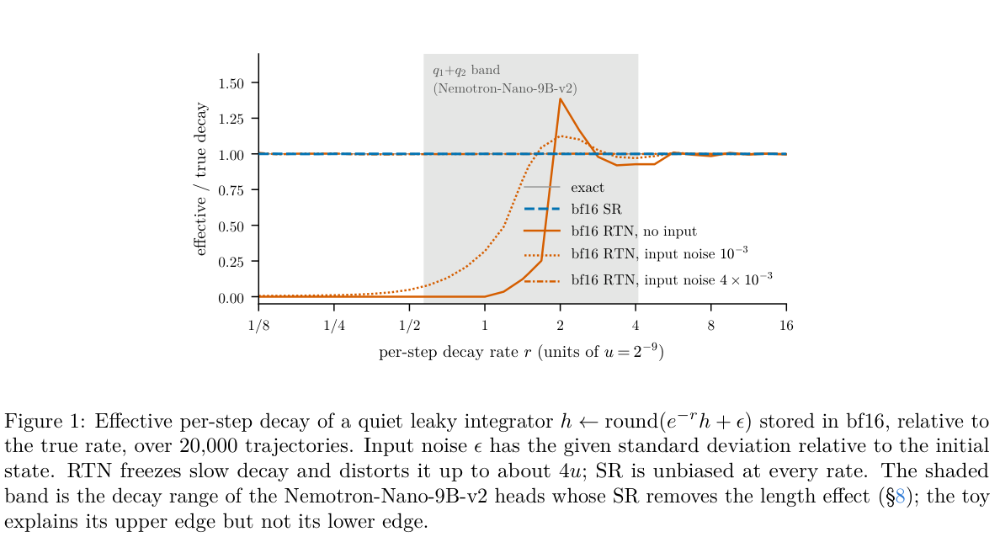
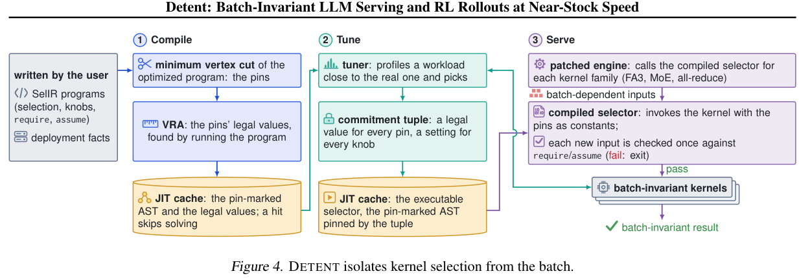
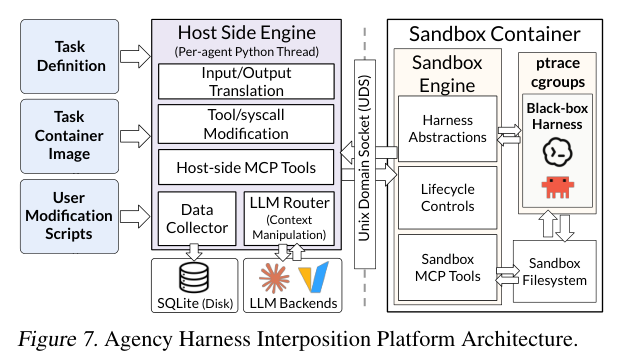
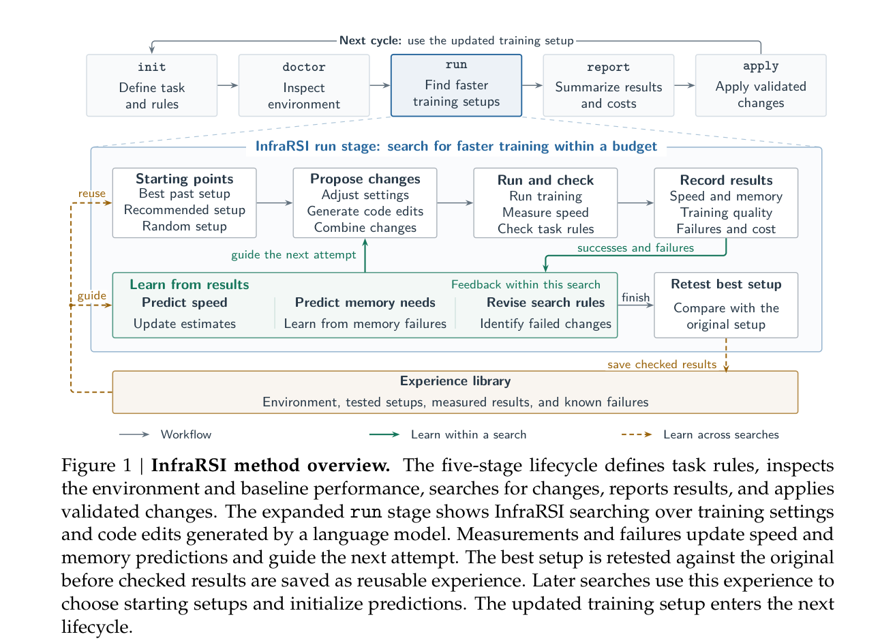

Serving drift need not originate in model weights. Recurrent-state rounding, batch-dependent kernel selection, cache-write failure and agent completion rules can change both answers and waiting time. Four studies provide detailed mechanisms: Lost in Rounding traces bf16 state bias to output length and cap hits; Detent controls batch-dependent selection; the lazy-pulling study localizes read failure to resource ownership and writer coupling; Agency shows why fewer turns need not lower cost.

Other work examines CAD verification, historical replay, tool-error delivery and web security to sharpen what completion means. KV storage, warm GPU pools and workspace forks offer reuse at different layers. The useful comparison is which work each optimization avoids and which correctness boundary its evidence actually covers.

<h2 class="daily-paper-title" id="paper-arxiv-2611.12127">01 · Lost in Rounding: recurrent-state rounding becomes reasoning cost</h2>

[Lost in Rounding: bf16 Recurrent State Makes Hybrid Reasoning Models Think Longer](https://arxiv.org/abs/2611.12127)  
Yuchuan Weng, Xin Chen, Chi Liu · 2026-11-09

An unchanged model can become slower and less successful because of how its serving engine stores recurrent state. Mamba-2 and Gated DeltaNet hybrids update that state at every decoding step. Computing an update in FP32 does not avoid rounding when the result is written back to bf16. This paper connects that implementation choice to completion rates, output length and accuracy, making it directly relevant to silent serving regressions.

**The additional evidence concerns bf16.** Earlier work already connected FP16 and INT8 state to verbosity and studied stochastic rounding. Here the authors vary recurrent-state precision and rounding across six open hybrid reasoning models, keeping weights and activations in bf16. The main workload contains 590 math problems; two models also run on 175 LiveCodeBench problems. Experiments use SGLang 0.5.21 and RTX PRO 6000 Blackwell GPUs.

A useful explanation is erased updates. When a decay or increment is small relative to the stored value, round-to-nearest (RTN) can repeatedly write back the same representable number. The resulting bias accumulates during generation. Stochastic rounding (SR) chooses neighboring values in proportion to the exact value’s fractional position, making the write unbiased in expectation. A simple decaying-state simulation illustrates this mechanism; it is not a complete behavioral model.

<a class="note-image-link" href="/assets/images/digest/2026-11-11/rounding.png" target="_blank" rel="noopener" aria-label="Lost in Rounding: recurrent-state rounding becomes reasoning cost · View original image ↗">View original image ↗</a>

*Reading the figure: decay rate is on the horizontal axis and effective/true decay on the vertical axis. Orange curves show RTN freezing and distortion; the blue dashed curve uses same-width SR. The shaded head-band result is lineage-specific.*

With a 32,768-new-token limit, five models produce geometric-mean lengths 1.07–1.27 times those with FP32 state. Qwen3.5-9B’s cap hits rise from 118/590 to 223/590, while accuracy falls from 85.6% to 70.8%. Evaluating only problems where both settings finish produces nearly identical accuracy while excluding the most serious failures. Resampling affected problems with a 128K budget narrows the overall accuracy gap to about 6.9 percentage points but does not close it. Of 93 unfinished bf16 runs, 79 meet the exact-loop criterion. More budget therefore addresses only part of the failure.

**The repair has implementation conditions.** Same-width bf16 SR removes the length increase in four of the five affected models; Nemotron-3 retains an unexplained bulk shift. Default Philox is expensive in the GDN kernel. An integer-hash implementation is additionally validated only on Qwen3.5-9B, where it approaches RTN speed and FP32 accuracy. That result should not be generalized to every model. Applying SR to only a quarter of heads selected by decay rate also works only within one Nemotron lineage.

The operational contribution is a stronger regression contract: record resolved state dtype, rounding mode, length distributions and cap rates together. This does not establish that all long reasoning is a numerical failure. Tasks focus on competition math and code, and repairs require validation for the target model. The closed-loop generation, 128K reruns and random-generator comparisons are more informative than accuracy alone.

<h2 class="daily-paper-title" id="paper-arxiv-2611.10611">02 · Detent: pin batch-dependent selection while retaining fast kernels</h2>

[Detent: Batch-Invariant LLM Serving and RL Rollouts at Near-Stock Speed](https://arxiv.org/abs/2611.10611)  
Peixu Xin, Runchuan Feng, Jiazhen Guo et al. · 2026-11-07

The same request and sampling seed can produce different tokens when its batch companions change, complicating regression tests, failure replay and RL rollouts. Existing batch-invariant kernels guarantee independence only with their parameters fixed. Engines still choose kernels and reduction strategies using batch token counts and KV lengths. Mathematically equivalent sums can round differently, so a sound individual kernel does not establish reproducible serving.

Detent makes **kernel selection an executable, analyzable program**. SelIR, a Python-subset language, separates deployment constants from batch-dependent inputs. Partial evaluation produces a dependence graph. A weighted minimum vertex cut identifies a small set of values to pin, blocking every path from batch inputs to selection outputs. Pinning one MoE configuration-table key can fix several dependent choices without pinning each output independently.

<a class="note-image-link" href="/assets/images/digest/2026-11-11/detent.png" target="_blank" rel="noopener" aria-label="Detent: pin batch-dependent selection while retaining fast kernels · View original image ↗">View original image ↗</a>

*Reading the figure: compile the selector, tune for the workload, then serve with a committed tuple. Batch-invariant kernels remain a separate prerequisite.*

Value-range analysis then filters candidate assignments. A tuner profiles arrivals resembling the target workload and commits a fixed tuple before deployment. The running engine executes the same selector that was analyzed. New input combinations are checked against stated preconditions; a violation stops execution rather than silently selecting another, potentially nondeterministic kernel. Tuning separately by kernel family reduces the search space, but assumes additive costs and no overlap across families. Fusion or overlapping execution requires a revised model.

Across multi-GPU Llama-3.1-70B and Qwen3-30B-A3B deployments in vLLM and SGLang, workload-tuned latency per output token is 1.04–1.17 times stock, compared with 1.67–10.3 times for the deterministic modes evaluated. The gain comes from retaining fast kernels that are already batch-invariant, while controlling their selection. In RL experiments, a trainer using the same kernels and tuple matches rollout logprobs bit for bit. Seeded rollouts replay across different batches and cache splits.

**The guarantee has several boundaries.** Detent establishes batch-independent selection; users must supply kernels that are themselves batch-invariant. Model, engine, hardware and deployment changes can require new analysis. Changing the committed tuple can itself change rounding and outputs. Transferring a tuple between workloads also risks performance: the reported MoE case takes up to 4.17 times the latency of its workload-specific tuple. Arbitrarily switching configurations online would therefore undermine the cross-configuration reproducibility one might assume.

This complements the recurrent-state rounding study: Detent controls batch-induced execution-path changes, while that study measures bias within a chosen numerical path. For Ops4LLM, its contribution is to turn reproducibility into a contract spanning selector logic, kernel properties, sampling seeds and deployment commitments, with an explicit serving-cost measurement.

<h2 class="daily-paper-title" id="paper-arxiv-2611.11739">03 · Lazy-pulling caches: read failures outside the platform ledger</h2>

[Why Kubernetes Cannot Contain a Full Lazy-Pulling Cache: Two Impossibility Results and a Bounded, Honest Design for Model Serving](https://arxiv.org/abs/2611.11739)  
Georgii Kliukovkin · 2026-11-09

Lazy image pulling shortens model-serving cold starts by mounting first and fetching weight chunks on demand. Those chunks enter a shared node cache that may sit outside kubelet’s reclaimable image accounting. The resulting partial failure is concrete: readiness remains green while most model files cannot be read completely. The useful reliability question is which component owns the bytes and the failure semantics.

The study tests two common remedies on stargz-snapshotter. A fixed sentinel readiness probe stays green while 272 of 280 files are unreadable; probing can keep the sampled data resident. Exposing complete disk pressure to kubelet also fails: image GC frees zero bytes, followed by eviction of 26 bystander Pods that never wrote to the cache. **Visibility does not provide an effective reclamation actuator.** These are counterexamples under a particular architecture and experimental setup, not a theorem that every Kubernetes cache must be unsafe.

The repair addresses both capacity and data delivery. A persistent index records chunks, sizes and access history, but its update queue deliberately avoids blocking reads and drops updates when full. That potentially incomplete index cannot be the sole authority for a hard budget. Filesystem usage determines how much reclamation is needed; the index determines which chunks to evict, with rescans when necessary. In-flight chunks are protected, open-file semantics preserve ongoing reads, and later misses refetch through the existing path.

The immediate read-failure mechanism is a coupled writer. Upstream streams fetched bytes to both the cache and the caller. Cache-side ENOSPC terminates the chain, so a reader can receive an error even when its bytes have arrived. The repair treats cache persistence as best effort: abort a partial entry, record the skip, and keep delivering bytes. Failure to retain data may cause another fetch; it must not veto a valid read.

On matched AWS rigs with 90% cache prefill, upstream fails 273 of 280 files, whereas the repaired version reads the full 150.3 GB without read errors. Interleaved comparisons against a same-AZ registry measure an 18.5% median completion-time penalty, converting corruption into a refetch cost. A separate 80 GB-budget experiment evicts 224.6 GB during a live read; another survives about 301,000 dropped index updates. These results belong to distinct experiments and do not form one universal performance guarantee.

The transferable principles are aligned resource ownership and separation of cache-write failures from read delivery. Results for SOCI and Nydus are primarily pinned-version source audits. Nydus RAFS already uses asynchronous persistence by default, so the stargz failure should not be generalized across the ecosystem. Distant-registry refetch cost remains unmeasured, and policy experiments establish no reliable advantage for 2Q over LRU. The source’s code-snippet figure is not used as an architecture diagram; the read/write path above explains the mechanism directly.

<h2 class="daily-paper-title" id="paper-arxiv-2611.12122">04 · Agency: optimize the context paid for at every turn</h2>

[System Optimizations for Cost-Efficient Agent Harnesses](https://arxiv.org/abs/2611.12122)  
Jongseok Park, Jiaxiang Yu, Eric Zhou et al. · 2026-11-09

How much can agent cost change without replacing the model? This study separates new-input, cached-input and output charges, then follows their accumulation through tool loops. Context retained in a session can be billed again on each model call. Even discounted cache reads become substantial over long tasks, so fewer turns or tokens need not mean a lower bill.

Trace analysis supplies opportunities rather than deletion rules. The finding that only 27% of tool-output tokens are referenced later is retrospective. It does not establish that the remaining 73% can safely be removed online. A live policy must predict future use and account for cache invalidation after editing earlier context.

Agency moves these experiments into an interposition layer. A sandbox engine captures relevant model and tool actions, passes them over a Unix socket to a host engine, translates them into a common representation, logs them and runs modification hooks. Context blocks use hashes and lookup tables so transformations persist across later requests. Tool results and resource controls have corresponding interception points. This is an optimization platform around existing harnesses, rather than a new model-training technique.

<a class="note-image-link" href="/assets/images/digest/2026-11-11/agency.png" target="_blank" rel="noopener" aria-label="Agency: optimize the context paid for at every turn · View original image ↗">View original image ↗</a>

*Reading the diagram: the existing harness on the right reaches the host interposition engine through the sandbox engine and UDS. Translation, context transformations and logging share this path.*

Five prototypes act at different timescales. New tool outputs receive conservative formatting compression and pointers to repeated lines. Context garbage collection uses tree models to predict line reuse and remaining turns, firing only when estimated net savings are positive. A subtask stack compacts completed segments while retaining results. Metadata-assisted search replaces repeated filesystem exploration with relational lookup, while batching instructions group independent tool calls. Their common objective is avoiding repeated payment, not minimizing context indiscriminately.

Across three harnesses, four models, 100 software-engineering tasks and 100 retrieval tasks, the combined techniques reduce mean cost to 0.77 of baseline, with model/harness group ratios of 0.65–0.85. The average accuracy ratio is 0.97. The abstract’s accuracy-preservation claim needs qualification: Luna degrades on some retrieval tasks and has an overall accuracy ratio of 0.93. Between 17% and 29% of individual tasks become more expensive. Aggregate savings do not guarantee a benefit for every request.

**The batching ablation is particularly useful.** On coding tasks with Basic-full and Luna, it reduces steps from 32.0 to 26.0 while increasing new input and unnecessary tool calls, raising cost by about 2%. Subtask compaction also causes retrieval overhead, although cache-read savings outweigh it. AgentOps measurements should therefore connect per-call context composition, cache writes and reads, and task correctness. The cost model depends on provider pricing, and hindsight estimates are not realizable online savings. The net-savings equation, interception architecture and individual ablations are the most informative parts to read.

<h2 class="daily-paper-title" id="paper-arxiv-2611.10063">05 · Done Is Not Correct: bind completion to final geometry measurements</h2>

[Done Is Not Correct: Measuring Silent Failures and Self-Verification Calibration When LLM Agents Take CAD Actions](https://arxiv.org/abs/2611.10063)  
Carson Rodrigues, Clive Rodrigues, Aravind Reddy G · 2026-11-06

A CAD agent can produce a valid solid and declare completion while violating dimensions, hole placement or volume constraints. The authors map 13 tasks to 122 computable checks using build123d/OpenCascade. Tool feedback returns measured geometry without target tolerances or grader verdicts, and the final code must be measured before completion is accepted.

Across four vendors and 156 attempts per architecture, silent failures fall from 22/156 (14.1%) for single-shot generation to 5/156 (3.2%) for enforced tool use. These rates use all attempts as the denominator. The separate metric of correctness conditional on a completion claim rises from 64.1% to 96.0%, while claim frequency falls. An identical-feedback ablation with the weaker claim contract produces 14 silent failures versus five under the enforced contract; its Fisher p-value is 0.056.

The transferable contribution is an explicit completion contract. Adding a checker alone does not establish reliability. The suite is small, expert review finds one ambiguous specification, and geometric-property checks do not cover every manufacturing constraint.

<h2 class="daily-paper-title" id="paper-arxiv-2611.11216">06 · Replay Fidelity: matching verdicts does not restore identical state</h2>

[Replay Fidelity in LLM Agent Evaluation: Randomness, Hidden State, and Test Oracles in AppWorld](https://arxiv.org/abs/2611.11216)  
You Liu, Quanchao Lu · 2026-11-08

What must an agent replay reproduce: printed observations, database changes, or state sufficient for a later continuation? This audit runs 284 isolated fixed-code replays of 71 failed executions from a historical AppWorld corpus. Its primary contract checks output, pre-oracle database deltas, and native verdict/test counts. Reconstructed declared settings admit 42 cases; resetting RNG before each interaction admits 68.

Much of that 26-case gap concerns printed output. With database and verdict checks alone, known matches become 66 versus 70, with one endpoint unknown. Materialized-row checks confirm that four delta discrepancies are not merely serialization differences. A separate case has matching checked endpoint contents, yet a later API call with identical arguments writes different state because RNG position was omitted.

The contribution is a precise replay contract for debugging and counterfactual evaluation. It does not establish per-interaction reseeding as a general restoration policy. The study uses an old runtime and recorded code, does not resample live agents, and does not measure whether these differences alter repair success.

<h2 class="daily-paper-title" id="paper-arxiv-2611.11581">07 · Same Error, Different Recovery: delivery is a recovery variable</h2>

[Same Error, Different Recovery: How Delivery Changes LLM Agent Behavior](https://arxiv.org/abs/2611.11581)  
Sunghyeun Woo, Javier Conde, Pedro Reviriego · 2026-11-08

The same tool error can produce different retries, corrections or stopping behavior depending on whether it stays in a tool message, replaces the failed exchange, or appears in a new user turn retaining that exchange. Across 13 open models from 3B to 70B, the authors control delivery while holding feedback fixed. Their optional recovery layer classifies recognizable errors and appends guidance while preserving the failure evidence.

On explicit ToolMaze errors, success increases by 14.2 percentage points for the small tier and 10.5 for the large tier. Loud/Quiet, scored by final-state agreement, shows no measurable improvement. Much of the pooled synthetic advantage comes from avoiding a Llama stopping failure caused by deleting history; excluding those two Llama models leaves almost no average advantage.

This makes error delivery a measurable harness variable rather than a universal retry policy. The implemented detector covers only part of the error space, and a client given the exact fault type still performs better. For side-effecting tools, a timeout does not establish that an operation failed to commit.

<h2 class="daily-paper-title" id="paper-arxiv-2611.11971">08 · Harness Matters: distinguish incapability from actual defense</h2>

[Harness Matters: Measuring and Dissecting Security Resilience in Web Agents](https://arxiv.org/abs/2611.11971)  
Xinyi Wu, Jiagui Chen, JiaYi Dong et al. · 2026-11-09

A web agent may fail an attacker’s objective simply because it cannot operate the page. WebTrap Farm separates harnesses into goal interpretation, webpage perception, planning and execution. It combines malicious user prompts, prompt injection and deceptive pages with paired usability tasks, distinguishing actual defense from capability failure. Page-side event instrumentation provides observations across implementations.

Across six open harnesses and seven backend models, the evaluated open systems have a weighted overall attack success rate of 32.55%. This is a result for the constructed attack set, not the probability of compromise during ordinary browsing. The analysis also locates where defensive behavior appears along the execution chain.

Its contribution concerns the safety boundary between web input and action, complementing completion contracts and error-delivery studies. Tasks use controlled pages and adapted attack sets. Aggregate comparisons establish that harness choice matters, but do not independently identify the causal effect of every component design.

<h2 class="daily-paper-title" id="paper-arxiv-2611.10178">09 · The Storage View of KV Cache: separate idle from dead state</h2>

[The Storage View Of KV Cache: Characterizing Cache Behavior Across LLM Workloads](https://arxiv.org/abs/2611.10178)  
Talia Q. Chen, Daniel Waddington, Narangerelt Batsoyol et al. · 2026-11-06

LRU and fixed TTLs cannot reliably distinguish a long session waiting for a tool from a session that has ended. This study normalizes 11 production and public traces to KV blocks, separating within-session reuse from cross-session sharing. It motivates a small interface carrying workload ID, session ID and completion events.

Trace comparisons retain up to 22% more within-session hits with workload-specific recurrence estimates, or reduce dead state by up to 40% on other workloads. Both benefits do not occur simultaneously everywhere. Completion permits reclamation of single-session state, not shared prefixes that remain useful elsewhere. Byte estimates use common KV geometry rather than each original deployment’s actual memory footprint.

The contribution aligns retention, demotion and reclamation with execution structure. It is a storage characterization and interface argument; hit improvements are not measured end-to-end serving speedups. Open-ended chat may also lack an explicit completion event.

<h2 class="daily-paper-title" id="paper-arxiv-2611.10832">10 · Firepool: ownership boundaries for warm GPU capacity</h2>

[Firepool: Brokering Warm GPU Capacity for Agentic and RL Workloads at LinkedIn](https://arxiv.org/abs/2611.10832)  
Ankit Goyal, Santosh Jha, Zhuo Zhi et al. · 2026-11-07

For seconds-long tool and RL jobs, GPU Pod startup can exceed useful execution time. LinkedIn’s Firepool shares a base image per hardware profile, binding code, dependencies and distributed topology at job assignment. Used Pods are reused only for their previous caller. Standby Pods occupy fractional scheduling slots without creating CUDA contexts or holding VRAM; a per-GPU gate promotes one only after the previous job has been cleared.

During a sampled production peak, warm or standby capacity serves 94.7% of 3,206 requests. Paired H200 experiments with fixed-duration jobs complete agent and RL loops 13.0 and 10.8 times faster than a fresh Pod per job. These startup-dominated synthetic loops do not establish equivalent gains for arbitrary training workloads.

The useful design combines isolation, ready capacity and bounded budgets. Warm hits can still queue behind caller quotas, dependencies persist until retirement, and large gang requests can starve without reservations. Warmth is not an unconditional latency guarantee.

<h2 class="daily-paper-title" id="paper-arxiv-2611.10453">11 · BunshinRL: fork live workspaces for rollout reuse</h2>

[BunshinRL: Splitting Live Agent Workspaces for Memory-Efficient Agentic RL](https://arxiv.org/abs/2611.10453)  
Yutong Huang, Vikranth Srivatsa, Alex Asch et al. · 2026-11-07

RL rollouts must retain browsers, files and tool processes as well as model context. BunshinRL uses BunshinFork to reconstruct container process trees, share unchanged pages copy-on-write, and preserve filesystem, internal communication and GUI state. It then caches workspaces by complete tool-call prefix and speculates on recurring future calls, discarding private branches when predictions differ.

Experiments use OSWorld, a WebArena subset and Qwen3-VL-8B. WebArena peak memory falls by up to 43% against AgentENV. In the OSWorld caching/speculation ablation, one epoch falls from 20.8 minutes for the base system to 17.0 for the full system. That specific reduction is about 18%; it should not be conflated with the abstract’s maximum 23%.

The reusable unit is live environment state, with matching grounded in the initial task and complete call history rather than arguments alone. External connections are re-established, local rollback cannot undo remote effects, and container isolation differs from a microVM security boundary.

<h2 class="daily-paper-title" id="paper-arxiv-2611.11558">12 · InfraRSI: lock the training contract before searching for speed</h2>

[InfraRSI: Harnessing Recursive Self-Improvement for Training Infrastructure](https://arxiv.org/abs/2611.11558)  
InfraRSI Team, Yuchuan Tian, Haocheng Mei et al. · 2026-11-08

A training optimizer can appear faster by changing effective batch size, using unauthorized precision or moving updates outside the timer. InfraRSI first fixes workload, data, optimizer steps, numerical tolerances and timing boundaries. It calibrates cluster noise, then jointly searches launch settings and code patches. Runtime and censored peak-memory models learn from successful and OOM trials; promotion requires fresh back-to-back verification against the baseline.

<a class="note-image-link" href="/assets/images/digest/2026-11-11/infrarsi.png" target="_blank" rel="noopener" aria-label="InfraRSI: lock the training contract before searching for speed · View original image ↗">View original image ↗</a>

*Reading the figure: define the task and inspect the environment before proposing, running, checking and recording changes. Independently retest the winner before writing verified experience back.*

On four dense/MoE workloads using 8–16 H100/H200 GPUs, the authors report a 1.83-times geometric-mean speedup, mean MFU increasing from 17.4% to 30.0%, and a maximum 2.75-times gain. Failed trials remain in the cost ledger, and the reference configuration is retained when nothing passes promotion.

Source-path review is still required beyond the 16 automated invariants. Short-window loss consistency is not proof of equivalent full-training convergence. Cross-hardware experience also requires model, topology and framework compatibility rather than copying winning settings directly.

<h2 class="daily-paper-title" id="paper-arxiv-2611.12079">13 · Correct First, Fast Second: negative evidence for a small kernel agent</h2>

[Correct First, Fast Second: What a Local 7B Code Model Can and Cannot Do for GPU Kernel Optimization](https://arxiv.org/abs/2611.12079)  
Jui-Chien Tsou, Po-Yi Wu · 2026-11-09

Does adding analysis, retrieval and feedback roles make a fixed local Qwen2.5-Coder-7B a better CUDA optimizer? Across 30 KernelBench tasks on V100, profiling-guided prompting achieves the highest overall correctness, 43%. Correct samples still average only 0.97–0.99 times eager PyTorch speed geometrically. The multi-role loop uniquely solves some level-two fusion tasks, while overengineering easier cases.

The crucial ablation samples several candidates and selects them using real compilation, numerical checks and timing. Correctness rises from 3% with one candidate per turn to 33% with eight. Removing the feedback-analysis role improves some outcomes. Benefits come from competence-matched fusion and execution-grounded selection, not role count alone.

This is a small, single-model, single-seed study rather than evidence about frontier models. The authors also document a generated kernel hanging an evaluation worker, motivating child-process evaluation with a hard timeout. Execution isolation belongs in the optimization system itself.

## Related notes

- [LMCache and Phoenix: bring SSD-resident KV directly to the GPU](/tech/en/phoenix-gds/)
- [NVIDIA Snapshot: reuse initialized state for replica recovery](/tech/en/nvidia-snapshot/)
- [Agent Substrate: suspend sessions without dedicating warm workers](/tech/en/agent-substrate/)
- [GKE Dynamic Slicing: decouple TPU topology from node pools](/tech/en/gke-dynamic-slicing/)
- [LLDB across CPUs and GPUs: one session, separate address spaces](/tech/en/lldb-accelerators/)
- [TLX: make warp orchestration explicit in the program](/tech/en/tlx-production/)
- [Muse Spark Open on TPU: pipeline the step and preserve session state](/tech/en/muse-spark-tpu/)
