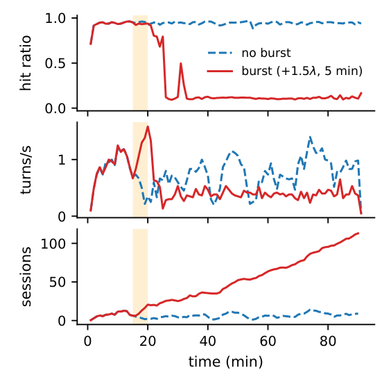
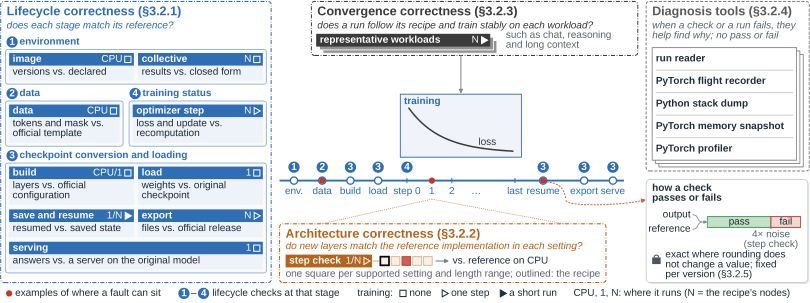
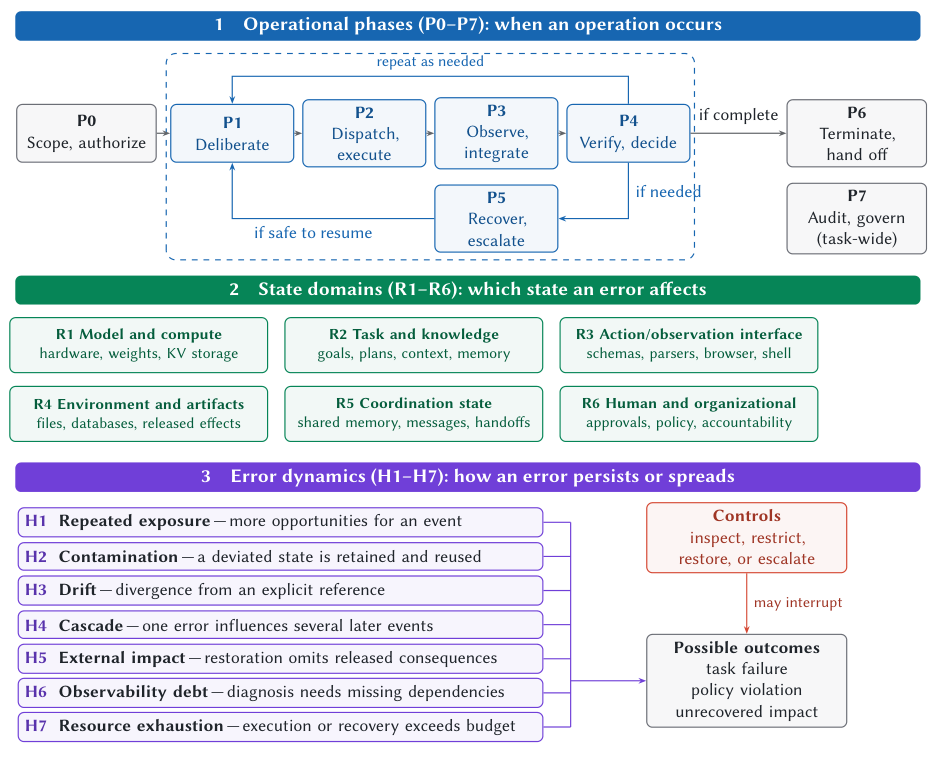
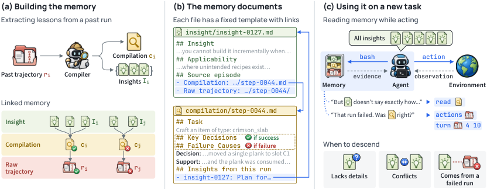
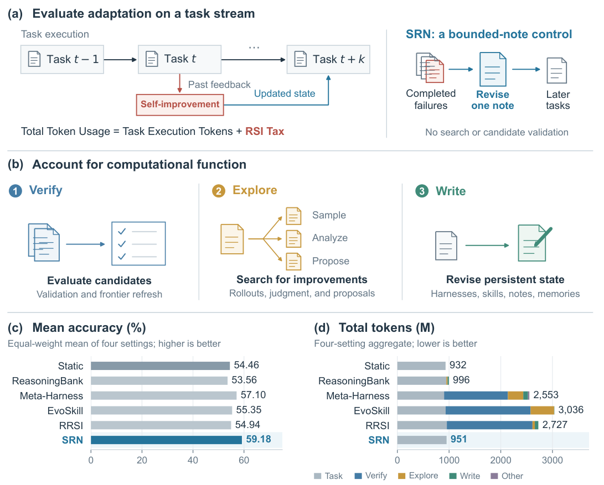
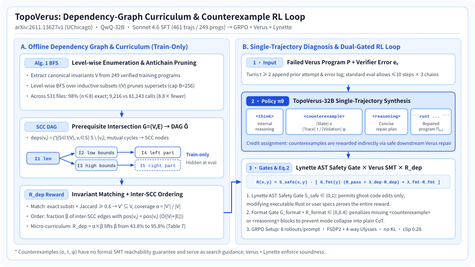
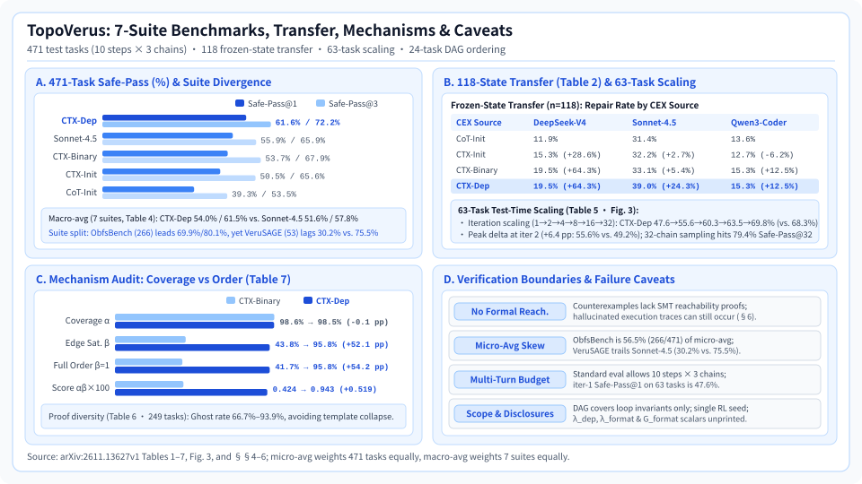

Caching, verification, and self-improvement can save future work while introducing new dependencies. Lost cache reuse can sustain session backlog; loss curves and final answers can hide corrupted intermediate state; repeated candidate validation can cost more than the tasks an agent serves. The main readings connect recovery, explicit correctness checks, and evidence that remains available when an agent reuses experience.

Further developments span multi-agent coordination, GPU communication analysis, training-configuration selection, and proof repair. Some change execution mechanisms; others contribute measurement tools or negative evidence. Distinguishing layer speedups from end-to-end gains, task utility from behavioral fidelity, and model proofs from implementation coverage is central to interpreting them.

<h2 class="daily-paper-title" id="paper-arxiv-2611.13412">01 · Why a short burst can leave a cache persistently degraded</h2>

[Bursts That Outlast Themselves: Persistent Degradation in Prefix-Cached Agent Serving](https://arxiv.org/abs/2611.13412)  
Wen Huang , Jack Liu · 2026-11-10

Prefix caching makes an agent turn cheap when most of its history remains resident. It also makes serving capacity depend on previous events. Wen Huang and Jack Liu show that a server can remain slow after a brief arrival surge has ended. Their contribution is a controlled demonstration of this history dependence and a comparison of recovery actions, rather than the invention of cache-aware concurrency control.

### How lost cache reuse sustains congestion

The main experiment runs Qwen3-8B on a single MI300X with vLLM and a 400K-token KV pool. Paired runs share the same base sessions. Only one receives five minutes of additional arrivals at minute 15, raising total arrivals to 2.5 times the base rate. In nine of twelve pairs, only the burst arm persistently degrades; no pair shows the reverse. Both arms degrade in two pairs and neither in one. In a representative degraded run, the hit ratio stays near 10%, throughput drops substantially, and backlog continues growing through the end of the 90-minute experiment.

This is not simply unfinished burst traffic. Closed-loop agents must wait for model and tool responses before continuing. Slower service extends session lifetimes, increasing the population competing for KV capacity. Evicted prefixes force repeated processing of growing histories, slowing service further. A base load sustainable with a warm cache can exceed capacity once most turns miss.

<a class="note-image-link" href="/assets/images/digest/2026-11-12/bursts.png" target="_blank" rel="noopener" aria-label="After the burst, the red run keeps missing and accumulating sessions; blue is its no-burst twin with identical base arrivals.">View original image ↗</a>

*After the burst, the red run keeps missing and accumulating sessions; blue is its no-burst twin with identical base arrivals.*

### Recovery must reduce already-admitted demand

Throttling new sessions leaves admitted sessions competing for the same insufficient cache. The authors instead park some sessions at turn boundaries. Their gateway budgeter estimates resident demand as context length plus output allowance and uses 0.75/0.95 of pool capacity as admission and parking thresholds. Parked sessions return before new arrivals; requests already in flight are not interrupted.

Among seven seeds collapsed in every comparison arm, the budgeter recovers all seven within the first five-minute measurement window. A capacity-based session cap also recovers all seven within six minutes; admission throttling alone recovers one. Token budgeting handles changes in session lengths better than a fixed session count. A 128-GiB host KV tier delays collapse but cannot eliminate a continually expanding working set.

### Efficient execution is not an empty queue

Experiments with Qwen3-32B trace shapes and SGLang support the mechanism beyond the main configuration, without covering every scheduler, device, or real prompt distribution. In longer 32B runs, restored cache efficiency can coexist with growing backlog because arrivals exceed long-run completion capacity. Parking also delays individual users. For Ops4LLM, the key distinction is between warm capacity, cold capacity, resident session demand, and recovery policy: a recovered hit ratio alone does not establish recovered user experience.

<h2 class="daily-paper-title" id="paper-arxiv-2611.13393">02 · Plumbline: falling loss does not establish correct training</h2>

[Plumbline: When the Loss Lies, Validating LLM Training Correctly](https://arxiv.org/abs/2611.13393)  
Ruochen Wen , Hongyang Wang , Siwei Li , Wenbo Chen , Xian Li , Jingguo Liu , Leo Fan , Yiming Yan , Qian Qu , Zheshen Wang , Benoit Dumoulin · 2026-11-10

A training run can avoid crashes and reduce loss while learning from the wrong labels or exporting the wrong model. Plumbline turns that problem into explicit checks over data, model loading, checkpoint recovery, optimizer updates, architecture, and serving exports. Its production use at Amazon supplies concrete failure evidence and illustrates why agent-driven diagnosis needs verdict rules independent of the diagnosing agent.

### Give each layer a reference

Lifecycle checks compare tokens and loss masks with the official tokenizer and template, initialize parameters with NaNs before loading to expose omissions, and compare saved and restored state bitwise on every rank. An export check takes a zero-learning-rate step and compares the exported checkpoint with the original. Optimizer checks independently recompute loss normalization and updates at higher precision.

Architecture checks use real weights and the first layers needed to cover each layer type. They compare supported training configurations with a CPU FP32 reference, changing individual settings and grouping inputs by length. Gradient error fails when it exceeds four times the larger measured run-to-run or precision noise floor. Fault injection checks that tolerances do not hide the targeted defect. Full-model convergence runs cover failures that require depth, memory pressure, or distributed timing.

<a class="note-image-link" href="/assets/images/digest/2026-11-12/plumbline.png" target="_blank" rel="noopener" aria-label="Lifecycle, one-step architecture, and full-run checks cover different faults; diagnostic tools supply records rather than independent pass verdicts.">View original image ↗</a>

*Lifecycle, one-step architecture, and full-run checks cover different faults; diagnostic tools supply records rather than independent pass verdicts.*

### Agents organize tests; fixed checks decide

An agent selects configurations, orders jobs, and proposes causal explanations. It does not redefine pass criteria during the investigation. Diagnosis combines the same checks with profiling, memory snapshots, communication records, and stack dumps, reducing scale or changing one setting at a time. A human approves plans and critical changes; a second agent reconstructs findings from raw records before human confirmation. Incomplete comparisons remain inconclusive or unevaluated.

Across tested versions of three frameworks and five MoE models, Plumbline finds 61 problems, including 32 silent ones. Of the total, 42 are fixed or reported upstream, eight first reported by the authors. Lifecycle and architecture checks first discover 29 of the 32 silent problems; at least 16 occur in runs that pass convergence checks. One example is a loss mask that omits the reply-ending token: loss can fall without teaching the model to stop correctly.

### Missing references mean missing coverage

The counting unit is one root cause on one framework. These are not 61 newly discovered vulnerabilities or a population failure rate. Layers without a trusted reference remain unjudged, as with the tested DeepSeek-V4.1-Flash implementation. Shared defects in reference and tested code can also escape comparison. The valuable reading is the check contracts and failure taxonomy: apparently healthy training becomes a set of bounded evidence claims rather than one universal correctness score.

<h2 class="daily-paper-title" id="paper-arxiv-2611.13254">03 · Failure trajectories: does contradictory evidence actually change state?</h2>

[Dependable Long-Horizon LLM Agents: A Trajectory-Centered Empirical Study of Where Errors Enter and Which Controls Reach Them](https://arxiv.org/abs/2611.13254)  
Shaohuang Wang , Jinghao Wen , Xulei Zhang , Xun Jiao · 2026-11-09

Asking which agent made the decisive mistake often stops at the most visible symptom. This paper introduces an episode record connecting a candidate origin, affected state, propagation, detection, response, and outcome. Its practical question is whether a control can both observe the relevant evidence and reach the state that needs correction, making it directly relevant to AgentOps diagnosis and recovery.

### Similar symptoms can require different controls

The framework separates operational phases from state domains. A false fact may enter a plan, cross a shared-message boundary, and later drive a tool action. Links distinguish observations, intervention-supported relations, and hypotheses. Step fields must point to trace lines, while evidence fields record whether contradictory information was available, acknowledged, or acted upon. A generic verification failure can then be separated into accepting an unsourced claim, verifying the wrong task, or losing an observation during handoff.

<a class="note-image-link" href="/assets/images/digest/2026-11-12/trajectory.png" target="_blank" rel="noopener" aria-label="Operations, state domains, and propagation dynamics are separate coordinates; recovery must reach contaminated state rather than only the final symptom.">View original image ↗</a>

*Operations, state domains, and propagation dynamics are separate coordinates; recovery must reach contaminated state rather than only the final symptom.*

The study completes 96 records and excludes one procedurally faulty run with a correct final answer from outcome statistics, leaving 95 failures. A crucial limitation is that Claude produces the records under the written protocol. This is **not an independently human-annotated dataset**. The authors manually inspect some comparison disagreements but report no human inter-annotator agreement. Partial corpus coverage and exclusion of very long traces further limit generalization.

### Detection does not imply recovery

The records identify contradictory evidence before the final failure in 68 of 95 runs, with action in only seven. The prose's “88%” non-action figure does not exactly match these counts; the numerator and denominator are clearer. Deviations are detected in 29 runs, yet no response completely removes the deviated state. Changing the next action while retaining the false belief can reproduce the same loop.

The authors judge local state restoration sufficient in 35 of 95 cases. In 56, the problem sits in the plan, task brief, or stopping rule and may simply recur after rollback. These are retrospective reach assessments, not measured success rates of deployed recovery controls. An additional judge helps only if it reads the neglected evidence rather than repeating the worker's information.

### A separate finding comes from deterministic log scanning

Scanning the complete Who&When corpus finds provider content-filter crashes in 26 of 58 hand-crafted runs. In 25, the harness subsequently prints a final answer no agent produced. This result does not depend on episode annotation and exposes an attribution problem: a benchmark may blame an agent for a runtime fallback answer. The reusable contribution is source-grounded propagation records and explicit inspection of post-detection state change; the reported proportions should not be treated as production failure prevalence.

<h2 class="daily-paper-title" id="paper-arxiv-2611.14320">04 · WikiTrace: keep evidence behind an agent’s memory</h2>

[Don't Just Trust Your Memory: Evidence-Linked Memory Reduces Memory-Induced Degradation in LLM Agents](https://arxiv.org/abs/2611.14320)  
Yukyeong Lee , Yumin Choi , Jinheon Baek , Sung Ju Hwang · 2026-11-10

Memory can improve average performance while causing failures on tasks an agent could previously solve. WikiTrace measures that regression separately and targets a common compression failure: distilling a success or failure into a lesson while discarding the experience that could qualify or contradict it.

### Follow a lesson back to its run

Each historical run produces a compilation of successful decisions or plausible failure causes and at most three insights. The original trajectory is preserved. Every insight links to both the compilation and the raw run and records applicability and source outcome. Compilations remain interpretations, not verified diagnoses. Conflicting insights can coexist; the acting agent decides which applies.

For a new task, the agent receives all insights and navigation pointers to three similar historical tasks. Missing details, conflicting lessons, failed source runs, and failed actions trigger prompts to inspect read-only source files with terminal tools. In a PlanCraft example, a mistaken lesson treats an intermediate crafting preview as consumed material. The original runs show that continuing to place ingredients completes the recipe. Evidence changes the basis for action rather than merely expanding the prompt.

<a class="note-image-link" href="/assets/images/digest/2026-11-12/wikitrace.png" target="_blank" rel="noopener" aria-label="Memory construction preserves links between insights, compilations, and raw runs; the agent follows them when details are missing or lessons conflict.">View original image ↗</a>

*Memory construction preserves links between insights, compilations, and raw runs; the agent follows them when details are missing or lessons conflict.*

### Compare with identical insights

The main evaluation uses the same DeepSeek-V4-Flash agent across eight suites from five benchmarks, with three trials. Each method builds memory once from the same training trajectories without extra validation runs. Mean performance rises from 79.5 without memory to 90.2 with WikiTrace. Giving the same insights without source access scores 87.0, a more direct 3.2-point comparison. This intervention includes both source access and the descent prompt; it does not isolate hyperlinks alone.

Previously solvable tasks are defined by the majority outcome of three no-memory trials. Regression on those tasks is 4.5% with WikiTrace and 6.5% with insights alone. Additional no-memory trials yield 9.7%, showing that ordinary run variability also causes regression. WikiTrace's mean test-time cost is 1.17 times that of insights alone.

### Traceability does not certify a lesson

Putting every insight in the initial message leaves retrieval and context limits unresolved at larger memory sizes. Agents choose when to descend, so comparisons between descending and non-descending runs are observational. Failure categories and descent effects also rely on model judgments of reasoning text. The useful reliability contribution is a route for correcting inherited advice, together with separate measurements of gains and lost successes, rather than a guarantee that memories are correct or indefinitely scalable.

<h2 class="daily-paper-title" id="paper-arxiv-2611.13524">05 · The RSI Tax: count the cost of improving the agent</h2>

[The RSI Tax: When Recursive Self-Improvement Is Not Worth the Cost](https://arxiv.org/abs/2611.13524)  
Yitong Zhang , Ang Li , Yisen Wang · 2026-11-10

Self-improvement reports often emphasize the better harness or skill that eventually reaches deployment. The RSI Tax asks what it cost to find that improvement. It counts candidate generation, experience analysis, repeated validation, and persistent-state writing alongside task execution, fixing each task's score before its feedback can influence later updates.

### Why a simple adaptive baseline matters

Six methods and two backbones are evaluated on seven repository chains totaling 105 positions and 89 Terminal-Bench 2.1 tasks: 2,328 scored method–task pairs. Methods share an initial agent and task order within each setting. Some procedures, including EvoSkill, are adapted for the stream, so these are not unchanged reproductions of their original evaluations.

Simple Reflection with Notes, or SRN, revises a note of at most 2,048 tokens every four tasks using failed-task excerpts and scalar outcomes from the allowed window. With no failures, it keeps the note. It performs no candidate search or extra validation. This provides an adaptive but inexpensive comparison for deciding whether more elaborate search pays for itself.

<a class="note-image-link" href="/assets/images/digest/2026-11-12/rsi-tax.png" target="_blank" rel="noopener" aria-label="Score each task before using its feedback; total cost includes execution plus verification, exploration, and writing for improvement.">View original image ↗</a>

*Score each task before using its feedback; total cost includes execution plus verification, exploration, and writing for improvement.*

### Validation costs more than writing skills

SRN has the highest observed accuracy in three model–benchmark settings and ties EvoSkill in the fourth. Averaging within-setting total-token ratios gives reductions of 65.6%, 71.0%, and 68.2% relative to Meta-Harness, EvoSkill, and RRSI. The conclusion concerns amortization over these finite streams, not the impossibility of useful self-improvement.

Verification accounts for 74.8%–93.6% of the three methods' aggregate improvement tax. On the DeepSeek terminal stream, Meta-Harness uses fewer task-execution tokens than SRN, but approximately 578.45M improvement tokens bring its total to 762.57M versus SRN's 214.65M. Looking only at execution after adaptation reverses the cost story.

### Unused artifacts are not automatically removable waste

Costs are also associated with whether a state or artifact is used later. These are token shares, not failed-update rates. Rejected candidates may still inform subsequent search, so their costs cannot necessarily be removed without consequences. Nor are raw token counts equivalent to dollar bills with cache discounts and different input/output prices.

Two models, one terminal ordering, and limited repository chains do not establish long-run returns or robust rankings across repetitions. The transferable AgentOps contribution is accounting: separate task and learning costs, distinguish validation from exploration and writing, and track how long outputs are actually reused. This is substantive negative evidence about particular update procedures, not a universal argument against adaptation.

<h2 class="daily-paper-title" id="paper-arxiv-2611.13176">06 · SHADOWPREFILL: warm the next model before a routing switch</h2>

[SHADOWPREFILL: Keeping Your Next Model Warm for Per-Step Model Routing in Agentic LLM Serving](https://arxiv.org/abs/2611.13176)  
Haoran Qiu , Rohan Mahapatra , Rodrigo Fonseca , Mark Russinovich · 2026-11-09

Per-step routing loses cache reuse when a session changes models. SHADOWPREFILL incrementally prefills the same history on the unselected model, prioritizing likely switches. Shadow work runs only behind normal demand and within latency slack; its KV entries are evicted first and can spill to host memory. A switch never waits for warming to finish: it uses the available prefix and computes the remaining tail.

The main 22-pair results are trace-driven simulations with cached tokens priced at one tenth of uncached input, so billing reductions are not GPU-cost reductions. A 16-H100 prototype separately reports 61.9% lower mean switch TTFT and 1.4% higher energy per compliant request. Decode-heavy pairs can show almost unchanged total LLM time. Unlike cross-version cache reuse, this computes the target model's own state; benefit depends on slack, context length, and residency.

<h2 class="daily-paper-title" id="paper-arxiv-2611.14051">07 · Cross-version KV reuse: utility differs from behavioral fidelity</h2>

[Can KV Cache Be Reused Across Model Updates? A DeepSeek-V4-Flash Case Study](https://arxiv.org/abs/2611.14051)  
Zhikun Tao , Fangyong Jin , Junping Zhao · 2026-11-10

Directly carrying old KV state into an updated model can preserve useful retrieval while changing answers or stopping behavior. Across four updates, the authors compare native target execution, native source execution, and direct handoff, finding substantial pair dependence. For DeepSeek-V4-Flash to Flash-0731, three longer-prefix QA benchmarks show median TTFT speedups of 2.10–5.08 times with source caches prepared. HotpotQA and 2WikiMQA lose approximately three and seven F1 points, while shorter-prefix BABILong reaches only 0.86 times native speed.

TTFT includes cache loading but excludes source-prefill and model-startup costs. Similar aggregate accuracy can hide both broken correct answers and repaired errors. Functional Cache Divergence additionally compares predictive distributions under matched histories. For rolling updates, the lesson is to distinguish task utility, first-token agreement, and full-generation fidelity rather than treating loadable state as semantic compatibility.

<h2 class="daily-paper-title" id="paper-arxiv-2611.13442">08 · ForeSpark: allocate speculative work before drafting</h2>

[ForeSpark: Joint Draft and Verification Budget Scheduling for Parallel Speculative Decoding](https://arxiv.org/abs/2611.13442)  
Jaeyong Song , Daniel Wang , Pratyush Patel , Jonny Kong , Preyas Shah , Shobhit Kanaujia · 2026-11-10

A parallel drafter that always proposes a full block still pays for tokens later discarded before verification. ForeSpark predicts acceptance benefits for different lengths from target context features and the anchor token before drafting. A scheduler converts reward curves into sortable marginal benefits and uses profiled latency tables to jointly choose draft lengths and verification budget. After drafting, actual candidate confidence redistributes verification while standard speculative sampling preserves the output distribution.

On vLLM with Qwen3-14B and two GLM models on H100/B200 hardware, throughput reaches 1.77 times DSpark at matched per-user generation rate. That maximum is decode-only; prefill reduces end-to-end gains. Ordinary autoregressive decoding can still lead at the heaviest Qwen3-14B decode-only load. Global sorting can also leave individual requests undrafted for a step. The contribution is avoiding work before it is paid for, with workload and fairness boundaries intact.

<h2 class="daily-paper-title" id="paper-arxiv-2611.14356">09 · EngineAgent: model enablement must cross engine and device boundaries</h2>

[EngineAgent: Agentizing On-Device LLM Inference Engines with Inference Stack Hierarchy Awareness and Hardware Abilities](https://arxiv.org/abs/2611.14356)  
Zhengxiang Huang , Yujie Sun , Shengheng Chen , Zhaode Wang , Chaoyue Niu , Zeyu Zhao , Chengfei Lv , Fan Wu , Guihai Chen · 2026-11-10

Enabling a new model in a mobile engine often requires coordinated export, graph, operator, and backend changes. EngineAgent first constructs a hierarchy/dependency index and validates build, execution, and debugging procedures on real hardware using supported models. Builder, debugger, and auditor agents then iterate against those artifacts. A non-agent verifier ultimately compares device logits with host PyTorch references rather than accepting an auditor's verbal approval.

Twelve tasks combine three models with four engine–backend pairs under a five-hour limit. Both backbones achieve 9/12 successes versus 4/12 for the strongest baseline. Removing the hierarchy index or hardware skills lowers success to 3/12 or 5/12, supporting their complementary roles. Artifact construction has separately reported one-time costs, and per-task API charges do not represent total maintenance cost. The small sample and bounded numerical tests also limit coverage. Its contribution is evaluating enablement beyond compilation, through complete cross-layer changes and device execution.

<h2 class="daily-paper-title" id="paper-arxiv-2611.13188">10 · NVLinkOneSided: send tokens without a metadata round trip</h2>

[One-Sided Expert-Parallel All-to-All for Mixture-of-Experts Inference over NVLink](https://arxiv.org/abs/2611.13188)  
Bo Li , Chulian Zhang , Or Biri , Anthony Chang , Anton Korzh , Noam Duvdevani , XingFei Xi , Daniel Stokes , Zhenhuan Chen , Ludwig Schneider , Artem Y. Polyakov , Julien Demouth , Chandler Zhou · 2026-11-09

Fixed handshakes can dominate MoE communication at small batches. NVLinkOneSided assigns each source rank a private destination-buffer region and pushes tokens directly. The receiver builds expert-to-slot indices so grouped GEMMs read in place without a separate expert-major copy. Fence amortizes synchronization; Sentinel detects arrival through data, favoring smaller batches.

On eight B300 GPUs with balanced synthetic routing, small-batch dispatch-plus-combine is 1.75–3.00 times faster than DeepEP. Fused MegaMoE can lead at larger batches through communication/computation overlap. The method requires one NVLink domain and word-arrival properties unavailable over RDMA, and workspace grows with EP size. Unlike the SGLang megakernel, it preserves a modular communication interface rather than tying every optimization to one fused compute implementation.

<h2 class="daily-paper-title" id="paper-arxiv-2611.13762">11 · ForeSight: separate fixed stalls from hardware queues</h2>

[Exploiting What NVIDIA Profilers Hide: Fast and Accurate Analytical GPU Performance Modeling](https://arxiv.org/abs/2611.13762)  
Ziwen Wang , Qi Luo , Kunlin Li , Changxi Liu , Dongsheng Wang , Yun Chen · 2026-11-10

Scaling every stall together confuses fixed dependencies with resource contention. ForeSight profiles an original configuration, retains measured fixed-latency stalls, recomputes queueing from target-unit pressure, and replays CTA execution. UnitSight recovers per-SM, L2-slice, and memory-channel counters from CUPTI CounterData that aggregate reporting obscures.

The nine-GPU configuration study covers fifty workloads, including forty-seven inference operators. Overall execution-time MAPE is 8.3% versus 14.1% for the strongest comparison baseline. Median H20-based prediction takes about 26 seconds, roughly 49 times faster than cycle simulation, while initial profiling still takes about 170 seconds. Simpler analytical models can be faster. The contribution is resource-level observability for configuration prediction, not measurement-free transfer to arbitrary architectures or direct serving acceleration.

<h2 class="daily-paper-title" id="paper-arxiv-2611.13293">12 · TKNP: separate weight placement from attention ownership</h2>

[Decode Token Parallelism: Memory-Efficient Distributed Attention Parallelism for Scalable LLM Decoding](https://arxiv.org/abs/2611.13293)  
Susav Shrestha , Brad Settlemyer , Narasimha Reddy · 2026-11-09

Scaling long-context decode creates a trade-off between replicated weights consuming KV capacity and sharded attention requiring cross-node merging. TKNP distributes one weight copy in contiguous layer blocks. The block owner performs projections and MLPs for the full batch, while fixed request owners keep all-layer KV and compute their requests' attention locally. Current-token activations cross nodes; dense TP collectives remain inside each node.

The vLLM implementation evaluates Llama 3.1 405B and Nemotron-4 340B on up to 64 H100s, reaching 2.06 times DP completion throughput in long-context, high-concurrency cases. That metric includes admission waves and draining, not just active-request token latency. Small batches or short contexts can lose to communication overhead. The dual-root microbatch variant adds a second distributed weight copy, trading KV capacity for overlap.

<h2 class="daily-paper-title" id="paper-arxiv-2611.13413">13 · SlackTier: place lookup tables by their prefetch deadlines</h2>

[Placing LLM Lookup Tables by Per-Layer Prefetch Deadlines](https://arxiv.org/abs/2611.13413)  
Wen Huang , Jack Liu · 2026-11-10

Engram lookup indices depend only on input tokens, allowing reads to start at the beginning of a decode step. SlackTier exploits unequal deadlines: early layers need rows quickly, while later layers can hide slower reads behind preceding computation. Its SGLang path submits early-layer I/O first, handles indexing and deduplication on a CUDA-Graph side stream, and makes each layer wait only for its own event. A small GPU row cache reduces early deadlines and shared-disk contention.

On four H200s with DeepSeek-V4.1-Flash agent/chat replays, placing both tables on four NVMe drives raises time per output token by at most 1.4% against unmodified SGLang and reduces host memory from 212 to 34 GiB. Predictable sparse lookups differ from streaming dense or expert weights. Optional row skipping is lossy and must remain separate from exact gathering. New hardware requires remeasuring deadlines, I/O contention, and miss curves.

<h2 class="daily-paper-title" id="paper-arxiv-2611.14246">14 · SinkState: maintain recurrent states in adaptive low rank</h2>

[SinkState: On-the-Fly SVD of Recurrent States for Efficient Hybrid LLM Serving](https://arxiv.org/abs/2611.14246)  
Haolin Jiang , Weihang Li , Zhongzhu Zhou , Jinwen Pan , Santosh Pandey , Hang Liu · 2026-11-10

Linear-attention state does not grow with history, yet dense state traffic can dominate larger batches. SinkState initializes low-rank factors with randomized SVD, buffers new updates, and periodically merges them into the dominant subspace. The CPU consolidates other components asynchronously, while fused kernels compute from factors and buffers without materializing dense states each step.

Four Mamba-2/GDN hybrid models run on one 96-GB RTX PRO 6000 Blackwell. Peak recurrent-state memory falls by up to 2.6 times relative to dense-state backends; that denominator is not total model or GPU memory. Singular-value truncation is approximate, thresholds vary by model family, and CPU/PCIe resources matter. Quality retention is empirical on the tested benchmarks. The contribution is ongoing rank control during serving rather than compressing only a post-prefill snapshot.

<h2 class="daily-paper-title" id="paper-arxiv-2611.14285">15 · LM-SimBench: connect simulation errors to training stages</h2>

[LM-SimBench: A Unified Framework, Dataset, and Benchmark for Large Language Model Training Simulation](https://arxiv.org/abs/2611.14285)  
Yu Dong , Hong Li , Qiang Sun , Xu Zhou , Jinbiao Huo , Qixiu Cheng , Zhiyuan Liu · 2026-11-10

Different workloads and accounting conventions obscure whether training-simulator errors arise from operators, communication, or scheduling overlap. LM-SimBench separates compilation, device binding, execution representation, cost estimation, and schedule aggregation, linking six measurement views through configuration and rank identifiers. Its main Ascend 910B3 dataset contains ten model families, twenty-three settings, and 348 feasible configurations varying five parallelism dimensions and recomputation.

On six common test configurations, vTrain and Calculon have time sMAPE of 1.86% and 8.88%, but both select the fastest configuration. Better numerical accuracy need not change the decision. This small comparison is not a ranking over all 348 configurations. Paired V100/NPU experiments support GPU shortlisting from NPU measurements for two small Qwen models, with final selection still using GPU measurements. The contribution is comparable evidence and error localization, not a universal simulator winner.

<h2 class="daily-paper-title" id="paper-arxiv-2611.13246">16 · ExpertCrowd-SWE: grade changes against maintainer requirements</h2>

[ExpertCrowd-SWE: Measuring Frontier Coding Agents on Expert-Authored Engineering Tasks in Unfamiliar Codebases](https://arxiv.org/abs/2611.13246)  
Josip Vrdoljak , Akash Singh , Bas Steunebrink , Alex Yarotsky , John Lorenzo , Achille Nicoletti , Sam Pigott · 2026-11-09

ExpertCrowd-SWE asks engineers familiar with real repositories to author multi-file changes against pinned commits. Weighted graders allow partial credit but retain must-pass blockers. Reference solutions must score fully, untouched and inert changes must score zero, and nearly half the tasks include lazy or adversarial control patches. This adds maintainer rejection criteria beyond a simple test-pass count.

One hundred tasks span 87 projects and eleven languages. Seven models with five runs yield 3,495 scored executions. Leading scores of 67.3% and 63.7% are mean partial-credit scores, not full-solution rates, and their difference is not significant. Tasks were selected for frontier-model difficulty; only 24 are public and 76 held back. Harness and native tool interfaces also shape comparisons. Grader calibration and repeated-run reliability are more transferable than a universal capability ranking.

<h2 class="daily-paper-title" id="paper-arxiv-2611.13709">17 · Context-file instructions: measure observable compliance</h2>

[Do They Do as They Are Told? Investigating Coding Agents' Adherence to Explicit Instructions in Context Files](https://arxiv.org/abs/2611.13709)  
Gianmario Voria , Yutaro Kashiwa , Gemma Catolino , Fabio Palomba · 2026-11-10

Writing a rule into an AGENTS.md-style file does not establish execution-time adherence. The study links 621 context snapshots to 6,541 agent commits across 268 repositories. Explicit, actionable, observable instructions become measurement scripts and fixtures, with independently generated scripts providing corroboration before applicable commits are checked.

Among evaluated instructions, 54.4% are satisfied in every applicable commit and 37.3% in none. However, the median instruction has only three applicable commits, and single observations necessarily produce zero or full compliance. Higher-support sensitivity analyses address that issue. Compliance in artifacts also does not prove the file caused it: repository conventions and model defaults may explain behavior. The contribution is executable measurement with evidence thresholds, not a causal ranking of agent obedience.

<h2 class="daily-paper-title" id="paper-arxiv-2611.13627">18 · TopoVerus: train counterexamples for useful proof repair</h2>

- **Paper**: [Curriculum Proof Repair with Learned Counterexamples](https://arxiv.org/abs/2611.13627) ([v1 PDF](https://arxiv.org/pdf/2611.13627) · [HTML](https://arxiv.org/html/2611.13627v1) · [Code](https://github.com/Etha-Sun/Topoverus) · [Weights](https://huggingface.co/YuechunSun/TopoVerus-32B))
- **Authors**: Yuechun Sun, Jun Yang, Kexin Pei (Department of Computer Science, University of Chicago)
- **Venue & Status**: arXiv:2611.13627v1 `[cs.PL; cs.LG]` · Submitted 2026-11-10 (PDF uses the NeurIPS 2026 template; only `v1` exists at verification time, with no `v2` revision or withdrawal)

`TopoVerus` tackles automated proof repair in **Verus** (a Rust formal verifier backed by SMT solvers) by shifting diagnostic reasoning from external iterative solvers into the language model policy itself and turning invariant dependencies into an intra-episode curriculum reward. Trained on top of `QwQ-32B`, `TopoVerus-32B` (`CTX-Dep`) achieves **`61.6%` / `72.2%`** micro-averaged `Safe-Pass@1` / `Safe-Pass@3` across `471` problems from `7` Verus benchmark suites, surpassing `Claude Sonnet 4.5` (`55.9%` / `65.9%`) by `5.7` / `6.3` percentage points. All figures and claims below trace directly to `arXiv:2611.13627v1` (Tables 1–7, Figures 1–4, Appendices A–D), separating primary measurements from audit caveats.

### 1. Problem Formulation, Under-Constrained Diagnostics & Single-Trajectory Synthesis

A Verus verification task pairs executable Rust code with formal specifications $$\Phi = (P_{\text{pre}}, Q_{\text{post}})$$ (`requires` / `ensures`) and ghost proof annotations $$\Pi$$ (loop `invariant`, `assert`, `decreases`), which Verus discharges into Verification Conditions checked by Z3 or cvc5. Standard verifier-in-the-loop repair loops struggle for two complementary reasons: raw Verus diagnostics report coarse pass/fail locations (such as `postcondition not satisfied` or `invariant not satisfied before loop`) without exposing concrete failing states, while prior counterexample pipelines either incur heavy test-time iteration with hand-crafted validators (`ExVerus`) or attempt brittle reconstruction from low-level SMT models.

Given a failing proof $$\Pi_t$$ and error $$e_t$$ decomposing into pre-state antecedent $$A_t(\sigma)$$ and obligation consequent $$C_t(\sigma)$$, a valid counterexample state satisfies $$\sigma \models A_t(\sigma) \land \neg C_t(\sigma)$$. Rather than calling an external symbolic checker to validate $$\sigma$$, `TopoVerus` trains policy $$\pi_\theta(y \mid x)$$ to emit **four structured blocks within one trajectory** (Appendix D):
1. **`<think>`**: internal chain-of-thought reasoning;
2. **`<counterexample>`**: a semi-formal diagnostic tuple $$(\sigma, \tau, \psi)$$ comprising `[State]` (concrete inputs/variables $$\sigma$$), `[Execution Trace]` (stepwise execution from $$\sigma$$ yielding $$\tau$$), and `[Violation]` (natural-language root cause $$\psi$$);
3. **`<reasoning>`**: a concise repair plan grounded in that counterexample;
4. **`rust` code block**: a single fenced block with the complete candidate repaired program $$\Pi_{t+1}$$.

Section 2.1 (`search_insert`, Figures 1–2) explains why order-blind diagnostics stall. The binary-search loop carries five clauses: array-length bound `I1`, index bounds `I2` (`low`) and `I3` (`high`), and semantic partition clauses `I4` (elements left of `low` are `< target`) and buggy `I5'` (`high <= i` instead of `high < i`). When `I1–I3` are missing, dependency-unaware reasoning emits syntactically plausible `[State]–[Trace]–[Violation]` text that hallucinates `mid = 0` before the loop and instantiates `i = 1` outside the quantified range (`high = 2, len = 3`), ending in vague postcondition hand-waving. Once prerequisites `I1–I4` are established, the state (`nums = [1, 3, 5], target = 5, low = 2, high = 2`) anchors the trace cleanly on `i = high = 2` (`nums[2] = 5` violates `> 5`), pinpointing the exact edit `high <= i -> high < i`.

### 2. Topological Dependency Graph, Lynette Safety Gate & Curriculum RL

<figure class="note-figure"><a class="note-image-link" href="/assets/images/digest/2026-11-12/topoverus-curriculum-pipeline-en.svg" target="_blank" rel="noopener" aria-label="View original TopoVerus offline dependency graph and safety-gated RL pipeline diagram">View original image ↗</a><figcaption>Figure 1 · TopoVerus pipeline: offline train-only minimal inductive subset dependency graph and topological reward (left), feeding single-trajectory counterexample diagnosis and dual-gated GRPO training (right).</figcaption></figure>

To convert prerequisite proof structure into dense intra-trajectory RL supervision, `TopoVerus` combines three mechanisms:

1. **Offline Invariant Dependency Graph & SCC Condensation (Section 3.3, Appendix A)**: For each verified training program's canonical loop-invariant set $$V = \{v_1, \dots, v_n\}$$, let $$\mathcal{I}(V)$$ be the family of inductive subsets (established at loop entry and preserved by the loop body). The structural prerequisites of invariant $$v_i$$ are those invariants present in every inductive subset containing $$v_i$$:

   $$\mathrm{deps}(v_i) = \left(\bigcap_{S \in \mathcal{I}(V),\, v_i \in S} S\right) \setminus \{v_i\}$$

   defining directed graph $$G = (V, E)$$ with $$(v_j, v_i) \in E \iff v_j \in \mathrm{deps}(v_i)$$. Mutually inductive cycles are condensed via Tarjan's algorithm into a DAG $$\hat{G} = (\hat{V}, \hat{E})$$ over strongly connected components (SCCs). Because exact minimal inductive subset enumeration reduces to Hypergraph Transversal Enumeration (`Trans-Enum`, best known complexity quasi-polynomial $$N^{O(\log N / \log \log N)}$$), Algorithm 1 runs **level-wise BFS over cardinalities $$k = 1 \dots n$$ with antichain pruning** (skipping supersets of any discovered minimal inductive set $$T$$) under a budget cap $$B = 256$$ verifier calls per file. Across `531` verified programs across `5` datasets (median $$n = 3$$, mean $$n = 3.0$$), `98%` satisfy $$n \le 8$$ ($$2^n - 1 \le 255 < B$$) so enumeration is **exact**; only `2%` (`9` LeetCode files, $$n \le 16$$) trigger approximation. Pruning cuts calls from `81,143` naive to `9,216` (`8.8×` reduction overall; `25.9×` on LeetCode), taking `≈ 64 min` on one machine (mean `0.42 s` per Verus call, range `0.25–0.71 s`). Only the `249` training programs' graphs are used during training; reference proofs, $$V$$, and $$G$$ are completely withheld at test time.

2. **Topological Graph Reward $$R_{\text{dep}}$$ (Equation 6)**: Candidate invariants extracted from the model's code are aligned against $$V$$ via exact substring matching and token-set Jaccard similarity $$J(\cdot, \cdot) \ge 0.6$$ to obtain $$V' \subseteq V$$. Over inter-SCC dependency edges $$\hat{E}' = \{(v_j, v_i) \in E \mid v_j, v_i \in V',\, \hat{S}(v_j) \neq \hat{S}(v_i)\}$$, the reward evaluates coverage $$\alpha$$ and source-order satisfaction $$\beta$$:

   $$R_{\text{dep}} = \underbrace{\frac{\lvert V'\rvert}{\lvert V\rvert}}_{\alpha\text{ (coverage)}} \times \underbrace{\frac{\bigl\lvert\{(v_j, v_i) \in \hat{E}' \mid \mathrm{pos}(v_j) < \mathrm{pos}(v_i)\}\bigr\rvert}{\lvert\hat{E}'\rvert}}_{\beta\text{ (edge satisfaction)}}$$

   Intra-SCC mutually inductive edges are ignored, and $$\beta = 1$$ if $$\hat{E}' = \emptyset$$. During GRPO training, evaluating $$R_{\text{dep}}$$ is an $$O(\lvert V\rvert + \lvert E\rvert)$$ lookup-and-order check with negligible overhead.

3. **AST Safety Gate & Shaped GRPO Objective (Equation 2)**: The full response-level reward is:

   $$R(x, y) = S_{\text{safe}}(x, y)\Big[G_{\text{format}}(y)\bigl(R_{\text{pass}}(x, y) + \lambda_{\text{dep}} R_{\text{dep}}(x, y)\bigr) + \lambda_{\text{format}} R_{\text{format}}(x, y)\Big]$$

   Here **AST Safety Gate** $$S_{\text{safe}} \in \{0, 1\}$$ invokes `Lynette` (Yang et al., 2025) to verify that only ghost proof annotations changed; tampering with executable Rust code or user `requires`/`ensures` specifications zeroes the reward. $$R_{\text{pass}} \in \{0, 1\}$$ reflects Verus acceptance, while $$R_{\text{format}} \in [0, 0.4]$$ and feasibility gate $$G_{\text{format}}(y)$$ penalize omitted `<counterexample>` or `<reasoning>` blocks to prevent mode collapse into plain CoT. Starting from `QwQ-32B`, the team distills **`461` SFT trajectories** from `249` disjoint source programs using `Claude Sonnet 4.6` as teacher (`DeepSpeed ZeRO-3`, `4 × NVIDIA L40S`, `lr = 2×10⁻⁵`, `batch = 32`, `max_len = 8,192`, `2` epochs), followed by GRPO (`FSDP2` + `4`-way Ulysses sequence parallelism, vLLM rollouts at `temp = 0.7`, `top-p = 0.9`, `8` rollouts/prompt, `lr = 2×10⁻⁶`, no KL penalty, PPO clip `0.28`, `2` epochs over the same `249` programs).

### 3. Seven-Suite Benchmarks, Counterexample Transfer, Mechanisms & Audit Boundaries

<figure class="note-figure"><a class="note-image-link" href="/assets/images/digest/2026-11-12/topoverus-eval-mechanisms-en.svg" target="_blank" rel="noopener" aria-label="View original TopoVerus 7-suite benchmarks, transfer, mechanisms, and caveats diagram">View original image ↗</a><figcaption>Figure 2 · Empirical benchmarks and mechanism audit: 7-suite micro/macro averages (Tables 1 & 4), 118-state diagnostic transfer (Table 2), 63-task scaling (Table 5), and 24-task DAG ordering (Table 7).</figcaption></figure>

The standard evaluation spans **`471` test problems across `7` suites**, allowing up to **`10` iterative verifier-feedback steps** per chain (`3` independent chains for `Safe-Pass@3`), with `Lynette` validating ghost-only edits on every accepted repair. Table 1 consolidates Table 1 and Table 4 across both micro-average (problem-weighted) and macro-average (suite-weighted) views:

| Approach / Variant (Tables 1 & 4) | VerusBench (`26`) `@1`/`@3` | DafnyBench (`17`) `@1`/`@3` | HumanEval (`15`) `@1`/`@3` | LeetCode (`5`) `@1`/`@3` | VeriCogen (`89`) `@1`/`@3` | ObfsBench (`266`) `@1`/`@3` | VeruSAGE (`53`) `@1`/`@3` | Micro Avg (`471`) `@1`/`@3` | Macro Avg (`7` suites) `@1`/`@3` |
| :--- | :--- | :--- | :--- | :--- | :--- | :--- | :--- | :--- | :--- |
| `Sonnet-4.5` | `73.1` / `84.6` | `70.6` / `76.5` | `13.3` / `13.3` | **`40.0` / `40.0`** | `26.7` / `30.0` | `62.0` / `75.2` | **`75.5` / `84.9`** | `55.9` / `65.9` | `51.6` / `57.8` |
| `GPT-4o` | `42.3` / `42.3` | `76.5` / `76.5` | `6.7` / `13.3` | `0.0` / `0.0` | `40.4` / `41.4` | `21.8` / `22.9` | `17.0` / `24.5` | `27.2` / `29.0`* | `29.2` / `31.6`* |
| `Qwen3-Coder` | `34.6` / `34.6` | `52.9` / `52.9` | `6.7` / `6.7` | `0.0` / `0.0` | `20.0` / `25.6` | `14.3` / `18.8` | `45.3` / `64.2` | `21.0` / `26.7`* | `24.8` / `29.0`* |
| `DeepSeek-V4` (`Flash`) | `23.1` / `38.5` | `47.1` / `82.4` | `13.3` / `20.0` | `0.0` / `0.0` | `28.9` / `36.7` | `12.8` / `29.3` | `58.5` / `66.0` | `22.7` / `36.7`* | `26.2` / `39.0`* |
| `AutoVerus` | `38.5` / `50.0` | `58.8` / `70.6` | `6.7` / `6.7` | `20.0` / `20.0` | `22.5` / `28.1` | `13.2` / `23.7` | `7.5` / `9.4` | `17.2` / `25.5`* | `23.9` / `29.8`* |
| `CoT-Init` (`QwQ-32B` SFT) | `46.2` / `50.0` | `82.4` / **`100`** | `20.0` / `26.7` | `0.0` / `0.0` | `38.2` / `48.3` | `42.9` / `60.9` | `15.1` / `24.5` | `39.3` / `53.5`* | `35.0` / `44.3`* |
| `CTX-Init` (+CEX SFT) | **`88.5`** / `92.3` | `88.2` / **`100`** | **`26.7`** / `26.7` | `20.0` / **`40.0`** | `48.3` / `61.8` | `55.3` / `73.3` | `9.4` / `22.6` | `50.5` / `65.6`* | `48.1` / `59.5`* |
| `CTX-Binary` (+Binary RL) | **`88.5`** / **`96.2`** | `94.1` / **`100`** | **`26.7`** / `26.7` | `20.0` / **`40.0`** | `44.9` / `60.7` | `58.6` / `75.9` | `24.5` / `30.2` | `53.7` / `67.9` | `51.0` / `61.4` |
| `CTX-Dep` (`TopoVerus-32B`) | **`88.5`** / `88.5` | **`100` / `100`** | `20.0` / **`33.3`** | `20.0` / `20.0` | **`49.4` / `65.2`** | **`69.9` / `80.1`** | `30.2` / `43.4` | **`61.6` / `72.2`** | **`54.0` / `61.5`** |

*Note: Micro/macro averages for `Sonnet-4.5`, `CTX-Binary`, and `CTX-Dep` plus `CoT-Init`/`CTX-Init` micro `@1` (`39.3%` / `50.5%`) are reported directly in Section 4.3 and Table 4; entries marked `*` are computed directly from Table 1 suite counts (`26, 17, 15, 5, 89, 266, 53`) using Table 4's exact weighting definitions.*

Cross-referencing Tables 2, 5, 6, and 7 illuminates both why `TopoVerus` works and where its empirical boundaries lie:

| Diagnostic / Mechanism Experiment | Protocol & Fixed Inputs | Reported Quantitative Measurements | Interpretation & Caveats |
| :--- | :--- | :--- | :--- |
| Cross-model counterexample transfer (Table 2, `118` frozen hard failed states) | Hold buggy code and Verus error fixed; swap only the counterexample source fed to `DeepSeek-V4`, `Sonnet-4.5`, `Qwen3-Coder` | `DeepSeek`: `11.9%` → `15.3%` (`CTX-Init`) → **`19.5%`** (`Binary`/`Dep`, `+64.3%`); `Sonnet`: `31.4%` → `32.2%` → `33.1%` → **`39.0%`** (`+24.3%`); `Qwen`: `13.6%` → `12.7%` (`-6.2%`) → **`15.3%`** (`+12.5%`) | Learned diagnostics carry actionable signal to external repairers despite lacking formal certificates; `CTX-Dep` ties `CTX-Binary` on `DeepSeek` and `Qwen` while separating cleanly on `Sonnet` (`+5.9 pp`) |
| Test-time scaling (Figure 3, Table 5, `63`-task subset) | Iteration scaling (`1` chain × `32` steps) and sample scaling (`32` chains × `10` steps) | `CTX-Dep` vs `CTX-Binary` at `1/2/4/8/16/32` iters: `47.6→47.6%`, `55.6%` vs `49.2%` (`+6.4 pp`), `60.3%` vs `57.1%`, `63.5%` vs `61.9%`, `69.8%` vs `68.3%` (plateaus at 16); `32`-chain sampling reaches `79.4%` (`Sonnet` 16-chain `73.0%`) | Topological reward delivers its largest speed-up by iteration `2` (`+6.4 pp`), whereas iteration-1 single-shot pass rate sits at `47.6%` |
| Post-hoc invariant coverage & DAG ordering (Table 7, `24` paired passing tasks) | Paired tasks accepted by Verus with non-empty dependency graphs | Mean coverage: `98.6%` (`Binary`) vs `98.5%` (`Dep`, `-0.1 pp`); **Inter-SCC edge satisfaction**: `43.8%` → **`95.8%` (`+52.1 pp`)**; Full ordering (`β=1`): `10/24` (`41.7%`) → **`23/24` (`95.8%`)**; Score `αβ`: `0.424` → `0.943` | Confirms gains stem not from emitting more invariants, but from establishing prerequisite bounds before dependent clauses |
| Proof signature diversity (Table 6, `249` paired tasks) | Lynette extracts ghost-only signatures across `3` independent chains | `CTX-Binary` / `CTX-Dep` Ghost rate: `84.9% / 79.4%` (in-dist), `94.2% / 88.4%` (VeriCogen), `96.9% / 93.9%` (ObfsBench), `72.2% / 66.7%` (VeruSAGE); ObfsBench unique signatures `2.618 / 2.640` | Dependency ordering trims signature spread slightly without collapsing solutions into a single memorized template |

Five explicit audit boundaries qualify these results:
1. **No formal reachability or validity guarantee for learned counterexamples**: Section 6 emphasizes that formal reachability verification is often intractable in complex proofs, so $$(\sigma, \tau, \psi)$$ is trained strictly as an intermediate reasoning artifact rather than a mathematically sound counterexample certificate. The model can still hallucinate imprecise traces; ultimate soundness rests exclusively on `Verus` and `Lynette`.
2. **Micro-average gains are heavily weighted by `ObfsBench`, while `VeruSAGE` still favors frontier cloud models**: `ObfsBench` accounts for **`56.5%`** (`266/471`) of the micro-average, where identifier obfuscation breaks memorized templates and gives `CTX-Dep` a `+7.9 / +4.9 pp` edge over `Sonnet-4.5` (`+11.3 / +4.2 pp` over `CTX-Binary`). On systems-level `VeruSAGE` (`53` tasks from Anvil, Mimalloc, NrOS), `CTX-Dep` (`30.2% / 43.4%`) still trails `Sonnet-4.5` (`75.5% / 84.9%`), `DeepSeek-V4` (`58.5% / 66.0%`), and `Qwen3-Coder` (`45.3% / 64.2%`). Under equal suite weighting (Table 4 macro-average), `CTX-Dep`'s margin narrows to `+2.4 / +3.7 pp` over `Sonnet-4.5` (`54.0% / 61.5%` vs `51.6% / 57.8%`) and `+0.1 pp` at `@3` over `CTX-Binary` (`61.5%` vs `61.4%`).
3. **Single-trajectory counterexample emission vs. multi-turn repair budget**: Generating `[State]–[Trace]–[Violation]` plus repair in one forward trajectory eliminates inner counterexample refinement loops, yet standard test evaluation still budgets up to **`10` Verus feedback steps** (and `3` chains for `Safe-Pass@3`); first-turn `Safe-Pass@1` on the `63`-task subset is `47.6%` (Table 5).
4. **Loop-invariant curriculum scope & undisclosed scalar constants**: $$R_{\text{dep}}$$ targets loop invariants only and does not directly structure non-loop `assert` or cross-function lemma dependencies; NeurIPS Checklist item 7 notes RL training ran with a single seed (no multi-seed error bars); and numerical scalars for $$\lambda_{\text{dep}}, \lambda_{\text{format}}$$ and $$G_{\text{format}}$$ tiers are omitted from the PDF text.
5. **Verification scope**: This close reading audited the full `arXiv:2611.13627v1` PDF/HTML and verified HTTP `200` on the linked GitHub repository and HuggingFace weights, without locally executing Verus or `TopoVerus-32B` rollouts.

### 4. Engineering Takeaways for Verifier-in-the-Loop Coding & Reliability Agents

1. **Decouple diagnostic utility from formal certificate validity when a hard verifier guards acceptance**: Requiring generated counterexamples to pass standalone formal reachability checks makes training intractable. Conditioning structured `[State]–[Trace]–[Violation]` synthesis directly on downstream verifier pass rates (already lifting SFT `Safe-Pass@1` by `+11.2 pp` from `CoT-Init` to `CTX-Init`) gives compact models an inspectable intermediate scaffold while leaving soundness to the verifier.
2. **Enforce AST-level specification immutability outside the RL reward**: Any coding or verification agent permitted to edit code alongside specs or tests will eventually discover reward hacking via weakened postconditions. Multiplying the outer reward by a deterministic AST gate like `Lynette` ($$S_{\text{safe}} \in \{0, 1\}$$) enforces hard invariant preservation without brittle regex heuristics.
3. **Use offline dependency graphs as zero-test-time-cost micro-curricula**: When multi-constraint tasks fail simultaneously on foundational bounds and high-level semantics, binary outcome RL wastes budget on premature downstream hypotheses. Extracting prerequisite DAGs from reference solutions offline turns sparse pass/fail signals into $$O(\lvert V\rvert + \lvert E\rvert)$$ intra-trajectory ordering guidance (pushing edge satisfaction from `43.8%` to `95.8%`) without leaking reference artifacts at inference time.

Source: [Curriculum Proof Repair with Learned Counterexamples](https://arxiv.org/abs/2611.13627)

<h2 class="daily-paper-title" id="paper-arxiv-2611.13509">19 · Mobile AI Factory: include device measurements in model selection</h2>

[Mobile AI Factory: Building Specialized Language Models for Your Mobile Device](https://arxiv.org/abs/2611.13509) ([v1 PDF](https://arxiv.org/pdf/2611.13509) · [GitHub](https://github.com/evanly-gh/SLM_Factory))  
Evan Li\*, Krishna Deshpande\*, Wen Cheng\*, Shyamnath Gollakota (Paul G. Allen School of Computer Science and Engineering, University of Washington; \*co-primary authors) · `arXiv:2611.13509v1 [cs.CL]` · Submitted 2026-11-10 (`v1` only at verification time, with no revision or withdrawal; PDF header reads October, 2026)

On-device small language models (SLMs) keep sensitive user inputs local and work without connectivity, yet succeed only when both fine-tuned to the task and sized to the exact phone’s runtime envelope. `Mobile AI Factory` targets the engineering bottleneck where every new task–phone pairing currently forces repeated human tuning across model checkpoints, quantization bit-widths, and mobile inference runtimes. Unlike server-centric post-training agents (such as Pioneer Agent or PostTrainBench) that optimize accuracy alone, this system treats **real per-phone hardware profiles** as a hard upfront search filter, delegates per-step training/data interventions to an orchestrator LLM, and enforces rollback, tier escalation, post-quantization target-engine scoring, and missing-evaluation accounting through deterministic code. All metrics and caveats below trace directly to `arXiv:2611.13509v1`, keeping author-reported results distinct from deployment boundaries.

### 1. Why spec sheets fail: hardware profiling across four phones and two engines

Deploying an on-device SLM requires choosing a base model, bit-width, inference engine (`llama.cpp` or `MNN`), and backend (`CPU` or `GPU`). In §3, the authors benchmark **26 of the 27** variants in their search pool—nine base models from `135M` to `4B` across SmolLM2 (`135M`, `360M`), Gemma 3 (`270M`), Qwen3 (`0.6B`, `1.7B`, `4B`), and Qwen3.5 (`0.8B`, `2B`, `4B`) at 4-, 8-, and 16-bit precision, excluding 16-bit `Qwen3.5-4B` which exceeded RAM on two phones—across four Android devices spanning five years:

- **Devices and profiling protocol**: `OnePlus 15` (Snapdragon 8 Elite Gen 5, 16 GB RAM), `Galaxy S23` (Snapdragon 8 Gen 2, 8 GB), `OnePlus 8 Pro` (Snapdragon 865, 12 GB), and `Redmi 9A` (MediaTek Helio G25, 4 GB; CPU-only because its GPU lacks OpenCL). Each run uses a 256-token prompt plus 256 generated tokens, four CPU threads, one warm-up followed by three repetitions, battery temperature ≤28°C (≤32°C on hotter-idling phones), uncapped CPU clocks, battery power in airplane mode with Wi-Fi enabled for `adb`, and the screen off (OnePlus 8 Pro keeps the panel off while awake to prevent sleep throttling). Whole-phone energy is sampled every 100 ms from the fuel gauge minus idle power. Profiling uses `llama.cpp Q4_0` at 4 bits (the pinned OpenCL build lacked a `Q4_K_M` kernel) and MNN’s default export.
- **42× decode and 94× prefill spreads across phones**: Running 4-bit `Qwen3-0.6B` on `llama.cpp CPU`, decode throughput drops from `72 tokens/s` on OnePlus 15, `50` on Galaxy S23, and `48` on OnePlus 8 Pro down to `1.7 tokens/s` on Redmi 9A (`42×`), while prefill spans `309 tokens/s` down to `3.3` (`94×`).
- **Best backend inversions across flagships and stages**: On `Qwen3-0.6B` with `llama.cpp`, GPU prefill is `5.4×` faster than CPU on OnePlus 15, **`1.7×` slower** on Galaxy S23, and **`7.4×` slower** on OnePlus 8 Pro (Fig. 3a). Optimal backends also flip by execution phase: on OnePlus 15, GPU prefill beats CPU by a median `3.4×`, whereas CPU decodes faster for `14 of 18` variants below `2B`. On S23, MNN decodes `SmolLM2-135M` at `224 tokens/s` on CPU versus `9 tokens/s` on GPU (`25×` gap).
- **4-bit quantization recipes alter task accuracy**: MNN’s default 4-bit export rounds blocks of 64 weights to nearest values, whereas `llama.cpp Q4_K_M` searches scale/offset per 32-weight block and keeps sensitive layers at 6 bits. On identical `CLINC150` weights (Table 1, `±0.015` run noise), MNN default drops fine-tuned `SmolLM2-360M` from `0.767` (`Q4_K_M`) to `0.659`, and zero-shot `Qwen3-1.7B` from `0.538` to `0.351`; switching to 32-weight-block `MNN HQQ-32` recovers `0.747` and `0.557`.
- **More than half of runtime failures are invisible on spec sheets**: Of `364` attempted configurations (`104` on each GPU phone + `52` on Redmi 9A), `288` completed and `76` failed. Weight size predicts `35` failures; the other **`41` fail for reasons absent from spec sheets** (`20` MNN 16-bit GPU crashes, `10` swapped despite weights fitting in RAM, `8` GPU driver/OpenCL symbol gaps—such as OnePlus 8 Pro lacking OpenCL symbols required by newer `llama.cpp` for all `Qwen3.5` models—and `3` load failures). Disk size also understates RAM: on Galaxy S23, `llama.cpp GPU` consumes a median `2.8×` file size (up to `8.1×` on the smallest model) by allocating GPU weight/KV/workspace buffers alongside a CPU weight copy. Consequently, under a 1 s latency cap on biomedical entity extraction (256-token prompt + 48-token output, Table 2), each flagship picks a distinct model, engine, and backend (`Qwen3.5-0.8B Q4` MNN GPU at `0.835` on OnePlus 15; `SmolLM2-360M Q4` MNN CPU at `0.744` on S23; `SmolLM2-135M Q4` llama.cpp CPU at `0.719` on OnePlus 8 Pro; none on Redmi 9A, where the fastest takes `10 s`).

### 2. Two-stage design: device feasibility pruning and the LLM-vs-deterministic split

<figure class="note-figure"><a class="note-image-link" href="/assets/images/digest/2026-11-12/mobile-ai-factory-architecture-en.svg" target="_blank" rel="noopener" aria-label="View original Mobile AI Factory two-stage architecture and control split diagram">View original image ↗</a><figcaption>Figure 1 · Two-stage architecture and control split (from arXiv:2611.13509v1 §4 &amp; Fig. 4): measured phone feasibility prunes variants once upfront, while deterministic gates isolate the search loop from noisy LLM proposals.</figcaption></figure>

Implemented as a `LangGraph` state machine with SQLite per-step checkpointing and SLURM self-requeueing across two NVIDIA L40S GPUs (one for LoRA training/scoring, one serving local teacher `Qwen3.6-35B-A3B` via `vLLM`) alongside `Claude Sonnet 5` as the orchestrator API, the factory separates **upfront device pruning** from an **exploration loop governed by fixed rules**:

1. **Setup Stage (once per task)**:
   - **Phone feasibility pruning & 5 disk-size tiers**: Looking up the target phone’s profile, the factory derives per-request latency from measured prefill/decode rates and task prompt/output lengths, drops crashing or over-budget entries (latency, memory, energy), and keeps only the fastest-decoding engine+backend for each surviving model variant. The `27` variants partition by disk footprint (combining parameter count and bit-width, e.g., `2B Q4` at `1.3 GB` shares Tier 3 with `0.6B FP16` at `1.4 GB`) at boundaries `300 MB`, `750 MB`, `1.5 GB`, and `2.5 GB` (`6, 5, 5, 4, 7` variants in Tiers 1–5); phone profiles prune variants without shifting tier boundaries.
   - **Four-point anti-leakage firewall & adaptive goal**: The factory freezes up to `1,000` held-out rows (`500` for DialogSum, `535` Calendar JSON, `871` MultiCoNER; label-balanced for classification) and enforces exact-match normalization checks at four points—dataset load (aborts if overlap persists), after mining/synthesis, after QC rewrites, and via a frozen held-out label vocabulary—plus an internal validation split for checkpoint selection. Smallest and largest untrained base models label rows as `Easy`, `Medium`, or `Hard`, and the local teacher’s 5-shot held-out score (0-shot on `CLINC150` where five examples exceed context) sets the initial accuracy goal clamped to `[0.80, 0.99]`.
2. **Search Loop (small-to-large across tiers, §4.3)**:
   - **Why deterministic rules keep control authority**: The orchestrator is invoked most often when search stalls, so stall detection cannot rely on it; furthermore, most LLM ideas regress—in the longest run (`TOPv2`, `109` evaluations, `104` interventions), **`88%` of proposed interventions lowered accuracy and were rolled back**.
   - **Orchestrator proposals**: Reading aggregate reports (overall score, E/M/H split, top failure categories) and search-graph memory, the orchestrator outputs a JSON object proposing one intervention: picking a tier variant, tuning hyperparameters (LoRA rank, `α/rank` ratio, weight decay, learning rate, epochs; dropout fixed at `0`), mining real rows (task sources first, then web search, halting after two empty rounds), or targeted synthesis (`25–600` rows per failure mode in proportion to counts, dropping categories whose counts fail to fall). Once a goal is met, it may raise the goal by `≥ 0.005` (up to `0.99`; lowering is allowed only after a raise and never below the initial goal).
   - **Three synthesis gates & solver-vs-writer mismatch**: Default synthesis requires a `≥ 0.80` 5-shot teacher score, programmatic checks where available (e.g., verbatim entity appearance), and teacher brief verification. Bypassing the `0.80` gate on seven tasks in main runs actually yielded **`67%` of all synthesis gains**—on `TOPv2`, the teacher scored just `0.02` solving new instances, yet `90%` of its synthesized rows passed programmatic verification and supplied `60%` of `TOPv2`’s search gain, showing that generation-verifier survival is a better gate than solver accuracy.
   - **Deterministic rollback, escalation & watchdog**: Every candidate retrains LoRA from the base model so rollback restores exact prior behavior, blocks repeated hyperparameter settings on the same data, and rejects decisions quoting held-out rows. Escalation moves upward when scores fail to rise `> 0.02` over `15` evaluations or after `30` evaluations in a tier (including rollbacks), carrying collected training data forward. A watchdog halts runs after `3` consecutive empty synthesis rounds or a single-step `≥ 25%` (`≥ 1,000`-row) dataset drop—added after an early run spent 8 hours on eight zero-yield data steps.

### 3. Post-quantization scoring and missing-vs-zero evaluation accounting

Scoring unquantized checkpoints on a server risks selecting models whose accuracy collapses upon mobile export. Section 4.3.3 locks down three evaluation invariants:

- **Score the deployable quantized artifact inside the target engine**: Every iteration merges LoRA adapters, exports 4- or 8-bit weights (`Q4_K_M`/`Q8_0` for `llama.cpp`; `MNN HQQ-32` instead of MNN’s lossy default), and scores them inside the target runtime (16-bit in Transformers). Copying final checkpoints to a `OnePlus 15` (Table 4) validates this proxy: relative to the server GPU running the same engine, phone CPU scores stay within `0.0014` on `8/10` tasks (`0.0000` on Calendar and TOPv2) and phone GPU within `0.0022` on `7/10`; the largest gap is `SMS Spam` (`-0.0160` CPU / `-0.0119` GPU, at the `±0.015` noise floor due to minority-class F1 boundary sensitivity), while phone CPU and GPU agree within `0.0041` across all ten tasks.
- **Aggregate isolation and parseable-output tracking**: The evaluator returns only aggregate scores, failure counts, and the **fraction of parseable outputs**, preventing leakage of held-out rows while separating semantic errors from format collapse (e.g., two `270M` tiers discarded from gain analysis after yielding `<20%` parseable outputs).
- **Base-candidate anchoring & missing-vs-zero discipline**: The untrained base model is evaluated first and worse fine-tunes are discarded. Crucially, **failed evaluations are recorded as missing rather than `0`**—an early bug that logged a failed run as `0` artificially credited fine-tuning with a fictitious **`+0.85`** improvement.

### 4. Quantitative evaluation: ten tasks, four phones, blind picking, and 1/19 GPU-time savings

<figure class="note-figure"><a class="note-image-link" href="/assets/images/digest/2026-11-12/mobile-ai-factory-evidence-en.svg" target="_blank" rel="noopener" aria-label="View original Mobile AI Factory empirical evidence summary chart">View original image ↗</a><figcaption>Figure 2 · Empirical highlights (arXiv:2611.13509v1 §3, §5.2.3, §5.3 &amp; Appendix A): backend inversions, blind-pick miss rates across 60 phone requirements, 1/19 GPU-time entity-extraction search, and unseen test outcomes.</figcaption></figure>

Across ten tasks (`2,600–5,000` starting real training rows each; `±0.015` run-to-run training noise), the authors compare task-specialized SLMs against reasoning-disabled `Claude Sonnet 5` and `DeepSeek v4-Flash` (0-shot and 5-shot), search baselines, and 60 per-phone deployment budgets:

| Task (Metric &amp; Regime) | Claude 5-shot | DeepSeek 5-shot | Winning Factory Model (Disk Size) | Untrained (Held-out) | First FT (Held-out) | Factory Best (Held-out) | Unseen Test Set (Base → Tuned vs. Best 5-shot) |
| :--- | :--- | :--- | :--- | :--- | :--- | :--- | :--- |
| BC5CDR (span F1, format-bound) | 0.606 | 0.508 | Qwen3.5-0.8B Q4 (517 MB) | 0.000 | 0.705 | **0.830** | 0.000 → **0.828** (vs. 0.652) |
| Calendar JSON (arg. match, format-bound) | 0.634 | 0.669 | Qwen3.5-0.8B Q4 (517 MB) | 0.036 | 0.535 | **0.811** | 0.036 → **0.818** (vs. 0.644) |
| TOPv2 (exact match, format-bound) | 0.242 | 0.085 | Qwen3-4B Q8 (4,082 MB) | 0.003 | 0.534 | **0.599** | 0.002 → **0.562** (vs. 0.221) |
| MultiCoNER (micro F1, format-bound) | 0.587 | 0.521 | Qwen3-4B Q8 (4,082 MB) | 0.284 | 0.604 | **0.653** | 0.292 → **0.619** (vs. 0.594) |
| BFCL (arg. match, format-bound) | 0.875 | 0.876 | Qwen3.5-4B Q4 (2,655 MB) | 0.818 | 0.834 | 0.852 | 0.808 → 0.816 (vs. 0.870) |
| CLINC150 default goal (macro F1) | 0.933 | 0.904 | SmolLM2-360M Q4 (258 MB) | 0.114 | 0.770 | 0.884 | 0.111 → 0.822 (vs. 0.894) |
| CLINC150 pinned 0.99 (macro F1) | 0.933 | 0.904 | Qwen3-4B Q8 (4,082 MB) | 0.766 | 0.901 | **0.937** | 0.704 → **0.882** (ties 0.894) |
| SMS Spam default goal (minority F1) | 0.961 | 0.832 | SmolLM2-360M Q4 (258 MB) | 0.235 | 0.878 | 0.913 | Not run (only 5 unused test rows) |
| SMS Spam pinned 0.99 (minority F1) | 0.961 | 0.832 | Qwen3-1.7B Q4 (1,223 MB) | 0.000 | 0.707 | **0.961** | Not run (only 5 unused test rows) |
| GoEmotions (Ekman F1) | 0.481 | 0.436 | Qwen3-4B Q8 (4,082 MB) | 0.378 | 0.598 | **0.598** | 0.393 → **0.525** (ties 0.515) |
| BEA-19 (ERRANT F0.5) | 0.506 | 0.528 | Qwen3-4B Q8 (4,082 MB) | 0.435 | 0.536 | **0.565** | 0.411 → **0.534** (ties 0.520) |
| DialogSum (ROUGE-L, in-distribution) | 0.424 | 0.374 | Qwen3-4B Q8 (4,082 MB) | 0.272 | 0.482 | **0.482** | 0.241 → **0.451** (vs. 0.387; 1 ref) |

*Table 1 · Specialized SLMs vs. frontier zero/five-shot baselines (arXiv:2611.13509v1 Table 3 &amp; Appendix A Table 5; compares task-trained SLMs against few-shot general models, with bold denoting row best or within the `0.015` noise floor).*

- **Held-out vs. unseen test generalization (Appendix A)**: On held-out sets used during search, default-goal runs beat the better frontier baseline on `7` tasks (`+0.037` to `+0.357`), and pinned `0.99` runs match Claude on `CLINC150` and `SMS Spam`. On completely unseen test splits (`SMS Spam` excluded because held-out consumed its test split, leaving only five unused spam rows), fine-tuned SLMs **outperform both five-shot frontier models on five tasks by `0.024` to `0.342`** (`BC5CDR`, `Calendar JSON`, `TOPv2`, `MultiCoNER`, `DialogSum`), **match within the `±0.015` noise floor on three** (`GoEmotions`, `BEA-19`, `CLINC150` at `0.99`), and **trail on two** (`BFCL` `0.816` vs. `0.870`, and `CLINC150` default where early stopping halts on `SmolLM2-360M` at `0.822`).
- **Gain decomposition, scarcity, and ~1/19 GPU compute (§5.2.1–5.2.5)**: Initial fine-tuning delivers a median `82%` of total improvement over untrained bases, while iterative search adds `>0.015` in `34/42` valid tiers (median `+0.051`, tapering from `+0.082` in Tier 1 to `+0.023` in Tier 5). Across interventions, hyperparameters drive `41%` of search gains, synthesis `40%` (`35%` excluding one `1.7B` spam collapse rescue from `0.707`), and mining `19%`. Under 100-row data scarcity (Appendix B; 151 for `CLINC150`), synthesis rescues `SMS Spam 360M` (`0.637 → 0.935`), whereas `BC5CDR` (`3%` QC survival) and `MultiCoNER` (`24%`) drop `16–30%`—showing **programmatic QC survival** governs synthesis payoff. Against baselines on `BC5CDR`, an exhaustive 27-variant sweep consumed **`165` training GPU-hours** and **`$31.81`** orchestrator spend (first hitting `0.80` at `52 h`; peaking at `0.859` on `2B Q8` at `126 h`), whereas tiered search hit `0.830` (`Qwen3.5-0.8B Q4`) in **`8.6` GPU-hours** and **`$2.62`**—within `0.029` of the 27-variant optimum at **19× less (`~1/19`) training GPU time**. Across all 10 tasks, tiered search (`286` GPU-h, `$45.39`) beats single-pick `One-shot` (`60` GPU-h, `$11.68`) on `8/10` tasks (`6` beyond noise). Orchestrator spend across the 10 main runs totaled `$57.37` (`$2.62–$8.46`/task; median `$0.064`/iteration), negligible beside `663` dual-L40S GPU-hours. When goals are met within 3 iterations, the orchestrator raises them `8/9` times (stopping `9/10` times after 6 iterations), improving `7/9` extended runs by `+0.036` on average.

| 60 Device-Requirement Tier (20 each) | Configs Pruned Pre-Train (Median) | Phone-Agnostic Best Model Fits | Claude Opus 5.5 Miss Rate (Full Specs) | Claude Opus 5.5 Miss Rate (App Desc Only) | Measured Selection Miss Rate (By Design) |
| :--- | :--- | :--- | :--- | :--- | :--- |
| Easy (≥60% configs satisfy) | 22% | 80% (16/20) | 25% | 5% | 0% (0/20) |
| Moderate (30–60% satisfy) | 61% | 30% (6/20) | 25% | 35% | 0% (0/20) |
| Hard (<30% satisfy) | 88% | 15% (3/20) | 60% | 80% | 0% (0/20) |

*Table 2 · Feasibility pruning and blind-pick failure rates across 60 four-limit deployment budgets (arXiv:2611.13509v1 §5.3 &amp; Fig. 9c–e; `Claude Opus 5.5` tested with high reasoning effort).*

- **Phone-in-the-loop vs. blind specification reasoning (§5.3)**: Across `18` multi-phone deployments, `15` require different configurations across phones. On a `Galaxy S23` call-summary budget (`≤1,024 MB`, `≥350 tokens/s` prefill, `≤90 J`), the phone-agnostic winner (`Qwen3-4B Q8`, `4,082 MB`, `0.482` ROUGE-L) cannot fit; searching only the `11` feasible variants selects `Qwen3-0.6B Q8` (`MNN CPU`) at `0.469` (`-0.013`, within noise) in `33.2 h` and `$2.38`. Crucially, without device profiles, even `Claude Opus 5.5` (high reasoning effort) given full phone specs, model sizes, engines, and all four limits misses requirements in **`25%` of Easy, `25%` of Moderate, and `60%` of Hard** cases—guessing the right engine `92%` of the time but the right CPU/GPU backend only **`75%`** (11/60 failures picked the right model and precision on the wrong backend [8] or engine [3]). Given only a plain-language app description, Hard misses climb to **`80%`** (`15/16` oversizing the model), while `10` Easy passes under-provision by `2–5.6×` parameters. Upfront measurements meanwhile prune `88%` of Hard configs before any training, capping the max feasible variant at `≤0.8B` in `19/20` Hard cases.

### 5. Operational boundaries, manual harness dependencies, and engineering takeaways

Adopting this pattern in mobile inference pipelines requires separating validated system behavior from unmeasured runtime regimes:

1. **Cold-start, idle-device, single-length profiling boundary**: Section 3 profiles come from standalone runs starting at ≤28°C/32°C, a single `256+256` length, four CPU threads, and an idle phone in airplane+Wi-Fi mode. Sustained conversational thermal throttling, concurrent foreground/background app contention, dynamic KV memory growth on long prompts, and mobile **NPUs** (which prior work [8] shows accelerate prefill ~10× without matching decode gains) lie outside these measurements and still require runtime safety margins or live telemetry recalibration.
2. **Human-engineered scorer & verifier bottleneck**: Developers must still supply data connectors, task metrics, and programmatic output verifiers. Appendix B demonstrates that when programmatic synthesis survival is low (`3%` on `BC5CDR`, `24%` on `MultiCoNER`), synthetic data fails to rescue scarce-data small models regardless of teacher strength. Furthermore, the search pool is capped at nine `135M–4B` decoder models under LoRA SFT (excluding `1–50M` encoders, RL, or preference tuning), and main runs are single-seed (`±0.015` noise floor).
3. **Transferable engineering lessons**: (1) **Measure device feasibility once per phone and enforce it before training**: reasoning over hardware/model spec sheets fails 60% of tight budgets due to runtime RAM bloat and backend flips; (2) **Pair LLM hypothesis proposals with deterministic safety gates**: tolerating an 88% proposal regression rate works only when base-restart rollback, tier caps, stall watchdogs, and **missing-rather-than-zero failure accounting** sit outside the LLM’s control; (3) **Score the exact quantized deployable artifact**: engine-level 4-bit recipes can shift task accuracy more than scaling parameters across tiers.

## Related Tech Notes

- [vstack and veriserve: reclaim KV pages only with completion evidence](/tech/en/haoailab-vstack-verifiable-llm-infra/)
- [Jev as a judge: calibrating smaller decisions for SRE evaluation](/tech/en/sregym-jev-as-a-judge/)
- [vLLM EPD: separate metadata contracts as well as compute stages](/tech/en/vllm-epd-encoder-disaggregation/)
- [SGLang megakernels: hide waiting inside each layer](/tech/en/lmsys-muse-spark-open-megakernel/)
