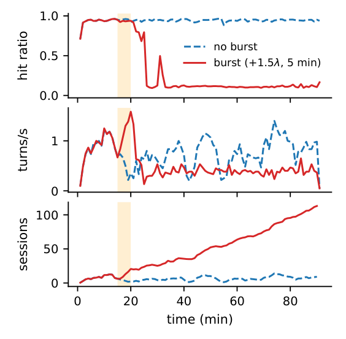
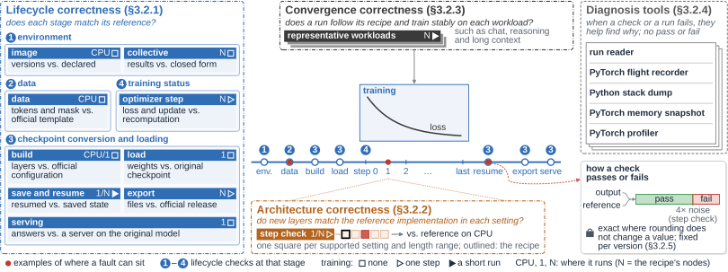
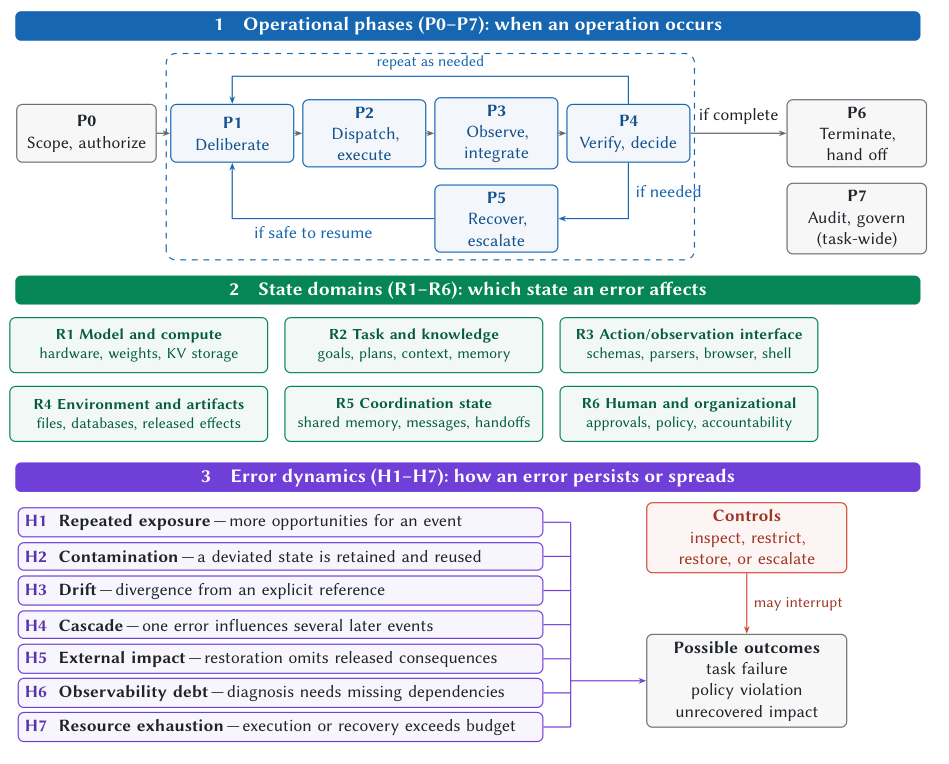
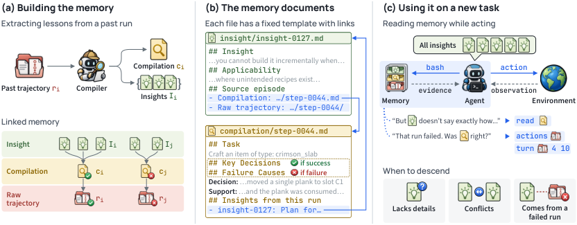
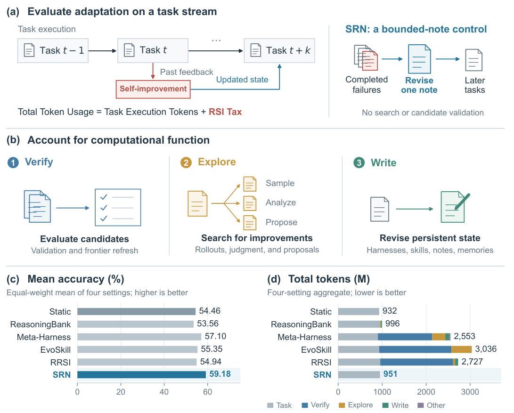

Caching, verification, and self-improvement can save future work while introducing new dependencies. Lost cache reuse can sustain session backlog; loss curves and final answers can hide corrupted intermediate state; repeated candidate validation can cost more than the tasks an agent serves. The main readings connect recovery, explicit correctness checks, and evidence that remains available when an agent reuses experience.

Further developments span GPU communication and simulation, tensor compilation, training-configuration selection, proof repair, and mobile model enablement. Some change execution mechanisms; others contribute measurement tools or negative evidence. Distinguishing layer speedups from end-to-end gains, task utility from behavioral fidelity, and model proofs from implementation coverage is central to interpreting them.

<h2 class="daily-paper-title" id="paper-arxiv-2611.13412">01 · Why a short burst can leave a cache persistently degraded</h2>

[Bursts That Outlast Themselves: Persistent Degradation in Prefix-Cached Agent Serving](https://arxiv.org/abs/2611.13412)  
Wen Huang , Jack Liu · 2026-11-10

Prefix caching makes an agent turn cheap when most of its history remains resident. It also makes serving capacity depend on previous events. Wen Huang and Jack Liu show that a server can remain slow after a brief arrival surge has ended. Their contribution is a controlled demonstration of this history dependence and a comparison of recovery actions, rather than the invention of cache-aware concurrency control.

### How lost cache reuse sustains congestion

The main experiment runs Qwen3-8B on a single MI300X with vLLM and a 400K-token KV pool. Paired runs share the same base sessions. Only one receives five minutes of additional arrivals at minute 15, raising total arrivals to 2.5 times the base rate. In nine of twelve pairs, only the burst arm persistently degrades; no pair shows the reverse. Both arms degrade in two pairs and neither in one. In a representative degraded run, the hit ratio stays near 10%, throughput drops substantially, and backlog continues growing through the end of the 90-minute experiment.

This is not simply unfinished burst traffic. Closed-loop agents must wait for model and tool responses before continuing. Slower service extends session lifetimes, increasing the population competing for KV capacity. Evicted prefixes force repeated processing of growing histories, slowing service further. A base load sustainable with a warm cache can exceed capacity once most turns miss.

<a class="note-image-link" href="/assets/images/digest/2026-11-12/bursts.png" target="_blank" rel="noopener" aria-label="After the burst, the red run keeps missing and accumulating sessions; blue is its no-burst twin with identical base arrivals.">View original image ↗</a>

*After the burst, the red run keeps missing and accumulating sessions; blue is its no-burst twin with identical base arrivals.*

### Recovery must reduce already-admitted demand

Throttling new sessions leaves admitted sessions competing for the same insufficient cache. The authors instead park some sessions at turn boundaries. Their gateway budgeter estimates resident demand as context length plus output allowance and uses 0.75/0.95 of pool capacity as admission and parking thresholds. Parked sessions return before new arrivals; requests already in flight are not interrupted.

Among seven seeds collapsed in every comparison arm, the budgeter recovers all seven within the first five-minute measurement window. A capacity-based session cap also recovers all seven within six minutes; admission throttling alone recovers one. Token budgeting handles changes in session lengths better than a fixed session count. A 128-GiB host KV tier delays collapse but cannot eliminate a continually expanding working set.

### Efficient execution is not an empty queue

Experiments with Qwen3-32B trace shapes and SGLang support the mechanism beyond the main configuration, without covering every scheduler, device, or real prompt distribution. In longer 32B runs, restored cache efficiency can coexist with growing backlog because arrivals exceed long-run completion capacity. Parking also delays individual users. For Ops4LLM, the key distinction is between warm capacity, cold capacity, resident session demand, and recovery policy: a recovered hit ratio alone does not establish recovered user experience.

<h2 class="daily-paper-title" id="paper-arxiv-2611.13393">02 · Plumbline: falling loss does not establish correct training</h2>

[Plumbline: When the Loss Lies, Validating LLM Training Correctly](https://arxiv.org/abs/2611.13393)  
Ruochen Wen , Hongyang Wang , Siwei Li , Wenbo Chen , Xian Li , Jingguo Liu , Leo Fan , Yiming Yan , Qian Qu , Zheshen Wang , Benoit Dumoulin · 2026-11-10

A training run can avoid crashes and reduce loss while learning from the wrong labels or exporting the wrong model. Plumbline turns that problem into explicit checks over data, model loading, checkpoint recovery, optimizer updates, architecture, and serving exports. Its production use at Amazon supplies concrete failure evidence and illustrates why agent-driven diagnosis needs verdict rules independent of the diagnosing agent.

### Give each layer a reference

Lifecycle checks compare tokens and loss masks with the official tokenizer and template, initialize parameters with NaNs before loading to expose omissions, and compare saved and restored state bitwise on every rank. An export check takes a zero-learning-rate step and compares the exported checkpoint with the original. Optimizer checks independently recompute loss normalization and updates at higher precision.

Architecture checks use real weights and the first layers needed to cover each layer type. They compare supported training configurations with a CPU FP32 reference, changing individual settings and grouping inputs by length. Gradient error fails when it exceeds four times the larger measured run-to-run or precision noise floor. Fault injection checks that tolerances do not hide the targeted defect. Full-model convergence runs cover failures that require depth, memory pressure, or distributed timing.

<a class="note-image-link" href="/assets/images/digest/2026-11-12/plumbline.png" target="_blank" rel="noopener" aria-label="Lifecycle, one-step architecture, and full-run checks cover different faults; diagnostic tools supply records rather than independent pass verdicts.">View original image ↗</a>

*Lifecycle, one-step architecture, and full-run checks cover different faults; diagnostic tools supply records rather than independent pass verdicts.*

### Agents organize tests; fixed checks decide

An agent selects configurations, orders jobs, and proposes causal explanations. It does not redefine pass criteria during the investigation. Diagnosis combines the same checks with profiling, memory snapshots, communication records, and stack dumps, reducing scale or changing one setting at a time. A human approves plans and critical changes; a second agent reconstructs findings from raw records before human confirmation. Incomplete comparisons remain inconclusive or unevaluated.

Across tested versions of three frameworks and five MoE models, Plumbline finds 61 problems, including 32 silent ones. Of the total, 42 are fixed or reported upstream, eight first reported by the authors. Lifecycle and architecture checks first discover 29 of the 32 silent problems; at least 16 occur in runs that pass convergence checks. One example is a loss mask that omits the reply-ending token: loss can fall without teaching the model to stop correctly.

### Missing references mean missing coverage

The counting unit is one root cause on one framework. These are not 61 newly discovered vulnerabilities or a population failure rate. Layers without a trusted reference remain unjudged, as with the tested DeepSeek-V4.1-Flash implementation. Shared defects in reference and tested code can also escape comparison. The valuable reading is the check contracts and failure taxonomy: apparently healthy training becomes a set of bounded evidence claims rather than one universal correctness score.

<h2 class="daily-paper-title" id="paper-arxiv-2611.13254">03 · Failure trajectories: does contradictory evidence actually change state?</h2>

[Dependable Long-Horizon LLM Agents: A Trajectory-Centered Empirical Study of Where Errors Enter and Which Controls Reach Them](https://arxiv.org/abs/2611.13254)  
Shaohuang Wang , Jinghao Wen , Xulei Zhang , Xun Jiao · 2026-11-09

Asking which agent made the decisive mistake often stops at the most visible symptom. This paper introduces an episode record connecting a candidate origin, affected state, propagation, detection, response, and outcome. Its practical question is whether a control can both observe the relevant evidence and reach the state that needs correction, making it directly relevant to AgentOps diagnosis and recovery.

### Similar symptoms can require different controls

The framework separates operational phases from state domains. A false fact may enter a plan, cross a shared-message boundary, and later drive a tool action. Links distinguish observations, intervention-supported relations, and hypotheses. Step fields must point to trace lines, while evidence fields record whether contradictory information was available, acknowledged, or acted upon. A generic verification failure can then be separated into accepting an unsourced claim, verifying the wrong task, or losing an observation during handoff.

<a class="note-image-link" href="/assets/images/digest/2026-11-12/trajectory.png" target="_blank" rel="noopener" aria-label="Operations, state domains, and propagation dynamics are separate coordinates; recovery must reach contaminated state rather than only the final symptom.">View original image ↗</a>

*Operations, state domains, and propagation dynamics are separate coordinates; recovery must reach contaminated state rather than only the final symptom.*

The study completes 96 records and excludes one procedurally faulty run with a correct final answer from outcome statistics, leaving 95 failures. A crucial limitation is that Claude produces the records under the written protocol. This is **not an independently human-annotated dataset**. The authors manually inspect some comparison disagreements but report no human inter-annotator agreement. Partial corpus coverage and exclusion of very long traces further limit generalization.

### Detection does not imply recovery

The records identify contradictory evidence before the final failure in 68 of 95 runs, with action in only seven. The prose's “88%” non-action figure does not exactly match these counts; the numerator and denominator are clearer. Deviations are detected in 29 runs, yet no response completely removes the deviated state. Changing the next action while retaining the false belief can reproduce the same loop.

The authors judge local state restoration sufficient in 35 of 95 cases. In 56, the problem sits in the plan, task brief, or stopping rule and may simply recur after rollback. These are retrospective reach assessments, not measured success rates of deployed recovery controls. An additional judge helps only if it reads the neglected evidence rather than repeating the worker's information.

### A separate finding comes from deterministic log scanning

Scanning the complete Who&When corpus finds provider content-filter crashes in 26 of 58 hand-crafted runs. In 25, the harness subsequently prints a final answer no agent produced. This result does not depend on episode annotation and exposes an attribution problem: a benchmark may blame an agent for a runtime fallback answer. The reusable contribution is source-grounded propagation records and explicit inspection of post-detection state change; the reported proportions should not be treated as production failure prevalence.

<h2 class="daily-paper-title" id="paper-arxiv-2611.14320">04 · WikiTrace: keep evidence behind an agent’s memory</h2>

[Don't Just Trust Your Memory: Evidence-Linked Memory Reduces Memory-Induced Degradation in LLM Agents](https://arxiv.org/abs/2611.14320)  
Yukyeong Lee , Yumin Choi , Jinheon Baek , Sung Ju Hwang · 2026-11-10

Memory can improve average performance while causing failures on tasks an agent could previously solve. WikiTrace measures that regression separately and targets a common compression failure: distilling a success or failure into a lesson while discarding the experience that could qualify or contradict it.

### Follow a lesson back to its run

Each historical run produces a compilation of successful decisions or plausible failure causes and at most three insights. The original trajectory is preserved. Every insight links to both the compilation and the raw run and records applicability and source outcome. Compilations remain interpretations, not verified diagnoses. Conflicting insights can coexist; the acting agent decides which applies.

For a new task, the agent receives all insights and navigation pointers to three similar historical tasks. Missing details, conflicting lessons, failed source runs, and failed actions trigger prompts to inspect read-only source files with terminal tools. In a PlanCraft example, a mistaken lesson treats an intermediate crafting preview as consumed material. The original runs show that continuing to place ingredients completes the recipe. Evidence changes the basis for action rather than merely expanding the prompt.

<a class="note-image-link" href="/assets/images/digest/2026-11-12/wikitrace.png" target="_blank" rel="noopener" aria-label="Memory construction preserves links between insights, compilations, and raw runs; the agent follows them when details are missing or lessons conflict.">View original image ↗</a>

*Memory construction preserves links between insights, compilations, and raw runs; the agent follows them when details are missing or lessons conflict.*

### Compare with identical insights

The main evaluation uses the same DeepSeek-V4-Flash agent across eight suites from five benchmarks, with three trials. Each method builds memory once from the same training trajectories without extra validation runs. Mean performance rises from 79.5 without memory to 90.2 with WikiTrace. Giving the same insights without source access scores 87.0, a more direct 3.2-point comparison. This intervention includes both source access and the descent prompt; it does not isolate hyperlinks alone.

Previously solvable tasks are defined by the majority outcome of three no-memory trials. Regression on those tasks is 4.5% with WikiTrace and 6.5% with insights alone. Additional no-memory trials yield 9.7%, showing that ordinary run variability also causes regression. WikiTrace's mean test-time cost is 1.17 times that of insights alone.

### Traceability does not certify a lesson

Putting every insight in the initial message leaves retrieval and context limits unresolved at larger memory sizes. Agents choose when to descend, so comparisons between descending and non-descending runs are observational. Failure categories and descent effects also rely on model judgments of reasoning text. The useful reliability contribution is a route for correcting inherited advice, together with separate measurements of gains and lost successes, rather than a guarantee that memories are correct or indefinitely scalable.

<h2 class="daily-paper-title" id="paper-arxiv-2611.13524">05 · The RSI Tax: count the cost of improving the agent</h2>

[The RSI Tax: When Recursive Self-Improvement Is Not Worth the Cost](https://arxiv.org/abs/2611.13524)  
Yitong Zhang , Ang Li , Yisen Wang · 2026-11-10

Self-improvement reports often emphasize the better harness or skill that eventually reaches deployment. The RSI Tax asks what it cost to find that improvement. It counts candidate generation, experience analysis, repeated validation, and persistent-state writing alongside task execution, fixing each task's score before its feedback can influence later updates.

### Why a simple adaptive baseline matters

Six methods and two backbones are evaluated on seven repository chains totaling 105 positions and 89 Terminal-Bench 2.1 tasks: 2,328 scored method–task pairs. Methods share an initial agent and task order within each setting. Some procedures, including EvoSkill, are adapted for the stream, so these are not unchanged reproductions of their original evaluations.

Simple Reflection with Notes, or SRN, revises a note of at most 2,048 tokens every four tasks using failed-task excerpts and scalar outcomes from the allowed window. With no failures, it keeps the note. It performs no candidate search or extra validation. This provides an adaptive but inexpensive comparison for deciding whether more elaborate search pays for itself.

<a class="note-image-link" href="/assets/images/digest/2026-11-12/rsi-tax.png" target="_blank" rel="noopener" aria-label="Score each task before using its feedback; total cost includes execution plus verification, exploration, and writing for improvement.">View original image ↗</a>

*Score each task before using its feedback; total cost includes execution plus verification, exploration, and writing for improvement.*

### Validation costs more than writing skills

SRN has the highest observed accuracy in three model–benchmark settings and ties EvoSkill in the fourth. Averaging within-setting total-token ratios gives reductions of 65.6%, 71.0%, and 68.2% relative to Meta-Harness, EvoSkill, and RRSI. The conclusion concerns amortization over these finite streams, not the impossibility of useful self-improvement.

Verification accounts for 74.8%–93.6% of the three methods' aggregate improvement tax. On the DeepSeek terminal stream, Meta-Harness uses fewer task-execution tokens than SRN, but approximately 578.45M improvement tokens bring its total to 762.57M versus SRN's 214.65M. Looking only at execution after adaptation reverses the cost story.

### Unused artifacts are not automatically removable waste

Costs are also associated with whether a state or artifact is used later. These are token shares, not failed-update rates. Rejected candidates may still inform subsequent search, so their costs cannot necessarily be removed without consequences. Nor are raw token counts equivalent to dollar bills with cache discounts and different input/output prices.

Two models, one terminal ordering, and limited repository chains do not establish long-run returns or robust rankings across repetitions. The transferable AgentOps contribution is accounting: separate task and learning costs, distinguish validation from exploration and writing, and track how long outputs are actually reused. This is substantive negative evidence about particular update procedures, not a universal argument against adaptation.

<h2 class="daily-paper-title" id="paper-arxiv-2611.13176">06 · SHADOWPREFILL: warm the next model before a routing switch</h2>

[SHADOWPREFILL: Keeping Your Next Model Warm for Per-Step Model Routing in Agentic LLM Serving](https://arxiv.org/abs/2611.13176)  
Haoran Qiu , Rohan Mahapatra , Rodrigo Fonseca , Mark Russinovich · 2026-11-09

Per-step routing loses cache reuse when a session changes models. SHADOWPREFILL incrementally prefills the same history on the unselected model, prioritizing likely switches. Shadow work runs only behind normal demand and within latency slack; its KV entries are evicted first and can spill to host memory. A switch never waits for warming to finish: it uses the available prefix and computes the remaining tail.

The main 22-pair results are trace-driven simulations with cached tokens priced at one tenth of uncached input, so billing reductions are not GPU-cost reductions. A 16-H100 prototype separately reports 61.9% lower mean switch TTFT and 1.4% higher energy per compliant request. Decode-heavy pairs can show almost unchanged total LLM time. Unlike cross-version cache reuse, this computes the target model's own state; benefit depends on slack, context length, and residency.

<h2 class="daily-paper-title" id="paper-arxiv-2611.14051">07 · Cross-version KV reuse: utility differs from behavioral fidelity</h2>

[Can KV Cache Be Reused Across Model Updates? A DeepSeek-V4-Flash Case Study](https://arxiv.org/abs/2611.14051)  
Zhikun Tao , Fangyong Jin , Junping Zhao · 2026-11-10

Directly carrying old KV state into an updated model can preserve useful retrieval while changing answers or stopping behavior. Across four updates, the authors compare native target execution, native source execution, and direct handoff, finding substantial pair dependence. For DeepSeek-V4-Flash to Flash-0731, three longer-prefix QA benchmarks show median TTFT speedups of 2.10–5.08 times with source caches prepared. HotpotQA and 2WikiMQA lose approximately three and seven F1 points, while shorter-prefix BABILong reaches only 0.86 times native speed.

TTFT includes cache loading but excludes source-prefill and model-startup costs. Similar aggregate accuracy can hide both broken correct answers and repaired errors. Functional Cache Divergence additionally compares predictive distributions under matched histories. For rolling updates, the lesson is to distinguish task utility, first-token agreement, and full-generation fidelity rather than treating loadable state as semantic compatibility.

<h2 class="daily-paper-title" id="paper-arxiv-2611.13442">08 · ForeSpark: allocate speculative work before drafting</h2>

[ForeSpark: Joint Draft and Verification Budget Scheduling for Parallel Speculative Decoding](https://arxiv.org/abs/2611.13442)  
Jaeyong Song , Daniel Wang , Pratyush Patel , Jonny Kong , Preyas Shah , Shobhit Kanaujia · 2026-11-10

A parallel drafter that always proposes a full block still pays for tokens later discarded before verification. ForeSpark predicts acceptance benefits for different lengths from target context features and the anchor token before drafting. A scheduler converts reward curves into sortable marginal benefits and uses profiled latency tables to jointly choose draft lengths and verification budget. After drafting, actual candidate confidence redistributes verification while standard speculative sampling preserves the output distribution.

On vLLM with Qwen3-14B and two GLM models on H100/B200 hardware, throughput reaches 1.77 times DSpark at matched per-user generation rate. That maximum is decode-only; prefill reduces end-to-end gains. Ordinary autoregressive decoding can still lead at the heaviest Qwen3-14B decode-only load. Global sorting can also leave individual requests undrafted for a step. The contribution is avoiding work before it is paid for, with workload and fairness boundaries intact.

<h2 class="daily-paper-title" id="paper-arxiv-2611.14356">09 · EngineAgent: model enablement must cross engine and device boundaries</h2>

[EngineAgent: Agentizing On-Device LLM Inference Engines with Inference Stack Hierarchy Awareness and Hardware Abilities](https://arxiv.org/abs/2611.14356)  
Zhengxiang Huang , Yujie Sun , Shengheng Chen , Zhaode Wang , Chaoyue Niu , Zeyu Zhao , Chengfei Lv , Fan Wu , Guihai Chen · 2026-11-10

Enabling a new model in a mobile engine often requires coordinated export, graph, operator, and backend changes. EngineAgent first constructs a hierarchy/dependency index and validates build, execution, and debugging procedures on real hardware using supported models. Builder, debugger, and auditor agents then iterate against those artifacts. A non-agent verifier ultimately compares device logits with host PyTorch references rather than accepting an auditor's verbal approval.

Twelve tasks combine three models with four engine–backend pairs under a five-hour limit. Both backbones achieve 9/12 successes versus 4/12 for the strongest baseline. Removing the hierarchy index or hardware skills lowers success to 3/12 or 5/12, supporting their complementary roles. Artifact construction has separately reported one-time costs, and per-task API charges do not represent total maintenance cost. The small sample and bounded numerical tests also limit coverage. Its contribution is evaluating enablement beyond compilation, through complete cross-layer changes and device execution.

<h2 class="daily-paper-title" id="paper-arxiv-2611.13188">10 · NVLinkOneSided: send tokens without a metadata round trip</h2>

[One-Sided Expert-Parallel All-to-All for Mixture-of-Experts Inference over NVLink](https://arxiv.org/abs/2611.13188)  
Bo Li , Chulian Zhang , Or Biri , Anthony Chang , Anton Korzh , Noam Duvdevani , XingFei Xi , Daniel Stokes , Zhenhuan Chen , Ludwig Schneider , Artem Y. Polyakov , Julien Demouth , Chandler Zhou · 2026-11-09

Fixed handshakes can dominate MoE communication at small batches. NVLinkOneSided assigns each source rank a private destination-buffer region and pushes tokens directly. The receiver builds expert-to-slot indices so grouped GEMMs read in place without a separate expert-major copy. Fence amortizes synchronization; Sentinel detects arrival through data, favoring smaller batches.

On eight B300 GPUs with balanced synthetic routing, small-batch dispatch-plus-combine is 1.75–3.00 times faster than DeepEP. Fused MegaMoE can lead at larger batches through communication/computation overlap. The method requires one NVLink domain and word-arrival properties unavailable over RDMA, and workspace grows with EP size. Unlike the SGLang megakernel, it preserves a modular communication interface rather than tying every optimization to one fused compute implementation.

<h2 class="daily-paper-title" id="paper-arxiv-2611.13741">11 · Arknife: make instruction layouts globally solvable constraints</h2>

[Retargetable Compilation for Tensor Kernels via a Unified Layout Abstraction](https://arxiv.org/abs/2611.13741)  
Likai Ma , Renze Chen , Tianqi Li , Yuhao Luo , Youwei Xiao , Size Zheng , Xiuhong Li , Yun Liang · 2026-11-10

Accelerator instructions impose different register, lane, and memory layouts. Arknife moves these requirements into target descriptions and uses a common algebra mapping logical axes onto hardware axes. Instruction binding introduces repairs such as moves or transposes; feasibility checking, e-graph simplification, global layout solving, and code generation follow. New targets still require instruction and repair descriptions.

Across nine tested x86 workloads, geometric-mean speedup over oneDNN is 2.17 times, with larger gains at small shapes. Eleven Hexagon operators average 3.78 times QNN, but Int8 GEMM reaches only 1.08 times. A100 TF32 GEMM reaches approximately 97% of cuBLAS performance. The contribution is reusable cross-target layout reasoning, not universal superiority over vendor kernels; offline constraint construction and solving also have costs.

<h2 class="daily-paper-title" id="paper-arxiv-2611.13762">12 · ForeSight: separate fixed stalls from hardware queues</h2>

[Exploiting What NVIDIA Profilers Hide: Fast and Accurate Analytical GPU Performance Modeling](https://arxiv.org/abs/2611.13762)  
Ziwen Wang , Qi Luo , Kunlin Li , Changxi Liu , Dongsheng Wang , Yun Chen · 2026-11-10

Scaling every stall together confuses fixed dependencies with resource contention. ForeSight profiles an original configuration, retains measured fixed-latency stalls, recomputes queueing from target-unit pressure, and replays CTA execution. UnitSight recovers per-SM, L2-slice, and memory-channel counters from CUPTI CounterData that aggregate reporting obscures.

The nine-GPU configuration study covers fifty workloads, including forty-seven inference operators. Overall execution-time MAPE is 8.3% versus 14.1% for the strongest comparison baseline. Median H20-based prediction takes about 26 seconds, roughly 49 times faster than cycle simulation, while initial profiling still takes about 170 seconds. Simpler analytical models can be faster. The contribution is resource-level observability for configuration prediction, not measurement-free transfer to arbitrary architectures or direct serving acceleration.

<h2 class="daily-paper-title" id="paper-arxiv-2611.13860">13 · GemAtlas: recover memory-hierarchy behavior for simulation</h2>

[Uncovering the Memory Hierarchy of Modern NVIDIA GPUs for Accurate Simulation](https://arxiv.org/abs/2611.13860)  
Ziwen Wang , Jiapeng Zhou , Changxi Liu , Dongsheng Wang , Yun Chen · 2026-11-10

Public capacity and bandwidth specifications leave out cache indexing, slice routing, and replacement behavior. GemAtlas uses SASS-level prime–evict–probe sequences with explicit dependency and timing control, infers memory-hierarchy parameters, and configures an extended AccelSim. It complements ForeSight: one reconstructs microarchitectural behavior, while the other builds faster queueing predictions from measured counters.

Evaluation includes twenty-five traditional workloads and twenty-eight LLM operators, with cold-cache hardware and simulation measurements. On H20, MAPE falls from 27.58% after documented memory parameters are supplied to 20.04% with recovered mechanisms; distributed L2 modeling contributes substantially. Residual error remains, including non-memory simulator components. H20, H100, A800, and RTX 4090 are tested; future architectures still need appropriate SASS support.

<h2 class="daily-paper-title" id="paper-arxiv-2611.13293">14 · TKNP: separate weight placement from attention ownership</h2>

[Decode Token Parallelism: Memory-Efficient Distributed Attention Parallelism for Scalable LLM Decoding](https://arxiv.org/abs/2611.13293)  
Susav Shrestha , Brad Settlemyer , Narasimha Reddy · 2026-11-09

Scaling long-context decode creates a trade-off between replicated weights consuming KV capacity and sharded attention requiring cross-node merging. TKNP distributes one weight copy in contiguous layer blocks. The block owner performs projections and MLPs for the full batch, while fixed request owners keep all-layer KV and compute their requests' attention locally. Current-token activations cross nodes; dense TP collectives remain inside each node.

The vLLM implementation evaluates Llama 3.1 405B and Nemotron-4 340B on up to 64 H100s, reaching 2.06 times DP completion throughput in long-context, high-concurrency cases. That metric includes admission waves and draining, not just active-request token latency. Small batches or short contexts can lose to communication overhead. The dual-root microbatch variant adds a second distributed weight copy, trading KV capacity for overlap.

<h2 class="daily-paper-title" id="paper-arxiv-2611.13413">15 · SlackTier: place lookup tables by their prefetch deadlines</h2>

[Placing LLM Lookup Tables by Per-Layer Prefetch Deadlines](https://arxiv.org/abs/2611.13413)  
Wen Huang , Jack Liu · 2026-11-10

Engram lookup indices depend only on input tokens, allowing reads to start at the beginning of a decode step. SlackTier exploits unequal deadlines: early layers need rows quickly, while later layers can hide slower reads behind preceding computation. Its SGLang path submits early-layer I/O first, handles indexing and deduplication on a CUDA-Graph side stream, and makes each layer wait only for its own event. A small GPU row cache reduces early deadlines and shared-disk contention.

On four H200s with DeepSeek-V4.1-Flash agent/chat replays, placing both tables on four NVMe drives raises time per output token by at most 1.4% against unmodified SGLang and reduces host memory from 212 to 34 GiB. Predictable sparse lookups differ from streaming dense or expert weights. Optional row skipping is lossy and must remain separate from exact gathering. New hardware requires remeasuring deadlines, I/O contention, and miss curves.

<h2 class="daily-paper-title" id="paper-arxiv-2611.14246">16 · SinkState: maintain recurrent states in adaptive low rank</h2>

[SinkState: On-the-Fly SVD of Recurrent States for Efficient Hybrid LLM Serving](https://arxiv.org/abs/2611.14246)  
Haolin Jiang , Weihang Li , Zhongzhu Zhou , Jinwen Pan , Santosh Pandey , Hang Liu · 2026-11-10

Linear-attention state does not grow with history, yet dense state traffic can dominate larger batches. SinkState initializes low-rank factors with randomized SVD, buffers new updates, and periodically merges them into the dominant subspace. The CPU consolidates other components asynchronously, while fused kernels compute from factors and buffers without materializing dense states each step.

Four Mamba-2/GDN hybrid models run on one 96-GB RTX PRO 6000 Blackwell. Peak recurrent-state memory falls by up to 2.6 times relative to dense-state backends; that denominator is not total model or GPU memory. Singular-value truncation is approximate, thresholds vary by model family, and CPU/PCIe resources matter. Quality retention is empirical on the tested benchmarks. The contribution is ongoing rank control during serving rather than compressing only a post-prefill snapshot.

<h2 class="daily-paper-title" id="paper-arxiv-2611.14285">17 · LM-SimBench: connect simulation errors to training stages</h2>

[LM-SimBench: A Unified Framework, Dataset, and Benchmark for Large Language Model Training Simulation](https://arxiv.org/abs/2611.14285)  
Yu Dong , Hong Li , Qiang Sun , Xu Zhou , Jinbiao Huo , Qixiu Cheng , Zhiyuan Liu · 2026-11-10

Different workloads and accounting conventions obscure whether training-simulator errors arise from operators, communication, or scheduling overlap. LM-SimBench separates compilation, device binding, execution representation, cost estimation, and schedule aggregation, linking six measurement views through configuration and rank identifiers. Its main Ascend 910B3 dataset contains ten model families, twenty-three settings, and 348 feasible configurations varying five parallelism dimensions and recomputation.

On six common test configurations, vTrain and Calculon have time sMAPE of 1.86% and 8.88%, but both select the fastest configuration. Better numerical accuracy need not change the decision. This small comparison is not a ranking over all 348 configurations. Paired V100/NPU experiments support GPU shortlisting from NPU measurements for two small Qwen models, with final selection still using GPU measurements. The contribution is comparable evidence and error localization, not a universal simulator winner.

<h2 class="daily-paper-title" id="paper-arxiv-2611.13246">18 · ExpertCrowd-SWE: grade changes against maintainer requirements</h2>

[ExpertCrowd-SWE: Measuring Frontier Coding Agents on Expert-Authored Engineering Tasks in Unfamiliar Codebases](https://arxiv.org/abs/2611.13246)  
Josip Vrdoljak , Akash Singh , Bas Steunebrink , Alex Yarotsky , John Lorenzo , Achille Nicoletti , Sam Pigott · 2026-11-09

ExpertCrowd-SWE asks engineers familiar with real repositories to author multi-file changes against pinned commits. Weighted graders allow partial credit but retain must-pass blockers. Reference solutions must score fully, untouched and inert changes must score zero, and nearly half the tasks include lazy or adversarial control patches. This adds maintainer rejection criteria beyond a simple test-pass count.

One hundred tasks span 87 projects and eleven languages. Seven models with five runs yield 3,495 scored executions. Leading scores of 67.3% and 63.7% are mean partial-credit scores, not full-solution rates, and their difference is not significant. Tasks were selected for frontier-model difficulty; only 24 are public and 76 held back. Harness and native tool interfaces also shape comparisons. Grader calibration and repeated-run reliability are more transferable than a universal capability ranking.

<h2 class="daily-paper-title" id="paper-arxiv-2611.13709">19 · Context-file instructions: measure observable compliance</h2>

[Do They Do as They Are Told? Investigating Coding Agents' Adherence to Explicit Instructions in Context Files](https://arxiv.org/abs/2611.13709)  
Gianmario Voria , Yutaro Kashiwa , Gemma Catolino , Fabio Palomba · 2026-11-10

Writing a rule into an AGENTS.md-style file does not establish execution-time adherence. The study links 621 context snapshots to 6,541 agent commits across 268 repositories. Explicit, actionable, observable instructions become measurement scripts and fixtures, with independently generated scripts providing corroboration before applicable commits are checked.

Among evaluated instructions, 54.4% are satisfied in every applicable commit and 37.3% in none. However, the median instruction has only three applicable commits, and single observations necessarily produce zero or full compliance. Higher-support sensitivity analyses address that issue. Compliance in artifacts also does not prove the file caused it: repository conventions and model defaults may explain behavior. The contribution is executable measurement with evidence thresholds, not a causal ranking of agent obedience.

<h2 class="daily-paper-title" id="paper-arxiv-2611.14106">20 · ProofCoder: treat proofs as continuously editable artifacts</h2>

[ProofCoder: Continuous Reasoning for Automated Software Verification](https://arxiv.org/abs/2611.14106)  
Martim Afonso , Inês Lynce , Maurizio Morisio , João F. Ferreira · 2026-11-10

ProofCoder lets the model use Rocq feedback to inspect state, retrieve context, revise a proof suffix, or backtrack rather than only generate tactics inside a fixed external loop. The theorem cannot change, placeholder commands such as admit are prohibited, and success requires Rocq acceptance with all goals discharged. Continuous reasoning selects repairs; the proof assistant decides validity.

The evaluation contains 200 complex SV-COMP obligations and eighty Verker tasks. With GPT-6 Sol, whole-proof generation solves 120/200 versus AutoRocq's 94/200; Verker reaches 60% versus 47.5%. These are subset results, not a claim over the entire AutoRocq benchmark. A 200K non-cached-token budget, thirty-minute limit, and different harness context handling affect comparisons. Unlike TopoVerus, it changes interactive revision rather than training a counterexample generator.

<h2 class="daily-paper-title" id="paper-arxiv-2611.13627">21 · TopoVerus: train counterexamples for useful proof repair</h2>

[Curriculum proof repair with learned counterexamples](https://arxiv.org/abs/2611.13627)  
Yuechun Sun , Jun Yang , Kexin Pei · 2026-11-10

TopoVerus trains a QwQ-32B-derived model to emit a structured counterexample, repair rationale, and revised proof from failed Verus code and verifier feedback. Rewards combine verified repair with ordering implied by invariant dependencies. An AST safety gate rejects changes to executable code or user specifications. Training dependency graphs and reference proofs are not supplied at evaluation.

Across seven suites and 471 problems, weighted Safe-Pass@1/3 reaches 61.6%/72.2%. Standard repair still allows up to ten verifier-feedback steps; single-pass counterexample generation does not mean every proof is repaired in one attempt. Counterexample reachability and mathematical validity are not formally guaranteed. They guide search, while proof checking and the safety gate govern acceptance. This learns diagnostic behavior and prerequisite ordering, unlike ProofCoder's online interaction redesign.

<h2 class="daily-paper-title" id="paper-arxiv-2611.13509">22 · Mobile AI Factory: include device measurements in model selection</h2>

[Mobile AI Factory: Building Specialized Language Models for Your Mobile Device](https://arxiv.org/abs/2611.13509)  
Evan Li , Krishna Deshpande , Wen Cheng , Shyamnath Gollakota · 2026-11-10

Given a task and phone, Mobile AI Factory filters model, quantization, and backend choices using device profiles, then lets an LLM choose hyperparameter changes, data mining, or synthesis. Fixed rules govern stopping, size escalation, and rollback. Scoring after quantization checks the deployable artifact; failed evaluations remain missing rather than zero, avoiding fictitious gains.

Across ten tasks and four Android phones, specialized small models outperform two five-shot frontier models on five tasks and roughly match them on three. This compares task-specific training with few-shot general models. Entity-extraction search approaches exhaustive training of 27 variants at about one nineteenth of training-GPU time. Profiles use cool, idle devices and one prompt length, leaving sustained thermals and concurrent apps untested. Scorers and data verifiers remain human-provided. The contribution is measured device feasibility inside search, rather than backend guesses from specifications.

<h2 class="daily-paper-title" id="paper-arxiv-2611.13378">23 · Looped CED: recurrent depth without per-round global KV copies</h2>

[Looping Deeper Without Growing the KV Cache: Recurrent Depth for Causal Encoder-Decoders](https://arxiv.org/abs/2611.13378)  
Jiaqi Leng , Minshen Zhang , Zhaofeng Sun , Yu-Yang Qian , Peng Zhao , Hao Zhang · 2026-11-09

Saving global KV for every recurrent round can erase a looped model's serving-capacity advantage. Looped CED places recurrence in the encoder that produces global KV and trains with stochastic depth to encourage stable late-round representations. Inference then retains last-round KV. Decoder-only recurrence instead rereads fixed global state and provides weaker long-range gains.

At 150M scale, encoder-loop validation BPB is 0.8468 versus 0.8461 for a dense loop, with global KV of 8KB versus 48KB per token. Quality experiments reach only 340M parameters and 2,048-token training contexts. The 552B DeepSeek-V4.1-Flash GB200/H200 serving study uses dummy or original weights not trained to loop and emulates per-round caching by limiting the KV pool. It measures cost potential, not frontier-scale lossless quality. Multiple encoder-prefill rounds also mean memory savings do not imply lower compute cost per request.

## Related Tech Notes

- [vstack and veriserve: reclaim KV pages only with completion evidence](/tech/en/haoailab-vstack-verifiable-llm-infra/)
- [Jev as a judge: calibrating smaller decisions for SRE evaluation](/tech/en/sregym-jev-as-a-judge/)
- [vLLM EPD: separate metadata contracts as well as compute stages](/tech/en/vllm-epd-encoder-disaggregation/)
- [SGLang megakernels: hide waiting inside each layer](/tech/en/lmsys-muse-spark-open-megakernel/)
- [Meta Intelligent Delivery: allocate compute by marginal benefit](/tech/en/meta-intelligent-delivery-ads-compute/)
- [ExecuTorch WebGPU: bring one exported artifact to browser GPUs](/tech/en/pytorch-executorch-webgpu/)
- [Quarkus AI RCA: prepare telemetry before asking for a diagnosis](/tech/en/quarkus-ai-root-cause-analysis/)
