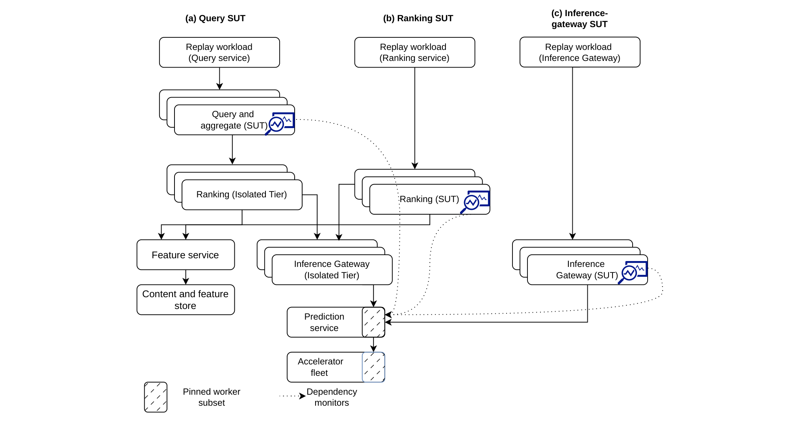
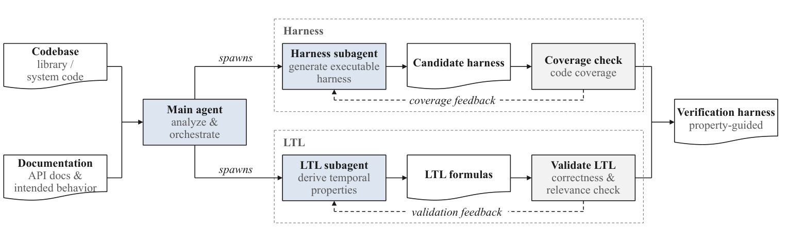
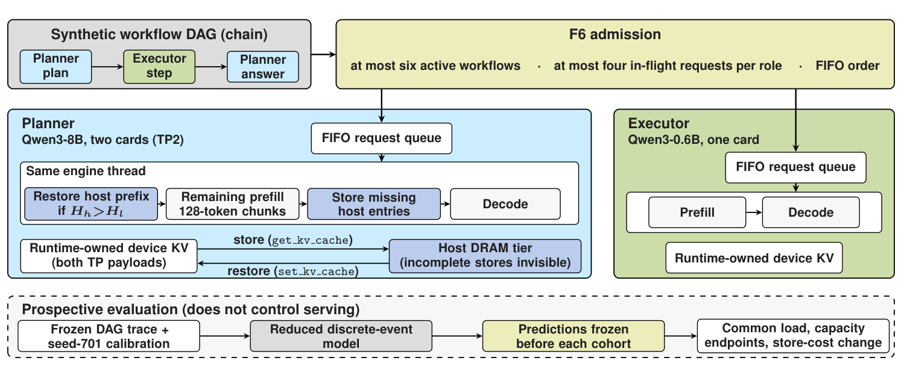

This issue focuses on making reliability boundaries inspectable. FIRE contains experimental effects on shared dependencies; a field study exposes missing production evidence for debugging agents; and isloss shows that valid API payloads can lose role and tool information. They address containment, diagnosability, and preserved context.

The remaining papers carry these concerns into generated-kernel contracts, harness control, and reusable serving state. KernelMutate and KernelAudit examine different obligations, while Aries, EvoX, and MULTILOOP separate observation, control, and optimization. Cache and cold-start benefits depend on restoration and scheduling costs, not capacity or peak speedup alone.

<h2 class="daily-paper-title" id="paper-arxiv-2611.14962">01 · FIRE: containing downstream effects of production-connected experiments</h2>

[FIRE: Failure Isolation and Reliability for Production-Connected Experiments at Scale](https://arxiv.org/abs/2611.14962)  
Shripad Nadgowda et al. · 2026-11-11

A candidate change can affect production before it is deployed. FIRE studies a replay platform in which recorded requests drive the service under test while selected downstream calls reach live dependencies. Comparing candidate and baseline responses is insufficient when a malformed tensor crashes an accelerator-backed prediction worker. For release validation and chaos engineering, the important quantity can be the number of workers reachable by an experiment, rather than its fraction of traffic.

<a class="note-image-link" href="/assets/images/digest/2026-11-14/fire.png" target="_blank" rel="noopener" aria-label="Selective isolation, dependency monitors and pinned workers · View original image ↗">View original image ↗</a>

*Reading the figure: Selective isolation, dependency monitors and pinned workers.*

### Three guardrails, three different boundaries

Selective isolation redirects calls to dedicated ranking and inference-gateway tiers where representative replicas can be maintained economically. Failures in those tiers remain on the experimental path. Replicating every accelerator-backed model or stateful feature store would be much more expensive, so isolation is applied selectively.

Dependency monitors cover services that remain shared. Health detectors observe restarts, exceptions, and invalid results; experiment-attributed detectors connect downstream errors to the control and treatment jobs. After warm-up, sustained violations across consecutive checks terminate the experiment. An unhealthy dependency does not by itself identify the responsible experiment: precise intervention requires caller identity to survive the request path.

Traffic pinning restricts experimental calls to a designated shard instead of distributing them across all workers. A small number of malformed requests can otherwise crash many workers, making a low traffic percentage an inadequate protection. Pinning bounds that exposure, but concentrates load and cannot contain effects propagated through shared state. Monitoring, write controls, and lifecycle controls remain necessary.

### What the operational evidence establishes

On the measured ranking paths, isolated tiers handle billions of replay requests daily with less than 1% of the corresponding shared tiers’ worker capacity. Over 90 days, they contained more than 200,000 abnormal worker exits, 96% involving fatal signals. Repeated crash loops contribute to this count; it is not a count of distinct defects. In a separate three-month window, dependency monitors cancelled about 5% of experiments and accounted for approximately 87% of cancellations. These measurements have different windows and denominators and should not be combined into a single failure-reduction rate.

Monitoring is reactive. In a separate 16-day measurement, median time from the first observed violation to termination was 62 seconds for health detectors and 121 seconds for experiment-attributed detectors. Fault onset can precede that first observation. Inputs capable of immediately disabling workers still need validation at the dependency boundary.

### Why the design matters

FIRE combines realistic dependencies with explicit containment: replicate where feasible, preserve attribution and monitor shared services, and bound fan-out for worker-local failures. Build-dependency filtering also reduced code-review workload executions by 25%. Replay nevertheless preserves sampled requests rather than full concurrency or causal sessions, and experiments sharing isolated tiers or pinned shards remain coupled. The transferable contribution is the combination of boundaries and evidence, not a claim that any single guardrail guarantees production safety.

<h2 class="daily-paper-title" id="paper-arxiv-2611.17304">02 · Database debugging: the production state an agent cannot see</h2>

[Where LLM Agents Get Stuck Debugging Databases: Access More Than Reasoning](https://arxiv.org/abs/2611.17304)  
Gustavo Pinto · 2026-11-12

Reading source code does not establish what happened in a running system. This field observation follows eight database incidents in a production message-dispatch engine. All five incidents whose causes depended on runtime concurrency began with a false start. Its contribution is a reconstruction of missing evidence, attempted fixes, and subsequent corrections, rather than a new root-cause classification score.

### Access must expose the state needed to test a hypothesis

The agent could inspect and edit the repository and run local tests, but production access was asymmetric. Some logs required authentication it lacked, database queries had to be run by a person through a read-only proxy, and cluster contexts required manual switching. Locks could disappear before a human-mediated query returned. Application logs truncated deadlock details even though the complete reports existed in database logs outside the agent’s reach.

In one incident, an early-commit hypothesis gave way to a fix that stopped holding a row lock across steps. In another, a retry calling rollback between attempts discarded the caller’s uncommitted work and expired ORM objects; the eventual repair used a savepoint. A throughput investigation rejected six hypotheses before finding a retry-sweep limit in configuration. The value was available in the repository, but evidence that it was saturating under production load was missing.

### Access and reasoning are not competing explanations

The author classifies one concurrency incident as access-limited and four as mixed access and reasoning failures. The latter include incomplete configuration inspection, anchoring on a historical cause, and misunderstanding transaction semantics. “Access More Than Reasoning” therefore describes the prevalence of access gaps in this sample, not evidence that stronger models would be irrelevant. A false start is also an operational coding category: a hypothesis consistent with the evidence then visible and subsequently refuted, rather than a blanket classification of mistakes as fabrication.

The analysis triangulates session transcripts, commits, and deployment/workload records across 27 sessions. Approximately 410 cumulative session hours measure first-to-last timestamps, including sessions left open across working days; they are not continuous inference time. Claude Code was the interface, while approximately 79% of model calls were served by DeepSeek and 17% by Claude Opus. Individual hypotheses were not attributed to models, so this is not an evaluation of one Claude model. The throughput incident ended with a configuration change and has no fix commit in the table; counting every rejected hypothesis as a separate code deployment would overstate the evidence.

### The useful direction is an investigation interface

The proposed tooling comprises an audited read-only API for locks, active queries, and execution plans; persistent capture of lock waits and complete deadlock reports; production replay for concurrency unavailable in a local single-process setup; and a ledger recording hypotheses and the evidence that retired them. These are design directions inferred from the cases, not a deployed system with a measured MTTR improvement.

The study is retrospective, covers one team and system over ten days, and was coded by the participating author. Without controlled changes to access or model capability, co-occurrence does not establish causality. For AI SRE evaluation, the practical question is whether decisive evidence exists, can be queried in time, and belongs to the correct environment before judging the agent’s reasoning over it. The paper has no standalone architecture diagram for the proposed investigation layer, so the explanation remains case-based.

<h2 class="daily-paper-title" id="paper-arxiv-2611.15543">03 · isloss: an accepted request can still lose conversation information</h2>

[Testing Conversation Preservation Across LLM APIs: A Rule-Based Oracle for Detecting Silent Information Loss](https://arxiv.org/abs/2611.15543)  
Xin Liu et al. · 2026-11-11

Model switches and API gateways are often treated as transport adaptations: if the target accepts the request, the migration appears successful. isloss identifies a separate correctness requirement. Role authority, tool call–result links, error flags, and explicit generation controls can disappear inside otherwise valid payloads. A change in agent behavior may consequently reflect a changed conversation rather than a difference in model capability.

<a class="note-image-link" href="/assets/images/digest/2026-11-14/isloss.png" target="_blank" rel="noopener" aria-label="Compare source and target tool events after normalizing representation · View original image ↗">View original image ↗</a>

*Reading the figure: Compare source and target tool events after normalizing representation.*

### Normalize representation before judging preservation

The checker maps source and translated payloads into ConvIR. Ordered events retain speaker identity, content, tool relationships, and relevant flags; a separate component records explicitly supplied generation controls. API field names, role names, and tool identifiers may change when permitted rules preserve the information. Merging adjacent messages likewise requires content and order preservation. This avoids needing either a trusted reference translation or another model call as judge.

The paper’s tool-error example illustrates the distinction: the translated container is valid and the tool’s text remains, but its is_error flag disappears. A subsequent model turn may interpret a failed operation as an ordinary result. isloss separately records whether information changed, whether the target could express it, and whether the translator disclosed degradation. Documented degradation still loses information, but is different from an avoidable silent defect.

### Keep the denominators attached to the findings

In held-out tests constructed after the rules were fixed, isloss detected 95 of 125 activated injected faults and incorrectly flagged two of 100 permitted changes. It therefore catches many failures while missing roughly a quarter of this fault set. Its guarantee concerns represented properties under explicit rules, not complete semantic or behavioral equivalence across models.

The main request census covers five translator codebases, six configurations, and 14 translation paths. Of 714 attempts, 29 were explicit rejections, leaving 685 completed translations. In 127 cases, or 18.5%, a finding simultaneously passed static target checks, changed prompt/role/tool information without disclosure, and involved information the target could preserve. This is neither a production failure rate nor 127 distinct bugs. Passing static checks also does not mean every request was accepted by a live endpoint.

A separate response experiment found exceptions or silent message corruption in at least one tested official OpenAI SDK for 203 of 558 translated streams. Its denominator is different and cannot be added to the request census. Human review also found disagreements, particularly for information unavailable in the target API. When a trusted target translation was provided, several comparators outperformed isloss; its advantage is deterministic checking without that reference, not universal superiority over other oracles.

### Why this matters for AgentOps

The work turns compatibility into explicit questions about preserved information and disclosed degradation. It motivates gateway regression tests and input audits for model comparisons: altered role or tool-error semantics introduce a confound before model reasoning begins. isloss remains an offline research checker. Rule coverage, capture boundaries, and API versions constrain its findings, and provider-side changes after the final observation point may be invisible. The preservation rules and concrete translation cases are more transferable than the synthetic-suite percentages.

<h2 class="daily-paper-title" id="paper-arxiv-2611.15441">04 · KernelMutate: what survives five passing tests</h2>

[KernelMutate: Mutation-Guided Validation of Generated GPU Kernels](https://arxiv.org/abs/2611.15441)  
Ziyuan Li et al. · 2026-11-11

Acceptance of an LLM-generated kernel can be narrower than its replacement obligations. KernelMutate injects controlled faults into accepted implementations to identify revealing input templates, then combines source fingerprints with directed and general tests. Comparisons include input side effects and post-call state as well as outputs.

Five draws accept 548 of 838 natural candidates. The full strategy subsequently finds native FP32 witnesses for 136 accepted candidates. Another 362 have dtype-only findings, mostly unsupported low-precision execution; without publisher guarantees, these are not automatically original-contract violations. Directed testing identifies the same 692 candidates at 26.1% lower charged cost, but leaves only dtype evidence for 16 candidates with native witnesses under the full strategy. **The same candidate yield does not mean the same diagnostic evidence.** Source guidance is not isolated from budgeting and stopping effects, an important qualification to the apparent efficiency gain.

<h2 class="daily-paper-title" id="paper-arxiv-2611.15506">05 · KernelAudit: auditing the validator against its contract</h2>

[KernelAudit: Contract-Aware Auditing of Validators for LLM-Generated GPU Kernels](https://arxiv.org/abs/2611.15506)  
Ziyuan Li et al. · 2026-11-11

Where KernelMutate expands testing conditions, KernelAudit asks which obligations a validator actually enforces: numerical semantics, prohibited delegation to libraries, and timing that includes completed computation. It combines reference-calibrated stress tests, dispatcher interventions, and lower-level launch provenance. A library name in source code is not itself proof of a violation.

The audit of six validators and 716 candidates produces 172 PASS, 397 FAIL, and 147 inconclusive certificates. PASS means no detected violation on audited surfaces, not proof for every input; missing state alignment or attribution cannot automatically justify FAIL. Independent human review uses a partly different library-use policy, and estimated overall specificity is 0.626, underscoring the audit oracle’s own calibration needs. For reward design, the contribution is separating correct output, implementation compliance, and credible performance. These obligations complement KernelMutate’s witness analysis rather than collapsing into one correctness rate.

<h2 class="daily-paper-title" id="paper-arxiv-2607.29069">06 · Aries: observe the whole serving trajectory</h2>

[Rethinking AI Cloud Infrastructure for Agentic Serving Systems with the Aries Experimentation Framework](https://arxiv.org/abs/2607.29069)  
Jooyoung Park et al. · 2026-07-31; revised 2026-11-03

Aries separates task specifications from execution configurations and reconstructs a shared trajectory from model calls, harness events, sandbox operations, and system telemetry using cross-component identifiers. It enables comparisons that preserve tasks and evaluators instead of describing an entire agent through TTFT and token throughput alone.

The paper combines an eight-hour commercial trace with controlled experiments on open harnesses, sampling 20 tasks per benchmark and repeating each five times. Tools account for 13%–48% of end-to-end latency, with harness processing contributing up to another 9%. Larger contexts consume KV capacity without consistently improving success, while sandboxes alternate between idle intervals and resource bursts. Snapshot-cost results replay tool traces through a billing model; they are not measured cloud bills. The distinct contribution is correlated, comparable observation, not an implemented optimal elasticity policy. First posted in July, the paper is read here in its November revision.

<h2 class="daily-paper-title" id="paper-arxiv-2611.15006">07 · EvoX: execution control as a second policy</h2>

[EvoX: Rethinking the Agent Harness as a Runtime Policy](https://arxiv.org/abs/2611.15006)  
Haoyang Zhang et al. · 2026-11-11

EvoX separates the model’s semantic choice of actions from the harness’s operational control. Runtime checks validate tool calls, normalize arguments within bounds, feed back recoverable errors, and stop repeated unproductive attempts. Final outcome grounding primarily uses instructions aligned with execution records; it is not an independent completion prover.

<a class="note-image-link" href="/assets/images/digest/2026-11-14/evox.png" target="_blank" rel="noopener" aria-label="Semantic decisions and runtime control cooperate; the bottom row is optional · View original image ↗">View original image ↗</a>

*Reading the figure: Semantic decisions and runtime control cooperate; the bottom row is optional.*

Its Contrast evaluation preserves native harness prompts and loops while controlling external conditions and auditing requests and scoring. Across 691 common valid task–model pairs, EvoX achieves 56.2% success versus 53.1% averaged over five alternatives; the closest, Pi, reaches 55.9%. Memory, evolution, and extensions are disabled, so the results do not establish benefits from those optional capabilities. Leaders also differ by model. The useful lesson is to distinguish external fairness conditions from internal harness design rather than treating closely spaced aggregate scores as universal superiority.

<h2 class="daily-paper-title" id="paper-arxiv-2611.15754">08 · MULTILOOP: accuracy improves while orchestration failures persist</h2>

[MULTILOOP: Evolving Multi-Agent Harnesses for Complex Information-Seeking Tasks](https://arxiv.org/abs/2611.15754)  
Daniela Gottesman et al. · 2026-11-11

MULTILOOP has a coding agent inspect trajectories, previous edits, and scores, modify a multi-agent harness, and select a version by training performance. Its contribution is testing an existing optimization paradigm in a multi-agent setting rather than introducing a new search algorithm.

With ten difficult training examples and ten optimization iterations, fully correct accuracy on the remaining 890 DeepSearchQA questions rises from 67.27% to 71.88%, a 4.61-percentage-point gain. Prompt-only optimization instead falls to 64.62%. Yet changes remain mostly prompt refinements and an added download tool; structural delegation problems persist. Total subagent steps per question increase from 152 to 250, and a compute-matched comparison is absent. The gain therefore cannot all be attributed to better coordination. For AgentOps, higher aggregate accuracy should prompt examination of failure types and work performed, not an assumption that orchestration has improved.

<h2 class="daily-paper-title" id="paper-arxiv-2611.15207">09 · Pre-QED: ask which legal uses a proof covers</h2>

[Pre-QED: Environment Specifications for Agentic Verification](https://arxiv.org/abs/2611.15207)  
Tristan Lim et al. · 2026-11-11

Proving that a fixed fuzz harness cannot crash does not cover every legal use of its library. Pre-QED illustrates this with a repeated-read bounds error: a harness that calls read only once can pass verification while missing a stateful error on the second call.

<a class="note-image-link" href="/assets/images/digest/2026-11-14/pre-qed.png" target="_blank" rel="noopener" aria-label="Code and documentation feed harness and temporal-property tracks · View original image ↗">View original image ↗</a>

*Reading the figure: Code and documentation feed harness and temporal-property tracks.*

The workflow extracts contracts from code and documentation. Separate harness and LTL tracks generate executable environments and temporal constraints, with state guards excluding misuse while admitting legal sequences. Across 29 libraries, average API coverage increases from 22.1% to 89.3%, but this measures APIs appearing in harnesses, not proof of complete sequence coverage. The released artifacts are stronger verification targets and challenges; completing their proofs still requires persistent-state invariants, compositional API lemmas, and protocol reasoning. The contribution concerns what to prove, with contract extraction and human review still part of the trust boundary, rather than another verification-speed result.

<h2 class="daily-paper-title" id="paper-arxiv-2611.15126">10 · Host-tier KV: saving prefill can still worsen tail latency</h2>

[Recompute or Restore? Host-Tier KV for Multi-Model Agent Workflows on a Static-Graph NPU Serving Stack](https://arxiv.org/abs/2611.15126)  
Sungwon Woo et al. · 2026-11-11

On Rebellions ATOM+ static-graph serving, evicted planner prefixes must be recomputed; 89.5% of executed planner prompt tokens in an overloaded run had already been materialized. A host-DRAM tier uses public KV-copy interfaces, restores only when the usable host prefix is longer, advances input positions only after both TP payloads are installed, and hides incomplete stores.

<a class="note-image-link" href="/assets/images/digest/2026-11-14/host-kv.png" target="_blank" rel="noopener" aria-label="Restore, prefill, store and decode share the planner engine thread · View original image ↗">View original image ↗</a>

*Reading the figure: Restore, prefill, store and decode share the planner engine thread.*

Adding the tier to stock serving raises SLO attainment from 22.8% to 100% and from 9.4% to 99.8% in two overload conditions. However, restore, store, prefill, and decode share an engine thread. Under sustainable fork load with admission held fixed, the tier increases P99 latency by 16%–18%. A frozen event model captures major effects but reverses three policy contrasts. The paper makes cache benefit a scheduling and transfer-cost question. Evidence is specific to a Qwen3-8B planner, a 0.6B executor, and this synchronous NPU path, not a general argument for maximizing cache capacity.

<h2 class="daily-paper-title" id="paper-arxiv-2611.16180">11 · Cairn: share startup artifacts and prewarm model-independent work</h2>

[Fast Serverless LLM Cold Starts by Sharing and Prewarming Startup Work](https://arxiv.org/abs/2611.16180)  
Hongjin Kim et al. · 2026-11-12

Cairn divides cold-start work into shareable, prewarmable, and process-bound components. A first server publishes weights and compilation artifacts to a shared CXL pool; entries become immutable and readable only after a single writer flushes them. Warm containers pre-import dependencies and initialize CUDA. Replacements fork from a zygote that has not initialized CUDA, avoiding unsupported post-CUDA fork behavior. Process-bound CUDA graphs are still captured anew.

<a class="note-image-link" href="/assets/images/digest/2026-11-14/cairn.png" target="_blank" rel="noopener" aria-label="The first server publishes artifacts; other servers read them from the pool · View original image ↗">View original image ↗</a>

*Reading the figure: The first server publishes artifacts; other servers read them from the pool.*

With two virtual servers, one RTX A6000 each, and remote NUMA memory emulating a CXL pool, six 1B–14B models start in 11–21 seconds rather than 57–85 seconds, a 4.1–5.2× improvement. Median TTFT falls 64% in a one-hour request stream. Single-start tests reuse entries previously published by another server, not an entirely empty cluster. Warm containers consume host memory and CUDA-context capacity, and initial pool publication adds load overhead. This complements the snapshot note: Cairn explicitly shares artifacts and recaptures graphs, whereas that implementation restores captured process state.

## GPU execution: synchronization, locality and power

<h2 class="daily-paper-title" id="paper-arxiv-2611.16248">12 · MegaOps: removing whole-kernel barriers without fusion</h2>

[MegaOps: A Kernel Overlapping Framework with PyTorch-like Modularity and Megakernel Performance](https://arxiv.org/abs/2611.16248)  
Jinkun Lin et al. · 2026-11-12

Modular operators are easy to replace and profile, but consumers normally wait for an entire producer kernel. MegaOps moves that dependency to intermediate tensor tiles. Kernels on separate CUDA streams signal tile readiness through semaphores, and consumers wait only for the data they need. Composition depends on a shared data tiling, not identical thread-block layouts.

Overlap also creates resource interference. Graph-level tuning jointly chooses prefetch depth, shared-memory occupancy and CTA ordering. In H100 short-context decoding, throughput is 0.96–1.09 times that of one specialized megakernel baseline across supported settings, and 0.89 times another single-model baseline. The contribution is composability near specialized performance, not a universal win. The current interface synchronizes one input and one output tensor and still requires kernel adaptation. Automatic optimization should check tile-readiness conditions and synchronization progress alongside speed.

<h2 class="daily-paper-title" id="paper-arxiv-2611.14741">13 · cuVein: from memory counters to reuse relationships</h2>

[Reconstructing Fine-grained Memory Reuse Structure in GPU Kernels](https://arxiv.org/abs/2611.14741)  
Yanbo Zhao et al. · 2026-11-10

A high memory-traffic count does not tell an optimizer whether to use registers, warp shuffles or shared memory. cuVein instruments optimized GPU binaries. Topological Distance labels the smallest thread, warp, block or grid scope containing the most recent reuse of an address; PCDepGraph aggregates these relationships between instructions. It separates thread-private redundancy, inter-warp sharing and streaming accesses rather than reporting only totals.

Host shadow memory, compact last-access records and CTA-partitioned analysis workers control the cost. Validation combines hardware counters with structural microbenchmarks: related traffic counts match exactly on 58 of 59 comparable kernels, with at most 0.03% deviation on the remaining one. Counter agreement alone does not validate every reuse edge, and logical reuse scope is not a physical cache-hit prediction. Instrumentation still commonly costs several times normal execution, making this an offline diagnostic tool rather than transparent production monitoring.

<h2 class="daily-paper-title" id="paper-arxiv-2611.14904">14 · SubGPU: spatial pipeline stages within one GPU</h2>

[SubGPU Pipelining: Intra-GPU Fine-Grained Spatial Parallelism for LLM Inference](https://arxiv.org/abs/2611.14904)  
Muralidhar Andoorveedu et al. · 2026-11-11

SubGPU binds contiguous operator segments to separate SM partitions and pipelines microbatches through them. Its search jointly selects graph cuts, SM allocations and microbatch counts while modeling shared bandwidth, cache and communication contention. Unlike MegaOps, the central choice is explicit spatial resource allocation, not only finer dependency barriers.

Two kinds of evidence must remain separate. The GPT-OSS 120B Pareto frontier on 32 B200 GPUs is simulated: up to 2.2 times the per-user throughput at matched per-GPU throughput is not a hardware measurement. The hardware feasibility experiment uses Green Contexts on one B200 for a 36-layer decode configuration. CUDA Graph replay falls from 14.970 to 13.424 ms, a 10.33% latency reduction. This supports implementability, not the same gain in a production cluster. Very small and very large batches can leave little room for productive overlap.

<h2 class="daily-paper-title" id="paper-arxiv-2611.15951">15 · Starscream: shard across chiplets on an orthogonal dimension</h2>

[Starscream: Reimagining LLM Sharding on AMD Instinct GPUs with GPU Partitioning](https://arxiv.org/abs/2611.15951)  
Sumanth Gudaparthi et al. · 2026-11-11

Partitioning an AMD physical GPU into logical devices changes the sharding problem. Extending the original tensor-parallel dimension can produce skinny matrices, duplicated KV state and collectives that ignore intra-GPU versus inter-GPU bandwidth. Starscream instead uses orthogonal sharding: one dimension across physical GPUs and another within a GPU, combined with sequence-sharded attention, two-dimensional GEMMs and hierarchical collectives.

Experiments compare partition modes on MI300X and MI355X across attention, GEMM and communication-fused kernels, including long contexts and many shapes. Reported maxima are 4 times for attention and 1.43 times for fused GEMMs. These are kernel-level measurements, not additive gains or end-to-end serving speedups. The useful lesson is that more logical devices do not automatically justify more of the same parallelism: local matrix shape and memory duplication can dominate.

<h2 class="daily-paper-title" id="paper-arxiv-2611.17206">16 · PACER: peak frequency need not minimize inference latency</h2>

[PACER: GPU Excursion Management for ML Workloads](https://arxiv.org/abs/2611.17206)  
Rutwik Jain et al. · 2026-11-12

Why can identical kernels on the same GPU have variable duration? PACER studies a mismatch between short kernels and slower dynamic power management. A transition from a low-power kernel to dense computation can cause a transient power excursion and subsequent throttling. A higher peak-frequency limit therefore need not make the whole prefill faster.

The paper separately examines fast hardware clamping and firmware frequency management. Strictly clamping power at TDP sacrifices useful bursts: TTFT worsens by 26% in one Llama3-8B configuration. PACER's firmware policy profiles dominant kernels by batched-token bucket, recording effective frequencies and memory-clock states. Online, a smoothed scheduler load selects a frequency cap and fixed memory-clock state rather than chasing transient spikes.

| Control | Problem addressed | Trade-off |
| --- | --- | --- |
| Strict power clamp | Excursions above a threshold | Can remove useful short-kernel bursts |
| Workload-specific frequency cap | Repeated overshoot and throttling | Requires offline profiles and load buckets |
| Fixed memory-clock state | Jitter from memory-clock transitions | Must be chosen jointly with compute power |

Online evaluation uses eight MI300X GPUs, LongBench requests and disaggregated prefill/decode, focusing on TTFT and SLO attainment. It does not establish gains for every decode workload. For performance experiments, the transferable lesson is to record clocks, power state and latency distributions together, so power-management variation is not mistaken for the effect of a code change.

## Serving: shared state and feedback deadlines

<h2 class="daily-paper-title" id="paper-arxiv-2611.15130">17 · Parallel Prompting: share decode reads, not only prefix prefill</h2>

[Read Once, Answer Many: Parallel Prompting for Shared-Context LLM Inference](https://arxiv.org/abs/2611.15130)  
Zekun Zhao et al. · 2026-11-11

When hundreds of questions share a document, prefix caching avoids repeated prefill but may still reread the document KV separately during decoding. Parallel Prompting groups questions into independent streams within one request. An in-kernel stream-ID mask restricts each answer to the shared document and its own question/history while reusing shared-document reads.

The SGLang implementation combines fixed shapes with CUDA Graphs and offers continuous batching to reduce waiting for the longest answer. Benefits depend on KV size: multi-head-attention models benefit more, while GQA narrows the opportunity. Qwen2.5-1.5B is even 5–7% slower than stock FlashInfer at 64 questions per document in the reported setting. This is relevant to document evaluation and labeling, not a universal accelerator for unrelated chats. Stream isolation and answer quality belong in the acceptance criteria alongside throughput.

<h2 class="daily-paper-title" id="paper-arxiv-2611.14969">18 · XINFER: optimize usable robot capacity, not just QPS</h2>

[Scaling VLA Serving Under Robotic Execution Constraints](https://arxiv.org/abs/2611.14969)  
Yue Zhang et al. · 2026-11-11

Robotic contact, grasping and free-space motion tolerate different feedback delays. XINFER exposes these requirements as per-request time budgets and coordinates vision encoding, prefill and action stages. Scheduling accounts for concurrent interference as well as deadlines. Every launch refreshes remaining slack, preventing independent admission checks from spending the same budget twice.

ERC measures the maximum concurrent robot count meeting specified latency and reliability requirements. With alternating 90/400 ms budgets and a 95% SLO target, XINFER supports 18 robots versus 15 for Slack-Gate, 14 for FIFO and 12 for EDF. The evaluation uses production-derived workloads, including synthetic state and controlled budgets; these numbers are not robotic task-success rates. The transferable contribution is the objective: timely feedback, useful update frequency and interference awareness can matter more than raw request throughput.

<h2 class="daily-paper-title" id="paper-arxiv-2611.16661">19 · Inference–environment coordination: shorten the tail of an agent batch</h2>

[Reducing Batch Makespan for LLM Agent Workloads through Inference-Environment Coordination](https://arxiv.org/abs/2611.16661)  
Wei Feng et al. · 2026-11-12

Agent evaluation and RL rollouts alternate between inference and tool environments. One task-level concurrency limit lets a small tool pool also restrict inference admission; blindly increasing concurrency can instead evict KV and recurrent state and trigger recomputation. This work optimizes complete-batch makespan through cache allocation, trajectory routing and environment-job ordering.

For hybrid models, a workload model selects a static split between KV and recurrent-state memory. Trajectory labels promote worker affinity while routing balances load. On the environment side, sample admission is separated from execution slots. CAAS prioritizes revealed long chains within arrival-time bands instead of discovering the tail only near batch completion. It changes job order, not the agent's chosen actions.

| Coordination point | What changes | What it does not establish |
| --- | --- | --- |
| Inference cache | KV/recurrent-state allocation | Every trajectory remains resident |
| Routing and scheduling | Trajectory affinity and load balance | Labels are an exact cache directory |
| Environment execution | Admission, slots and job ordering | Better reasoning or task planning |

Ablations combine real inference with recorded environment responses and durations; live experiments then examine end-to-end behavior. The capacity model abstracts away some allocation granularity and fragmentation, and labels can outlive cached state. Excess concurrency causes severe slowdowns and timeouts in some tests. When comparing harnesses, tool-pool capacity and serving caches can therefore dominate execution efficiency; neither model quality nor prompts alone explain a slow run.

## Memory tiers: prefetching, paging and decoding

<h2 class="daily-paper-title" id="paper-arxiv-2611.14776">20 · SlipStream: pace flash prefetching by actual kernel demand</h2>

[SlipStream: Enabling HBF for GPU Systems by Mitigating the Latency and SRAM Overheads](https://arxiv.org/abs/2611.14776)  
Anish Saxena et al. · 2026-11-10

HBF expands weight capacity with high-bandwidth NAND but has much higher latency than HBM. Prefetching in virtual-address order need not match CTA demand. SlipStream profiles weight-page access order for data-independent kernels and replays it with a staging warp. A tracking entry retires only on first consumption, so demand bounds how far prefetching runs ahead rather than allowing returned pages to drive unlimited advancement.

In simulation, a 40 MB staging buffer reaches 92.4% of ideal-HBF performance on average. This depends on the modeled HBF and proposed hardware. Current GPUs lack STAGE instructions; real hardware uses L2 prefetches to approximate staging-warp overhead, not to measure an HBF product. Unlike software SSD paging, this is a hardware/software capacity–latency–buffer design.

<h2 class="daily-paper-title" id="paper-arxiv-2611.14848">21 · Tideway: manage VRAM and RAM together to avoid expert thrashing</h2>

[Tideway: Phase-Aware Tiered Memory Management for MoE Inference on Consumer Devices](https://arxiv.org/abs/2611.14848)  
Yifei Wang et al. · 2026-11-10

Large MoE models on consumer machines may exceed both VRAM and RAM. Independent caches can retain duplicate experts and evict decode-useful weights during prefill scans. Tideway uses a unified residency table to distinguish duplicate copies from the last in-memory copy. Prefill protects reusable RAM residents and streams weights; decode reclaims workspace to expand expert caching.

The engine splits decode CUDA Graphs and handles routing, paging and slot updates between segments. Transfers and subsequent computation are ordered on the same stream so kernels do not execute before their experts arrive. Across RTX 5090 configurations with different RAM budgets, the Static Shapes evaluation reports 1.97 times average end-to-end speedup, with larger gains under SSD spilling. SSD latency remains; fewer avoidable reads and less CPU dispatch explain the benefit. The evidence concerns memory-constrained local MoE inference, not datacenter batch serving.

<h2 class="daily-paper-title" id="paper-arxiv-2611.17108">22 · LazyWeights: lossless coding after quantization needs a matching decoder</h2>

[LazyWeights: Decode-on-Demand Edge LLMs](https://arxiv.org/abs/2611.17108)  
Arnab Sanyal et al. · 2026-11-12

Four-bit quantization does not make all integer codes equally common. LazyWeights adjusts GPTQ choices to improve compressibility, stores codes as parallel Huffman streams, and proposes a DRAM-to-L2 decoder that restores weights on demand while preserving the kernel-facing representation. Coding is lossless relative to the quantized codes, not relative to the original floating-point model.

At stated perplexity budgets, released operating points are 5.7–31.4% smaller than the compared llama.cpp formats. Hardware evidence includes ASIC synthesis and bit-exact FPGA validation. End-to-end latency and energy with an integrated decoder are estimated from a measured twin runtime and a model, not measured on a Jetson containing that unit. Software decoding can cost more than the saved bandwidth, and some Nano comparisons use CPU baselines because of toolchain constraints. The important trade-off is compression versus decoding cost, with each evidence level kept distinct.

## Training systems: layout and coordination costs

<h2 class="daily-paper-title" id="paper-arxiv-2611.16467">23 · SS-HSDP: separate execution layout from optimizer update units</h2>

[SS-HSDP: Efficient and Flexible Sharded Data Parallelism via Runtime-Update Decoupling](https://arxiv.org/abs/2611.16467)  
Chendong Xiang et al. · 2026-11-12

Efficient kernels favor packed Q/K/V weights and contiguous buffers, while optimizers such as Muon may require complete matrices or individual attention heads. SS-HSDP separates runtime parameters from update parameters using shared views and shard mappings. Computation keeps kernel- and collective-friendly storage; updates gather only the fragments required by an operation and return modified pieces to their owners.

Language and video experiments span 32–128 GPUs. At 128 GPUs, the largest MFU gain over the fastest baseline is 21.7% relative, not 21.7 percentage points. Individual components are conditional: ZeroSM is 33.5% slower in throughput at the smallest tested workload but 8.8% faster at the largest, exposing the trade-off between collective latency and SM contention. The contribution is independent evolution of optimizer structure and runtime layout, not a guarantee that low precision always accelerates training.

<h2 class="daily-paper-title" id="paper-arxiv-2611.16301">24 · LoCoJAX: host coordination can dominate small-model RL</h2>

[LoCoJAX: Host-Local Coordination for Small-Model RL on TPUs](https://arxiv.org/abs/2611.16301)  
Loki Chen et al. · 2026-11-12

Small models execute short computations, making centralized coordination harder to amortize. LoCoJAX keeps rollout, reward and group-advantage computation for each prompt local to a host, followed by synchronous global training and weight publication. It reduces request-admission and token-level cross-host coordination without abandoning training consistency.

Against a tuned Pathways baseline, colocated Qwen3-0.6B runs are 1.3–3.6 times faster per step across three workloads and 8–64 TPU v7x chips. Disaggregating rollout and training does not always help: at small scale, taking devices from rollout can cost more than overlap saves. It benefits sufficiently imbalanced phases with suitable resource splits. The model-size sweep also uses randomly initialized weights to study execution overhead; short-run step time is not final learning quality or total training cost.

## Verification: contracts, proofs and concrete witnesses

<h2 class="daily-paper-title" id="paper-arxiv-2611.15548">25 · DafnyCert: a verified program can still have an underspecified contract</h2>

[DafnyCert: Certifying Specification Strength in Dafny](https://arxiv.org/abs/2611.15548)  
Álvaro Silva et al. · 2026-11-11

Dafny proves that an implementation satisfies a contract. If the contract permits multiple results for the same input, an incorrect implementation may still verify. DafnyCert produces recheckable certificates: weakness is demonstrated by a verifying mutant and a legal input yielding a different result; strength uses a two-call harness that reasons only from the contract to show at most one observable output, including modified state.

Of 3,910 filtered, already-verified methods, 3,570 receive certificates automatically (91.3%); the remainder require further completion. A fully certified final corpus is not a fully automatic success rate. Uniqueness also does not establish agreement with natural-language intent, and strong certificates retain assumptions such as satisfiable preconditions. This complements Pre-QED's coverage audit and KernelAudit's runtime-contract checks: contract strength, legal-use coverage and complete checking are different questions.

<h2 class="daily-paper-title" id="paper-arxiv-2611.16886">26 · LLM-assisted Dafny: freeze the target before optimizing the proof</h2>

[LLM-Assisted Verification in Dafny](https://arxiv.org/abs/2611.16886)  
Wieger Wesselink et al. · 2026-11-12

This work organizes complex-algorithm verification into ten steps. An algorithm and contract are reconstructed from a paper and locked after human approval. Executable implementations and candidate invariants are tested before proof development uses verification failures and resource measurements to guide lemma decomposition and context control. Tool-enforced guardrails restrict edits and prevent “repairs” through assumptions, axioms or weaker contracts.

The authors report machine-checked artifacts for 37 algorithms, including difficult graph algorithms. These come from an interactive workflow: humans review specifications, redirect proof strategies and supply key insights. They are not a success rate for 37 autonomous tasks. Assertion isolation offers a useful negative lesson: it can reduce solver cost but also cause memory exhaustion, so it must be measured per declaration. For RSI, the transferable ideas are a protected target, reusable proof experience and diagnosis of failure causes rather than repeated blind retries.

<h2 class="daily-paper-title" id="paper-arxiv-2611.15596">27 · Agentic symbolic execution: synthesize environments, then validate concrete witnesses</h2>

[Bug Finding With Agentic Symbolic Execution](https://arxiv.org/abs/2611.15596)  
George Granberry et al. · 2026-11-11

Symbolic execution often cannot even run functions in real web applications: contracts are missing, database state is unavailable and ORM calls are not directly symbolic. This harness has a coding agent write assertions and synthesize constraint-aware environment stubs, then uses CrossHair to search for counterexamples. Candidates must ultimately be tested against the unmodified application so impossible stub states do not automatically become reported bugs.

Across 11 Python web projects and 5,406 contracted functions, environment synthesis raises executability from 4.5% to 81%. Raw refutations still include many false positives and tool artifacts. Of 1,050 test-reproduced findings, 829 are discovered by the agent while writing contracts and 221 by CrossHair. A further 920 reproduce through a public entry point with a real database. Neither all 1,050 being symbolic-execution discoveries nor all being maintainer-confirmed is supported.

| Evidence stage | What it establishes | What remains |
| --- | --- | --- |
| Counterexample in a symbolic environment | A contract violation under the modeled conditions | Real reachability and contract validity |
| Unit test against the original application | Reproduction without stubs | Acceptance through a user-facing entry point |
| End-to-end test with a real database | Reachability through an actual entry point | Whether product semantics require a fix |

In a blinded sample, an author judged 72% of this method's findings to be real bugs. Reproducibility therefore does not automatically establish that behavior should be fixed. The distinctive contribution connects environment synthesis to witness validation while separating what the LLM and symbolic executor actually discovered.

## Community development

**vstack verification cases in vLLM.** [Hao AI Lab’s original thread](https://x.com/haoailab/status/2121320482876399825), dated November 13, reports 17 findings and shares five fix PRs. Its linked first-party tracker contains evidence of varying strength: same-step copying under non-default fine-grained prefix matching can read unwritten KV, while an in-place LoRA update followed by cache eviction can reload an old path. These cases make cache consistency, request-state release, and post-update visibility explicit contracts. The count is the team’s report, not evidence that all fixes have merged. Small reproduction counts, configuration-specific triggers, and unfinished verification in the tracker warrant case-by-case follow-up.

**Microsoft 365: restored access and cleared backlogs are separate stages.** The [official incident thread](https://x.com/MSFT365Status/status/2120938282204688468) begins with Exchange Online access failures on November 12 and reports unavailable servers straining remaining capacity, failed health checks, and mitigations including an alternative health-check method, restarts, and traffic redistribution. Some returned servers became unresponsive again under traffic. As access improved, mail queues still needed draining; email timeout was extended to 48 hours. A November 14 update reports restoration for the remaining affected customers and regions. The operational lesson is to observe accessibility, effective capacity, and backlog processing separately. The public thread does not establish the final root cause or substantiate circulating claims about a specific configuration change.

## Related technical notes

- [Vera sandboxes: how CPUs shape agentic RL training](/tech/en/miles-vera/)
- [Floating-point formulas: why real-number proofs miss zero gradients](/tech/en/rounding-ml-formulas/)
- [Custom-model cold starts: what snapshots actually avoid](/tech/en/custom-model-snapshots/)
