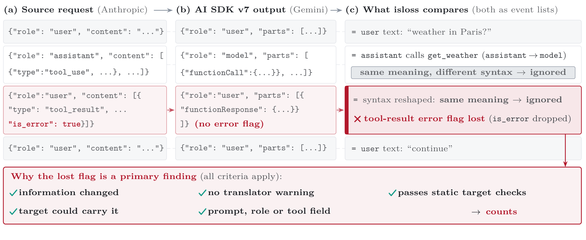
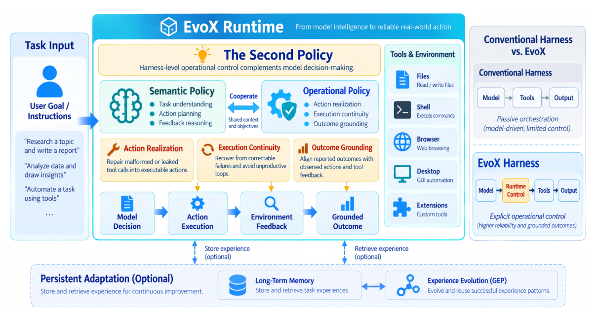
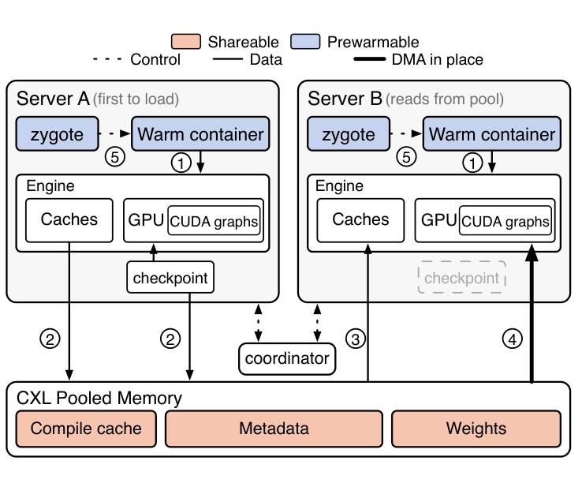

This issue focuses on making reliability boundaries inspectable. FIRE contains experimental effects on shared dependencies; a field study exposes missing production evidence for debugging agents; and isloss shows that valid API payloads can lose role and tool information. They address containment, diagnosability, and preserved context.

The remaining papers carry these concerns into generated-kernel contracts, harness control, and reusable serving state. KernelMutate and KernelAudit examine different obligations, while Aries, EvoX, and MULTILOOP separate observation, control, and optimization. Cache and cold-start benefits depend on restoration and scheduling costs, not capacity or peak speedup alone.

<h2 class="daily-paper-title" id="paper-arxiv-2611.14962">01 · FIRE: containing downstream effects of production-connected experiments</h2>

[FIRE: Failure Isolation and Reliability for Production-Connected Experiments at Scale](https://arxiv.org/abs/2611.14962)  
Shripad Nadgowda et al. · 2026-11-11

A candidate change can affect production before it is deployed. FIRE studies a replay platform in which recorded requests drive the service under test while selected downstream calls reach live dependencies. Comparing candidate and baseline responses is insufficient when a malformed tensor crashes an accelerator-backed prediction worker. For release validation and chaos engineering, the important quantity can be the number of workers reachable by an experiment, rather than its fraction of traffic.

<a class="note-image-link" href="/assets/images/digest/2026-11-14/fire.png" target="_blank" rel="noopener" aria-label="Selective isolation, dependency monitors and pinned workers · View original image ↗">View original image ↗</a>

*Reading the figure: Selective isolation, dependency monitors and pinned workers.*

### Three guardrails, three different boundaries

Selective isolation redirects calls to dedicated ranking and inference-gateway tiers where representative replicas can be maintained economically. Failures in those tiers remain on the experimental path. Replicating every accelerator-backed model or stateful feature store would be much more expensive, so isolation is applied selectively.

Dependency monitors cover services that remain shared. Health detectors observe restarts, exceptions, and invalid results; experiment-attributed detectors connect downstream errors to the control and treatment jobs. After warm-up, sustained violations across consecutive checks terminate the experiment. An unhealthy dependency does not by itself identify the responsible experiment: precise intervention requires caller identity to survive the request path.

Traffic pinning restricts experimental calls to a designated shard instead of distributing them across all workers. A small number of malformed requests can otherwise crash many workers, making a low traffic percentage an inadequate protection. Pinning bounds that exposure, but concentrates load and cannot contain effects propagated through shared state. Monitoring, write controls, and lifecycle controls remain necessary.

### What the operational evidence establishes

On the measured ranking paths, isolated tiers handle billions of replay requests daily with less than 1% of the corresponding shared tiers’ worker capacity. Over 90 days, they contained more than 200,000 abnormal worker exits, 96% involving fatal signals. Repeated crash loops contribute to this count; it is not a count of distinct defects. In a separate three-month window, dependency monitors cancelled about 5% of experiments and accounted for approximately 87% of cancellations. These measurements have different windows and denominators and should not be combined into a single failure-reduction rate.

Monitoring is reactive. In a separate 16-day measurement, median time from the first observed violation to termination was 62 seconds for health detectors and 121 seconds for experiment-attributed detectors. Fault onset can precede that first observation. Inputs capable of immediately disabling workers still need validation at the dependency boundary.

### Why the design matters

FIRE combines realistic dependencies with explicit containment: replicate where feasible, preserve attribution and monitor shared services, and bound fan-out for worker-local failures. Build-dependency filtering also reduced code-review workload executions by 25%. Replay nevertheless preserves sampled requests rather than full concurrency or causal sessions, and experiments sharing isolated tiers or pinned shards remain coupled. The transferable contribution is the combination of boundaries and evidence, not a claim that any single guardrail guarantees production safety.

<h2 class="daily-paper-title" id="paper-arxiv-2611.17304">02 · Database debugging: the production state an agent cannot see</h2>

[Where LLM Agents Get Stuck Debugging Databases: Access More Than Reasoning](https://arxiv.org/abs/2611.17304)  
Gustavo Pinto · 2026-11-12

Reading source code does not establish what happened in a running system. This field observation follows eight database incidents in a production message-dispatch engine. All five incidents whose causes depended on runtime concurrency began with a false start. Its contribution is a reconstruction of missing evidence, attempted fixes, and subsequent corrections, rather than a new root-cause classification score.

### Access must expose the state needed to test a hypothesis

The agent could inspect and edit the repository and run local tests, but production access was asymmetric. Some logs required authentication it lacked, database queries had to be run by a person through a read-only proxy, and cluster contexts required manual switching. Locks could disappear before a human-mediated query returned. Application logs truncated deadlock details even though the complete reports existed in database logs outside the agent’s reach.

In one incident, an early-commit hypothesis gave way to a fix that stopped holding a row lock across steps. In another, a retry calling rollback between attempts discarded the caller’s uncommitted work and expired ORM objects; the eventual repair used a savepoint. A throughput investigation rejected six hypotheses before finding a retry-sweep limit in configuration. The value was available in the repository, but evidence that it was saturating under production load was missing.

### Access and reasoning are not competing explanations

The author classifies one concurrency incident as access-limited and four as mixed access and reasoning failures. The latter include incomplete configuration inspection, anchoring on a historical cause, and misunderstanding transaction semantics. “Access More Than Reasoning” therefore describes the prevalence of access gaps in this sample, not evidence that stronger models would be irrelevant. A false start is also an operational coding category: a hypothesis consistent with the evidence then visible and subsequently refuted, rather than a blanket classification of mistakes as fabrication.

The analysis triangulates session transcripts, commits, and deployment/workload records across 27 sessions. Approximately 410 cumulative session hours measure first-to-last timestamps, including sessions left open across working days; they are not continuous inference time. Claude Code was the interface, while approximately 79% of model calls were served by DeepSeek and 17% by Claude Opus. Individual hypotheses were not attributed to models, so this is not an evaluation of one Claude model. The throughput incident ended with a configuration change and has no fix commit in the table; counting every rejected hypothesis as a separate code deployment would overstate the evidence.

### The useful direction is an investigation interface

The proposed tooling comprises an audited read-only API for locks, active queries, and execution plans; persistent capture of lock waits and complete deadlock reports; production replay for concurrency unavailable in a local single-process setup; and a ledger recording hypotheses and the evidence that retired them. These are design directions inferred from the cases, not a deployed system with a measured MTTR improvement.

The study is retrospective, covers one team and system over ten days, and was coded by the participating author. Without controlled changes to access or model capability, co-occurrence does not establish causality. For AI SRE evaluation, the practical question is whether decisive evidence exists, can be queried in time, and belongs to the correct environment before judging the agent’s reasoning over it. The paper has no standalone architecture diagram for the proposed investigation layer, so the explanation remains case-based.

<h2 class="daily-paper-title" id="paper-arxiv-2611.15543">03 · isloss: an accepted request can still lose conversation information</h2>

[Testing Conversation Preservation Across LLM APIs: A Rule-Based Oracle for Detecting Silent Information Loss](https://arxiv.org/abs/2611.15543)  
Xin Liu et al. · 2026-11-11

Model switches and API gateways are often treated as transport adaptations: if the target accepts the request, the migration appears successful. isloss identifies a separate correctness requirement. Role authority, tool call–result links, error flags, and explicit generation controls can disappear inside otherwise valid payloads. A change in agent behavior may consequently reflect a changed conversation rather than a difference in model capability.

<a class="note-image-link" href="/assets/images/digest/2026-11-14/isloss.png" target="_blank" rel="noopener" aria-label="Compare source and target tool events after normalizing representation · View original image ↗">View original image ↗</a>

*Reading the figure: Compare source and target tool events after normalizing representation.*

### Normalize representation before judging preservation

The checker maps source and translated payloads into ConvIR. Ordered events retain speaker identity, content, tool relationships, and relevant flags; a separate component records explicitly supplied generation controls. API field names, role names, and tool identifiers may change when permitted rules preserve the information. Merging adjacent messages likewise requires content and order preservation. This avoids needing either a trusted reference translation or another model call as judge.

The paper’s tool-error example illustrates the distinction: the translated container is valid and the tool’s text remains, but its is_error flag disappears. A subsequent model turn may interpret a failed operation as an ordinary result. isloss separately records whether information changed, whether the target could express it, and whether the translator disclosed degradation. Documented degradation still loses information, but is different from an avoidable silent defect.

### Keep the denominators attached to the findings

In held-out tests constructed after the rules were fixed, isloss detected 95 of 125 activated injected faults and incorrectly flagged two of 100 permitted changes. It therefore catches many failures while missing roughly a quarter of this fault set. Its guarantee concerns represented properties under explicit rules, not complete semantic or behavioral equivalence across models.

The main request census covers five translator codebases, six configurations, and 14 translation paths. Of 714 attempts, 29 were explicit rejections, leaving 685 completed translations. In 127 cases, or 18.5%, a finding simultaneously passed static target checks, changed prompt/role/tool information without disclosure, and involved information the target could preserve. This is neither a production failure rate nor 127 distinct bugs. Passing static checks also does not mean every request was accepted by a live endpoint.

A separate response experiment found exceptions or silent message corruption in at least one tested official OpenAI SDK for 203 of 558 translated streams. Its denominator is different and cannot be added to the request census. Human review also found disagreements, particularly for information unavailable in the target API. When a trusted target translation was provided, several comparators outperformed isloss; its advantage is deterministic checking without that reference, not universal superiority over other oracles.

### Why this matters for AgentOps

The work turns compatibility into explicit questions about preserved information and disclosed degradation. It motivates gateway regression tests and input audits for model comparisons: altered role or tool-error semantics introduce a confound before model reasoning begins. isloss remains an offline research checker. Rule coverage, capture boundaries, and API versions constrain its findings, and provider-side changes after the final observation point may be invisible. The preservation rules and concrete translation cases are more transferable than the synthetic-suite percentages.

<h2 class="daily-paper-title" id="paper-arxiv-2611.15441">04 · KernelMutate: what survives five passing tests</h2>

[KernelMutate: Mutation-Guided Validation of Generated GPU Kernels](https://arxiv.org/abs/2611.15441)  
Ziyuan Li et al. · 2026-11-11

Acceptance of an LLM-generated kernel can be narrower than its replacement obligations. KernelMutate injects controlled faults into accepted implementations to identify revealing input templates, then combines source fingerprints with directed and general tests. Comparisons include input side effects and post-call state as well as outputs.

Five draws accept 548 of 838 natural candidates. The full strategy subsequently finds native FP32 witnesses for 136 accepted candidates. Another 362 have dtype-only findings, mostly unsupported low-precision execution; without publisher guarantees, these are not automatically original-contract violations. Directed testing identifies the same 692 candidates at 26.1% lower charged cost, but leaves only dtype evidence for 16 candidates with native witnesses under the full strategy. **The same candidate yield does not mean the same diagnostic evidence.** Source guidance is not isolated from budgeting and stopping effects, an important qualification to the apparent efficiency gain.

<h2 class="daily-paper-title" id="paper-arxiv-2611.15506">05 · KernelAudit: auditing the validator against its contract</h2>

[KernelAudit: Contract-Aware Auditing of Validators for LLM-Generated GPU Kernels](https://arxiv.org/abs/2611.15506)  
Ziyuan Li et al. · 2026-11-11

Where KernelMutate expands testing conditions, KernelAudit asks which obligations a validator actually enforces: numerical semantics, prohibited delegation to libraries, and timing that includes completed computation. It combines reference-calibrated stress tests, dispatcher interventions, and lower-level launch provenance. A library name in source code is not itself proof of a violation.

The audit of six validators and 716 candidates produces 172 PASS, 397 FAIL, and 147 inconclusive certificates. PASS means no detected violation on audited surfaces, not proof for every input; missing state alignment or attribution cannot automatically justify FAIL. Independent human review uses a partly different library-use policy, and estimated overall specificity is 0.626, underscoring the audit oracle’s own calibration needs. For reward design, the contribution is separating correct output, implementation compliance, and credible performance. These obligations complement KernelMutate’s witness analysis rather than collapsing into one correctness rate.

<h2 class="daily-paper-title" id="paper-arxiv-2607.29069">06 · Aries: observe the whole serving trajectory</h2>

[Rethinking AI Cloud Infrastructure for Agentic Serving Systems with the Aries Experimentation Framework](https://arxiv.org/abs/2607.29069)  
Jooyoung Park et al. · 2026-07-31; revised 2026-11-03

Aries separates task specifications from execution configurations and reconstructs a shared trajectory from model calls, harness events, sandbox operations, and system telemetry using cross-component identifiers. It enables comparisons that preserve tasks and evaluators instead of describing an entire agent through TTFT and token throughput alone.

The paper combines an eight-hour commercial trace with controlled experiments on open harnesses, sampling 20 tasks per benchmark and repeating each five times. Tools account for 13%–48% of end-to-end latency, with harness processing contributing up to another 9%. Larger contexts consume KV capacity without consistently improving success, while sandboxes alternate between idle intervals and resource bursts. Snapshot-cost results replay tool traces through a billing model; they are not measured cloud bills. The distinct contribution is correlated, comparable observation, not an implemented optimal elasticity policy. First posted in July, the paper is read here in its November revision.

<h2 class="daily-paper-title" id="paper-arxiv-2611.15006">07 · EvoX: execution control as a second policy</h2>

[EvoX: Rethinking the Agent Harness as a Runtime Policy](https://arxiv.org/abs/2611.15006)  
Haoyang Zhang et al. · 2026-11-11

EvoX separates the model’s semantic choice of actions from the harness’s operational control. Runtime checks validate tool calls, normalize arguments within bounds, feed back recoverable errors, and stop repeated unproductive attempts. Final outcome grounding primarily uses instructions aligned with execution records; it is not an independent completion prover.

<a class="note-image-link" href="/assets/images/digest/2026-11-14/evox.png" target="_blank" rel="noopener" aria-label="Semantic decisions and runtime control cooperate; the bottom row is optional · View original image ↗">View original image ↗</a>

*Reading the figure: Semantic decisions and runtime control cooperate; the bottom row is optional.*

Its Contrast evaluation preserves native harness prompts and loops while controlling external conditions and auditing requests and scoring. Across 691 common valid task–model pairs, EvoX achieves 56.2% success versus 53.1% averaged over five alternatives; the closest, Pi, reaches 55.9%. Memory, evolution, and extensions are disabled, so the results do not establish benefits from those optional capabilities. Leaders also differ by model. The useful lesson is to distinguish external fairness conditions from internal harness design rather than treating closely spaced aggregate scores as universal superiority.

<h2 class="daily-paper-title" id="paper-arxiv-2611.15754">08 · MULTILOOP: accuracy improves while orchestration failures persist</h2>

[MULTILOOP: Evolving Multi-Agent Harnesses for Complex Information-Seeking Tasks](https://arxiv.org/abs/2611.15754)  
Daniela Gottesman et al. · 2026-11-11

MULTILOOP has a coding agent inspect trajectories, previous edits, and scores, modify a multi-agent harness, and select a version by training performance. Its contribution is testing an existing optimization paradigm in a multi-agent setting rather than introducing a new search algorithm.

With ten difficult training examples and ten optimization iterations, fully correct accuracy on the remaining 890 DeepSearchQA questions rises from 67.27% to 71.88%, a 4.61-percentage-point gain. Prompt-only optimization instead falls to 64.62%. Yet changes remain mostly prompt refinements and an added download tool; structural delegation problems persist. Total subagent steps per question increase from 152 to 250, and a compute-matched comparison is absent. The gain therefore cannot all be attributed to better coordination. For AgentOps, higher aggregate accuracy should prompt examination of failure types and work performed, not an assumption that orchestration has improved.

<h2 class="daily-paper-title" id="paper-arxiv-2611.15207">09 · Pre-QED: ask which legal uses a proof covers</h2>

[Pre-QED: Environment Specifications for Agentic Verification](https://arxiv.org/abs/2611.15207)  
Tristan Lim et al. · 2026-11-11

Proving that a fixed fuzz harness cannot crash does not cover every legal use of its library. Pre-QED illustrates this with a repeated-read bounds error: a harness that calls read only once can pass verification while missing a stateful error on the second call.

<a class="note-image-link" href="/assets/images/digest/2026-11-14/pre-qed.png" target="_blank" rel="noopener" aria-label="Code and documentation feed harness and temporal-property tracks · View original image ↗">View original image ↗</a>

*Reading the figure: Code and documentation feed harness and temporal-property tracks.*

The workflow extracts contracts from code and documentation. Separate harness and LTL tracks generate executable environments and temporal constraints, with state guards excluding misuse while admitting legal sequences. Across 29 libraries, average API coverage increases from 22.1% to 89.3%, but this measures APIs appearing in harnesses, not proof of complete sequence coverage. The released artifacts are stronger verification targets and challenges; completing their proofs still requires persistent-state invariants, compositional API lemmas, and protocol reasoning. The contribution concerns what to prove, with contract extraction and human review still part of the trust boundary, rather than another verification-speed result.

<h2 class="daily-paper-title" id="paper-arxiv-2611.15126">10 · Host-tier KV: saving prefill can still worsen tail latency</h2>

[Recompute or Restore? Host-Tier KV for Multi-Model Agent Workflows on a Static-Graph NPU Serving Stack](https://arxiv.org/abs/2611.15126)  
Sungwon Woo et al. · 2026-11-11

On Rebellions ATOM+ static-graph serving, evicted planner prefixes must be recomputed; 89.5% of executed planner prompt tokens in an overloaded run had already been materialized. A host-DRAM tier uses public KV-copy interfaces, restores only when the usable host prefix is longer, advances input positions only after both TP payloads are installed, and hides incomplete stores.

<a class="note-image-link" href="/assets/images/digest/2026-11-14/host-kv.png" target="_blank" rel="noopener" aria-label="Restore, prefill, store and decode share the planner engine thread · View original image ↗">View original image ↗</a>

*Reading the figure: Restore, prefill, store and decode share the planner engine thread.*

Adding the tier to stock serving raises SLO attainment from 22.8% to 100% and from 9.4% to 99.8% in two overload conditions. However, restore, store, prefill, and decode share an engine thread. Under sustainable fork load with admission held fixed, the tier increases P99 latency by 16%–18%. A frozen event model captures major effects but reverses three policy contrasts. The paper makes cache benefit a scheduling and transfer-cost question. Evidence is specific to a Qwen3-8B planner, a 0.6B executor, and this synchronous NPU path, not a general argument for maximizing cache capacity.

<h2 class="daily-paper-title" id="paper-arxiv-2611.16180">11 · Cairn: share startup artifacts and prewarm model-independent work</h2>

[Fast Serverless LLM Cold Starts by Sharing and Prewarming Startup Work](https://arxiv.org/abs/2611.16180)  
Hongjin Kim et al. · 2026-11-12

Cairn divides cold-start work into shareable, prewarmable, and process-bound components. A first server publishes weights and compilation artifacts to a shared CXL pool; entries become immutable and readable only after a single writer flushes them. Warm containers pre-import dependencies and initialize CUDA. Replacements fork from a zygote that has not initialized CUDA, avoiding unsupported post-CUDA fork behavior. Process-bound CUDA graphs are still captured anew.

<a class="note-image-link" href="/assets/images/digest/2026-11-14/cairn.png" target="_blank" rel="noopener" aria-label="The first server publishes artifacts; other servers read them from the pool · View original image ↗">View original image ↗</a>

*Reading the figure: The first server publishes artifacts; other servers read them from the pool.*

With two virtual servers, one RTX A6000 each, and remote NUMA memory emulating a CXL pool, six 1B–14B models start in 11–21 seconds rather than 57–85 seconds, a 4.1–5.2× improvement. Median TTFT falls 64% in a one-hour request stream. Single-start tests reuse entries previously published by another server, not an entirely empty cluster. Warm containers consume host memory and CUDA-context capacity, and initial pool publication adds load overhead. This complements the snapshot note: Cairn explicitly shares artifacts and recaptures graphs, whereas that implementation restores captured process state.

## Community development

**vstack verification cases in vLLM.** [Hao AI Lab’s original thread](https://x.com/haoailab/status/2121320482876399825), dated November 13, reports 17 findings and shares five fix PRs. Its linked first-party tracker contains evidence of varying strength: same-step copying under non-default fine-grained prefix matching can read unwritten KV, while an in-place LoRA update followed by cache eviction can reload an old path. These cases make cache consistency, request-state release, and post-update visibility explicit contracts. The count is the team’s report, not evidence that all fixes have merged. Small reproduction counts, configuration-specific triggers, and unfinished verification in the tracker warrant case-by-case follow-up.

**Microsoft 365: restored access and cleared backlogs are separate stages.** The [official incident thread](https://x.com/MSFT365Status/status/2120938282204688468) begins with Exchange Online access failures on November 12 and reports unavailable servers straining remaining capacity, failed health checks, and mitigations including an alternative health-check method, restarts, and traffic redistribution. Some returned servers became unresponsive again under traffic. As access improved, mail queues still needed draining; email timeout was extended to 48 hours. A November 14 update reports restoration for the remaining affected customers and regions. The operational lesson is to observe accessibility, effective capacity, and backlog processing separately. The public thread does not establish the final root cause or substantiate circulating claims about a specific configuration change.

## Related technical notes

- [Vera sandboxes: how CPUs shape agentic RL training](/tech/en/miles-vera/)
- [Floating-point formulas: why real-number proofs miss zero gradients](/tech/en/rounding-ml-formulas/)
- [Custom-model cold starts: what snapshots actually avoid](/tech/en/custom-model-snapshots/)
