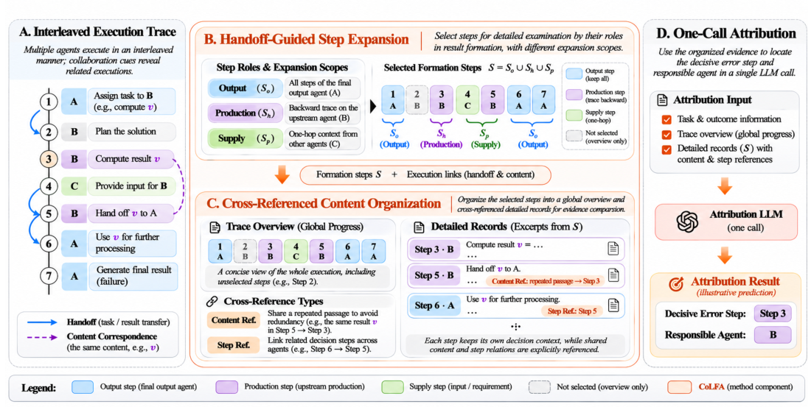
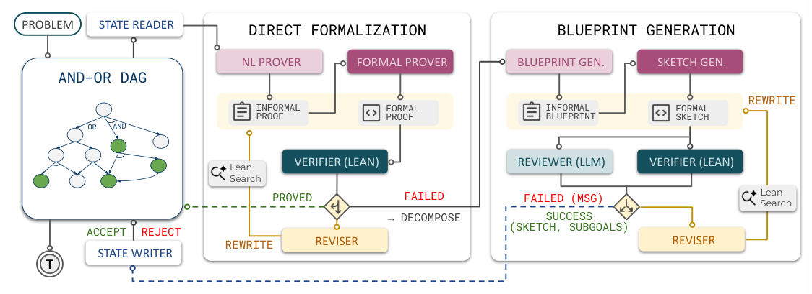

## What matters in this issue

Autonomous optimization and failure diagnosis both face expensive evidence. Full performance tests limit search iterations, while long execution traces raise attribution costs. DuoDiscover lets agents discover both optimization targets and cheap evaluators, then corrects those proxies with full tests. CoLFA uses handoffs and content references to reduce the records a diagnostic model must process. These are the two close reads: one asks whether optimization feedback remains trustworthy, the other whether failure evidence is organized usefully.

LEAP adds a transferable idea: preserve checked intermediate progress in a shared dependency graph instead of rediscovering it in every branch. Two technical notes examine verification in Google’s long-running workflows and Baseten’s speculative decoding and cross-server caches. An FAA timeline illustrates reducing operating activity during telecommunications disruption.

<h2 class="daily-paper-title" id="paper-arxiv-2610.17184">DuoDiscover: continuously testing the proxy evaluator</h2>

[DuoDiscover: Scaling Autonomous Discovery Beyond the Evaluation Bottleneck](https://arxiv.org/abs/2610.17184)  
Shubham Agarwal, Akshat Gupta, Mike Heddes, Dilara Soylu et al. · First published 2026-10-12

### When full tests constrain search

An end-to-end evaluation of a real system can take tens of minutes. Even a coding agent that generates patches quickly can test only a few candidates. DuoDiscover asks each worker to choose both a target and a cheap way to estimate progress. A worker can select a scheduling path, hot loop, or kernel stage and write a fast scoring script called a yardstick. Compared with evolving a predefined code region, this broadens target selection. Compared with profiling alone, it adds an evaluator that can be reused and continuously checked.

### Fast exploration, slow confirmation

<a class="note-image-link" href="/assets/images/digest/2026-11-15/duodiscover.png" target="_blank" rel="noopener" aria-label="DuoDiscover workers, fast yardstick loop, and full-evaluation validation loop · View original image ↗">View original image ↗</a>

*The orchestrator on the left manages workers. The fast loop on the right proposes and screens edits; full evaluations below confirm gains and check whether the yardstick still ranks candidates correctly.*

Workers edit, score, retain, or revert changes in separate code copies. A yardstick need not predict full runtime accurately, but it should order candidates consistently with the true objective. The slow loop runs complete tests. The orchestrator compares rankings using Kendall correlation, considering only differences larger than measurement noise. Search can gradually exploit a proxy’s weaknesses, so every full evaluation triggers another check. Previously validated yardsticks can become invalid and require rebuilding or a different target.

The orchestrator also terminates stalled workers, starts fresh exploration, shares confirmed findings, and asks new workers to combine patches. Combinations must pass full evaluation again: local gains cannot simply be added. In the paper’s samples, 41% of repository yardsticks and 45% of kernel yardsticks were subsequently invalidated. Drift was an observed problem, not merely a hypothetical design concern.

### Read gains together with objectives and budgets

Across 100 SWE-fficiency-Lite tasks, normally with eight hours and four agents, the authors report a 15.02× geometric-mean speedup over original code, versus 12.81× for Claude Code and 6.90× for expert patches. These are task-specific workloads, not a promise for arbitrary Python projects. In the ablation sample, adding unchecked yardsticks reduced the score from 12.85× to 10.33×; fidelity testing restored the benefit.

The vLLM case serves GLM-5.2 NVFP4 on 8×B200, with a 20-hour budget and an approximately 85-minute full evaluation. Its 1.92× result is a geometric mean across four objectives: 2.94× lower p99 decode latency, 3.61× lower first-token latency, 21% lower power, and unchanged throughput. It is not a 1.92× throughput increase. SQLite reaches 1.38× under speedtest1 and full-test constraints.

The valuable systems idea is to treat a proxy metric as a maintained component. Main experiments mostly use single runs, with repeated-run analysis on subsets. When no faithful yardstick is available, the method falls back to expensive search; short budgets may not recover its initialization cost. The dual loop, drift ablation, and vLLM case explain applicability more directly than leaderboard position.

<h2 class="daily-paper-title" id="paper-arxiv-2611.14980">CoLFA: organizing failure evidence along collaboration links</h2>

[CoLFA: Collaboration-Guided Lightweight Failure Attribution for LLM-Based Multi-Agent Systems](https://arxiv.org/abs/2611.14980)  
Yufei Luo, Yuchen Ling, Chunrong Fang · First published 2026-11-11

### Where an error appears is not necessarily where failure was determined

Multi-agent traces follow time, but not necessarily the formation of information. A result may be produced upstream, relayed by another agent, and misused downstream. An earlier error may already have been corrected. CoLFA seeks the earliest erroneous step decisive to the final failure and its responsible agent. Rather than adding more rounds of unconstrained diagnostic reasoning, it organizes the evidence the model will receive.

### Expand through handoffs, then reference repeated content

<a class="note-image-link" href="/assets/images/digest/2026-11-15/colfa.png" target="_blank" rel="noopener" aria-label="CoLFA selects formation steps from interleaved traces and organizes references for attribution · View original image ↗">View original image ↗</a>

*Starting from the trace on the left, handoff links select steps above, while a global overview and content references organize them below. One model call on the right returns the error step and responsible agent.*

For delegation-and-handoff configurations, the method retains every step of the final-output agent, traces upstream production through content correspondence, and adds one-hop requirements and inputs from other agents. Cues include assignments, agent mentions, and recurring specific numbers, identifiers, or text. An LLM does not first infer an entire causal graph. Group chats use corresponding expansion rules, making those rules part of the method’s transfer boundary.

Selected records retain original indices, authors, actions, and execution context. References replace repeated text with pointers to earlier occurrences; step references support comparisons between requirements and subsequent processing. Actions are not length-truncated, while long reasoning and tool feedback can be truncated with omissions marked. Steps without detailed expansion still appear in a global overview. This reduces repetition without merging separate agents’ decisions about the same content into one summary.

### Lower cost does not mean attribution is solved

On Who&When’s 184 failed traces, DeepSeek-V4.1-Flash exact step accuracy rises from the strongest baseline CORRECT’s 41.30% to 44.57%, while mean tokens fall from 22.7K to 6.9K. LongRCA contains 1,140 failures from several systems, including single-agent executions. With the same backbone, exact localization is 21.84% for CoLFA versus 18.86% for CORRECT, using 22.4K versus 114.5K tokens per trace.

Across the four main settings, gains over each setting’s most accurate baseline are approximately 1.84–3.26 percentage points, with 66–90% fewer tokens. A fifth setting using Claude Sonnet 5.5 also shows an accuracy–cost advantage. Accounting includes input and output tokens across all model calls within the method; it is not a direct comparison of elapsed time or monetary cost. Removing either step expansion or content organization lowers accuracy and increases tokens, supporting their complementary roles.

The AgentOps contribution is treating trace organization as part of diagnosis rather than merely changing models. However, candidate coverage depends on recorded handoffs and content matches connecting the relevant executions. Missing links can leave the decisive error outside the candidate set. Exact localization of roughly one-fifth of LongRCA failures also remains an assistive result. The paper does not establish improved task completion by repairing attributed steps and rerunning execution; localization is not demonstrated automatic repair.

<h2 class="daily-paper-title" id="paper-arxiv-2606.03303">LEAP: preserving progress in a reusable proof graph</h2>

[LEAP: Supercharging LLMs for Formal Mathematics with Agentic Frameworks](https://arxiv.org/abs/2606.03303)  
Po-Nien Kung, Linfeng Song, Dawsen Hwang et al. · First published 2026-06-02; reading the 2026-11-12 revision

LEAP stores theorem and lemma goals as OR nodes, and decompositions requiring every subgoal as AND nodes. It first attempts direct proof generation with Lean compiler feedback. On failure, it generates an informal blueprint and formal sketch, checks acyclic dependencies, and writes subgoals into a shared DAG. Lemmas can be reused across branches. Lean checks logic, while an LLM reviewer assesses whether decomposition actually simplifies the problem: these are separate responsibilities.

<a class="note-image-link" href="/assets/images/digest/2026-11-15/leap.png" target="_blank" rel="noopener" aria-label="LEAP shared proof DAG, direct formalization, and blueprint generation · View original image ↗">View original image ↗</a>

*The middle path tries direct proving; failure leads to blueprint decomposition on the right, and checked structure returns to the DAG on the left. Proposed lemmas must eventually be proved: intermediate placeholders are not completed proofs.*

With Gemini-3.1-Pro, LEAP achieves 83.3%/56.7% on Lean-IMO-Bench Basic/Advanced, versus 73.3%/40.0% when global sharing is removed in a tree variant. The authors also report solving all 12 Putnam 2025 problems. These are iterative-framework results, not a 70% success rate for one unaided model generation. For long-running agents, the transferable ideas are checked progress and shared dependencies; geometry remains difficult, and repeated cross-model evaluation is limited.

## Related technical notes

- [Antigravity /teamwork: organizing independent verification for long tasks](/tech/en/antigravity-teamwork/): context handoffs, unchanged tests, and production changes, separating workflow mechanisms from vendor-reported gains.
- [DeepSeek Ultrafast: speculative decoding and cross-server KV state](/tech/en/deepseek-ultrafast/): the conditions behind 1,740–2,060 tokens/s and ownership control for resuming work across replicas.

## Incident update: FAA limits new departures after telecom problems

[Secretary Sean Duffy’s official timeline](https://x.com/SecDuffy/status/2121426698172293310) says facilities and TRACONs experienced telecommunications problems at 15:36 Eastern on November 13. The FAA subsequently imposed a ground stop while more than 3,500 aircraft were airborne. Crews and controllers used established procedures to land aircraft, reducing that number below 400 by 20:00. The ground stop was lifted at 20:15.

The statement also says radar and telecommunications were not completely lost, and exceptions remained for medevac, life-saving cargo, and law-enforcement flights. For reliability research, this illustrates reducing incoming activity while preserving critical operations during partial capability loss. The timeline does not establish a technical root cause, support the claim that a router flooded the network, or demonstrate that relevant drills had never been conducted.
