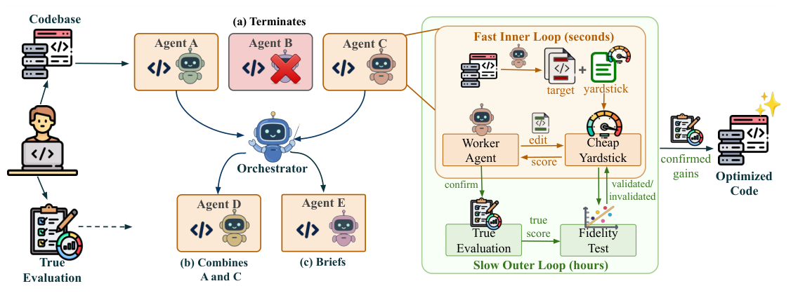
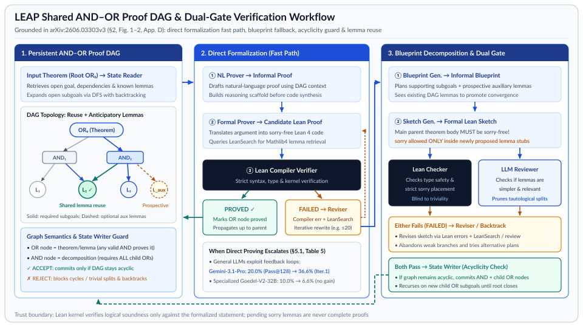

## What matters in this issue

Autonomous optimization and failure diagnosis both face expensive evidence. Full performance tests limit search iterations, while long execution traces raise attribution costs. DuoDiscover lets agents discover both optimization targets and cheap evaluators, then corrects those proxies with full tests. CoLFA uses handoffs and content references to reduce the records a diagnostic model must process. These are the two close reads: one asks whether optimization feedback remains trustworthy, the other whether failure evidence is organized usefully.

LEAP adds a transferable idea: preserve checked intermediate progress in a shared dependency graph instead of rediscovering it in every branch. Two technical notes examine verification in Google’s long-running workflows and Baseten’s speculative decoding and cross-server caches.

<h2 class="daily-paper-title" id="paper-arxiv-2610.17184">DuoDiscover: continuously testing the proxy evaluator</h2>

[DuoDiscover: Scaling Autonomous Discovery Beyond the Evaluation Bottleneck](https://arxiv.org/abs/2610.17184)  
Shubham Agarwal, Akshat Gupta, Mike Heddes, Dilara Soylu et al. · First published 2026-10-12

### When full tests constrain search

An end-to-end evaluation of a real system can take tens of minutes. Even a coding agent that generates patches quickly can test only a few candidates. DuoDiscover asks each worker to choose both a target and a cheap way to estimate progress. A worker can select a scheduling path, hot loop, or kernel stage and write a fast scoring script called a yardstick. Compared with evolving a predefined code region, this broadens target selection. Compared with profiling alone, it adds an evaluator that can be reused and continuously checked.

### Fast exploration, slow confirmation

<a class="note-image-link" href="/assets/images/digest/2026-11-15/duodiscover.png" target="_blank" rel="noopener" aria-label="DuoDiscover workers, fast yardstick loop, and full-evaluation validation loop · View original image ↗">View original image ↗</a>

*The orchestrator on the left manages workers. The fast loop on the right proposes and screens edits; full evaluations below confirm gains and check whether the yardstick still ranks candidates correctly.*

Workers edit, score, retain, or revert changes in separate code copies. A yardstick need not predict full runtime accurately, but it should order candidates consistently with the true objective. The slow loop runs complete tests. The orchestrator compares rankings using Kendall correlation, considering only differences larger than measurement noise. Search can gradually exploit a proxy’s weaknesses, so every full evaluation triggers another check. Previously validated yardsticks can become invalid and require rebuilding or a different target.

The orchestrator also terminates stalled workers, starts fresh exploration, shares confirmed findings, and asks new workers to combine patches. Combinations must pass full evaluation again: local gains cannot simply be added. In the paper’s samples, 41% of repository yardsticks and 45% of kernel yardsticks were subsequently invalidated. Drift was an observed problem, not merely a hypothetical design concern.

### Read gains together with objectives and budgets

Across 100 SWE-fficiency-Lite tasks, normally with eight hours and four agents, the authors report a 15.02× geometric-mean speedup over original code, versus 12.81× for Claude Code and 6.90× for expert patches. These are task-specific workloads, not a promise for arbitrary Python projects. In the ablation sample, adding unchecked yardsticks reduced the score from 12.85× to 10.33×; fidelity testing restored the benefit.

The vLLM case serves GLM-5.2 NVFP4 on 8×B200, with a 20-hour budget and an approximately 85-minute full evaluation. Its 1.92× result is a geometric mean across four objectives: 2.94× lower p99 decode latency, 3.61× lower first-token latency, 21% lower power, and unchanged throughput. It is not a 1.92× throughput increase. SQLite reaches 1.38× under speedtest1 and full-test constraints.

The valuable systems idea is to treat a proxy metric as a maintained component. Main experiments mostly use single runs, with repeated-run analysis on subsets. When no faithful yardstick is available, the method falls back to expensive search; short budgets may not recover its initialization cost. The dual loop, drift ablation, and vLLM case explain applicability more directly than leaderboard position.

<h2 class="daily-paper-title" id="paper-arxiv-2611.14980">CoLFA: organizing failure evidence along collaboration links</h2>

[CoLFA: Collaboration-Guided Lightweight Failure Attribution for LLM-Based Multi-Agent Systems](https://arxiv.org/abs/2611.14980)  
Yufei Luo, Yuchen Ling, Chunrong Fang · First published 2026-11-11

### Where an error appears is not necessarily where failure was determined

Multi-agent traces follow time, but not necessarily the formation of information. A result may be produced upstream, relayed by another agent, and misused downstream. An earlier error may already have been corrected. CoLFA seeks the earliest erroneous step decisive to the final failure and its responsible agent. Rather than adding more rounds of unconstrained diagnostic reasoning, it organizes the evidence the model will receive.

### Expand through handoffs, then reference repeated content

<a class="note-image-link" href="/assets/images/digest/2026-11-15/colfa.png" target="_blank" rel="noopener" aria-label="CoLFA selects formation steps from interleaved traces and organizes references for attribution · View original image ↗">View original image ↗</a>

*Starting from the trace on the left, handoff links select steps above, while a global overview and content references organize them below. One model call on the right returns the error step and responsible agent.*

For delegation-and-handoff configurations, the method retains every step of the final-output agent, traces upstream production through content correspondence, and adds one-hop requirements and inputs from other agents. Cues include assignments, agent mentions, and recurring specific numbers, identifiers, or text. An LLM does not first infer an entire causal graph. Group chats use corresponding expansion rules, making those rules part of the method’s transfer boundary.

Selected records retain original indices, authors, actions, and execution context. References replace repeated text with pointers to earlier occurrences; step references support comparisons between requirements and subsequent processing. Actions are not length-truncated, while long reasoning and tool feedback can be truncated with omissions marked. Steps without detailed expansion still appear in a global overview. This reduces repetition without merging separate agents’ decisions about the same content into one summary.

### Lower cost does not mean attribution is solved

On Who&When’s 184 failed traces, DeepSeek-V4.1-Flash exact step accuracy rises from the strongest baseline CORRECT’s 41.30% to 44.57%, while mean tokens fall from 22.7K to 6.9K. LongRCA contains 1,140 failures from several systems, including single-agent executions. With the same backbone, exact localization is 21.84% for CoLFA versus 18.86% for CORRECT, using 22.4K versus 114.5K tokens per trace.

Across the four main settings, gains over each setting’s most accurate baseline are approximately 1.84–3.26 percentage points, with 66–90% fewer tokens. A fifth setting using Claude Sonnet 5.5 also shows an accuracy–cost advantage. Accounting includes input and output tokens across all model calls within the method; it is not a direct comparison of elapsed time or monetary cost. Removing either step expansion or content organization lowers accuracy and increases tokens, supporting their complementary roles.

The AgentOps contribution is treating trace organization as part of diagnosis rather than merely changing models. However, candidate coverage depends on recorded handoffs and content matches connecting the relevant executions. Missing links can leave the decisive error outside the candidate set. Exact localization of roughly one-fifth of LongRCA failures also remains an assistive result. The paper does not establish improved task completion by repairing attributed steps and rerunning execution; localization is not demonstrated automatic repair.

<h2 class="daily-paper-title" id="paper-arxiv-2606.03303">LEAP: preserving progress in a reusable proof graph</h2>

[LEAP: Supercharging LLMs for Formal Mathematics with Agentic Frameworks](https://arxiv.org/abs/2606.03303) ([v3 PDF](https://arxiv.org/pdf/2606.03303v3) · [v1 PDF](https://arxiv.org/pdf/2606.03303v1) · [Project Page](https://billkunghappy.github.io/LEAP/) · [Lean Solutions](https://github.com/google-deepmind/superhuman/tree/main/leap) · [Lean-IMO-Bench](https://imobench.github.io)) 
Po-Nien Kung, Linfeng Song, Dawsen Hwang, Jinsung Yoon, Chun-Liang Li, Simone Severini, Mirek Olšák, Edward Lockhart, Quoc V Le, Burak Gokturk, Thang Luong, Tomas Pfister, Nanyun Peng (Google Cloud AI Research / Google Cloud / Google DeepMind / UCLA) · arXiv:2606.03303v3 (cs.AI) · First submitted: 2026-06-02 (v1); v2 revised: 2026-06-03; latest revision: 2026-11-12 (v3, active)

### 1. Problem Formulation: The Bottleneck Is Single-Pass Lean Synthesis, Not Math Reasoning

Frontier LLMs already solve competition mathematics in natural language, yet their one-shot solve rates collapse once proofs must be checked by a formal kernel such as Lean 4. Much prior work assumed general-purpose foundation models lack formal-corpus specialization and therefore fine-tuned dedicated provers (AlphaProof, DeepSeek-Prover-V2, Seed-Prover, Goedel-Prover-V2) or paired informal LLMs with specialized proving components (Hilbert, AlphaProof Nexus, Aristotle, Seed-Prover 1.5).

In `arXiv:2606.03303` (initially submitted 2026-06-02 as v1, updated 2026-11-12 to v3), **LEAP (LLM-in-Lean Environment Agentic Prover)** challenges that assumption by showing that the primary failure mode of general-purpose LLMs is **not mathematical reasoning or Lean comprehension, but synthesizing long, structurally intricate, valid proofs in a single pass**. To test beyond saturated benchmarks like MiniF2F and PutnamBench, the authors introduce **Lean-IMO-Bench**, 60 problems from expert-vetted `IMO-ProofBench` whose Lean statements were manually formalized and verified by Lean experts. It splits evenly into **Basic** (30 problems: pre-IMO to IMO-Medium; 8 algebra, 8 combinatorics, 8 number theory, 6 geometry) and **Advanced** (30 problems: up to IMO-Hard; 8 algebra, 8 combinatorics, 6 number theory, 8 geometry) sets, keeping mathematical prerequisites elementary so evaluation isolates non-routine multi-step proof search rather than heavy library engineering.

Table 1 makes this diagnosis concrete. On informal `IMO-ProofBench`, `Gemini 2.5 Pro` reaches **55.2%** (Basic) and **17.6%** (Advanced) at `Pass@1`. Yet in formal theorem proving on `Lean-IMO-Bench`, `Gemini 3.1 Pro` achieves only **20.0%** (Basic) and **3.3%** (Advanced) even at `Pass@128`, with `Avg.@128` at **4.6%** and **0.2%**. Tellingly, in **Formal Proof Translation**—where the model is given a **verified correct informal proof**—`Gemini 3.1 Pro` stays unchanged at **20.0% / 3.3%** `Pass@128` (`4.6% / 0.8%` `Avg.@128`). Rather than training a specialized formal prover, LEAP organizes a pure general-purpose LLM (`Gemini-3.1-Pro` in main experiments) inside an agentic loop built around persistent graph memory, interleaved informal–formal planning, compiler feedback, and semantic review.

### 2. Shared AND–OR Proof DAG and Dual-Path Execution: Direct Proving, Blueprint Sketching, and Split Verification

<figure class="note-figure">
<a class="note-image-link" href="/assets/images/digest/2026-11-15/leap-proof-dag-workflow-en.svg" target="_blank" rel="noopener" aria-label="LEAP shared AND-OR proof DAG and dual-gate verification workflow · View original image ↗">View original image ↗</a>
<figcaption>Drawn from arXiv:2606.03303v3 Section 2 and Figures 1–2: LEAP persists proof state in a shared AND–OR DAG, attempting direct formalization with compiler-feedback revision before falling back to blueprint sketching gated by both Lean logical verification and LLM simplification review.</figcaption>
</figure>

Modeled on human formalization workflows such as `leanblueprint` (used in the Fermat's Last Theorem roadmap), LEAP runs exclusively on general-purpose LLMs without specialized prover fine-tuning and centers on three coupled mechanisms:

**Persistent AND–OR DAG & anticipatory lemma planning**: The input Lean theorem becomes the root **OR node**. Every theorem or lemma statement is an **OR node** (satisfied if *any* valid proof or child decomposition succeeds), whereas each candidate decomposition is an **AND node** (satisfied only if *all* of its child OR subgoals are proved). Unlike isolated recursive search trees (such as Hilbert, which suffers <i>O</i>((<i>n</i> · <i>b</i>)<i>d</i>) redundant subgoal re-exploration), the shared DAG yields **monotone refinement**—established dependency order remains intact while local branches are revised or abandoned—alongside **cross-branch lemma memoization**. Before expanding any open goal, `State Reader` fetches its dependencies and existing graph lemmas; during decomposition, LEAP also performs **anticipatory lemma planning**, proposing auxiliary lemmas (dashed edges in Figure 2 of the paper) that are not required for the immediate AND node yet remain stored in graph memory for downstream subgoals.

**Direct formalization fast path & blueprint-sketch fallback**: Exploring open OR nodes via depth-first search (DFS) with backtracking, LEAP first tries **Direct Formalization**: `NL Prover` drafts a natural-language proof, `Formal Prover` translates it into a `sorry`-free Lean 4 proof, and `Lean Verifier` compiles it. On failure, `Reviser` uses compiler diagnostics plus `LeanSearch` (Gao et al., 2024) Mathlib4 semantic retrieval to iteratively rewrite the attempt (up to 20 revision steps in the Section 5.1 ablation). If direct proving fails, LEAP switches to **Blueprint Generation (`→ DECOMPOSE`)**: `Blueprint Gen.` writes an informal decomposition plan, and `Sketch Gen.` translates it into a formal Lean sketch under a strict **placeholder isolation rule**—the parent goal's main proof body must be **completely `sorry`-free**, and `sorry` stubs are permitted **only inside the newly proposed lemma statements**. Mathematically, this guarantees that proving every child lemma automatically completes the parent goal.

**Split dual verification & acyclicity commit guard**: LEAP explicitly separates formal correctness from search usefulness. `Lean Verifier` enforces syntax, type safety, and strict `sorry` placement, while an **LLM Reviewer** evaluates whether proposed subgoals are relevant, genuinely simplify the parent goal, and offer a plausible route forward. Any `(sketch, subgoals)` passing both checks goes to `State Writer`, which verifies that adding the new edges preserves **acyclicity** (`ACCEPT` commits the AND node and child OR subgoals to the DAG; cycles or failed checks `REJECT` and trigger revision or backtracking).

| LEAP Component | Role, Inputs, and Outputs | Key Constraints & Trust Boundary | Failure / Escalation Path |
|---|---|---|---|
| `State Reader` & AND–OR DAG | Persistent proof memory; OR = goal/lemma (any child suffices), AND = sketch (all subgoals required) | `State Writer` enforces DAG acyclicity before commit; supports optional dashed auxiliary lemmas | Open OR nodes scheduled via DFS with backtracking; abandoned tries do not break graph skeleton |
| Direct Formalization (`NL` → `Formal`) | Generates informal argument then translates into complete Lean 4 proof | Zero `sorry` placeholders allowed; queries `LeanSearch` for Mathlib4 lemmas | Compiler errors trigger `Reviser` rewrites; exhaustion escalates to blueprint decomposition |
| Blueprint Decomposition (`Blueprint` → `Sketch`) | Produces informal lemma plan and Lean proof sketch | Parent proof body must be `sorry`-free; `sorry` permitted only inside new child lemma stubs | Sketches with pending `sorry` lemmas are never complete proofs; subgoals recurse until closed |
| `Lean Verifier` (Logical Checker) | Checks Lean 4 syntax, types, and kernel validity | Guarantees soundness relative to the Lean statement only; blind to tautological splits | Diagnostics feed `Reviser` + `LeanSearch` for targeted repair |
| `LLM Reviewer` (Search Heuristic) | Judges whether subgoals are relevant and actually simplify the parent goal | Heuristic filter with no soundness guarantee; prevents compute waste | Rejects circular or non-simplifying decompositions early and triggers backtracking |

### 3. Quantitative Evaluation, Structural Ablations, and Mechanism Attribution

<figure class="note-figure">
<a class="note-image-link" href="/assets/images/digest/2026-11-15/leap-proof-dag-eval-ablation-en.svg" target="_blank" rel="noopener" aria-label="LEAP empirical benchmarks, ablations, and scope boundaries · View original image ↗">View original image ↗</a>
<figcaption>Drawn from arXiv:2606.03303v3 Tables 1–6, Sections 5–6, and Appendix A: summarizes Lean-IMO-Bench and Putnam 2025 metrics with strict framing between iterative rollout=2 results and one-shot baselines, alongside DAG/reviewer ablations and domain limits.</figcaption>
</figure>

**Putnam 2025 (12 problems) coverage and efficiency caveats**: On the 86th William Lowell Putnam Competition (where human scores had a top of 110/120, mean around 10, and median 2), receiving only Lean statements without reference informal proofs, both `Gemini-3.1-Pro` and `Goedel-Prover-V2-32B` solve **0 / 12 (0.0%)** at `Pass@128`. Open-source `Hilbert` (`rollout=2`, up to 7 days per rollout) solves **4 / 12 (33.3%)** (A2, A3, A4, B6), and proprietary `Aristotle` (`rollout=2`) solves **9 / 12 (75.0%)** (missing A5, B5, B6). **LEAP (`Gemini-3.1-Pro`, `rollout=2`) solves all 12 / 12 (100.0%)**, matching `Numina-Lean-Agent` and `Axiom`. In v3's Table 3 efficiency summary, LEAP reports **822 minutes** aggregate runtime and **~28M tokens**, compared against `Axiom` (2,682 min, 105.2M tokens) and `Numina-Lean-Agent` (3,889 min, tokens unreported; A5 alone took 2,040 min). Crucially, Table 3 explicitly cautions that differing model backbones, system settings, and token accounting prevent a controlled architecture-level comparison. (For internal context, v1 Table 3 also logged LEAP's own per-problem search footprint, spanning 46 LLM calls / 8 active nodes / 300 proof lines on B2 up to 3.0k calls / 170 nodes / 2.0k lines on A5 and 211 active nodes on B5.)

**Lean-IMO-Bench and reconciling the "below 10% to 70%" headline**: On Lean-IMO-Bench, LEAP (`Gemini-3.1-Pro`, `rollout=2`) achieves **83.3% (25/30)** on Basic and **56.7% (17/30)** on Advanced—hitting **100%** on Algebra and Number Theory in both tiers and outperforming `Numina (Opus 4.5)` (76.7% / 43.3%), `Numina (3.1 Pro)` (43.3% / 23.3%), `Aristotle` (76.7% / 20.0%), and `Hilbert` (36.6% / 6.6%). Readers should carefully reconcile the abstract's "from below 10% to 70%, surpassing 48%" phrasing: across all 60 problems (30 Basic + 30 Advanced), LEAP's overall mean is (83.3% + 56.7%) / 2 = **70.0%** (42/60), `Aristotle`'s is (76.7% + 20.0%) / 2 = **48.35%** (29/60), and `Gemini-3.1-Pro`'s one-shot `Avg.@128` mean is (4.6% + 0.2%) / 2 = **2.4%** (`Pass@128` mean: 11.7%). That 70.0% figure is the product of an **iterative multi-step agentic framework under `rollout=2`**, never a single-pass capability of the base model.

| Method & Evaluation Setting | Basic Alg. | Basic Comb. | Basic NT | Basic Geo. | Basic Overall | Adv. Alg. | Adv. Comb. | Adv. NT | Adv. Geo. | Adv. Overall |
|---|---|---|---|---|---|---|---|---|---|---|
| `Gemini-3.1-Pro` (Pass@128) | 37.5 | 12.5 | 25.0 | 0 | 20.0 | 0 | 12.5 | 0 | 0 | 3.3 |
| `Goedel-Prover-V2-32B` (Pass@128) | 37.5 | 0 | 0 | 0 | 10.0 | 0 | 0 | 0 | 0 | 0 |
| `Hilbert` (rollout=2) | 62.5 | 25 | 50 | 0 | 36.6 | 12.5 | 0 | 16.6 | 0 | 6.6 |
| `Aristotle` (rollout=2) | 75 | 100 | 100 | 16.7 | 76.7 | 37.5 | 12.5 | 33.3 | 0 | 20.0 |
| `Numina` (3.1 Pro single-backbone, rollout=2) | 50 | 50 | 50 | 16.7 | 43.3 | 50 | 12.5 | 33.3 | 0 | 23.3 |
| `Numina` (Opus 4.5 + Gemini partner, rollout=2) | 87.5 | 100 | 87.5 | 16.7 | 76.7 | 87.5 | 25 | 66.6 | 0 | 43.3 |
| `LEAP w/o DAG` (Naive Tree ablation, rollout=2) | 100 | 75 | 100 | 0 | 73.3 | 75 | 25 | 66.6 | 0 | 40.0 |
| `LEAP Full DAG` (Gemini-3.1-Pro, rollout=2) | **100** | **100** | **100** | **16.7** | **83.3** | **100** | **25** | **100** | **12.5** | **56.7** |

**Three cleanly isolated ablations explain where gains originate**:

- **One-shot vs. iterative Direct Formalization (§5.1, Table 5)**: Testing only the Direct Formalization path on Lean-IMO-Bench Basic, specialized `Goedel-Prover-V2-32B` drops from 10.0% (`Pass@128`) to **6.6%** (`Iterative Pass@1` with up to 20 compiler-feedback steps), whereas `Gemini-3.1-Pro` nearly doubles from 20.0% to **36.6%** on a smaller sampling budget—showing that error diagnosis and multi-turn state tracking drive iterative gains.
- **DAG memoization vs. Naive Tree (§5.2, Table 6)**: Removing global lemma sharing leaves a tree variant that still scores **73.3% / 40.0%** (already far above `Hilbert`'s 36.6% / 6.6%), isolating the payoff of interleaved planning, compiler repair, and semantic review. Restoring the shared DAG adds **+10.0 pp** on Basic (83.3%) and **+16.7 pp** on Advanced (56.7%), closing Advanced Algebra (75% → 100%), Advanced Number Theory (66.6% → 100%), and breaking zero in Geometry.
- **LLM Reviewer ablation on Putnam A5 (§5.3, Figure 3)**: Full LEAP proves A5 in **2 rollouts (122 min, 10M tokens)**; removing the LLM decomposition reviewer causes all **8 rollouts** to fail. Trace inspection reveals a classic compiler-legal failure mode: the agent unfolds `PermsA`/`PermsB` into an intermediate lemma (`valid_perms_end_eq_sigma_card`), then folds them back into `card_perms_a_eq_card_perms_b`—a subgoal syntactically identical to the grandparent theorem `perms_a_equiv_b_card`. Because the lemma name differs, Lean accepts it as well-typed and locally acyclic, trapping search in zero-progress cycles until budget exhaustion.

**Research-level case studies (§6)**: Beyond benchmarks, LEAP formalized a critical subproblem of Donald Knuth's Hamiltonian decomposition of directed Cayley graphs Γ<i>m</i> = Cay(ℤ<i>m</i>3, {<i>e</i>1, <i>e</i>2, <i>e</i>3}) (specifically the unrolled Color-2 planar "round map" `r2Map` cycle condition under <i>m</i> = 2<i>h</i> ≥ 12), decomposing ~20 pages of dense piecewise maps and parity-dependent defect routing into **over 5,000 lines of verified Lean 4 code**. It also reconstructed and verified `Erdős Problem 457` from its `Formal Conjectures` statement plus an LLM-reconstructed proof, and in v3 solved **all 9 Erdős problems previously solved by AlphaProof Nexus** from `Formal Conjectures` statements without reference proofs or web search (bounded strictly to those 9 solved instances rather than the full AlphaProof Nexus corpus).

### 4. Scope Boundaries, Remaining Weaknesses, and Engineering Takeaways for Verifiable Agents

The paper's own experiments and Appendix A highlight four explicit boundaries:

1. **Geometry and hard combinatorics remain bottlenecks**: Geometry solve rates stay near zero across every tested system—LEAP reaches only **16.7% (1/6)** on Basic and **12.5% (1/8)** on Advanced (0% without the DAG), while Advanced Combinatorics remains at **25% (2/8)**. Without dedicated symbolic geometry engines, general Lean proving still struggles on olympiad geometry.
2. **Limited cross-model and multi-run replication**: Main results and ablations use `Gemini-3.1-Pro` alone. Appendix A reports brief evaluations on the **Basic set only** with `Opus 4.5` plus `Gemini 3.1 Pro` as discussion partner (**90.0%**) and `Gemini 3.5 Flash` (**86.6%** vs. 83.3% main), explicitly noting these are **single runs** without Advanced set coverage or variance across repeated seeds.
3. **Naive DFS search policy**: LEAP currently uses depth-first search with backtracking over the DAG, leaving branch prioritization, learned node-value heuristics, and adaptive compute allocation as open scaling bottlenecks as decompositions grow deeper.
4. **Trust and formalization boundary**: Lean guarantees logical soundness only against the formalized Lean statement, not semantic fidelity of an informal-to-formal statement translation (which relied on Lean experts for Lean-IMO-Bench and `Formal Conjectures` for Erdős problems). Pending `sorry` stubs in sketches are strictly intermediate search states and never count as proved results.

For engineers building **long-horizon verifiable agents** (across theorem proving, verified code synthesis, and systems optimization), three lessons transfer directly: **first**, persist verified sub-artifacts in an **acyclic dependency DAG** rather than isolated linear histories or trees so cross-branch lemma reuse turns exponential rediscovery into monotone progress; **second**, enforce **strict placeholder isolation** (`sorry` allowed only in child stub signatures, never parent proof bodies) so partial decompositions remain compositionally sound; and **third**, pair **hard formal checkers** with a **lightweight semantic progress reviewer** to prune formally valid yet tautological unfold–refold loops before they exhaust search budgets.

## Related technical notes

- [Antigravity /teamwork: organizing independent verification for long tasks](/tech/en/antigravity-teamwork/): context handoffs, unchanged tests, and production changes, separating workflow mechanisms from vendor-reported gains.
- [DeepSeek Ultrafast: speculative decoding and cross-server KV state](/tech/en/deepseek-ultrafast/): the conditions behind 1,740–2,060 tokens/s and ownership control for resuming work across replicas.
