A successful API call can promote a database replica that has not caught up. This issue opens with a HotNets proposal that gives a checker the information to catch that error. HerAgent asks a related question about setup scripts by distinguishing local validation, clean replay and external acceptance. On the serving side, Callo lets stale KV help draft an answer while reserving commitment for exact state. The evidence takes different forms: a counterexample for a controller, the acceptance rate after rebuilding an environment, and latency across cache hits as well as misses.

<h2 class="daily-paper-title" id="paper-hotnets26-formal-operations-specifications">What can an operator check before failover?</h2>

[Formal Operations Specifications for Reliable System Management](https://djapg7v42ea9q.cloudfront.net/pdf/hotnets26-final281.pdf)  
Jinlang Wang, Jiawei Tyler Gu, Ruize Tang, Tej Chajed, Tianyin Xu, Xudong Sun · HotNets ’26, November 16–17, 2026

Promoting a PostgreSQL replica can restore service or lose data. The command alone cannot tell an operator which outcome to expect. Is the replica ready? How far behind is its log under asynchronous replication? Under synchronous replication, is it a member of the synchronous standby set? The authors trace three operator errors to these three missing preconditions. A successful Kubernetes API call gives little assurance that the database can safely make the requested transition.

<a class="note-image-link" href="/assets/images/digest/2026-11-17/hotnets26-formal-operations-specifications.png" target="_blank" rel="noopener" aria-label="The three candidates violate readiness, log progress and synchronous membership conditions respectively. View original image ↗">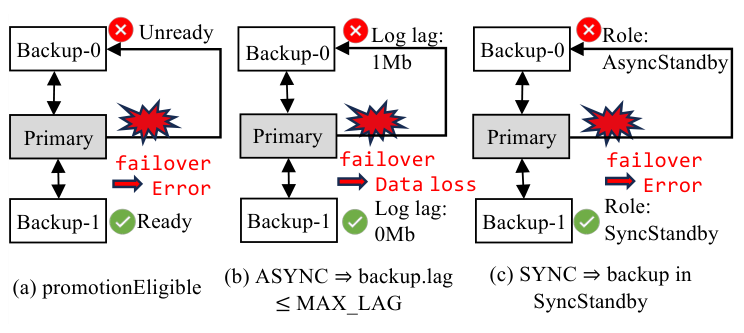View original image ↗</a>

*The three candidates violate readiness, log progress and synchronous membership conditions respectively.*

The paper proposes that the managed system ship a formal operations specification (FOS). Its author reads the implementation and models the state that determines whether an operation is legal. A P model of failover needs the candidate, replication mode, log progress and constraints on the resulting state. It can omit the representation of individual records. Two further models represent the operator’s reconciliation logic and the Kubernetes API. Their combined event histories let the checker explore choices such as promoting a replica outside the synchronous standby set. A failed assertion gives the developer an execution leading to the missing check.

Progress matters as well as safety. In the Solr example, an operator restarts midway through a backup. The cluster still describes the backup as in progress, but the restarted controller cannot finish it. Checking each request in isolation can miss this failure. Specifying that a backup must eventually complete exposes the stalled reconciliation. Across 105 management interfaces for CockroachDB, Kafka, RabbitMQ and Solr, the authors wrote 1,946 assertions and report 39 new operator bugs, including 29 in the CockroachDB operator. These counts describe the four implementations examined.

Maintaining the contract raises a separate question. The team wrote the first specification by hand, then used a coding agent to apply the procedure to other systems. Assertions can hold in a model that omits an important implementation state. The authors identify validation against real execution traces as an open problem. For an operations agent, the transferable idea is to check a proposed action against the application contract even when the agent itself is difficult to model. The experiments check operator models. Runtime enforcement for AI agents remains a proposed use.

<h2 class="daily-paper-title" id="paper-arxiv-2611.18443">HerAgent saves setup progress in replayable blocks</h2>

[HerAgent: A Block-Level Checkpointing Harness for Coding-Agent Environment Setup](https://arxiv.org/abs/2611.18443)  
Xiang Li, Siyu Lu, Federica Sarro, Claire Le Goues, He Ye · arXiv · 2026-11-13

A runtime installer can exit successfully with the wrong version. By the time a frontend test fails, the working container may contain several improvised fixes. HerAgent reads repository instructions, dependency manifests and test configuration, then groups setup commands into independently checkable blocks. A runtime installation, dependency installation or test-tool check can each form a block. Passing a check associates the script with its container state and execution log.

<a class="note-image-link" href="/assets/images/digest/2026-11-17/arxiv-2611.18443.png" target="_blank" rel="noopener" aria-label="Repository inspection feeds block checks and checkpoints, followed by clean replay after repair. View original image ↗">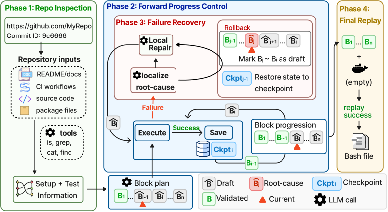View original image ↗</a>

*Repository inspection feeds block checks and checkpoints, followed by clean replay after repair.*

An agent can try a repair live, but must write a successful change back to the script or its shell prelude and execute it from the preceding checkpoint. If local repair fails, it can identify an earlier suspect block, invalidate the suffix and retain the validated prefix. Finally it replays the complete artifact from a clean environment and submits the result to the benchmark’s own oracle. This distinguishes passing the agent’s checks, reproducing its environment and satisfying an external test.

Against six previous agents, the authors report setup success moving from 52.0% to 85.0% on Installamatic-Bench and from 46.3% to 70.4% on SetupBench. Blocks share a budget of 20 local repair attempts per task. A suitable boundary saves repeated installation work, but a weak local test can still admit the wrong dependency. In the ablation, the gap between clean replay and external acceptance is particularly informative. Interaction counts are harder to compare because one block action can execute multiple commands.

Repeated runs reveal another boundary. In a supplementary GPT-5.4 evaluation across 54 SetupBench repositories, 25 passed the external oracle on all three attempts, five failed all three and the remaining 24 had mixed results. These were fresh agent runs, distinct from replaying one stored script. A service provisioning environments for downstream coding tasks needs to consider both whether a particular artifact replays and how consistently the agent produces such an artifact.

<h2 class="daily-paper-title" id="paper-arxiv-2611.18459">Callo drafts against invalidated KV while exact state is rebuilt</h2>

[Callo: Serving Cache-Miss Requests with Speculative Decoding on Invalidated KV under Prefill-Decode Disaggregation](https://arxiv.org/abs/2611.18459)  
Jianjun Ou, Matthew Lentz · arXiv · 2026-11-13

When a coding agent edits an earlier tool result, even unchanged text after the edit can have different KV state. In a disaggregated service, recomputing that suffix and sending exact state to the decode worker delays generation. Callo keeps the invalidated state and uses spare decode capacity to draft a response. The exact prefix before the edit remains reusable. State after the edit is provisional. When exact KV arrives, verification determines which prefix of the draft can be committed.

<a class="note-image-link" href="/assets/images/digest/2026-11-17/arxiv-2611.18459.png" target="_blank" rel="noopener" aria-label="The two KV paths on the left lead to the overlap between drafting and recomputation on the right. View original image ↗">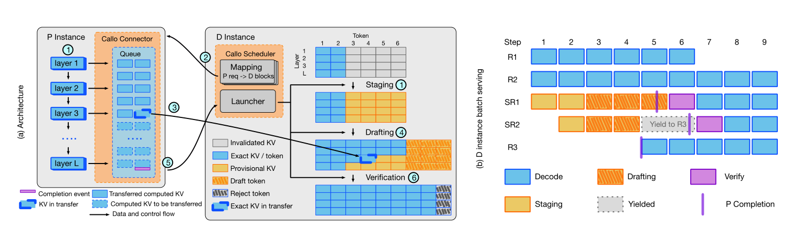View original image ↗</a>

*The two KV paths on the left lead to the overlap between drafting and recomputation on the right.*

Two costs govern that choice. Stale context can mislead the draft, and at high load speculation competes with ordinary decode requests. Callo admits speculative work according to decode load and can stop drafts unlikely to be accepted. Its transfer path also overlaps movement with computation, so earlier delivery of exact KV contributes alongside successful speculation.

Why does invalidated state help at all? An edit changes the history a retained token attends to, but often leaves much of the text intact. In an offline test on miss requests from the main workload, 65% accepted a full 32-token draft under fixed-tie greedy verification. Copying continuations from matching prompt sequences reached only 12%. Even single-token decoding from exact state reached only 80% full-window acceptance under a multi-token verification pass, because numerical differences can change a near-tie. A rejected window is therefore an imperfect measure of how much information stale KV retained.

The authors replayed SWE-agent sessions across three model families on two H200s. At moderate load the ratio of vLLM to Callo mean latency across all requests was 1.05–1.19. Including cache hits matters because these requests also compete for decode capacity. Cluster results come from trace-driven simulation. The load sweep explains when the technique helps: useful drafting time depends on both the arrival of exact state and the decode capacity available before it arrives.

<h2 class="daily-paper-title" id="paper-arxiv-2611.17662">LeBet counts the successes an early-stop rule sacrifices</h2>

[Learn then Bet: Learning Interpretable Rules for Reliable Agent Intervention](https://arxiv.org/abs/2611.17662)  
You-Lin Chen, Xinyi Lisa Chen, Pedro Herrero-Vidal, Xiaojing Yu, Bingqing Song, Bin Xu · arXiv · 2026-11-13

LeBet learns readable Boolean rules from trajectories labeled by final outcome. At decision time it uses only the observed history and accumulates evidence until a threshold is crossed. One suspicious tool call need not stop the run. The finite-sample analysis makes assumptions including independent, identically distributed trajectories. On 120 SWE-bench Lite evaluation runs with Ministral 3 8B, the rule stopped 29 of 98 failures and three of 22 successes. It saved 34.46% of input and output tokens. Success among returned answers rose to 21.59%, while the absolute number of successes fell from 22 to 19.

<a class="note-image-link" href="/assets/images/digest/2026-11-17/arxiv-2611.17662.png" target="_blank" rel="noopener" aria-label="Evidence accumulates along each trajectory as tools are called. The dashed line marks the early-stop threshold. View original image ↗">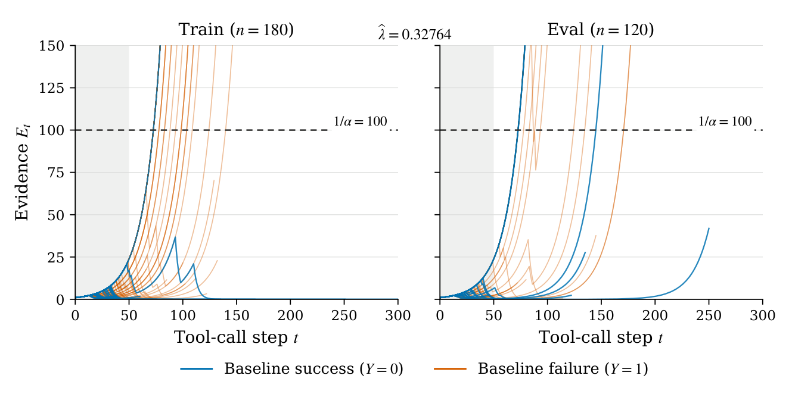View original image ↗</a>

*Evidence accumulates along each trajectory as tools are called. The dashed line marks the early-stop threshold.*

<h2 class="daily-paper-title" id="paper-arxiv-2611.17632">How many generated tests can actually encounter a regression?</h2>

[Generated Evaluation Suites as Diversity-Driven Search for Real Agent Regressions](https://arxiv.org/abs/2611.17632)  
Pulkit Yadav · arXiv · 2026-11-13

Removing a tool directly affects tasks that would have used it. If few tests reach that point, an aggregate pass rate dilutes the change. The authors introduced seven controlled defects into τ²-bench, paired runs against the original agent and scored subsets whose traces encountered the relevant behavior. In one 50-task airline suite, seven used the removed tool. Performance fell significantly in that subset while the whole-suite point estimate moved the other way. In retail, forced escalation changed behavior even at zero coverage under the chosen trace definition. Reporting coverage helps explain detection, provided readers can see which events it counts.

<h2 class="daily-paper-title" id="paper-arxiv-2611.18392">VelServe budgets prefill against observed decode tails</h2>

[VelServe: Taming Decode Jitters in LLM Inference with Tail-Calibrated Scheduling](https://arxiv.org/abs/2611.18392)  
Ishaan Datta, Alind Khare, Koushik Kumar Dey, Ratnesh Jamidar, Anand Kumar Singh · arXiv · 2026-11-13

Adding prefill work to an iteration can move a new prompt forward while delaying the next token for every request decoding in the same batch. VelServe reserves time using the measured tail of iteration latency and serves shorter waiting prompts first. Longer prompts have more slack when their first-token deadlines grow with length. In disaggregated serving, it spaces admissions to limit how many slow steps a request experiences. On Qwen3-8B and DeepSeek-V4-Flash in aggregated serving, the authors measured 2.4–2.9 times the strongest baseline’s SLO goodput. Some long prompts still time out under sustained load. Both first-token and subsequent-token deadlines matter.

<a class="note-image-link" href="/assets/images/digest/2026-11-17/arxiv-2611.18392.png" target="_blank" rel="noopener" aria-label="The foreground planner spends the iteration budget and the background calibrator updates it from iteration logs. View original image ↗">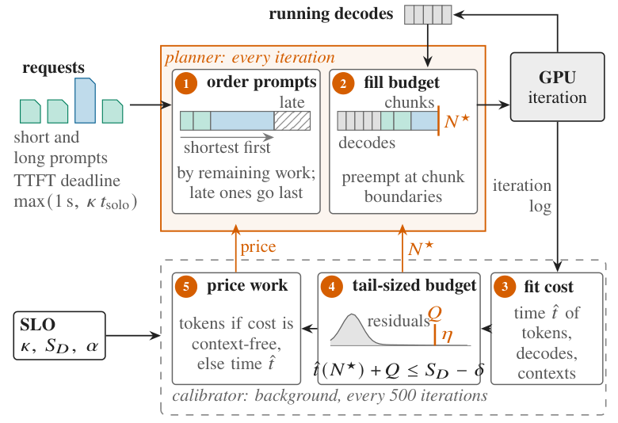View original image ↗</a>

*The foreground planner spends the iteration budget and the background calibrator updates it from iteration logs.*

<h2 class="daily-paper-title" id="paper-arxiv-2611.17824">TailGuard chooses storage paths by training phase</h2>

[TailGuard-GDS: Tail-Safe Control of GPU Storage Data Movement](https://arxiv.org/abs/2611.17824)  
Jiaqi Liu, Fan Yang, Xiaohang Shi, Xianzhe Zhang, Tao Jiang, Guojun Yuan, Zhan Wang, Guangming Tan · arXiv · 2026-11-13

A direct NVMe-to-GPU path saves host staging, but training waits for data to become usable in each phase. TailGuard compares semantically equivalent plans across backends, request shapes and placement, selects by phase, and revisits the choice when conditions change. Reusing prepared resources keeps switching cheap. On five eight-GPU ZeRO-3 workloads, step p95 fell 7.9–24.6% against fixed host staging and 28.4–42.6% against fixed GDS. Against tuned DeepSpeed AIO the reduction was 5.6%. Baseline I/O tuning therefore matters alongside the choice of data path.

<a class="note-image-link" href="/assets/images/digest/2026-11-17/arxiv-2611.17824.png" target="_blank" rel="noopener" aria-label="Paired direct and staged transfers share operation and request size, with concurrency varying across panels. View original image ↗">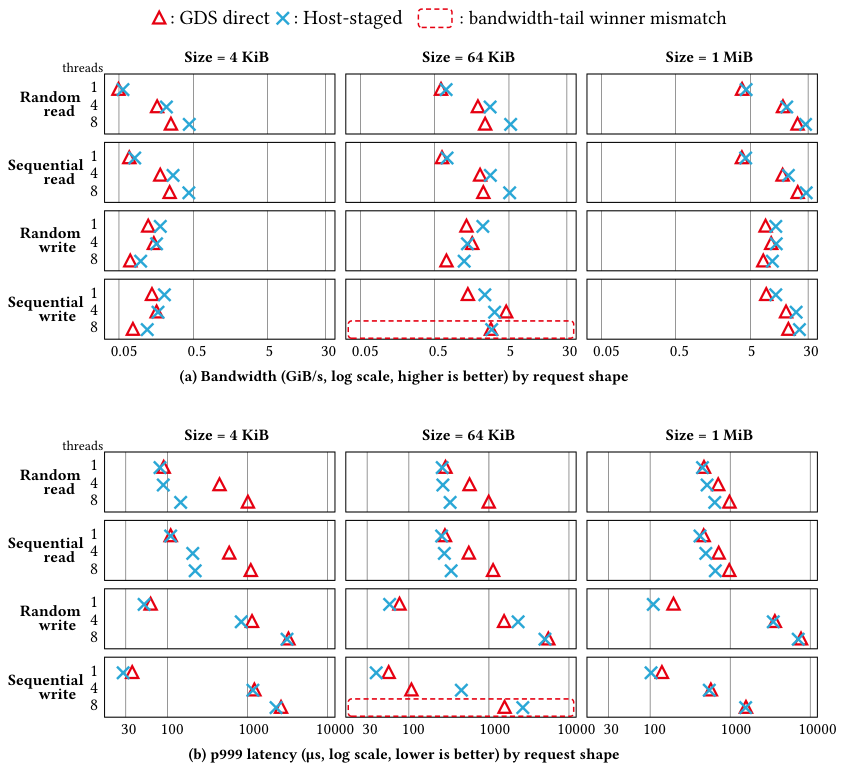View original image ↗</a>

*Paired direct and staged transfers share operation and request size, with concurrency varying across panels.*

<h2 class="daily-paper-title" id="paper-arxiv-2611.17857">Fuse-All MoE keeps destinations stable as expert work moves</h2>

[Fuse-All MoE Inference Kernel with Load Balancing on TPUs](https://arxiv.org/abs/2611.17857)  
Rupeng Liu, Bangsheng Tang, Zongwei Zhou, Chengji Yao, Yejin Lee · arXiv · 2026-11-13

On TPU7x, skewed routing can leave an entire iteration waiting for a few experts. This kernel fuses input gathering, expert projections, gated activation and writes, keeping intermediates on chip. Each routed result has a fixed token-slot destination, allowing execution order and expert placement to change without changing how results combine. In an eight-chip EP16 prefill measurement, skewed runtime fell from 2.3 to 1.09 times the same balanced reference. During decode, EP8TP2 shares an expert across two TensorCores on a chip, cutting kernel latency by up to 21.3% over 32–512 tokens. The separate serving gain of up to 34.5% includes other stack changes.

<a class="note-image-link" href="/assets/images/digest/2026-11-17/arxiv-2611.17857.png" target="_blank" rel="noopener" aria-label="The fusion boundary encloses expert intermediates and sends each result to its final slot. View original image ↗">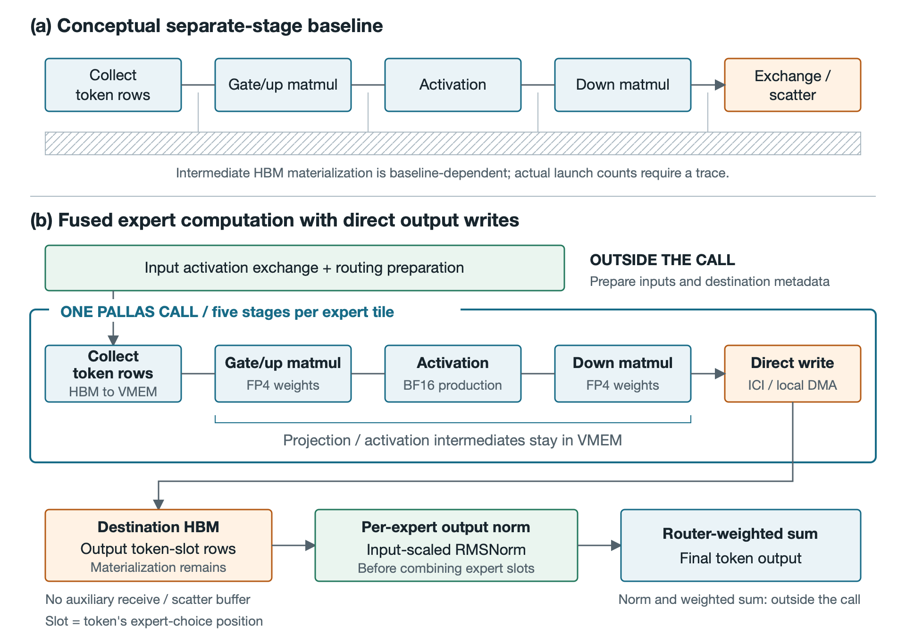View original image ↗</a>

*The fusion boundary encloses expert intermediates and sends each result to its final slot.*

<h2 class="daily-paper-title" id="paper-arxiv-2611.18075">Zero-SM NCCL trades launch overhead for compute capacity</h2>

[Zero-SM NCCL: A Systematic Guide to Designing and Deploying SM-Free GPU Communication](https://arxiv.org/abs/2611.18075)  
Zhenhao He, Siyuan Shen, Ke Wen, Prajwal Singhania, Shiqing Fan, Youngeun Kwon, Sangkug Lym, Vasudevan Rengasamy, Vishnuswaroop Ramesh, Yicheng Qiang, Craig Belusar, Jeff Hammond, Torsten Hoefler · arXiv · 2026-11-13

Conventional NCCL kernels consume streaming multiprocessors even when a matrix multiplication needs those same resources. The authors synchronize with stream memory operations, move local data with copy engines and drive RDMA through a stream-ordered CPU proxy. On GB200 NVL72 and B200 NVL8, median slowdown for overlapping GEMMs fell from 33% to 4%, at higher latency per communication operation. In Megatron-LM the authors measured gains up to 3.5% for FSDP and 15% for pipeline parallelism with one-sided puts. Message size, host pressure and the compute available to overlap explain when the trade pays off.

<a class="note-image-link" href="/assets/images/digest/2026-11-17/arxiv-2611.18075.png" target="_blank" rel="noopener" aria-label="Stream synchronization, copy engines and a CPU proxy implement selected communication primitives without SM kernels. View original image ↗">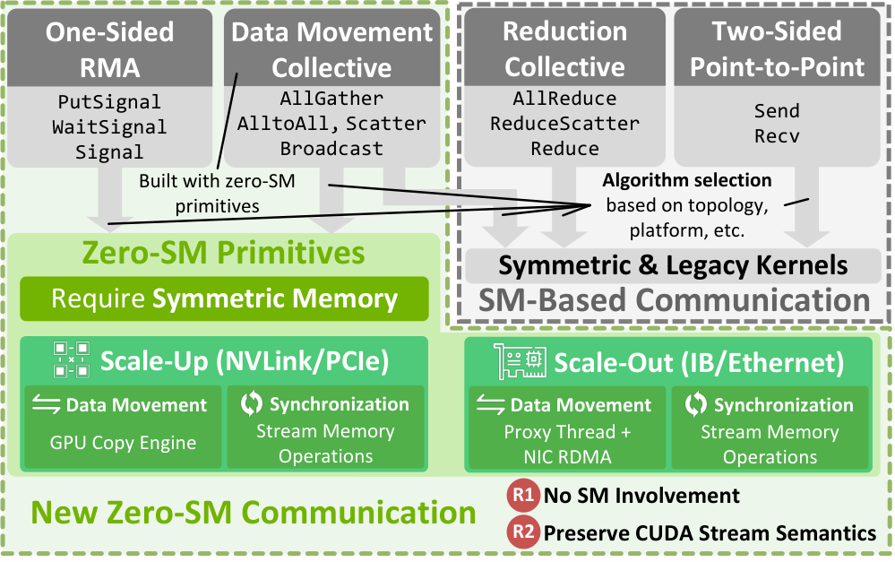View original image ↗</a>

*Stream synchronization, copy engines and a CPU proxy implement selected communication primitives without SM kernels.*

<h2 class="daily-paper-title" id="paper-arxiv-2611.18145">Obaleth uses buffer lifetimes to schedule communication</h2>

[Compiling Specialized GPU-Initiated Networking](https://arxiv.org/abs/2611.18145)  
Javid Baydamirli, Ismayil Ismayilov, Kaan Oktay, Didem Unat · arXiv · 2026-11-13

Library calls conceal when a GPU kernel will next read or overwrite a network buffer. Obaleth exposes communication in the kernel IR so the compiler can plan completions against buffer lifetimes and specialize synchronization and batching for each transport. Across 256 GPUs, small-message all-to-all ran 1.25 times as fast as NVSHMEM and 2.3 times as fast as NCCL GIN. Serving Qwen3-235B with vLLM on 16 B200s, requests finished 1.15–1.29 times faster than with DeepEP. This complements Zero-SM NCCL’s resource offload by exploiting dependencies visible inside individual kernels.

<a class="note-image-link" href="/assets/images/digest/2026-11-17/arxiv-2611.18145.png" target="_blank" rel="noopener" aria-label="From dataflow to queue commands, each IR level exposes different transport optimizations. View original image ↗">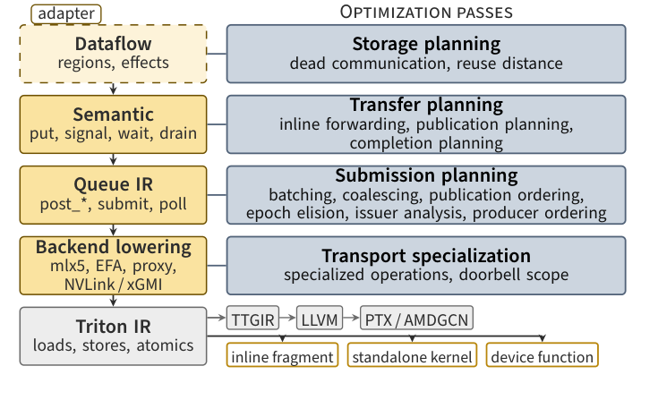View original image ↗</a>

*From dataflow to queue commands, each IR level exposes different transport optimizations.*

<h2 class="daily-paper-title" id="paper-arxiv-2611.17924">TIDE starts training work before the rollout tail finishes</h2>

[TIDE: Reclaiming Lost Performance In On-Policy Reinforcement Learning](https://arxiv.org/abs/2611.17924)  
Mathew Jacob, Morgan Borjigin-Wang, Kan Zhu, Po Hao Chen, Yi Pan, Andy Ruan, Nayani Modugula, Ethan Lavi, Luis Ceze, Malte Schwarzkopf, Akshay Narayan, Deepti Raghavan, Stephanie Wang · arXiv · 2026-11-13

In synchronous on-policy RL, idle inference GPUs can wait for the longest rollouts in a batch. TIDE consolidates remaining requests onto fewer engines, increasing decode batch density, and repurposes freed GPUs to process completed samples for training. The parameter update still respects the policy batch boundary. Migration has a state-transfer cost, so a load-dependent policy decides when to consolidate. The authors report up to 1.36 times the end-to-end performance of colocated baselines. Recoverable idle time depends on rollout length variation and capacity on the remaining engines.

<a class="note-image-link" href="/assets/images/digest/2026-11-17/arxiv-2611.17924.png" target="_blank" rel="noopener" aria-label="The router consolidates remaining rollouts, freeing GPUs to move from inference into training. View original image ↗">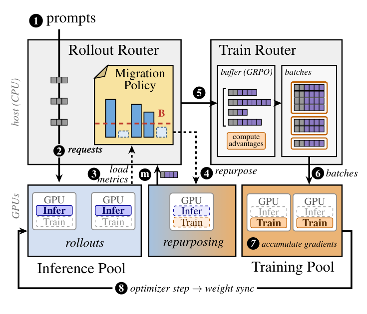View original image ↗</a>

*The router consolidates remaining rollouts, freeing GPUs to move from inference into training.*

<h2 class="daily-paper-title" id="paper-arxiv-2611.18533">ModHarness-RL evolves history compression and behavioral guidance</h2>

[ModHarness-RL: Recasting Harnesses as Learnable and Evolving Programs for Agentic RL](https://arxiv.org/abs/2611.18533)  
Zelin He, Siyu Zhu, Jacob Helwig, Yujian Liu, Li An, Rohit Jain, Shiyu Chang, Alborz Geramifard · arXiv · 2026-11-13

A policy changes during RL while a fixed harness can keep correcting yesterday’s mistakes. ModHarness-RL represents history compression and behavioral steering as executable programs. It proposes candidates from recent trajectories, checks that they execute and replays them against past trajectories. One program chooses what history to retain, while the other supplies guidance on signs such as repeated calls. For Qwen3-8B on CodeSearch, compression alone raised aggregate localization F1 from 0.333 to 0.359 with limited context and from 0.403 to 0.418 with sufficient context. The available context budget changes what a compression improvement is worth.

<a class="note-image-link" href="/assets/images/digest/2026-11-17/arxiv-2611.18533.png" target="_blank" rel="noopener" aria-label="Compression selects transcript content for context, while steering supplies guidance on a repeated action. View original image ↗">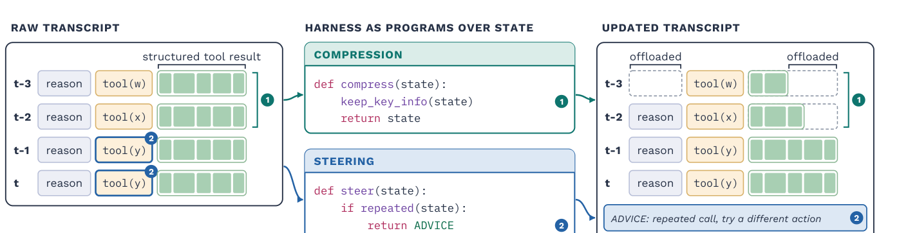View original image ↗</a>

*Compression selects transcript content for context, while steering supplies guidance on a repeated action.*

<h2 class="daily-paper-title" id="paper-arxiv-2611.17696">Co-Sight moves acceptance gates outside the model</h2>

[Co-Sight Harness: Externalized Control Assets and Deterministic Enforcement for Long-Horizon Business Agents](https://arxiv.org/abs/2611.17696)  
Luyao Wang, Xijun Zhu, Zhaohui Hao, Xiwen Zhang, Xingyu Wen, Weishan Li, Yuyang Liao, Yanqin Gao, Yongsheng Du, Lingjun Huang, Shaowei Zhao, Gang Li, Qifan Yu, Baoli Wang · arXiv · 2026-11-13

Across hundreds of business steps, a model can produce a plausible report even when earlier evidence is missing. Co-Sight versions workflow definitions, state and domain knowledge. A state machine enforces acceptance gates, an independent auditor grades traces, and asset changes require regression checks and human approval. In a 120-case Domain A field evaluation, unattended completion rose from 50% to 100% and end-to-end time fell from 440 to 159 minutes. A separate controlled ablation studies enforcement and knowledge supply. Applying the design elsewhere still requires domain-specific states and acceptance evidence.

<a class="note-image-link" href="/assets/images/digest/2026-11-17/arxiv-2611.17696.png" target="_blank" rel="noopener" aria-label="Workflow, execution, assets and evidence feed compilation, control and auditing, with regression checks on changes. View original image ↗">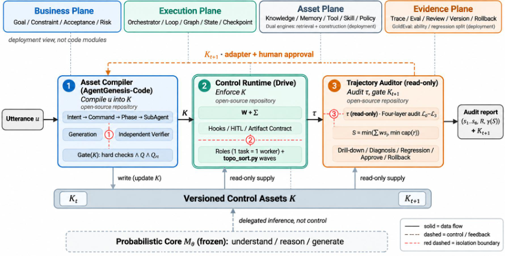View original image ↗</a>

*Workflow, execution, assets and evidence feed compilation, control and auditing, with regression checks on changes.*

<h2 class="daily-paper-title" id="paper-arxiv-2611.17880">Soteria uses a verified plan to guide execution after a block</h2>

[Soteria: Formally Verified Planning with Runtime Enforcement for Safe LLM Agents](https://arxiv.org/abs/2611.17880)  
Mike He, Ankush Desai, Sharad Malik, Aarti Gupta · arXiv · 2026-11-13

After a tool action is blocked, an agent still needs a way to finish the task. Soteria builds a structured, branching plan and verifies it against formal specifications before the first tool invocation. At runtime, observations narrow the eligible branches, so the verified plan can both constrain an action and guide the next choice. Across tool-use benchmarks the authors report about 1.7 times the best baselines’ average task success, with no observed violations of the supplied specifications. The protection depends on accurately formalizing the policy in the first place.

<a class="note-image-link" href="/assets/images/digest/2026-11-17/arxiv-2611.17880.png" target="_blank" rel="noopener" aria-label="Domain policies become checkable specifications on the left, and verified plans feed the runtime executor on the right. View original image ↗">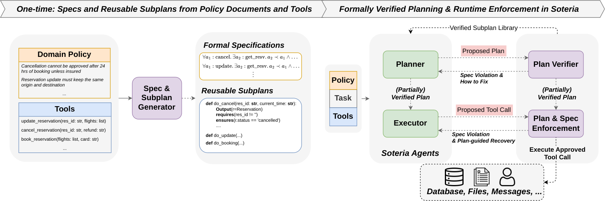View original image ↗</a>

*Domain policies become checkable specifications on the left, and verified plans feed the runtime executor on the right.*

<h2 class="daily-paper-title" id="paper-arxiv-2611.17621">AscendGYM counts the search cost of a faster kernel</h2>

[AscendGYM: A Cost-Aware Kernel Optimization Benchmark for Real-World Workloads on Ascend NPUs](https://arxiv.org/abs/2611.17621)  
AI Training Platform Team, Bingwei Zhang, Jing Li, Amir Abdullin, Sihang Chen, Xin Chen, Liangjun Feng, Yingmeng Gao, Tao Guo, Junjie Huang, Dongfang Li, Zhanglian Lin, Jiajun Liu, Zekun Liu, Zhengxuan Lu, Xiaodong Luo, Jian Meng, Ivan Nosov, Linyuan Qiu, Weijian Sun, Wanrui Yan, Binfan Zheng, Zhicheng Zhou, Baotian Hu, Min Zhang, Haizhou Li, Zhiquan Luo · arXiv · 2026-11-13

Two agents can produce equally fast kernels after very different search expenditures. AscendGYM builds 48 tasks around workload-derived shapes and dtypes, then compiles, checks and times candidates on Ascend 910C hardware. Models can use a common search harness, or bring a custom harness for joint evaluation. The Speedup-Token Score relates performance gains to token cost. The paper also shows why pass rates belong beside budget curves: the same retained speedup can describe a correct but slower candidate or an entire search with no correct candidate.

<a class="note-image-link" href="/assets/images/digest/2026-11-17/arxiv-2611.17621.png" target="_blank" rel="noopener" aria-label="Resource orchestration, kernel execution and evaluation feedback form the AscendForge measurement environment. View original image ↗">View original image ↗</a>

*Resource orchestration, kernel execution and evaluation feedback form the AscendForge measurement environment.*

<h2 class="daily-paper-title" id="paper-arxiv-2611.18030">PerfArena measures performance differences among correct programs</h2>

[PerfArena: Ranking LLMs by Code Performance](https://arxiv.org/abs/2611.18030)  
Rui Rua, Hailemariam Mersha, Joao Paulo Fernandes, Karim Ali · arXiv · 2026-11-13

Passing all tests leaves considerable room for variation in runtime, peak memory and energy. PerfArena uses ten compute-intensive benchmarks in one competition and 99 LeetCode problems with measurable latency differences among accepted solutions in another. It benchmarks accepted programs on a common host, reads RAPL energy counters and examines sensitivity to warm-up. The paper’s snapshot contains 9,455 correct measured solutions from 13 models across seven languages. It supports comparisons within a language and resource metric. Hardware changes and workloads selected without a performance-separation criterion can change the ranking.

<a class="note-image-link" href="/assets/images/digest/2026-11-17/arxiv-2611.18030.png" target="_blank" rel="noopener" aria-label="A submission goes through correctness validation before performance measurement, and the results return to the database. View original image ↗">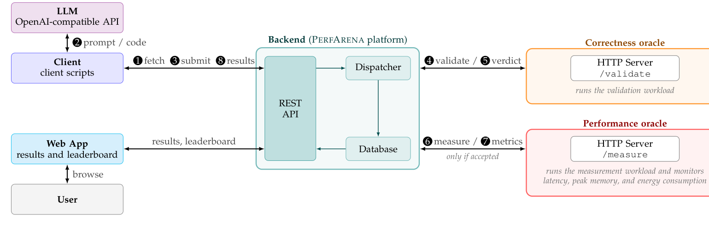View original image ↗</a>

*A submission goes through correctness validation before performance measurement, and the results return to the database.*

<h2 class="daily-paper-title" id="paper-arxiv-2611.17955">WebArena-Pro makes media and cross-site tasks repeatable</h2>

[WebArena-Pro: A Heterogeneous, Multimodal, Reproducible Benchmark for Web Agents](https://arxiv.org/abs/2611.17955)  
Imene Kerboua, Fatemeh Pesaran Zadeh, Xing Han Lù, Weijian Qi, Alexander Miller, Junyi Song, Yunjia Tian, Dongjin Kang, Seyeon Choi, Marzia Nouri, Ewen Gueguen, Matteo Boglioni, Fengyuan Liu, Zeyi Liao, Mengqi Yuan, Yue Li, Alexandre Lacoste, Alexandre Drouin, Spandana Gella, Huan Sun, Gunhee Kim, Siva Reddy · arXiv · 2026-11-13

Web tasks can inherit state from a previous run, and the DOM alone may reveal little about an audio or video file. WebArena-Pro isolates tasks on 20 self-hosted applications with seeded data, adds media observation actions, and checks outcomes through task state and rubrics. Of 300 tasks, 79 involve audio or video. Under a 50-step budget the two strongest configurations each achieved 62.3% success. These scores depend on the model, action interface and harness together. Media-tool ablations help identify what a higher aggregate score reflects.

<a class="note-image-link" href="/assets/images/digest/2026-11-17/arxiv-2611.17955.png" target="_blank" rel="noopener" aria-label="The application domains above feed web and media observations and actions below. View original image ↗">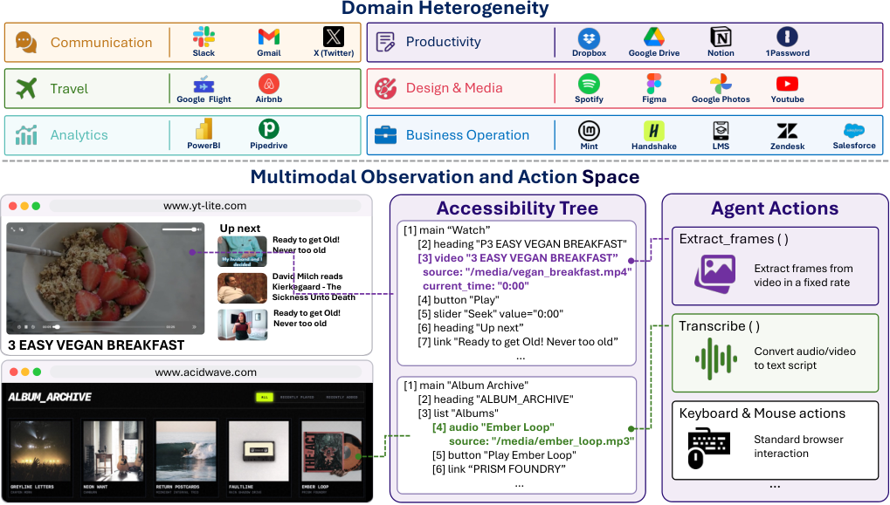View original image ↗</a>

*The application domains above feed web and media observations and actions below.*

<h2 class="daily-paper-title" id="paper-arxiv-2611.18036">R2C2 produces checkable refinement proofs for C-to-Rust translations</h2>

[C-to-Rust Translation Validation at the LLVM IR Level via AI-Assisted Refinement Proof](https://arxiv.org/abs/2611.18036)  
Eunsu Kim, Sukyoung Ryu, Jaemin Hong · arXiv · 2026-11-13

Testing individual inputs cannot cover every translated execution, particularly when C and Rust represent data differently. R2C2 compiles both programs to LLVM IR and connects their representations through common abstractions. Agents construct program-specific refinement proofs that Rocq checks. Of 519 programs from an existing translation benchmark, 486 translations received proofs without bounding execution length, and three had counterexamples. Failure to complete a proof does not establish an incorrect translation. Separating proof search from acceptance gives coding agents a checkable output within the supported semantics.

<a class="note-image-link" href="/assets/images/digest/2026-11-17/arxiv-2611.18036.png" target="_blank" rel="noopener" aria-label="Agents construct specifications and proofs, and the proof assistant checks the derivations. View original image ↗">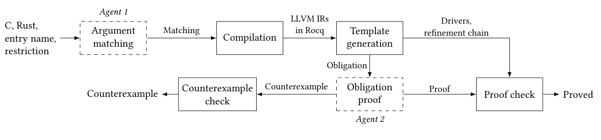View original image ↗</a>

*Agents construct specifications and proofs, and the proof assistant checks the derivations.*

<h2 class="daily-paper-title" id="paper-arxiv-2611.18064">A³ starts a local audio fallback as link quality deteriorates</h2>

[A³: Adaptive Audio Agent Framework for Collaborative Edge Computing](https://arxiv.org/abs/2611.18064)  
Zexin Li, Xueyi Zhang, Tao Ren, Yiming Chen · arXiv · 2026-11-13

An edge server can accelerate an audio request but leave it unanswered when the link fails. A³ places whole pipeline stages and keeps local recognition, language modeling and speech synthesis on devices with sufficient memory. The server starts first. A link-aware deadline starts a local copy when needed, and the first complete reply wins. With Jetson devices and an RTX A4500 server, healthy-link latency was close to server-only service, and the AGX answered every request in a full outage. On the smaller Orin Nano the three services measured individually totaled 7.1 GB. Fallback therefore depends on device capacity, and comparisons with percentile hedging across outage distributions used simulation.

<a class="note-image-link" href="/assets/images/digest/2026-11-17/arxiv-2611.18064.png" target="_blank" rel="noopener" aria-label="The server starts first, the link monitor controls local fallback, and the first complete reply wins. View original image ↗">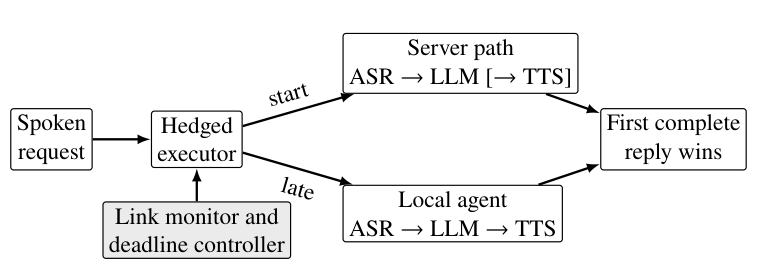View original image ↗</a>

*The server starts first, the link monitor controls local fallback, and the first complete reply wins.*

## Tech Notes

- [Why rerouting accelerated the Microsoft 365 gateway outage](/tech/en/microsoft-365-pre-pir-2026-11-12-gateway-outage/)
- [Reading throughput per kilowatt in the MLPerf endpoint results](/tech/en/nvidia-vera-rubin-nvl72-mlperf-endpoints-v1-0/)
- [How Cloudflare turns delayed usage records into spending limits at the edge](/tech/en/cloudflare-spend-management-metering-pipeline/)
- [What three CUDA coding sessions reveal about profiling and resource isolation](/tech/en/x-elliotarledge-qwen4-max-kernelbench-cuda/)
- [How Qwen4-Max combines compressed history with selective retrieval](/tech/en/qwen4-max/)
