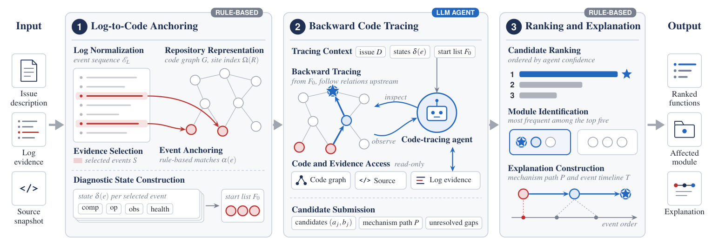
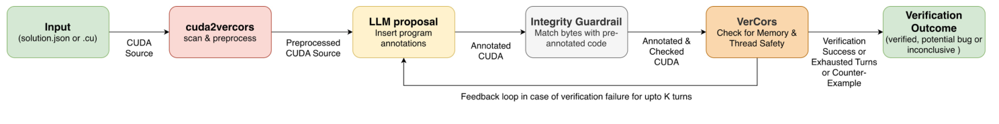
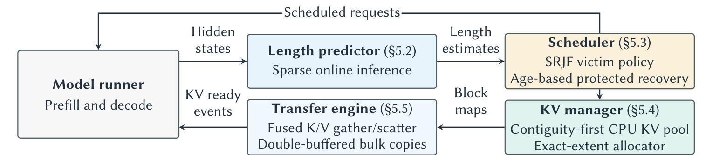

Three different guarantees connect this issue: safety, evidence and progress. KernelArmor places CUDA safety verification inside optimization; CLEW connects logs to candidate causal code while exposing the gap between ranking and causal explanation; Stint addresses repeated KV recovery that produces little fresh output. Correct outputs, live processes and successful tool returns each describe only part of reliability.

The remaining work develops low-precision execution, storage, parallelism and energy management under concrete workload limits, alongside better agent environments, oversight and formal feedback. Useful distinctions run throughout: stage speedup versus end-to-end benefit, compilation versus semantic faithfulness, and restored state versus user-visible progress.

<h2 class="daily-paper-title" id="paper-arxiv-2611.19448">01 · CLEW: tracing from symptom code to candidate causes</h2>

[CLEW: Log-Anchored Backward Tracing for Root-Cause Code Localization](https://arxiv.org/abs/2611.19448)  
Bai, Wenji, Waseem, Muhammad, Peltonen, Jaakko, Abrahamsson, Pekka · 2026-11-14

Production incidents often leave an issue, log excerpts and a deployed source snapshot rather than a reproducible failing test. The function that emits an error may merely detect a symptom. CLEW makes this gap explicit: establish inspectable log-to-code links, let an agent investigate upstream from symptom functions, and return ranked functions, an affected module and a proposed mechanism path tied to events. Its AIOps contribution is an investigation entry point that engineers can inspect step by step.

The first phase is largely rule-based. The system indexes logging statements, exception sites and function locations, builds a static code graph, and matches events using stack frames, source locations and message templates. Multiple alternative anchors can survive. Matching scores express specificity, not calibrated causal probabilities. Selected events become diagnostic states containing component, operation, observation and health; unknown fields remain unknown. Health describes an observation rather than identifying its cause.

<a class="note-image-link" href="/assets/images/digest/2026-11-18/clew.png" target="_blank" rel="noopener" aria-label="Rules establish log anchors; the agent explores upstream code and retains evidence links. · View original image ↗">View original image ↗</a>

*Rules establish log anchors; the agent explores upstream code and retains evidence links.*

The agent then receives the issue, states and starting functions. Read-only tools expose function bodies, callers, attribute references and overrides. Source inspection can supplement unresolved dynamic dispatch, and candidate submissions retain unresolved gaps. Ranking uses the agent’s confidence, while the event timeline points back to logs. Backward tracing is an investigation direction, not complete data-flow analysis or an established causal chain.

LogLoc separates two evidence regimes. Its 150 real issues come from 25 Python repositories, with changed non-test functions in reference fixes serving as proxy labels. Another 42 Airflow fault-injection cases have known injected functions. On the issue subset, CLEW reaches 77.3% Acc@1 against LocAgent’s 72.0%, but the difference is not statistically significant; its Recall@5 is lower. On Airflow it ties two leading baselines at 97.6%. These are not interchangeable measurements of production root-cause accuracy.

The efficiency result is clearer: across 192 cases, mean wall time is approximately 60 seconds versus 219 seconds for LocAgent, about 73% lower. Mean inference costs are $0.157 and $0.154, respectively. Cost differences run in opposite directions across the two datasets, so faster does not mean universally cheaper.

The ablations and discussion deserve particular attention. Removing the tracing agent causes substantial degradation, but removing structured anchoring does not consistently reduce accuracy. The evidence supports explicit traceability, without establishing a reliable accuracy gain from anchoring itself. Explanation checks assess structural consistency, not causal correctness or engineers’ investigation time. CLEW offers a useful way to organize log-guided code investigation and a reason to measure ranking, evidence faithfulness and practical diagnostic benefit separately.

<h2 class="daily-paper-title" id="paper-arxiv-2611.18754">02 · KernelArmor: putting safety verification inside CUDA optimization</h2>

[KernelArmor: End-to-End Agentic System for Establishing Memory and Thread Safety for CUDA](https://arxiv.org/abs/2611.18754)  
Chatterjee, Bodhisatwa, Zaid, Mohamed Tarek Ibn, Damani, Sana, Hari, Siva Kumar Sastry, Kozyrakis, Christos · 2026-11-11

A CUDA kernel can produce correct benchmark outputs while remaining unsafe for other sizes, offsets or concurrent executions accepted by its wrapper. KernelArmor addresses this gap between tests and interfaces. An LLM proposes contracts and annotations; an extended VerCors checks memory and thread safety and returns diagnostics for revision. The optimization loop receives checkable safety obligations rather than a model’s textual assurance.

A deterministic frontend identifies unsupported constructs, normalizes CUDA and lowers supported operations to calls with explicit safety contracts. Using available host code and launch metadata, the agent proposes preconditions, postconditions, loop invariants and permission annotations. An integrity guard strips annotations and requires the remaining program to match the preprocessed baseline byte for byte. This prevents silently changing the program to make verification easier. Source-grounded verifier feedback drives a bounded annotation-repair loop.

<a class="note-image-link" href="/assets/images/digest/2026-11-18/kernelarmor.png" target="_blank" rel="noopener" aria-label="An integrity guard preserves the program; verifier feedback revises annotations and separates verified, potential-bug and inconclusive outcomes. · View original image ↗">View original image ↗</a>

*An integrity guard preserves the program; verifier feedback revises annotations and separates verified, potential-bug and inconclusive outcomes.*

The CUDA modeling is central. Asynchronous copies retain permissions until the corresponding completion; an unrelated wait cannot authorize buffer reuse. Warp synchronization transfers permissions only among participating lanes. Packed accesses must satisfy alignment and the bounds of every element, while pointer casts retain byte-offset semantics. A 64-bit cast after a 32-bit multiplication, for example, cannot undo an overflow that already occurred. Ordinary benchmark shapes can miss these conditions.

Across three suites containing 740 instances and 1,370 kernel definitions, KernelArmor verifies 84 instances, reports potential findings in 582 and remains inconclusive on 74: 11.4%, 78.6% and 10%. These classify the selected implementations, not production incident frequency. Race coverage also needs its denominator: all 14 in-scope races are detected, but nine tests involving cross-stream, CPU–GPU or multi-GPU interactions lie outside the current scope.

The optimization experiment integrates verification into 11 KernelBench tasks with seven independent trajectories per task. Each trajectory has up to eight rounds and a six-hour budget, with kernels measured on an A40. A candidate first passes numerical checks and beats the incumbent; it becomes the new incumbent only after safety verification. All 77 trajectories finish with verified kernels, retaining 99% of the unconstrained geometric-mean speedup. Filtering an unconstrained search afterward retains implementations in far fewer trajectories, illustrating the value of returning diagnostics while changes can still be made.

Verification consumes time and can reject fast candidates whose proofs are unresolved. Inconclusive does not mean buggy. Guarantees remain conditional on explicit preconditions, the supported CUDA model and library contracts, and do not automatically establish numerical equivalence. The transferable AgentOps lesson is to distinguish a potential defect, an incomplete proof and an unsupported construct, because each calls for a different next action.

<h2 class="daily-paper-title" id="paper-arxiv-2611.20106">03 · Stint: recovery must produce fresh tokens</h2>

[Making Preemption Productive in Long-Output LLM Serving](https://arxiv.org/abs/2611.20106)  
Shi, Ziji, Wan, Xinyi, Ruan, Chaoyi, Huang, Guangxing, Lin, Min, Li, Jialin · 2026-11-15

Long-output requests hold growing KV caches until GPU memory fills and some requests must be preempted. The problem is larger than transfer or recomputation time: a request can repeatedly lose and recover state, only to be evicted before producing meaningful output. Stint calls this KV thrashing. Its objective moves from faster restoration to useful progress after restoration, addressing a service that remains alive while a user sees a prolonged output stall.

Victim selection estimates remaining output length from decoding hidden states, favoring requests close to completion. Predictions refresh sparsely to limit overhead. If eligible candidates lack usable estimates, selection falls back to freeing the most physical KV blocks. A preempted request retains a complete CPU snapshot when allocation succeeds; otherwise it falls back to recomputation.

<a class="note-image-link" href="/assets/images/digest/2026-11-18/stint.png" target="_blank" rel="noopener" aria-label="Prediction guides victims, storage and transfer restore state, and scheduling protects fresh output. · View original image ↗">View original image ↗</a>

*Prediction guides victims, storage and transfer restore state, and scheduling protects fresh output.*

Storage exploits the fact that a paused snapshot no longer grows. The CPU pool prefers one exact-sized contiguous extent, then a small number of extents, avoiding fixed large-slot padding. Fused kernels gather scattered GPU K/V blocks into staging buffers for bulk DMA; reload reverses the process. Double buffering overlaps copying with gather or scatter, while CUDA events enforce safe buffer reuse and computation dependencies. This reduces movement overhead without hiding every transfer behind model execution.

Recovery scheduling provides the crucial second half. Stall age starts at preemption and survives reloading or recomputing old context; only fresh output clears it. In the evaluated configuration, five seconds establishes readmission eligibility. Each replica protects one request through restoration and 64 new tokens, or earlier completion. Five seconds is not a waiting-time bound, and reconstructed old tokens do not count toward the protected turn.

The main replay serves BF16 Qwen3-32B on eight H200s as four TP2 replicas, with four requests per second across the deployment. On the olympiad workload, p99 TPOT falls 50.69% and throughput rises 11.99% against recomputation in the same maintained engine, finishing the batch about 10.7% earlier. No observed request pause exceeds 50 seconds. Fixed output lengths equalize output work; they do not evaluate answer quality or imply token-identical text under different schedules.

The gains have costs. Pinned host memory and GPU staging consume resources, protected recovery can delay other requests, and throughput gains are much smaller on other workloads. Some predictor-training questions appear in the main replay; the authors separately analyze the held-out subset. The recovery state machine, memory accounting and cross-workload results are the most useful reading. Stint’s contribution is coordinating preserved state, data movement and scheduler protection around fresh output rather than treating fast swapping as sufficient.

## Systems and agent research

<h2 class="daily-paper-title" id="paper-arxiv-2611.19230">04 · CompoundingKernel: reliable evaluations determine search scale</h2>

[CompoundingKernel: Self-Improving from Zero to First](https://arxiv.org/abs/2611.19230)  
Qu, Qian, Wang, Hongyang, Chen, Wenbo, Li, Yichuan, Liu, Jingguo, Li, Xian, Wang, Xuan, Wen, Ruochen, Fan, Leo, Yan, Yiming, Wang, Zheshen, Dumoulin, Benoit · 2026-11-14

CompoundingKernel searches from PyTorch definitions, keeping every checked-correct candidate and its lineage in an external archive. A controller rereads it and gives each parallel child a parent and one direction. Slower correct candidates can become stepping stones, and restarts preserve progress.

As of the report’s November 11 snapshot, all 235 problems have site-verified implementations. Across 209 public-board problems, geometric-mean speedup over the official reference is 4.40×. Local B200 clocks differ from the official site, so larger local speedups are not interchangeable. At equal wall time, the controller wins 35 of 38 comparisons with a UCB-style tree mainly through more correct attempts, not better parent choices per attempt. A warm restart bundling several changes raises evaluation rate 3.6×, without isolating individual contributions. This complements KernelArmor: search organization and external testing versus conditional safety proofs.

<h2 class="daily-paper-title" id="paper-arxiv-2611.18972">05 · NVFP4-MLA: FP4 storage and computation share one cache</h2>

[NVFP4-MLA: Unified FP4 KV-Cache Storage and Attention Computation for Multi-Head Latent Attention](https://arxiv.org/abs/2611.18972)  
Ni, Chao, Zhang, Qi, Wang, Xiao, Jing, Zongfei, Hao, Mingyang, Chen, Binghan, Duan, Kefeng, Chen, Yu-Jung, Wang, Mengdi, Blankevoort, Tijmen, Yang, Jun · 2026-11-13

Compressing KV storage alone need not accelerate compute-bound MLA if operands are dequantized before calculation. NVFP4-MLA uses two-dimensional token-by-channel blocks compatible with both QK and PV reductions, plus FP4 residuals on sensitive channels, so one cache directly supports both low-precision matrix multiplications.

Nine-task mean accuracy is close to BF16 for DeepSeek-R1 and Kimi-K3, with 3.20× and 3.05× MLA-cache compression. Kimi’s count excludes KDA state and retains FP8 in its last two MLA layers; this is not threefold compression of all model state. On Rubin, equal-cache-budget AgentX replay links higher cache hit rates to less repeated prefill: at 48 DeepSeek-R1 sessions, p90 TTFT falls from 108 to 30.9 seconds. Similar average accuracy does not imply losslessness on every task. Read numerical error, capacity and kernel throughput together.

<h2 class="daily-paper-title" id="paper-arxiv-2611.20095">06 · Speech serving: choose fusion granularity by current work</h2>

[High-Throughput Serving of Nemotron 3.5 Transcribe with Regime-Aware Megakernels and Kernel Fusion](https://arxiv.org/abs/2611.20095)  
Chatterjee, Aditya, Chauhan, Sanjay Singh, Jain, Mayank, Dhingra, Arushi, Chowdhury, Sahin, Mittal, Rahul · 2026-11-15

Continuous batching changes the work of each Nemotron 3.5 Transcribe pass, making an always-on megakernel inefficient at larger sizes. Offline crossover measurements select between persistent megakernels and fused-kernel chains using encoder tokens or decoder rows; example thresholds are roughly 384 encoder tokens and 448 MoE rows.

Peak H100 SXM throughput is 4,345× real time, 1.39× tuned vLLM’s peak; B200 reaches 6,367× real time and 1.64× the baseline. Real-time factor measures audio throughput, not request-latency speedup. Under a 400 ms p95 completion budget, supported concurrency is eightfold higher. Native host execution, feature extraction and speculative decoding also contribute, so switching alone does not explain the full gain. Optional layer-skipping optimizations raise WER and must be separated from the main accuracy-preserving configuration.

<h2 class="daily-paper-title" id="paper-arxiv-2611.21288">07 · GNoF: reduce GPU polling overhead for remote storage</h2>

[GNoF: A Low-SM-Overhead GPU-Native NVMe-over-Fabrics Completion Path for Data-Intensive GPU Workloads](https://arxiv.org/abs/2611.21288)  
Tian, Lei, Gu, Wenhao · 2026-11-16

GPU-initiated remote I/O can still occupy compute resources while polling for completion. GNoF coalesces doorbells, drains completions in batches, uses monotonic counters to avoid lost wakeups, and separates page-cache fetch initiation from waiting. The CPU retains connection and administrative work; the data path uses an unmodified SPDK target.

On 200 Gb/s InfiniBand, the authors report 1.77 million 4 KB IOPS per client, 0.37% host CPU and roughly 1% SM occupancy. Workload boundaries matter: selective taxi-data column reads beat bulk loading by 10–22×, while bulk staging wins for the larger graph and regular writes. Application-level BaM comparisons remain missing. The contribution is cheaper completion handling and selective access, not a universal case for bypassing the CPU.

<h2 class="daily-paper-title" id="paper-arxiv-2611.19861">08 · HBF-EventLab: model resource lifetimes in flash coordination</h2>

[HBF-EventLab: A Discrete-Event Simulator for Studying Host-Device Coordination in High Bandwidth Flash](https://arxiv.org/abs/2611.19861)  
Mei, Ziqing, Huang, Yiwei, Zeng, Zhiyi, Xiao, Yuhao, Pang, Pu, Chen, Quan, Zeng, Deze, Guo, Minyi · 2026-11-15

HBF-EventLab places host dispatch, admission, fragmented-write assembly, read eligibility, NAND execution and responses in one discrete-event loop. Resources have different lifetimes: after a command is accepted, even an error retains its credit until response delivery. Policies are separated from these constraints so experiments can distinguish scheduling effects from occupancy.

Its Qwen3-0.6B integration adds simulated weight-access waits to profiled GPU activity. Selecting FFN weights in all 28 layers raises modeled TTFT from 6.392 to 20.166 ms. Tensor bytes remain on the GPU; bitwise-identical logits establish unchanged numerical execution, not physical HBF performance. Parameters lack hardware calibration, and online arrivals, batching and KV traffic are outside the integration. This is a mechanism-exploration tool rather than a production capacity predictor.

<h2 class="daily-paper-title" id="paper-arxiv-2512.03416">09 · TokenScale: autoscale disaggregated serving by token work</h2>

[TokenScale: Timely and Accurate Autoscaling for Disaggregated LLM Serving with Token Velocity](https://arxiv.org/abs/2512.03416)  
Lai, Ruiqi, Liu, Hongrui, Lu, Chengzhi, Liu, Zonghao, Cao, Siyu, Shao, Siyang, Zhang, Yixin, Mai, Luo, Ustiugov, Dmitrii · 2025-12-03

TokenScale expresses prefill, KV transfer and decode capacity through Token Velocity, comparing incoming work with capacity instead of waiting for GPU utilization or counting requests regardless of length. Decode velocity concerns state released when requests complete, not merely generated-token throughput. Output-length prediction and model–hardware profiling inform provisioning.

During bursts, a Convertible Decoder with reserved resources temporarily handles prefill while new instances start. This differs from pushing prefill onto an already saturated decoder. In the NVIDIA-cluster results, Llama-3.1-8B SLO attainment rises from baseline 62–88% to 89–96%, using 6–13% fewer GPUs on average. Prediction, profiling and reservation all matter; the metric alone does not explain the gain. First released on December 3, 2025, the paper is read here in its November 4, 2026 revision for SoCC ’26.

<h2 class="daily-paper-title" id="paper-arxiv-2611.21165">10 · Multimodal downclocking: lower power can increase energy</h2>

[A Matter of Stages: Energy-Latency Trade-offs in Multimodal LLM Serving](https://arxiv.org/abs/2611.21165)  
Sun, Yifan, Jiang, Jiantong, Zhang, Zhexiang, Bai, Xu, Liu, Feng, Buyya, Rajkumar, Toosi, Adel N. · 2026-11-16

Under a fixed three-L40S budget, this study compares three fused replicas with one GPU each for encoding, prefill and decode, then downclocks individual stages. Queueing propagates local slowdowns: lower stage power can be outweighed by longer execution and waiting elsewhere.

For one Qwen3-VL Chart-to-text workload, lowering uniform frequency from 50% to 40% reduces power but raises energy from 415.1 to 423.5 kJ and TTFT from 1.00 to 31.69 seconds. Across 18 workloads, uniform 80% frequency saves 11.7–18.6% energy. Four probes recover the measured optimum only across the 288 positive-margin SLO scenarios; zero-margin scenarios still produce misses. Whole-pipeline accounting is the transferable method, not a universal 80% frequency prescription.

<h2 class="daily-paper-title" id="paper-arxiv-2611.20289">11 · Two DGX Sparks: choose parallelism with the workload</h2>

[Benchmarking LLM Inference on Desktop-Scale NVIDIA Grace Blackwell Clusters](https://arxiv.org/abs/2611.20289)  
Bhimani, Kevin, Escobar, Christian, Mihovch, Daniel, Eigenmann, Rudolf, Chandrasekaran, Sunita · 2026-11-15

Using two GB10 systems connected by 200 GbE, the authors compare vLLM TP2, PP2 and one-node serving across 17 checkpoints and concurrency 1–64. TP splits per-layer weight reads but communicates every layer; PP transfers between stages but cannot overlap their work effectively at low concurrency. Fewer communications do not necessarily mean faster individual tokens.

Across 13 complete comparisons, median peak-throughput gains are 1.59× for TP2 and 1.39× for PP2. For models fitting one node, TP tends to favor low concurrency while two replicas can favor high concurrency. However, replication is derived from single-node measurements assuming ideal routing. Requests are synthetic and fixed-length, prefix caching is disabled, and peaks are within the tested range. This does not contradict Inferact’s cached-prefill result: hardware, cache behavior and latency objectives differ.

<h2 class="daily-paper-title" id="paper-arxiv-2611.18956">12 · Olmo-core: MoE capacity costs and misleading routing losses</h2>

[Supercharging Olmo-core for Efficient and Scalable MoE Training](https://arxiv.org/abs/2611.18956)  
Tao, Tianhua, Bhagia, Akshita, Groeneveld, Dirk, Walsh, Pete, Romero, Tyler, Samaga, Yashas, Morrison, Jacob, Beltagy, Iz, Anderson, Taira, Smith, Noah A., Hajishirzi, Hannaneh · Report cover: 2026-10; first arXiv submission: 2026-11-13

Olmo-core replaces repeated FSDP weight gathering with resident partitioned weights under DDP, combining EP, PP, a distributed optimizer and recomputation. Rowwise EP writes tokens directly into expert buffers through NVSHMEM, while GPU-resident routing metadata removes reordering and host synchronization.

The 1.2T configuration reaches 858 useful-model TFLOP/s per B300 across 512 GPUs. Headline configurations use random routing and differ in batch and topology, so they are neither learned-routing time-to-quality results nor a controlled scaling curve. Token Gerrymandering is especially relevant to reliability: hard assignment counts can diverge from soft probabilities, allowing balancing loss to fall while actual imbalance increases. Concurrent communication can also slow GEMMs. Better proxy metrics and more overlap do not automatically improve the system.

<h2 class="daily-paper-title" id="paper-arxiv-2611.21584">13 · CertiSum: cross-platform consistency starts with reductions</h2>

[CertiSum: Bitwise-Identical MXFP4 Training Across Platforms and Parallelism Layouts](https://arxiv.org/abs/2611.21584)  
Rhyner, Steve, Gao, Yubo, de Lasa, Stefan, Durvasula, Sankeerth, Vijaykumar, Nandita · 2026-11-16

Bitwise training differences arise from reduction order and partitioning, not only random seeds. CertiSum collects statistics during quantization to certify whether native FP32 accumulation is exact for the current MXFP4 operands. Uncertified outputs are recomputed exactly, and distributed partial sums remain exact until final rounding.

MX blocks follow global tensor positions rather than local shards, preventing layout changes from altering the operands themselves. In 200-step Qwen3-8B-Base experiments, losses, parameters and optimizer-state hashes match across MI350X and GB200; separate elastic experiments preserve trajectories across DP, CP and TP layouts. The guarantee concerns shared numerical definitions and quantized operands, not recovery of BF16 ground truth. It provides a checkable contract for debugging and elastic recovery at the cost of certification and exact repair.

<h2 class="daily-paper-title" id="paper-arxiv-2611.19982">14 · ITOps Observability Studio: evaluate the tool boundaries</h2>

[Autonomous Multi-modal Agents for ITOps Observability](https://arxiv.org/abs/2611.19982)  
Siddharth, Gunjan, Garai, Sanjana, Shekhar, Utsav, Jain, Prakhar, Maheshwari, Sarvam, Ganesan, Balaji, Saha, Avirup, Nagar, Seema, Mishra, Pratik, George, Felix, Samanta, Suranjana, Kumar, Harshit, Verma, Mudit, Mohapatra, Prateeti, Jagannathan, Ravi, Paradkar, Amit, Mehta, Sameep, Moogi, Pratibha · 2026-11-15

Observability Studio connects heterogeneous operations data through UI orchestration, specialized agents and MCP tools. GraphQL querying, schema generation and mapping, visualization and trace sampling have separate responsibilities, while model and tool calls are themselves instrumented. This supports studying how diagnostic agents become observable.

There is no single end-to-end RCA accuracy: agents use different benchmarks. The DLM agent solves 22 of 30 deterministic mock scenarios and produces the expected tool sequence in 23; failures include choosing the wrong cost tool or omitting a second call. A model judge finds fewer than half of schema mappings joinable and roughly a quarter equivalent, without gold labels. The useful contribution is integration-boundary analysis, not evidence that strong query or routing scores establish mature autonomous operations.

<h2 class="daily-paper-title" id="paper-arxiv-2611.21407">15 · Harness comparisons: normal exit can leave no artifact</h2>

[Harness Leverage Across Model Size: A Ladder of Five Local Agent Harnesses from 0.75B to 4.7B](https://arxiv.org/abs/2611.21407)  
Wang, Hao, Huang, Ting · 2026-11-16

This study crosses five harnesses with four local models from 0.75B to 4.7B on 18 tasks, scored by one deterministic artifact checker. Of 357 usable cells, 127 leave no declared artifacts; 85 of those still exit normally. Exit-code scoring would credit work never delivered.

Mingbird has the highest mean at every size, but the mechanism is not simply more completion checks. Disabling all six completion checks yields mean-difference intervals containing zero; removing a repeat-blocking rule instead substantially harms progress at the smallest size. Only two of four preregistered contrasts survive multiple-testing correction. Family, quantization and scorer ceilings confound size trends, preventing a conclusion that larger models need less harness support. The strongest finding concerns measuring actual deliverables.

<h2 class="daily-paper-title" id="paper-arxiv-2611.21152">16 · RepoFactory: apply feedback to the training environment</h2>

[From Repositories to Training Environments: Scaling Long-Horizon Coding Agents with Environment Evolution Loop](https://arxiv.org/abs/2611.21152)  
Tian, Yang, Zheng, Tianyu, Yang, Xiyuan, Du, Yaxin, Yang, Chengran, Zhao, Bo, Yang, Jian, Dai, Bryan · 2026-11-16

RepoFactory turns repositories into project-reconstruction environments with visible specifications and workspaces, plus hidden verifiers and oracle implementations. Instead of repeatedly training models to select environments, evolution checks oracle success, empty-workspace failure, structural coupling and implementation scope, then revises specifications, tests and implementations.

The collection contains 10,159 environments. Training Qwen3.5-35B-A3B raises NL2Repo from 23.8 to 46.4, while training without environment evolution already reaches 41.3. Evolution therefore adds 5.1 points, not the entire 22.6-point gain; its five-benchmark incremental average is about 2.1 points. Construction favors offline CPU-testable Python repositories, and size and coupling remain proxies for training value. This improves environment supply, a different layer from ELITE’s direct agent modification.

<h2 class="daily-paper-title" id="paper-arxiv-2611.20772">17 · DroidPrefill: move mobile action selection toward prefill</h2>

[Building Fully On-Device GUI Agents with Mobile NPUs](https://arxiv.org/abs/2611.20772)  
Dong, Zhe, Cai, Guanyu, Jiang, Yuchen, Wang, Jiliang · 2026-11-16

Mobile NPUs favor parallel prefill over long autoregressive reasoning. DroidPrefill compiles UI actions into candidates, selects an operation and target, and generates values only for parameterized actions such as typing. A bounded state ledger manages context. This reshapes inference rather than merely substituting a faster model.

With Qwen3-4B and llama.cpp/Q4_0 on the same phone, per-step inference latency falls from 34.8 to 5.2 seconds. Easy-task success rises from 13.1% to 37.7%, a 24.6-percentage-point increase. Medium/hard success remains 7.3%, exposing the model ceiling. AndroidWorld runs in a host emulator while agent decisions execute on the phone. Latency measures the critical path until an action is available, not total task duration or all background computation.

<h2 class="daily-paper-title" id="paper-arxiv-2611.18747">18 · VEX: one video interface for tutorials and execution review</h2>

[Video-as-Experience: Learning Computer Use via Audio-Visual Understanding](https://arxiv.org/abs/2611.18747)  
Sun, Guangzhi, Zhai, Zhonghao, Li, Yixuan, Zhang, Chao · 2026-11-11

VEX first executes a task and reviews an audiovisual recording of its own trajectory. If self-verification fails, it extracts guidance from tutorial videos and retries. AGGO trains separate guidance and action adapters, rewarding guidance through prediction loss on reference action trajectories rather than superficial tutorial-summary quality.

The complete system reaches 49.99% OSWorld success; removing tutorials or self-verification lowers it to about 45.63% or 45.58%. Feeding raw videos directly to another model can hurt performance, separating content access from actionable guidance. Gains also depend on repeated trials and trajectory selection, not solely stronger single-attempt actions. Unlike EVIDENT’s external grounding audit, VEX’s review is the agent’s own decision mechanism and can misjudge success. The two approaches address complementary reliability questions.

<h2 class="daily-paper-title" id="paper-arxiv-2611.20488">19 · EVIDENT: a correct-looking answer may lack observed evidence</h2>

[EVIDENT: Evaluating Evidence Grounding in GUI Agents](https://arxiv.org/abs/2611.20488)  
Nam, Yerin, Cho, Minkyung, Kim, MinKyu, Song, SeungWoo, Yoo, Hangyeol, Kim, Jihyo, Lim, KyungTae · 2026-11-16

EVIDENT separates task completion, observation of required evidence and support for final claims into TSR, ESR and GSR. It freezes execution screenshots and evaluates human-curated evidence requirements through extraction and judging, without revisiting changing websites. Visiting a relevant page is distinguished from observing the information that supports an answer.

Across 220 English/Korean tasks, Gemini CUA’s English TSR is 87.14% but GSR only 55.71%. The main judge agrees with human labels on 91.27% of 126 stratified trajectories, yet extraction can omit visual details and cause errors. The 70 English and 150 Korean tasks use different sites, so they do not isolate language capability. Its AgentOps contribution is auditable evidence grounding beyond another completion leaderboard.

<h2 class="daily-paper-title" id="paper-arxiv-2611.21421">20 · AuXSpec: give declarative specifications executable feedback</h2>

[AuXSpec: Learning to Autoformalize Program Specifications via Executable Postconditions](https://arxiv.org/abs/2611.21421)  
Wang, Haocheng, Yuan, Weixuan, Hübler, Florian, Huang, Yinya, Guo, Zhijiang, Yingchareonthawornchai, Sorrachai, Kyng, Rasmus · 2026-11-16

AuXSpec pairs each declarative Lean postcondition with an executable Boolean counterpart and an equivalence obligation on valid inputs, letting frozen tests evaluate specifications. Training combines compilation, test alignment, non-tautology and quality checks, discouraging a specification that merely restates the implementation.

On the 300-problem AuXSpec-Test, 9B and 27B models reach 82.7% and 84.3% SpecGen pass@4. Under Verina’s original prompts without supplied tests, pass@1 is 73.7% and 84.5%. These reflect acceptance based on tests and judges, not proof that every generated specification faithfully captures natural language. Separating specifications from implementations while supplying executable feedback is transferable; semantic faithfulness beyond finite tests still needs independent scrutiny.

<h2 class="daily-paper-title" id="paper-arxiv-2611.21084">21 · CompCert4Lean: audit interfaces before parallel proof work</h2>

[CompCert4Lean: Porting a Verified C Compiler to Lean in Six Weeks with Parallel Coding Agents](https://arxiv.org/abs/2611.21084)  
Wang, Cong, Chen, Zhiyang, Long, Fan, Rinard, Martin · 2026-11-16

CompCert4Lean partitions migration into owned units with stable interfaces, translates definitions and theorem statements first, audits them independently, then reconstructs proofs in parallel. An early audit catches 1,091 statements weakened to True: successful builds and proofs do not establish that the intended proposition was translated. This is more transferable to coding-agent workflows than the six-week headline alone.

The final port discharges 4,908 obligations without project-specific axioms, proving preservation from typed CompCert C AST to x86-64 assembly AST. Correspondence with Rocq remains supported by review and differential testing rather than a mechanized equivalence theorem. In one 24-active-hour optimization campaign per environment, the Lean candidate lowers runtime across 29 small programs by 11.7% relative to original CompCert, versus 2.3% for Rocq. These limited campaigns cannot isolate Lean as the causal factor.

<h2 class="daily-paper-title" id="paper-arxiv-2611.20671">22 · MASTA: verifier outcomes decide which agent acts next</h2>

[MASTA: A Feedback-Scheduled Multi-Agent System for End-to-End Tamarin Modeling and Analysis](https://arxiv.org/abs/2611.20671)  
Xiao, Yongkang, Deng, Qiyi, Chen, Jing, Shi, Min, Ma, Ju, Du, Ruiying · 2026-11-16

MASTA assigns protocol-rule modeling to an Architect, property modeling to an Auditor and dispatch alone to an Arbiter. Natural language becomes role-specific action blocks, then Tamarin rules and lemmas. The latest verifier outcome determines the next repair and agent, with tagged, deduplicated modification lists reducing scheduling loops.

Across 10 protocols and 139 mutations, correctness sub-averages rise from 0.573 for same-backbone OpenCode to 0.698, and completeness from 0.767 to 0.873, using Qwen 3.5-plus. The mechanism separates authoring from verifier-driven dispatch rather than merely adding agents. Scope remains a limited protocol set, symbolic adversary model and bounded verification time. A tool proves properties of the supplied model; faithfulness to the original protocol is a separate question.

<h2 class="daily-paper-title" id="paper-arxiv-2611.21299">23 · Turing Agent: verify the statement before proving it</h2>

[Turing Agent: Agentic Formal Verification for Mathematical Research](https://arxiv.org/abs/2611.21299)  
Chen, Yang, Wang, Qianyi, Yang, Ronghui, Li, Zhanhao, Cong, Yu, Zhang, Chen, Zhang, Hangfan, Zhang, Shao, Li, Shuai, Takisaka, Toru, Xu, Chao, Zhou, Yi, Tang, Zhihao, Wang, Xiao, Zhang, Bo, Hu, Shuyue · 2026-11-16

Turing Agent separates theorem formalization from proof construction. The main statement passes Lean checks and semantic review before becoming a fixed target. Before parallel subproof work begins, Lean must establish that the proposed child statements imply the complete parent proposition. Coverage of the original goal becomes an explicit obligation.

On Formal TCS Bench, compilation exceeds 97% for both backbones, but faithful-formalization success is only 57.34% and 61.54%. Semantic review uses an independent model rather than comprehensive mechanized equivalence. Although the application is mathematics, fixed goals, checked decomposition and separate semantic and execution checks transfer directly to long-horizon agent completion criteria.

<h2 class="daily-paper-title" id="paper-arxiv-2611.21056">24 · ELITE: integrate mechanisms without downstream selection scores</h2>

[Evaluation-Free Recursive Self-Improvement for Coding Agents](https://arxiv.org/abs/2611.21056)  
Ren, Zhe, Rong, Guowei, Chen, Yimeng, Li, Nanbo, Piękos, Piotr, Ostaszewski, Mateusz, Guo, Dandan, Schmidhuber, Jürgen · 2026-11-16

ELITE implements several improvement hypotheses independently from one parent, inspects complementary, redundant and conflicting mechanisms, then reimplements a coherent descendant. Structural and operational validity checks remain. Evaluation-free means downstream candidate task results do not guide evolution, not that checks or final evaluation disappear.

The paper reports SWE-bench Pro improving from 60.0% to 85.6%, near DGM/HGM. Its DeepSeek resource table gives 4.90 hours of evolution versus 43.15 and 15.66 hours, observed under the reported configurations rather than a universal multiplier. Model, implementation and resources affect these ratios. Unlike CompoundingKernel’s measurement-driven search, ELITE asks whether implementation-level integration can remove downstream task evaluation from the inner loop.

<h2 class="daily-paper-title" id="paper-arxiv-2611.16591">25 · Singularity-Bench: protect scoring before measuring AI development</h2>

[Singularity-Bench: Can Agents Build Agents?](https://arxiv.org/abs/2611.16591)  
Zhou, Yang, Agarwal, Krish, Chen, Zhuoming, Wang, Zerui, Zhang, Zhenyu, Li, Wenshuang, Wei, Xinpeng, Zeng, Zhichen, Liu, Jingyu, Wang, Jue, Wu, Sen, Jiang, Ziheng, Dong, Zhen, Cai, Han, Yuan, Binhang, Sheng, Ying, Zhang, Ce, Li, Bo, Chen, Beidi · 2026-11-12

Singularity-Bench evaluates six end-to-end AI-development tasks spanning pretraining, mid-training, post-training, inference, harnesses and cluster orchestration. Its distinctive contribution includes attacking the evaluator itself. Restricting the agent’s workspace is insufficient when submitted code later executes inside a verifier, where it may access answers, replace dependencies or retain cross-phase processes.

Breakwater adds binary fingerprint checks, API routing restrictions, process cleanup between phases, external logs inaccessible to agents and an isolated execution phase. These stop the tested attacks. An LLM judge alone remains vulnerable to writable logs and contaminated inputs. Results against human references describe this task and hardware suite, not general autonomous research or an established singularity. For AgentOps, the transferable advance is including scoring and audit evidence in the threat model.

<h2 class="daily-paper-title" id="paper-arxiv-2611.18963">26 · SpecRelay: stop waiting for every edge–cloud round trip</h2>

[SpecRelay: Amortize or Avoid the Round Trip in Edge-Cloud Speculative Decoding](https://arxiv.org/abs/2611.18963)  
Jain, Jai, Ahn, Chihyo, Liu, Yong, Chen, Charles, Hoang, Duc N. M, Jaiswal, Ajay Kumar, Ilhan, Fatih, Kim, Han-Byul, Hannah, Lauren, Dixit, Richa, Cho, Minsik, Lin, Yingyan Celine, Kim, Hyesoon · 2026-11-13

SpecRelay sends fixed-budget draft trees before earlier verification replies arrive and hedges across several likely continuations. Replies preserve the confirmed lineage; the cloud rejects stale requests before a target-model forward pass. An RTT-aware router separately chooses local direct answers, concise or full reasoning, or cloud verification.

Experiments use an RTX 4090 edge, A100 cloud and Qwen3-1.7B/14B, adding 0–500 ms RTT. At 500 ms added latency, SPROUT throughput at matched target-model accuracy is 2.21× a reproduced synchronous baseline. Overlap reduces waiting but can increase verifier activity; routing suitable queries locally provides further cloud-compute savings. Matched accuracy is a dataset statistic, not a guarantee that each local answer matches the target model.

<h2 class="daily-paper-title" id="paper-arxiv-2611.20119">27 · CECAR: let cache state influence expert selection</h2>

[CECAR: Cache & Expert Co-Aware Routing Accelerates On-Device Inference of MoE LLMs](https://arxiv.org/abs/2611.20119)  
Kim, Byeongju, Lee, Hoonki, Kim, Byungjun, Ra, Inyul, Kim, Yongjin, Lee, Yongseong, Kim, Sangyeob · 2026-11-15

CECAR does more than improve MoE caching. It predicts expert reuse distance, uses eviction scores to bias selection toward resident experts, and prunes some low-priority cache misses. Adjusted logits select experts while original logits determine mixing weights. Expensive SSD misses influence routing, but exact top-k execution changes.

For Qwen3-30B-A3B with 16 GB VRAM, throughput reaches 12.5 tokens/s versus 2.8, and cache hit rate rises from 68.3% to 96.6%. Mean activated experts fall from eight to 7.13. HumanEval means remain close, but MBPP falls from 64.4 to 61.1, preventing a blanket losslessness claim. This is a quality–I/O trade-off for constrained devices and should be evaluated separately from cache policies preserving routing.

## Community engineering and perspective

### vstack: healthy probes can coexist with stalled decoding

[Agentic Formal Verification on SGLang: vstack finds 20+ issues and fix PRs](https://x.com/haoailab/status/2122758544462434802) · 2026-11-17

Hao AI Lab’s official thread describes vstack checks of SGLang’s asynchronous interleavings. Two fixes have merged: [weight updates](https://github.com/sgl-project/sglang/pull/50717) wait for an already launched forward before overwriting weights, while the [decode-queue fix](https://github.com/sgl-project/sglang/pull/50712) continues polling arrived transfers while retracted requests wait. The reliability distinction is between responding to health probes and making application-state progress. The thread’s 20-plus findings are the team’s reported issue/fix collection, not individually confirmed production incidents.

### Inferact: a looser TTFT objective changes parallelism choices

[Pipeline parallelism for prefill can be cheaper under agentic serving (MiniMax-M3.1-Flash on 2×B300)](https://x.com/inferact/status/2122479013897896315) · 2026-11-16

Inferact’s five-post experiment uses two B300s, MiniMax-M3.1-Flash and vLLM with a 100K-token cached prefix plus 7.5K–12.5K new tokens. Under a two-second p50 TTFT target, PP2 sustains 23% more requests per GPU than DEP2 and 17% more than TP2. CUDA copy-engine handoffs further reduce PP2 p50 TTFT by 8–16% at matched load. TP2 still leads at light load and a one-second target. Cached agent turns and latency tolerance change the preferred layout; PP is not universally superior.

### DSpark: bounded draft state, separately measured acceptance

[DSpark for Kimi K3.1 Pro: up to 30% higher acceptance length with bounded draft KV](https://x.com/vllm_project/status/2122736816809992294) · 2026-11-17

The vLLM announcement and model card confirm a 2K sliding window in every DSpark draft layer for Kimi K3.1 Pro, bounding draft KV as full context grows. HumanEval acceptance length is 4.660 with seven draft tokens, temperature 1.0 and top_p 0.95; the metric includes the bonus token. The official claim of up to 30% improvement over preview is not a 30% whole-system throughput claim. Bounded draft state does not make the target model’s entire cache constant.

### Model progress does not replace systems research

Tianyin Xu · 2026-11-17

In his [original post](https://x.com/tianyin_xu/status/2122521147468374232), Tianyin Xu argues for continued investment in resource management, metastability and overload protection, asking what role AI played in code generation and diagnosis. This is a research perspective, not an incident postmortem, and the questions do not establish that AI caused the outages. It complements Stint’s stalls and vstack’s liveness examples: stronger models do not remove the need to verify state progress and resource boundaries.

## Related notes

- [RecSA: tree search and local positions for million-token context](/tech/en/recsa/)
- [LMCache on Ascend: KV state beyond the engine lifecycle](/tech/en/lmcache-ascend-mp/)
- [Sparse attention: the bottleneck moves into selection](/tech/en/sparse-attention-codesign/)
- [TokenEconomizer: reduce repeated agent work with repository history](/tech/en/tokeneconomizer/)
- [Quarkus AI RCA: telemetry correlation and repeatable fault evaluation](/tech/en/quarkus-ai-rca/)
- [Sciforium: turn traffic-tuned drafts into output speed](/tech/en/sciforium-traffic-speculators/)
- [GPT-6.2: oversight for research agents beyond model upgrades](/tech/en/gpt-62-agent-oversight/)
