Does a changed answer after cache corruption mean the task failed? Does a skill that wins one test deserve to survive the next round? Two studies use task graders and independent evolution runs to examine these inferences. The task with frequent text changes need not be the one where a change most often costs the answer. Evolution can produce good skills that a few trajectories cannot distinguish. The other readings follow these systems into operation, from maintaining skills and publishing code context to sharing memory, bandwidth and compute across requests.

<h2 class="daily-paper-title" id="paper-arxiv-2611.22243">When a shared prefix changes an answer, how often does the task fail?</h2>

[From Token Changes to Task Failures: Bit Flips in a Shared KV-Cache Block](https://arxiv.org/abs/2611.22243) · Yuji Yamamoto, Satoshi Matsuura · arXiv v1 · 2026-11-17

A single prefix can supply cached state to many requests. If that state changes silently, generation can still finish and return a plausible answer. Operators then face two distinct questions. Did the output change, and did a task that previously succeeded now fail? Two different programs can pass the same tests. Changing a single entity in an otherwise identical factual answer can lose the point.

<a class="note-image-link" href="/assets/images/digest/2026-11-19/arxiv-2611.22243.png" target="_blank" rel="noopener" aria-label="View original image ↗ — Change rate is on the horizontal axis and harm rate on the vertical. Axis scales differ by task. The slope indicates how often a change costs the answer.">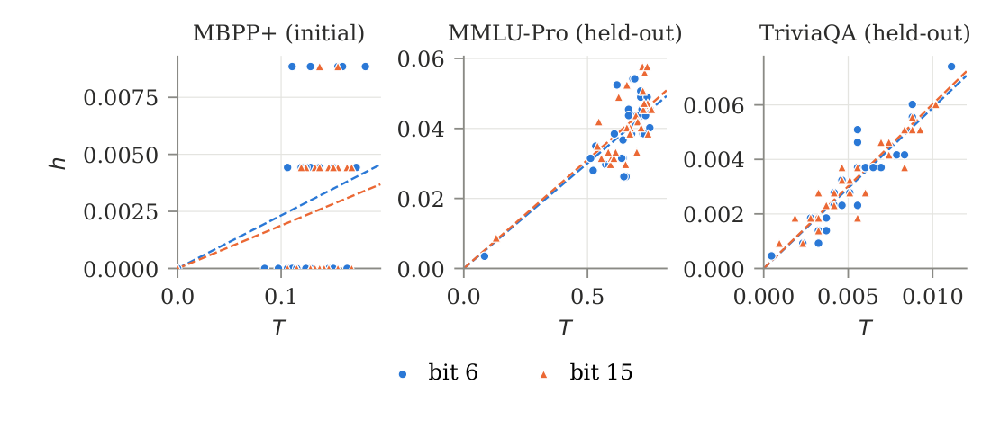View original image ↗</a>

*Change rate is on the horizontal axis and harm rate on the vertical. Axis scales differ by task. The slope indicates how often a change costs the answer.*

The authors compare clean and perturbed cache runs in a controlled software fault study of Qwen3-8B served by vLLM. They start with items answered correctly in the clean run and record text changes, task failures and the fraction of changes that are harmful. For fresh MBPP+ requests, both perturbations changed about 13% of outputs. Only 2.3% or 1.9% of those changes made a previously passing answer fail. On held-out TriviaQA, about 0.53% of outputs changed, yet 59% or 60% of the changes were harmful. Across initially correct draws, that amounts to roughly three failures per thousand. Counting text differences alone would reverse the comparison of how often a change costs the task.

The scoring method matters. A program can only be checked against the available tests, and answer matching can penalize a wording change. The paper also separates fresh requests from returning ones with more history already cached. Fresh requests showed more changed outputs on both held-out tasks, but the harm rate rose only on TriviaQA. In a separate control, changing batch composition alone changed some MBPP+ outputs. A text mismatch by itself gives little evidence about where the error originated.

Harmed responses can look like ordinary model mistakes. The authors therefore point to integrity checks on shared cache blocks, where a check could cover state consumed by many requests. Their measurements characterize consequences under the tested model, cache conditions and graders. Estimating production fault incidence or the cost of checking that state requires other measurements.

<h2 class="daily-paper-title" id="paper-arxiv-2611.23068">Agent evolution can propose gains that its evaluator cannot resolve</h2>

[The Resolution Hypothesis: Agent Evolution's Key Is Identifying Improvements](https://arxiv.org/abs/2611.23068) · Yuanhao Zeng, Shaocheng Lan, Ao Lu, Kuang Yan, Heng Lin, Xinang Xu, Yuan Luo, Yueting Wang, Yexin Li, Ruo Shan, Kan Ren · arXiv v1 · 2026-11-17

An agent's score rises a few points after a skill update. That observation depends on the proposed skill, the tasks sampled and the particular execution trajectories. The paper separates two questions usually folded into the final score. Did the proposer produce a better artifact, and could the selector recognize it from the available feedback? When promising candidates already exist, generating more of them can give noise more opportunities to win.

<a class="note-image-link" href="/assets/images/digest/2026-11-19/arxiv-2611.23068.png" target="_blank" rel="noopener" aria-label="View original image ↗ — Colors distinguish methods. Each distribution shows the scores a single run might report. Overlap makes a ranking from one run unstable.">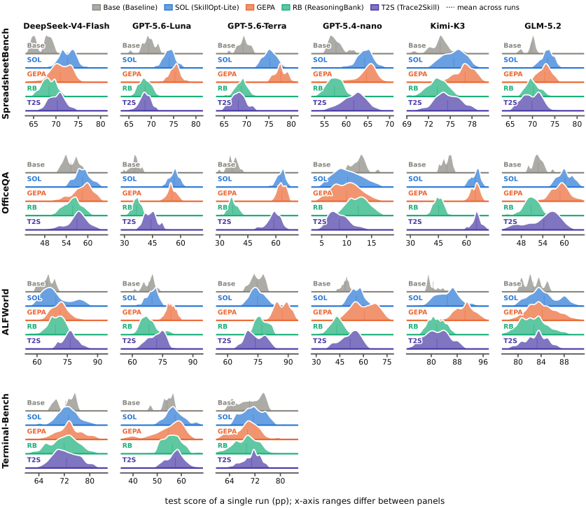View original image ↗</a>

*Colors distinguish methods. Each distribution shows the scores a single run might report. Overlap makes a ranking from one run unstable.*

At the method level, the authors rerun evolution independently and repeatedly evaluate the resulting artifacts. Across seven methods and six models, 150 configurations account for 1,030 independent evolution runs and over 2.1 million test trajectories. Repeating the test of one final skill captures execution variability. Rerunning evolution also captures early decisions that send subsequent rounds down different branches. In a ranking simulation involving four text-artifact methods, a single run identified the best method about 33% of the time, against 25% by chance. Variation between runs of one method can span the margins separating published methods.

At the candidate level, the authors freeze pools of proposed skills and use repeated executions to obtain a better reference for their quality. This holds proposal quality constant while testing which candidate a selector would keep on its usual budget. Beneficial variants exist, but scores from a few executions often fail to separate close candidates. Giving model judges more evidence did not yield reliable pairwise judgments in the tested comparison. An early selection error also changes the starting point for the next proposal, allowing modest single-round uncertainty to produce substantially different final artifacts.

For teams maintaining an agent harness, the experimental unit changes with the claim. Repeated execution of one final skill describes its behavior. Independent evolution runs measure the reliability of the update process itself. The chance comparisons apply to particular pools, tasks and budgets. The relevant quantity for another workload is the size of the expected gain relative to what its evaluation can resolve.

<h2 class="daily-paper-title" id="paper-arxiv-2611.22525">Replay the assumptions a successful skill depended on</h2>

[When Agent Skills Go Stale: Runtime Behavior and Selective Maintenance in Evolving Environments](https://arxiv.org/abs/2611.22525) · Ömer Faruk Akgül, Shuli Jiang, Yuting Zhang, Yi Zhang, Xiaohan Fei, Wei Xia, Stefano Soatto · arXiv v1 · 2026-11-17

After a tool update, a skill file can still load even when its field mappings or tool choices have expired. The authors extract checks from the retained skill and successful executions, then replay them in the changed environment without another model call. A conflict triggers verification and repair. An update must pass validation before it is committed, with regeneration available when a local fix fails. This separates maintenance cost from the savings on later uses. Across four settings and two models, tax-form field accuracy improved by up to 67 percentage points over stale reuse, while ScienceWorld required up to 37% fewer steps. The maxima describe different tasks and different outcomes.

<a class="note-image-link" href="/assets/images/digest/2026-11-19/arxiv-2611.22525.png" target="_blank" rel="noopener" aria-label="View original image ↗ — Checks from healthy executions are replayed. Conflicts trigger repair or regeneration, followed by validation before commit.">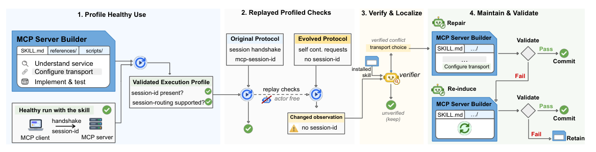View original image ↗</a>

*Checks from healthy executions are replayed. Conflicts trigger repair or regeneration, followed by validation before commit.*

<h2 class="daily-paper-title" id="paper-arxiv-2611.21616">Publish code context at a complete revision boundary</h2>

[Revision-Consistent Code Context for Agents That Edit Their Environment](https://arxiv.org/abs/2611.21616) · Meng Shi · arXiv v1 · 2026-08-20

A rename can reach source files, search results and dependency edges at different times. Individually plausible answers can then describe a repository that never existed. Codetrip builds the next index incrementally and switches readers at a complete revision boundary. Before publication a reader can wait, receive an unavailable response, or read the entire older revision. On frozen Gin and Cobra repositories, all 300 evaluable recovery trials produced new contexts equivalent to a clean rebuild. Median restart-to-context time was 77–131 ms. A rename probe observed mixed contexts in 30/30 control trials and 0/30 with Codetrip. The result establishes the tested publication property rather than a task completion rate.

<a class="note-image-link" href="/assets/images/digest/2026-11-19/arxiv-2611.21616.png" target="_blank" rel="noopener" aria-label="View original image ↗ — Incremental construction happens behind a publication boundary that exposes one complete revision to readers.">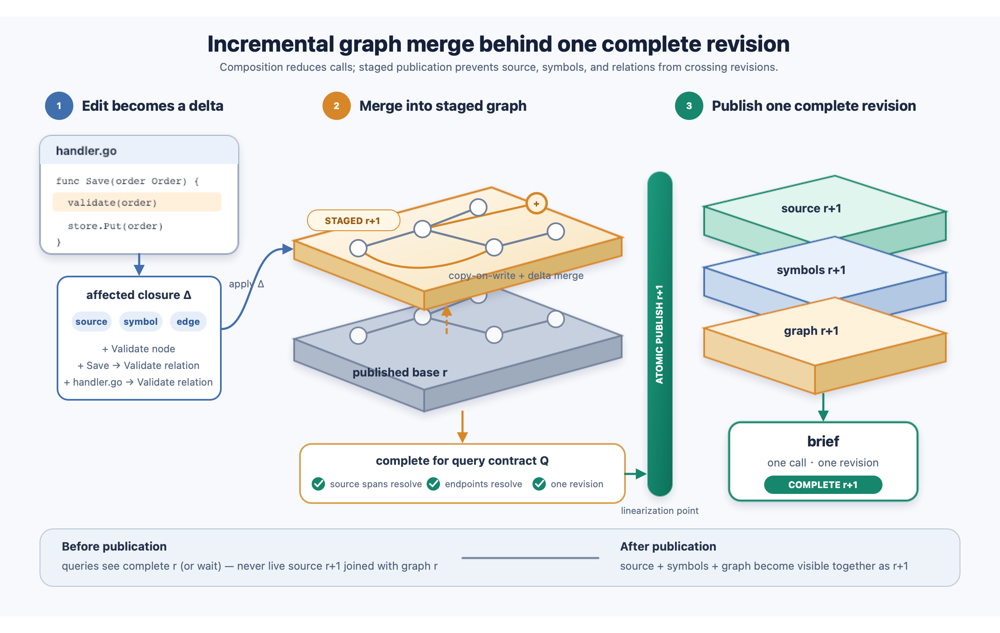View original image ↗</a>

*Incremental construction happens behind a publication boundary that exposes one complete revision to readers.*

<h2 class="daily-paper-title" id="paper-arxiv-2611.22835">What operation does a passing check actually cover?</h2>

[When Passing Checks Do Not Establish Completion: Evidence Interpretation in Coding Agents](https://arxiv.org/abs/2611.22835) · Xueping Gao · arXiv v1 · 2026-11-17

The repository an agent edits can also supply its verifier's startup path and the code that records observations. Starting the verifier, emitting a witness and executing the intended operation are separate facts. Across 118 repair episodes on 31 tasks, the authors use local reversions and controls on witness production to trace those dependencies. In a separate held-out study all 122 delivered labels were correct, yet 16 responses misstated execution facts and 11 others exceeded the authorized scope. Label accuracy alone misses both reporting failures. The interventions identify concrete validation dependencies, while comparisons against ordinary diagnosis do not establish a consistent general repair advantage.

<a class="note-image-link" href="/assets/images/digest/2026-11-19/arxiv-2611.22835.png" target="_blank" rel="noopener" aria-label="View original image ↗ — Startup, execution and witness recording intervene between an edit and a completion claim. Each affects what the evidence covers.">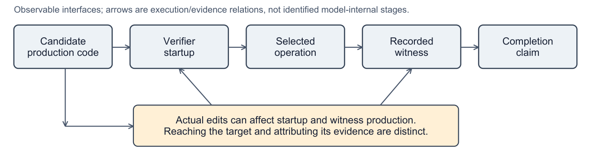View original image ↗</a>

*Startup, execution and witness recording intervene between an edit and a completion claim. Each affects what the evidence covers.*

<h2 class="daily-paper-title" id="paper-arxiv-2611.21679">FCP checks both the artifact and the reading of its requirements</h2>

[FCP: Formal Context Protocol for Verifying LLM-Generated Artifacts](https://arxiv.org/abs/2611.21679) · Shashank · arXiv v1 · 2026-11-15

Tests and code generated by the same model can agree on the same mistaken interpretation. FCP decomposes a request into independently formalized readings, then applies model checking or SMT to the artifact. Conflicting requirements or a witness that distinguishes two readings can return a question to the requester. Across four hardware designs, trusting generated assertions certified 23% of violated requirements, while FCP certified none of those violations. On ten coding tasks it still certified three of 33 violations. A proof can establish compliance with a reading while both formalizers share a mistaken understanding of the request.

<a class="note-image-link" href="/assets/images/digest/2026-11-19/arxiv-2611.21679.png" target="_blank" rel="noopener" aria-label="View original image ↗ — Requirements and artifacts enter separate verification paths that report proofs, counterexamples or questions per requirement.">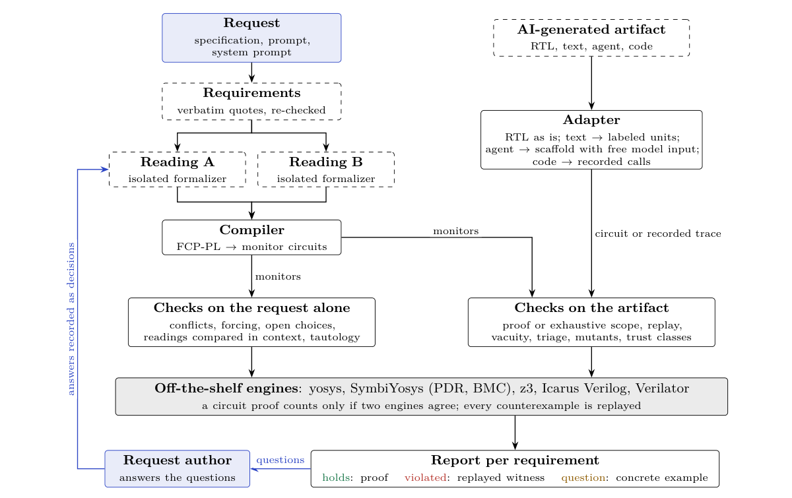View original image ↗</a>

*Requirements and artifacts enter separate verification paths that report proofs, counterexamples or questions per requirement.*

<h2 class="daily-paper-title" id="paper-arxiv-2611.22583">Measure task utility alongside agent safeguards</h2>

[Evolution Under Fire: Evolving Agent Safety Harnesses with Adaptive Injection Stressors](https://arxiv.org/abs/2611.22583) · Yujun Wang, Yilun Liu, Jinhe Bi, Krishna Kanth Nakka, Xuebing Zhou, Hinrich Schütze, Yunpu Ma · arXiv v1 · 2026-11-17

A guard that refuses every tool call can score well on one safety metric while making the agent useless. With the task model, tools and evaluator fixed, the authors assess safeguards against utility on ordinary and stressed tasks as well as security outcomes. On AgentDyn with GPT-4o-mini, attack success fell from 50.4% with the initial harness to 3.0%, with gains in both utility measures. On Agent-SafetyBench with Qwen2.5-7B, the change was from 82.6% to 62.0%, leaving substantial residual risk. The difference between the settings is material to any deployment interpretation.

<a class="note-image-link" href="/assets/images/digest/2026-11-19/arxiv-2611.22583.png" target="_blank" rel="noopener" aria-label="View original image ↗ — Moving right indicates greater attack resistance and moving up indicates higher task utility under stress.">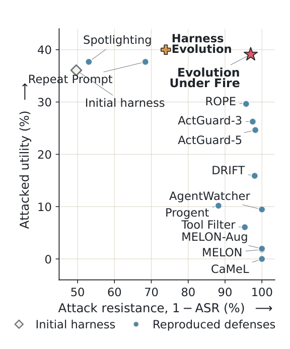View original image ↗</a>

*Moving right indicates greater attack resistance and moving up indicates higher task utility under stress.*

<h2 class="daily-paper-title" id="paper-arxiv-2611.22171">Readie plans warm snapshots around overlapping dependencies</h2>

[Readie: Low-Latency Code Sandboxes for AI Agents](https://arxiv.org/abs/2611.22171) · Arjun Sivaraman, Zhaoheng Li, Alan Shi, Sanjay Malisetty, Eugene Wu, Yongjoo Park · arXiv v1 · 2026-11-17

For a short agent-generated script, importing packages can take longer than the computation. Per-request snapshots consume storage, while a universal image restores unnecessary state. Readie learns a portfolio from package sets in public and synthesized scripts. A greedy facility-location approximation values a snapshot by the remaining requests it covers, initialization time saved and storage consumed. A request restores a suitable warm state and imports what is missing. At matched storage budgets the authors report 3–22× lower initialization latency and 1.3–3.3× lower end-to-end runtime. The latter includes the script's actual work and better reflects the saving visible to an agent calling the tool.

<a class="note-image-link" href="/assets/images/digest/2026-11-19/arxiv-2611.22171.png" target="_blank" rel="noopener" aria-label="View original image ↗ — Learned memory snapshots can be shared across requests while avoiding repeated package initialization.">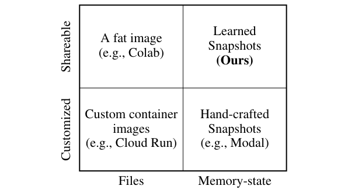View original image ↗</a>

*Learned memory snapshots can be shared across requests while avoiding repeated package initialization.*

<h2 class="daily-paper-title" id="paper-arxiv-2611.22215">EchoMoE communicates activation changes between experts</h2>

[Communicate the Change: Efficient Expert Parallelism via Activation Compression](https://arxiv.org/abs/2611.22215) · Fengyuan Liu, Jay Gala, Siva Reddy, Dzmitry Bahdanau · arXiv v1 · 2026-11-17

Expert parallelism sends activations to remote experts and collects their outputs. EchoMoE exploits similarity between a token's residual states across nearby layers. The first layer of a group broadcasts a full reference. Later layers dispatch a compressed difference. Experts compute directly from the reference and difference, their compact outputs are combined before decompression, and routing still sees the full state. On a retrofitted Qwen3-30B-A3B at EP32 across four nodes and 128 requests per GPU, one four-layer grouping cut inter-node RDMA bytes by 58% and improved throughput by 22.6%, at a 3.8-point average loss across 18 tasks. Gains reached 2.38× under a bandwidth-constrained TCP setup. Compression width sets a quality trade-off, while the interconnect affects how much of the traffic saving becomes throughput.

<a class="note-image-link" href="/assets/images/digest/2026-11-19/arxiv-2611.22215.png" target="_blank" rel="noopener" aria-label="View original image ↗ — Layer groups retain a reference on the left. On the right, later layers dispatch differences and combine compact expert outputs.">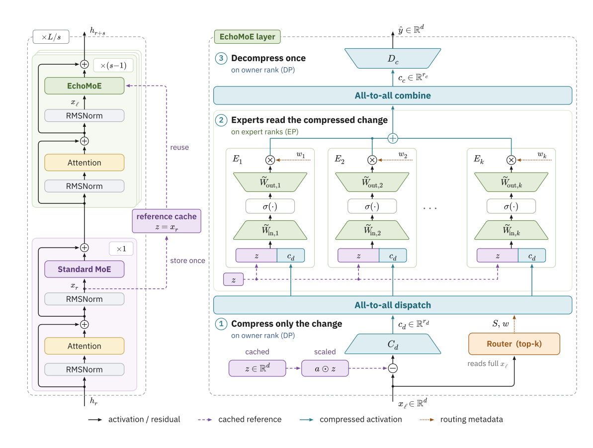View original image ↗</a>

*Layer groups retain a reference on the left. On the right, later layers dispatch differences and combine compact expert outputs.*

<h2 class="daily-paper-title" id="paper-arxiv-2611.21852">Weight quantization exposes the diffusion sampler</h2>

[The Hidden Cost of MoE Diffusion Decoding: Profiling and Fixing the Sampler](https://arxiv.org/abs/2611.21852) · Harshit Samrat, Ramakrishna Paramahamsa Kompella · arXiv v1 · 2026-11-16

Block diffusion scans vocabulary scores for a whole canvas each round. On GB10, accelerating the expert matrix multiplications exposes a reference loop that computes entropy twice on the same logits to decide acceptance and stopping. The first optimization reuses entropy until the tensor changes, preserving outputs and step counts exactly. The second fuses the entropy scan and changes sampling, preserving its distribution while allowing different draws. With W4A16 expert kernels the full stack achieved 2.4–2.7× end-to-end speedup over BF16 on 100 examples each from GSM8K, HumanEval and MATH, with unchanged measured accuracy. The comparison uses the eager reference loop. The same pipeline occupied only 3.6% of decode on the dense diffusion model.

<h2 class="daily-paper-title" id="paper-arxiv-2611.22191">RISA keeps skipped KV pages available to later blocks</h2>

[RISA: Recoverable Sparse Attention for Block-Diffusion Language Models](https://arxiv.org/abs/2611.22191) · Xinrui Zhong, Fanjiang Ye, Yuke Wang · arXiv v1 · 2026-11-17

During block denoising, historical KV stays fixed while queries change. Independent page selection inflates the union of reads, while permanent eviction can remove history a later block needs. RISA keeps exact KV on the GPU. Seed queries select one bounded page plan for the block. Later steps reuse its indices with fresh queries, and future blocks can retrieve cold pages again. At 32K the default configuration sped attention up 2.67× and a fixed-trajectory request 1.36×. The 128K experiments characterize computational scaling. Some evaluated models support only 32K natively, and their task-quality tests remain within that range.

<a class="note-image-link" href="/assets/images/digest/2026-11-19/arxiv-2611.22191.png" target="_blank" rel="noopener" aria-label="View original image ↗ — The left compares attention mass with page reads. The right distinguishes saved KV reads from fewer page-selection operations.">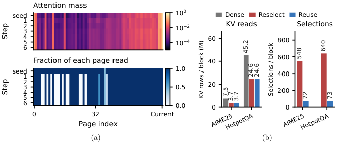View original image ↗</a>

*The left compares attention mass with page reads. The right distinguishes saved KV reads from fewer page-selection operations.*

<h2 class="daily-paper-title" id="paper-arxiv-2611.21974">Select quantization against language quality and measured B200 memory</h2>

[Beyond Bitwidth: Deployment-Constrained Mixed-Precision Quantization for Multilingual LLM Inference on NVIDIA Blackwell](https://arxiv.org/abs/2611.21974) · Hyojung Han · arXiv v1 · 2026-11-16

Four-bit weights alone do not determine deployed behavior. Activation precision, the output head and the packed kernels actually used all matter. On B200 with vLLM and Qwen3-8B, the author checks 144 fused linear modules, ranks restoration choices by measured quality, then freezes a configuration for held-out testing. The passing allocation retains 16-bit activations, uses NVFP4 in 98 modules and INT8 in 46, with an INT8 head. On the 5,168-item final set it retained 0.904 of teacher-correct Korean answers, narrowly clearing 0.90. Weight-loading memory was 5.917 GiB and time per output token was 0.939× BF16. That memory counter excludes other serving allocations. The final checkpoint was not retained for bitwise reconstruction.

<a class="note-image-link" href="/assets/images/digest/2026-11-19/arxiv-2611.21974.png" target="_blank" rel="noopener" aria-label="View original image ↗ — Intervals around paired accuracy differences show which configuration comparisons span zero.">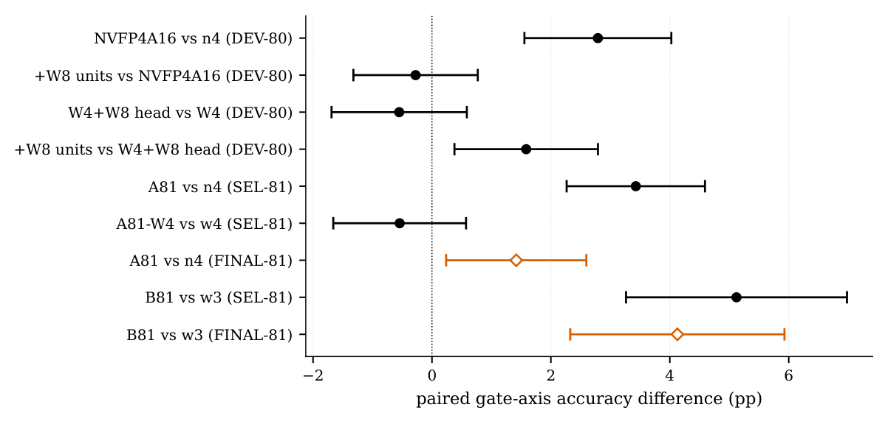View original image ↗</a>

*Intervals around paired accuracy differences show which configuration comparisons span zero.*

<h2 class="daily-paper-title" id="paper-arxiv-2611.21677">Chimera co-designs FPGA placement and decode bandwidth</h2>

[Chimera: A Configurable LLM Decode Accelerator Architecture with Compute-Memory-Floorplan Co-Design for HBM-Equipped Multi-Die FPGAs](https://arxiv.org/abs/2611.21677) · Zhiheng Chen, Yifan Zhang, Yu-An Chou, Ye Qiao, Sitao Huang · arXiv v1 · 2026-11-14

HBM interfaces sit on one side of a multi-die FPGA. Spreading compute across more regions can add lanes yet lower the clock of every memory port through long routes. Chimera keeps proxy ports near HBM and feeds remote lanes through them. For MoE weights beyond HBM capacity it places experts across storage tiers. The authors placed and routed ten designs on an Alveo U280, covering dense models, hybrid attention and MoEs up to 80B. Decode throughput averaged 1.6× the selected prior FPGA designs geometrically. This measures token production under the tested mappings and shows why placement and bandwidth matter together. Multi-user serving capacity would need a separate workload.

<a class="note-image-link" href="/assets/images/digest/2026-11-19/arxiv-2611.21677.png" target="_blank" rel="noopener" aria-label="View original image ↗ — Placed layouts and resource allocations show how compute and routing occupy the same U280 across models.">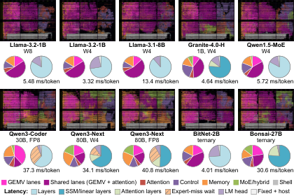View original image ↗</a>

*Placed layouts and resource allocations show how compute and routing occupy the same U280 across models.*

<h2 class="daily-paper-title" id="paper-arxiv-2611.23035">Two overlapping views shrink Gemma 4&#x27;s global KV rows</h2>

[Storing the Gemma 4 K=V Cache Once: Exact Global-KV Memory Savings in a Paged Serving Engine with Unchanged Attention Kernels](https://arxiv.org/abs/2611.23035) · Kushagra Bainsla · arXiv v1 · 2026-11-17

In Gemma 4 31B's global layers, keys and values share projection structure. Reordering dimensions lets one 640-element row expose two overlapping 512-element views to existing paged attention kernels. The compact implementation matches a conventional-cache emulation of the same arithmetic bit for bit, an important qualification because some operations are reordered. Sliding layers and page grouping still consume space, limiting steady-state capacity improvement per request to about 1.34×. On A100 with NIXL and CPU offload, eager throughput reached 1.30× and 1.11× stock at median prompt lengths of 16K and 8K. More requests fit the same pool. At equal batch size an eager step was actually 4–9% slower.

<a class="note-image-link" href="/assets/images/digest/2026-11-19/arxiv-2611.23035.png" target="_blank" rel="noopener" aria-label="View original image ↗ — Overlapping 512-element windows share the middle of a 640-element row to expose both K and V.">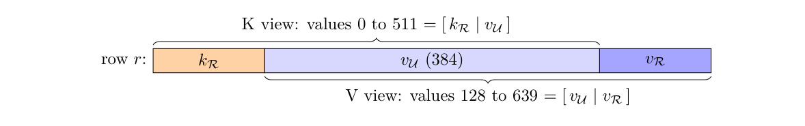View original image ↗</a>

*Overlapping 512-element windows share the middle of a 640-element row to expose both K and V.*

<h2 class="daily-paper-title" id="paper-arxiv-2611.22280">XM-Sparse schedules predictable and data-dependent reads separately</h2>

[XM-Sparse: High-Throughput Sparse-Attention LLM Serving over Scale-up Memory Pools](https://arxiv.org/abs/2611.22280) · Yijun Sun, Xudong Liao, Zhuobin Huang, Kai Chen, Nikita Lazarev, Zhizhen Zhong · arXiv v1 · 2026-11-17

After historical KV moves off GPU, the K-index used to select it can still cap concurrency. XM-Sparse distinguishes two kinds of reads. Index access is predictable enough for GPU-initiated DMA prefetch. Selected KV becomes known at runtime, so its TMA retrieval is tiled and overlapped with attention. SGLang experiments on an emulated scale-up pool span 16K–1M contexts with DeepSeek-V3.2 and GLM-5.3. Peak throughput ratios of 4.98× over PCIe ECHO and 4.52× over PCIe HiSparse include interconnect and software changes. The comparison with a naive integration on the same pool reached 1.34×, isolating more of the software contribution.

<a class="note-image-link" href="/assets/images/digest/2026-11-19/arxiv-2611.22280.png" target="_blank" rel="noopener" aria-label="View original image ↗ — As batch size rises, KV volume grows much faster than swap-in latency. Fixed transfer costs make overlap valuable.">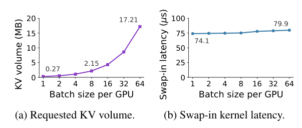View original image ↗</a>

*As batch size rises, KV volume grows much faster than swap-in latency. Fixed transfer costs make overlap valuable.*

<h2 class="daily-paper-title" id="paper-arxiv-2611.22296">SpecSearch includes turning speculation off</h2>

[SpecSearch: Towards Hardware-Aware Efficient Speculative Decoding](https://arxiv.org/abs/2611.22296) · Selin Yildirim, Ali Zeyrek, Deming Chen · arXiv v1 · 2026-11-17

Longer drafts can amortize verification, but they also consume compute and KV capacity. A change in concurrency or output length can reverse the preferable policy on the same device. On RTX 5090 the authors observed DFlash ranging from 3.50× autoregressive throughput at low concurrency to 0.76× with high concurrency and short outputs. SpecSearch jointly compares autoregressive and speculative execution, draft length and cache precision. Across RTX 5090, H100, L40 and MI300X, calibrated choices averaged 1.36× default speculative throughput. Jev, trained using other GPUs, retained 97.36% of calibrated-search throughput in held-out-hardware evaluation. Its calibration saving is established for the tested hardware, models and workloads.

<a class="note-image-link" href="/assets/images/digest/2026-11-19/arxiv-2611.22296.png" target="_blank" rel="noopener" aria-label="View original image ↗ — Output caps and batch size change feasible policies. OOM cells expose a separate memory limit.">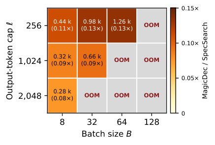View original image ↗</a>

*Output caps and batch size change feasible policies. OOM cells expose a separate memory limit.*

<h2 class="daily-paper-title" id="paper-arxiv-2611.22746">LaFlash retains state while coding sessions wait on tools</h2>

[LaFlash: Capacity-Driven Acceleration for Coding Agent Workflows via QLC-HBF](https://arxiv.org/abs/2611.22746) · Yuseon Choi, Eunjong Lee, Sanghyeon Park, Seongyon Hong, Sangjin Kim, Thierry Tambe · arXiv v1 · 2026-11-17

A GPU can serve another request while a coding agent waits for a tool. Evict the waiting session's KV, however, and resumption incurs prefill again. LaFlash studies retaining dormant state in high-capacity QLC high-bandwidth flash. It assigns new sessions to the least populated group to balance active state and context lengths, exploits page-dependent read latency through fast-page allocation, and buffers new KV in HBM to avoid unnecessary writes. Trace-driven logical and timing simulation gave 7.04× throughput over batch-expanding SLC-HBF on the coding-agent workload. Against QLC-HBF already using capacity for dormant states, the ratio was 2.36×. The two baselines distinguish the retention policy from incremental flash management. Both are simulated comparisons.

<a class="note-image-link" href="/assets/images/digest/2026-11-19/arxiv-2611.22746.png" target="_blank" rel="noopener" aria-label="View original image ↗ — Tool waits and graph transitions create dormant states. Actively executing requests account for only part of the footprint.">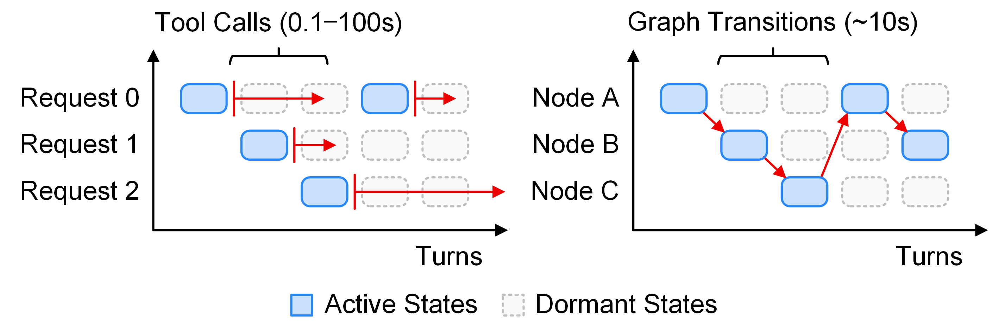View original image ↗</a>

*Tool waits and graph transitions create dormant states. Actively executing requests account for only part of the footprint.*

<h2 class="daily-paper-title" id="paper-arxiv-2611.21839">Route image features to a subset of draft heads</h2>

[VisHead-Spec: Head-Routed Visual Attention for Multimodal Speculative Decoding](https://arxiv.org/abs/2611.21839) · Xin Guo, Arushi Rai, Xiang Zhou, Qiang Zhang, Siyu Lin, Xiangjun Fan, Lizhu Zhang · arXiv v1 · 2026-11-16

If every draft head repeatedly attends to image tokens, draft computation can absorb the benefit of parallel verification at high concurrency. VisHead-Spec selects upper-layer visual features from a frozen Qwen3-VL-8B and routes them to a fixed subset of draft KV heads, keeping the remaining paths text-only. Across six MMSpec task categories, exposing eight of 40 heads to images kept accepted length within 0.3% of DSpark. At batch 64, throughput gain over autoregression rose from DSpark's 9.5% to 16.0%. At batch one the two were comparable. Preserving accepted length matters because cheaper drafts then avoid paying for additional target verification rounds.

<a class="note-image-link" href="/assets/images/digest/2026-11-19/arxiv-2611.21839.png" target="_blank" rel="noopener" aria-label="View original image ↗ — Only a subset of draft KV heads on the right receives visual features. Other heads retain a text path.">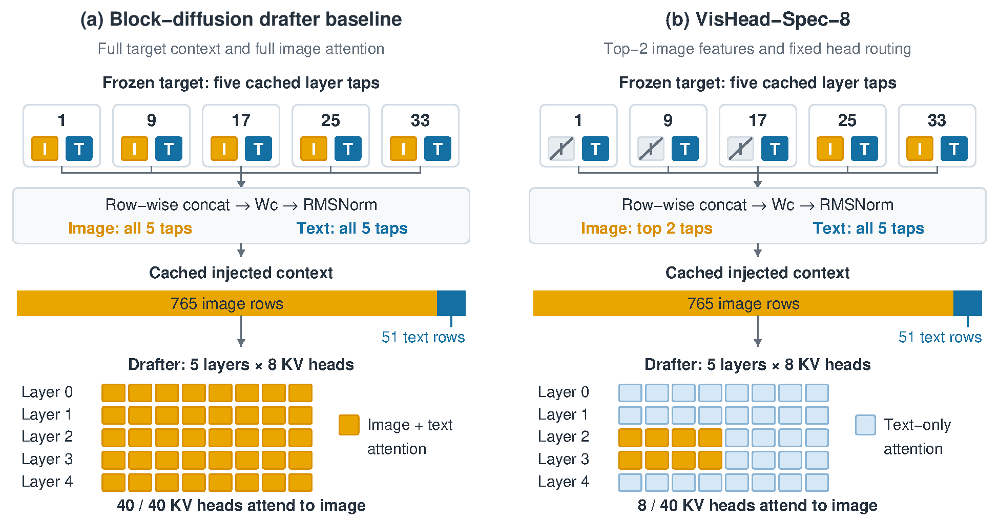View original image ↗</a>

*Only a subset of draft KV heads on the right receives visual features. Other heads retain a text path.*

<h2 class="daily-paper-title" id="paper-arxiv-2611.22206">TAILROLL distinguishes imbalance from the last long response</h2>

[TAILROLL: Tail-Aware Rollout Acceleration for RL-Based LLM Post-Training](https://arxiv.org/abs/2611.22206) · Niloofar Gholipour, Marcos Assuncao, Timothy Yu, Gursimran Singh, Rajkumar Buyya, Julien Gascon-Samson, Zhenan Fan, Yong Zhang · arXiv v1 · 2026-11-17

An RL training step waits for a group of rollouts. One engine holding many unfinished requests and one exceptionally long response surviving alone create different kinds of idle time. TAILROLL migrates requests at chunk boundaries when the benefit justifies one re-prefill of known tokens at the destination. A group-sufficiency gate can end a tail early, masking incomplete output from training. Across ten configurations the rollout bubble ratio fell by 21–74% relative. In end-to-end long-reasoning training, rollout time fell by 24–34% and whole-step time by 21–22%. Since termination changes the available samples, the accompanying comparable or higher final reward matters and applies to the tested tasks and termination budgets.

<a class="note-image-link" href="/assets/images/digest/2026-11-19/arxiv-2611.22206.png" target="_blank" rel="noopener" aria-label="View original image ↗ — The controller reads engine load and makes migration or termination decisions at chunk boundaries for rollout workers.">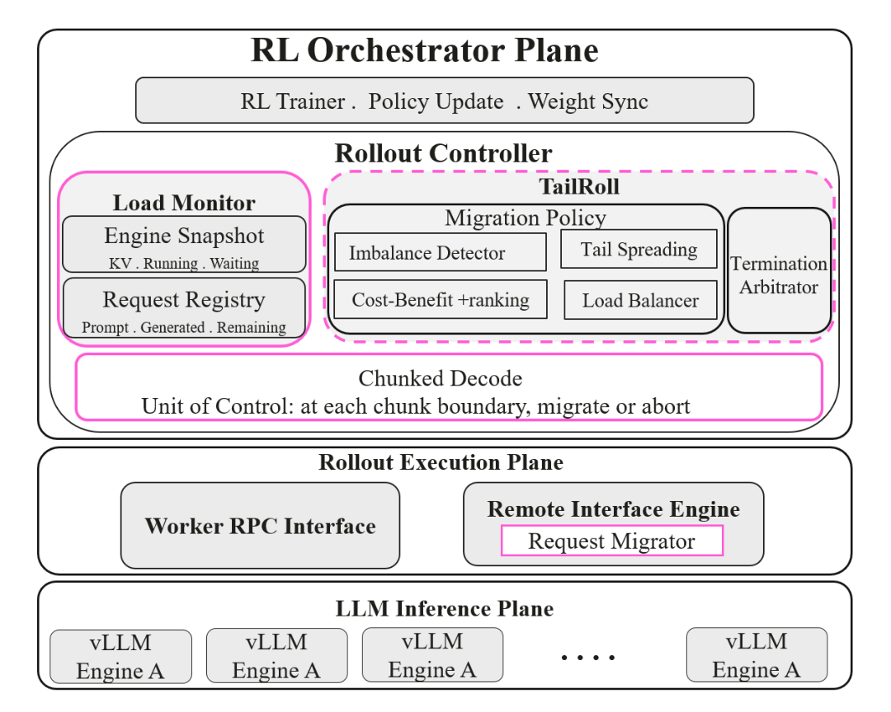View original image ↗</a>

*The controller reads engine load and makes migration or termination decisions at chunk boundaries for rollout workers.*

<h2 class="daily-paper-title" id="paper-arxiv-2611.22115">Xing4 tackles host jitter and uneven agent rollout times</h2>

[TeleChat to Xing4: Advancing Frontier Agentic Models on Domestic Chips and Frameworks](https://arxiv.org/abs/2611.22115) · Xingchen AGI Lab, et al. · arXiv v1 · 2026-11-17

The Xingchen AGI Lab report follows the 285B training stack down to host threads. In synchronous training, a host thread competing with background work can delay every accelerator waiting on it. On 8,192 Ascend 910C devices the team reports a 5–10% throughput improvement from CPU pinning combined with isolation. Memory affinity needs separate configuration. Post-training introduces a different wait: task engines, sandboxes and tools finish at different times. TeleGym decouples environment interaction from model generation, its server assembles trajectories, and bounded oversampling and partial rollouts accommodate uneven durations. The pretraining throughput result and the post-training execution design address different workloads.

<a class="note-image-link" href="/assets/images/digest/2026-11-19/arxiv-2611.22115.png" target="_blank" rel="noopener" aria-label="View original image ↗ — TeleGym executes interactions, the server assembles trajectories, and training consumes the resulting samples asynchronously.">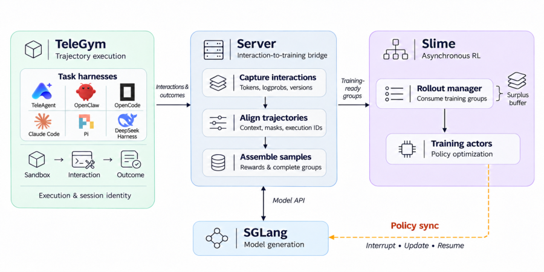View original image ↗</a>

*TeleGym executes interactions, the server assembles trajectories, and training consumes the resulting samples asynchronously.*

<h2 class="daily-paper-title" id="paper-arxiv-2611.23053">SPICE makes sparse updates usable across changing peers</h2>

[SPICE: Sparse Parameter Gossip for LLM Pretraining](https://arxiv.org/abs/2611.23053) · Pietro Cagnasso, Daniele Kopyshevskiy, Edouard Oyallon, Eugene Belilovsky · arXiv v1 · 2026-11-17

Dense synchronization can hold faster training replicas behind a slow link. With sparse updates, changing neighbors also complicates residuals that assume a particular recipient's prior state. SPICE sends parameter values at selected coordinates and incorporates error feedback into the local update. A new recipient can interpret the message without sharing a history of deltas. More replicas can increase the neighborhood while each message stays sparse. The authors impose bandwidth caps and temporary selective slowdowns, and compare validation loss at equal training time on a 134M model. Throughput and quality gains depend on bandwidth. Each training configuration used one random seed, limiting the interpretation of small quality differences.

<a class="note-image-link" href="/assets/images/digest/2026-11-19/arxiv-2611.23053.png" target="_blank" rel="noopener" aria-label="View original image ↗ — Outbound traffic is normalized by model size. Validation loss on the vertical axis shows the quality cost of each communication budget.">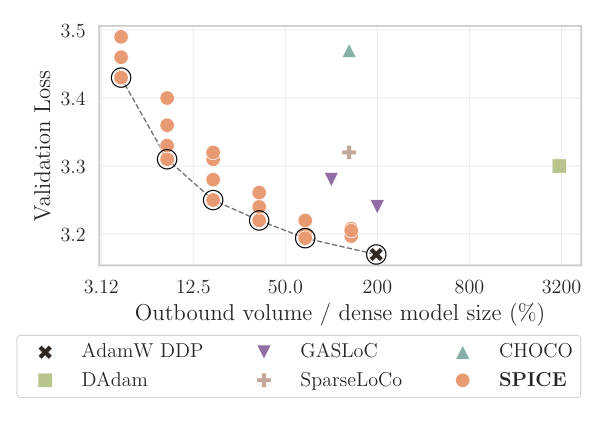View original image ↗</a>

*Outbound traffic is normalized by model size. Validation loss on the vertical axis shows the quality cost of each communication budget.*

<h2 class="daily-paper-title" id="paper-arxiv-2611.22086">HyCoInfer makes link capacity part of decode placement</h2>

[HyCoInfer: Cloud-Edge Collaborative Inference for Large Language Models on Heterogeneous GPU-FPGA Architectures](https://arxiv.org/abs/2611.22086) · Zewen Huang, Xiangwen Zhuge, Yingkun Hu, Zheng Yang, Qiang Ma · arXiv v1 · 2026-11-17

Keeping prefill on cloud GPUs and moving decode to an edge FPGA introduces a KV transfer that can cost more than queueing. HyCoInfer uses prompt length, queues and link state to choose a decode location. It pipelines layer transfers, varies progressive residual-vector quantization depth with bandwidth, and can precompute prefix work while edge capacity is idle. Experiments with two V100s and an Alveo U280 span 100–1,000 Mbps. At 500 Mbps, Qasper achieved up to 4.11× cloud-only vLLM's request goodput, with mean end-to-end latency reduced by up to 61.1%. Transfer overlap and available edge capacity both affect placement. Raw FPGA token rate alone cannot determine the preferable location.

<a class="note-image-link" href="/assets/images/digest/2026-11-19/arxiv-2611.22086.png" target="_blank" rel="noopener" aria-label="View original image ↗ — After cloud prefill, the scheduler chooses a decode location and overlaps layer transfers with edge computation.">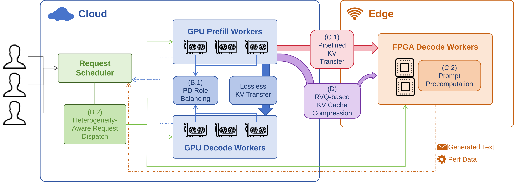View original image ↗</a>

*After cloud prefill, the scheduler chooses a decode location and overlaps layer transfers with edge computation.*
