A server returning to service, a classifier running on fewer GPUs and a tool action that can be reconciled after a crash each have a measurable endpoint. HardwareDx follows diagnoses through the repair loop. Cap-and-Track moves overload into a durable queue. Tool fault injection separates deduplication from recovery. The remaining studies examine fairness across agent turns, verification of visual evidence and actions, and how much kernel speed survives at task level.

<h2 class="daily-paper-title" id="paper-arxiv-2611.23398">HardwareDx shortens the repair loop</h2>

[HardwareDx: A Foundational Graph Model System for Datacenter Machine Repairs](https://arxiv.org/abs/2611.23398) · Yuanlin Wen, Elan Markowitz, Zubo Gu, Sami Abu-El-Haija, Bryan Perozzi, Mikhail Galkin, Ali Parviz, Aayush Gupta, Venkata Chivukula, Griffin Hadfield, Aravind Akella, Daniel J. Frame, Vahab Mirrokni, Amin Vahdat · arXiv v1 2026-11-17

When several GPUs disappear from a server at once, should a technician replace several cards or inspect a component they share? One failure can fire multiple diagnostic rules, and the connections and log formats change with each hardware generation. Google frames the decision around the more than 100 field-replaceable units in a machine. Which unit needs attention, and given what the technician has already tried, what should happen next? Each extra trip through stress testing can cost hours.

HardwareDx builds a graph for each test. Components, ports and diagnostic signals become different node types. Physical connections, internal links and signal ownership determine how evidence travels. Type-specific encoders map logs, telemetry and past repairs into a shared representation. A graph network and transformer can then use symptoms from neighboring components to score each replaceable unit. This gives a new platform a way to reuse structural patterns learned elsewhere. The repair plan accounts for previous attempts. Service failure triggers a fallback to rules, and experts take over cases that exceed the iteration threshold.

<a class="note-image-link" href="/assets/images/digest/2026-11-20/arxiv-2611.23398.png" target="_blank" rel="noopener" aria-label="Signals attach to components before graph layers combine neighboring evidence for the prediction heads.">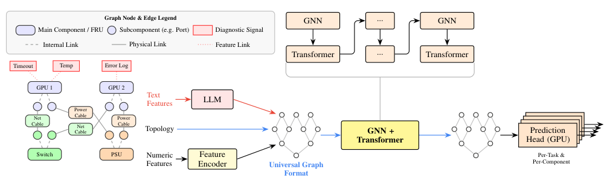View original ↗</a>

*Signals attach to components before graph layers combine neighboring evidence for the prediction heads.*

Expert labels identify faulty parts directly. The larger historical dataset usually records something weaker: whether the next test passed after a set of actions. If several components were replaced together, a pass cannot identify which replacement mattered. The model uses both sources of supervision. Offline ablations isolate the contribution of graph structure and log encodings, while the production trial measures what happens when technicians act on the recommendations.

The machine-randomized trial covered 225 H100 repair windows and 2,567 TPU windows. Mean time in the test–diagnose–repair loop fell by 18.3% and 16.1% against the production rules, excluding installation. For new hardware, the relevant outcome was the repair-time percentile associated with the cluster turnover target. That QA measure improved by 28.3% and 25.1%, respectively. Automated diagnostic coverage on H100 also rose from 83.1% to 93.9%, so more cases could receive a recommendation. Historical transfer experiments address a separate question about how early a new platform can reach usable diagnostic accuracy.

<h2 class="daily-paper-title" id="paper-arxiv-2611.24891">Cap-and-Track keeps the backlog outside the engine</h2>

[Cap-and-Track: Optimizing LLM Inference Request Dispatch Across Shifting Capacity](https://arxiv.org/abs/2611.24891) · Benjamin Novotny, Doug Szeto, Chang Wang, Shicheng Chen, George Zhihua Yuan, Bob Kamma, Michael Ge, John Xin Zhou, Andrea Olgiati · arXiv v1 2026-11-18

A dispatcher for post and live-video classification cannot know the output length of an incoming request or how much compute will be available an hour later. A fixed rate can leave replicas idle or bury work inside their execution queues, where newly urgent jobs cannot overtake it. Meta puts durable priority queues ahead of execution and asks each saturated resource to signal when it cannot admit more work.

A Cap sits where saturation is visible. A replica can use local queue depth, while a provider can return a capacity refusal. Refused work returns to the durable queue. Track therefore needs no common unit of capacity across providers. Every 15 seconds a leader updates each queue’s dispatch rate from successes and capacity refusals. In the reported production configuration, a refusal share at or below 2% raises the rate by 3%. Above that target the rate falls in tiers, gently under mild pressure and sharply during widespread capacity loss. A modest refusal rate lets the dispatcher probe for returning capacity. This depends on a recognizable refusal arriving before substantial waiting or computation.

<a class="note-image-link" href="/assets/images/digest/2026-11-20/arxiv-2611.24891.png" target="_blank" rel="noopener" aria-label="Durable queues hold waiting work while online workers adjust dispatch to backend refusals.">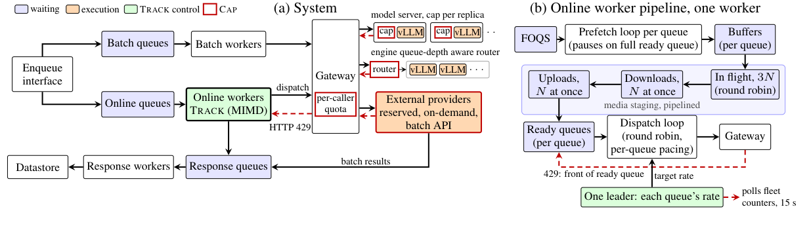View original ↗</a>

*Durable queues hold waiting work while online workers adjust dispatch to backend refusals.*

In a same-traffic production comparison, the classifier ran on 43% fewer H100s. A separate zero-shot workload used equal fleets of about 600 MI300Xs each. The shaper drained every shared backlog first, with a median lead of three hours. These comparisons measure different outcomes: hardware needed for a workload and time to clear accumulated work on fixed hardware. At peak backfill, lower-priority items waited longer. Moving that wait into durable storage was viable for asynchronous classification. The experiments establish no comparable response-time guarantee for interactive requests.

<h2 class="daily-paper-title" id="paper-arxiv-2611.23353">An action can run once and still be unaccounted for</h2>

[Idempotency Is Not Recovery: A Fault-Injection Study of Language-Model Agent Tool Actions](https://arxiv.org/abs/2611.23353) · Song Xu · arXiv v1 2026-11-17

A tool can finish an external action and lose the acknowledgement when its caller crashes. A deduplication key at the destination may prevent another effect, yet the restarted caller still needs to establish who authorized the action, which request it belonged to and whether the destination carried it out. Song Xu separates these guarantees through single-machine fault injection. One revealing configuration produced no duplicate effects but left the caller unable to account for completed work.

The full runtime checks authorization before reserving a stable action identity in a durable ledger. The destination deduplicates by identity, and the runtime records confirmed completion. A repeated request for unfinished work can return an explicitly uncertain outcome while reconciliation checks destination records. Recovery can thus distinguish confirmed completion, confirmed absence and missing evidence.

<a class="note-image-link" href="/assets/images/digest/2026-11-20/arxiv-2611.23353.png" target="_blank" rel="noopener" aria-label="Identity reservation follows authorization. Unconfirmed actions take a different recovery path from completed ones.">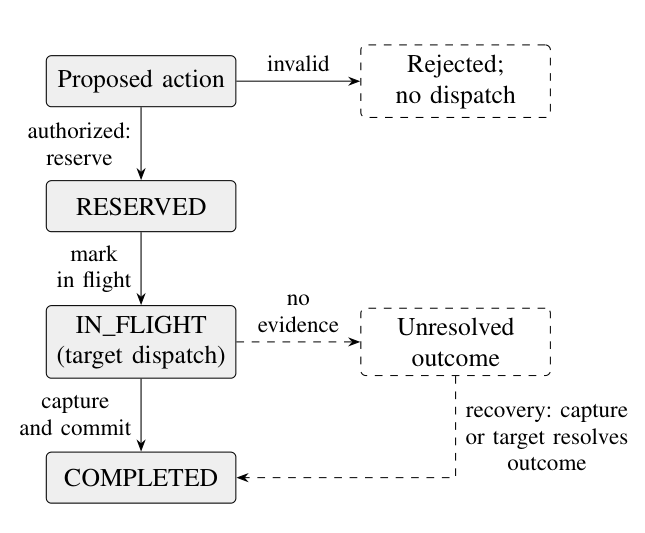View original ↗</a>

*Identity reservation follows authorization. Unconfirmed actions take a different recovery path from completed ones.*

The study injects ten fault classes. Across 200 prespecified crash/replay pairs, the full configuration recorded zero repeated effects against 117 for each of three simpler baselines. In a separate ablation, removing a bundle of ledger capabilities preserved destination deduplication but orphaned all 170 external effects. Recoverable cases fell from 300 of 300 to 200. Keeping the ledger while disabling reconciliation left all 100 outcomes ambiguous in a known-crash cohort. The bundled ablation cannot attribute the whole difference to any individual field. Its contribution is a way to test duplication, orphaning and ambiguity independently at specified interruption points with a controlled destination.

<h2 class="daily-paper-title" id="paper-arxiv-2611.23307">Testing what a retry preserves</h2>

[Checking Retry Transparency in Agent Tools](https://arxiv.org/abs/2611.23307) · Jiapeng Li (Microsoft) · arXiv v1 2026-11-11

Repeating a write in isolation can leave its value unchanged and still overwrite an acknowledged update from another client between attempts. Jiapeng Li derives effect contracts from implementations, checking both whether an atomic attempt absorbs a retry and what other operations can observe between internal steps. In 27 checks with replies suppressed after backend completion, evidence-based recovery completed six justifiable workflows with no confirmed goal damage. Blind retry completed nine but damaged three goals. The result concerns pinned components and bounded interleavings. It complements the ledger study by asking whether a tool preserves intervening updates even when the caller can account for its actions.

<h2 class="daily-paper-title" id="paper-arxiv-2611.23362">TRACE-MAS traces collaboration failures upstream</h2>

[TRACE-MAS: Diagnosing and Repairing Collaboration Failures in Multi-Agent Systems](https://arxiv.org/abs/2611.23362) · Zekai Chen, Yihan Sun, Xunkai Li, Xun Wu, Xinmo Jin, Yinlin Zhu, Haodong Lu, Xuaner Chen, Rong-Hua Li · arXiv v1 2026-11-17

The most anomalous message in a collaboration may merely relay an earlier mistake. TRACE-MAS learns normal relationships among states, messages and task dependencies from benign runs and expresses an execution as a partially ordered event graph. It provisionally restores candidate events and measures how much downstream contract violation falls, using that change to attribute the source and choose a local repair. Across five controlled benchmarks, first-choice localization improved by 28.0 percentage points on average over AcMAS. Localization and task recovery measure different things: repairing a nearby branch can restore success without identifying the exact initiating event. Evolving workflows also challenge contracts learned from past benign runs.

<a class="note-image-link" href="/assets/images/digest/2026-11-20/arxiv-2611.23362.png" target="_blank" rel="noopener" aria-label="Contracts on the event graph connect detection, source attribution and local repair.">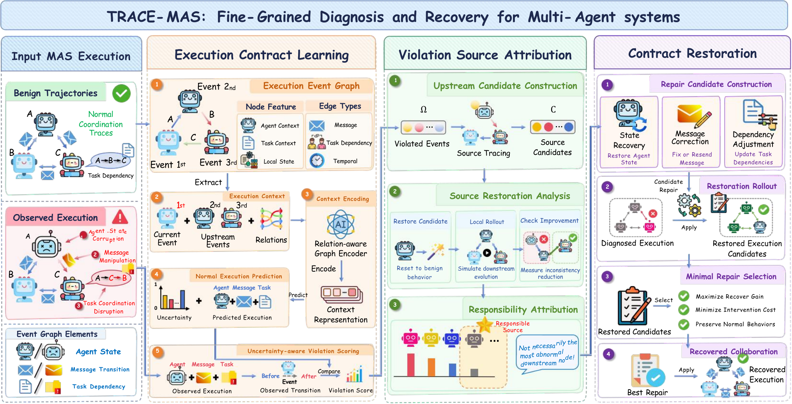View original ↗</a>

*Contracts on the event graph connect detection, source attribution and local repair.*

<h2 class="daily-paper-title" id="paper-arxiv-2611.23346">Auditing the transitions between agent states</h2>

[Securing and Auditing Long-Horizon LLM Agents: State-Transfer Auditing and Controls in the Agent Harness](https://arxiv.org/abs/2611.23346) · Deep Shah, Nehal Kathrotia · arXiv v1 2026-11-17

Context compaction, memory writes and rollback all change what an agent can subsequently know. Tool logs alone leave gaps. The authors record source, destination and segment lineage at state transitions and link records by hash. Deterministic checks cover identity and state consistency, while semantic checks assess whether a transformation lost important constraints. Across 120 benign and 120 fault-injected trajectories, the full schema achieved 98.3% violation recall versus 16.7% from tool logs. Microsecond timing applies to deterministic wrappers. Semantic assessment carries separate costs and failure modes. Segment lineage makes it possible to trace an anomaly back to the transition that introduced it.

<a class="note-image-link" href="/assets/images/digest/2026-11-20/arxiv-2611.23346.png" target="_blank" rel="noopener" aria-label="Writes, compaction and rollback change the state available to later decisions.">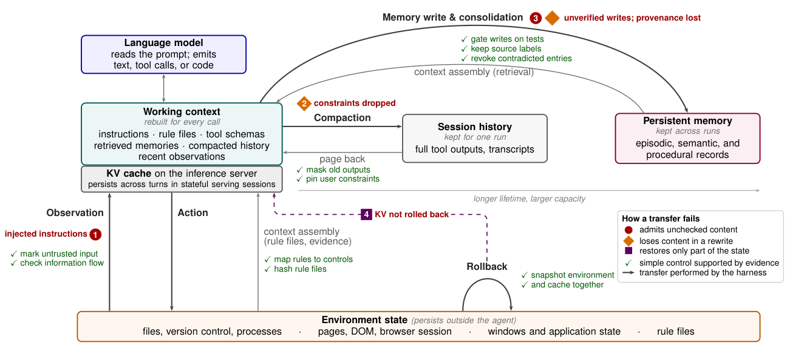View original ↗</a>

*Writes, compaction and rollback change the state available to later decisions.*

<h2 class="daily-paper-title" id="paper-arxiv-2611.23611">Qualifying a hidden tool execution graph</h2>

[RefinementGuard: Counterexample-Directed Semantic Qualification for Hidden Agent-Tool Execution](https://arxiv.org/abs/2611.23611) · Adhyayan Veer Singh, Fanjiang Ye, Yuke Wang · arXiv v1 2026-11-17

Expanding a repository operation into parallel background checks can save time, yet omitting one required branch can produce a false pass. RefinementGuard runs the candidate graph and an independent reference on isolated state, compares provenance, mandatory checks and visible outcomes against the parent operation’s obligations, then binds the qualification to the deployed artifact. Across bug-localization and patch-validation contracts, obligation checking rejected 49 of 100 activated non-equivalent faults and accepted all 60 valid variants. Exact equality detected more faults but rejected every valid variant too. Finite qualification still misses errors. Its value lies in specifying which implementation differences the parent may tolerate and what evidence permits admission.

<a class="note-image-link" href="/assets/images/digest/2026-11-20/arxiv-2611.23611.png" target="_blank" rel="noopener" aria-label="The candidate graph is qualified offline before runtime checks its certificate against the artifact.">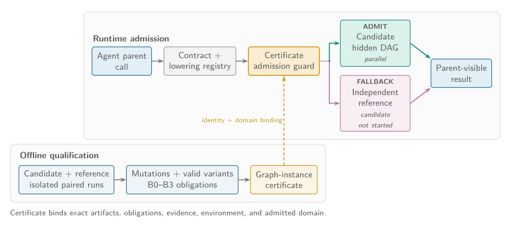View original ↗</a>

*The candidate graph is qualified offline before runtime checks its certificate against the artifact.*

<h2 class="daily-paper-title" id="paper-arxiv-2611.23558">Duru measures slowdown across an agent’s calls</h2>

[Towards Fair Resource Sharing in Agentic LLM Serving](https://arxiv.org/abs/2611.23558) · Sehyeon Lee, Yuchen Xia, Zhaoyang Hong, Jinrui Hu, Anuradha Pandey, Evan Zhao, Ankita Nayak, Nishil Talati · arXiv v1 2026-11-17

Retaining one agent’s KV cache during a tool call speeds its return but can keep another agent out of memory. In a 100-agent experiment at concurrency 18, retention lowered median normalized slowdown from 1.4× to 1.0× while raising p99 from 6.6× to 10.7×. Duru coordinates routing, admission and runtime queues using accumulated agent slowdown relative to isolated execution. Across workload configurations on MI300X and H100, the authors report a geometric-mean reduction of 44.4% in p99 slowdown, with throughput ranging from 91.8% to 127.4% of baseline. Cache hit rate alone hides both the tail penalty and the throughput cost of improving fairness on some workloads.

<a class="note-image-link" href="/assets/images/digest/2026-11-20/arxiv-2611.23558.png" target="_blank" rel="noopener" aria-label="Retaining A’s cache speeds its return but can delay B for several turns, shifting the tail on the right.">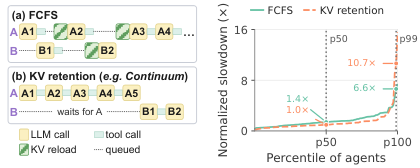View original ↗</a>

*Retaining A’s cache speeds its return but can delay B for several turns, shifting the tail on the right.*

<h2 class="daily-paper-title" id="paper-arxiv-2611.23239">ETA checks for an early exit when the tool returns</h2>

[ETA: Exit on Tool Arrival in Speculative Agent Loops](https://arxiv.org/abs/2611.23239) · Saptarshi Mitra, Xuan Zhu, Rohith Kukkala, Sitao Huang, Karthik Vijayan · arXiv v1 2026-09-01

Dispatching a speculative tool call can hide its latency behind model reasoning, yet reasoning may continue after the result arrives. ETA uses the fork as a sensor. An attempted early exit requires a stable prediction matching the dispatched call, a probe indicating imminent tool use and an available result. The model still passes its normal action check, and the probe’s prediction is never executed directly. Against retry-enabled SPORK, the authors measured 1.33× speedup on 155 airline and retail τ²-bench tasks, 1.26× on telecom and 1.13× on BFCL v4 multi-turn tasks. Paired action-match measurements assess aggregate quality and leave room for individual trajectories to change.

<a class="note-image-link" href="/assets/images/digest/2026-11-20/arxiv-2611.23239.png" target="_blank" rel="noopener" aria-label="Exit requires agreement across several guards and preserves the main path’s action check.">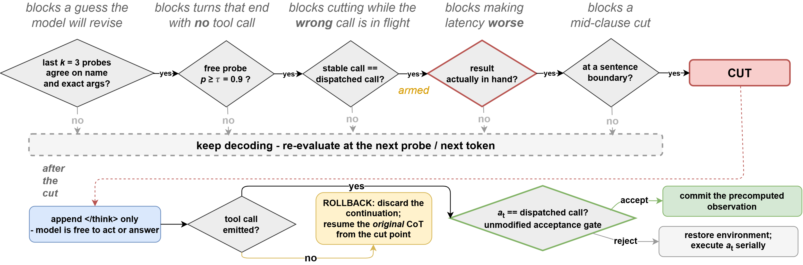View original ↗</a>

*Exit requires agreement across several guards and preserves the main path’s action check.*

<h2 class="daily-paper-title" id="paper-arxiv-2611.24496">BubbleTea fits fine-tuning into MoE layer stalls</h2>

[Harvesting Expert-Parallel Bubbles for Fine-Tuning](https://arxiv.org/abs/2611.24496) · Oana Balmau, Saurav Banka, Jiaxuan Chen, Anne-Marie Kermarrec, Ramya Narasimha Prabhu, Rafael Pires, Mathis Randl, Martijn de Vos · arXiv v1 2026-11-18

A busy MoE server can still have idle time inside a layer when one GPU finishes its local experts before its peers. BubbleTea predicts each GPU’s available microseconds from the router’s token assignment and admits short fine-tuning chunks that reuse resident weights and fit the predicted window. This exposes capacity hidden by iteration-level accounting. On four A100s across three MoE models, fine-tuning throughput was 1.9–6.2× that of LLMStation. In 50 of 63 configurations, p90 serving latency metrics stayed within 10% of serving alone. The denominator matters: predicting bubbles recovers compute without guaranteeing the same tail protection at every load and context length.

<a class="note-image-link" href="/assets/images/digest/2026-11-20/arxiv-2611.24496.png" target="_blank" rel="noopener" aria-label="Unequal token assignments leave idle intervals on early-finishing GPUs before the gather.">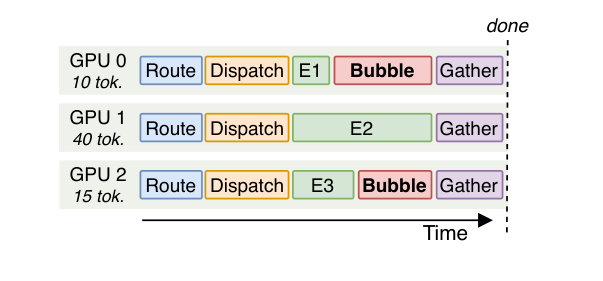View original ↗</a>

*Unequal token assignments leave idle intervals on early-finishing GPUs before the gather.*

<h2 class="daily-paper-title" id="paper-arxiv-2611.23848">KIWI turns a host proxy into a programmable communication path</h2>

[A Fast, Programmable GPU-to-CPU Invocation Layer for GPU-Initiated Communication](https://arxiv.org/abs/2611.23848) · Jiakun Yan, Shiksha Patel, David Sidler, Gengyu Rao, Brandon Potter, Bradford Beckmann · arXiv v1 2026-11-18

Expert parallelism requires tokens to reach the right devices and their results to be combined. KIWI lets a GPU enqueue a compact invocation for a dedicated CPU proxy to progress. The application defines what a complete invocation does, allowing KIWI-EP to specialize dispatch and combine. The evaluation spans small-message latency, communication kernels and vLLM serving on multi-node AMD systems. On eight nodes serving FP8 GLM-5.3, time per output token fell by up to 29% against MORI. The proxy consumes CPU cores, and routing matters: combining transfers destined for GPUs on the same remote node can change the bandwidth needed by competing implementations.

<a class="note-image-link" href="/assets/images/digest/2026-11-20/arxiv-2611.23848.png" target="_blank" rel="noopener" aria-label="The two-node test separates one-way message latency from bandwidth as payload size grows.">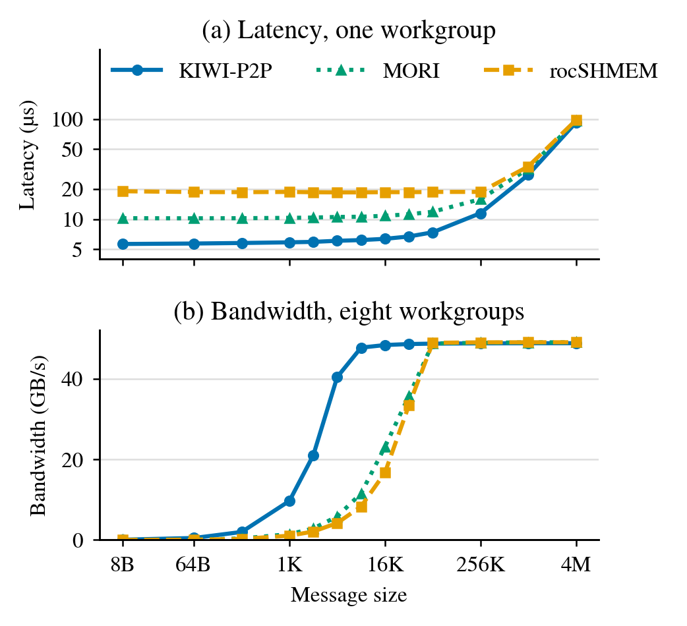View original ↗</a>

*The two-node test separates one-way message latency from bandwidth as payload size grows.*

<h2 class="daily-paper-title" id="paper-arxiv-2611.23512">DexAttention includes mask planning in the speedup</h2>

[DexAttention: Distributed Sparse Attention through Rapid Online Planning and Persistent GPU Execution](https://arxiv.org/abs/2611.23512) · Sirui Chen, Xuehai Qian · arXiv v1 2026-11-17

Sparse attention can remove arithmetic while leaving heavily contended links. A fixed placement can fit one mask poorly when masks change by head or input. DexAttention uses GPU-assisted topology-aware assignment, orders coarse transfers and computation with a lightweight scheduler, then lets a persistent kernel on each GPU release fine-grained tasks as dependencies clear. The planner need not predict every kernel completion. On four nodes and sixteen GPUs, end-to-end training gained a geometric mean of 1.39× over the fastest applicable baseline across eleven configurations. Dynamic video attention gained 2.11–2.37× over Ring Attention including planning. That workload-specific comparison has a different denominator from complete training.

<a class="note-image-link" href="/assets/images/digest/2026-11-20/arxiv-2611.23512.png" target="_blank" rel="noopener" aria-label="The assigner places work from the mask and persistent executors advance ready tasks on each GPU.">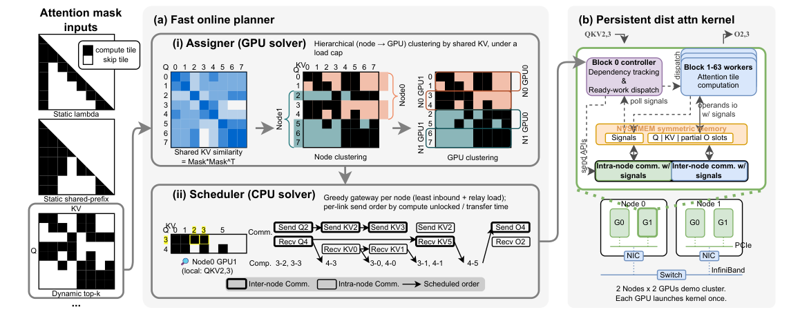View original ↗</a>

*The assigner places work from the mask and persistent executors advance ready tasks on each GPU.*

<h2 class="daily-paper-title" id="paper-arxiv-2611.24458">Separate SM partitions can still share a crossbar port</h2>

[A Runtime System for Mitigating Crossbar Port Contention on SM-Partitioned GPUs](https://arxiv.org/abs/2611.24458) · Ziwen Wang, Qi Luo, Kunlin Li, Changxi Liu, Dongsheng Wang, Yun Chen · arXiv v1 2026-11-18

Giving a latency-sensitive job its own streaming multiprocessors can leave its path from the graphics processing cluster to L2 shared. GPCPlace adjusts placement: spreading work across GPCs opens more ports, while packing competing jobs into different GPCs can isolate them. The runtime changes processing-unit masks without application changes. Across fourteen GPUs and 112 workload combinations, reported group-average speedups reached 1.15× over CUDA Green Contexts, with an individual case at 2.38× while maintaining aggregate throughput. The benefit depends on request rate, pressure on the cache path and the colocated job.

<a class="note-image-link" href="/assets/images/digest/2026-11-20/arxiv-2611.24458.png" target="_blank" rel="noopener" aria-label="Distinct SM partitions can reach L2 through the same GPC port.">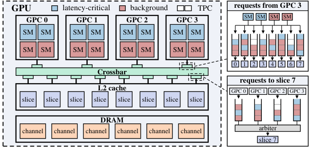View original ↗</a>

*Distinct SM partitions can reach L2 through the same GPC port.*

<h2 class="daily-paper-title" id="paper-arxiv-2611.24437">Finding useful work while warps wait at a barrier</h2>

[Dissecting an Unexplored SASS Control-Code Field: Barrier Exemption and Programmable Warp Priority](https://arxiv.org/abs/2611.24437) · Ziwen Wang, Qi Luo, Kunlin Li, Changxi Liu, Dongsheng Wang, Yun Chen · arXiv v1 2026-11-18

Instruction sequences can leave useful scheduling room around a synchronization barrier. Microbenchmarks separate two effects of an NVIDIA SASS field: EXEMPT lets independent instructions issue during a barrier wait, while another set of marks adjusts warp priority. A post-compilation optimizer places the marks where applicable. Testing actual inference kernels shows how much of the microbenchmark benefit survives. In llama.cpp, decoding 32 concurrent Qwen3-30B-A3B sequences gained up to 3.6% on H20, while dense-model prefill gained up to about 1%. Small expert workloads change the fraction of time spent waiting, so a kernel’s gain does not extrapolate directly to the entire model.

<a class="note-image-link" href="/assets/images/digest/2026-11-20/arxiv-2611.24437.png" target="_blank" rel="noopener" aria-label="The paired timelines show independent marked loads overlapping a barrier wait.">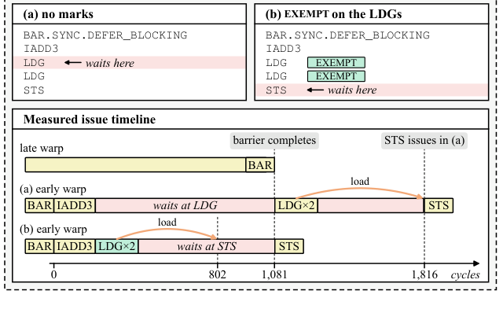View original ↗</a>

*The paired timelines show independent marked loads overlapping a barrier wait.*

<h2 class="daily-paper-title" id="paper-arxiv-2611.23835">NarrowSpec decouples draft width from target width</h2>

[NarrowSpec: Draft Hidden Width Need Not Match the Target in Speculative Decoding](https://arxiv.org/abs/2611.23835) · Alagappan Valliappan, Ankit More, Dheevatsa Mudigere, Jatin Mitra · arXiv v1 2026-11-18

A drafter that reads target hidden states need not keep the target’s width throughout its layers. NarrowSpec narrows the residual stream and adapts dimensions at the interfaces. For DFlash, which borrows the target vocabulary head, two linear maps can be folded in advance. Draft steps become cheaper, but losing accepted tokens can offset the saving. On 880 prompts at temperature zero, half- or quarter-width DFlash and EAGLE-3 variants sped up end-to-end decoding by 1.06–1.12× on B200 and 1.13–1.44× on GB10. A B200 batch sweep extended to 512 and reached 1.21×. Each variant received one matched-budget training run. Hardware bandwidth utilization and training maturity both affect the best width.

<a class="note-image-link" href="/assets/images/digest/2026-11-20/arxiv-2611.23835.png" target="_blank" rel="noopener" aria-label="Folding the output adapter and vocabulary head at load time leaves one narrower projection at decode.">View original ↗</a>

*Folding the output adapter and vocabulary head at load time leaves one narrower projection at decode.*

<h2 class="daily-paper-title" id="paper-arxiv-2611.23388">QDA searches quantization recipes with two feedback signals</h2>

[QDA: Closed-Loop LLM Quantization Design with Agents](https://arxiv.org/abs/2611.23388) · Xingyang Li, Tianlang Zhao, Song Han, Ligeng Zhu · arXiv v1 2026-11-17

A quantization recipe can help one model and hurt another at a different precision. QDA fixes the format supported by the serving kernel and lets an agent modify offline quantization. Most candidates receive a fast KL-divergence score against the original output distribution. Promising ones also undergo long generation to expose repetitive loops that short samples miss. Across four reasoning models, searches costing about 64 GPU-hours each improved average accuracy over the strongest public recipe by 0.9, 1.4 and 2.2 percentage points at W4A16, W4A8 and W3A16. Serving uses existing kernels. KL is a screening signal whose implications still need long-generation and downstream checks.

<a class="note-image-link" href="/assets/images/digest/2026-11-20/arxiv-2611.23388.png" target="_blank" rel="noopener" aria-label="KL ranks most recipes cheaply and long-generation checks focus on selected candidates.">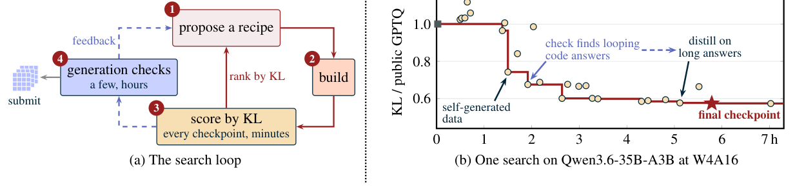View original ↗</a>

*KL ranks most recipes cheaply and long-generation checks focus on selected candidates.*

<h2 class="daily-paper-title" id="paper-arxiv-2611.24431">SkimPrefill keeps whole images and paragraphs</h2>

[Let a Small Model Read First: Faster Prefill for Long Interleaved Image-Text Inputs](https://arxiv.org/abs/2611.24431) · Xiaolin Lin, Kai-Chiang Wu, Bing Li, Grace Li Zhang · arXiv v1 2026-11-18

Prefilling an entire interleaved document before pruning it can consume much of the time pruning was meant to save. SkimPrefill scans half-resolution input with Qwen3.5-0.8B up to an early layer and uses one attention head to rank whole images and paragraphs. Targets from different families can consume the same selected units. On 128K MMLongBench inputs with 10% of tokens retained, time to first token improved by 3.7×, 11.6× and 8.2× across the three targets, including selection. Whole units preserve relationships among evidence words, but discarded context can still matter for synthesis across paragraphs. Accuracy varies by task.

<a class="note-image-link" href="/assets/images/digest/2026-11-20/arxiv-2611.24431.png" target="_blank" rel="noopener" aria-label="Keeping whole paragraphs preserves color words that token pruning discards in this example.">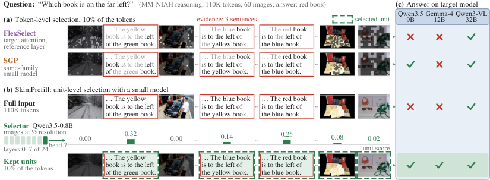View original ↗</a>

*Keeping whole paragraphs preserves color words that token pruning discards in this example.*

<h2 class="daily-paper-title" id="paper-arxiv-2611.23483">SpecLook verifies where to look</h2>

[SpecLook: Speculating Where to Look for Fast and Reliable Agentic MLLMs](https://arxiv.org/abs/2611.23483) · Xi Ding, Jiawei Zhang · arXiv v1 2026-11-17

A visual agent can spend multiple tool rounds zooming in to confirm an answer. SpecLook asks a smaller model to propose a verifiable glimpse, then checks whether the added evidence supports its original answer. Stable, confident answers exit early. Otherwise the expert first verifies without tools, with a full loop reserved for cases still lacking evidence. A fast variant skips the final search. With DeepEyes-7B across six V*, HR-Bench and POPE splits, that variant raised mean accuracy by 4.2 points and cut time per question from 9.92 seconds to about one. Accuracy averages splits while timing pools questions. The object of verification is visual evidence, distinct from the proposed interface action in Vanguard.

<a class="note-image-link" href="/assets/images/digest/2026-11-20/arxiv-2611.23483.png" target="_blank" rel="noopener" aria-label="A small model proposes a glimpse before unresolved questions are routed to further search.">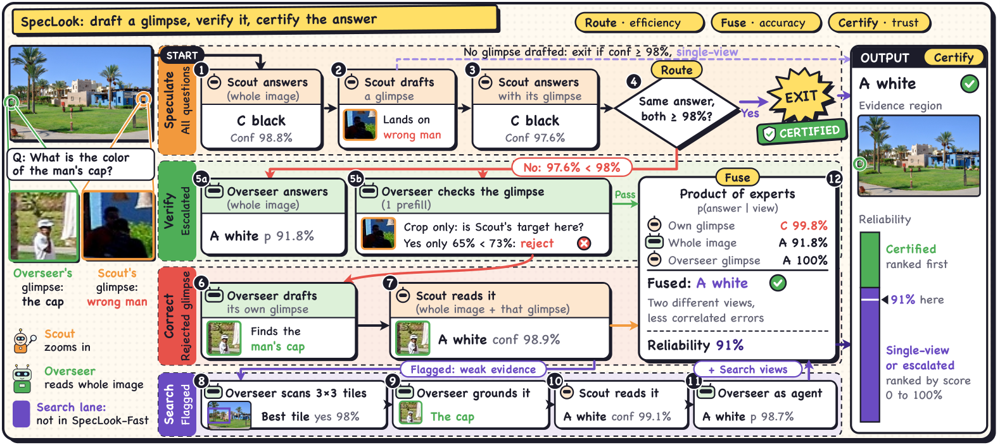View original ↗</a>

*A small model proposes a glimpse before unresolved questions are routed to further search.*

<h2 class="daily-paper-title" id="paper-arxiv-2611.23917">Vanguard checks a proposed action against the screen</h2>

[Vanguard: Knowing When to Trust the Draft in Speculative Vision-Language Agents](https://arxiv.org/abs/2611.23917) · Hanqi Mao, Jiajun Fan, Ruihan Guo, Shuaike Shen, Ziwen Wang, Hui Ren, Xianrui Zhong, Ge Liu · arXiv v1 2026-11-18

“Click confirm” can sound plausible even when the button is absent. Vanguard judges draft actions using the screenshot, task, action history and proposed step. A candidate must clear a threshold or the larger model takes over. Multiple small-model samples can already contain the correct action, making discrimination a productive use of compute. On two held-out Mind2Web sets of 820 and 975 steps, four candidates with an 8B fallback achieved 66.5% and 66.8% step success. The 8B wrote 26% and 23% of steps. Thresholds were fixed on development data. Step success, full-episode completion and end-to-end time remain distinct measurements.

<a class="note-image-link" href="/assets/images/digest/2026-11-20/arxiv-2611.23917.png" target="_blank" rel="noopener" aria-label="The interface example and closed-loop trajectory distinguish draft steps from target-model fallbacks.">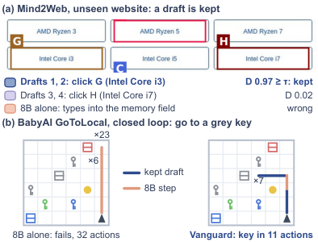View original ↗</a>

*The interface example and closed-loop trajectory distinguish draft steps from target-model fallbacks.*

<h2 class="daily-paper-title" id="paper-arxiv-2611.24324">How much GPU time a coding timeout cascade saves</h2>

[Reducing Inference Cost of Coding Agents with Timeout Cascades](https://arxiv.org/abs/2611.24324) · Boxi Zhou, German Sviridov, Dmitrii Ustiugov, Haris Javaid · arXiv v1 2026-11-18

Difficulty routing requires predicting which tasks a smaller model cannot solve. A timeout cascade gives it a bounded attempt and escalates on failure. After comparing 36 open-weight models, the authors simulated a GLM-4.7-Flash to GLM-4.7 cascade from mini-swe-agent traces. At the best timeout on all 500 SWE-bench Verified tasks, it saved 16.4% of GPU-hours at the large model’s resolve rate, versus 17.9% for an oracle-style router. Easy and medium tasks made up 91%, favoring the first stage. Escalated jobs pay sequential waiting time, and deployments must recognize failure. Single-run cost estimates therefore do not predict interactive response time.

<a class="note-image-link" href="/assets/images/digest/2026-11-20/arxiv-2611.24324.png" target="_blank" rel="noopener" aria-label="The cascade escalates on timeout or failure, while the router chooses by predicted difficulty up front.">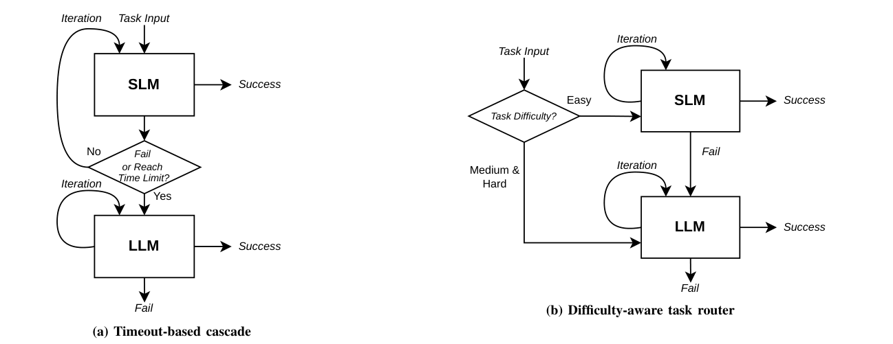View original ↗</a>

*The cascade escalates on timeout or failure, while the router chooses by predicted difficulty up front.*

<h2 class="daily-paper-title" id="paper-arxiv-2611.24892">Can a simulator metric reward accepting broken work?</h2>

[On Evaluating User Simulators for Interactive Agents](https://arxiv.org/abs/2611.24892) · Hengguang Zhou, I-Hung Hsu, Li Chen, Priyanshi Shrivastava, Anastasios Angelopoulos, Wei-Lin Chiang, Ion Stoica, Cho-Jui Hsieh · arXiv v1 2026-11-18

An agent can look unusually reliable when a simulated user accepts broken work or declares success early. The authors perturb comparable interactions by changing goals, removing constraints, stopping early or directing users to approve faulty results. Across ten perturbations, three existing suites detected drops for only five or six each. The proposed suite tests individual intent and constraints, population behavior and agreement with a reference agent ranking. Together its signals detect all ten perturbations. Sensitivity to bad traces does not ensure that filtering by a metric produces useful agent rankings. The study tests those properties separately.

<a class="note-image-link" href="/assets/images/digest/2026-11-20/arxiv-2611.24892.png" target="_blank" rel="noopener" aria-label="Intent in a trace, population statistics and agent rankings answer different evaluation questions.">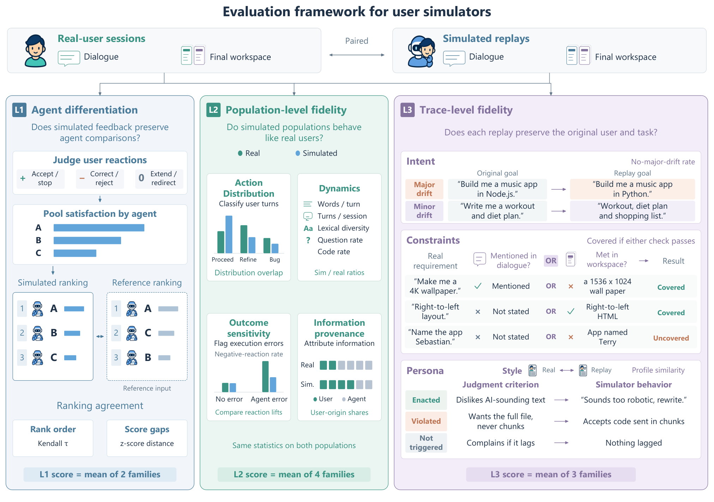View original ↗</a>

*Intent in a trace, population statistics and agent rankings answer different evaluation questions.*

<h2 class="daily-paper-title" id="paper-arxiv-2611.24395">RSIBench-Infra independently checks speedup submissions</h2>

[RSIBench-Infra: Can Agents Optimize Their Own Training and Inference Infrastructure at Production Scale?](https://arxiv.org/abs/2611.24395) · Hanlin Wu, Yifei Wang, Zhicheng Cai, Huan-ang Gao, Wei-Ying Ma, Ya-Qin Zhang, Jingjing Liu, Hao Zhou · arXiv v1 2026-11-18

A faster kernel can conceal lost work, numerical degradation or work shifted outside the timer. RSIBench-Infra turns official runnable recipes into twenty training and inference tasks with fixed hardware, inputs, measurement boundaries and quality gates. Agents may modify the software stack but submit an OCI image layer for independent execution. With seven agent–model configurations and eight-hour budgets, 86 of 130 formally scored submissions passed quality checks and exceeded 1.10× speedup. The denominator counts submissions, with multiple entries possible per task. Warmup exclusions, output checks and end-to-end timing make the gains interpretable.

<a class="note-image-link" href="/assets/images/digest/2026-11-20/arxiv-2611.24395.png" target="_blank" rel="noopener" aria-label="Optimization, image-layer application and independent evaluation are distinct stages with a quality gate before timing.">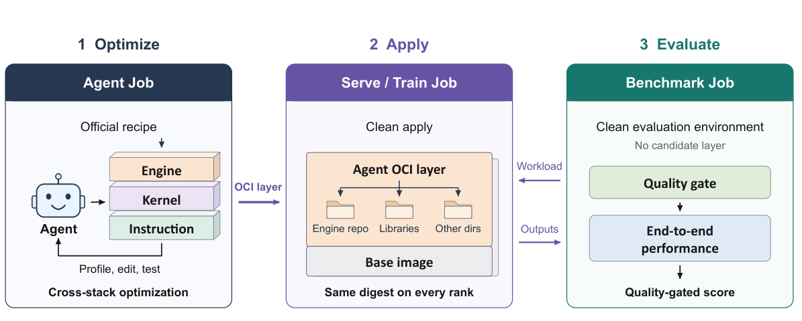View original ↗</a>

*Optimization, image-layer application and independent evaluation are distinct stages with a quality gate before timing.*

<h2 class="daily-paper-title" id="paper-arxiv-2611.24788">Leasing warm Isabelle sessions for concurrent verification</h2>

[Isabelle Pool Server: a pooled verification service for prover training and multi-agent proving](https://arxiv.org/abs/2611.24788) · Xuanwei Ren, Wenda Li · arXiv v1 2026-11-18

Concurrent proving agents can lose throughput to session startup or exhaust memory by retaining branches. Isabelle Pool Server reuses warm sessions with matching imports, leases each to one client at a time, bases admission on memory and budgets each call. Clients can check steps, save state and roll back, with a full theory build available for final validation. On one host, 32 workers reached about 24× single-worker verification throughput in the warm setting. Including startup lowered the rate, and complete scripted rollouts scaled less than short chunks. Reuse suits branching searches with shared imports. Chunk throughput alone cannot establish proof completion rate.

<a class="note-image-link" href="/assets/images/digest/2026-11-20/arxiv-2611.24788.png" target="_blank" rel="noopener" aria-label="Throughput scales differently to 32 workers when session startup is included.">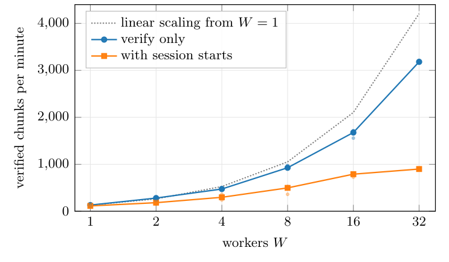View original ↗</a>

*Throughput scales differently to 32 workers when session startup is included.*

<h2 class="daily-paper-title" id="paper-arxiv-2611.24578">BaseRSI transfers harness gains into the visual model</h2>

[BaseRSI: Recursive Self-Improvement of a Base Vision-Language Model via Training-Free Harness Internalization](https://arxiv.org/abs/2611.24578) · Mingda Zhang, Yuanhao Dong, Qiang Huang, Rui Qian, Yanjin Li, Zhenyu Liu, Xiao Huang, Zihao Yang, Jian Wang, Pinjia He, Xiaoying Tang · arXiv v1 2026-11-18

A visual reasoning prompt supplied on every request helps only while that external procedure is available. BaseRSI proposes and validates harness entries from failures, then uses the model with the harness to teach the same model running alone. ReGap derives a signal from per-layer activation differences. ReKey confines the edit to selected neurons, allowing edits to accumulate on one checkpoint. The authors measure accuracy on ten visual reasoning benchmarks and test random replacement values as a control. This demonstrates partial transfer of harness gains when weights are accessible. Image-question results leave the transfer of multi-tool production behavior open.

<a class="note-image-link" href="/assets/images/digest/2026-11-20/arxiv-2611.24578.png" target="_blank" rel="noopener" aria-label="The outer loop selects harness entries and the inner loop transfers their activation effects into weights.">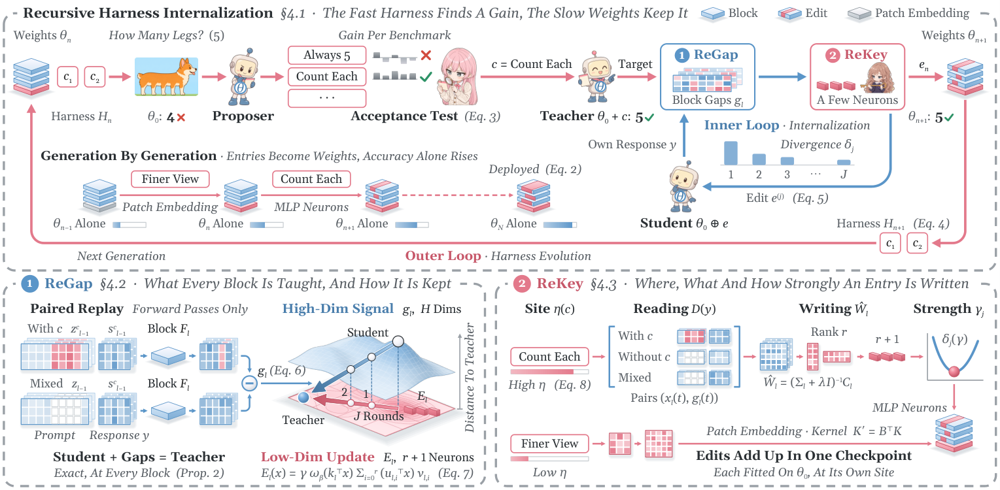View original ↗</a>

*The outer loop selects harness entries and the inner loop transfers their activation effects into weights.*

<h2 class="daily-paper-title" id="paper-arxiv-2611.23878">HETEROVLM makes room for urgent visual requests on-device</h2>

[HETEROVLM: Edge Multi-Request Vision-Language Model Serving on a Heterogeneous Versal SoC with AI Engines and Programmable Logic](https://arxiv.org/abs/2611.23878) · Zhiheng Chen, Yu-An Chou, Yifan Zhang, Ye Qiao, Saptarshi Mitra, Sitao Huang · arXiv v1 2026-11-18

A short urgent request can miss its deadline behind a long prefill on an edge device. HETEROVLM places encoding, prefill and attention on the AIE array, with small-batch decode and scheduling in programmable logic. Concurrent requests share a weight read during decode. Urgent work preempts at a work-unit boundary and the paused request resumes from intermediate results in DDR. On a physical Versal VC1902, first tokens took 140 ms for a text question and 303 ms for a 177-token camera question with one 512×288 image. Arriving during a 4K prefill added about 14 ms over idle for the urgent question. These timings are specific to the board, model and input shapes.

<a class="note-image-link" href="/assets/images/digest/2026-11-20/arxiv-2611.23878.png" target="_blank" rel="noopener" aria-label="The device floorplan separates the AIE array, memory servers and GEMV engines used for small decode batches.">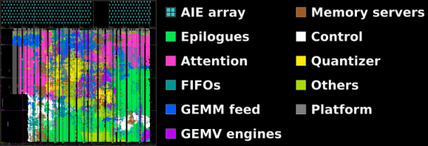View original ↗</a>

*The device floorplan separates the AIE array, memory servers and GEMV engines used for small decode batches.*

<h2 class="daily-paper-title" id="paper-arxiv-2611.24085">LEDGE calibrates edge inference placement against devices</h2>

[LEDGE: An Efficient Simulator for Distributed LLM Serving on Heterogeneous Edge Devices](https://arxiv.org/abs/2611.24085) · Zihao Wang, Ye Tian, Tajana Rosing, Nalini Venkatasubramanian · arXiv v1 2026-11-18

Model placement on heterogeneous edge devices depends on precision-specific execution costs and competition for shared uplinks. LEDGE skips tensor arithmetic, calibrates device models from end-to-end measurements and simulates uneven tensor parallelism, pipeline splits and link contention. The authors validated predictions on ten devices including Jetsons and Raspberry Pis. Request-level mean absolute percentage error was below 3.6% in the original Qwen setting. Zero-shot transfer to other model families yielded 7.44% end-to-end error. Simulation can screen many placements, but workloads outside the calibration distribution need new measurements. Simulation speed describes exploration cost, separate from device inference speed.

<a class="note-image-link" href="/assets/images/digest/2026-11-20/arxiv-2611.24085.png" target="_blank" rel="noopener" aria-label="Placement enters the simulator, which models devices and shared links to predict request latency.">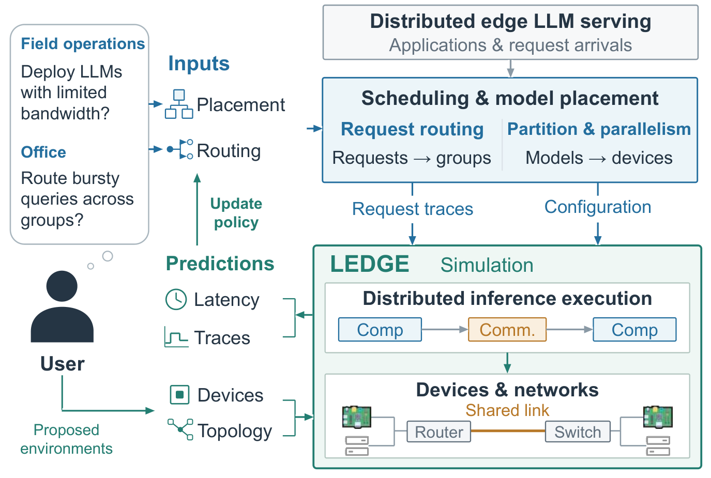View original ↗</a>

*Placement enters the simulator, which models devices and shared links to predict request latency.*

## Community reports

### SREGym checks recovery against user-visible outcomes

SREGym merged a gateway cascade task based on Microsoft’s preliminary report for the November 12 outage. Recovery requires exactly-once mail delivery, healthy peak-load probes and survival under a later burst. In dedicated-host single-tier validation, the reference repair delivered 1,644 messages exactly once. A partial repair still failed the connection-load check. After changelog wording was brought closer to the incident report, gpt-6.1-sol passed zero of ten attempts in two host cohorts. The result shows sensitivity to diagnostic hints. Isolation policy models an undisclosed incident detail, and the replicated tier still lacked live validation. · Jackson Clark · 2026-11-18 · [Original post](https://x.com/HacksonClark/status/2123165881324716111) · [Project validation](https://github.com/SREGym/SREGym/pull/1202)

### KernelBench records both a speedup and a synchronization caveat

KernelBench published per-cell audits for Gemini 4 Neon xhigh. On RTX PRO 6000, Kimi-Linear Decode achieved 36.66× over Torch across 2K, 8K and 16K contexts. Centered int4 dequantization addressed rounding, while cache policy targeted dense weights displaced by the previous step’s KV writes. The audit flags a normalization-state reset before grid synchronization. The maintainer reports zero failures in 110 isolated repeats and one under heavy load. A separate DeepSeek NSA result of 0.073 ms measures geometric-mean kernel time. The benchmark grants agents unlimited time per cell, so the numbers describe artifact performance on specific hardware. · Elliot Arledge · 2026-11-19 · [Original post](https://x.com/elliotarledge/status/2123522413464031716) · [Per-cell audit](https://kernelbench.com/models/gemini-4-neon-xhigh)

## Notes from this issue

- [DeepSeek on H20-3e brings the first token forward while later tokens slow down](/tech/en/lmsys-deepseek-v41-flash-h20-pd-colocate/)
- [Loading tools on demand reduces the context read at every step](/tech/en/baseten-deferred-tool-loading/)
- [How Inferact tests vLLM changes against shadow traffic](/tech/en/inferact-autonomous-inference-system/)
- [How SageMaker decides when an inference request should change regions](/tech/en/aws-sagemaker-cross-region-inference-routing/)
- [How Performance Factory decides a regression has recovered](/tech/en/openai-performance-factory/)
- [Gemini 4 Neon’s task cost depends on reasoning effort and harness](/tech/en/gemini-4-neon/)
