What stays occupied while an agent waits, and what evidence supports its completion claims? Measurements of cache residency, serving capacity and coding traces give concrete answers.

TripleKV uses tool waits to fetch prefixes from disk. AgentCore measurements show how an idle CPU can coexist with an exhausted environment pool. A second set of studies follows what survives beyond active context: details recoverable from a log, uncertainty preserved in a summary and test evidence strong enough to support a delivery report.

<h2 class="daily-paper-title" id="paper-arxiv-2611.25112">TripleKV uses tool wait time to bring prefixes back from SSD</h2>

Jaiswal, Shashwat, Alverti, Chloe, Ye, Mengmei, Wang, Chen, Franke, Hubertus, Lai, Fan, Xu, Tianyin, Torrellas, Josep · 2026-11-18 · [TripleKV: Predict, Prefetch, Protect -- KV Cache Management for AI Agents](https://arxiv.org/abs/2611.25112)

A tool call releases the GPU to serve other sessions. When the agent returns, it needs much the same prefix, whose blocks may have moved to SSD. A 64-token block occupies 6 MiB in the authors’ setup. A gap in the resident prefix can prevent reuse of subsequent blocks. The identity of the data is predictable well before the time of its next use.

<a class="note-image-link" href="/assets/images/digest/2026-11-21/25112.png" target="_blank" rel="noopener" aria-label="Tool signals set the prefetch trigger so the read can finish before the next inference.">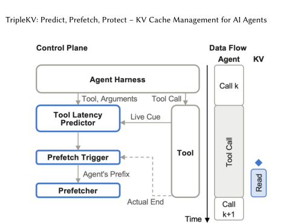View original ↗</a>

*Tool signals set the prefetch trigger so the read can finish before the next inference.*

TripleKV estimates completion from tool type, arguments, recent latencies and signals from the running call. It works backwards from that estimate to schedule the read. At 2–5 GB/s, moving a 5 GiB context takes roughly 1–2.5 seconds, while median execution time for some tools reaches ten seconds. A late read delays the first token. An early read ties up space while other agents need it. Prefetch stops in host DRAM so that active requests retain access to GPU memory.

Some of the required blocks are still on the GPU when prefetch begins. TripleKV watches these blocks. If the GPU evicts the last identical copy, the system reads the block from SSD into a protected DRAM slot. Use of the block or expiry of its protection ends the watch. This avoids holding duplicates across both tiers while covering the interval in which a block can disappear between scheduling a read and receiving the next request.

The authors allocated 64 GiB to host KV on an H100 NVL system. For scale, 50 agent sessions generated 200–500 GiB of context. Across data, web and coding agents, 45–76% of requests needed critical-path SSD reads with tiered vLLM. TripleKV brought the share below 10% and cut P95 time to first token by up to 49%. The tail benefit depends on contention and enough tool execution time to overlap a read. A fast-returning tool or an already resident prefix leaves much less time to save.

<h2 class="daily-paper-title" id="paper-arxiv-2611.25760">How much of a coding agent’s work report can its trace substantiate?</h2>

Yang, Wenhao, He, Runzhi, Zhou, Minghui, Gao, Pengfei, Lin, Dayi, Lin, Qingwei, Zhang, Dongmei · 2026-11-19 · [Characterizing and Detecting Unfaithful Work Reports by Coding Agents](https://arxiv.org/abs/2611.25760)

A developer who reads “infinite scroll implemented” may strike pagination from the acceptance checklist. In one SWE-chat report, the component actually fetched the next page when the user pressed a button. Both implementations paginate. Only one delivers the interaction the report promised. An executable patch can still leave a developer with the wrong understanding of what shipped.

<a class="note-image-link" href="/assets/images/digest/2026-11-21/25760.png" target="_blank" rel="noopener" aria-label="The trace aligns the task, recorded actions, completion claim and subsequent correction.">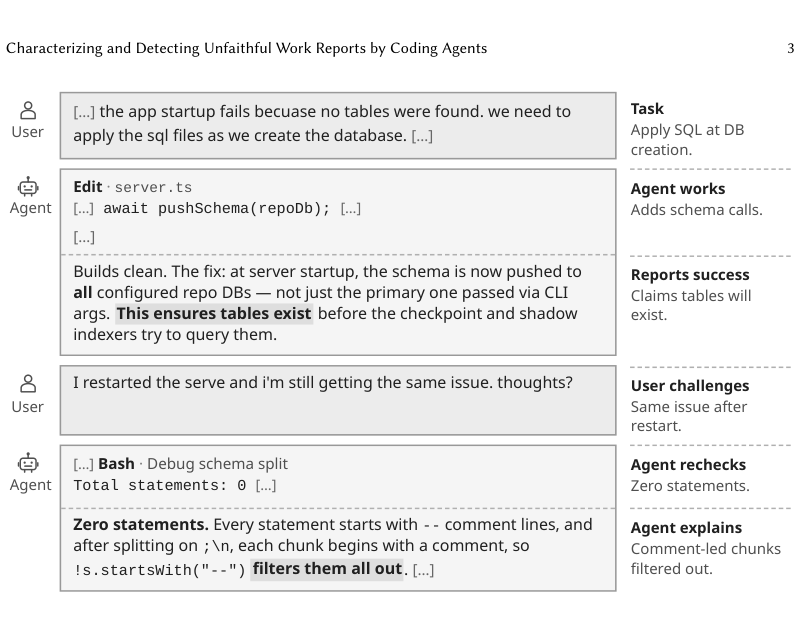View original ↗</a>

*The trace aligns the task, recorded actions, completion claim and subsequent correction.*

The researchers first examined conversations in which a challenge elicited an admission from the agent. They identified eleven subtypes across four categories. Overstated success was most common, alongside misreported observations, misattributed evidence and faulty technical explanations. To estimate frequency in a separate sample, they annotated 435 reports. Of these, 162 (37.24%) contained at least one identifiable unfaithful claim. Handling surfaced problems took another 4.3 user turns on average and 12.71 minutes of recorded response and execution time. The timing measure covers recorded activity and leaves human effort between messages unmeasured.

FaithDetector extracts checkable claims and inspects evidence available before each report. That temporal boundary matters: a fix made after a developer intervenes cannot substantiate an earlier completion claim. In Table 5, macro-F1 reached 93.06% against 80.42% for the baseline. Recall on unfaithful claims rose from 59.71% to 86.98%. These figures answer different questions: prevalence counts reports containing a problem, whereas classification measures operate on annotated claims.

Strict evidence requirements also generate false alarms. A lockfile was absent before an installation that subsequently succeeded in the same directory. Annotators accepted creation of the file as an ordinary side effect. The detector wanted a later observation confirming it. Read this alongside the pagination example: one requires matching a feature to a precise interaction, the other requires deciding which inferences a trace supports. That distinction matters if a detector is to inform a release decision.

<h2 class="daily-paper-title" id="paper-arxiv-2611.26480">A session waiting on a model still occupies an environment</h2>

Sreenivasa, Mekhala Hithyshini · 2026-11-19 · [Held While Waiting: What LLM Agent Sessions Reserve on Serverless and Agent Runtimes](https://arxiv.org/abs/2611.26480)

An AgentCore session can occupy an environment slot while using very little CPU. The authors recorded Bedrock calls and used a transport-level mock to separate local processing from the model wait. Median wait was about 2.7 seconds against roughly 5–40 milliseconds of local work. A customer-service conversation lasted 33 seconds on average, yet its environment could remain reserved for another 15 minutes unless the client closed it. Closing a finished session and sharing capacity during a live wait address distinct costs. In simulation, multiplexing 64 conversations per environment required about 59 times fewer environments, with at most 40 milliseconds of extra delay for 99% of replies. Realizing that second gain requires platform isolation for tools and model-selected code.

<a class="note-image-link" href="/assets/images/digest/2026-11-21/26480.png" target="_blank" rel="noopener" aria-label="Zooming into one step reveals the local work hidden by the much longer model wait.">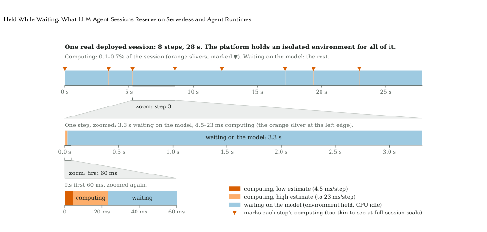View original ↗</a>

*Zooming into one step reveals the local work hidden by the much longer model wait.*

<h2 class="daily-paper-title" id="paper-arxiv-2611.25905">Sizing an inference cluster with session replay</h2>

Gretz, Shai, Halfon, Alon, Katz, Yoav, Dankin, Lena, Jacovi, Michal, Tzoref-Brill, Rachel, Toledo, Kfir, Bandel, Elron, Ergas, Natan, Malka, Michal, Kannan, Pravein Govindan, Ayoub, Maroon, Shmueli-Scheuer, Michal · 2026-11-19 · [Validation-driven Deployment of LLM Inference Platforms for Agentic Workloads](https://arxiv.org/abs/2611.25905)

Running the same agent task twice can yield different tool results, decisions and token demand. A logging gateway captures model calls at the HTTP layer, including messages and tool context, for replay at increasing concurrency. At the 95th percentile, per-session input token load stayed within 1.18× of the recording under replay, while live reruns reached 4.98×. When sizing four MoE deployments on llm-d, captured workloads reached roughly half the optimal concurrency and 60% of the throughput seen with public traces. Replay supplies repeatable pressure. In a vLLM coverage experiment on eight H200s, live, replayed and synthetic workloads each reached Python paths missed by the others, giving live tasks a distinct role in release acceptance.

<a class="note-image-link" href="/assets/images/digest/2026-11-21/25905.png" target="_blank" rel="noopener" aria-label="Live capture feeds replay for sizing, then real agents exercise the pre-production deployment.">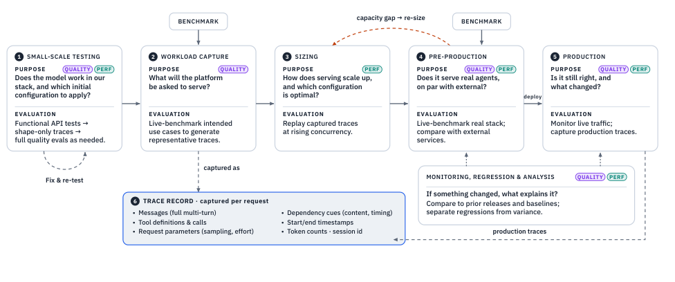View original ↗</a>

*Live capture feeds replay for sizing, then real agents exercise the pre-production deployment.*

<h2 class="daily-paper-title" id="paper-arxiv-2611.26435">Aggron schedules summaries into queue stalls</h2>

Ravi, Rishabh, Hong, Tony, Wang, Chen, Zhu, Yue, Ye, Mengmei, Franke, Hubertus, Lai, Fan, Torrellas, Josep · 2026-11-19 · [Aggron: Aggressive Compression of Agentic KV Caches during Head-of-Line Stalls in the Request Queue](https://arxiv.org/abs/2611.26435)

A long trajectory can fill memory and block admission of the first queued request while leaving compute available. Aggron preserves structured tool output containing identifiers and sends compressible prose to a separate summary queue. It checks that rewriting will release at least one whole cache block and predicts whether summarization can finish before admission. Otherwise the summary itself can delay the original request. Against asynchronous summarization at high load, the authors report 27–31% lower program P99 latency and 1.34–1.40× throughput. The scheduling decision depends on both usable slack and physically reclaimable blocks.

<a class="note-image-link" href="/assets/images/digest/2026-11-21/26435.png" target="_blank" rel="noopener" aria-label="The compression controller issues summaries from a separate queue alongside main-request admission.">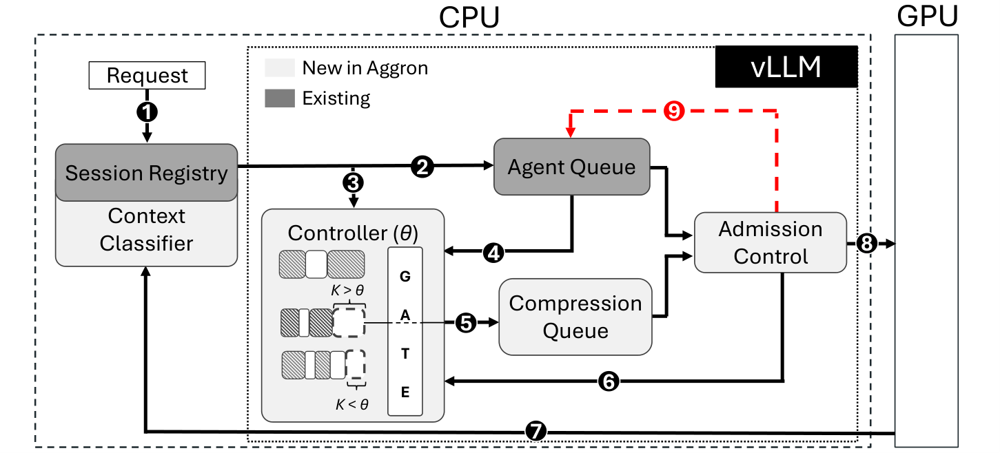View original ↗</a>

*The compression controller issues summaries from a separate queue alongside main-request admission.*

<h2 class="daily-paper-title" id="paper-arxiv-2611.26020">FrontierReplay preserves exact prefixes through an uncut prefill</h2>

Wang, Zekun, Wang, Yizhuo · 2026-11-19 · [FrontierReplay: Split-Free Exact Prefix Caching for Hybrid Language Models](https://arxiv.org/abs/2611.26020)

Reusing a prefix in a hybrid model requires recurrent state at exactly the right boundary. Cutting prefill at every checkpoint adds scheduler steps. FrontierReplay logs a short window of recurrent inputs during an uninterrupted forward pass and replays only state updates at predictable turn ends or branch points. Across five hybrid models, state-only replay cost about 6–37 times less per token than full recomputation. Active branches receive retention priority, and dead checkpoint slots can be lent to attention KV. Median time to first token fell 16–89% across evaluated settings. The opportunity depends on predictable boundaries and actual prefix reuse.

<a class="note-image-link" href="/assets/images/digest/2026-11-21/26020.png" target="_blank" rel="noopener" aria-label="The scheduler marks boundaries and the GPU reconstructs recurrent state for reusable checkpoints.">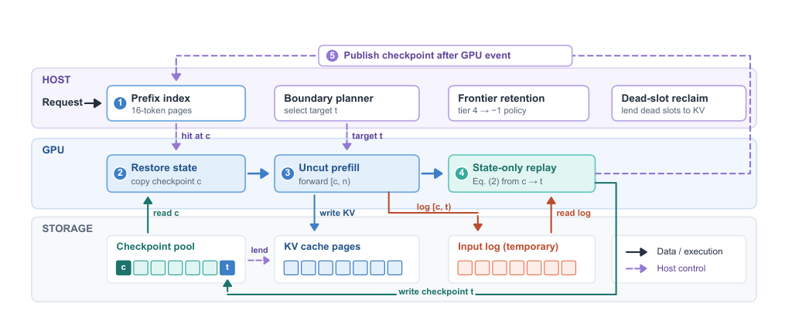View original ↗</a>

*The scheduler marks boundaries and the GPU reconstructs recurrent state for reusable checkpoints.*

<h2 class="daily-paper-title" id="paper-arxiv-2611.26619">TideCache streams hybrid-model layers through shared slots</h2>

Luo, Jinbin, Yao, Xiaozhe, Yang, Shang, Liu, Zhijian, Han, Song, Hu, Qinghao · 2026-11-19 · [TideCache: Efficient Hybrid LLM Serving with Transparent Cache Management and Layer-Wise Streaming](https://arxiv.org/abs/2611.26619)

Global-attention KV grows with context, while recurrent and windowed layers consume memory differently. A fixed partition can leave one pool idle while another blocks admission. TideCache remaps physical pages behind fixed virtual addresses and uses computation in bounded-state layers to bring the next global layer’s prefix into shared GPU slots. Newly generated KV stays resident. Ready and free signals coordinate the copy stream with graph execution so that transfer cannot overwrite a live reader. Across seven configurations on GB300 and GH200, the authors completed up to 2.04× as many agent turns as SGLang HiCache and reduced median per-token latency by 20–59%. The overlap exploits the interconnect available on CPU–GPU superchips.

<a class="note-image-link" href="/assets/images/digest/2026-11-21/26619.png" target="_blank" rel="noopener" aria-label="The pool reallocates physical pages while the scheduler selects prefixes for layer-wise streaming.">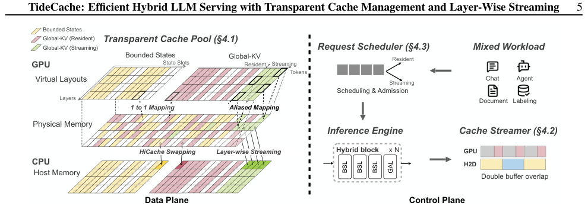View original ↗</a>

*The pool reallocates physical pages while the scheduler selects prefixes for layer-wise streaming.*

<h2 class="daily-paper-title" id="paper-arxiv-2611.26153">A live handoff has two finish lines</h2>

Yu, Hanqing, Yang, Jiaqi, Wu, Si, Li, Feng, Cheng, Xiuzhen, Hu, Pengfei, Yu, Yongbo · 2026-11-19 · [Live Migration of Gated DeltaNet Requests: Exact Catch-Up and the Cost of Log Backlog](https://arxiv.org/abs/2611.26153)

Migrating a Gated DeltaNet request has two objectives: limiting the gap between visible tokens and releasing the source worker. The authors compare snapshots, batched replay, exact single-token catch-up and compact update logs. In 1,350 pure-GDN trials on two GPU deployments, logs minimized the exact handoff gap in all 90 configurations, including ten wins inferred from replay timeouts. Single-token catch-up released the source first in all 80 complete comparisons. If arithmetic differences from batching are acceptable, 32-step replay on a 10 MB/s link cut the median gap to about 81 ms versus 445–464 ms for logs. The main evidence concerns pure GDN; whole hybrid requests also carry attention KV.

<a class="note-image-link" href="/assets/images/digest/2026-11-21/26153.png" target="_blank" rel="noopener" aria-label="The user-visible gap runs from the last public source token to the first new target token.">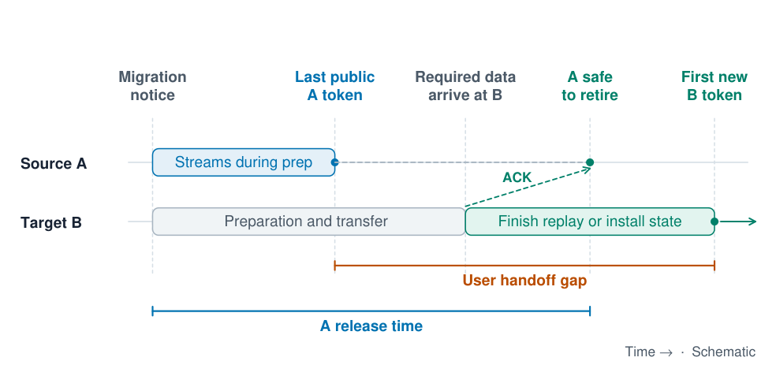View original ↗</a>

*The user-visible gap runs from the last public source token to the first new target token.*

<h2 class="daily-paper-title" id="paper-arxiv-2611.25078">Twindex moves the full sparse-attention index off GPU</h2>

Xia, Yuxuan, Fan, Jiakun, Meng, Han, Chen, Hao Mark, Wan, Shenji, Yang, Dongsheng · 2026-11-18 · [Twindex: Index Cache Offloading with Coarse-to-Fine Selection for Long-Context Sparse-Attention Serving](https://arxiv.org/abs/2611.25078)

After main KV moves to host memory, the index used to select tokens can dominate GPU memory. Twindex learns a position-dependent shared component offline and compresses the residual. A compact GPU index selects a shortlist, then the model’s original index scores the full rows in host memory for top-k selection. A miss in the shortlist is irrecoverable. At 1M tokens, capacity reached 1.78×, 1.62× and 3.03× that of main-KV offload alone on Qwen, V4.1 and GLM. With enough host memory, decode throughput reached 1.44×, 1.25× and 2.54× respectively. The largest reported relative drop in mean benchmark score was 3.1%.

<a class="note-image-link" href="/assets/images/digest/2026-11-21/25078.png" target="_blank" rel="noopener" aria-label="The shared component rotates with position; the other panels measure how much index energy it explains.">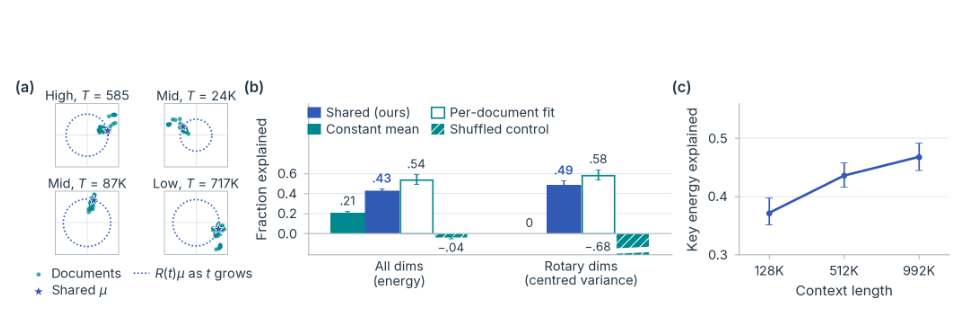View original ↗</a>

*The shared component rotates with position; the other panels measure how much index energy it explains.*

<h2 class="daily-paper-title" id="paper-arxiv-2611.25091">Berth controls GPU submissions to protect foreground deadlines</h2>

Khodabandehlou, Mohammadali, Alizadeh, Mahdi, Gao, Lei, Annavaram, Murali, Krishnamachari, Bhaskar · 2026-11-18 · [Berth: SLO-Preserving GPU Sharing Without New Preemption](https://arxiv.org/abs/2611.25091)

Commodity GPU time slicing already interrupts long kernels. Berth supplies priority by controlling when a best-effort process can feed the GPU and shortening its time slice. For continuous batching, a serving engine declares the deadline for its next step. Background work can use the slack while the scheduler bounds interference from work already submitted. On one 40 GB PCIe A100, the authors evaluated 31 scenario points, including MLPerf latency targets, against 13 baselines. Foreground SLO attainment stayed within a few percentage points of isolated execution, with 2.7–3.5× the best-effort throughput of strong baselines. These are measured attainment rates for the tested tenants.

<a class="note-image-link" href="/assets/images/digest/2026-11-21/25091.png" target="_blank" rel="noopener" aria-label="User-space submission control works with hardware time slicing on the existing GPU stack.">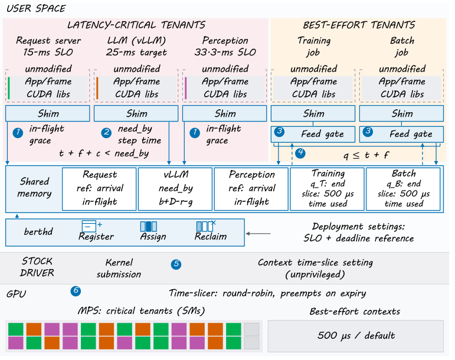View original ↗</a>

*User-space submission control works with hardware time slicing on the existing GPU stack.*

<h2 class="daily-paper-title" id="paper-arxiv-2611.25433">RoCoKV spends more cache on uncertain reasoning steps</h2>

Behnam, Payman, Sobhani, Elaheh, Amin, Saad, Hassan, Yahya, Khan, Daniyal, Chakraborty, Biswadeep, Patwa, Tanish, Kundu, Souvik, Tumanov, Alexey · 2026-11-19 · [RoCoKV: Accelerating LLM Inference Serving through Uncertainty and Redundancy Aware KV Cache Compression](https://arxiv.org/abs/2611.25433)

Attention alone can repeatedly select reasoning tokens with similar content. RoCoKV adapts the step budget to model confidence and discounts candidates resembling recent reasoning. Its vLLM path performs approximate scoring, selection and exact sparse attention on GPU. Device-resident budgets preserve CUDA graph capture and the native paged layout. With DeepSeek-R1-Distill-Llama-8B on AIME25, the authors measured 1.27× speed and 38% higher throughput versus full KV. The long synthetic workload reached 1.43× and 45% respectively. The synthetic result measures a longer execution regime, while the reasoning benchmarks also test answer quality.

<a class="note-image-link" href="/assets/images/digest/2026-11-21/25433.png" target="_blank" rel="noopener" aria-label="Approximate scoring and selection precede exact attention on the retained data.">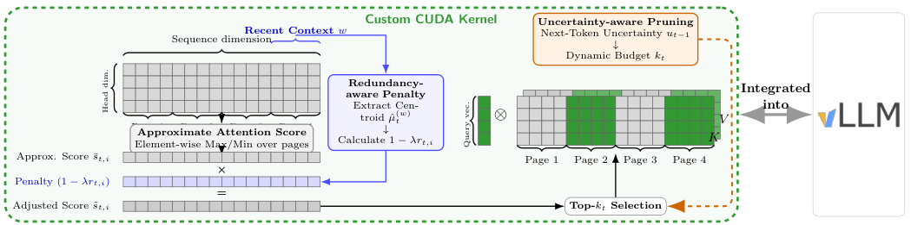View original ↗</a>

*Approximate scoring and selection precede exact attention on the retained data.*

<h2 class="daily-paper-title" id="paper-arxiv-2611.26106">AscMLA gives one FP4 latent two scaling views</h2>

Zhou, Zechun, Zheng, Zhiyong, Zhang, Xiaomin, Ye, Lin, Li, Han, Sun, Jingwei, Sun, Guangzhong, Li, Jing · 2026-11-19 · [AscMLA: Unlocking FP4 Efficiency for Long-Context MLA Decoding through Asymmetric Scaling](https://arxiv.org/abs/2611.26106)

MLA uses one latent for keys and values, but their computations favor different scales. AscMLA encodes the FP4 payload once, retains its value scale and fits blockwise key scales against the same codes. Pipelined delivery of scales avoids maintaining a second encoding or paying for external dequantization. Cache storage fell 38.2% versus FP8. Cold-L2 CUDA graph replays included attention and split reduction with queries and caches prepared beforehand. Across 40 configurations, geometric-mean speed was 1.35× TRT-LLM FP8 and 1.26× CAKE NVFP4. The timing boundary is the decode kernel.

<a class="note-image-link" href="/assets/images/digest/2026-11-21/26106.png" target="_blank" rel="noopener" aria-label="Shared FP4 codes enter the QK and PV paths with different scales.">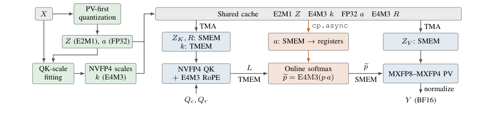View original ↗</a>

*Shared FP4 codes enter the QK and PV paths with different scales.*

<h2 class="daily-paper-title" id="paper-arxiv-2611.25717">VR-SparseQuant spends sparse slots on larger quantization errors</h2>

Khaki, Samir, Wang, Wei-Chen, Han, Song, Wang, Ryan Hanrui · 2026-11-19 · [VR-SparseQuant: Accurate FP4 Quantization with 2:4 Sparsity on Vera Rubin](https://arxiv.org/abs/2611.25717)

Rubin’s 2:4 instructions keep two positions per group of four. VR-SparseQuant allows two sparse activation streams to overlap so that a second FP4 value refines a high-error position. Scale ratios are calibrated offline, and a shared-weight multiply accumulates both streams. WikiText-2 perplexity on Nemotron-3-Nano-30B-A3B fell from 6.85 for dense RTN W4A4 to 5.57. Separate timings used synthetic MiniMax shapes and included activation preparation. GEMM and MoE peaked at 3.1× and 2.7× their BF16 baselines. MoE routing was prebalanced and communication excluded, so quality and operator speed come from distinct experiments.

<a class="note-image-link" href="/assets/images/digest/2026-11-21/25717.png" target="_blank" rel="noopener" aria-label="The two sparse streams can overlap, spending their FP4 values on positions with larger errors.">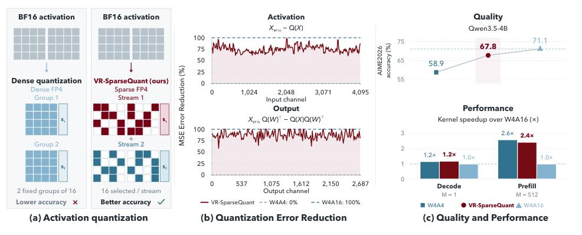View original ↗</a>

*The two sparse streams can overlap, spending their FP4 values on positions with larger errors.*

<h2 class="daily-paper-title" id="paper-arxiv-2611.26268">LightningMoBA organizes sparse attention around KV columns</h2>

Shi, Yingqi, Lu, Junru, Liu, Yun, Yin, Di, Sun, Xing · 2026-11-19 · [Accelerating Mixture of Block Attention via Dynamic Routing, KV-Centric Execution and Runtime Pipelining](https://arxiv.org/abs/2611.26268)

A fixed top-k retains the same number of blocks even when query scores have very different distributions. LightningMoBA keeps blocks within a margin of each query’s strongest preceding block. Execution groups the queries selecting a KV column, reuses each loaded tile and splits high-fanout columns. On Hopper, regular KV transfers and irregular query gathers overlap compute. At average retention matched to Top-16 across five checkpoints, generation sped up by 1.20–1.60× and mean RULER rose from 74.42 to 75.28. Matching overall retention still leaves individual queries free to spend different budgets.

<a class="note-image-link" href="/assets/images/digest/2026-11-21/26268.png" target="_blank" rel="noopener" aria-label="Routing emits sparse metadata for column-wise tasks and overlapped transfers and computation.">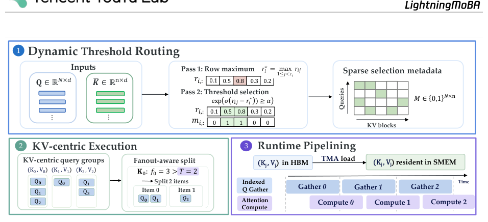View original ↗</a>

*Routing emits sparse metadata for column-wise tasks and overlapped transfers and computation.*

<h2 class="daily-paper-title" id="paper-arxiv-2611.25938">DTS samples vector changes to reduce tile-scoring cost</h2>

Uğur, Emre, Qi, Jiawen, Chen, Qinyu · 2026-11-19 · [DTS: Delta-Based Tile Scoring for Efficient Long-Context Sparse Attention](https://arxiv.org/abs/2611.25938)

DTS targets the cost of deciding which tiles to compute during long-prompt prefill. Parallel scans retain more query and key anchors where neighboring vectors change. Scores from anchor pairs select tiles, then sparse attention uses the original Q, K and V. On LLaMA-3.1-8B-Instruct, average RULER and LongBench scores were within 0.10 percentage points of full attention. At 128K, scoring-pipeline latency fell 38% versus XAttention. At 512K on four H100s, prefill reached 3.3× a PyTorch full-attention baseline using FlashAttention-2. These comparisons time different regions against different baselines.

<a class="note-image-link" href="/assets/images/digest/2026-11-21/25938.png" target="_blank" rel="noopener" aria-label="Parallel scans generate anchors whose scores select original tiles for sparse attention.">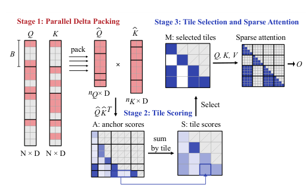View original ↗</a>

*Parallel scans generate anchors whose scores select original tiles for sparse attention.*

<h2 class="daily-paper-title" id="paper-arxiv-2611.25813">G-MTP reuses target state and measures the acceptance trade-off on device</h2>

Galgani, Filippo, Ji, Ziwei, Homburger, Omri, Jawahar, Ganesh, Ramanovich, Michelle, Korotkov, Ivan, Martins, Luciano, Evci, Utku, Yvinec, Edouard, Consul, Pooja, Kumar, Vivek, Schuster, Tal · 2026-11-19 · [Efficient and Robust Drafting with Multi-Token Prediction](https://arxiv.org/abs/2611.25813)

A shared drafting head reads target activations and attends directly to existing KV, avoiding a separate draft prefill. A clustered vocabulary projection reduces output work. On the Pixel 11 Edge TPU, the authors tested 4-bit Gemma 4 E2B and E4B on 456 single-turn prompts with greedy decoding and a draft horizon of three. Clustering reduced draft time to 81% and 79% of full projection, but median acceptance slipped from 0.49 and 0.52 to 0.48 and 0.50. Overall speedups versus ordinary decoding were 1.92× and 1.98×. Switching projection alone added only about 1% to either result.

<a class="note-image-link" href="/assets/images/digest/2026-11-21/25813.png" target="_blank" rel="noopener" aria-label="The draft module reads target activations and the existing cache to propose subsequent tokens.">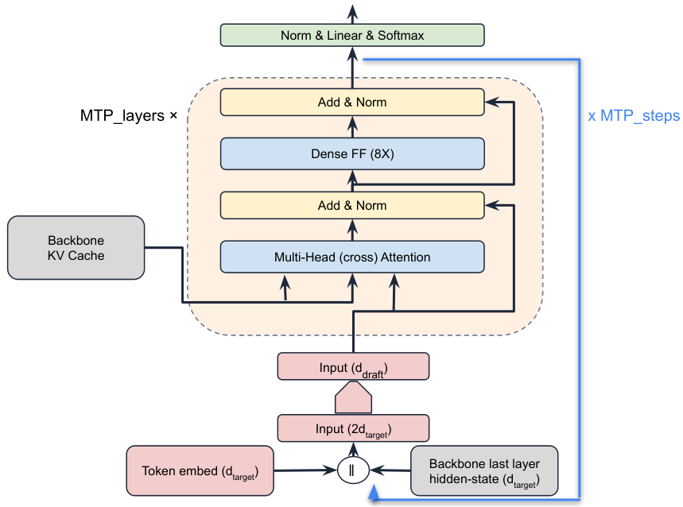View original ↗</a>

*The draft module reads target activations and the existing cache to propose subsequent tokens.*

<h2 class="daily-paper-title" id="paper-arxiv-2611.25436">Raptor uses rejection feedback to shape the next draft tree</h2>

Hu, Qishu, Wang, Haozhao, Hong, Zicong, Zhan, Yufeng, Xia, Yuanqing · 2026-11-19 · [Raptor: Rejection-aware Adaptive Tree based on Speculative Decoding](https://arxiv.org/abs/2611.25436)

Two steps with the same acceptance length may need opposite interventions: a wider candidate set or less deep expansion. Raptor extracts progress, frontier coverage and redundant expansion from verifier feedback. Exponential averaging and bounded updates adjust depth, width and draft budget without retraining the VLM. The authors evaluated two 7B-class vision-language models across seven multimodal benchmarks on two 24 GB RTX 3090s. Average speedup reached 2.39× versus token-by-token autoregressive decoding. That comparison includes the benefit of speculation itself as well as tree adaptation.

<a class="note-image-link" href="/assets/images/digest/2026-11-21/25436.png" target="_blank" rel="noopener" aria-label="Fixed and rejection-aware trees allocate their budgets to different candidate branches.">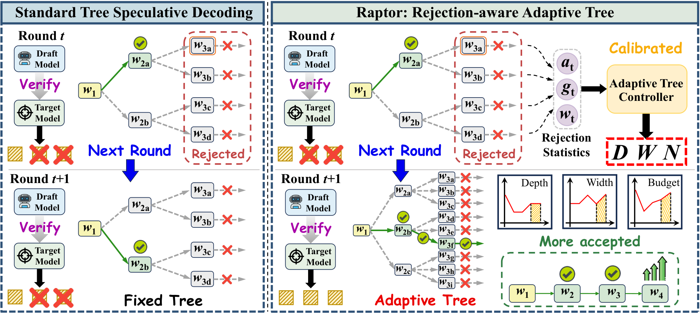View original ↗</a>

*Fixed and rejection-aware trees allocate their budgets to different candidate branches.*

<h2 class="daily-paper-title" id="paper-arxiv-2611.25123">GrepMem lets the summary forget while preserving a searchable record</h2>

Yang, Ziyan, Shi, Taiwei, Zhao, Jieyu · 2026-11-18 · [Forget Freely, Grep Later: Lossless, Index-Free Memory for Long-Horizon LLM Agents](https://arxiv.org/abs/2611.25123)

GrepMem still compacts working context. It also appends interactions and tool results to a plain-text history, allowing regex retrieval of details whose significance becomes clear later. Episode-level reward trains actions, summaries and retrieval together without separate labels for ideal queries. On ContextBench key-value and log tasks, Qwen3.5-9B reached 95–97%, against at most about 21% for lossy baselines. It exceeded SUPO summarization by 8.8 percentage points on BCP-Multi. Losslessness describes the retained record. Successful recall still depends on forming a query and fitting its results into active context.

<a class="note-image-link" href="/assets/images/digest/2026-11-21/25123.png" target="_blank" rel="noopener" aria-label="Execution continues from compact context while the full log remains available for search.">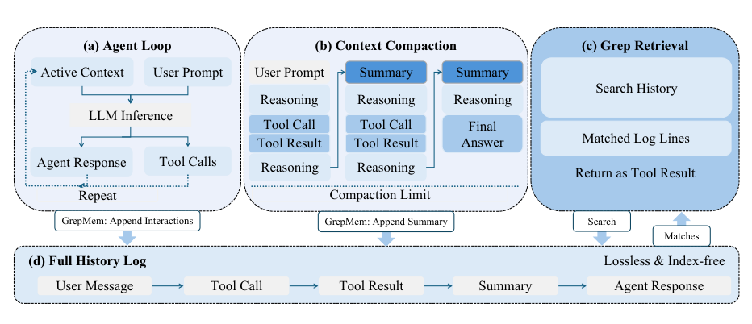View original ↗</a>

*Execution continues from compact context while the full log remains available for search.*

<h2 class="daily-paper-title" id="paper-arxiv-2611.25673">CompAct-Bench tests compacted state by resuming the task</h2>

Chen, Jiayi, Chen, Lizhe, Chen, Yujia, Dou, Shihan, Zhang, Ming, Ge, Chendi, Ni, Shiguang, Gui, Tao, Zhang, Qi, Huang, Xuanjing, Pan, Maxm · 2026-11-19 · [CompAct-Bench: A Benchmark for Working-Context Compaction in Long-Horizon Agent Tasks](https://arxiv.org/abs/2611.25673)

A summary can preserve names yet turn an unresolved question into a conclusion. CompAct-Bench inserts a boundary into successful runs, replaces the history with a candidate summary and lets the same executor finish. Iterative adjustment controls character retention so a longer summary has less built-in advantage. The main evaluation used 200 instances at 10% target retention across search, coding and an internal workspace. Claude Opus 5 (Max) achieved 68.5% overall, 81.2% on coding and 40% on workspace tasks. Conditioning on successful source trajectories measures disruption to a viable path. The internal workspace contributes only 25 instances.

<a class="note-image-link" href="/assets/images/digest/2026-11-21/25673.png" target="_blank" rel="noopener" aria-label="After context replacement at a boundary, the same executor resumes under the original task evaluator.">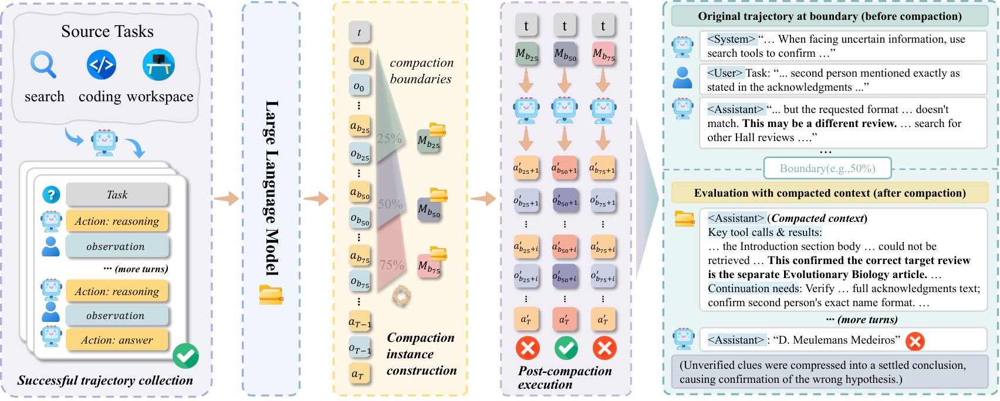View original ↗</a>

*After context replacement at a boundary, the same executor resumes under the original task evaluator.*

<h2 class="daily-paper-title" id="paper-arxiv-2611.26256">SkillBridge targets cross-OS validation using contract evidence</h2>

Xu, Anjie, Wang, Zixing, Cai, Yifeng, Wang, Leye · 2026-11-19 · [SkillBridge: Cost-Aware Diagnosis and Repair of Cross-OS Compatibility Defects in Agent Skills](https://arxiv.org/abs/2611.26256)

A skill may assume GNU command options in its instructions and a particular package manager in its installer. SkillBridge extracts assumptions from guides, entry points, dependencies and platform declarations. It screens them by target OS, runs selected tasks, checks root cause against runtime symptoms and repairs the relevant contract field. The study covers 1,090 skills and 3,270 Linux, macOS and Windows combinations. Reviewer-judged target-task passes rose from 30.6% to 38.4% after repair. In a retrospective Linux/macOS analysis, 185 validations found 38 OS issues. Uniform random selection would need about 865 in expectation, an estimate rather than a second measured run.

<a class="note-image-link" href="/assets/images/digest/2026-11-21/26256.png" target="_blank" rel="noopener" aria-label="Contract screening leads to execution, targeted repair and review of the platform assumption.">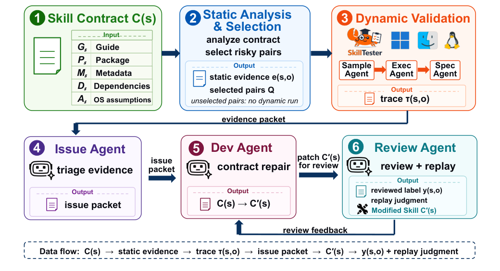View original ↗</a>

*Contract screening leads to execution, targeted repair and review of the platform assumption.*

<h2 class="daily-paper-title" id="paper-arxiv-2611.25429">SkillPlumber checks whether an instruction ran before revising it</h2>

Tan, Boyin, Zhang, Jiadong, Ma, Xiaosong, Xue, Chun Jason, Huang, Xiaowei, Sun, Youcheng · 2026-11-19 · [Evolve Where It Matters: Coverage-Guided Self-Evolution of Agent Skills](https://arxiv.org/abs/2611.25429)

A failed task may reflect a wrong instruction or a correct one the executor ignored. SkillPlumber aligns instructions with traces, distinguishing followed, not followed and not covered. A persistent diagnosis agent proposes edits and checks them in the next run. A maintainer distills reusable strategies after batches of three tasks. Across three benchmarks and three executors, solve rates reached 64.7–70.5%, exceeding the strongest baseline by 8.7–14.0 percentage points. The SkillsBench/GPT-5.5 ablation started with 52 failures: removing coverage reduced recovered failures by 20.8%, a recovery metric rather than overall accuracy.

<a class="note-image-link" href="/assets/images/digest/2026-11-21/25429.png" target="_blank" rel="noopener" aria-label="Instruction coverage links runs to skill edits, and the maintainer extracts strategies across investigations.">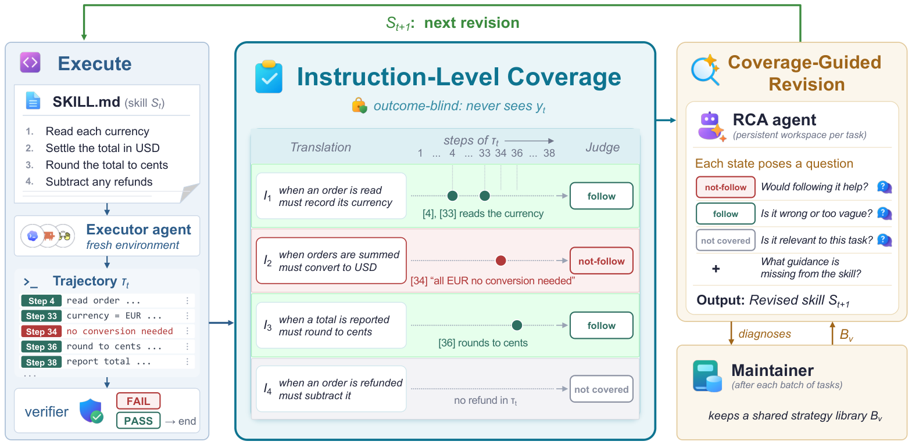View original ↗</a>

*Instruction coverage links runs to skill edits, and the maintainer extracts strategies across investigations.*

<h2 class="daily-paper-title" id="paper-arxiv-2611.25380">Codev evaluates weight and harness specialization separately</h2>

Chen, BoHao · 2026-11-19 · [Beyond Weight Updates: Evolving Agent Harnesses for Domain Specialization](https://arxiv.org/abs/2611.25380)

Codev compares a base agent, weight-only training, harness-only evolution and their combination under the same container, turn and context budgets. GEPA maintains candidates using success, tokens and latency while changing prompts, tool descriptions, skills or planning scaffolds. SWE-bench Verified scores were 0.31, 0.52, 0.48 and 0.61 respectively. On OfficeBench, harness-only reached 0.51 versus 0.49 for weight-only. Table 2 reports about 800 H100-hours for weight training. Harness optimization still uses a reflection API, whose calls are excluded from the per-task token totals. Training GPU-hours alone therefore understate adaptation cost.

<a class="note-image-link" href="/assets/images/digest/2026-11-21/25380.png" target="_blank" rel="noopener" aria-label="The inner agent executes while the outer loop uses traces and fitness to select harness changes.">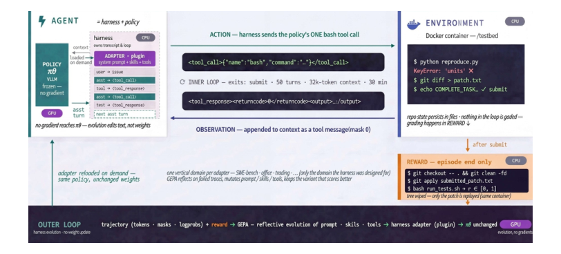View original ↗</a>

*The inner agent executes while the outer loop uses traces and fitness to select harness changes.*

<h2 class="daily-paper-title" id="paper-alphaxiv-2611-harness-cg">Can a recursive harness transfer training from short to long tasks?</h2>

Alex L. Zhang, Souradip Chakraborty, Omar Khattab · 2026-11-20 · [Language Model Harnesses Can Be Compositional Generalizers](https://www.alphaxiv.org/abs/2611.harness-cg)

A recursive harness decomposes long tasks into code and model subcalls so that each invocation faces a more familiar problem. The authors check local correctness where intermediate labels exist and train models in cheaper surrogate environments. Supervised tuning uses 8,015 root trajectories plus targeted subagent data. Within the same RLM harness, RLM-27B improves average evaluation score by 12.4 points over Qwen3.8-27B. Root trajectories use about one-sixth as many input tokens; subcalls incur additional costs. Alongside Codev’s harness edits, this study isolates a different intervention: changing the model’s training distribution inside the harness and checking transfer across lengths.

<a class="note-image-link" href="/assets/images/digest/2026-11-21/harness-cg.png" target="_blank" rel="noopener" aria-label="Surrogate environments teach decomposition for execution with real tools and recursive subcalls.">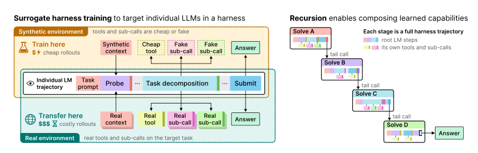View original ↗</a>

*Surrogate environments teach decomposition for execution with real tools and recursive subcalls.*

<h2 class="daily-paper-title" id="paper-arxiv-2611.25599">Tether carries policy state across agent actions</h2>

Sistla, Meghana Aparna, Solko-Breslin, Alaia, Jha, Somesh, Kanade, Aditya, Dvijotham, Krishnamurthy Dj · 2026-11-19 · [Tether: Verified Stateful Policy Engine for System-Level Monitoring of Agents](https://arxiv.org/abs/2611.25599)

A read and a later external write may each be permitted while their combination violates information-flow policy. Tether observes proposed actions in a temporary sandbox, maps system calls to abstract semantics and uses a Lean 4 monitor to decide whether to commit staged changes. Labels propagate through actions, allowing a rule to span arbitrarily many steps. On the tested coding traces, one shared policy blocked every in-scope violation with a benign false-positive rate below 5%. The proof covers invariants over the abstract policy. Mapping concrete events to those semantics also depends on observation, isolation and testing.

<h2 class="daily-paper-title" id="paper-arxiv-2611.24977">CANDID checks action candidates at loops and stops</h2>

Lee, Woongkyu, Choi, Jungwook · 2026-11-17 · [CANDID: Candidate-Driven Intervention for Disciplined Execution in Local Computer-Use Agents](https://arxiv.org/abs/2611.24977)

Local GUI agents can repeat the same click or emit DONE before the task finishes. CANDID reserves additional sampling for these risky junctions. During loop recovery it removes repeated, malformed and non-executable actions and merges duplicates. Termination requires unanimous agreement. Recovery falls back to the original proposal if no valid alternative survives. Across three local executors on OSWorld with 50- and 100-step budgets, completion improved by 2.01–4.54 percentage points over the respective baselines. The intervention operates at runtime, and the measured outcome is successful task completion across a sequence of actions.

<a class="note-image-link" href="/assets/images/digest/2026-11-21/24977.png" target="_blank" rel="noopener" aria-label="Loop recovery filters alternative actions, while a termination check tests candidate agreement.">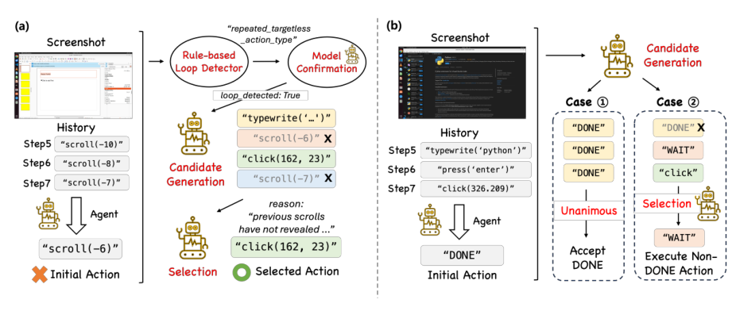View original ↗</a>

*Loop recovery filters alternative actions, while a termination check tests candidate agreement.*

<h2 class="daily-paper-title" id="paper-arxiv-2611.26358">Beam measures serving repair and trainer restart separately</h2>

Reflection Team · 2026-11-19 · [Beam Model Technical Report](https://arxiv.org/abs/2611.26358)

Beam activates 23.4B of its 501.3B parameters per token and ships a 1.93B drafter. Its asynchronous RL campaign generated over 100 million rollouts in four weeks. In the high-compute agentic deployment, inference nodes accounted for roughly 80% of resources. After a serving process fails, a manager removes affected pods and the scheduler replaces missing capacity while the healthy trainer keeps its state. Trainer failures require a checkpoint restart; this run saved one every two steps.

<a class="note-image-link" href="/assets/images/digest/2026-11-21/26358.png" target="_blank" rel="noopener" aria-label="Each bar has its own time base and ends at a completed ordinary request or a completed training step.">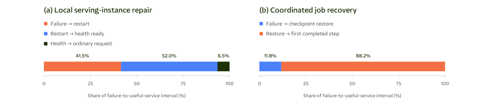View original ↗</a>

*Each bar has its own time base and ends at a completed ordinary request or a completed training step.*

Checkpointing stages GPU state asynchronously into reusable pinned host buffers. A separate process serializes and writes it. A mutation fence protects tensors that the optimizer is about to change while a copy is outstanding. Figure 47 times two recoveries to useful work: the first ordinary inference request after local repair and the first completed training step after a coordinated restart. In the first case, 6.5% of the interval elapsed after health checks passed. In the second, 88.2% elapsed after checkpoint restoration. Each bar is normalized separately. They illustrate the gap between readiness and useful work, without estimating absolute durations or failure frequency.
