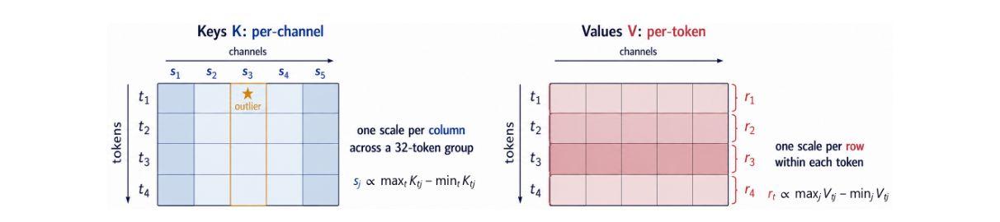

A speculative decoder keeps a second KV cache for its draft model. Compressing that cache changes the bytes retained per sequence. Turning the saving into faster generation also depends on prefill, unpacking and verification. A separate single-GPU serving experiment shows why capacity matters when many sessions return at once.

<h2 class="daily-paper-title" id="paper-arxiv-2611.20565">What does a four-bit draft cache save in practice?</h2>

Saksham Gupta and Michael Li · arXiv · 2026-11-16 · [Memory-Efficient Speculative Decoding with Quantized Draft KV Cache](https://arxiv.org/abs/2611.20565)

A small model proposes several tokens. The target accepts the prefix that matches its greedy choices and supplies a correction at the first disagreement. Each model keeps its own history. The authors compress keys and values on the draft side and keep the target cache in BF16. Compression can make the draft guess wrong more often while leaving the target’s correction rule intact. Acceptance measures how often the draft guesses right. Checking implementation correctness requires comparing outputs against target-only decoding.

### Why extra bits for keys can appear to pay off

When a key vector shares one scale across channels, an outlier in one channel widens the quantization step for its neighbors. At the same total bit budget, eight-bit keys and four-bit values beat the reverse allocation by 10.87 percentage points in mean acceptance under symmetric per-token quantization. With KIVI-style grouping the gap became −0.25 points. That comparison changed other conditions, including value quantization. A controlled Qwen experiment held prompts, value quantization and the residual-window setting fixed. Changing only the key quantizer moved the gap from +28.70 to −0.33 points.

<a class="note-image-link" href="/assets/images/digest/2026-11-22/quantizer.png" target="_blank" rel="noopener" aria-label="Draft keys share scales down columns and values across rows">View original image ↗</a>

*A channel with an outlier gets its own scale, preserving finer steps in neighboring columns.*

The four-bit design shares a scale across 32 tokens in each key channel, retains the newest 128 keys in BF16 and groups values within each token and head. Six model pairs spanning 360M to 8B parameters processed 576 FineWeb-Edu prompts of 1,024 tokens, drafting up to four tokens per round for 16 output tokens. With equal weight per pair, acceptance fell from 57.93% to 57.14%. Counting scales, zero points and the residual window, draft cache bytes fell by 66.20% and combined KV bytes by 23.95%. Weights and temporary allocations occupy additional device memory.

### From retained bytes to peak memory

For Qwen2.5 3B/1.5B at 32K context, the packed implementation reduced persistent draft storage per sequence from 896.0 to 260.2 MiB. Packing took place after BF16 prefill, leaving peak GPU memory unchanged. At 1K and 16K context the single-request prototype ran 18%–33% slower than BF16 speculative decoding. The main acceptance experiment verified sequentially, calling the target once per emitted token. The prototype that verified a proposal in one call failed to consistently match target-only output even with a BF16 draft. The storage measurement thus identifies two concrete implementation problems for serving: containing the prefill peak and rolling state back correctly during batched verification.

## Community measurement: what a two-minute load test missed

Johnson Shi reports 337 configuration trials of vLLM and SGLang with Nanbeige 4.3-33B, each trial on a dedicated Azure A100 80GB PCIe GPU. Raising vLLM’s concurrent sequence cap from 256 to 512 improved two-minute chat capacity by 19%. Over nine minutes both caps sustained about 3.21 requests per second. The smaller cap left requests queued. The larger one let the active batch grow until time per output token reached the 100 ms target.

In a separate synthetic workload with 48 six-turn sessions, prefix caching was already enabled. Changing weight and KV precision expanded vLLM’s KV pool from 70,656 to 418,816 tokens, eliminated 11 preemptions and reduced p90 time to first token from 114 seconds to about 1.05 seconds. The result depends on whether the concurrent histories fit in memory. A separately documented upstream fix forwards the requested random seed to two benchmark datasets. [Johnson Shi · X](https://x.com/johnsonshi86/status/2124250717963932121) · [vLLM #68859](https://github.com/vllm-project/vllm/pull/68859)
