A recovery command can succeed while the operator still has to reconstruct the workspace. A study of 50 harnesses and runtimes follows that gap. Contexture asks when removing an old tool result is worth sacrificing a cached prefix. Both look beyond the immediate operation to what the next turn inherits. Other readings examine coordinated plugins, independent grading, on-device policy checks, long-context indexing, expert placement and numerical consistency in decoding.

<h2 class="daily-paper-title" id="paper-arxiv-2611.27090">Did the run recover after the recovery command?</h2>

Kaviru Hapuarachchi · 2026-11-20  
[Exercised, Rarely Recovered: What Public Reports Say About Recovery in 50 AI Agent Harnesses and Runtimes](https://arxiv.org/abs/2611.27090)

An undo command can restore the files a coding agent edited while leaving its subagent’s changes behind. Another reported undo removed the user’s uncommitted work. An operator needs the workspace back in a usable state. Kaviru Hapuarachchi asks how far public evidence follows the run after someone invokes a recovery mechanism.

The study covers 12 persistent runtimes, 26 coding-agent harnesses and 12 research runtimes. Each system receives its strongest evidence grade in eight mechanism classes. Documentation, a worked example, a benchmark measurement and an attributable report of real use carry different grades. For real use, the study also records full recovery, partial recovery, failure or an unclear outcome. A system with substantial deployment experience can still have little evidence for a particular recovery action.

In the first two groups, 11 of 12 runtimes and 25 of 26 harnesses had at least one real-use report. Among 128 system–mechanism records, 19 describe full recovery, 54 partial recovery, 45 failure and 10 an unclear outcome. Full recovery appears once in 27 checkpoint/resume records and once in 15 rollback records. Resuming a process can leave its earlier writes to an external service intact. Research prototypes explicitly compensate for such effects. The author found no evidence of this capability in the 26 coding harnesses.

The denominator matters. The protocol and codebook were frozen before collection. Two models coded independently, disputed and high-grade evidence went through verification, and the author checked every final label. Public issues favor troubled runs, and only the strongest evidence per system and class enters the count. The 19 records cannot estimate a production success probability. They suggest a more informative endpoint for an AgentOps evaluation: which files, subtasks and external effects were restored, and could the operator actually continue the original task?

<a class="note-image-link" href="/assets/images/digest/2026-11-24/arxiv-2611.27090.png" target="_blank" rel="noopener" aria-label="Real-use outcomes by recovery mechanism">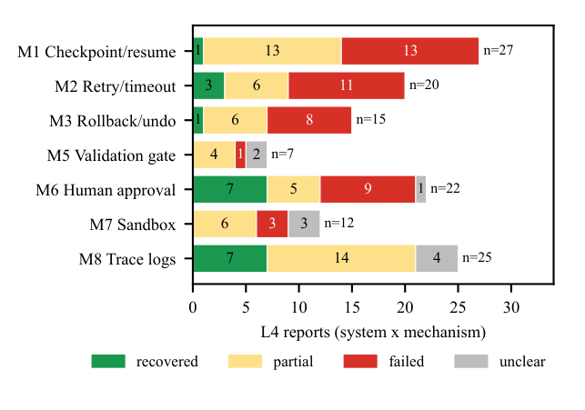View original image ↗</a>

*Real-use outcomes by recovery mechanism*

<h2 class="daily-paper-title" id="paper-arxiv-2611.26980">When Contexture can afford to remove an old tool result</h2>

Colin Hong, Bryan Shan, Wei Siong Pang, Chengzhi Lu, Xu Guo, Nitin Shivaraman, Tao Luo, Esha Choukse, Kisson Lin, Dmitrii Ustiugov · 2026-11-20  
[Contexture: Runtime Context Eviction for High-Throughput Agent Serving](https://arxiv.org/abs/2611.26980)

An agent may read a file both before and after an edit. The older read can lose its value to the model while remaining part of a useful cached prefix. Removing it immediately forces later tokens through prefill again. Waiting for a per-session length limit has the opposite problem: many short sessions can exhaust a shared pool without any one of them reaching its limit. Contexture weighs the KV saved by a shorter history against the GPU time that rebuilding a prefix takes away from concurrent requests.

The harness keeps its complete conversation. The runtime edits the copy sent to the model, tracking tool type, target and outcome. A later successful file operation or test can supersede an older result. When all tool results in a round have been superseded, more of that round becomes eligible. A grace window preserves recent rounds. The analysis marked 64% of final-history tokens as candidates. Only a subset passes the runtime checks for removal.

The system maps candidates onto the rendered prompt and looks up its resident prefix. If the suffix after a removal point already misses, the edit sacrifices little reusable computation. If an edit breaks a hit, the runtime considers shared pool occupancy and the number of tokens it must prefill again per token removed. The default pressure threshold is 80%, with a cap of six re-prefill tokens per removed token. The same tool event can therefore justify different decisions as other sessions fill the pool, without an extra model call.

The eight configurations combine Hermes and OpenClaw, Qwen3.8-27B on H200 and Qwen3.6-35B-A3B on H100, and two benchmarks. Replay throughput counts sessions completed within budget per minute at a P90 slowdown of ten times the same task under unloaded no eviction. It rose 20–73% over the strongest of no eviction, harness compaction, AgentDiet and Continuum. Observation masking remained competitive on throughput: Contexture led it by 7–63% in five of eight configurations. In live-agent quality tests, Contexture averaged 1.4 percentage points above unloaded no eviction, with a worst-case loss of 3.7 points. Masking lost 3–28 points. An eviction changes the input to the next decision, so identifying what a tool operation supersedes matters as much as the memory saving. The implementation supplies rules for sandbox and file tools. External services would need their own semantics.

<a class="note-image-link" href="/assets/images/digest/2026-11-24/arxiv-2611.26980.png" target="_blank" rel="noopener" aria-label="Tool events and prefix residency jointly shape the next prompt">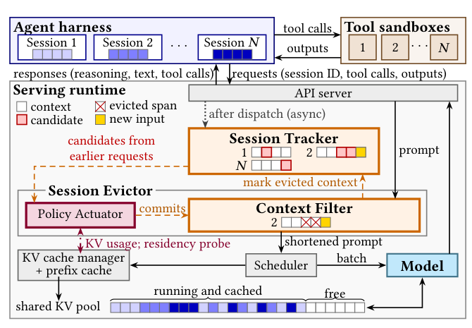View original image ↗</a>

*Tool events and prefix residency jointly shape the next prompt*

<h2 class="daily-paper-title" id="paper-arxiv-2611.27554">Which execution path defines an exact greedy decode?</h2>

Mohammed Nayeem Khan, Navin Kumar R · 2026-11-20  
[Vega-Fafnir: Is Greedy Decoding the Same Decoding? Where Rounding Noise in Speculative Verification Comes From and What Removing It Costs](https://arxiv.org/abs/2611.27554)

Greedy selection can produce different text under speculative verification and single-token execution. Verifying four guesses changes matrix shapes and rounding. A later single-token fallback may still inherit KV entries written by the wider pass. On 150 GSM8K and ARC prompts generating 128 tokens with BF16 Qwen3-0.6B, four-token verification diverged from the single-token reference on 60% of texts. At every first divergence the two highest logits were within 0.375.

The most revealing comparison changes what a low-margin fallback reads. Keeping the cache left 58 of 100 prompts different, against 61 for plain verification. Rebuilding it with single-token passes reduced the count to zero at 7.2 model passes per generated token. Redefining the reference at width five and padding every pass made drafted and plain decoding agree on all 100 prompts, at 0.75 passes per token with drafting. This last result establishes consistency against a different reference. Pass counts do not translate directly to production latency, and the timing experiment used a small model on one shared GPU.

<a class="note-image-link" href="/assets/images/digest/2026-11-24/arxiv-2611.27554.png" target="_blank" rel="noopener" aria-label="Single-token reference, wide verification and fallback paths">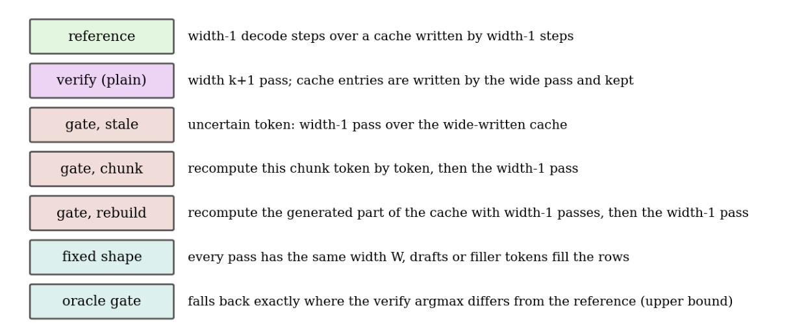View original image ↗</a>

*Single-token reference, wide verification and fallback paths*

<h2 class="daily-paper-title" id="paper-arxiv-2611.27294">HookEvo lets several plugins act on one tool receipt</h2>

Shengze Huang, Yanyu Mao, Xiaofei Yu, Baoshen Guo, Xiaorui Wang, Zhiwen Wu, Sheng Wu, Fukang Wen, Chengxu Wu, Linhao Li, Kailai Sun, Baotong Mi · 2026-11-20  
[HookEvo: A Framework for Coordinated Plugin Evolution on Hook-Enabled Agent Runtimes](https://arxiv.org/abs/2611.27294)

A tool can return a valid result while the next turn tries the same action again. HookEvo lets an improver propose coordinated edits from traces: one handler parses the receipt into episode state, another assembles context and a third checks the next action. Matched training tasks expose both repairs and new regressions before a version is retained. With a frozen Qwen3-4B executor, Sol’s coordinated edits yielded 95.41%, 70.56%, 48.17% and 41.67% on ALFWorld, DBBench, WebShop and OSBench. These are test scores for task-specific harnesses. The gain from broader edit scope also depended on the improver.

<a class="note-image-link" href="/assets/images/digest/2026-11-24/arxiv-2611.27294.png" target="_blank" rel="noopener" aria-label="Parent and candidate plugins face matched tasks">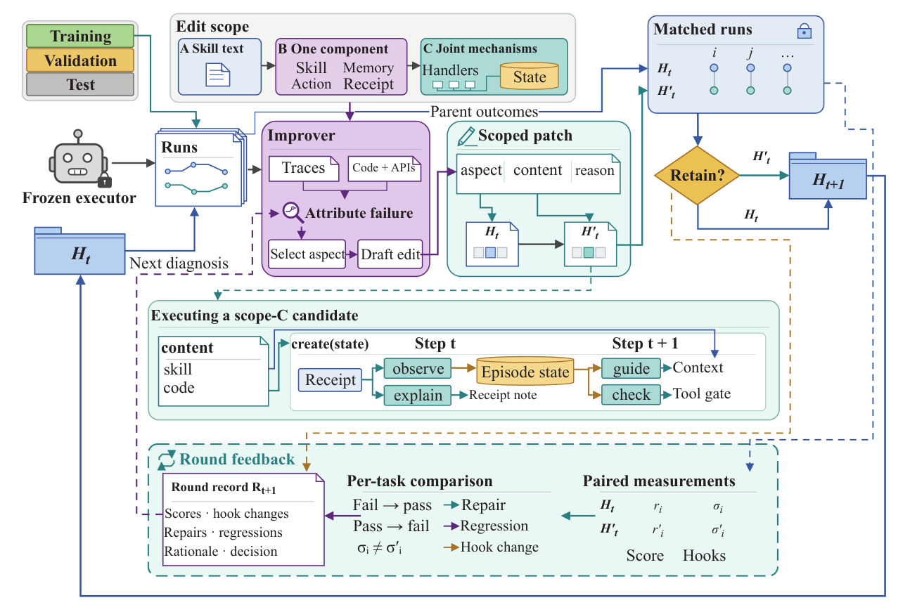View original image ↗</a>

*Parent and candidate plugins face matched tasks*

<h2 class="daily-paper-title" id="paper-arxiv-2611.27860">SplitBench keeps expected answers with the trusted grader</h2>

Nathan Nour Houlamy, Mattia Favretto, Earlence Fernandes, Mauro Conti · 2026-11-20  
[Who Grades the Agent? Privilege Separation for Coding-Agent Benchmarks](https://arxiv.org/abs/2611.27860)

Executing an agent’s submission makes the test environment itself an untrusted source of observations. SplitBench runs the submission there and leaves expected answers and comparison logic with a trusted oracle. The authors converted 180 of 202 tasks from two existing benchmarks. The new and original graders agreed on 98.7% of comparable attempts. The system rejected 75% of completed attempts in the authors’ adversarial evaluation. Remaining cases expose a second issue: protecting the answer key preserves the grading boundary, while an incomplete test can still accept an incomplete solution.

<a class="note-image-link" href="/assets/images/digest/2026-11-24/arxiv-2611.27860.png" target="_blank" rel="noopener" aria-label="The test environment supplies observations for independent grading">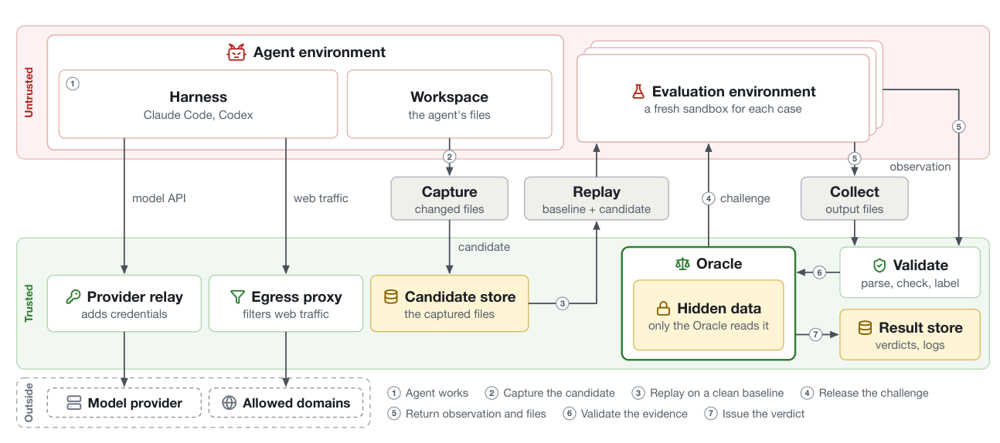View original image ↗</a>

*The test environment supplies observations for independent grading*

<h2 class="daily-paper-title" id="paper-arxiv-2611.27095">Can a tool receipt support the agent’s completion claim?</h2>

Sean Maxwell · 2026-11-20  
[Epistemic Guard: Out-of-Process MCP Receipt Proxying, Post-Turn Prose Supervision, and Provenance-Gated Memory for Tool-Using Autonomous Agents](https://arxiv.org/abs/2611.27095)

After a failed tool call an agent can still report completion. Epistemic Guard signs MCP receipts in a separate process, checks post-turn prose against execution evidence on CPU and gates durable writes by provenance. Protocol checks and semantic judgments have different error profiles. Tampering was rejected in tests on 200 log leaves, and claim classification reached 93.2% accuracy on 250 frozen traces. Across 60 live proxy traces, hazard detection reached 96.15% with a 38.24% false-positive rate. Authenticating a receipt leaves the harder problem of interpreting the sentence shown to the user.

<h2 class="daily-paper-title" id="paper-arxiv-2611.27216">A correct earlier decision can bias an on-device policy check</h2>

Chong Tian, Yu Wang, Steve Liu, Qirong Ho, Xiuying Chen · 2026-11-20  
[Correct Precedents Induce Policy Violations in On-Device LLM Agents](https://arxiv.org/abs/2611.27216)

An on-device agent decides whether an operation is allowed for each item. Paired synthetic queues test a failure that isolated examples miss: all earlier decisions can be correct and a currently restricted item can still be released. Safe rates fell across 13 open-weight models, roughly halving for the most affected model after one correct precedent. Paired decision distillation uses examples from a less affected teacher to train a LoRA student to reassess the current item. Safe rates approached 100% on the distilled models without another model call at deployment. This evidence concerns the policies, queues and sampling conditions tested.

<a class="note-image-link" href="/assets/images/digest/2026-11-24/arxiv-2611.27216.png" target="_blank" rel="noopener" aria-label="Paired queues diagnose the precedent effect and inform distillation">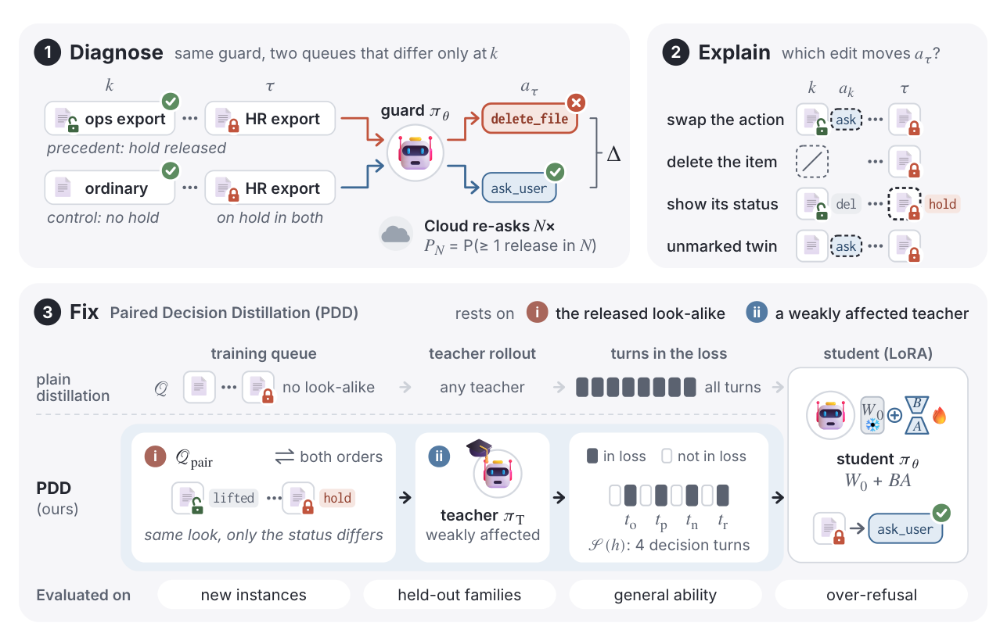View original image ↗</a>

*Paired queues diagnose the precedent effect and inform distillation*

<h2 class="daily-paper-title" id="paper-arxiv-2605.17170">TriAxialKV assigns bits by role, recency and modality</h2>

Hanzhang Shen, Haoran Wu, Yiren Zhao, Robert Mullins · 2026-05-16  
[TriAxialKV: Toward Extreme Low-Precision KV-Cache Quantization for Agentic Inference Tasks](https://arxiv.org/abs/2605.17170)

Screenshots, tool observations and the current user query share KV capacity, yet quantization error affects them differently. TriAxialKV tags tokens by turn recency, modality and semantic role, calibrates sensitivity for their combinations and assigns INT2 or INT4 under a memory budget. Separate pools feed fused decode kernels. On OSWorld, Qwen3-VL-32B-Thinking matched the SGLang BF16 task accuracy with 4.5 times the KV capacity and roughly 30% higher end-to-end throughput. A separate text-memory budget sweep shows accuracy falling when too many tokens use two bits. This November revision updates a paper first submitted in May.

<a class="note-image-link" href="/assets/images/digest/2026-11-24/arxiv-2605.17170.png" target="_blank" rel="noopener" aria-label="Offline tag calibration feeds two online cache pools">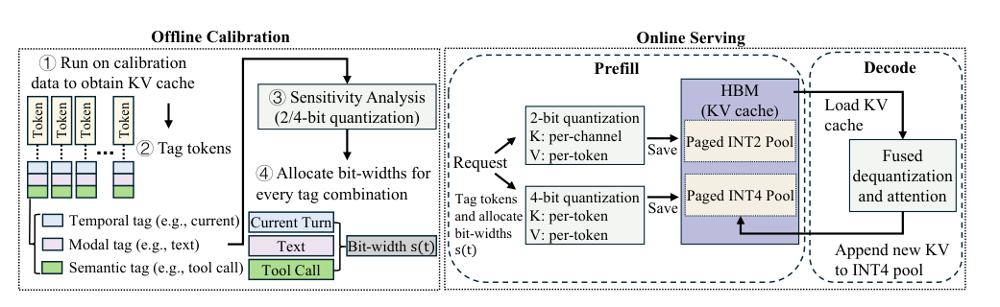View original image ↗</a>

*Offline tag calibration feeds two online cache pools*

<h2 class="daily-paper-title" id="paper-arxiv-2611.27233">LongCat selects pages before scoring individual keys</h2>

Hao Zhang, Bin Xiao, Kefeng Zhang · 2026-11-20  
[LongCat Recall Sparse Attention: Co-Designing Key Organization and Retrieval for Long-Context Inference](https://arxiv.org/abs/2611.27233)

Sparse attention accesses few KV entries, but finding them can still require scanning the history. LRSA independently indexes completed time buckets into balanced directional groups and packs whole groups into pages. A query scores group centers to choose pages, then refines their members alongside recent, sink and unindexed positions. SGLang can build new buckets asynchronously and reuse compatible indices after a prefix hit. At 1024K, key selection was 4.70 times faster than DSA. The 35.60-fold result measures selection plus attention against dense attention. Including index maintenance and full-model execution, the speedup over DSA was 1.865-fold at a final budget of 2,048 positions.

<a class="note-image-link" href="/assets/images/digest/2026-11-24/arxiv-2611.27233.png" target="_blank" rel="noopener" aria-label="Bucket indices retain fine-grained centers for paged reads">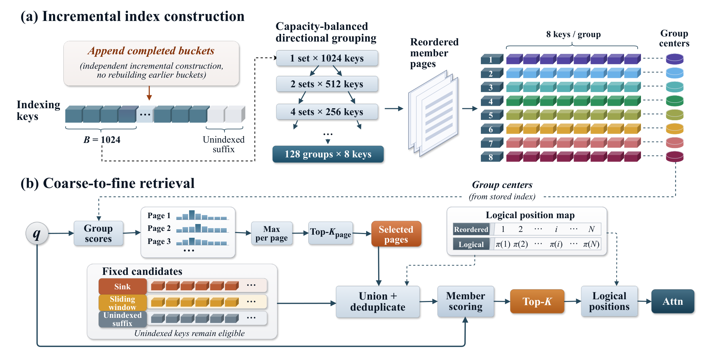View original image ↗</a>

*Bucket indices retain fine-grained centers for paged reads*

<h2 class="daily-paper-title" id="paper-arxiv-2611.27973">MemOnce reconstructs layer KV from shared memory states</h2>

Chang Nie, Chaoyou Fu, Songlin Liu, Yiqing Hu, Caifeng Shan · 2026-11-20  
[MemOnce: A Scalable Memory Architecture for Large Language Models](https://arxiv.org/abs/2611.27973)

MemOnce changes what the model saves from history. It retains selected final-layer hidden states, retrieves relevant memories once per incoming input and decodes the corresponding KV for each attention layer on demand. Cold states can move to CPU or SSD while the retrieval budget bounds active GPU cache. After adapting Qwen3.5-4B, the authors report a 1,313-fold reduction in active cache, 6.9-fold faster prefill and 3.5-fold decode throughput at one million tokens. Those figures involve an adapted model and exclude offloaded history from the active-cache count.

<a class="note-image-link" href="/assets/images/digest/2026-11-24/arxiv-2611.27973.png" target="_blank" rel="noopener" aria-label="Final-layer memory is decoded into attention-layer KV on demand">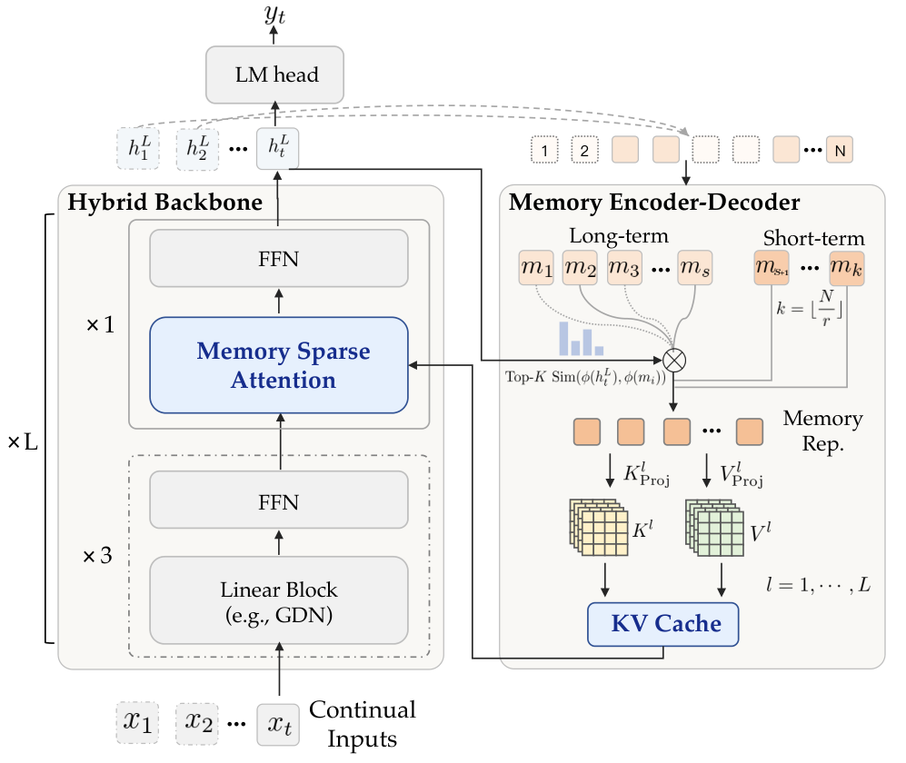View original image ↗</a>

*Final-layer memory is decoded into attention-layer KV on demand*

<h2 class="daily-paper-title" id="paper-arxiv-2611.27596">Isonomy separates cross-request reuse from observable first-token timing</h2>

Bowen Sun, Chaowei Xiao · 2026-11-20  
[Isonomy: Isolating Every Request from Timing Side Channels at Nearly Full-Sharing Throughput in Multi-Instance LLM Prefill](https://arxiv.org/abs/2611.27596)

A shared prefix saves prefill work, but a hit left by another request changes first-token timing. Isonomy routes using only load and cache entries visible to the request. Requests are isolated by default and may join explicit sharing groups. An instance can still use a hidden hit: prediction mode gates release using the visible prefix and queue, while execution mode reserves the skipped work and tries to fill it with other prompts. On two account-labeled workloads, prediction mode retained about 98% of unrestricted sharing’s saturated throughput, versus 95% and 80% for per-account isolation. The first-token timing evidence assumes clients cannot observe one another’s load.

<a class="note-image-link" href="/assets/images/digest/2026-11-24/arxiv-2611.27596.png" target="_blank" rel="noopener" aria-label="Routing uses visible prefixes while skipped work can be reserved">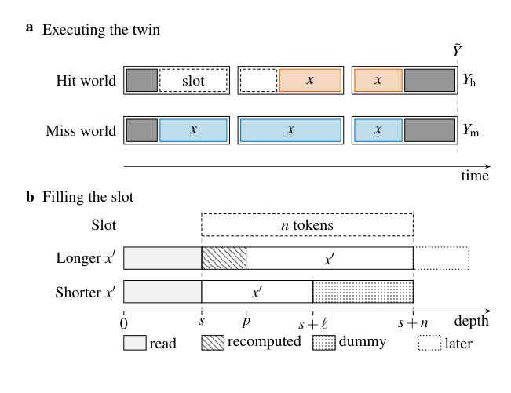View original image ↗</a>

*Routing uses visible prefixes while skipped work can be reserved*

<h2 class="daily-paper-title" id="paper-arxiv-2611.27604">IsoMoE preserves expert arithmetic across CPU and GPU placement</h2>

Hang Gu, Teng Wang, Zhendong Zheng, Qianyu Cheng, Wenqi Lou, Lei Gong, Xi Li, Xuehai Zhou · 2026-11-20  
[IsoMoE: Placement-Invariant Hybrid CPU-GPU MoE Inference with Lossless 12-bit Experts](https://arxiv.org/abs/2611.27604)

Moving MoE experts to CPU saves GPU memory but can change greedy outputs when the devices accumulate values differently. IsoMoE’s GPU expert kernel reproduces CPU arithmetic bitwise. Losslessly representable 12-bit weights are arranged for AVX-512 dot products and unpacked in registers to reduce host memory traffic. A dual-microbatch pipeline overlaps the devices while preserving each token’s arithmetic. Across three MoE models, outputs were bitwise identical across placements, with mean decoding speedup of 1.26 times and a maximum of 1.54 times over the fastest baseline per setting. The guarantee applies to placement changes under the matched arithmetic.

<a class="note-image-link" href="/assets/images/digest/2026-11-24/arxiv-2611.27604.png" target="_blank" rel="noopener" aria-label="Expert placement changes while arithmetic order stays fixed">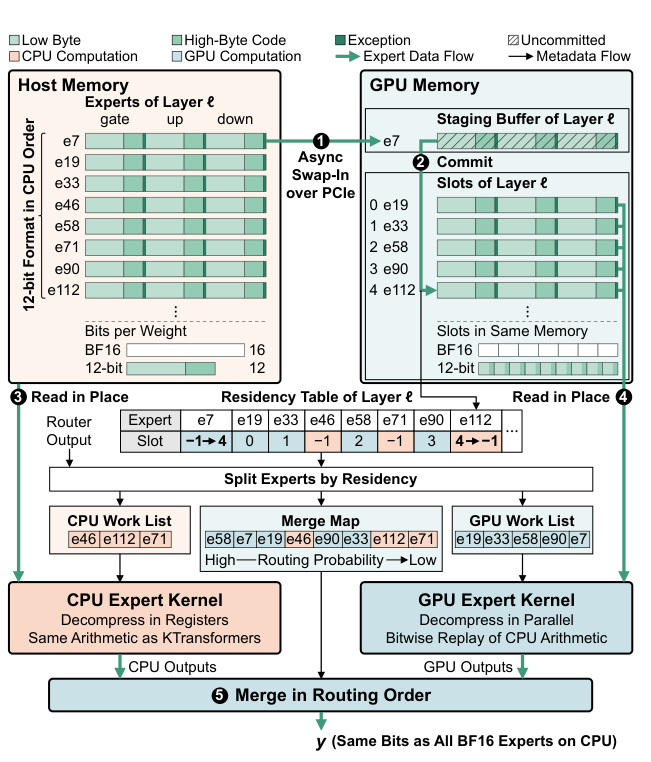View original image ↗</a>

*Expert placement changes while arithmetic order stays fixed*

<h2 class="daily-paper-title" id="paper-arxiv-2611.27765">Weave assigns communication and compute warps after routing</h2>

Ziyu Huang, Yangjie Zhou, Chenhao Zhu, Hongzhe Yan, Tianwei Qiao, Sicheng He, Zihan Liu, Peng Yu, Shulai Zhang, Xingxun Tang, Xinhao Luo, Minyi Guo, Xiu Lin, Yinghao Yu, Guodong Yang, Liping Zhang, Shixuan Sun, Qingyun Chen, Jingwen Leng · 2026-11-20  
[Weave: Routing-Adaptive Runtime Warp Scheduling for MoE Megakernels](https://arxiv.org/abs/2611.27765)

Under expert parallelism, tokens sent to a GPU and expert matrix work there need not grow together. At fused-kernel launch, Weave uses routing statistics to choose the SM and warp shares for communication, matrix work and writeback on each GPU. Warps can switch roles at the beginning and end of the layer. This handles both inter-device imbalance and slack within a layer that compile-time partitions leave unused. With eight-way expert parallelism, geometric-mean layer speedups over DeepGEMM-MegaMoE were 1.30 on SM103 and 1.24 on SM90. Full requests also incur attention and scheduling costs outside the measured layer.

<a class="note-image-link" href="/assets/images/digest/2026-11-24/arxiv-2611.27765.png" target="_blank" rel="noopener" aria-label="Each GPU selects spatial and temporal schedules from routing statistics">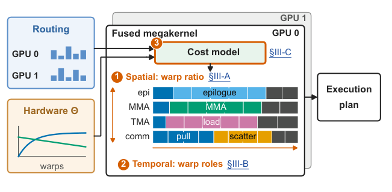View original image ↗</a>

*Each GPU selects spatial and temporal schedules from routing statistics*

<h2 class="daily-paper-title" id="paper-arxiv-2611.26840">When should communication start later?</h2>

Marco Kurzynski, Shaizeen Aga, Di Wu · 2026-11-19  
[Contention-Aware Flexible Execution for Machine Learning Workloads](https://arxiv.org/abs/2611.26840)

Starting a ready collective immediately can lengthen the critical path. Millisecond sampling on MI300X helps distinguish compute-unit contention from cache and memory traffic. The authors change both the operator paired with communication and the resources allocated to each. For example, letting the QKV projection claim enough units first can complete it in one wave while communication uses the remaining capacity. Across the prefill, decode and training schedule comparison, flexible overlap gained 3.7% geometrically over earliest-first scheduling. The peak 13% was for prefill at batch four and length 2K. The available scheduling slack depends on the dataflow.

<a class="note-image-link" href="/assets/images/digest/2026-11-24/arxiv-2611.26840.png" target="_blank" rel="noopener" aria-label="Resource contention between concurrent kernels">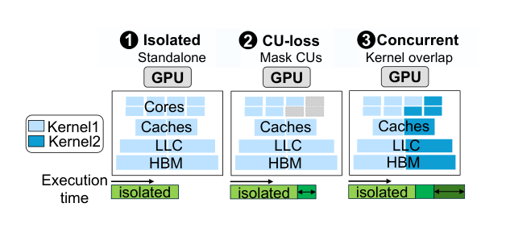View original image ↗</a>

*Resource contention between concurrent kernels*

<h2 class="daily-paper-title" id="paper-arxiv-2611.26657">BitPrefill maps ternary weights onto INT4 tensor cores</h2>

Fang Chen, Xuming Chen, Sanmukh Kuppannagari, Gourav Datta · 2026-11-18  
[BitPrefill: W1.58A4 Tensor-Core Acceleration for Compute-Bound LLM Prefill](https://arxiv.org/abs/2611.26657)

Ternary weights reduce decode traffic, but long prompts still require substantial matrix computation during prefill. BitPrefill quantizes and packs activations online, runs projections on native INT4 tensor cores and applies scales during GEMM writeback to avoid an intermediate transfer. On an RTX 4090 with both inner and output dimensions at 2,560, 2,048 input rows took 60.1 microseconds including packing and writeback, versus 183 for BF16. At 64 rows the figures were 11.8 and 12.8 microseconds. Shape determines how well the packing cost amortizes. The full-model measurements cover single-round prompts and support a prefill-specific conclusion.

<a class="note-image-link" href="/assets/images/digest/2026-11-24/arxiv-2611.26657.png" target="_blank" rel="noopener" aria-label="Activation packing feeds low-bit GEMM with scaling at writeback">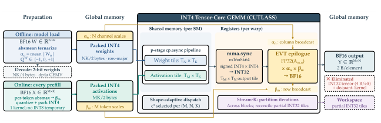View original image ↗</a>

*Activation packing feeds low-bit GEMM with scaling at writeback*

<h2 class="daily-paper-title" id="paper-arxiv-2611.26975">ToRA checks streaming output with the same weight read</h2>

Soheil Zibakhsh, Pedram Aghazadeh, Farinaz Koushanfar · 2026-11-20  
[Run One, Get Two: Near-Free Streaming Safety Checks for Local LLMs](https://arxiv.org/abs/2611.26975)

Single-user local decoding often runs out of memory bandwidth before compute. A separate guard would read another set of weights. ToRA branches a verifier row at the first adapted feed-forward layer. Dual-row kernels share each weight read and reuse generator KV while retaining computation for a distinct decision. On Qwen3-0.6B, F1 exceeded a dedicated streaming guard on 12 of 17 benchmarks. Unsafe-response detection improved by 11.8 percentage points over a hidden-state probe, with under 4% added per-token latency. The available slack comes from single-user bandwidth-bound decoding. A compute-saturated batch has a different cost profile.

<a class="note-image-link" href="/assets/images/digest/2026-11-24/arxiv-2611.26975.png" target="_blank" rel="noopener" aria-label="Verifier and generator branches share weights and KV">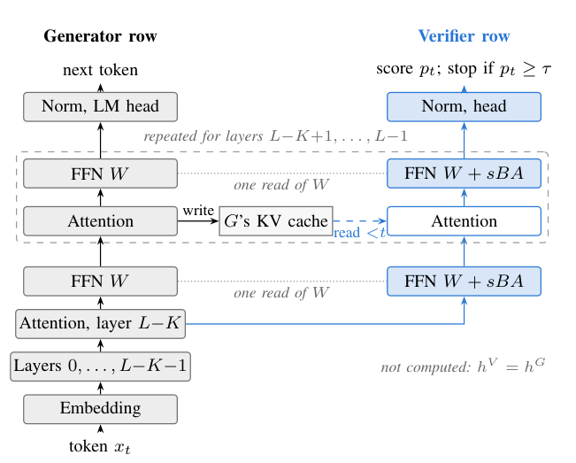View original image ↗</a>

*Verifier and generator branches share weights and KV*

<h2 class="daily-paper-title" id="paper-arxiv-2611.27092">PLoQ reserves high-precision directions for each prompt</h2>

Faraz Tahmasebi, Michael Pellauer, Hyoukjun Kwon, Sitao Huang · 2026-11-20  
[PLoQ: A Prompt-Specific Low-Rank Basis for 4-bit Quantization of LLM Activations](https://arxiv.org/abs/2611.27092)

Offline calibration identifies common activation outliers but cannot anticipate the directions unique to a prompt. PLoQ fits a low-rank basis on prefill samples, quantizes dominant components separately from the residual and restores them within the layer GEMM. Decode reuses the basis. At equal average bit width, prompt-specific directions take up part of the existing high-precision allocation. Perplexity improved across six Llama and Qwen models, recovering up to 46% of the baseline’s remaining four-bit activation error. At 8K on Llama-3.1-8B, prefill time rose 4% and decode time 8%. The trade is extra runtime arithmetic for better quality at the same bit budget.

<a class="note-image-link" href="/assets/images/digest/2026-11-24/arxiv-2611.27092.png" target="_blank" rel="noopener" aria-label="A low-rank basis fitted during prefill is reused during decode">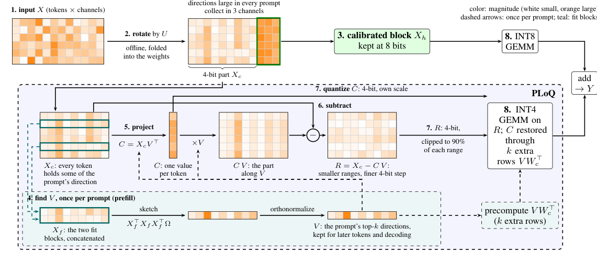View original image ↗</a>

*A low-rank basis fitted during prefill is reused during decode*

<h2 class="daily-paper-title" id="paper-arxiv-2611.27891">DICE makes the current sampling draws available to the draft tree</h2>

Guanning Zeng, Andrea Zanette · 2026-11-20  
[Speculative Decoding Is Less Speculative Than You Think](https://arxiv.org/abs/2611.27891)

A drafter cannot know the target’s next distribution, but sampling draws can be made in advance. DICE synchronizes those draws across drafting and verification to allocate draft-tree nodes. It also guides asynchronous preparation of the next round’s candidates, preserving the target sampling distribution without retraining the drafter. In an H200 asynchronous-prefetch comparison at temperature one and concurrency one, Llama-3.1-70B-Instruct with a 1B drafter raised outcome-cache hits from 59.8% to 77.9% and throughput from 160.8 to 182.0 tokens/s. The paper also sweeps concurrency in two engines. Gains depend on the drafter, temperature and scheduling strategy.

<a class="note-image-link" href="/assets/images/digest/2026-11-24/arxiv-2611.27891.png" target="_blank" rel="noopener" aria-label="Shared draws guide candidate expansion and verification">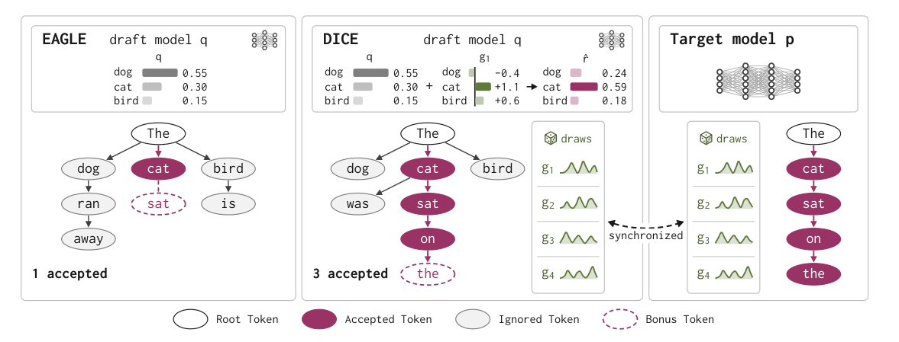View original image ↗</a>

*Shared draws guide candidate expansion and verification*

<h2 class="daily-paper-title" id="paper-arxiv-2611.26944">Which VLA stage benefits from batching robot requests?</h2>

Stefan de Lasa, Mohammadreza Mofayezi, Gennady Pekhimenko, Nandita Vijaykumar · 2026-11-20  
[Analysis of Multi-Client Inference Techniques for Vision-Language-Action Models](https://arxiv.org/abs/2611.26944)

The GPU can sit idle while a robot executes an action chunk, but batching more clients affects each inference stage differently. The authors profile three vision-language-action models on RTX 4090 and H100. The action expert amortizes weight reads across samples: raising batch size from one to four on H100 increased its latency only 1.15–1.33 times. Large matrix operations in the vision-language backbone already occupy compute resources, so larger batches extend response time. Even partitioning concurrent work across SMs can slow projections by reducing the units available per kernel. The study characterizes the scheduling trade-off across stages and control periods.

<a class="note-image-link" href="/assets/images/digest/2026-11-24/arxiv-2611.26944.png" target="_blank" rel="noopener" aria-label="GPU idle fraction across action chunk sizes and control rates for three models">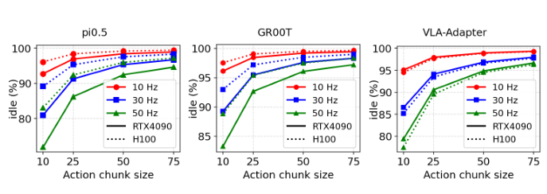View original image ↗</a>

*GPU idle fraction across action chunk sizes and control rates for three models*

<h2 class="daily-paper-title" id="paper-arxiv-2611.27119">CTRL keeps rollout and learning active on the same GPU</h2>

Ruijia Yang, Ruikai Li, Zeyi Wen · 2026-11-20  
[CTRL: Concurrent Training and Rollout for LLM Reinforcement Learning via GPU Co-Residency](https://arxiv.org/abs/2611.27119)

Rollout batches shrink as responses finish, while the learner needs dense computation. CTRL uses CUDA MPS to keep both resident on each GPU, with optimizer state on the host and a bounded window of layers streamed to the learner. A ready batch can train immediately, with the staleness gate applied before publishing the next policy. Across 24 configurations on three GPU platforms with a two-version lag limit, throughput was 1.11–2.24 times the stronger asynchronous verl baseline. Holding the learner fixed isolates the layout effect: co-residency achieved 1.10–1.26 times time-sharing throughput. Host memory and transfers remain part of the resource budget.

<a class="note-image-link" href="/assets/images/digest/2026-11-24/arxiv-2611.27119.png" target="_blank" rel="noopener" aria-label="A host-owned optimizer feeds a bounded on-device layer window">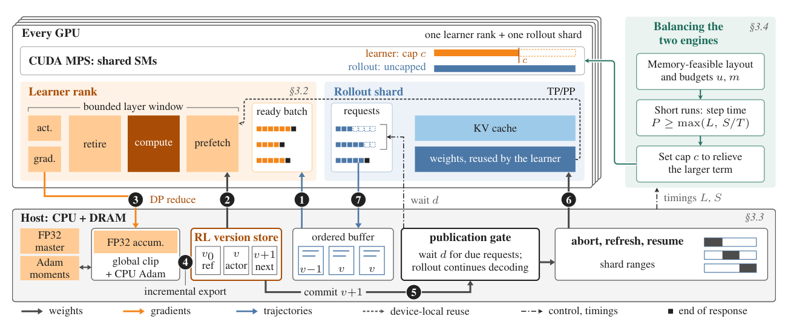View original image ↗</a>

*A host-owned optimizer feeds a bounded on-device layer window*

<h2 class="daily-paper-title" id="paper-arxiv-2611.27255">AceVLN schedules refreshes as cloud navigation guidance ages</h2>

Zihao Zheng, Hangyu Cao, Yulong Han, Xichang Wu, Zhihao Mao, Maoliang Li, Jiayu Chen, Hailong Zou, Donggang Cao, Xuanzhe Liu, Hong Mei, Xiang Chen · 2026-11-20  
[AceVLN: Asynchronous Cloud Edge Deployment of VLNs via Latent Scheduling and Compensation](https://arxiv.org/abs/2611.27255)

Cloud guidance may describe an older scene by the time it reaches an acting robot. AceVLN tracks drift in an action-relevant subspace of edge features, uses entropy to schedule refreshes and compensates delayed guidance only when recent drift is sufficiently continuous. On RxR-CE with DualVLN and Orin, holding cloud calls at ten per hundred decisions raised deployed success from 52.8% under periodic refresh to 60.5%. Targeting the periodic policy’s 52.8% success required only seven calls. Fewer calls lower amortized compute, while mean response time still rose 5–13 milliseconds relative to Bridge across the comparisons. These are different deployment objectives.

<a class="note-image-link" href="/assets/images/digest/2026-11-24/arxiv-2611.27255.png" target="_blank" rel="noopener" aria-label="Action-relevant drift determines when to refresh cloud guidance">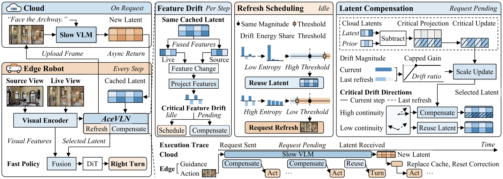View original image ↗</a>

*Action-relevant drift determines when to refresh cloud guidance*
