In AlgoTune, placing one more job on a host can change the performance feedback another agent sees. TideSand establishes a reference with reserved replays. RetryRealistic traces how partial tool results can reach a final answer without a retry. Exact on Paper reorders identical requests to measure how often a grade changes on an unchanged service. Their controls answer different questions about a speedup, an answer and a release regression.

<h2 class="daily-paper-title" id="paper-arxiv-2611.31118">TideSand preserves tool timing on a shared host</h2>

Shulu Li, Hanchen Li, Xiaokun Chen, Qiuyang Mang, Hanfei Chen, Jacky Kwok, Hanfei Yu, Alvin Cheung, Edward A. Lee, Joseph E. Gonzalez, Ion Stoica · First submitted to arXiv 2026-11-23 · [TideSand: Performance-Accurate Sandbox Multiplexing for LLM Agents](https://arxiv.org/abs/2611.31118)

In AlgoTune, the runtime of a tool is feedback to the agent. A faster implementation can look slower if a neighbor happens to compete for CPU during the second trial. Reserving a host slice for each sandbox protects that measurement but strands CPU while the model thinks. TideSand schedules at the boundary of a tool call and measures delay relative to a dedicated reservation alongside calls completed per host-hour.

<a class="note-image-link" href="/assets/images/digest/2026-11-25/arxiv-2611.31118.png" target="_blank" rel="noopener" aria-label="View original image">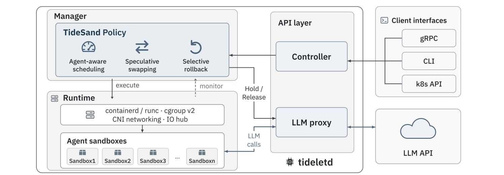View original image ↗</a>

*Allocation and admission sit inside the manager, connected to containers and model services through the API.*

A model call creates a scheduling opportunity. Memory belonging to a sandbox waiting for inference can move out of DRAM and return before its next tool call. Waiting until the host runs out of memory would allow reclaim and page faults to slow an active measurement. TideSand combines anticipatory swapping with tool admission and selective checkpoints. If contention distorts an execution, the scheduler can restore it and run it again when the host is quieter. The authors distinguish the cost of taking checkpoints from the frequency of using them. At most 0.44% of calls were rolled back across the six workload pairs.

The replay host had 64 Arm cores and 128 GB of memory, with 56 cores and 112 GiB assigned to sandboxes. Five strictly reserved replays establish a reference for each call. The study uses the slowest of the five to allow for variation even under isolation. Fidelity counts calls with a reference duration of at least one second whose delay inflation stays below 10%. Throughput is measured up to completion of 80% of calls, so the throughput result leaves the drain time of the final stragglers open.

Across six model–workload pairs from AlgoTune, Terminal-Bench 4.0 and Terminal-Bench Science, the authors report 3.8–10 times the throughput of strict reservation at comparable fidelity. AlgoTune replay evaluation error fell by a factor of 19. When a tool compares performance, host interference can enter the reward itself. The paired comparison with each call's isolated replay explains a property that average CPU utilization cannot capture.

<h2 class="daily-paper-title" id="paper-arxiv-2611.28341">RetryRealistic follows partial tool results into the final answer</h2>

Gün Kaynar, Boshen Yan, Carl Kingsford · First submitted to arXiv 2026-11-20 · [When Tools Fail, Agents Fabricate: Silent Failure and Verification-First Oversight in Tool-Using LLM Agents](https://arxiv.org/abs/2611.28341)

An explicit denial tells an agent that evidence is missing. A successful query that silently omits rows can yield a perfectly plausible total. RetryRealistic uses real files, SQLite and executable tools to control nine fault types and their persistence across eight tools and thirty multi-step tasks. Four agents completed 2,100 faulted runs. Task ground truth separates recovery, acknowledged failure and confident fabrication, outcomes that would all count as a delivered response.

<a class="note-image-link" href="/assets/images/digest/2026-11-25/arxiv-2611.28341.png" target="_blank" rel="noopener" aria-label="View original image">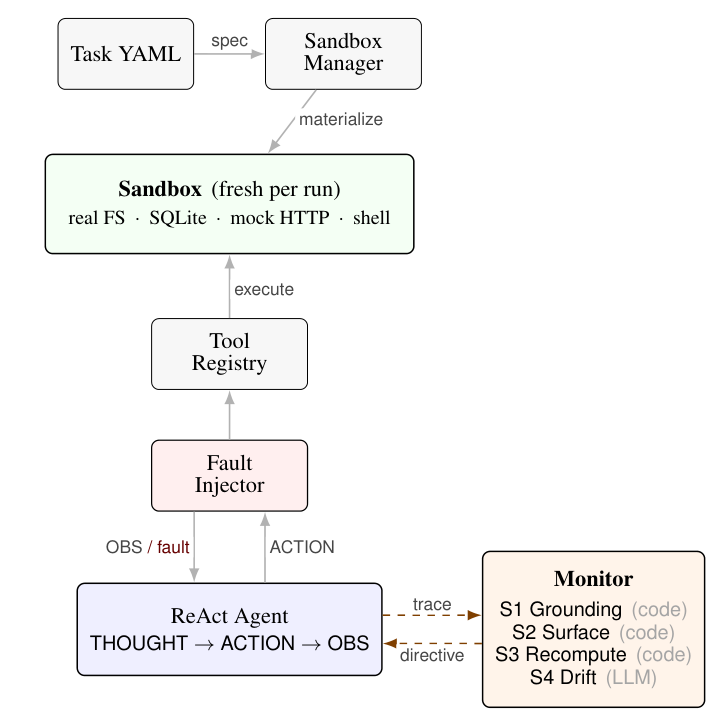View original image ↗</a>

*Faults enter the agent's observations, and the monitor can send a corrective directive after inspecting the trace.*

Trace inspection changes where one would look for the fault. Of 609 runs in which partial or malformed data actually appeared, 554 never repeated the affected call. Hard denials more often elicited a retry or an acknowledgement of failure. Experiments separating fault labels from payloads point to the plausibility of the returned content. A larger retry allowance helps only after something detects the need to retry.

The monitor checks reported values against structured observations and can recompute an answer from returned rows. It sends discrepancies back for revision. A final model-based stage checks for drift. Pooled correct recovery rose from 45.6% to 56.3%, while fabrication fell from 17.3% to 10.8%. With only the code checks those figures were 54.7% and 13.4%. The trade-off varied by agent. Claude Haiku fabricated less but also lost 5.7 percentage points of correct recovery.

The most informative cases are the ones the monitor never touched. It did not activate in 224 of 324 partial-success runs with the full cascade. Truncated data can arrive without an error, and recomputing from those rows may agree with the answer. Fabrication in this group still reached 32.1%, down from 38.3%. Consistency with the available evidence and completeness of that evidence require different observations.

<h2 class="daily-paper-title" id="paper-arxiv-2611.29663">Measuring answer flips against the noise of request order</h2>

Sharven Rane · First submitted to arXiv 2026-11-22 · [Exact on Paper: Which LLM Serving Shortcuts Flip Graded Answers, Measured Against the Noise of Reordering the Same Requests](https://arxiv.org/abs/2611.29663)

Two runs can have equal accuracy while exchanging which items were correct. The study pairs 3,380 requests from five benchmarks for one 4B instruction model in vLLM 0.33.0 and changes nine features individually. Repeated reference runs separate fresh-process variation from the effect of reordering identical requests. Reordering changes batch composition and gives a comparison for how often the unchanged service flips a grade.

<a class="note-image-link" href="/assets/images/digest/2026-11-25/arxiv-2611.29663.png" target="_blank" rel="noopener" aria-label="View original image">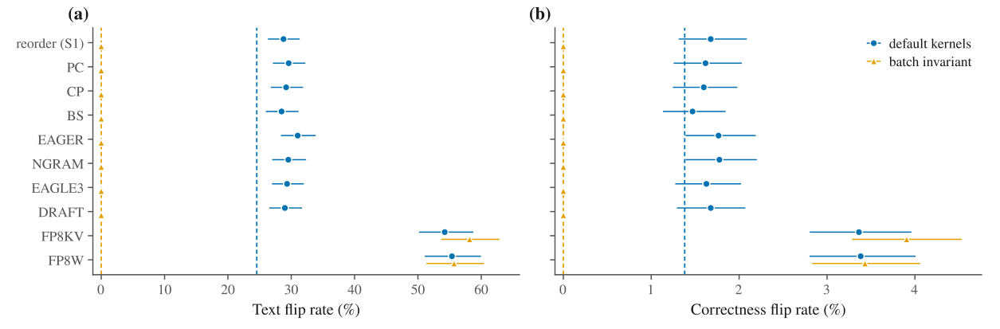View original image ↗</a>

*The two panels track text and grade flips. Quantization differences persist with batch-invariant kernels.*

With default kernels, seven nominally exact optimizations flipped grades on 1.47–1.78% of requests, comparable to the 1.72% reordering floor. FP8 KV flipped 3.36%. With batch-invariant kernels all seven exact configurations matched the reference text on every request, while FP8 KV still flipped 3.91% of grades. The aggregate accuracy changes stayed within one percentage point. Flips count corrections as well as regressions, so the rate measures instability, not a loss of that many accuracy points.

One proposed release gate rejected an unchanged configuration when its noise estimate came from a single pair of replicas. The author recommends batch-invariant kernels where practical or at least three replicas to estimate scheduling variation. These results cover a single model and GPU and tasks with exact grading. An open-ended benchmark would also have to account for variation in its judge.

<h2 class="daily-paper-title" id="paper-arxiv-2611.30027">When four-bit KV improves serving capacity on Hopper</h2>

Jian Zhang · First submitted to arXiv 2026-11-23 · [Fast 4-bit KV-Cache Decoding on Hopper GPUs: Why Existing Kernels Are Slow and How to Fix Them](https://arxiv.org/abs/2611.30027)

Half the cache bits can still mean slower decoding. Instruction counts expose unpacking, rearrangement and serialized loads as consumers of Hopper's issue budget. The kernel arranges data at cache write time, overlaps a producer warp with compute groups, feeds tensor cores from registers and swaps matrix operands to avoid padding small query groups. Layer zero and four sink tokens remain in BF16. On one H200 with Llama-3.1-8B and roughly 1K input and 8K output tokens, the sustainable arrival rate was 1.23–1.32 times that of FP8, requiring 99% of requests to meet both a two-second first-token and 100 ms per-output-token target. Single-item decode was roughly level and prefill was about 7% slower. Long outputs and cache pressure drive the capacity gain.

<a class="note-image-link" href="/assets/images/digest/2026-11-25/arxiv-2611.30027.png" target="_blank" rel="noopener" aria-label="View original image">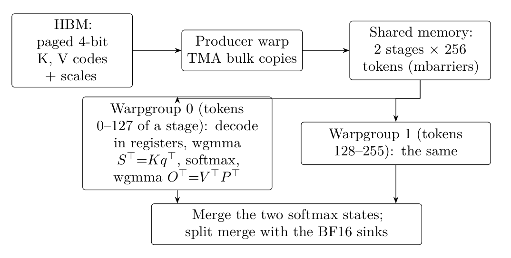View original image ↗</a>

*The producer stages data ahead of two compute groups, whose partial softmax states are merged.*

<h2 class="daily-paper-title" id="paper-arxiv-2611.28671">MASSYS counts the multi-agent jobs that never deliver</h2>

Haoyuan Zheng, Dongting Li, Hancheng Ye, Qinsi Wang, Mingyuan Ma, Yuncheng Yao, Yifei Wang, Baijun Zhou, Zishan Shao, Tingjun Chen, Hai Helen Li, Danyang Zhuo, Yiran Chen · First submitted to arXiv 2026-11-21 · [The Evaluation Substrate Matters: Benchmarking Multi-Agent Serving Substrates](https://arxiv.org/abs/2611.28671)

Parallel workers shorten dependencies while holding more KV state concurrently. MASSYS fixes tasks and workflows, varies the backend, concurrency and resource limits, and records timeouts, quality on delivered answers and effective quality over all submissions. In a controlled diagnostic, KV pressure moved Star from first to fourth in mean latency and Chain from fourth to first. Separate sweeps across five backend combinations found task families where the quality of surviving outputs moved little while fewer usable answers arrived. A latency ranking needs its load conditions, and a quality score needs its denominator.

<a class="note-image-link" href="/assets/images/digest/2026-11-25/arxiv-2611.28671.png" target="_blank" rel="noopener" aria-label="View original image">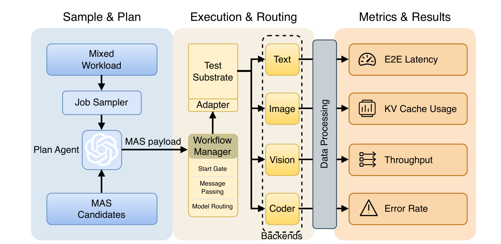View original image ↗</a>

*Fixed workloads and workflows pass through alternative backends, with service metrics and task outcomes collected together.*

<h2 class="daily-paper-title" id="paper-arxiv-2611.29004">Checking recovery where the next consumer reads state</h2>

Guijia Zhang, Huihao Jing, Bing Li, Shing-Chi Cheung, Harry Yang, Ziqi Zhang · First submitted to arXiv 2026-11-21 · [Consumer-Time Validity in Stateful AI Runtimes: Verifying Recovered State and Deferred Authority](https://arxiv.org/abs/2611.29004)

Resuming token generation does not establish that the next request reads valid state. The recovery contract requires exclusion of invalid state, retention of valid work and task completion, with scheduler evidence bound to the consuming request. Deferred tool actions separately require approval for the current revision. An offline verifier agreed with reference judgments on 42 frozen GPU scenarios. In a fault-free BF16 control, batching changed token 30 even though the digests of attended KV matched. Comparing text alone would have misdiagnosed recovery. A separate revision-bound dispatch check prevented 160 deterministic conflicting writes. These counts describe coverage of the fixed scenarios.

<a class="note-image-link" href="/assets/images/digest/2026-11-25/arxiv-2611.29004.png" target="_blank" rel="noopener" aria-label="View original image">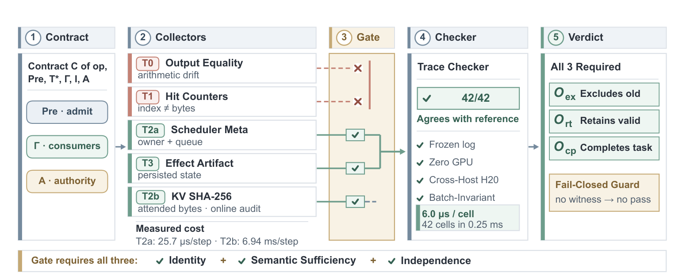View original image ↗</a>

*The contract fixes the consumer boundary and the verifier checks exclusion, retention and completion.*

<h2 class="daily-paper-title" id="paper-arxiv-2611.31105">LiveLoRA publishes an adapter, its cache and next-token scores together</h2>

Tianyi Huang, Samuel Xu, Ivy Gu, Nathan Huang, Siqi Zhang · First submitted to arXiv 2026-11-23 · [LiveLoRA: Exact KV Cache Migration Across LoRA Updates for LLM Agents](https://arxiv.org/abs/2611.31105)

An adapter change can invalidate the old cache, while replaying a long session makes each update pay for its history. LiveLoRA restricts updates to the final decoder block, fixing lower layers and K/V down-projections. Per-token base projections and low-rank coordinates survive the change. The runtime reconstructs a candidate cache, reevaluates the latest token and commits weights, cache and logits together. With 32 sessions of 8K tokens on Qwen2.5-3B-Instruct, median paired publication speedups averaged 68.98 times across five runs. Ongoing decoding cost about 4.8% extra. The equivalence argument assumes exact arithmetic and this restricted update structure.

<a class="note-image-link" href="/assets/images/digest/2026-11-25/arxiv-2611.31105.png" target="_blank" rel="noopener" aria-label="View original image">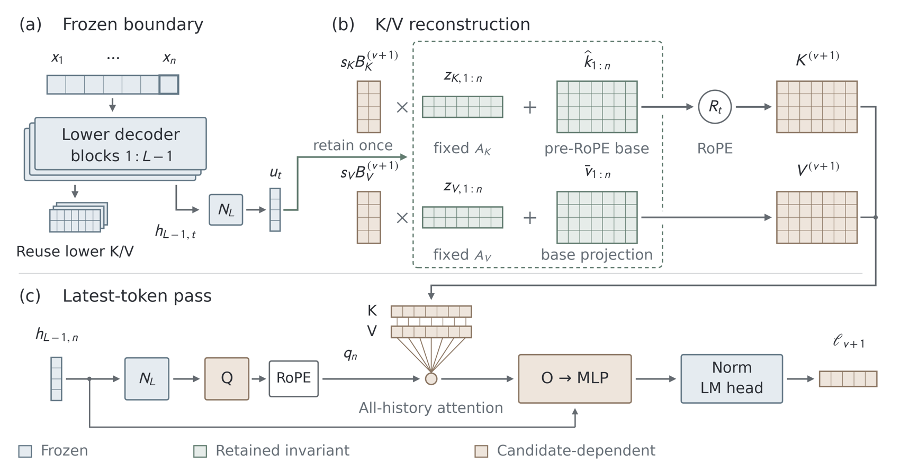View original image ↗</a>

*The final block reconstructs K/V from invariant inputs before recomputing the next prediction.*

<h2 class="daily-paper-title" id="paper-arxiv-2611.28625">IndexerStage stages sparse-attention index keys one layer at a time</h2>

Xin Zhang, Weifeng Zhang, Xianyan Xie, Huijun Shen, Xijin Yin, Zhen He, Yinben Xia, Xiang Li, ZeKun He, Yachen Wang, Xianneng Zou, Guo Chen · First submitted to arXiv 2026-11-21 · [IndexerStage: Staging Indexer-K across Memory Tiers for Sparse-Attention LLM Serving](https://arxiv.org/abs/2611.28625)

Sparse attention retrieves few values, but its indexer still scans keys spanning the history to decide which positions to keep. IndexerStage moves completed index pages to a backing tier, retains new entries locally and reuses execution buffers across layers. Admission checks both storage and per-layer transfer budgets. The SGLang prototype used 16 serving and 16 backing H800s. At 64K input with the latent-KV backing path held fixed, time per output token rose 2.42% at batch 24. Expanding to 29 enabled 1.10 times the control throughput. Capacity repays the transfer cost at the larger batch, with the backing GPUs counted as resources.

<a class="note-image-link" href="/assets/images/digest/2026-11-25/arxiv-2611.28625.png" target="_blank" rel="noopener" aria-label="View original image">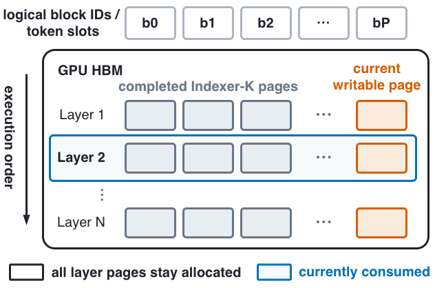View original image ↗</a>

*The resident layout holds index pages for every layer, with the current writable page and consumed layer highlighted.*

<h2 class="daily-paper-title" id="paper-arxiv-2611.28702">KV backup can stall foreground tokens in confidential serving</h2>

Haoxuan Xu, Shaoyu Wang, Minghao Lin, Beijie Liu, Potung Yu, Yongqin Wang, Vincent Quentin Ulitzsch, Seo Jin Park, Murali Annavaram, Mengyuan Li · First submitted to arXiv 2026-11-21 · [HiPerfCC-KVCache: Accelerating Confidential LLM Serving with Hierarchical KV Caching](https://arxiv.org/abs/2611.28702)

Confidential CPU–GPU cache transfers use a protected path. Separate threads and streams can still stall foreground generation through lock scope and staging-buffer ownership. HiPerfCC-KVCache bounds backup submissions so ready token readback can run between them, then uses auxiliary contexts with shared staging to parallelize restores. Against staged HiCache-Workers at the highest tested loads across three models and three workloads, H200 output throughput improved by a geometric mean of 1.74 times and mean time to first token fell 36% on average. The corresponding Blackwell throughput gain was 1.28 times. The bottleneck in protected copies determines how much scheduling can recover.

<a class="note-image-link" href="/assets/images/digest/2026-11-25/arxiv-2611.28702.png" target="_blank" rel="noopener" aria-label="View original image">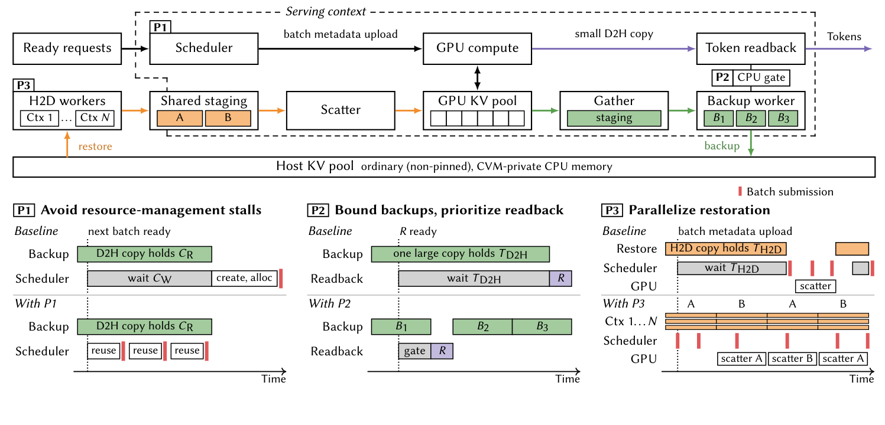View original image ↗</a>

*The timelines show how backup, token readback and restores interact with foreground progress.*

<h2 class="daily-paper-title" id="paper-arxiv-2611.28522">DisSparse moves variable-sized attention selection off the scheduling path</h2>

Nurlan Nazaraliyev, Elaheh Sadredini, Nael Abu-Ghazaleh · First submitted to arXiv 2026-11-21 · [DisSparse: Pipelined Top-$p$ Sparse Attention for Long-Context LLM Serving](https://arxiv.org/abs/2611.28522)

A fixed block count simplifies allocation but spends the same budget on concentrated and diffuse heads. Cumulative-probability selection adapts the count, at the cost of unpredictable allocation and expensive selection. DisSparse overlaps a second stream with layer computation, estimates the cutoff with a single-pass histogram kernel, and relocates tokens by prefill scores so a few important tokens do not drag entire mixed blocks into attention. Block selection was 1.17–1.80 times faster than prior top-p methods. Maximum batch size reached eight times dense vLLM under the same memory budget. These are selector speed and capacity respectively, distinct from end-to-end throughput.

<a class="note-image-link" href="/assets/images/digest/2026-11-25/arxiv-2611.28522.png" target="_blank" rel="noopener" aria-label="View original image">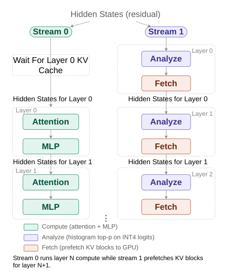View original image ↗</a>

*The streams separate layer execution and sparsity analysis so selection can overlap the main path.*

<h2 class="daily-paper-title" id="paper-arxiv-2611.29280">QASparse adapts both budget and membership during prefill</h2>

Zhiyuan Chen, Zihao Yang, Quanjiang Li, Haijiang Li, Jiancheng Pan, Qichao Zhao, Zihan Dong, Qiushi Shi, Jinshi Liu · First submitted to arXiv 2026-11-22 · [QASparse: Query-Adaptive Sparse Attention with Tailored Budgets and Tokens](https://arxiv.org/abs/2611.29280)

Heads can share a coarse importance estimate yet disagree on candidates near the cutoff. QASparse regresses budgets from locally sampled queries, assigns them by position and head, then uses actual query–key scores to vote on borderline candidates. The vote can replace a candidate while keeping the budget fixed. Length-specialized kernels keep selection overhead in check. The authors compare quality and latency on long-context tasks including RULER, reporting up to 1.77 times faster time to first token at 64K against FlashAttention-2. This concerns prompt processing, a different stage from decode block selection in DisSparse.

<a class="note-image-link" href="/assets/images/digest/2026-11-25/arxiv-2611.29280.png" target="_blank" rel="noopener" aria-label="View original image">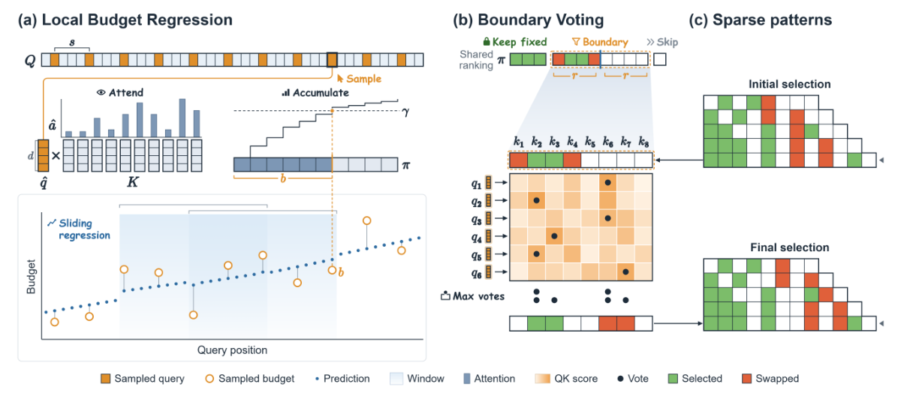View original image ↗</a>

*Budget regression precedes boundary voting, producing a sparse pattern for each query.*

<h2 class="daily-paper-title" id="paper-arxiv-2611.30554">Near-Far Attention scores nearby and distant history differently</h2>

YuanShuo Wang, Jianchao Tan, Lei Gong, Teng Wang, Wenqi Lou, Xuehai Zhou · First submitted to arXiv 2026-11-23 · [Near-Far Attention: Region-Aware Sparse Retrieval for Long-Context LLM Decoding](https://arxiv.org/abs/2611.30554)

Uniform page scoring can miss isolated distant clues or retain redundant nearby tokens. NFA gates regions during prefill, extracts shared low-dimensional features for those that remain, scores near and far pages separately and ranks candidate tokens under one budget. Tests used batches of 1, 2 and 4 where memory permitted. Qwen3-8B at 512K and batch one reached 2.97 times the whole-model decode speed of FlashInfer, including selection. The matched-budget comparisons show whether retrieval earns back its cost more directly than the peak 5.49-fold operator speedup.

<a class="note-image-link" href="/assets/images/digest/2026-11-25/arxiv-2611.30554.png" target="_blank" rel="noopener" aria-label="View original image">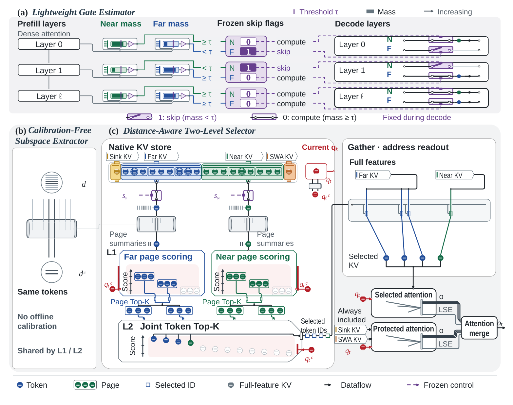View original image ↗</a>

*Prefill identifies skippable regions before two-level page and token scoring during decode.*

<h2 class="daily-paper-title" id="paper-arxiv-2611.31112">Parallel drafts consult earlier choices before verification</h2>

Mohammad Mahdi Moradi, Ali Pourranjbar, Zongzuo Wang, Mingming Zhu, Ben Feng, Boxing Chen · First submitted to arXiv 2026-11-23 · [Look Back, Draft Ahead: Corrective Prefix Attention for Parallel Speculative Decoding](https://arxiv.org/abs/2611.31112)

Parallel proposals can lose an entire suffix when one early choice is inconsistent with its prefix. CPA builds shortlists at each position and precomputes interactions between candidates in parallel. Sequential prefix selection then needs only table lookup, accumulation and scoring. An auxiliary autoregressive loss teaches the drafter from clean prefixes without another inference pass. Across eight benchmarks and two Qwen3 targets on Ascend NPUs, CPA committed 13–15% more tokens per round than DSpark. On Qwen3-4B, speedup over the target alone fell from 3.35 times for one request to 1.52 times at 32 requests, against 1.42 times for DSpark at that concurrency.

<a class="note-image-link" href="/assets/images/digest/2026-11-25/arxiv-2611.31112.png" target="_blank" rel="noopener" aria-label="View original image">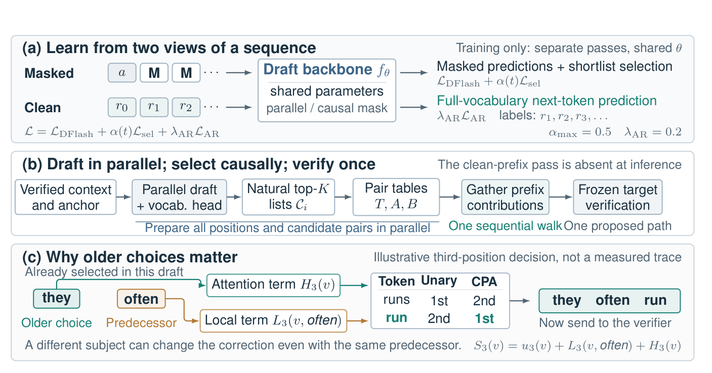View original image ↗</a>

*Clean prefixes supply supervision. At inference candidate interactions precede sequential selection.*

<h2 class="daily-paper-title" id="paper-arxiv-2611.30455">CGSpec schedules cloud verification around edge return times</h2>

Yuanbing Ouyang, Xiaoli Liu, Shirong Wei, Hao Wang, Xiang Su · First submitted to arXiv 2026-11-23 · [CGSpec: Consistency-Guided Speculative Decoding with Overlap-Aware Verification Scheduling for Edge-Cloud Inference](https://arxiv.org/abs/2611.30455)

A larger candidate tree can improve acceptance at one edge device while occupying a shared cloud verifier needed by another. CGSpec estimates draft–target divergence from verification feedback, adjusts tree budgets and separates global growth from local token selection. Scheduling accounts for expected client return times and remaining verification work. Tests used four model pairs, three datasets and injected bandwidth, latency and jitter profiles. System throughput rose 12.2% and 10.2% against the comparison methods with eight and sixteen clients respectively. Network conditions came from simulation, leaving scheduling under live congestion open.

<a class="note-image-link" href="/assets/images/digest/2026-11-25/arxiv-2611.30455.png" target="_blank" rel="noopener" aria-label="View original image">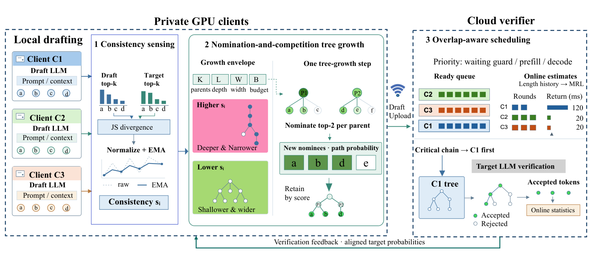View original image ↗</a>

*Clients build candidates from verification feedback. The cloud orders verification around overlapping work.*

<h2 class="daily-paper-title" id="paper-arxiv-2611.28760">OSplit sizes prefill and decode pools from a capacity model</h2>

Akshat Pandey, Dominic Cheng, Sidharth Sharma, Ashwin Gumaste · First submitted to arXiv 2026-11-21 · [Analytical Modeling and Optimal GPU Provisioning for Disaggregated LLM Inference](https://arxiv.org/abs/2611.28760)

After disaggregation, adding a GPU to the right pool depends on input and output lengths, weight traffic and attention traffic. OSplit models collectives, kernels and hardware capacity to predict step time and search for an allocation. The authors check timing predictions with vLLM on H100 and GB300. On H100, holding the model and output length fixed while extending input from 1K to the longest tested length increased the optimal prefill-to-decode GPU ratio by 3.3–4.9 times. These predictions apply to the specified interconnect domain and workload. Mixed production arrivals still require a queue-level capacity check.

<a class="note-image-link" href="/assets/images/digest/2026-11-25/arxiv-2611.28760.png" target="_blank" rel="noopener" aria-label="View original image">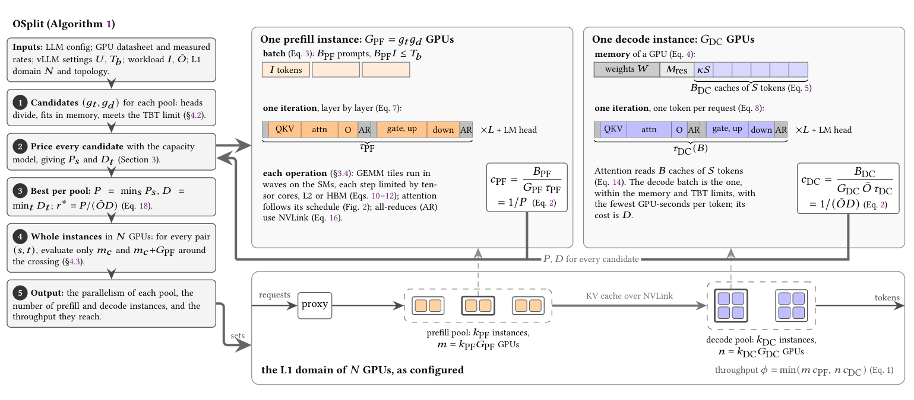View original image ↗</a>

*Separate prefill and decode capacity estimates drive the search for a balanced allocation.*

<h2 class="daily-paper-title" id="paper-arxiv-2611.29104">Five ways to organize four GPUs change places across workloads</h2>

Jihui Yang, Wentai Wu, Jiahua Huang, Weiwei Lin, Ligang He, Linghong Tsang · First submitted to arXiv 2026-11-22 · [When Does Decomposition Help? Empirical Study on Workload-Architecture Affinity in LLM Inference Serving](https://arxiv.org/abs/2611.29104)

The authors hold the four-GPU budget constant and compare replicas, tensor and pipeline parallelism and two disaggregated layouts under short chat, long output and 32K contexts. Four independent replicas achieved the lowest end-to-end latency for short chat and long output. At 0.4 requests/s with 32K prompts, four-stage pipelining reached 1.55 s P95 time to first token against 3.81 s for replicas. A disaggregated pipeline pair achieved the best P95 end-to-end time at 3.98 s. At higher long-context load the fixed TP2+TP2 split reached 92.9% errors. This complements OSplit by testing queue stability on a fixed budget without independent phase scaling.

<a class="note-image-link" href="/assets/images/digest/2026-11-25/arxiv-2611.29104.png" target="_blank" rel="noopener" aria-label="View original image">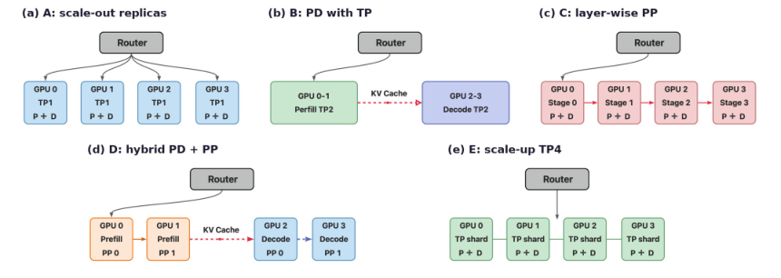View original image ↗</a>

*All five layouts use the same four GPUs with different replica and phase boundaries.*

<h2 class="daily-paper-title" id="paper-arxiv-2611.29156">ARC gives an uncertain rollout group a chance to resume</h2>

Yihui Zhang, Tianyu Wo, Jinghao Wang, Xiao Zhou, Huitian Xue, Xiaoyang Sun, Zeying Wang, Chunming Hu, Renyu Yang · First submitted to arXiv 2026-11-22 · [ARC: Adaptive Rollout Control for Efficient Synchronous LLM Reinforcement Learning](https://arxiv.org/abs/2611.29156)

Synchronous GRPO needs enough useful groups per step. Waiting for every straggler wastes time, while discarding groups early changes the data entering training. ARC uses partial group outcomes to backfill candidates, parks uncertain groups with bounded resumption and limits admission to the outstanding group requirement. In math experiments on two nodes with sixteen H20s, online rollout time fell 37.4%, effective GRPO throughput rose 50.1%, and 98.9% of ultimately useful groups were recovered. Resumed groups contributed 18.3 percentage points of recall in the main experiment. Early decisions depend on the reward structure of the workload.

<a class="note-image-link" href="/assets/images/digest/2026-11-25/arxiv-2611.29156.png" target="_blank" rel="noopener" aria-label="View original image">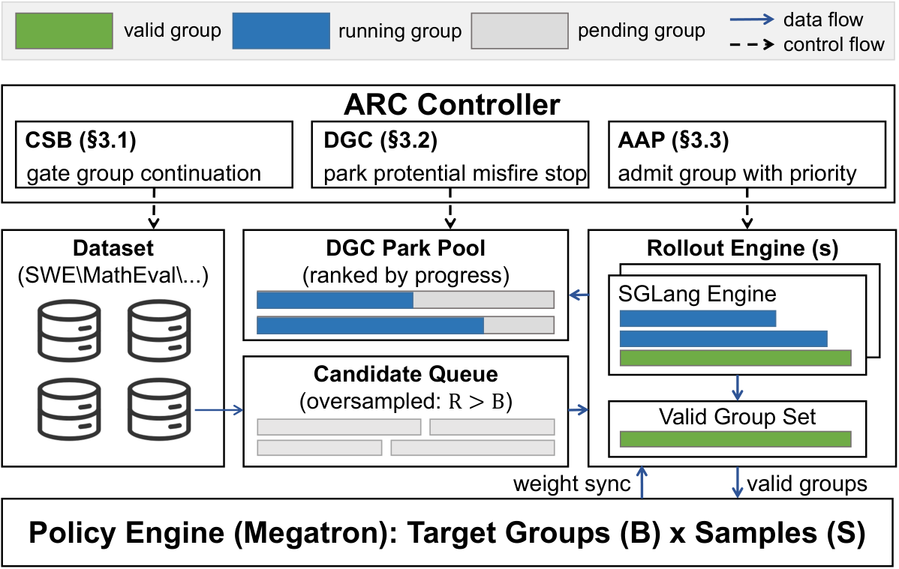View original image ↗</a>

*The controller moves groups among the candidate queue, deferred pool and rollout engines.*

<h2 class="daily-paper-title" id="paper-arxiv-2611.28469">Apsis finds workflow faults in the wiring</h2>

Yanju Chen, Ying Li, Bosi Zhang, Hanzhi Liu, Hongbo Wen, Yufei Ding, Yuan Tian, Yu Feng · First submitted to arXiv 2026-11-21 · [Automated Safety Analysis for Agentic Workflows](https://arxiv.org/abs/2611.28469)

A verifier node can route back to analysis forever even if every component works in isolation. Apsis lifts steps, control flow, input dependencies and shared state into a common graph, annotating mandatory inputs and how concurrent writes merge. Declarative patterns identify where progress or a data contract can fail. From reports across 13 frameworks, the authors constructed reproducible buggy and fixed artifacts. Apsis reached 91% precision and 84% recall and found 36 previously unknown workflow defects. Localization is tied to modeled semantics. Open-ended judgments made by the model are outside that graph.

<a class="note-image-link" href="/assets/images/digest/2026-11-25/arxiv-2611.28469.png" target="_blank" rel="noopener" aria-label="View original image">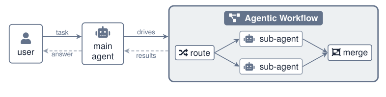View original image ↗</a>

*The main agent dispatches to a fixed workflow with explicit routing and merge points.*

<h2 class="daily-paper-title" id="paper-arxiv-2611.29290">Which errors an intervention fixes depends on the harness</h2>

Zihan Jin, Gaoyuan Du, Jiate Li, Dongze Ye, Shawn Li, Yue Zhao, Defu Cao · First submitted to arXiv 2026-11-22 · [Which Failure Does an Intervention Repair? When Agent Interventions Help, and Where Self-Evolving Skills Stall](https://arxiv.org/abs/2611.29290)

A skill that helps a weak harness can add little once the harness supplies execution feedback. The authors paired fixed tasks while varying models, skills, harness and budget across nine benchmarks and nearly 900,000 trajectories. The visibility of a failure explains some results more clearly than model strength. On SQuAD a feedback-equipped harness rescued 76.9% of signaled failures but only 1.3% of silent ones. On SimpleQA, evolved skills struggled to supply missing facts while retrieved passages made a larger difference. An intervention result needs the prior failure mix, the signals available to the intervention and the harness under which its gain disappears.

<a class="note-image-link" href="/assets/images/digest/2026-11-25/arxiv-2611.29290.png" target="_blank" rel="noopener" aria-label="View original image">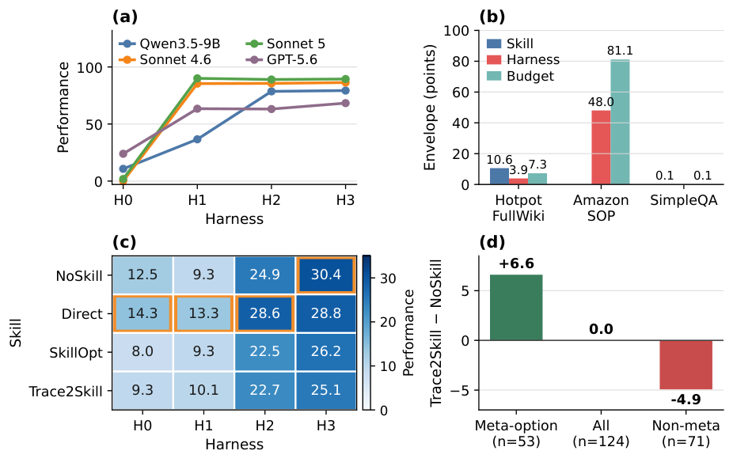View original image ↗</a>

*Skill gains and recovery rates vary across model and harness combinations.*

<h2 class="daily-paper-title" id="paper-arxiv-2611.30483">Measuring immediate database damage separately from recoverability</h2>

Abdullah Kaya, Cevheri Bozoglan, Yusuf Gundogdu · First submitted to arXiv 2026-11-23 · [When an AI agent makes a mistake in a database, what decides the damage?](https://arxiv.org/abs/2611.30483)

The study first scripts 22 fixed mistakes, separating permissions and recovery from model behavior, then runs six small open-weight models on hazardous tasks across nine engines in 9,468 primary trials. Recovery drills change the damage estimate. Cassandra's default snapshots left no permanent protected-row loss in 432 trials, but this drill was added later and began seconds after the mistake. In 215 of 392 loss trials only a backup copy of an order was lost. Combining copies and originals in one metric can mischaracterize a guard. Only three of seven preregistered hypotheses met their decision rules, two largely by construction.

<h2 class="daily-paper-title" id="paper-arxiv-2611.29546">ShellPlan binds authorization to the plan that runs</h2>

Jieyu Li · First submitted to arXiv 2026-11-22 · [ParseGap: Testing What Coding Agents Authorize and What Shells Execute](https://arxiv.org/abs/2611.29546)

When a coding agent checks command text and a different interpreter executes it, the approved action can diverge from its effects. ParseGap evaluates policies against observed runtime effects. Its defense, ShellPlan, builds a typed execution plan for a supported language subset, checks argument capabilities and executes that plan directly. Unsupported operations escalate for approval. In 90 model-driven risk trials the guarded configuration recorded zero violating effects against 62 unguarded. Standard development tasks completed in 36 of 36 frontier-model runs and 74 of 100 overall. The result concerns the modeled command semantics and shows a measurable compatibility trade-off.

<h2 class="daily-paper-title" id="paper-arxiv-2611.31010">Airlock enforces policy outside the agent VM</h2>

Sina Abdollahi, Amir Al Sadi, Marios Kogias, Hamed Haddadi, Adrien Ghosn, Antoine Delignat-Lavaud, Manuel Costa, Mark Russinovich · First submitted to arXiv 2026-11-23 · [Airlock: Robust Sandboxing and Governance of Rogue Agents](https://arxiv.org/abs/2611.31010)

Placing an agent and its enforcement logic in one environment also ties the audit trail to that environment's integrity. Airlock mediates network and filesystem I/O in a separate confidential VM, adapts OpenShell to isolate policy and credentials, and preserves forensic evidence through separate auditing. On a Radxa prototype, socket bandwidth fell 51–70% relative to baseline. Mean OpenClaw system time rose from 15.5 to 20.7 seconds, while end-to-end time rose from 85.7 to 91.4 seconds. The visible cost depends on how much task time is spent in I/O. A development board leaves high-throughput cloud networking unmeasured.

<a class="note-image-link" href="/assets/images/digest/2026-11-25/arxiv-2611.31010.png" target="_blank" rel="noopener" aria-label="View original image">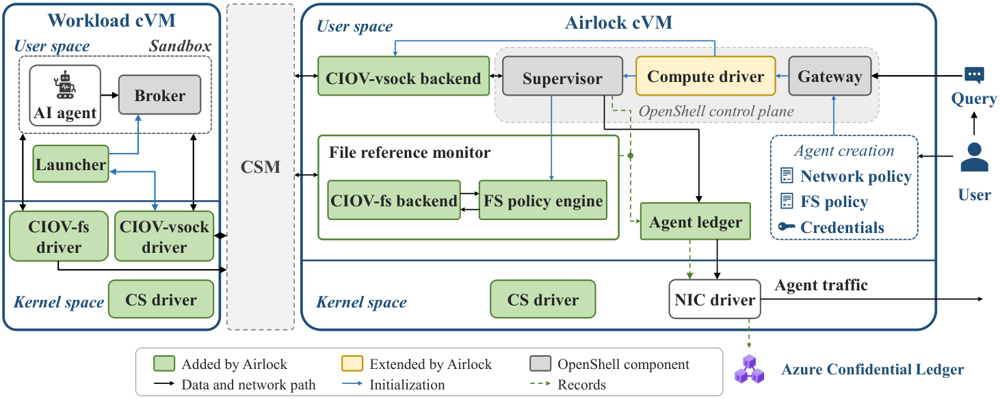View original image ↗</a>

*The workload VM's I/O passes through policy and audit components in a separate Airlock VM.*

<h2 class="daily-paper-title" id="paper-arxiv-2611.28947">NightWatch changes execution when the screen changes</h2>

Jiaqi Su, Jie-Jing Shao, Yichen Liu, Long-Kai Huang, Haiyan Yin · First submitted to arXiv 2026-11-21 · [Don't Sleep, Keep Watch: Proactive Perception for Computer-Use Agents](https://arxiv.org/abs/2611.28947)

The screen can change while the model reasons, making an initially valid click stale. NightWatch continuously reads screenshots with a 0.8B watcher and can wake the main model, interrupt outdated reasoning or invalidate a queued action. The authors compare observation strategies under the same screenshot-only input. For the large vision-language agent, non-reasoning time on OSWorld fell 33% at comparable success. On dynamic DynaCU-Bench, success rose from 39.5% to 44.2%. A pixel-quiescence ablation conflated settled pixels with readiness to act. The time saving applies to the non-reasoning portion of a task.

<a class="note-image-link" href="/assets/images/digest/2026-11-25/arxiv-2611.28947.png" target="_blank" rel="noopener" aria-label="View original image">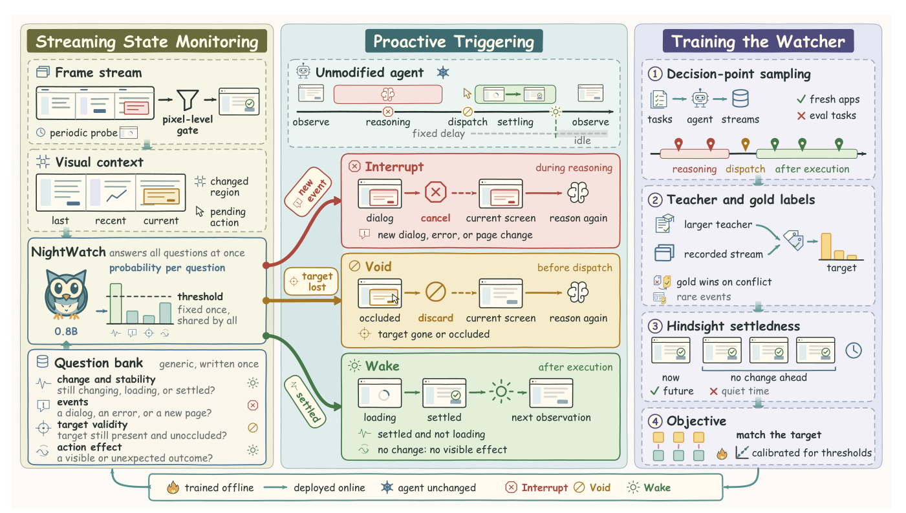View original image ↗</a>

*A screen stream drives watcher decisions to wake, interrupt or invalidate actions.*

<h2 class="daily-paper-title" id="paper-arxiv-2611.30190">How much separates two web-agent scores?</h2>

Zelong Wang, Weiyue Li, Fei Xue, Junru Zhu · First submitted to arXiv 2026-11-23 · [Same Executions, Different Gaps: Judgment Rules in Web-Agent Evaluation](https://arxiv.org/abs/2611.30190)

Holding web-agent executions fixed while changing the judging rule can alter the size of a lead. The paper distinguishes probable completion from completion supported by recorded evidence and preserves unresolved outcomes. When errors partly cancel, improving both agents' individual score estimates can worsen the estimated difference. The authors sample paired tasks and use human reference labels to correct judge predictions. With 50 labeled pairs in ten judge/evidence settings, regression reduced mean squared error by 16.9–36.9% against direct paired sampling. The estimate is conditional on this fixed task cohort and paired labeling.

<a class="note-image-link" href="/assets/images/digest/2026-11-25/arxiv-2611.30190.png" target="_blank" rel="noopener" aria-label="View original image">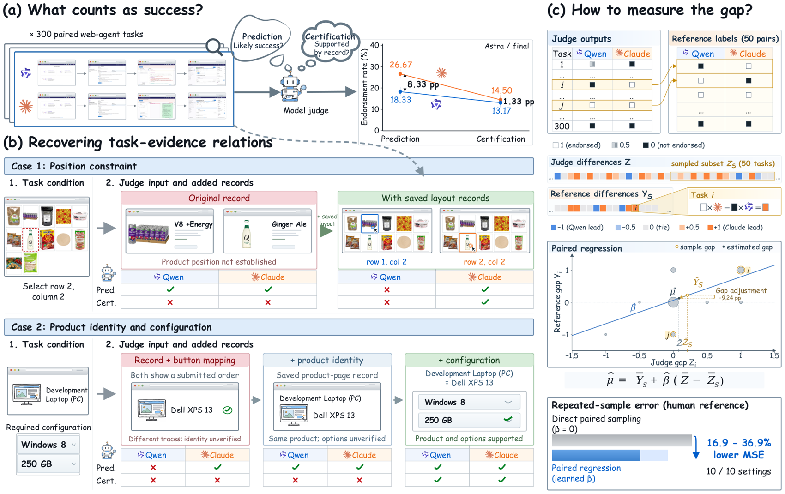View original image ↗</a>

*The same traces support rule changes, evidence additions and paired estimation of the gap.*

<h2 class="daily-paper-title" id="paper-arxiv-2611.28516">SQLution searches for counterexamples to query equivalence</h2>

Haoran Ding, Zhaoguo Wang, Zuming Jiang, Haibo Chen, Jinyang Li, Ruzica Piskac · First submitted to arXiv 2026-11-21 · [Bound to be Complete: Efficient Verification for SQL Equivalence via U-Expressions](https://arxiv.org/abs/2611.28516)

Query rewrites can silently alter ordering or multiplicities on databases that a test suite never exercises. SQLution represents query semantics with U-expressions, encodes tuple ordering in first-order logic, and expands sums over inferred finite bounds to simplify counterexample search. Among 997 Spider-derived query pairs, the tool supported all 271 non-equivalent pairs. The largest reported verification-time reduction against previous verifiers was 98.6%. The practical question is whether the supported features, bounds and solver budget allow a distinguishing database instance. The maximum reduction is specific to the comparison.

<a class="note-image-link" href="/assets/images/digest/2026-11-25/arxiv-2611.28516.png" target="_blank" rel="noopener" aria-label="View original image">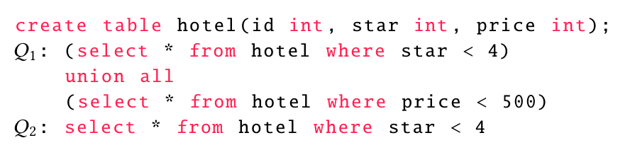View original image ↗</a>

*The queries differ on duplicate rows, requiring a distinguishing database instance.*

<h2 class="daily-paper-title" id="paper-arxiv-2611.28436">SafeJIT carries a crash-freedom proof to generated machine code</h2>

Gabriel Ebner · First submitted to arXiv 2026-11-21 · [SafeJIT: A Speculating JIT Engine Verified Down to the Machine Code](https://arxiv.org/abs/2611.28436)

A speculating JIT must restore interpreter state when its type assumptions fail, making deoptimization a potential source of faults. SafeJIT carries a Lean 4 proof to statically linked RISC-V and x86-64 binaries, covering generated code, garbage collection and deoptimization metadata. Sail instruction semantics underpin crash freedom in a Linux user-process model, taking the compiler and linker out of the trusted base. The backends differ in optimization level, including register allocation. The achievement is coverage through code generation. Correct JavaScript results would require a separate semantic theorem.

<a class="note-image-link" href="/assets/images/digest/2026-11-25/arxiv-2611.28436.png" target="_blank" rel="noopener" aria-label="View original image">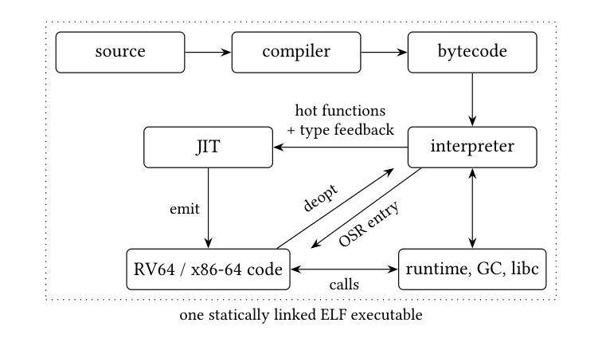View original image ↗</a>

*Interpreter and JIT share a runtime inside the binary-level proof boundary.*

<h2 class="daily-paper-title" id="paper-arxiv-2611.28704">Requiring independently checkable solver certificates</h2>

Tobias Philipp · First submitted to arXiv 2026-11-21 · [Zero-Trust Formal Methods: AI Agents Build Verified Checkers for Untrusted Solvers](https://arxiv.org/abs/2611.28704)

Verifying agent-generated code can still require trusting the verifier's solver. Agents build Isabelle/HOL specifications, soundness proofs and reference checkers. After independent review the specifications are frozen, and fast Rust checkers are verified with Verus. A solver result advances only with an accepted certificate. The study certified and validated 3,726 SMT queries from 20 crates, and both checker implementations accepted 15,662 answer-set proofs. A trust manifest retains assumptions including correspondence between specifications. The two implementations and explicit trust boundary make a successful verification result easier to audit.

<a class="note-image-link" href="/assets/images/digest/2026-11-25/arxiv-2611.28704.png" target="_blank" rel="noopener" aria-label="View original image">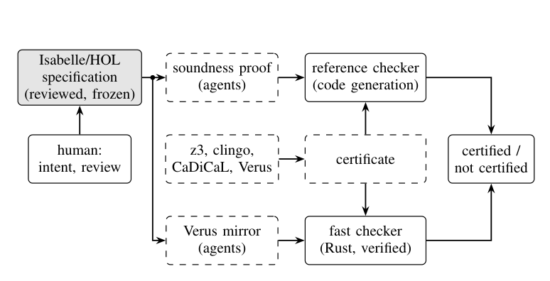View original image ↗</a>

*Solvers provide certificates to reference and fast checkers backed by reviewed specifications.*

<h2 class="daily-paper-title" id="paper-arxiv-2611.29745">CGRizz triangulates missing static call edges</h2>

Mohammad Rafieian, Michael Hicks, Shiyi Wei · First submitted to arXiv 2026-11-22 · [Agentic Root Cause Reasoning and Localization of Unsoundness in Static Call Graph Analysis](https://arxiv.org/abs/2611.29745)

An edge observed at runtime but absent from a static graph gives the diagnosis an observable starting point. CGRizz proposes the missing program pattern and its location in the analyzer, then cross-checks runtime instrumentation, a test exposing the omission and a warning at the proposed location. Across WALA, OPAL and Soot, 10.3% of 1,459 edges received direct analysis and another 84.1% were explained by grouping. In an audit, 86% of sampled grouped edges shared the representative's cause, so grouping carries uncertainty. Derived warnings flagged 74–92% of unsoundness on held-out programs.

<a class="note-image-link" href="/assets/images/digest/2026-11-25/arxiv-2611.29745.png" target="_blank" rel="noopener" aria-label="View original image">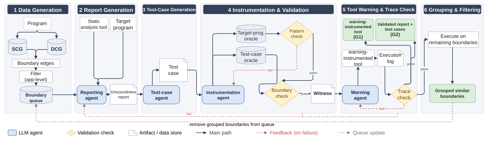View original image ↗</a>

*Observed missing edges lead to hypotheses checked through instrumentation, tests and localized warnings.*
