An agent resuming after a tool call can incur three different serving costs. Moving to an idle replica may require rereading thousands of tokens. Queuing behind a long prompt can delay the first token by minutes. Summarizing a passage in mid-history can invalidate the cache for untouched text. PARK, PipeAxes and NOOA measure these costs through session replays, mixed-length requests and editable contexts. Other studies look beneath completion rates to ask whether safeguards survived recovery, how many extra calls a multi-agent route took, and which new regressions an evolved harness introduced.

<h2 class="daily-paper-title" id="paper-arxiv-2611.34584">PARK prices the next turn’s prefix rebuild into routing</h2>

Sentao Miao, Tianjiao Nie, Yuan Zhou, Song Yuan, Yuanwei Lu, Yibo Zhu · arXiv v1 · 2026-11-25 · [Routing and Cache Retention for Multi-Turn LLM Inference: Theory and Implementation](https://arxiv.org/abs/2611.34584)

A coding agent can return from a tool call with almost the same prompt it sent a few moments earlier. Retaining its key-value (KV) cache saves a prefill on the next turn, but occupies memory for an unknown length of time. Evicting it frees space immediately and risks having to process the same history twice. Even a router with accurate queue lengths can send a request to the replica where it costs the most to resume. PARK asks how much those two decisions depend on one another.

<a class="note-image-link" href="/assets/images/digest/2026-11-27/34584.png" target="_blank" rel="noopener" aria-label="View original image ↗ The SWE replay tracks prefix hits and KV occupancy alongside token and turn throughput.">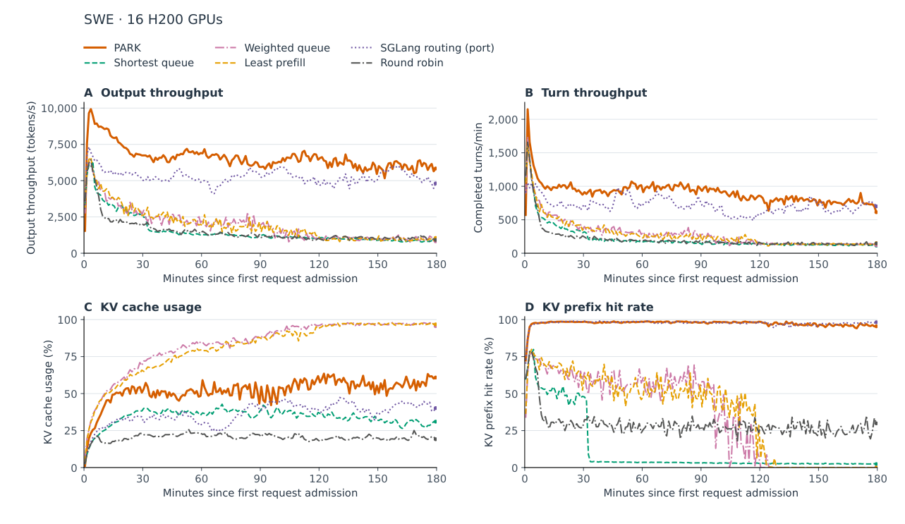View original image ↗</a>

*The SWE replay tracks prefix hits and KV occupancy alongside token and turn throughput.*

Each replica reports pressure on compute and active KV memory. The controller prices the two separately. Staying with the current replica earns credit for its cached prefix. Moving incurs a rebuild, but a less congested destination may pay off on the following turn. The implementation requires a sustained load advantage and a sufficiently better bid before rebinding a session. Waiting increases a request’s priority. A stale snapshot alone is unlikely to send a session bouncing between endpoints.

Inside a replica, the question becomes how much future computation an idle block can save per byte and per unit of holding time. The numerator reflects the cost of rebuilding the prefix. The denominator reflects its size and the expected holding time per successful reuse. A short prefix can be cheap enough to discard, and a very long one expensive enough to release. Where several sessions share a physical block, their priorities add up. The allocator evicts from the lowest nonempty priority bucket. Recency alone cannot express all three distinctions.

The completed SWE sessions averaged about 72 turns with roughly 433 output tokens per reply, creating frequent opportunities to reuse a prefix. Terminal-Bench averaged about 17 turns but roughly 2,290 output tokens per reply, tying up decode slots and active KV for longer. Queue length misses the value of a warm prefix in the first regime. Pursuing hits alone can concentrate work on busy replicas in the second.

Across two tensor-parallel replicas on 16 H200s serving a 197B MoE, PARK delivered 6,575 output tokens/s over a three-hour SWE replay, 24.2% above the SGLang routing rule ported to the shared vLLM stack. On Terminal-Bench it reached 8,590 tokens/s, 40.0% above shortest queue. The strongest comparator changed with the workload. A single-replica ablation gives a clearer account of the mechanism. With routing held fixed, the fraction of previously verified prefix tokens missing at return fell from 13.26% under LRU to 2.17%, cutting recomputation from 30.77 million tokens to 6.62 million. Tracking that loss alongside output throughput would help distinguish time spent queuing from time spent rereading history.

<h2 class="daily-paper-title" id="paper-arxiv-2611.34615">PipeAxes gives short requests a way through long prefills</h2>

Xiaoqiang Guo, Yifan Lin, Yang Liu, Jianan Zhang, Yingqi Peng, Jiamei Lv, Yi Gao, Wei Dong · arXiv v1 · 2026-11-25 · [PipeAxes: Decoupling Compute and Communication Granularities for Pipeline-Parallel LLM Serving](https://arxiv.org/abs/2611.34615)

A 60,000-token prompt sharing a pipeline with an interactive request can make the latter wait minutes for its first token. Narrower prefill chunks create opportunities for decode work to run, at the cost of repeatedly loading the same weights. Wider chunks use the GPU efficiently but can keep other requests waiting through an entire compute stage and transfer. PipeAxes separates three decisions usually controlled by chunk size. How many rows should the GPU process together? How many layers can it run before yielding? How many rows should cross the stage boundary at once?

<a class="note-image-link" href="/assets/images/digest/2026-11-27/34615.png" target="_blank" rel="noopener" aria-label="View original image ↗ Follow an activation group from sliced computation through compression and transport to downstream execution and scheduler feedback.">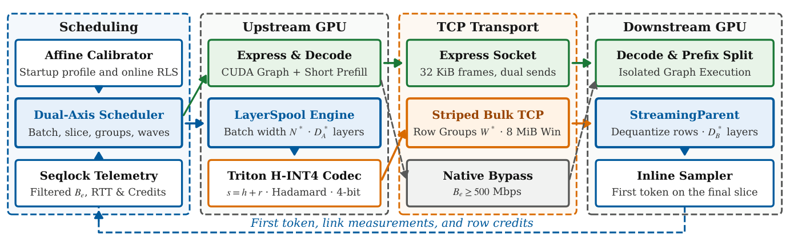View original image ↗</a>

*Follow an activation group from sliced computation through compression and transport to downstream execution and scheduler feedback.*

The scheduler keeps a wide prefill batch, estimates the slack before the next decode deadline and uses it to choose a layer at which to yield. Boundary activations travel in smaller row groups, allowing downstream execution to begin as groups arrive. A Hadamard transform and INT4 quantization reduce the transfer size. An express queue lets short requests pass bulk traffic still waiting to be sent. Compute and transport can each cause head-of-line blocking. Yielding the GPU does little for a request stuck behind a bulk send, and an empty link cannot interrupt a long computation upstream.

The WAN experiments show why the objective matters. Across two SWE-agent workloads, fixed 512-token chunks finished sessions in 66.6–71.4 seconds at p95, faster than PipeAxes at 70.9–78.7 seconds. Yet no request with fixed chunks met all its latency targets. PipeAxes kept p95 time per output token at 83.5–84.0 milliseconds. Earlier session completion alone cannot answer how long users wait for the next piece of output.

On two PCIe A800s serving a dense 32B model, the 64K mixed replay comprised 15 short requests and eight prompts of 56K–63K tokens. Short-request p95 time to first token fell from 129.8 seconds with native vLLM to 512 milliseconds. All 15 short requests met their latency targets. Total output was 14.6 tokens/s, or 93.6% of the throughput of fixed 4,096-token chunks. The tail-latency gain thus came with a measurable throughput trade-off. Activation compression has a separate quality cost to examine. Against BF16, INT4 transport scored 0.06 percentage points higher on MMLU and 0.46 lower on GSM8K. Table 1 puts short-request waiting time, throughput and the number of requests meeting their deadlines side by side for the same replay.

<h2 class="daily-paper-title" id="paper-arxiv-2611.34147">NOOA lets the model choose which history to compress</h2>

Alessio Devoto, Avinash Vem, Tara Safavi, Sanjay Kariyappa, Yu-Hsuan Tseng, Paul Furgale, Ricardo Silveira Cabral · arXiv v1 · 2026-11-25 · [Letting Models Manage Their Own Context: Where We Stand](https://arxiv.org/abs/2611.34147)

[Authors’ technical note, November 23, 2026](https://nvidia-nemo.github.io/Applied-Research/dev-notes/posts/2026-11-23-model-driven-context-management/)

A long task can run out of useful context before it runs out of space. The model doing the work may know that an early measurement still matters and that a much longer directory search can be condensed into a sentence. NOOA’s baseline harness triggers summarization at a usage threshold and preserves the initial instructions and ten most recent events. In the alternative, the model can inspect its history, replace a contiguous range of events with its own summary, and retrieve the originals by tag. Choosing the range gives it a way to retain one old detail while compressing newer material.

<a class="note-image-link" href="/assets/images/digest/2026-11-27/34147.png" target="_blank" rel="noopener" aria-label="View original image ↗ Above, the harness protects recent events. Below, the model summarizes a selected range and archives the originals by tag.">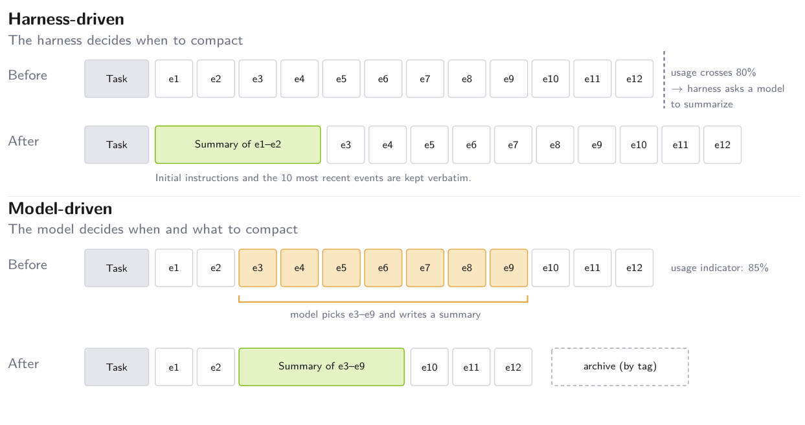View original image ↗</a>

*Above, the harness protects recent events. Below, the model summarizes a selected range and archives the originals by tag.*

On the 90 document questions in OfficeQA Pro v2, GPT-6.1 Sol’s task score at a 32K budget rose from 21% to 56%. Models given the same interface used it differently. Some barely called it, others compressed large spans at once, and some acted while plenty of space remained. Counting calls alone misses the relevant comparison. At the same model and budget, do the timing and content of edits preserve evidence needed later?

Window size and cumulative usage answer different questions. A window limits what fits on each turn. Cumulative input counts the history carried into every turn, including cached tokens. Early compression can lower that total while losing detail needed later. Opus 5.5 rarely used the API and trailed the harness at smaller budgets. Gaps were also smaller on MLE-bench Lite. Shrinking the window creates context pressure without capturing every dependency of work that actually spans days.

A shorter prompt need not save a corresponding amount of GPU work. An edit in the middle breaks the match used by a conventional prefix cache. Even untouched tool results after the edit can require a new prefill. The authors tested a separate SGLang prototype with Qwen3.6-27B at 32K. Reusing the old KV state for the unchanged suffix is approximate because that state was originally computed against different preceding text. Across three task suites, the prototype cut per-request prefill compute by 4%–15% relative to standard prefix caching, with no measurable change in task accuracy. OfficeQA had the largest saving. About 10,000 suffix tokens, roughly 60% of the prompt on average, survived an edit. The question-answering improvement and the compute saving came from different models. Estimating the serving benefit requires measuring how much cached work each edit invalidates as well as how well the model summarizes.

<h2 class="daily-paper-title" id="paper-arxiv-2611.33605">ARGUS measures whether recovery preserves protection</h2>

Boyang Ma, Jinku Li, Hao Wu, Sheng Gao, Man Zhou, Minghui Xu, Yue Zhang · arXiv v1 · 2026-11-25 · [The Detour Is the Danger: Preserving Security During LLM Agent Recovery](https://arxiv.org/abs/2611.33605)

An agent can finish a task after a tool fails while silently losing an authorization or verification step. ARGUS binds obligations to the resources an operation affects, derives required evidence from trusted contracts, checks whether an alternative plan provides equivalent guarantees, and enforces those checks when effects occur. Across 12 workflow templates, Qwen Plus completed 30 of 36 runs under undefended service failures, but only seven finished with protection intact. The authors observed no protection loss under enforcement. For DeepSeek Flash, protected completions went from 28/36 with blocking alone to 35/35 with recovery guidance. Fault drills that track completion, violations and protected completion separately can expose this otherwise silent degradation. The result depends on trusted contracts and mediation of consequential operations.

<a class="note-image-link" href="/assets/images/digest/2026-11-27/33605.png" target="_blank" rel="noopener" aria-label="View original image ↗ ARGUS checks the task’s obligations, evidence and proposed alternative before execution.">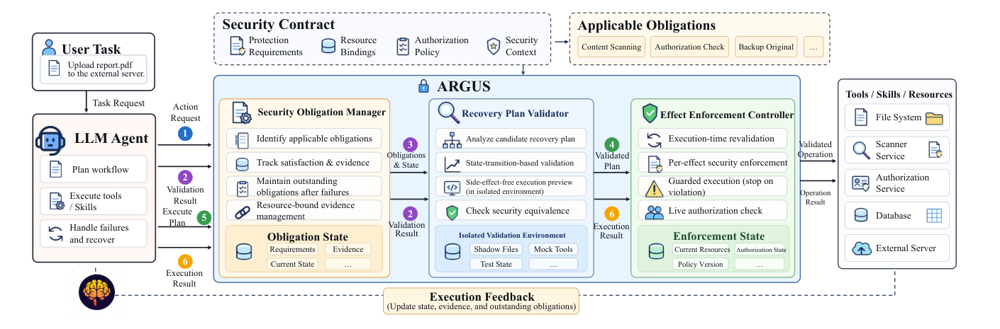View original image ↗</a>

*ARGUS checks the task’s obligations, evidence and proposed alternative before execution.*

<h2 class="daily-paper-title" id="paper-arxiv-2611.34776">DFly2 reads the history positions the target already selected</h2>

Hong Liu, Rui Cen, Junhan Shi, Lin Niu, Runzhi Fan, Zhaojing Zhou, Haodi Lei, Jiebin Zhang, Saiyong Yang, Junqiang Zheng, Zhenghai Xue, Guanghua Yu, Jianchen Zhu · arXiv v1 · 2026-11-25 · [DFly2: Turbocharging Long-Context Speculative Decoding by Sharing the Target's Sparsity](https://arxiv.org/abs/2611.34776)

A sparse-attention target has already paid to select a small set of positions from its history. A drafter that builds another KV cache or scores the history again can consume the memory and bandwidth the target saved. DFly2 pairs three draft layers with target layers, reads the positions selected at the preceding step, and proposes a block of tokens in parallel. On DS-V4.1-Flash, a selection made one step early still covered close to nine tenths of what later positions selected. Against DFlash and DSpark trained with the same recipe, the accepted-length advantage widened on long-context and agent workloads. In high-concurrency serving at DSpark’s per-user decode speed, DFly2 delivered 62% more throughput on CodeSpan 64K and 81% more on SWE 64K. The design requires access to both the target cache and its position selections.

<a class="note-image-link" href="/assets/images/digest/2026-11-27/34776.png" target="_blank" rel="noopener" aria-label="View original image ↗ Three draft layers each reuse the KV and sparse indices of a paired target layer.">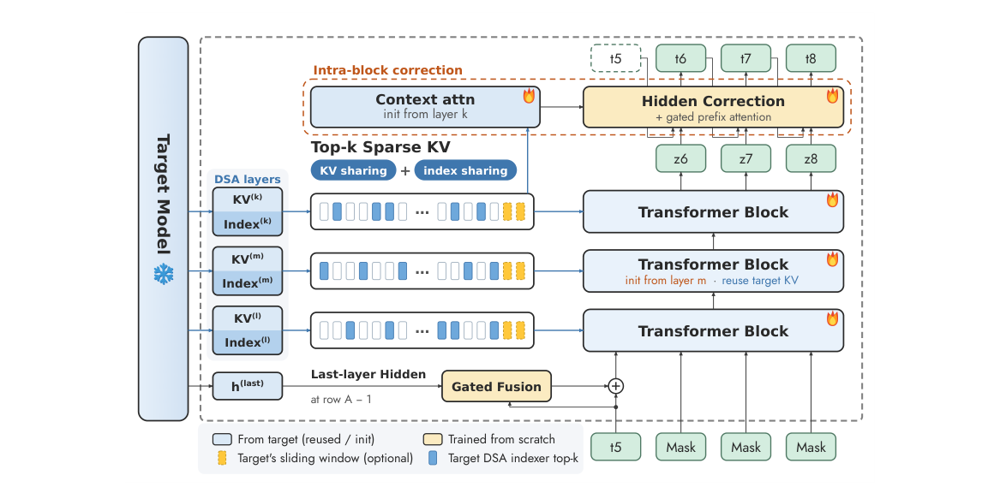View original image ↗</a>

*Three draft layers each reuse the KV and sparse indices of a paired target layer.*

<h2 class="daily-paper-title" id="paper-arxiv-2611.34010">AsymSpec gives examples only to the drafter</h2>

Guang Huang, Zeyi Wen · arXiv v1 · 2026-11-25 · [Asymmetric Speculative Decoding: Unlocking In-Context Learning in Draft Models](https://arxiv.org/abs/2611.34010)

The same prompt may be easy for a target and difficult for its small drafter. AsymSpec collects target answers offline and adds task-aligned examples only to the draft context, giving the drafter examples of the behavior it should imitate. Verification uses the target’s original prompt and cache. The sampling correction uses the actual proposal distribution, for which the paper proves preservation of the target distribution. Fewer rejected proposals come at the expense of constructing the pool. On HumanEval and MATH-500, the first half of each dataset supplied examples and the second half was held out. Task-matched pools produced higher throughput than alternative pools. The reported 2.29–4.95× speedup over autoregression includes the benefit of speculation itself. Comparisons against standard speculation and across pools isolate the value of the examples.

<a class="note-image-link" href="/assets/images/digest/2026-11-27/34010.png" target="_blank" rel="noopener" aria-label="View original image ↗ Separate input paths let the draft read examples while the target verifies against the original prompt.">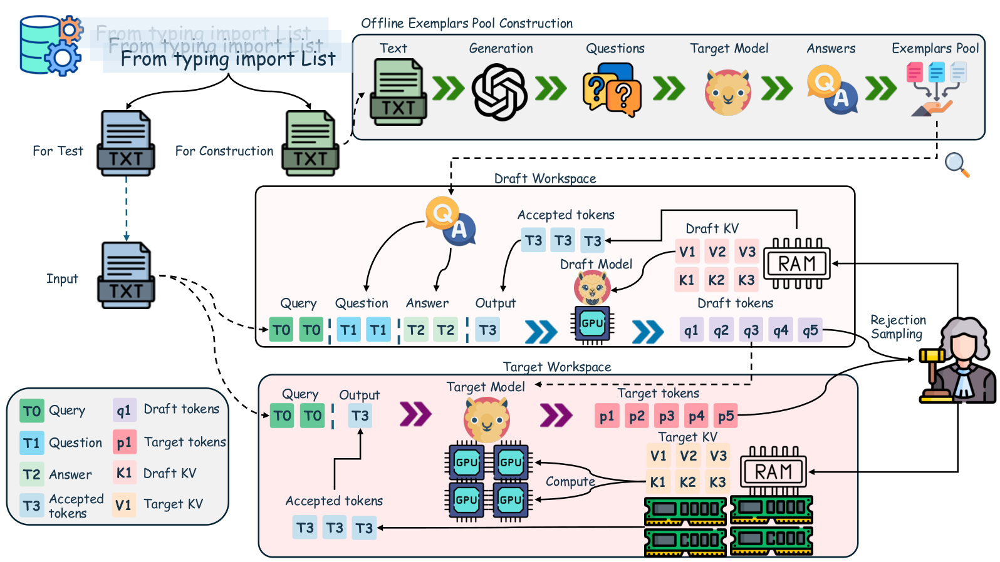View original image ↗</a>

*Separate input paths let the draft read examples while the target verifies against the original prompt.*

<h2 class="daily-paper-title" id="paper-arxiv-2611.33896">Floodgates uses a shallow loop to read a deep prefix</h2>

Ayhan Suleymanzade, Sean McLeish, Sehoon Kim, Jinwoo Kim, Antoine Bosselut · arXiv v1 · 2026-11-25 · [Looped Models are Fast Multi-Token Predictors](https://arxiv.org/abs/2611.33896)

Looped language models execute the same layers repeatedly. Floodgates takes one shallow pass over masked positions, conditioning it on deep prefix states from the previous full-depth verification. The full model then checks the entire block and truncates it at the first mismatch. A cheap draft can therefore use a richer representation of history than its own depth would produce. Tests cover seven looped models and five benchmarks under greedy and sampled decoding. The peak 7.5× acceleration concerns single-request latency. In a separate A100 experiment, sharing one loop cache let Huginn 3.5B reach batch size 320 on GSM8K. Gains over other decoders persisted at the largest batches on several tasks, at smaller margins than the single-request peak. The design relies on predictive shallow states in a looped model.

<a class="note-image-link" href="/assets/images/digest/2026-11-27/33896.png" target="_blank" rel="noopener" aria-label="View original image ↗ One shallow loop fills masked positions in parallel, then full-depth execution verifies the block.">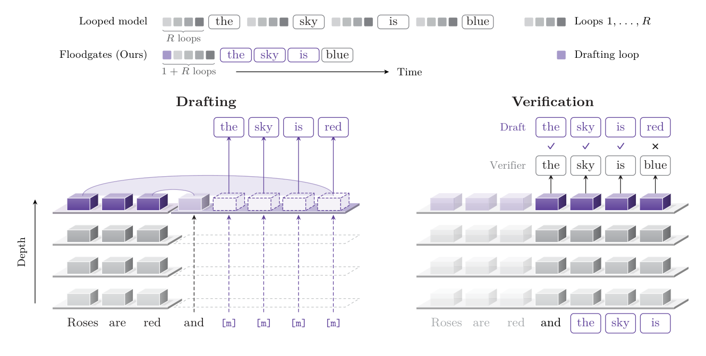View original image ↗</a>

*One shallow loop fills masked positions in parallel, then full-depth execution verifies the block.*

<h2 class="daily-paper-title" id="paper-arxiv-2611.33542">RankCast balances prefill and decode against different targets</h2>

Kaidi Fu, Xu-Hao Lu, Pingwei Sun, Jianchao Tan, Yuchen Xie, Xunliang Cai · arXiv v1 · 2026-11-24 · [RankCast: Phase-Aware Rank Balancing in MoE Serving](https://arxiv.org/abs/2611.33542)

MoE bottlenecks change by phase. During prefill, excess tokens on one rank can stall the group. During decode, few tokens reach each expert, so the number of experts whose weights must be read matters more. RankCast predicts next-layer routing, protects the highest-scoring experts and adjusts only the remaining assignments within a candidate set. Prefill raises prices on busy ranks. Decode masks experts to limit the active set. Final selections use the target layer’s own scores. The SGLang and DeepEP implementation overlaps prediction with current-layer execution. On Qwen3-235B-A22B at EP=8 and Qwen3.5-397B-A17B at EP=16, prefill throughput improved by up to 19% and decode time per output token fell by up to 10%. Expert assignments do change, with a measured quality cost below one percentage point.

<a class="note-image-link" href="/assets/images/digest/2026-11-27/33542.png" target="_blank" rel="noopener" aria-label="View original image ↗ Prefill redistributes token assignments, while decode limits active experts on the busiest rank.">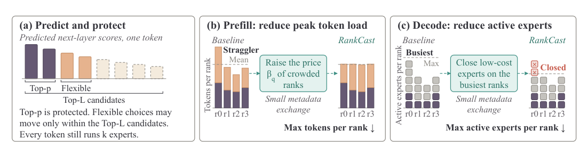View original image ↗</a>

*Prefill redistributes token assignments, while decode limits active experts on the busiest rank.*

<h2 class="daily-paper-title" id="paper-arxiv-2611.34161">CoordRoute prices compute that later requests may need</h2>

Boning Huangfu, Boxiao Du, Chen Chen · arXiv v1 · 2026-11-25 · [CoordRoute: Coordinated Multi-Model Routing for Maximum Compute-Budget Utility](https://arxiv.org/abs/2611.34161)

Upgrading the current request can leave a later request with no answer when a stream shares one compute budget. CoordRoute predicts answer utility and computation for each candidate model, then estimates the opportunity cost of spending more from the remaining budget and expected arrivals. During execution the same price helps decide whether to inspect an answer, stop, or restart on a stronger model. Replays using Azure Conversation and BurstGPT arrival traces charged FLOPs at actual generation lengths. The authors report 18.72% higher total satisfaction than the strongest existing router. Satisfaction here is evaluated answer utility across the window, including the effects of unserved requests. The replays explain why a fixed price can misallocate compute during bursts. Converting FLOPs into latency or an API bill requires backend-specific measurements.

<a class="note-image-link" href="/assets/images/digest/2026-11-27/34161.png" target="_blank" rel="noopener" aria-label="View original image ↗ One hundred generations per request produce distributions of both answer scores and compute.">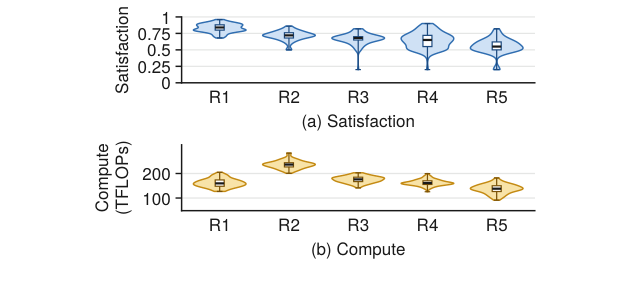View original image ↗</a>

*One hundred generations per request produce distributions of both answer scores and compute.*

<h2 class="daily-paper-title" id="paper-arxiv-2611.34402">Any-Rate changes weight precision in half-bit steps</h2>

Hoonki Lee, Haechan Shin, Hyuntaek Jung, Yeonu Choi, Sangyeob Kim · arXiv v1 · 2026-11-25 · [Any-Rate: Half-Bit Multi-Precision LLM Quantization with Coded Bit-Planes](https://arxiv.org/abs/2611.34402)

Keeping separate weights for every precision makes switching expensive on a memory-constrained device. Any-Rate nests bit planes inside one checkpoint and reads only the leading planes needed for a mode. It constrains one index plane across eight adjacent weights to an extended Hamming codeword. Four stored bits select an eight-bit pattern, adding half a bit per weight. Joint calibration must balance low-rate errors against the reconstructions still reachable at higher rates. Across four models the 2-bit mode retained about 69% of FP16 accuracy on average, a relative fraction. For Llama-3.1-8B-Instruct, an LPDDR accelerator model estimated up to 27% less energy per token at matched accuracy. That saving is an estimate incorporating memory and decoding energy, with actual device costs dependent on implementation.

<a class="note-image-link" href="/assets/images/digest/2026-11-27/34402.png" target="_blank" rel="noopener" aria-label="View original image ↗ The two rows show how shared low-rate choices constrain reconstruction under different error targets.">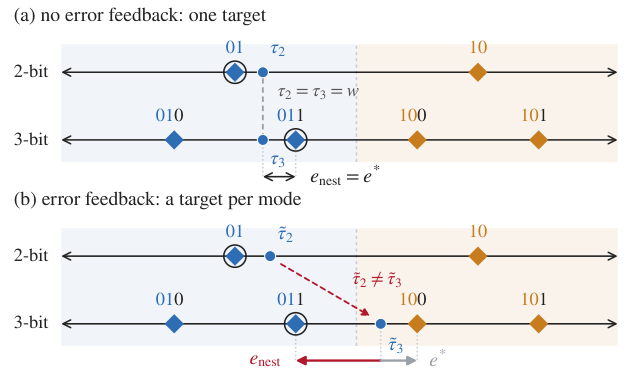View original image ↗</a>

*The two rows show how shared low-rate choices constrain reconstruction under different error targets.*

<h2 class="daily-paper-title" id="paper-arxiv-2611.33981">MixMoMo assigns mobile expert precision from the current input</h2>

Hailong Zou, Maoliang Li, Taohong Han, Haoze Chi, Zihao Zheng, Jiayu Chen, Xiang Chen · arXiv v1 · 2026-11-25 · [MixMoMo: Accelerating Extra--Large MoE Inference with Mixed--Precision GPU--NPU Execution on Mobile Devices](https://arxiv.org/abs/2611.33981)

The same MoE expert’s sensitivity to quantization can change with the token. Assigning a permanent bit width from activation frequency can therefore spend precision in the wrong place. MixMoMo profiles how critical input dimensions relate to output deviation and uses those features online to assign precision to selected experts. It groups experts by precision, splits work using GPU and NPU execution-time estimates, and parallelizes dequantization on Hexagon vector units. Reducing weight traffic then need not leave one processor idle waiting for the other. In a llama.cpp extension tested on two mobile platforms, three MoE models and five benchmarks, average decode speed was 3.72× uniform Q4_0 and 1.53× the strongest mixed-precision baseline. The latter comparison better captures the incremental gain. Transfer depends on device-specific execution costs.

<a class="note-image-link" href="/assets/images/digest/2026-11-27/33981.png" target="_blank" rel="noopener" aria-label="View original image ↗ Input sensitivity feeds precision grouping, GPU–NPU assignment and batched dequantization.">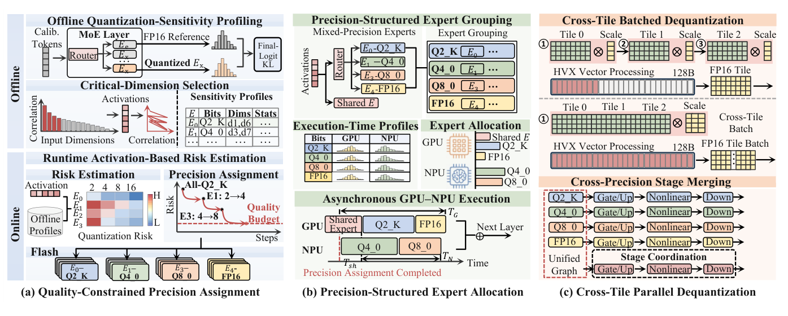View original image ↗</a>

*Input sensitivity feeds precision grouping, GPU–NPU assignment and batched dequantization.*

<h2 class="daily-paper-title" id="paper-arxiv-2611.34759">Concurrent collectives share optical circuit configurations</h2>

Xinchi Han, Weihao Jiang, Xuanyu Wang, Zhuoran Liu, Ximeng Liu, Haoyuan Liu, Kairui Zhou, Jiachen Wang, Yike Liu, Peirui Cao, Xun Nie, Xinbing Wang, Shizhen Zhao · arXiv v1 · 2026-11-25 · [Minimizing Optical Circuit Reconfigurations for Concurrent Collectives](https://arxiv.org/abs/2611.34759)

Reconfiguring optical switches incurs a fixed delay. Independently scheduled collectives can keep requesting different circuits even when their communication patterns admit alternative orders. The authors jointly schedule reorderable patterns so concurrent operations can share connections in the same round while preserving dependencies. Counting pairings by type also reduces the optimization problem’s size. On a scheduling instance with 64 supernodes and 64 domains, pairwise AlltoAll needed three reconfigurations instead of 62. ASTRA-sim synthetic training replays parameterized by eight real models assumed 400 Gb/s ports and a 10-microsecond switching delay. Iteration time fell by up to about 34%. The first result counts configuration changes. The time saving also depends on topology, message sizes and the network model.

<a class="note-image-link" href="/assets/images/digest/2026-11-27/34759.png" target="_blank" rel="noopener" aria-label="View original image ↗ Two AllReduce schedules on eight ranks use the same pairings in different orders.">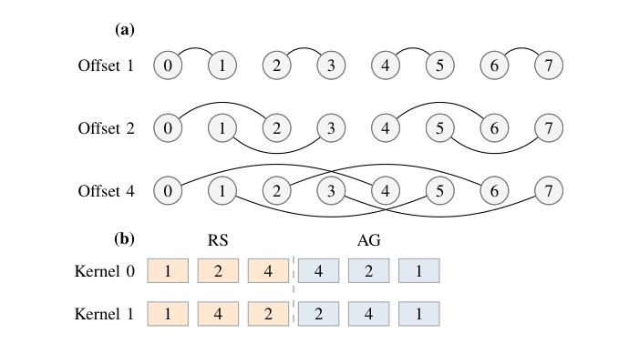View original image ↗</a>

*Two AllReduce schedules on eight ranks use the same pairings in different orders.*

<h2 class="daily-paper-title" id="paper-arxiv-2611.33757">TransHarness learns interventions from contrasting runs of the same task</h2>

Tianze Xia, Zimo Wang, Heng Tong, Zhaoxiang Liu, Shiguo Lian, Fan Huang, Wenyu Liu, Yunchao Wei, Xinggang Wang · arXiv v1 · 2026-11-25 · [TransHarness: From Benchmark Overfitting to Transferable Harness Evolution](https://arxiv.org/abs/2611.33757)

A warning learned from a failed trajectory may simply memorize the task. TransHarness contrasts a success and failure on the same task, turns an evidence-backed divergence into a triggered intervention, and replays it on other source tasks to test activation. An independent reviewer, blinded to replay statistics, then checks the diagnosis, independence from the source problem and grounding of the guidance. Selected policies react to events and history on target tasks. The best configuration scored 76.4% on 113 DeepSWE v1.1 tasks and a different configuration scored 95.5% on 89 Terminal-Bench 2.1 tasks. Confidence intervals for paired gains over their respective base harnesses both crossed zero. The separate counts of recovered failures and newly introduced regressions show how similar net scores can mask different intervention risks.

<a class="note-image-link" href="/assets/images/digest/2026-11-27/33757.png" target="_blank" rel="noopener" aria-label="View original image ↗ Contrasting runs suggest a trigger, which passes independent review before use on a new task.">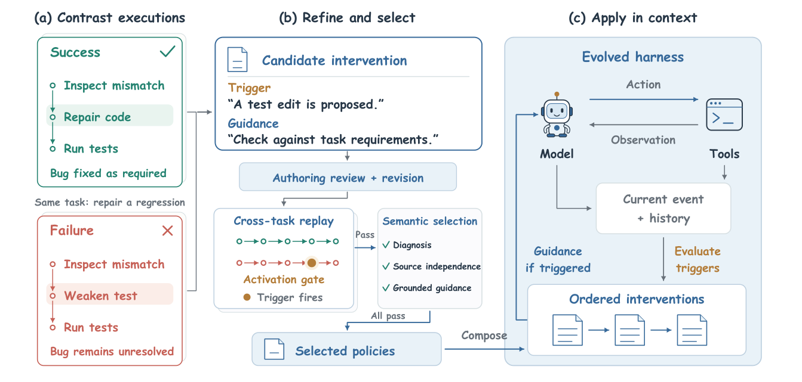View original image ↗</a>

*Contrasting runs suggest a trigger, which passes independent review before use on a new task.*

<h2 class="daily-paper-title" id="paper-arxiv-2611.34624">HoMe traces memory-system changes back to failures across queries</h2>

Yifei Xu, Li Yu, Zhaoyang Liu, Ce Wang, Sen Huang, Yanyan Shen, Yun Lin, Linpeng Huang, Hong Mei · arXiv v1 · 2026-11-25 · [HoMe: Toward Practical Harness Optimization of Memory Systems for AI Assistants](https://arxiv.org/abs/2611.34624)

A long-term memory system may answer incorrectly because it wrote the wrong representation or because retrieval opened the wrong file. HoMe pools failures, has developer agents trace searches, file reads and answers for common causes, and edits ReMe’s memory harness. An experiment manager controls candidate evaluation and favors historically difficult cases. Each benchmark used six formal candidate evaluations after a full initial evaluation. Different candidate samples make their intermediate average scores unsuitable for direct ranking. On the final LongMemEval-S test, score rose from 0.888 to 0.916 while tokens per query fell from 43.9K to 17.9K. Optimizing on BEAM-100K and testing on BEAM-1M raised score from 0.650 to 0.704 and cut tokens from 101.8K to 60.4K. These are query-time costs. Development and evaluation incur separate work.

<a class="note-image-link" href="/assets/images/digest/2026-11-27/34624.png" target="_blank" rel="noopener" aria-label="View original image ↗ Developer agents propose edits, the experiment manager selects cases, and candidates run in isolation.">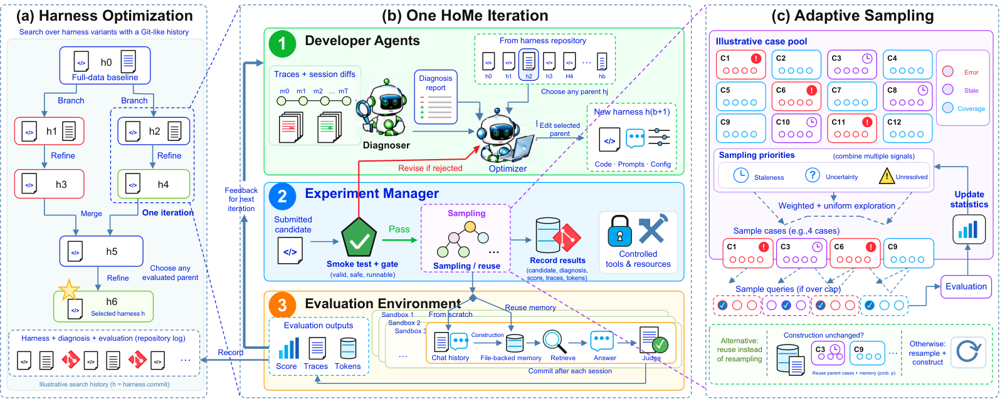View original image ↗</a>

*Developer agents propose edits, the experiment manager selects cases, and candidates run in isolation.*

<h2 class="daily-paper-title" id="paper-arxiv-2611.33242">CypherMAS isolates message loss in multi-hop delegation</h2>

Danil Kostromin, Andrey Sakhovskiy, Semen Budennyy · arXiv v1 · 2026-11-24 · [CypherMAS: Benchmarking Routing Reliability in LLM-Based Multi-Agent Systems](https://arxiv.org/abs/2611.33242)

An open-ended task can fail because a model cannot solve it or because its message never arrives. CypherMAS gives another node the decoder a request needs. The message must traverse graph edges to that node and return with the result. A calculable minimum call count exposes wasted hops even in successful runs. Across four fixed topologies and 11 open models, under tool-based and free-text communication, chains and rings exhibited looping and transit loss. Capable models came closer to the minimum on bounded-diameter graphs. Each run was capped at 2,048 calls. The synthetic design separates routing distance from node count. Its success rate measures that controlled communication task, with a different interpretation from completion rates on open-ended collaboration.

<a class="note-image-link" href="/assets/images/digest/2026-11-27/33242.png" target="_blank" rel="noopener" aria-label="View original image ↗ Graph edges constrain contacts. Each request must reach its matching decoder and return with the result.">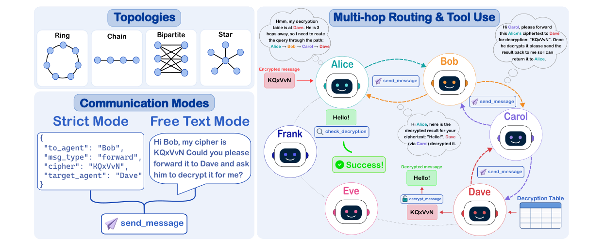View original image ↗</a>

*Graph edges constrain contacts. Each request must reach its matching decoder and return with the result.*

<h2 class="daily-paper-title" id="paper-arxiv-2611.33402">Partial Routing uses prior runs to decide which subtasks to delegate</h2>

Siddharth Arya, Kshitij Jain · arXiv v1 · 2026-11-24 · [Partial Routing: Trace-Tuned Delegation for Resource-Efficient Agentic Workflows](https://arxiv.org/abs/2611.33402)

A task can require an expensive lead while containing pieces a cheaper worker handles well. The authors run both models independently on profiling tasks, label recurrent subtasks in their traces, and compile a delegation policy from quality gaps and acceptable risk. During execution the lead retains responsibility and hands off bounded assignments. At δ=0.75 on ten held-out ViBench applications, score rose from 70.2 for the solo lead to 78.5 at 19% lower cost. On 23 held-out Terminal-Bench tasks, pass rate rose from 54% to 61% at similar cost. A separate condition gave the lead the subtask breakdown without a worker and already improved Terminal-Bench performance. This control distinguishes the benefit of a plan from that of delegated execution.

<a class="note-image-link" href="/assets/images/digest/2026-11-27/33402.png" target="_blank" rel="noopener" aria-label="View original image ↗ First label each model’s solo runs, then give the lead a subtask policy.">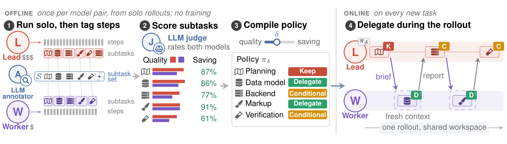View original image ↗</a>

*First label each model’s solo runs, then give the lead a subtask policy.*

<h2 class="daily-paper-title" id="paper-arxiv-2611.33817">SentryWard checks synchronization and lifetimes in asynchronous GPU kernels</h2>

Mengdi Wu, Sreeram Vennam, Stephen Mell, Ziwei Zhou, Advay Kadam, Xinhao Cheng, Francois Costa, Alex Aiken, Oded Padon, Zhihao Jia · arXiv v1 · 2026-11-25 · [SentryWard: Formal Verification of Warp-Specialized GPU Kernels](https://arxiv.org/abs/2611.33817)

When warps divide data movement and computation, passing tests can leave the order of asynchronous accesses unresolved. SentryWard specializes the kernel for a shape and launch configuration, represents barriers and asynchronous transactions in a schedule-independent happens-before graph, and checks synchronization, lifetimes and races before comparing symbolic outputs with a reference. Repeated thread structures share representations, avoiding enumeration of schedules. Of 189 configurations, 105 verified and 64 were flagged for potential correctness issues, including 33 lifetime findings. These include cases where completion before deallocation could not be proved. The paper separately records confirmed issues and fixes. Dynamic control flow remains a coverage limit, with 17 unsupported configurations.

<a class="note-image-link" href="/assets/images/digest/2026-11-27/33817.png" target="_blank" rel="noopener" aria-label="View original image ↗ Follow the specialized kernel and event graph through synchronization, race and equivalence checks.">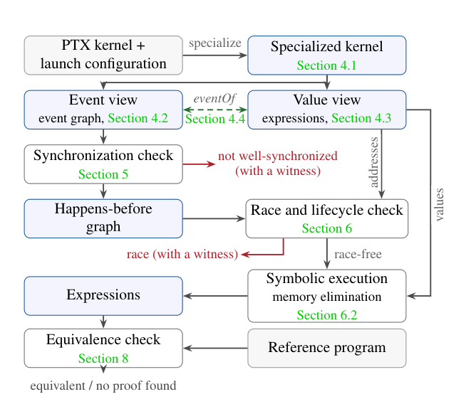View original image ↗</a>

*Follow the specialized kernel and event graph through synchronization, race and equivalence checks.*

<h2 class="daily-paper-title" id="paper-arxiv-2611.33181">SeQLean distinguishes query equivalence, a counterexample and no verdict</h2>

Siddhartha Gadgil, Anirudh Gupta, Ajay Kumar Nair · arXiv v1 · 2026-10-25 · [SeQLean: Verifying SQL queries using Lean](https://arxiv.org/abs/2611.33181)

An SQL agent can produce two plausible translations of a request. Matching outputs on a sample database do not establish equivalence on every database satisfying the schema. SeQLean expresses relational algebra and schema assumptions in Lean, starts with deterministic tactics, and can ask a model to repair a proof for kernel checking. A refutation supplies a witness database. The system reached a verdict on 112 of 397 Calcite pairs and 42 of 64 Literature pairs, including seven additional counterexamples from the model-assisted stage on Literature. An unresolved pair remains a valid outcome. Proofs cover the encoded semantics. Equality of unordered row sets cannot establish identical ordering, and agreement between two translations cannot by itself establish that both understood the user.

<a class="note-image-link" href="/assets/images/digest/2026-11-27/33181.png" target="_blank" rel="noopener" aria-label="View original image ↗ Queries and schema assumptions enter Lean, which checks proofs of equivalence and counterexamples.">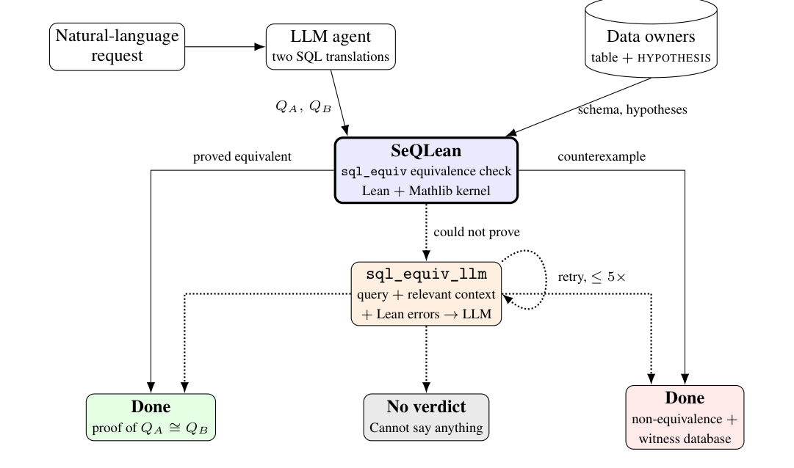View original image ↗</a>

*Queries and schema assumptions enter Lean, which checks proofs of equivalence and counterexamples.*
