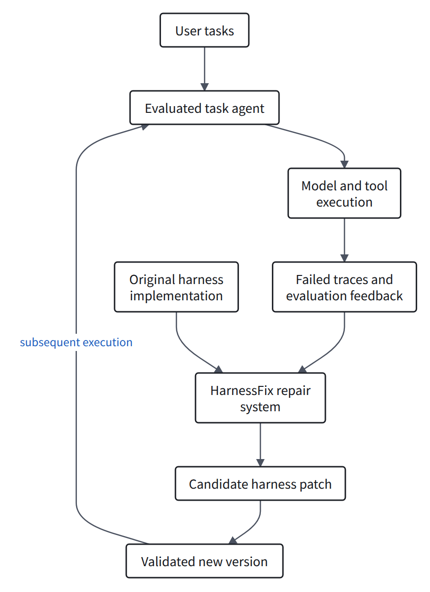
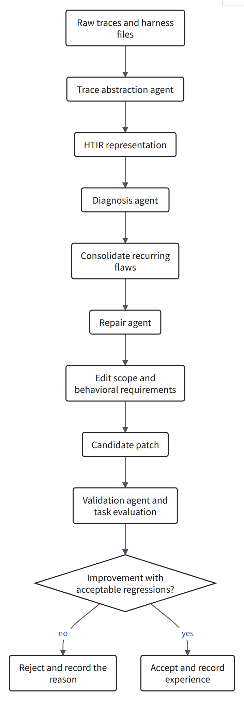
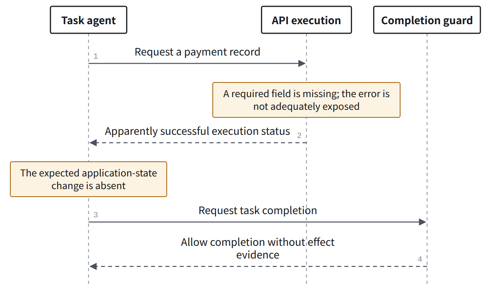
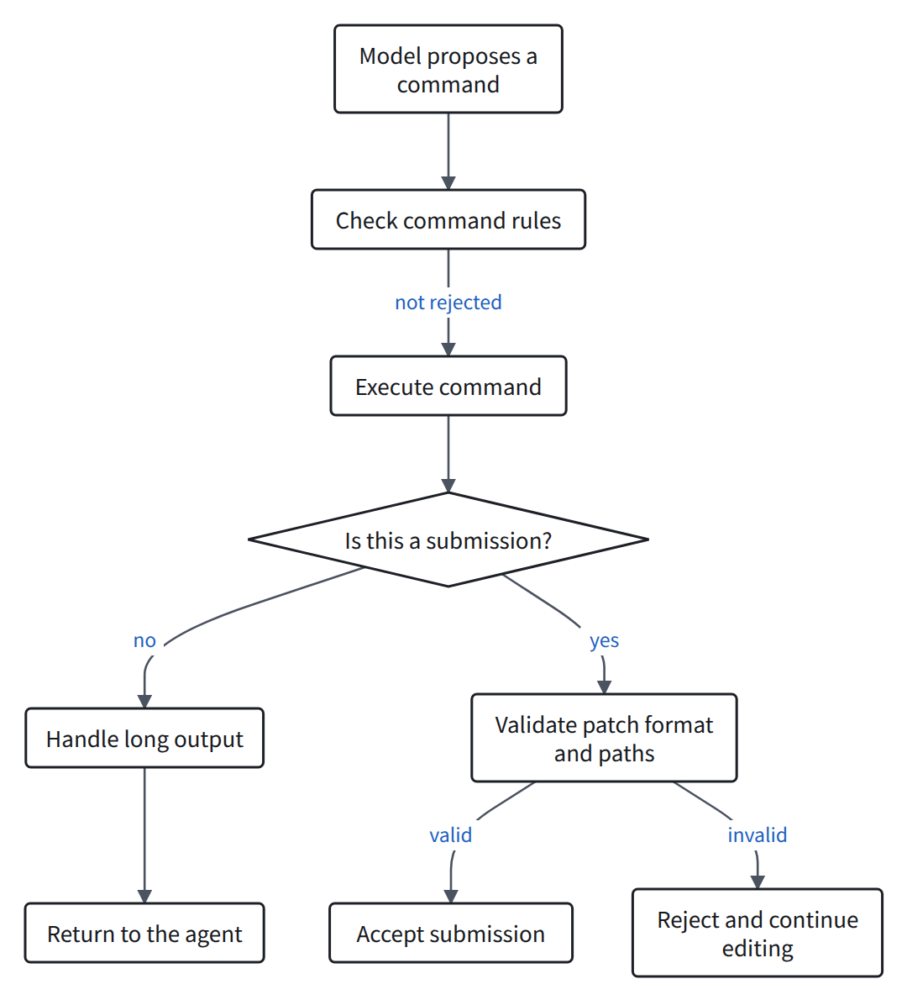

> AI-assisted close reading. Experimental results are author-reported; code inspection and analysis are identified separately. No paper benchmark was run.

**HarnessFix uses failed trajectories to guide harness modifications and selects candidate versions through validation.** It permits runtime implementation changes, unlike approaches that only supply recovery guidance.

Paper: From Failed Trajectories to Reliable LLM Agents: Diagnosing and Repairing Harness Flaws. Version reviewed: arXiv 2606.06324v2.

<h2 id="section-a">Which agent is being repaired?</h2>

<figure>
<a class="note-image-link" href="/assets/images/digest/paper-close-readings/harnessfix/en-01.png" target="_blank" rel="noopener" aria-label="The outer HarnessFix system reads traces and implementation artifacts to generate and validate harness versions for the inner task agent.">Enlarge diagram ↗</a>
<figcaption>The outer HarnessFix system reads traces and implementation artifacts to generate and validate harness versions for the inner task agent. Explanatory diagram based on the paper and public code.</figcaption>
</figure>
The outer system changes the implementation used by the inner task agent. The main method does not train model weights.

The public artifact includes repair pipelines and initial/final harness snapshots. Benchmark data and complete raw trajectories are not all included.

| Benchmark | Initial harness |
|---|---|
| GAIA | open-deep-research |
| SWE-bench Verified | mini-swe-agent |
| AppWorld | Official simplified ReAct code agent |
| Terminal-Bench 2.0 Verified | Harbor Terminus-2 |

These are the evaluated systems, not direct repair experiments on Codex, Pi, iCode, or DSH.

Sources: [experimental setup](https://arxiv.org/html/2606.06324v2#S4), [public artifact](https://github.com/HarnessFix/HarnessFix/blob/9167a0b9a58748c73b56c3ee04fdc3437ba0c56e/README.md).

<h2 id="section-b">How does evidence become a scoped patch?</h2>

<figure>
<a class="note-image-link" href="/assets/images/digest/paper-close-readings/harnessfix/en-02.png" target="_blank" rel="noopener" aria-label="Trace abstraction, diagnosis, scoped repair, and validation connect failure evidence to candidate implementation patches.">Enlarge diagram ↗</a>
<figcaption>Trace abstraction, diagnosis, scoped repair, and validation connect failure evidence to candidate implementation patches. Explanatory diagram based on the paper and public code.</figcaption>
</figure>
HTIR is an execution representation linked to implementation locations. It organizes steps, data and control relations, and anchors in code, templates, or configuration.

| HTIR element | Question it helps answer |
|---|---|
| Requests, responses, and external effects | What happened, and did real state change? |
| Data-flow relations | How did earlier evidence enter, or fail to enter, a later step? |
| Control-flow relations | What caused continuation, retry, or termination? |
| Implementation anchors | Which code, template, or configuration governs that behavior? |

Diagnosis traces backward from the failed outcome. Repair specifies allowed edits, forbidden artifacts, and required behavior.

**Evidence boundary**: a model largely infers these relations. Structured explanations help localization but do not automatically establish causality.

Source: [method](https://arxiv.org/html/2606.06324v2#S3).

<h2 id="section-c">A paper example: a successful return is not task completion</h2>

The paper illustrates this with an AppWorld payment request. This diagram simplifies that example.

<figure>
<a class="note-image-link" href="/assets/images/digest/paper-close-readings/harnessfix/en-03.png" target="_blank" rel="noopener" aria-label="The paper’s AppWorld example: apparently successful execution lacks the expected state effect, yet completion is allowed.">Enlarge diagram ↗</a>
<figcaption>The paper’s AppWorld example: apparently successful execution lacks the expected state effect, yet completion is allowed. Explanatory diagram based on the paper and public code.</figcaption>
</figure>
The repair specification requires exposing API errors and checking expected state effects before completion. Task answers and evaluation labels are forbidden edit targets.

This involves request construction, error visibility, and finalization. A completion guard is useful, but it does not establish that every upstream issue has been removed.

### Three questions need separate evidence

| Question | Required evidence |
|---|---|
| Was the API request correct? | Actual arguments and the interface contract |
| Did execution produce the intended effect? | Observable state changes |
| Did the harness allow an incorrect finish? | Completion conditions and the control trace |

The same distinction matters for coding agents: submitting a patch, executing tests, and fixing the user's issue are separate outcomes.

Source: [repair specification example](https://arxiv.org/html/2606.06324v2#S3.SS3).

<h2 id="section-d">What changed in the public mini-swe-agent snapshots?</h2>

The comparison uses the initial and final SWE directories from the same pinned commit.

| File category | Observed difference |
|---|---|
| Three SWE configuration YAML files | Additional testing, editing, and submission guidance |
| environments/docker.py | Command checks, output handling, and submission validation |
| environments/local.py | The same kinds of checks |
| New environments/safety.py | Protection and validation logic |

`agents/default.py` is unchanged between these snapshots. This describes the public snapshots, not the entire evolution history.

### Three changes at execution boundaries
<figure>
<a class="note-image-link" href="/assets/images/digest/paper-close-readings/harnessfix/en-04.png" target="_blank" rel="noopener" aria-label="Execution-boundary changes in the public SWE snapshots: command rules, output handling, and submission validation.">Enlarge diagram ↗</a>
<figcaption>Execution-boundary changes in the public SWE snapshots: command rules, output handling, and submission validation. Explanatory diagram based on the paper and public code.</figcaption>
</figure>
- Command patterns attempt to reject selected submission and broad-search operations.
- Ordinary output above 12,000 characters keeps the first and last 6,000 characters, plus an omission notice.
- Submission checks reject empty patches, unrecognized diffs, and selected disallowed paths.

**Interpretation**: these are runtime-boundary checks and policy improvements. They change executable code, but this set of changes does not show repair of concurrency or durable-recovery mechanisms.

Truncation does not guarantee that important evidence in the middle survives. A well-formed patch does not establish functional correctness.

Sources: [final safety logic](https://github.com/HarnessFix/HarnessFix/blob/9167a0b9a58748c73b56c3ee04fdc3437ba0c56e/task_agent/final/swe/src/minisweagent/environments/safety.py), [final Docker executor](https://github.com/HarnessFix/HarnessFix/blob/9167a0b9a58748c73b56c3ee04fdc3437ba0c56e/task_agent/final/swe/src/minisweagent/environments/docker.py), [initial executor](https://github.com/HarnessFix/HarnessFix/blob/9167a0b9a58748c73b56c3ee04fdc3437ba0c56e/task_agent/mini-swe-agent/src/minisweagent/environments/docker.py).

<h2 id="section-e">What does validation establish?</h2>

| Check | Question answered | What it does not establish alone |
|---|---|---|
| Edit scope and static checks | Is the patch within scope and basically well formed? | Functional correctness |
| Target improvement and validation regressions | Is this version worth accepting? | Every diagnosis is a true root cause |
| Final task evaluation | Does it help on the evaluated tasks? | Effectiveness on arbitrary runtime defects |

Diagnosis is separately audited against human labels on 80 failed trajectories. The public table reports 85.0% step-localization accuracy and 81.3% implementation-anchor accuracy for Full HTIR.

These measure agreement with annotations, not patch repair rates. The audit labels were not used to generate or accept repairs.

For a concrete runtime defect, a stronger study would also require a reproducible trigger and an independent contract test. Task-score improvement and elimination of the defect need separate acceptance criteria.

Sources: [diagnosis audit](https://github.com/HarnessFix/HarnessFix/blob/9167a0b9a58748c73b56c3ee04fdc3437ba0c56e/exp/rq2_failure_diagnosis.md), [validation procedure](https://arxiv.org/html/2606.06324v2#S3.SS4).

<h2 id="section-f">What does the experiment support most directly?</h2>

These author-reported task scores are percentages. They were not reproduced for this review.

| Method | GAIA | SWE | AppWorld | TB2 |
|---|---:|---:|---:|---:|
| Initial harness | 43.3 | 45.3 | 36.7 | 17.6 |
| Prompt-only | 50.6 | 48.3 | 37.4 | 18.6 |
| Full HarnessFix | 61.7 | 57.3 | 43.0 | 26.5 |

On SWE, the full method gains 12 percentage points over the initial harness and nine over prompt-only.

This supports a specific conclusion: in the authors' setup, prompt changes alone do not recover the full method's gains.

**It does not directly compare the full executable extension space against core edits.** Hooks, scripts, and plugins may implement some checks and should not all be reduced to prompt-only.

The reported ablations remove method components rather than every individual rule in the final code. The entire gain cannot be assigned to one submission check or output limit.

Source: [ablation results](https://github.com/HarnessFix/HarnessFix/blob/9167a0b9a58748c73b56c3ee04fdc3437ba0c56e/exp/rq3_ablation.md).

<h2 id="section-g">How does it differ from Sentry?</h2>

This compares intervention targets, not scores from different benchmarks.

| Dimension | Sentry | HarnessFix |
|---|---|---|
| Intervention target | Recovery guidance during the current task | The implementation used by the agent |
| Output | Action-regeneration and recovery prompts | Scoped candidate patches |
| Cross-task retention | Verified recovery lessons | Repair specifications, patches, and validation experience |
| Validation focus | Whether the triggering local failure resolves | Target improvement with acceptable regressions |
| Invalid extrapolation | Local recovery proves the runtime defect is fixed | A higher score proves every root cause is eliminated |

**Sentry's hard repair is not HarnessFix's code repair.** One requests a legal action; the other can change execution mechanisms.

The methods may be complementary, but the combination is not guaranteed to help. Additional monitoring and modifications can interact and require controlled evaluation.

Sources: [Sentry method](https://arxiv.org/html/2610.02994v1#S3), [HarnessFix method](https://arxiv.org/html/2606.06324v2#S3). [Read the Sentry close reading](/digest/en/paper-sentry-close-reading/).

<h2 id="section-h">Implications for runtime reliability and RSI research</h2>

**Trace diagnosis, targeted harness modification, and regression-aware acceptance are directly covered by this work.** That chain alone is not a new contribution.

A more specific question is whether diagnosis can choose an effective intervention scope for real open-source runtime defects and independently establish a repair.

| Question requiring further evaluation | Convincing evidence |
|---|---|
| Runtime defect or agent capability limitation? | Reproducible versions, actual inputs/outputs, and controlled interventions |
| Can an extension address it? | Explicit permitted interfaces, not merely prompt edits |
| Is it actually repaired? | Defect contracts, stability checks, and independent tasks |
| Can the change be adopted safely? | Cancellation, recovery, plugin-composition, and state-migration regressions |
| Does improvement persist? | Benefits, degradation, and costs across later tasks and iterations |

Additional retries can improve success while duplicating side effects. Truncation can save context while discarding essential evidence. Both require exceptional-path testing.

**Assessment**: HarnessFix is direct related work and a candidate baseline. A distinct contribution needs real defects, explicit edit boundaries, and independent validation.

Scope: methods, experiments, discussion, public experiment notes, and the initial/final SWE snapshots were inspected. Code is pinned to `9167a0b9a58748c73b56c3ee04fdc3437ba0c56e`. No model, training, or benchmark experiment was run.

[Original paper](https://arxiv.org/abs/2606.06324) · [Official code](https://github.com/HarnessFix/HarnessFix) · [Sentry close reading](/digest/en/paper-sentry-close-reading/)
