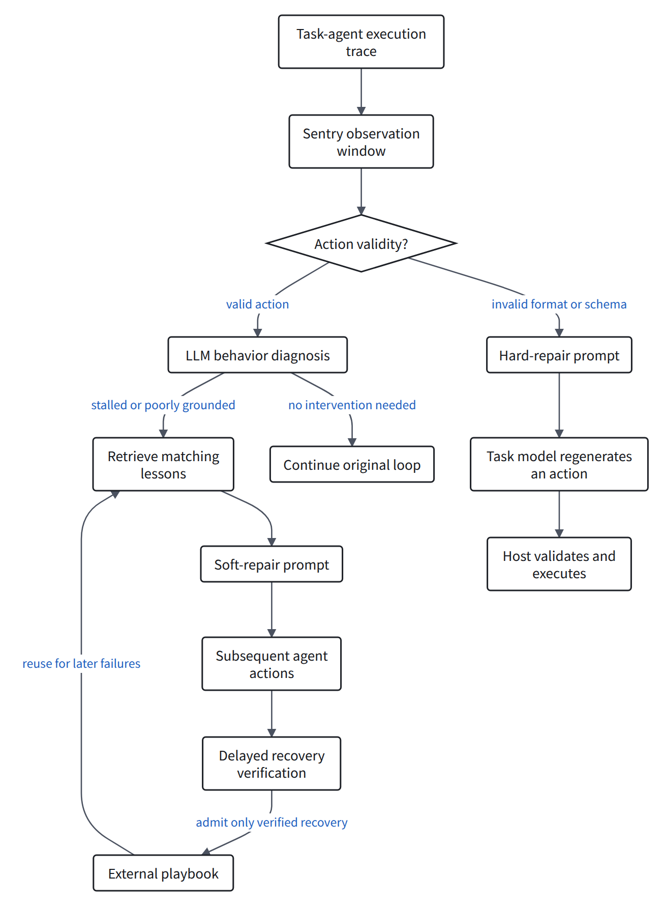
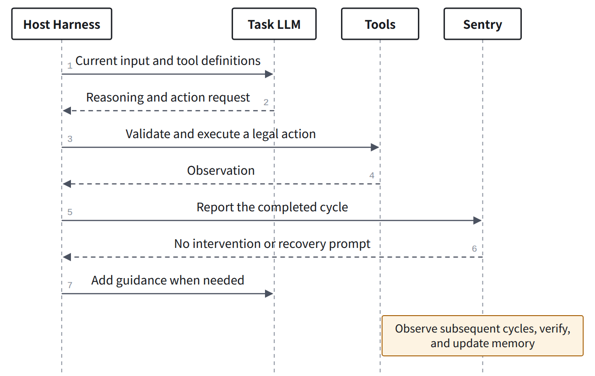

> AI-assisted close reading. Experimental results are author-reported; code inspection and analysis are identified separately. No paper benchmark was run.

**Sentry detects local failures during a task, supplies targeted recovery guidance, and accumulates lessons from verified recoveries.** It is relevant to agent reliability, but does not directly repair runtime code.

Paper: Sentry: Learning to Recover from LLM Agent Failures at Test Time. Changxiu Ji, Amy Lu, Qizheng Zhang, and Kunle Olukotun. Version reviewed: arXiv 2610.02994v1.

<h2 id="section-a">Why can useful failure knowledge become harmful?</h2>

The authors observe that advice useful during a failure can distract an agent when it remains in the context during normal execution. A different family of monitors intervenes on failure without accumulating recovery knowledge.

Sentry combines these properties: keep the playbook external, then retrieve a small set of lessons after detecting a matching failure.

| Mechanism | When does recovery knowledge appear? |
|---|---|
| Persistent guidance | Throughout execution |
| Fixed monitor | When its intervention rule fires |
| Sentry | After a matching diagnosis; verified recoveries update the playbook |

These rows describe the mechanisms discussed by the authors, not every possible memory system.

The contribution to examine is **when recovery knowledge is exposed and how new lessons are admitted**, beyond adding another reflection prompt.

Source: [author explanation](https://nuglifeleoji.github.io/blog/2026/sentry/).

<h2 id="section-b">How do the two recovery routes enter the agent loop?</h2>

<figure>
<a class="note-image-link" href="/assets/images/digest/paper-close-readings/sentry/en-01.png" target="_blank" rel="noopener" aria-label="Sentry routes invalid actions and behavioral failures separately; only verified soft recoveries enter the external playbook.">Enlarge diagram ↗</a>
<figcaption>Sentry routes invalid actions and behavioral failures separately; only verified soft recoveries enter the external playbook. Explanatory diagram based on the paper and public code.</figcaption>
</figure>
The default detector reads five recent reasoning–action–observation cycles. Soft repair retrieves at most five lessons and checks recovery after ten subsequent cycles.

**Hard repair** requests a valid action; it is not a code patch. An environment error alone does not establish a malformed action.

The implementation first checks `parsed_ok` and `schema_valid`, supplied by the host. A model then diagnoses behavioral failures such as repetition, stalls, or unsupported reasoning.

Sources: [detector](https://github.com/nuglifeleoji/Sentry/blob/1d91bca14fa6a4e17908856cc787eb8e8354395f/Sentry/detector.py), [paper configuration](https://github.com/nuglifeleoji/Sentry/blob/1d91bca14fa6a4e17908856cc787eb8e8354395f/configs/paper.yaml).

<h2 id="section-c">What changes, and what remains the host&#x27;s responsibility?</h2>

<figure>
<a class="note-image-link" href="/assets/images/digest/paper-close-readings/sentry/en-02.png" target="_blank" rel="noopener" aria-label="Sentry receives cycles from the host and returns optional guidance; the host still owns model calls, tool execution, and result delivery.">Enlarge diagram ↗</a>
<figcaption>Sentry receives cycles from the host and returns optional guidance; the host still owns model calls, tool execution, and result delivery. Explanatory diagram based on the paper and public code.</figcaption>
</figure>
This shows integration for an executable action. The host reports invalid actions for the separate repair route.

| Object | Does the method directly update it? |
|---|---|
| Next model input | Yes: recovery guidance is added |
| Recovery playbook | Yes: verified soft recoveries add entries |
| Task-model weights | No training step is part of the method |
| Harness scheduling and process code | Sentry does not automatically generate patches |

The host receives guidance from `runner.step()` and decides how to insert it into the conversation. It still generates, validates, and executes actions.

Runtime intervention therefore does not imply modification of the runtime implementation.

Sources: [integration interface](https://github.com/nuglifeleoji/Sentry/blob/1d91bca14fa6a4e17908856cc787eb8e8354395f/Sentry/integration.py), [official repository](https://github.com/nuglifeleoji/Sentry).

<h2 id="section-d">What counts as a verified recovery?</h2>

| Route | Verification criterion | Added to the playbook? |
|---|---|---|
| Hard repair | The replacement conforms to the schema and is explicitly accepted by the environment | No |
| Soft repair | The triggering pattern stops and grounded, task-relevant progress resumes | Only if judged recovered |

The soft verifier cannot access final task rewards. Its judgment is model-based and needs an independent audit.

The public implementation has three important boundaries:

- If the task ends before ten subsequent cycles, the incomplete recovery does not update the playbook.
- While soft verification is pending, another soft intervention is suppressed; action-validity repair remains available.
- Verifier or updater exceptions are logged and re-raised. The host must handle this failure path.

Playbook growth does not establish that the detector improves. Detection and retrieval procedures remain fixed.

Sources: [runtime state and admission](https://github.com/nuglifeleoji/Sentry/blob/1d91bca14fa6a4e17908856cc787eb8e8354395f/Sentry/Sentry.py), [verifier](https://github.com/nuglifeleoji/Sentry/blob/1d91bca14fa6a4e17908856cc787eb8e8354395f/Sentry/verifier.py).

<h2 id="section-e">How far does the experimental evidence go?</h2>

The default model is Qwen3.5-9B. These are author-reported results, not experiments reproduced for this review.

| Evidence | Reported result | Interpretation |
|---|---|---|
| SWE-bench Lite | Best runtime-intervention baseline: 0.24; Sentry: 0.30 | A six-percentage-point gain on 50 tasks |
| Paired recovery experiment | 200 checkpoints: 33.5% to 60.5% | A 27-point gain in locally judged recovery from the same initial state |
| Final outcomes of paired branches | 74 better, 101 tied, 25 worse | Interventions help some cases and harm others |
| Aggregate resources | 1.54 times the base agent's tokens | The gains have an additional resource cost |

The study also evaluates WebShop, AppWorld, and Mind2Web Replay. AppWorld measures average check pass rate, not full-task success. Replay is a controlled adaptation, not the original Mind2Web metric.

The headline 37% average improvement aggregates relative gains across metrics. It is not a uniform 37-percentage-point success-rate increase.

Across 99 soft-repair windows in the human audit, recovery judgments agree with annotations in 81.8% of cases. This supports usefulness without making the verifier an infallible oracle.

Source: [paper and appendices](https://arxiv.org/html/2610.02994v1).

<h2 id="section-f">What does this mean for runtime stability?</h2>

The following is analysis of the method and interface, not additional experimental evidence.

| Situation | Relationship to Sentry |
|---|---|
| Invalid action format | Directly addressed by hard repair |
| Repeated actions without progress | Addressed by behavioral diagnosis and guidance |
| Agent ignores available evidence | Local guidance may help; effectiveness needs testing |
| Scheduler hangs and cannot report steps | A prompt-based intervention is not guaranteed to run |
| Tool executes but its result is lost | The host must provide trustworthy state; guidance cannot automatically recover the missing result |
| Restart causes duplicate side effects | Durable recovery and idempotence are not established by this method |
| Sentry's own model endpoint fails | The host must choose degradation, suspension, or termination |

**Sentry depends on working observation and control paths.** Behavioral stalling must be distinguished from a runtime that cannot advance.

A useful experiment would first measure recovery on intact traces, then disrupt result delivery or call/result pairing. Does Sentry recover, misdiagnose, or admit misleading lessons?

<h2 id="section-g">Overlap with our research and remaining questions</h2>

**Detection, intervention selection, recovery verification, and experience accumulation are direct prior-work overlap.** That chain alone is not a new contribution.

| Research question | What Sentry provides | Additional evidence needed |
|---|---|---|
| When should the system intervene? | Conditional detection and guidance | Actual trigger points and delays across harnesses |
| How does experience enter the LLM? | External memory with failure-triggered retrieval | How guidance persists through compaction and replay |
| Where did the failure originate? | Behavioral categories and local evidence | Controlled interventions separating model, information-transfer, and runtime faults |
| When is a runtime change needed? | Recovery mainly through guidance | Comparison of extension control limits and core repairs |
| Does improvement remain stable? | Cross-task lesson accumulation | Misverification, conflicting entries, and failures of the recovery mechanism itself |

Compared with HarnessFix, Sentry mainly updates recovery guidance and memory; HarnessFix generates implementation patches. Both require separating local improvement, final task outcomes, and elimination of the original defect.

Sentry is direct related work and a candidate baseline for behavioral recovery. Its effectiveness under runtime faults should be measured, not assumed absent.

Code reviewed at `1d91bca14fa6a4e17908856cc787eb8e8354395f`. The review covers methods, experiments, relevant appendices, and core integration, detection, verification, and admission code. No benchmark was installed or executed.

[Read the HarnessFix close reading](/digest/en/paper-harnessfix-close-reading/) · [Original paper](https://arxiv.org/abs/2610.02994)
