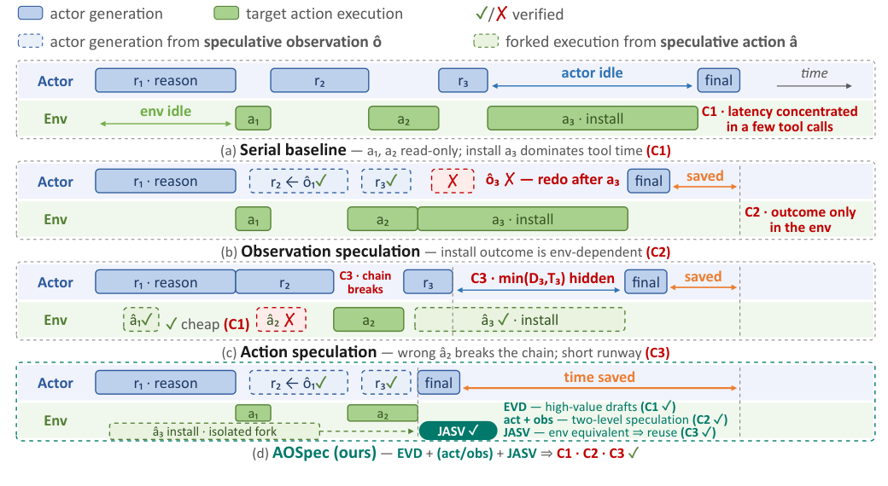

## 本期看点

Agent 的慢工具与 GPU 内部拓扑距离都能成为推理瓶颈。AOSpec 将动作与观察投机和正确性验证结合；NUNA 则从网络局部性出发优化多卡通信带宽。

<h2 class="daily-paper-title" id="paper-aospec">01 · AOSpec：把动作与观察一起投机</h2>

[AOSpec: Action and Observation Co-Speculation for Low-Latency Agent Serving](https://arxiv.org/abs/2608.00881)  
Hao Mark Chen, Jinnan Guo, Wayne Luk, Hongxiang Fan · 2026-08-01

Agent 每一步通常先生成工具调用，再等待环境返回，慢工具会让模型空等。AOSpec 同时预测未来动作和观察，将模型生成与工具执行交叠；它针对的是完整 agent–环境循环，而不是仅加速模型解码。

系统用 Expected Value Decoding 优先预测能隐藏更多工具等待时间的观察，而不是单纯追求命中率。对只有真实执行才能揭示的结果，它在隔离的环境分支提前运行目标动作；Joint Action-State Verification 同时检查动作及其来源状态，只有与已提交执行一致时才复用结果。预测失败则沿真实轨迹继续，隔离与验证是保持串行语义的关键，尤其不能把它理解为可随意提前提交外部副作用。

<a class="note-image-link" href="/assets/images/digest/2026-08-02/aospec.png" target="_blank" rel="noopener" aria-label="AOSpec 联合投机流程">查看原图 ↗</a>

*读图：从上到下比较串行、仅预测观察、仅预测动作，以及联合投机；底部在隔离分支执行较慢动作，验证动作和状态后才复用。*

作者在 Terminal-Bench 2.0 的九组 harness／模型配置、五档生成速度上回放相同轨迹。相对串行执行，平均延迟节省从 20 ms/token 时的 11.8% 增至 1 ms/token 时的 32.5%；最强实际基线分别为 4.3% 和 12.2%。在 10 ms/token 条件下，中位数与 p90 延迟分别降低 10.7% 和 10.5%。SWE-bench Verified 的跨基准回放在 1 ms/token 下节省 18.9%。这些是固定轨迹回放和模型化生成速度的结果，并非线上部署的端到端实测；额外预测与隔离执行也需要资源。值得精读的是其把延迟收益和执行正确性放进同一设计。

<h2 class="daily-paper-title" id="paper-nuna">02 · NUNA：让 GPU 通信考虑片内距离</h2>

[NUNA: Characterizing and Mitigating Non-Uniform Network Access in Multi-Die GPU Scale-Up Systems](https://arxiv.org/abs/2608.00867)  
Conor James Green, William Won, Tuan Ta, Bradford M. Beckmann · 2026-08-01

多 die GPU 上，计算单元、显存和跨 GPU I/O 端口之间的距离不相同。NUNA 将这种网络访问不均匀性作为优化对象：NUNA-aware routing 根据物理位置选择端口，NUNA-aware placement 则将线程块和数据放到靠近对应 I/O 的位置。它与传统只关注计算和内存局部性的 NUMA 优化不同。

作者在 ASTRA-sim 建模的 scale-up 系统中报告，单用 placement 的集合通信最高加速 1.5 倍，结合 routing 后最高 1.8 倍；12 种 LLM 架构的推理模型中每输出 token 时间平均改善 7%、最高 28%。端到端评估使用推理轨迹和 roofline 估算，计算和通信按串行建模，并非实体集群测量。对推理服务而言，值得关注的是片内拓扑可能改变跨 GPU 通信成本，而这些倍率仍需在具体硬件和并行策略下验证。
