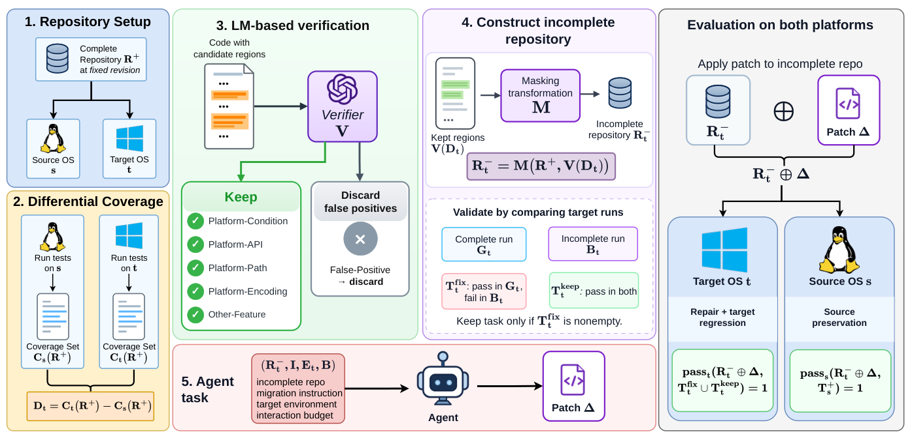
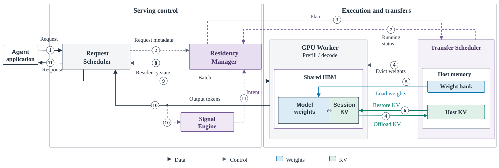
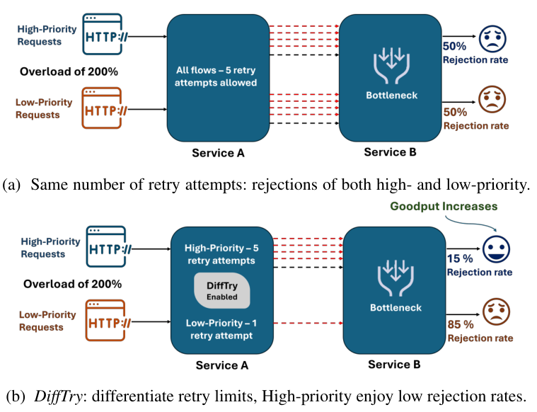
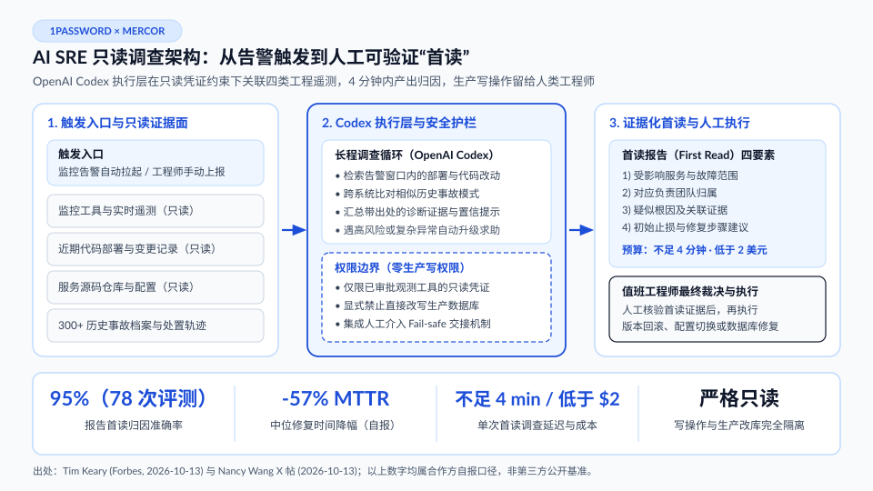
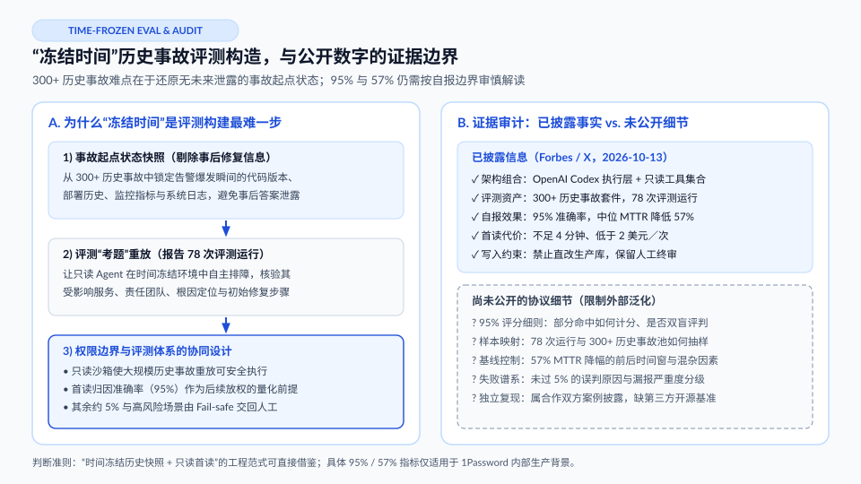

## 本期看点

本期优先读 OS-Bench 与 JointServe：前者追问 Agent 把程序迁到另一个操作系统后，是否还保住原平台行为；后者追问多模型 Agent 在有限显存中切换专家时，怎样避免反复搬权重、重建上下文。两篇分别把评测和调度的单位向外扩了一层，从单环境修复走向双平台约束，从单模型请求走向完整会话。

DiffTry 则提供一个更轻的系统控制点：按请求价值分配重试机会，让过载时的拒绝有所区别。配套技术阅读关注推理服务里的验证预算、KV 传输和训练数值一致性，以及如何把 Agent 执行接入已有观测系统。共同值得关注的是，局部步骤成功或变快，并不足以说明整条任务链已经可靠、高效。

<h2 class="daily-paper-title" id="paper-os-bench">01 · OS-Bench：迁好目标平台，也要保住源平台</h2>

[OS-Bench: Evaluating SWE Agents on Cross-OS Code Migration](https://arxiv.org/abs/2610.19368)  
Qirui Jin、Kenan Li、Liao Zhu、Lingching Tung、Yikai Zhang、Yijia Wu、Zijian Jin、Pengfei Gao、Yu Kang、Qingwei Lin、Wenke Lee · 首发：2026-10-14 · **重点关注：Qingwei Lin 参与**

### 把“双平台正确”写进成功条件

跨系统迁移不只是重新编译。路径、进程、编码、系统 API 与构建工具都可能改变行为，而目标平台通过的测试通常覆盖不到源平台专属分支。OS-Bench 将成功定义为同一补丁同时通过目标平台修复与回归测试，并保住源平台原来通过的测试。这使“迁过去能跑”和“迁完仍兼容”成为可比较的两个结果。

它没有直接把历史提交当题目，因为一次迁移可能跨多个提交，还混着无关修改。作者先在 Linux、Windows 原生环境运行同一仓库，以执行覆盖差异寻找平台专属区域，再用语言模型筛查条件编译、API、路径、编码等差异，并由人工进一步过滤。覆盖不对称也可能来自测试选择或依赖差异，因此并非所有差异都进入题目。

<a class="note-image-link" href="/assets/images/digest/2026-10-14/os-bench.png" target="_blank" rel="noopener" aria-label="双平台覆盖差异、实现遮蔽与补丁双平台验证流程 · 查看原图 ↗">查看原图 ↗</a>

*从左侧两平台覆盖差异出发，中间筛查并遮蔽目标实现，右侧要求同一补丁通过目标修复与源平台保留检查。*

随后，构造器遮蔽已确认的目标平台实现，保留原测试。只有遮蔽后至少一个目标测试不再通过、源平台参考测试仍通过的候选才被保留。Agent 得到不完整仓库、迁移目标及原生工具环境，提交补丁后再做双平台检查。这是从已存在实现构造的恢复任务，其难度与从零设计新平台支持相关，但不能完全等同。

### 最有信息量的是两种评分之间的落差

数据集含 111 个仓库的 140 个任务，覆盖 C、C++、C#、Go、Rust；91 个迁向 Linux，49 个迁向 Windows。六个模型以 medium thinking effort 运行，每次上限 100 步、5 小时。Linux 使用三种 harness，Windows 使用 Win-agent。

| 代表配置 | 双平台成功 |
| --- | --- |
| Claude-Opus-4.8 + OpenHands，迁向 Linux | 24/91，26.4% |
| GPT-5.6-Sol + Win-agent，迁向 Windows | 10/49，20.4% |

更值得读的是 GPT-5.6-Sol + Claude Code：50 个 Linux 目标任务通过第一阶段，只有 22 个取得双平台通过，成功率从 54.9% 降到 24.2%。其中 28 个缺少有效的源平台通过结果，不能把这些全部武断归为已确认的代码回归，但足以说明只验目标平台会高估完成度。

作者对 35 次明确记录的目标阶段失败进行审计，18 次仍留有未恢复实现，19 次验证范围不完整，两类可重叠。这把改进方向落到具体行为：追踪跨文件迁移范围，确保局部验证没有遗漏必要测试与构建模式。

**阅读判断：值得精读任务构造与双阶段评测。** 同一模型换 harness 后成绩也会变化，因此榜单反映模型和工具共同能力。两个方向的题目构成不同，不能仅凭差值判定某个操作系统更难；C/C++ 样本尤其少。依赖覆盖差异还会漏掉两平台走同一路径的抽象层实现，测试通过也只支持测试覆盖到的行为。

<h2 class="daily-paper-title" id="paper-jointserve">02 · JointServe：把模型权重与会话 KV 放进同一显存预算</h2>

[JointServe: Serving Multi-Model Agents on Memory-Constrained GPUs](https://arxiv.org/abs/2610.19822)  
Daijin Hu · 首发：2026-10-14

### 专家切换有去程，也有回程

一个规划模型调用多个独立专家时，所有权重未必能同时装进 GPU。整模型换入会拖慢下一次调用；为权重让路而丢掉 KV，则让会话返回时重新处理长上下文。只加速模型加载，无法一并解决这两种等待。JointServe 把权重层组和会话 KV 块都看成驻留对象，按预计复用概率、恢复成本与占用字节共同选择。

这与仅管理请求队列的系统有所不同：它决定显存中究竟保留什么。已有会话路由和主机 KV 恢复技术也会保存状态，本文的增量在于单 GPU 内更细粒度的权重／KV 联合分配，以及调用到达之前的准备。

<a class="note-image-link" href="/assets/images/digest/2026-10-14/jointserve.png" target="_blank" rel="noopener" aria-label="JointServe 的意图信号、驻留管理与权重和 KV 传输 · 查看原图 ↗">查看原图 ↗</a>

*下方信号模块从输出中提取意图，驻留管理器据此分配共享显存，右侧传输调度器搬运权重与会话 KV。*

信号模块读取调用者输出流中的工具调用头，在参数尚未生成完时识别下一个专家。驻留管理器保留启动所需层组，提前搬入其余部分；运行时用就绪事件控制每层执行，未到齐就等待。没有显式意图时才退回调用转移统计和热门度，因而收益取决于可见信号和实际重叠窗口。

KV 有有效主机副本时可以取回，否则需要重算。两条路径的成本不同，不能仅按块大小驱逐。传输调度器还给活跃会话 KV 流量默认保留 15% 带宽下限，避免大批权重传输长期挤占恢复通道。权重与 KV 的份额随需求调整，但在用状态和已承诺启动区域受保护；目标驻留计划也不等于数据已经就绪。

### 收益应按显存压力和会话结构来读

实验使用单张 A800-SXM4-80GB、1 TB 主机内存和约 24.3 GB/s 的实测主机到设备带宽。标准池由五个 7B 级专家组成。在 80 GB 的 40% 配额下，再扣除 8 GB 运行时预留，可用预算为 24 GB。作者报告中位会话完成时间为 516 秒，相对最强整模型交换基线缩短约 21.7%。

消融更能说明组合机制：去掉部分驻留，完成时间升至 608 秒；去掉主机 KV 层升至 793 秒；同时去掉自适应控制则为 641 秒。它不是单靠提前加载得益，避免返回时重算同样关键。SWE-bench 轨迹实验报告会话时间缩短 49.1%，而 τ-bench 只有 5.2%；后者仍改善首 token 延迟，因为用户思考间隙本来就能隐藏部分交换开销。

**阅读判断：联合管理权重与 KV 的思路值得跟进，极端容量结果需谨慎解读。** 论文的正常热切换路径写明 decode 前整模型已驻留，却同时报告整模型装不下时仍能完成的场景；这些描述尚不足以清楚解释极小预算下的完整执行路径。因此不把该场景的“46 倍”当作常规速度结论。当前原型也采用原地覆盖，而双缓冲切换仍属于目标设计。优先读驻留成本模型、执行协议和消融；硬件带宽、调用间隙、主机容量及可见工具意图都会改变实际收益。

<h2 class="daily-paper-title" id="paper-difftry">03 · DiffTry：用不同重试上限保护高价值请求</h2>

[Prioritizing Microservice Requests via Retries](https://arxiv.org/abs/2610.20567)  
Ofek Lavi、Jhonatan Tavori、Hanoch Levy、Anat Bremler-Barr · 首发：2026-10-14

DiffTry 把优先级放进重试预算：高价值请求获得更多机会，低优先级请求较早退出。各服务按传播的优先级头设置本跳重试上限，不必等待全局过载信号，也不修改应用代码。

<a class="note-image-link" href="/assets/images/digest/2026-10-14/difftry.png" target="_blank" rel="noopener" aria-label="相同与差异化重试预算下的请求拒绝示意 · 查看原图 ↗">查看原图 ↗</a>

*上方所有请求均可重试五次；下方将低优先级压至一次。图中百分比是两服务示例，不是后文网络实验的全部结果。*

在 Kubernetes/Istio 的 DeathStarBench hotelReservation 实验中，高／低优先级预算为 5/1，对照为 5/5；高优先级到达率固定为 50，低优先级从 50 扫到 250。最重负载约为容量的 2.1 倍时，高优先级拒绝率从约 54% 降到约 15%，低优先级约为 61%。这体现拒绝的重新分配，不是所有请求都获益。理论使用重试拒绝独立性等近似，并讨论长服务时间导致的相关性；任意网络的均衡唯一性也没有全部解决。值得读的是轻量控制点及其网络分析，前提是业务优先级本身可信。

## 社区观察：可用性与信任都需要任务级证据

<h3 id="community-1password-mercor-sre">1Password × Mercor AI SRE Agent：只读调查、300+ 历史事故评测与首读归因</h3>

[Nancy Wang X 原帖](https://x.com/NancyZWang/status/2110150762215178531) · [Tim Keary（Forbes 报道）](https://www.forbes.com/sites/timkeary/2026/10/13/mercor-built-an-ai-agent-to-automate-sre-heres-what-happened/)  
Nancy Wang（1Password CTO）、Mercor 合作项目 · 首发：2026-10-13

此前仅凭 X 原帖只能看到“95% 准确率、中位修复时间降低 57%”的结果摘要；结合 Tim Keary 于同日在 *Forbes* 发表的专题报道，这起由 **1Password** 与 **Mercor** 联合落地的 AI SRE Agent 实践补充了执行层选型、300 余起历史事故评测构造方法、单次成本边界以及只读安全护栏。**它要解决的不是无人值守改库，而是把值班工程师事故首小时的人工跨系统查证压缩成一份不到 4 分钟、低于 2 美元、可核验的“首读（first read）”归因报告。**

#### Codex 执行层与只读“首读”工作流

按 *Forbes* 报道，该 Agent 以 **OpenAI Codex** 作为长程调查执行层，嵌入 1Password 工程生产环境。当监控系统触发告警或工程师主动上报异常时，Agent 自动跨四类只读数据源检索并关联上下文：实时监控工具与系统遥测、近期代码部署记录、服务源码仓库，以及超过 300 起历史工程事故档案。调查结束后，Agent 输出结构化的证据化“首读”，明确指出四个核心信息：受影响服务、责任团队归属、疑似根因及支持证据、以及首批建议止损与排查步骤。单次调查耗时**不足 4 分钟**、调用成本**低于 2 美元**。

<figure class="note-figure"><a class="note-image-link" href="/assets/images/digest/2026-10-14/mercor-1password-sre-architecture-zh.svg" target="_blank" rel="noopener" aria-label="1Password 与 Mercor AI SRE Agent 只读调查架构：从告警触发到人工可验证首读 · 查看原图 ↗">查看原图 ↗</a><figcaption><em>图 1：1Password × Mercor AI SRE Agent 在只读凭证约束下关联四类工程数据，4 分钟内生成首读报告并把生产变更控制权留给值班工程师。</em></figcaption></figure>

#### “冻结时间”构造 300+ 历史事故评测集与 78 次运行验证

这项实践最有工程含金量的部分不在模型提示词，而在评测环境建设。Mercor 基于 1Password 内部 **300 多起真实历史事故**（连同当时的源码、部署记录、监控数据与日志）构建专用评测套件。1Password CTO Nancy Wang 在报道中指出，构建这些评测“考题”最困难的环节是**“冻结时间（freezing time）”**：必须精准还原每起事故爆发瞬间的代码版本、部署状态与遥测切片，把事后人工提交的修复代码与复盘结论完全隔离在上下文之外，才能检验 Agent 在真实未知条件下的排障能力，而不是在“剧透现场”里做摘要。

| 维度 | Forbes 与 X 已披露口径 | 证据说明与限制 |
| --- | --- | --- |
| 执行层与权限 | OpenAI Codex 执行层；仅具已审批工具的只读权限 | 明确禁止直接改写生产数据库，最终执行由人完成 |
| 评测语料与运行次数 | 基于 300 多起历史事故构建套件；78 次评测运行 | 未公开 78 次运行从 300 余起事故池中的抽样与分层方式 |
| 归因准确率 | 1Password CTO 报告 95%（78 次评测运行） | 未披露部分命中计分细则、人工评审一致性与其余约 5% 错因 |
| 响应耗时与单次成本 | 不足 4 分钟、低于 2 美元生成证据化“首读” | 未拆分模型推理 token 成本与工具侧检索开销 |
| 线上 MTTR 变化 | 报告中位修复时间（MTTR）降低 57% | 属前后对照自报值，未披露基线时间窗与事故难度分布控制 |

#### 权限边界与评测体系的协同设计

与许多试图直接“自动修复生产故障”的演示不同，1Password 将**极度克制的权限边界**写进了系统前提：Agent 对已接入观测与代码工具仅拥有**只读访问（read-only）**，显式拦截对生产数据库的直接写入；当遇到跨服务高风险变更或不确定路径时，内置的人机交接 Fail-safe 会主动升级给值班工程师。这种设计让“评测”与“权限”形成正反馈——正是因为只读沙箱不会破坏现网状态，团队才敢把 Agent 接入真实告警流并在数百起历史事件上反复重放；而只有当首读准确率达到 95% 这类可量化门槛后，后续放宽执行权限的讨论才具备工程依据。

<figure class="note-figure"><a class="note-image-link" href="/assets/images/digest/2026-10-14/mercor-1password-sre-eval-boundary-zh.svg" target="_blank" rel="noopener" aria-label="时间冻结历史事故评测构造与公开证据边界审计 · 查看原图 ↗">查看原图 ↗</a><figcaption><em>图 2：左侧拆解时间冻结历史快照的评测构造链路，右侧对照 Forbes 与 X 已披露事实及尚未公开的评测协议细节。</em></figcaption></figure>

#### 证据边界：合作方自报结果与可迁移工程实践

**阅读判断**：应把架构与评测方法留下来，把量化百分比放回具体前提中读。与 X 原帖相比，*Forbes* 报道补齐了 Codex 执行层、300 多起历史事故语料、78 次评测运行以及不足 4 分钟／低于 2 美元的成本边界；但它仍然属于**客户与合作方（1Password 与 Mercor）通过媒体与社交平台自报的工程案例**，而非独立第三方的同行评审基准。公开材料尚未说明 95% 准确率的逐项评分 rubric（例如服务、团队、根因、初始步骤四项是全对算对还是加权计分）、57% 中位 MTTR 降幅是否控制了同期值班人数或告警路由调整等混杂因素，以及 5% 失败案例中误导性建议的占比。对其他基础设施团队而言，最直接可复用的经验是先把 AI SRE 定位在“只读首读归因”，并投入工程精力建设**不带未来信息泄露的时间冻结历史事故评测集**。

## 延伸技术阅读

- <a href="/tech/zh/adaptive-verification/">Adaptive Verification：没有置信度头，也能在线分配验证预算</a>
- <a href="/tech/zh/nixl-push/">NIXL Push：把 KV 传输准备移出首 token 关键路径</a>
- <a href="/tech/zh/train-inference-consistency/">训练／推理一致性：逐位对齐的机制与成本</a>
- <a href="/tech/zh/claude-agent-observability/">Claude Agent 可观测性：把执行轨迹接入 OTel</a>
