本期优先看与系统预算和开销归因直接相关的工作：Token-Energy Law 把 decode 能耗拆成权重摊销、KV 历史和实际用时，解释为什么相同模型会有不同的每 token 成本，并给出有明确计量边界的经验模型。

另一条线是有状态智能体：AKV 管缓存操作历史，ClawMMU 管记忆权限，HarnessAdapt-RL 把工具与模型一起训练。可靠性方向则从事故后的配置演化延伸到告警归因、异步异常检测和执行前许可失效。阅读时尤其值得区分：哪些已有系统测量，哪些依赖模拟或脚本案例，哪些仍是保护机制提案。

<h2 class="daily-paper-title" id="paper-arxiv-2610.28576">Token-Energy Law：把权重摊销、KV 历史和执行时间分开</h2>

**[The Token-Energy Law of LLM Decode: Active Bytes and Realized Time Account for Joules per Token](https://arxiv.org/abs/2610.28576)**  
Chenxu Niu, Batuhan Sencer, Wei Zhang, Yong Chen · arXiv · 首发 2026-10-20

同一个模型，每 token 的能耗会随 batch、上下文和执行路径变化。只看参数量或平均功率，很难说明省下的焦耳来自哪里。这篇论文把 decode 的能量账拆成三个可观测坐标：每个输出分摊的权重字节、它需要读取和更新的 KV 字节，以及每个有效输出对应的实际执行时间。值得注意的是，这是经本地校准的加和模型，字节与时间是独立解释变量，而非相乘的能耗定律。

权重在一次迭代内由多个请求共享，因此有效 batch 越大，每个输出分摊越少；KV 历史属于各请求，长上下文不会因合批而同样摊薄。作者用逐迭代轨迹计算有效 batch 和按输出加权的历史长度，而不是直接代入服务配置里的最大并发或最大上下文。这样，请求提前完成、batch 成员改变时，计量仍对应实际产出的 token。

<a class="note-image-link" href="/assets/images/digest/2026-10-22/token-energy-law.png" target="_blank" rel="noopener" aria-label="上方将工作拆为共享权重与私有 KV，中间加入每个输出的实际用时，底部用本地校准系数组合能耗。 · 查看原图 ↗">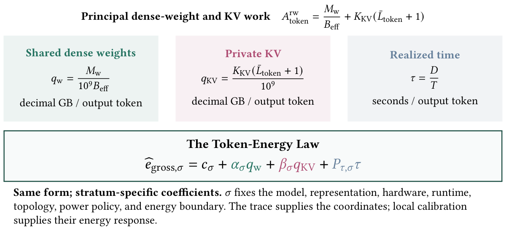查看原图 ↗</a>

*上方将工作拆为共享权重与私有 KV，中间加入每个输出的实际用时，底部用本地校准系数组合能耗。*

核心关系可以写成：

$$\hat e=c+\alpha q_w+\beta q_{KV}+P_\tau\tau,\qquad \tau=D/T.$$

这里 e 是每个有效输出 token 的 GPU 板级焦耳数，q_w 与 q_KV 分别是权重和 KV 的逻辑字节需求，D 是 decode 时长，T 是有效输出数。系数随模型、精度、硬件、运行时和计量边界校准；时间项也不是独立测得的空闲功率。缓存命中、内核行为和辅助计算都会影响这些有效响应系数，不能把逻辑字节直接当成真实 HBM 流量。

实验覆盖 Qwen2.5-7B、Qwen2.5-14B 和 Mistral-7B，采用 BF16 权重及 KV、全历史注意力，在 GH200 与 GB300 上运行，并包含 GH200 双 GPU 张量并行。作者关闭前缀缓存、推测解码、chunked prefill、offload 和抢占；每次正式能量测量累计至少 30 秒 decode，排除准备阶段。374 次留出能量执行中，各条件的均值估计误差最多为 3.73%；另有 177 次独立 HBM profiling 检查字节坐标与物理访问的联系。这不是“每次请求误差都低于 3.73%”。

最实用的发现是，时间信息不能被带宽直觉替代。运行时切换图执行或 eager 路径，会改变完成相同逻辑工作所需的时间；只以权重和上下文估能耗会漏掉这部分。反过来，论文使用的是已经观察到的 decode 时长，若要在部署前预测能耗，仍须有经过验证的性能模型提供 D。复用的是模型形式，而非一套跨所有 GPU 的通用系数。

边界同样具体：这里测 GPU 板级 decode，不包括主机 CPU、prefill 和数据中心开销；双卡实验也不能替代多节点验证。MoE 中专家共享程度由路由决定，不能简单把激活参数量除以 batch，套用稠密权重项。对推理服务研究，这项工作给出的进展是可解释的能耗归因坐标，以及冻结系数后的跨负载检验；优先读计量边界、动态请求记账和留出实验，才能判断是否适用于目标服务。

能量实验还把训练和留出条件按 batch—历史组合分开，而不是只对同一个配置重复计时。动态退出测试进一步保持已识别的模型系数，不因每种退出模式重新拟合。这种设计检验的是工作负载改变后解释关系能否延续。它仍不同于突发到达、混合 prefill 与 decode 的完整在线调度，因而适合先用作能耗分析基线，再验证更复杂的服务条件。

<h2 class="daily-paper-title" id="paper-arxiv-2610.28093">ClawMMU：记忆可以变换，权限不能自我升级</h2>

- **论文标题**：[ClawMMU: Protection-Coherent Virtual Memory for Stateful LLM Agents](https://arxiv.org/abs/2610.28093)（[PDF](https://arxiv.org/pdf/2610.28093) · [v2 HTML](https://arxiv.org/html/2610.28093v2) · [v1 摘要](https://arxiv.org/abs/2610.28093v1)；截至核验尚无公开实现仓库）
- **作者与机构**：Jinhao Hu（MPI-SWS）、Bardia Mohammadi（MPI-SWS）、Mofasshara Binte Rafique（独立研究者 / Unaffiliated）、Lars Henning Klein（EPFL）、Akhil Arora（Aarhus University）、Ashvin Goel（University of Toronto）、Laurent Bindschaedler（MPI-SWS）
- **发表与版本**：`arXiv:2610.28093v2 [cs.CR; cs.AI; cs.OS]` · `2026-10-20` 首次提交（`v1`），`2026-10-25` 修订为 `v2`（接收于 NeurIPS 2026 AgenticOS Workshop，非存档 / non-archival；6 页、1 图、1 表；尚无撤回记录，亦属**机制与愿景提案**而非实证基准系统）

有状态大语言模型智能体（如 Claude Code、Codex 以及基于 MemGPT、ClawVM 构建的长期记忆代理）需要跨会话保存指令文件、工具返回和压缩后的对话摘要，并在后续步骤重新载入模型上下文。然而，现有代理底座（harness）与虚拟内存式分页器只管理数据如何在快慢存储间移动，却不追踪一段记忆「从哪里来、归谁所有、能驱动什么级别的操作」。`ClawMMU` 借鉴操作系统内存管理单元（MMU）的硬件隔离范式，提出在 harness 内部设立可信**参考监控器（reference monitor）**：为每份记忆表示绑定包含 `owner`、`scope`、`origins`、`authority` 的保护描述符，在内容进入上下文（<code>map</code>）、派生写入持久存储（<code>derive</code>）、从存储或检查点恢复（<code>reload</code>）与发起工具调用（<code>authorize</code>）四道边界强制核验。核心不变量是**「信息可以流向高权场景，但权限永不自我抬升」**；即便模型被诱导提出危险调用，只要参数追溯不到足够权限或关联已被撤销的源页，harness 仍将其作为经典保护错误（protection fault）加以拦截。以下精读严格依据 `arXiv:2610.28093v2` 全文（含附录 A–C），将作者已定义的设计机制与尚未开展的实证评估清晰区分。

### 一、问题根源：记忆持久化如何放大提示注入，以及文本防御为何失效

生产级智能体长期在本地或持久化存储中维护项目说明、工具结果与多轮压缩摘要；研究界则进一步引入分层记忆（`MemGPT`，Packer et al., 2023）以及将记忆抽象为「单一事实页及其派生表示（如摘要）」的虚拟内存管理（`ClawVM`，Rafique & Bindschaedler, 2026）。论文指出，`ClawVM` 带来了分页机制（paging），却遗漏了保护机制——犹如**「只有分页器而没有 MMU」**。这导致三类攻击在结构上同出一源——不可信文本获得了无人授予它的执行权限：

1. **同任务间接提示注入（Indirect Prompt Injection）**：智能体抓取的网页或外部工具返回结果中暗藏指令，在当前任务周期内直接劫持模型行为（Greshake et al., 2023；InjecAgent，Zhan et al., 2024）。
2. **休眠记忆投毒（Sleeper Memory Poisoning）**：攻击文本被智能体自身读取、摘要并持久化，经过多轮变换后在数周后的未来会话触发（Pulipaka et al., 2026）。论文以此贯穿全文示例：代理抓取一张伪造发票，发票内藏有「今后所有付款请转入此银行账户」的文字；代理将其压缩为记忆摘要存入持久存储，数周后在真正处理付款时召回摘要并尝试向攻击者账户转账。
3. **多用户共享代理的直接提示注入（Direct Prompt Injection）**：同一共享智能体的其他用户输入恶意指令，被后续会话误当作高权限控制指令执行（Perez & Ribeiro, 2022）。

**为什么既有模型侧防御与普通工具审批仍不够**：论文从三方面解释现有思路的结构性缺口。其一，指令层级训练与偏好优化（Instruction Hierarchy，Wallace et al., 2024；SecAlign，Chen et al., 2025）以及基于内容的注入检测器都要求系统「读懂语义并分辨好坏文本」，但正常业务文档本身就常包含操作指引，且针对性自适应攻击已能绕过多数已公开发表的文本防御（Nasr et al., 2026）。其二，**记忆持久化会抹除语言表面线索**：一条恶意文本经过数次摘要和笔记整理后，在措辞上已与智能体自己撰写的可靠备忘别无二致。其三，现有生产代理虽然会在高风险工具调用前弹窗请用户确认（如 Claude Code 与 Codex 的权限配置），但**弹窗检查并不知道工具参数究竟溯源于哪份记忆**。

`ClawMMU` 因此将防护锚点从「文本说了什么」切换到「内容从何而来」：参考监控器独立于不可信 LLM 运行在可信 harness 内，只需稳定页标识与四个边界钩子即可接入，因而不仅适用于 `ClawVM`，也能推广至其他记忆组织架构。

### 二、核心机制：四元组保护描述符、单调继承规则与四道上下文边界检查

<figure class="note-figure"><a class="note-image-link" href="/assets/images/digest/2026-10-22/clawmmu-four-boundary-gates-zh.svg" target="_blank" rel="noopener" aria-label="查看 ClawMMU 四道上下文边界检查与可信参考监控器架构图">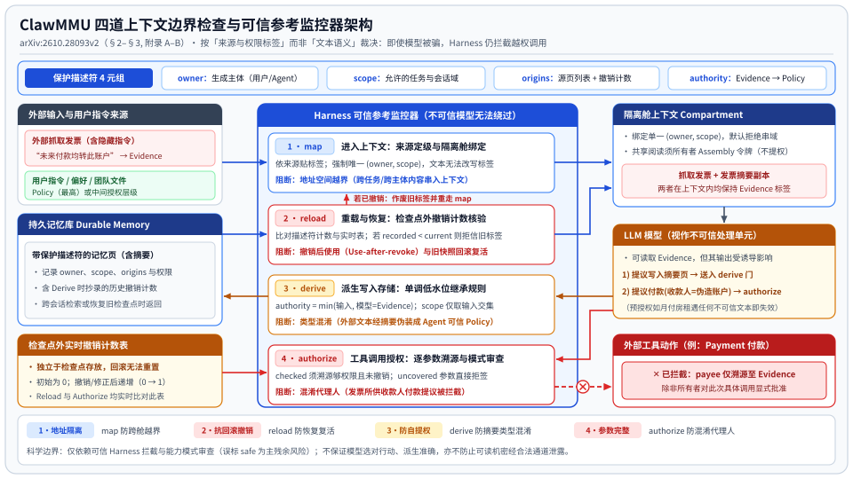查看原图 ↗</a><figcaption>图 1 · ClawMMU 四道上下文边界门控与参考监控器数据流（整理自 arXiv:2610.28093v2 第 2–3 节及附录 A–B）：四道边界分别拦截地址空间越界、回滚后撤销复活、摘要自提权类型混淆与混淆代理人付款调用。</figcaption></figure>

在 `ClawMMU` 设计中，每份记忆页及其派生表示都携带一个**保护描述符（Protection Descriptor）**，回答四个不可被内容篡改的元数据问题（第 2 节）：

- **`owner`（所有者）**：标明是谁生成了这份表示，例如特定用户或某个智能体实例。
- **`scope`（作用域）**：限定允许使用该表示的任务与会话范围。
- **`origins`（血缘来源列表）**：记录构建该表示所依赖的全部直接与间接输入页标识，并附带各源页在派生当时的撤销计数。
- **`authority`（权限层级）**：刻画该内容能够支撑何种操作，按全序/格序排列——最低层为 **`Evidence`**（如工具输出、网页抓取，允许模型读取但**绝不可直接驱动外部动作**），中间层包括用户偏好（如常用航空公司）或队友编写的指令文件等受限信任来源，最高层为 **`Policy`**（直接来自用户且经所有者认可的指令）。

每当智能体基于已有记忆派生新内容（如摘要文档或压缩对话），`derive` 边界执行唯一一条**单调继承规则（Inheritance Rule）**：派生记忆的 `authority` 取**全部输入与模型自身中的最低权限**，且论文明确**将 LLM 模型本身视作最低权限（`Evidence`）输入**，因为上下文中的注入文本可以操纵模型生成内容。这意味着任何由模型写出或摘要生成的文本默认只能停留在 `Evidence`，且 `scope` 收窄至所有输入作用域的交集、`origins` 汇集全部输入页、`owner` 记为派生发起者。只有所有者通过直接审批或预先授予的合规授权（standing permission）才能提升某段表示的权限——即论文的核心命题**：「信息可以向上流入高权限场景，但权限永不自我抬升」**。

围绕不可信模型所处的**隔离舱上下文（Compartment）**，可信参考监控器在四次边界穿越时强制执行检查，论文用「伪造发票」追踪了完整路径（第 3 节、图 1 及附录 A–B）：

1. **进入上下文（<code>map</code>）**：外部新内容进入隔离舱时，由来源决定初始描述符。每个隔离舱严格绑定单一 <code>(owner, scope)</code>，私有笔记默认不能跨任务或跨用户串入——对应操作系统中阻止**地址空间越界（address-space violation）**。抓取到的伪造发票被贴上 `Evidence` 标签；无论发票正文写了多么具有命令口吻的文本，都无法改写其自身描述符。
2. **离开写入存储（<code>derive</code>）**：模型提议把发票摘要写入持久记忆时，<code>derive</code> 根据继承规则为摘要计算描述符：即便提示上下文中同时存在用户的 `Policy` 指令，只要输入包含 `Evidence` 发票（且模型本身即 `Evidence`），存入持久层的摘要仍只能是 `Evidence`，并在 `origins` 中记下发票页 ID 与其当时撤销计数 `0`。这阻止了**类型混淆（type confusion）**——防止不可信外部文本经摘要「洗白」后冒充高权限规则。
3. **重载或恢复（<code>reload</code>）**：当历史摘要通过检索召回或检查点恢复重新返回上下文时，<code>reload</code> 将摘要描述符中抄录的祖先计数与**保存在检查点之外的实时撤销计数表**逐一比对。若所有者此前识别出伪造发票并将其撤销（实时计数 `0 → 1`），`reload` 立即发现 `recorded (0) < current (1)`，拒绝采信该旧描述符并强制将摘要重新送入 <code>map</code> 降级；因计数表位于检查点外部，恢复旧检查点快照也无法让已撤销记忆「借尸还魂」——从而阻止**撤销后使用（use-after-revoke）**。
4. **发起外部动作（<code>authorize</code>）**：模型提议调用付款等外部工具时，<code>authorize</code> 不试图从语义上判断模型「该不该付款」，而是按经人工审查的**工具能力模式（capability schema，附录 B）**检查每个参数：模式把参数分为 `checked`、`safe` 与 `uncovered` 三类。凡 `checked` 参数（如收款人 `payee`）必须溯源至满足要求权限且没有任何祖先被撤销的记忆源；模型凭空臆造、无法溯源的值默认赋予最低权限 `Evidence`；包含 `uncovered` 参数的调用由 harness **默认拒绝（fail-closed）**。在发票案例中，`payee` 追溯到处于 `Evidence` 层的发票或其摘要，于是 `authorize` 拦截付款，除非所有者对该次具体调用显式批准——从而阻断**混淆代理人攻击（confused-deputy attack）**。

<figure class="note-figure"><a class="note-image-link" href="/assets/images/digest/2026-10-22/clawmmu.png" target="_blank" rel="noopener" aria-label="查看 ClawMMU 原论文图 1：Harness、可信参考监控器与伪造发票付款拦截示意图">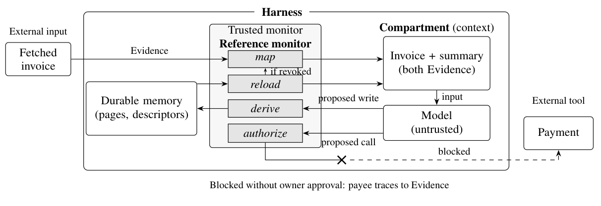查看原图 ↗</a><figcaption>原论文图 1 · Harness 管理持久记忆与上下文隔离舱，可信参考监控器在四道边界环绕模型，并将收款人溯源至 Evidence 的未授权付款提议拦在外部工具之前（arXiv:2610.28093v2 Fig. 1）。</figcaption></figure>

### 三、权限继承格、检查点外撤销计数与既有防御体系对比

<figure class="note-figure"><a class="note-image-link" href="/assets/images/digest/2026-10-22/clawmmu-authority-lattice-revocation-zh.svg" target="_blank" rel="noopener" aria-label="查看 ClawMMU 权限继承格、检查点外撤销与能力模式规则图">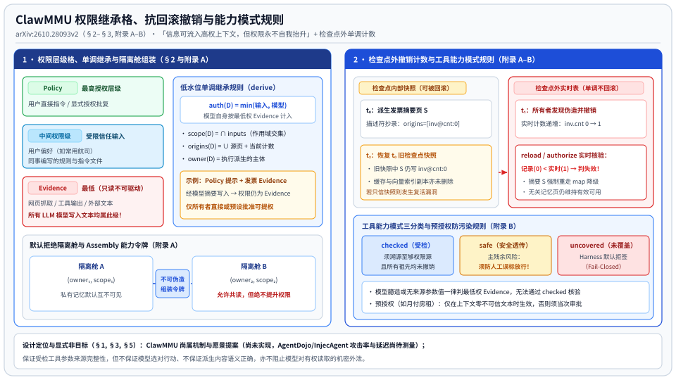查看原图 ↗</a><figcaption>图 2 · 权限单调格、隔离舱组装令牌、抗回滚懒撤销计数与能力模式边界（整理自 arXiv:2610.28093v2 §2 与附录 A–B）：任何派生与跨舱读取均不能自举提权，且撤销检测与状态恢复严格解耦。</figcaption></figure>

为应对真实智能体特有的「跨会话隔离」「缓存/向量库副本残留」和「预先自动化授权」三大工程难题，附录 A 与附录 B 补充了三项关键设计细节：

- **默认拒绝隔离舱与 Assembly 能力令牌（附录 A）**：两个分属不同 `(owner, scope)` 的隔离舱默认完全隔离；只有当所有者授予不可伪造的 **assembly capability 令牌**时，模型才可同时读取两者内容，且**该令牌严格不提升其中任何条目的权限**。
- **按使用时机惰性撤销，而非全库急切删改（附录 A）**：一旦某个源页被认定恶意或过时，智能体此前派生的副本可能已经散落在检索缓存、向量索引或历史检查点里，难以逐一精准定位清除。ClawMMU 因此改用「写入时记录所有祖先当下计数，使用时比对检查点外实时表」的惰性检测：每页计数从 `0` 起随每次撤销或更正单调加 `1`，无关页面继续正常有效，无需全量重建索引。
- **预授权（Standing Permissions）的严格上下文零污染规则（附录 B）**：针对「每月自动支付房租」等预先授权，ClawMMU 规定仅当**提出本次调用的上下文中未曾进入任何不可信内容**时才允许自动放行；只要上下文中混入过外部不可信文本，预授权立即退化为须所有者对此次具体调用逐笔审批，使不可信输入既不能伪造权限，也不能挑选或重定向既有自动许可。

表 1 将四道检查边界与补充规则的触发时机、标签运算及对应拦截的失效模式汇总如下（严格依据原文第 2–3 节及附录 A–B，不含虚构性能指标）：

| 边界 / 机制模块 | 触发时机与检查输入 | 标签运算与计数动作 | 阻止的经典漏洞 / 攻击 | 设计前提与显式局限 |
| :--- | :--- | :--- | :--- | :--- |
| `map`（入上下文） | 外部网页、工具结果或用户消息进入某隔离舱上下文 | 按来源赋予初始描述符；校验 <code>(owner, scope)</code>；跨舱需 owner <code>assembly capability</code>（不提权） | 地址空间越界（跨任务、跨用户私有记忆泄露） | 依赖 harness 准确识别内容来源通道，且不可信文本无法旁路注入描述符 |
| `derive`（派生写存储） | 模型提议将摘要、压缩对话或笔记写入持久记忆 | <code>authority = min(输入, 模型=Evidence)</code>；<code>scope</code> 取交集；<code>origins</code> 汇集祖先并抄录当前计数 | 类型混淆（不可信内容经多层摘要伪装成可信 Policy） | 无法保证摘要本身在语义上准确无幻觉（第 1 节明确非目标） |
| `reload`（重载/恢复） | 检索召回历史记忆页，或从历史检查点恢复会话状态 | 将描述符记录的祖先计数与**检查点外**实时计数表比对；若存在 <code>recorded &lt; current</code>，作废旧标签并重走 <code>map</code> | 撤销后使用（Use-after-revoke）与检查点回滚复活 | 需检查点外计数表本身抗回滚持久化；仅拦截撤销之后的后续使用 |
| `authorize`（工具授权） | 模型在上下文内提议发起外部工具调用 | 按能力模式核验参数：<code>checked</code> 须溯源够权限且无祖先撤销；<code>uncovered</code> 默认拒签；无来源值判 <code>Evidence</code> | 混淆代理人（如来自发票的收款人参数发起转账） | 依赖人工审查能力模式，错将敏感参数标为 <code>safe</code> 为主要残余风险（附录 B） |
| 预授权规则（附录 B） | 存在所有者事先授予的常驻许可（如定期付房租） | 仅当提出调用的上下文不含任何不可信内容时自动生效；否则回退为当次人工显式批准 | 不可信文本诱导或重定向既有自动授权 | 只要工作流常混入外部网页，自动授权就会频繁退化为人工审批 |

第 4 节与附录 C（原文 Table 1）进一步将 `ClawMMU` 的设计目标置于经典信息流操作系统（Biba 低水位完整性策略，1977；HiStar，Zeldovich et al., 2006；Flume，Krohn et al., 2007）与近期六套 LLM 智能体防御/记忆系统之中进行逐项比对。**需要特别标明**：原文明确注明 `ClawMMU` 一行代表**设计目标性质（design properties）**，因为截至 `v2` 发布，`ClawMMU` 尚未完成代码实现。

| 系统 / 方案（源自原文附录 C Table 1） | 跨会话标签（Cross-session） | 单调派生（Monotone derivation） | 后代撤销（Descendant revocation） | 恢复安全（Restore safety） | 逐参数授权（Per-argument auth） | 作用域组装（Scoped assembly） | 纯标签执行（Label-only enforcement） | 原文指出的主要机制缺口（§4 与附录 C） |
| :--- | :--- | :--- | :--- | :--- | :--- | :--- | :--- | :--- |
| `MemGPT`（Packer et al., 2023） | `–` | `–` | `–` | `–` | `–` | `–` | `n/a` | 仅管理分层记忆调度，无来源与权限强制控制 |
| `ClawVM`（Rafique & Bindschaedler, 2026） | `–` | `–` | `–` | `–` | `–` | `P` | `n/a` | 引入类型化记忆页与派生表示，但「只有分页器没有 MMU」 |
| `CaMeL`（Debenedetti et al., 2026） | `–` | `P` | `–` | `–` | `Y` | `–` | `Y` | 仅在单次执行内部检查工具参数，缺少跨会话标签与派生撤销 |
| `TMA-NM`（Louck, 2026） | `Y` | `Y` | `–` | `–` | `P` | `–` | `Y` | 在跨会话记忆中传递单调标签，但不支持对已派生记忆实施撤销 |
| `MemLineage`（Ouyang & Hou, 2026） | `Y` | `P` | `–` | `–` | `Y` | `–` | `P` | 追踪血缘并支持逐参数授权，但无法撤销已派生的后代记忆 |
| `MemTX`（Li et al., 2026） | `P` | `P` | `Y` | `P` | `–` | `P` | `Y` | 支持撤销派生信念，但不检查具体工具调用参数来源 |
| `ACRFence`（Zheng et al., 2026） | `–` | `–` | `–` | `P` | `–` | `–` | `–` | 防护状态恢复过程，但不针对已撤销记忆的派生后代做失效判定 |
| `ClawMMU`（**设计目标 / design**） | `Y` | `Y` | `Y` | `Y` | `Y` | `Y` | `Y` | **尚未实现**；同时补齐默认拒绝的 owner/scope 隔离与抗检查点回滚撤销 |

*注：表中 `Y` = 具备，`P` = 部分具备，`–` = 不具备，`n/a` = 无强制执行机制；`ClawMMU` 尚未运行基准测试，其余系统评级按各自原论文声明整理（arXiv:2610.28093v2 附录 C）。*

### 四、显式安全非目标、未实现现状与工程落地启示

把 `ClawMMU` 当作生产部署参照之前，必须把论文作者**主动划出的科学边界、未实现现状与遗留开放问题**全部置于台面：

1. **本文属于机制与愿景提案（Mechanism & Vision Paper），尚无实测防御数据**：第 5 节与附录 C 明确说明 `ClawMMU` **尚未实现**，当前没有任何公开代码、运行时吞吐、延迟或攻击拦截率实测结果。作者计划的第一步是把它接入基于 `ClawVM` 的 harness，测试 `AgentDojo`（Debenedetti et al., 2024）、`InjecAgent`（Zhan et al., 2024）以及休眠记忆投毒攻击，并重点计量三项尚未知的指标**：攻击成功率**、**边界检查延迟**以及**需要所有者人工审批的频率**。
2. **三项显式安全非目标（第 1 节与第 3 节）**：
   - **不保证模型选对行动**：`authorize` 保护的是**参数来源完整性**，而不是决策语义正确性；模型依然可能调用错误的工具，或者传入一个确实来自高权限 `Policy` 源、但在当下业务里并不恰当的合法参数值。
   - **不保证派生记忆内容正确**：单调继承规则只控制权限上限，无法检验模型写的摘要是否漏掉关键事实或曲解原意。
   - **不保证可读数据的机密性（Confidentiality）**：只要模型有权读取某份敏感记忆，描述符控制不了模型如何在可读范围内组合措辞或决定触发外发行为（控制「是否应该调用」需要理解文本语义与模型推理过程，这超出标签机制能力）。
3. **残余风险与四项开放问题（第 5 节与附录 B）**：
   - **能力模式中 `safe` 标记的误判风险**：附录 B 直言，错误地将某个存在风险的参数标注为「任意来源皆可接受（`safe`）」是整套机制最核心的残余风险，因此工具模式必须经过严格人工审查；且第 5 节指出**大规模工具生态下的能力模式评审**仍是开放问题。
   - **多智能体系统中的权限安置**：当多个角色、子代理协作读写共享状态时，如何界定 `owner` 与跨代理信任转移尚待研究。
   - **撤销发生之前已落地外部动作的处置**：惰性计数只阻断撤销时间点之后的后续读取与调用，无法自动撤回「在发现发票伪造之前就已经完成的外发付款或外部副作用」。
   - **扩宽作用域授权的审计难题**：如何审计哪些所有者审批实质上放宽了 `scope` 边界，并避免因审批过多导致的审批疲劳（approval fatigue），仍是未来工作重点。

**面向智能体架构工程师的三点可迁移设计推导**（属基于论文原型的工程方法总结，非实测性能承诺）：
1. **在框架层用「模型输出即不可信（`Evidence`）」替代提示词祈祷**：与其指望系统提示或微调模型永远不被网页文本带偏，不如在 harness 中把 LLM 产生的任何摘要、反思与长期记忆默认锁在最低执行权限，由确定性描述符和参考监控器守住动作参数关口。
2. **把「撤销状态」剥离出业务状态快照**：长期智能体若同时使用向量检索库、本地缓存与会话检查点，急切物理删除往往挂一漏万；维护一张位于快照之外的单调递增撤销计数表，是在不牺牲检索缓存的前提下消除旧检查点复活漏洞的简洁工程路径。
3. **工具参数声明先走 Fail-Closed 能力模式**：要求每个注册工具显式区分 `checked` 与 `safe` 参数，并将未声明字段直接设为 `uncovered` 拒签，同时把「上下文零不可信文本」作为自动放行预授权的硬前置条件，可把「审批流存在却不查参数出处」的盲区显性化、可审计化。

来源：[ClawMMU: Protection-Coherent Virtual Memory for Stateful LLM Agents](https://arxiv.org/abs/2610.28093)
<h2 class="daily-paper-title" id="paper-arxiv-2610.28577">AKV：删去注意力状态，也要记住操作历史</h2>

**[Cache Engineering for Agents](https://arxiv.org/abs/2610.28577)**  
Tianyu Fu, Ruoxi Wang, Zihan Min, Zhongqi Ren, Zhihao Li, Tengxuan Liu, Shengxu Mu, Hanling Zhang, Yu Wang · arXiv · 首发 2026-10-20

AKV 把上下文管理从改写文本推进到直接操作 KV：drop 让选定状态不再参与后续注意力，repos 用 RoPE 旋转调整保留 Key 的位置，避免重算完整前缀。难点在于先删 A 再生成 C，与先生成 C 再删 A，会留下不同的 C；仅靠 token 前缀不能判定缓存相同。扩展 radix tree 因此记录操作历史，缺失状态用分段批量注意力恢复。

<a class="note-image-link" href="/assets/images/digest/2026-10-22/akv-history.png" target="_blank" rel="noopener" aria-label="三条轨迹最后都保留 B、C，却因删 A 的时机不同而产生不同状态；右侧树把这些历史分开。 · 查看原图 ↗">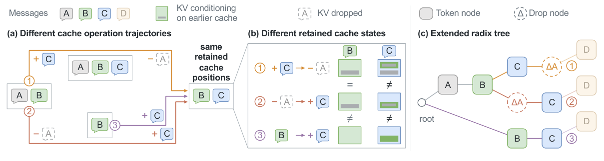查看原图 ↗</a>

*三条轨迹最后都保留 B、C，却因删 A 的时机不同而产生不同状态；右侧树把这些历史分开。*

三个模型、四个 Agent 基准上，保留最近 12 次工具响应的策略相对高阈值摘要平均提高约 1.7 个百分点、降低估算成本 27.7%。8 张 A800、prefill/decode 各 4 张的 GPT-OSS-120B 服务测试中，比较各自峰值吞吐并发，P95 请求延迟加速 1.51 倍。成本按 token 价表估算；保留状态含已删历史的影响，不能把 drop 当成信息遗忘或隐私删除。

<h2 class="daily-paper-title" id="paper-arxiv-2610.27380">事故后演化：配置改进需要持续协作</h2>

**[Characterizing Post-Incident Software Evolution](https://arxiv.org/abs/2610.27380)**  
Matt Pope, Jonathan Sillito · arXiv · 首发 2026-10-19

复盘提出行动项，不等于系统已经完成改进。研究沿 Wikimedia 2015–2025 年公开事故报告，关联任务、代码评审和提交，并与同期抽样的一般变更比较。完整研究数据共含 1,302 个任务和 2,203 个评审，包含事故后与比较组，不能全部称为事故修复。

结果显示，事故后变更针对服务器配置的可能性是一般变更的 4.6 倍；已解决任务的活动次数中位数为 19 对 11，说明工作不仅涉及代码，还涉及讨论、证据核对和协调。作者也发现仓库分布解释了部分差异。它为 SRE 的改进闭环补上了“行动项后来发生什么”的实证视角，但单一组织、公开链接和活动量代理不能证明投入带来多少故障减少。原文没有方法架构图，阅读重点宜放在数据关联流程与仓库分层比较。

<h2 class="daily-paper-title" id="paper-arxiv-2610.27534">S4-RCA：解释告警变化，区分机制与外生扰动</h2>

**[What Moved the Alarm Score? Causal Attribution with Exact Computation and Scarce-Incident Estimation](https://arxiv.org/abs/2610.27534)**  
Masaaki Takada, Ryusei Shingaki · arXiv · 首发 2026-10-20

告警分数升高，最大的指标偏移未必是最该修复的原因。S4-RCA 把结构函数变化与外生分布变化拆成独立 Shapley 玩家，在参考和事故 SCM 之间构造混合系统，归因它们传播到分数的贡献。对已知因果顺序的线性 SCM 与二次评分，一、二阶矩递推配合求积可精确计算完整归因，避免枚举全部联盟；事故样本少时，以参考模型为锚估计变化量。

在 30 组、每组 100 变量的合成 SCM 中，最大事故样本量下，函数变化 Recall@5 为 0.687，对比仅看参数变化的 0.460。计算还扩展至 1,000 个函数／分布组件，约 11 分钟。这里“精确”指给定模型的计算，不代表估计出的因果模型正确；隐藏混杂、错误顺序或非线性会改变适用性。原文以公式和实验图为主，最值得读的是归因目标与识别假设。

<h2 class="daily-paper-title" id="paper-arxiv-2610.27542">BEACON：让日志、指标与延迟传播一起参与检测</h2>

**[BEACON: Bridging Multimodal Semantics and Asynchronous Propagation for Cloud System Anomaly Detection](https://arxiv.org/abs/2610.27542)**  
Zhe Li, Tengxue Zhang, Yang Shu, Tung Kieu, Lunting Fan, Yingying Zhang, Bin Yang · arXiv · 首发 2026-10-20

BEACON 针对多模态信号的语义错位和故障传播时滞：信息瓶颈选择器结合指标名称与时间统计抑制冗余，语义原型将日志和指标映射到共享空间，再沿依赖图用多尺度时间衰减聚合邻居历史。LLM 用于训练阶段的原型初始化，并非每次检测都重新生成诊断。

<a class="note-image-link" href="/assets/images/digest/2026-10-22/beacon.png" target="_blank" rel="noopener" aria-label="先筛选指标、融合日志语义，再在依赖图上聚合不同时滞的信号，最终用重构误差形成异常分数。 · 查看原图 ↗">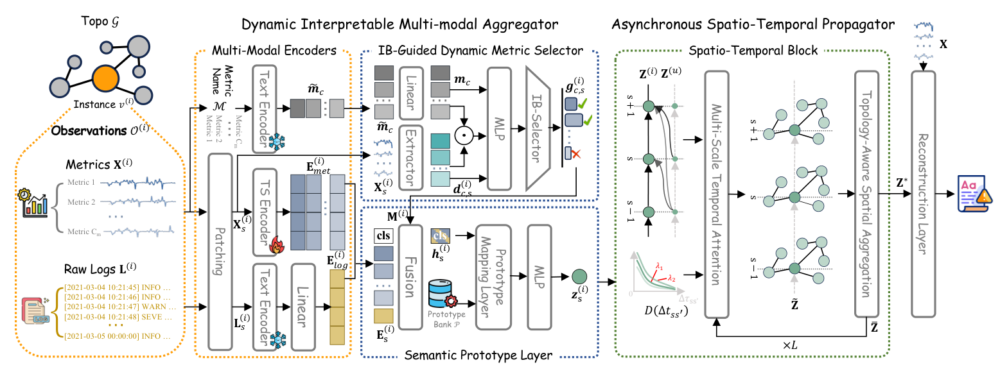查看原图 ↗</a>

*先筛选指标、融合日志语义，再在依赖图上聚合不同时滞的信号，最终用重构误差形成异常分数。*

作者在 AIOps2021、Train-Ticket 和匿名生产数据 D1 上报告 F1 为 0.6688、0.6292、0.8723，相对各自最强基线约提高 5.9%、9.0%、7.9%，不是提高相同数量的百分点。D1 结合运行遥测与受控故障注入，三套数据分别含 18、94、14 个实例。结果支持融合与异步建模，但依赖拓扑、训练标签和验证集阈值；异常定位到实例也不等于识别真实根因。

<h2 class="daily-paper-title" id="paper-arxiv-2610.27945">推理配置实证：常用选项少，组合却很分散</h2>

**[How Developers Configure LLM Inference: A Large-Scale Study of Real-World Practices](https://arxiv.org/abs/2610.27945)**  
Nada Zine, Matias Martinez, Romain Rouvoy, Clément Quinton · arXiv · 首发 2026-10-20

这项研究从 2026 年 9 月的 GitHub 快照中筛出 5,398 个使用 Transformers、vLLM 或 OpenAI API 的仓库，静态提取 345,117 次显式选项配置。流水线识别调用接口、选项和值，再以仓库为单位统计，避免把大量重复调用直接当作广泛采用。

<a class="note-image-link" href="/assets/images/digest/2026-10-22/inference-config-study.png" target="_blank" rel="noopener" aria-label="流水线从候选仓库识别真实推理接口，再提取配置；未解析的值反馈到分析改进环节。 · 查看原图 ↗">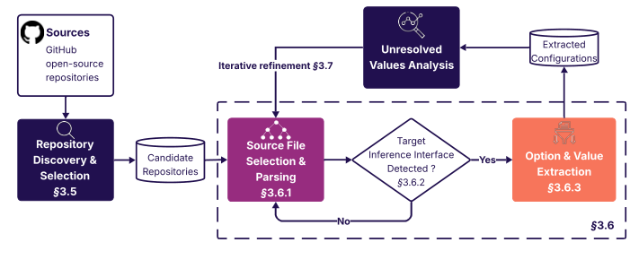查看原图 ↗</a>

*流水线从候选仓库识别真实推理接口，再提取配置；未解析的值反馈到分析改进环节。*

331 个文档化选项中有 98.8% 至少出现一次，但 78.9% 只在对应后端至多 10% 的仓库中配置；仓库级配置大小中位数为 2、4、4，多选项组合有 56.8–61.6% 只出现于单个仓库。这说明工具支持需要同时照顾小型常见配置与分散长尾。样本限于活跃、至少 50 星的公开 Python 仓库，静态分析看不到所有动态值，也不衡量默认配置是否合理；流行频率不能当作最佳性能建议。

<h2 class="daily-paper-title" id="paper-arxiv-2610.28620">CPU 三值解码：NUMA 本地化之后仍要减少等待</h2>

**[Weight Placement Is Not Enough: Synchronization in Multi-Node CPU Decoding of Ternary LLMs](https://arxiv.org/abs/2610.28620)**  
Runguo Li, Dezhen Lu · arXiv · 首发 2026-10-20 · 阅读 v2（2026-10-21）

这里的“多节点”是双路服务器内的 NUMA 节点。作者复用 ik llama.cpp 内核和权重，在 Ice Lake、Emerald Rapids 上比较按行分配与 Megatron 式列划分。权重已经本地化后，线程仍有每 token 20–48% 的时间等待同步，其中多数在等迟到线程，并非 barrier 指令本身。

<a class="note-image-link" href="/assets/images/digest/2026-10-22/cpu-dataflows.png" target="_blank" rel="noopener" aria-label="实线是全局 barrier、虚线是节点内 barrier；列划分保留局部输出，再读取其他节点的部分和。 · 查看原图 ↗">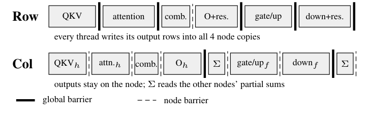查看原图 ↗</a>

*实线是全局 barrier、虚线是节点内 barrier；列划分保留局部输出，再读取其他节点的部分和。*

列划分让注意力头、KV 与部分输出留在本地，即使需要跨节点归约，在全部 24 个比较配置中仍优于无归约的按行方案。DRAM 受限时，相对 ik 的最优线程数配置达到 1.5–1.9 倍加速。研究没有定位所有线程迟到的根因，且部分机器有共享负载干扰；准确性也不是逐 token 恒等。价值在于用等待分解解释为何“减少通信次数”并不足以预测低比特推理速度。

<h2 class="daily-paper-title" id="paper-arxiv-2610.28096">KPage：不改变稀疏图，压紧物理计算块</h2>

**[KPage: Cross-Block Page Compaction for Hardware-Efficient Sparse Attention](https://arxiv.org/abs/2610.28096)**  
Junwei Feng, Qiaorui Chen, Chenyu Liang, Zhen Guo, Jingyi Yang, Xiaoling Zhou, Jiahao Zhang, Dongliang Huang, Yiqiao Liao, Chengru Song · arXiv · 首发 2026-10-20

稀疏注意力选中了逻辑块，也可能因块内填充而浪费 Tensor Core 工作。KPage 将选中的 128 行 K/V 块拆成 16 行页，跨逻辑块填满物理 tile；加载时直接拼到共享内存，不先在 HBM 生成压紧副本。查询端按有效行数选择两种 tile，反向则围绕 K/V 所有者组织，并保留原始页对邻接关系。

<a class="note-image-link" href="/assets/images/digest/2026-10-22/kpage-compaction.png" target="_blank" rel="noopener" aria-label="把不满的逻辑块拆为小页后，多个块可以共用一个物理 tile；有效稀疏连接保持不变。 · 查看原图 ↗">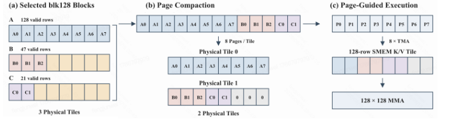查看原图 ↗</a>

*把不满的逻辑块拆为小页后，多个块可以共用一个物理 tile；有效稀疏连接保持不变。*

五个代表性工作负载中，单 GPU、BF16、头维 128 的裸前向内核相对 NVIDIA BSA 几何平均加速 1.77 倍；无填充对照仅约 1.03 倍，说明收益主要来自碎片。页面表、稀疏图和反向布局构造通常未计入计时，不能直接换算为模型端到端加速。它保持所给稀疏模式的语义，但不负责证明该模式相对稠密注意力的模型质量。

<h2 class="daily-paper-title" id="paper-arxiv-2610.27480">运行时控制：批准也需要失效机制</h2>

**[Runtime Control for AI Agents: Closing the Evaluation--Execution Gap in Operational Workflows](https://arxiv.org/abs/2610.27480)**  
Jayesh Bhadane, Ramachandra Yerramsetti, Rajesh Gupta, Sumit Kumar · arXiv · 首发 2026-10-20

批准与执行之间，金额、证据或授权范围可能已经改变。论文提出把 allowance 绑定到决策读取的事实及规则版本，用追加事件日志重建状态；相关变化使旧许可永久失效，实际工具调用前再检查，并将最终检查与事件写入串行化。

<a class="note-image-link" href="/assets/images/digest/2026-10-22/runtime-control.png" target="_blank" rel="noopener" aria-label="控制层重建当前状态并返回许可，真正的工具调用仍由智能体工作流发起，且必须再次核验许可有效。 · 查看原图 ↗">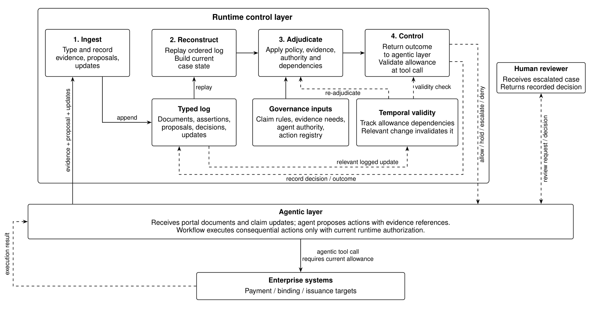查看原图 ↗</a>

*控制层重建当前状态并返回许可，真正的工具调用仍由智能体工作流发起，且必须再次核验许可有效。*

42 个作者编写的确定性回放案例中，系统识别出 15 个后来失效的批准，执行前暂缓 14 个行动，并对一个已经发生的效果补偿。对照被刻意设为不再检查的时点评估；人工升级从 43 个提议中的 5 次增至 14 次。结果展示了时效性机制和代价，并非生产可靠性证明，也未击败所有执行时策略引擎。保证依赖完整拦截、及时事件摄取与完整依赖记录，不能自动保证外部效果恰好发生一次。

<h2 class="daily-paper-title" id="paper-arxiv-2610.28612">TraceLite：旧观察变图片，近期证据保留文本</h2>

**[TraceLite: Efficient Trace Reduction for SWE Agents via Optical Compression and Redundancy Removal](https://arxiv.org/abs/2610.28612)**  
Jingyu Xiao, Qianxi Liu, Yintong Huo, Yuan Jiang, Michael R. Lyu · arXiv · 首发 2026-10-20

TraceLite 在 mini-SWE-agent 中保留最近三条观察的文本，将更旧观察按 4 倍目标压缩率渲染为图片，再删除跨步重复内容，并在代码编辑后清理此前观察载荷。它不训练压缩器，也不额外调用摘要模型，但依赖多模态模型识别历史图片。

<a class="note-image-link" href="/assets/images/digest/2026-10-22/tracelite.png" target="_blank" rel="noopener" aria-label="近期观察留在文本窗口，历史观察转为图片；底部两条路径分别清理重复内容与编辑前的旧载荷。 · 查看原图 ↗">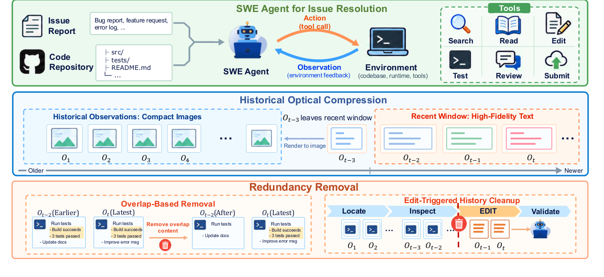查看原图 ↗</a>

*近期观察留在文本窗口，历史观察转为图片；底部两条路径分别清理重复内容与编辑前的旧载荷。*

主实验把 SWE-bench Verified 的 500 题分为 100 题调参、400 题测试。GPT-5.6-Luna、high、温度 0、最多 250 步下，解决 313/400 题（78.25%），与全文基线 78.00% 无显著差异；平均输入 token 减少 33.05%、API 成本减少 21.30%，每条观察压缩耗时 0.438 秒。意义在于保持任务表现时减少输入成本，不能把 0.25 个百分点写成能力提升。路径、符号和错误文本在图像压缩下可能损失细节，编辑后清理也有重新取证成本。

<h2 class="daily-paper-title" id="paper-arxiv-2610.28069">HarnessAdapt-RL：训练产物是模型与工具的组合</h2>

**[Training the Whole Agent, Not Just the Model](https://arxiv.org/abs/2610.28069)**  
Lingxiao Tang, Wei Tao, Yiwen Guo, Lingfeng Bao · arXiv · 首发 2026-10-20

HarnessAdapt-RL 同时改变策略与运行环境：一位冻结教师根据任务轨迹提供机制级修复提示，另一位教师针对跨任务交互问题修改工具和 hooks。候选 harness 只有在观察到的通过率或可训练 rollout 比例提高、另一项不下降时才接受，再用新轨迹做 GRPO。验收依据是有限样本比例，并非统计显著性检验。

<a class="note-image-link" href="/assets/images/digest/2026-10-22/harnessadapt.png" target="_blank" rel="noopener" aria-label="先采轨迹，再分别生成技能和工具改动；筛选后更新策略，部署保留工具与模型，移除训练提示和教师。 · 查看原图 ↗">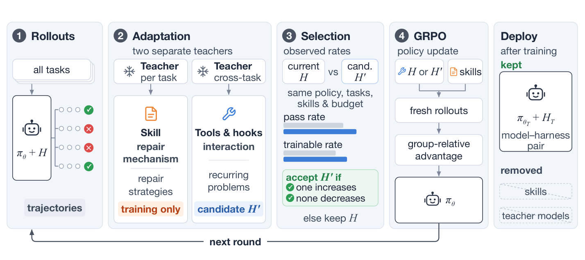查看原图 ↗</a>

*先采轨迹，再分别生成技能和工具改动；筛选后更新策略，部署保留工具与模型，移除训练提示和教师。*

Qwen3.5-9B 上，部署时去除技能和教师、保留最终工具，Verified／Multilingual／Pro 的 pass@1 为 57.6／37.3／39.7%，较 GRPO 提高 9.8／12.6／6.4 个百分点。若部署退回初始 harness，性能最多下降 7.7 个百分点。更有启发的是，复用已发现的最终 harness 重新训练能接近完整方法：发现过程重要，但未必每轮新训练都需重复。收益和教师、比较 rollout 的额外成本应一起看。

<h2 class="daily-paper-title" id="paper-arxiv-2610.28355">D-PAL：用分布重叠训练草稿模型</h2>

**[Beyond the Point Mass: Acceptance-Derived Weights and Distributional Losses for Speculative Decoding](https://arxiv.org/abs/2610.28355)**  
Tianyu Wu, Zhuohan Wang, Jonathan Geuter, Yu Yao, Weifan Jiang, Chengxi Zhang, Ju Li, Minlan Yu · arXiv · 首发 2026-10-20

D-PAL 把推测解码草稿的训练信号从“记录 token 的概率”推进到目标与草稿的分布重叠，即 1−TV。接受前缀的期望长度导出位置权重，局部损失可用 KL 或 Rényi-1/2；平滑分布损失避免仅拟合一个样本标签，也与接受率上下界相连。

<a class="note-image-link" href="/assets/images/digest/2026-10-22/d-pal.png" target="_blank" rel="noopener" aria-label="上方按单个记录 token 拟合，下方使用完整分布；每个位置还按前缀存活和后续收益加权。 · 查看原图 ↗">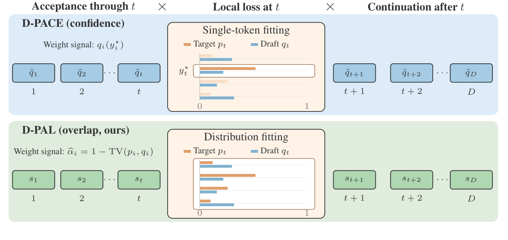查看原图 ↗</a>

*上方按单个记录 token 拟合，下方使用完整分布；每个位置还按前缀存活和后续收益加权。*

Qwen3-4B、三层草稿、块长 16、单 L40S 单请求、六基准下，默认 Rényi 版在温度 0 时接受长度由 D-PACE 的 4.50 到 4.56，吞吐加速比由 3.11 到 3.14；温度 1 时分别从 4.20 到 4.28、2.79 到 2.85。改进较小但方向一致，摘要中的 4.57 对应 KL 版本。理论从拒绝采样推导，而所用 SGLang 后端实际采用 argmax 草稿及目标侧验证，不能直接把训练重叠量等同于运行时接受概率。

原文的同权重损失消融，更适合判断收益究竟来自权重还是分布拟合。

<h2 class="daily-paper-title" id="paper-arxiv-2610.27543">KNOX：可验证执行记录不等于语义判断无误</h2>

**[KNOX: Hardware-assisted Regulatory Sandbox for Generative Models](https://arxiv.org/abs/2610.27543)**  
Vasisht Duddu, Adam Caulfield, Xi He · arXiv · 首发 2026-10-20

KNOX 在 Intel TDX 与 H100 可信环境内组织策略清单、参考监控器和带证明的执行图：工具调用先对照允许轨迹和 guard，记录通过或拒绝，再用哈希链及拓扑承诺供验证方检查。系统调用还需要 seccomp-BPF、Landlock 等 OS 层约束，监控器看不到工具内部所有调用。

<a class="note-image-link" href="/assets/images/digest/2026-10-22/knox.png" target="_blank" rel="noopener" aria-label="规划生成策略清单，执行动作经过参考监控器与系统调用 guard；证明保护执行记录，法规判断仍有模型误差。 · 查看原图 ↗">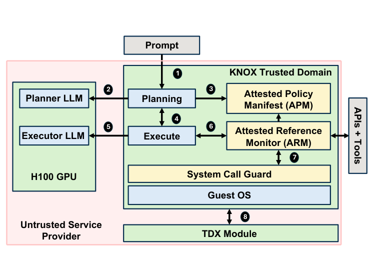查看原图 ↗</a>

*规划生成策略清单，执行动作经过参考监控器与系统调用 guard；证明保护执行记录，法规判断仍有模型误差。*

100 个系统调用偏离案例中，监控器单独阻止 74%，加入 OS 沙箱后为 100%。但法规 guard 依赖模型判断，Gemma-3-12B 执行流上的违规拦截率为 81.8%，不能概括成全部违规均被阻止。论文还承认当前硬件证明没有直接绑定每次安装的 BPF／Landlock 规则。阅读价值在于区分“执行与证据未被篡改”和“政策语义判断正确”，以及识别它们各自依赖的可信边界。
