本期优先读两种“责任归属”：深度研究的引用错误究竟在哪次信息交接产生，以及 KV 缓存的性能收益究竟消耗了多少 SSD 寿命。前者把报告质量拆成可诊断的调用边界，后者把设备耐久性放进缓存放置决策。它们都让一个看似单一的指标显露出背后的代价。

其余研究沿三条线展开：Muffin 与 ScaleMAS 改变多智能体共享信息的方式；AgentTriage 与 REGATTA 追问诊断证据与评价标签是否可靠；SARIA、MoEZip、uGDS 与 OMRC 则处理缓存、存储和互连约束。可验证优化案例还提醒我们：证明、测试与人工检查覆盖的责任范围并不相同。

<h2 class="daily-paper-title" id="paper-arxiv-2608.24306">01 · 引用错误定位：找出信息在哪次交接中失真</h2>

[Who is the Agent to Blame? Localizing Faithfulness and Citation Mistakes in Agentic Deep Research](https://arxiv.org/abs/2608.24306)  
Eran Hirsch, David Wan, Han Wang, Elias Stengel-Eskin, Mohit Bansal, Ido Dagan · 2026-08-25 · EMNLP 2026

深度研究报告中的一句话挂着真实链接，仍可能没有来源支持。搜索器先把网页压成片段，研究员再写笔记，编排器最后生成报告；信息与引用在每次交接中都可能变化。只给最终报告一个引用召回率，能说明出了问题，却难以决定应该修搜索、摘要还是写作环节。Eran Hirsch 等的工作把评价单位缩小到一次 agent 调用，检查它实际收到的输入和产生的输出。

方法先为目标句抽取支持片段，验证这些片段确实出现在输入中，并能共同支持该句。找不到充分支持时归为幻觉；若支持依赖没有引用的输入，归为依赖无引文输入；若输入有引用而输出丢了引用，归为输出未引用；若输出仅保留部分必要来源，则归为引用不足。这里检查的是相对输入的忠实性，因此一个 agent 忠实转述上游错误时，不会立即被认定为错误起点。

<a class="note-image-link" href="/assets/images/digest/2026-10-24/2608.24306.png" target="_blank" rel="noopener" aria-label="先检验输入能否支持输出，再检查支持片段和输出的引文是否齐全；每个终止分支对应一种错误。">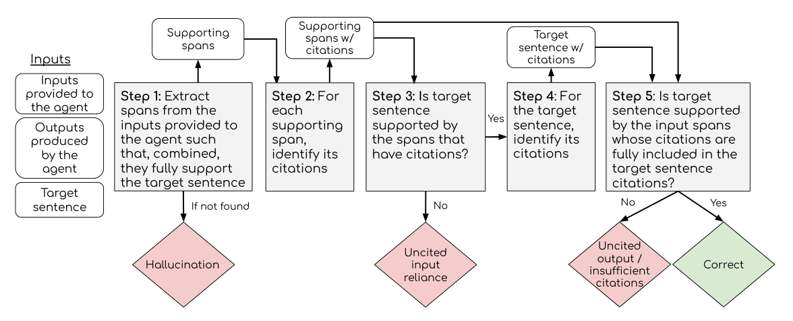查看原图 ↗</a>

*先检验输入能否支持输出，再检查支持片段和输出的引文是否齐全；每个终止分支对应一种错误。*

系统级分析先找最终报告中不能被原始来源支持的句子，再沿支持片段递归回溯。遇到当前调用新引入的错误就记录责任位置；如果当前调用忠实传递了信息，则继续追到上游。这与统计每类 agent 平均犯错多少互补：中间笔记可以有很多错误，却未必进入最终答案；位于出口的编排器错误较少，也可能决定读者最终看到什么。

作者在 20 个 DeepResearch Bench 样例上分析 AI-Q、MS-Agent 和 TrajectoryKit。AI-Q 最终确认错误中，84.7% 被归到编排器；这不是“84.7% 的报告句子出错”。更值得读的是从诊断到干预的下一步：在另一个覆盖全部 50 个英文问题的实验中，分别把研究员笔记替换为原始片段，或提醒编排器避免无引文信息。引用召回率由 64.5% 分别升至 69.7% 和 69.6%，RACE 质量分数维持约 52.4–52.6。两项改动分别评估，不能把收益相加。

**推进之处是把引用质量变成可定位、可验证的组件问题。** 但定位器也依赖模型判断：50 句人工标注中，算法与裁决标签精确一致率为 76%，κ 为 0.62；表格数字未纳入评价。不同角色采用不同模型，错误类型与模型能力之间的联系也只是观察。优先读局部判定流程与干预实验，理解何种证据足以把责任归到一次调用，避免把这套诊断当成完全准确的因果裁判。

另一个值得注意的设计是，原始网页内容直接从执行日志取得，而不是评价时重新抓取网站。否则，网页更新、付费墙或不同爬虫可能制造与原运行无关的引用分歧。不同系统仍需各自适配输入、输出和引用标记，代价并不会因为统一分类而消失。对研究者，这是一种将信息来源与调用边界同时保留的评价方法；对开发者，则意味着记录中间证据本身就是后续定位能力的一部分。

<h2 class="daily-paper-title" id="paper-arxiv-2610.30791">02 · Gandalf：把 SSD 写入寿命纳入 KV 缓存决策</h2>

[Gandalf: Flash Shall Not Die! Increasing Flash Storage Lifetime for KV Cache Offloading in LLM Serving](https://arxiv.org/abs/2610.30791)  
Maharani A. P. Irawan, Kuntai Du, Jiayi Yao, Dongjoo Seo, Yuyang Huang, Haryadi S. Gunawi, Junchen Jiang · 2026-10-22

把 KV cache 从显存搬到 SSD，可以扩大可复用上下文，却也把推理服务变成持续写入负载。缓存失效可以重算，闪存写入寿命却不能恢复；只优化命中率，会把大量短命状态持久化。Gandalf 关注的变化，是把“是否值得写盘”与“这份状态还能复用多久”一起纳入缓存管理，而不只在空间耗尽后执行通用淘汰。

它利用混合注意力模型中的状态差异。全注意力保存各 token 的 K/V，后续追加对话往往继续使用整个前缀；线性注意力在边界保存递归状态，新一轮结束后旧状态通常很快被替代。滑动窗口状态也有相似的短期复用特征。若最新状态能在 DRAM 中等到下轮请求，额外写入 SSD 就可能没有带来一次有效命中。这个观察给出优先保留短命状态在内存、让长期前缀使用 SSD 的方向。

<a class="note-image-link" href="/assets/images/digest/2026-10-24/2610.30791.png" target="_blank" rel="noopener" aria-label="新缓存先进入 DRAM；内存紧张时比较丢弃与迁移，SSD 替换还会影响已有前缀的复用价值。">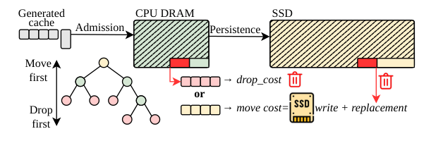查看原图 ↗</a>

*新缓存先进入 DRAM；内存紧张时比较丢弃与迁移，SSD 替换还会影响已有前缀的复用价值。*

固定分层仍受容量约束：短会话的递归状态可能塞满 DRAM，长会话的前缀又可能占满 SSD。实际在线策略先将新缓存放入 DRAM，在压力到来时比较两个代价：丢弃造成的预期重算，以及写盘磨损加上替换 SSD 中其他缓存所损失的复用。历史会话返回行为用于估计再访问机会，状态大小和等待时间参与归一化；写入价格还可以随目标寿命预算调整。参数 α 越大，写盘越谨慎，通常也意味着更多缓存未命中。

论文在 Kimi-K3、100 GB DRAM、1 TB SSD 的轨迹模拟中比较多种准入和淘汰策略。在最低未命中率配置 α=0 时，相对各轨迹最低未命中率的基线，TraceA、Claude Code 和 AIPerf 的估计寿命分别提高 2、3.3 和 6.5 倍。Claude Code 的未命中率为 0.052，略高于 LRU 的 0.047，却减少了写入。这比单报“延寿数倍”更有意义：收益必须和具体工作负载、缓存容量及重算代价一起读。

**这里最值得关注的是优化目标的扩展：缓存不仅消耗容量，也消耗设备寿命。** 作者通过存储轨迹和模拟器检验写入行为，寿命按额定总写入量与推算日写入量计算，并非把 SSD 连续运行到报废的测量。模拟假设写放大为 1，没有完整建模垃圾回收和磨损均衡，绝对寿命可能偏乐观。文章适合与 SARIA 对照阅读：前者突出状态类型、成本与放置，后者用跨 DRAM 驻留的复用证据过滤写入，并协调重载。两者都要求同时观察延迟与耐久预算。

在混合模型里，“一个前缀命中”还意味着该边界需要的各种状态都能取得。只保留全注意力部分而丢掉必须的递归检查点，并不能按完整命中计费。由此看，按类型放置只是偏好，真正的决策必须尊重前缀依赖与容量。寿命目标也应与请求质量目标共同设置：写入减少若换来昂贵重算，节约的设备成本可能被更多 GPU 时间抵消。这正是成本比较比固定写回规则更值得研究的原因。

<h2 class="daily-paper-title" id="paper-arxiv-2610.31355">03 · Muffin：共享发现，让推理保持异步</h2>

[Muffin - A Shared Memory Buffer for Asynchronous AI Agents](https://arxiv.org/abs/2610.31355)  
Ping-Lin Kuo, Suman Navaratnarajah, Christian Frey, Gresa Shala, Josif Grabocka · 2026-10-22

Muffin 将共享内容缩小为发现、警告和中间结果，保留各 agent 的私有推理。编排器分派角色与子任务；agent 在每一步开始时读取其他成员最近的 k 条发现，完成后原子追加新发现，最后由汇总器根据各自末步摘要形成答案。无需等待所有成员完成同一轮，但迟到的消息可能错过当前读取窗口。

<a class="note-image-link" href="/assets/images/digest/2026-10-24/2610.31355.png" target="_blank" rel="noopener" aria-label="编排器划分任务，共享缓冲只交换选出的发现，汇总器读取各成员末步摘要。">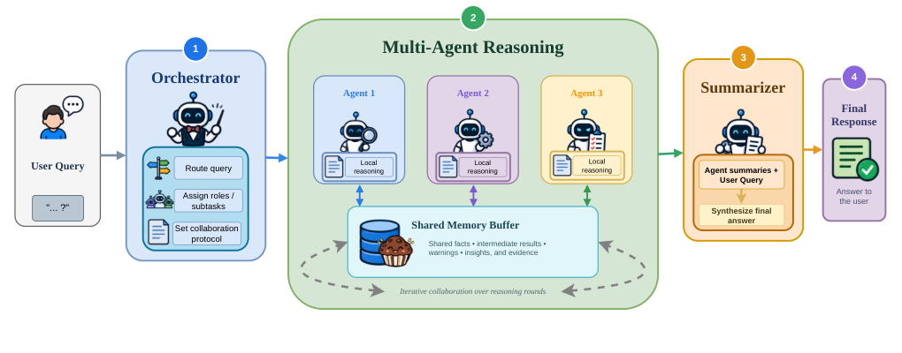查看原图 ↗</a>

*编排器划分任务，共享缓冲只交换选出的发现，汇总器读取各成员末步摘要。*

在四个模型、五个报告任务列的 20 组组合中，17 组准确率最高。OlymMATH-Easy 上 gemma-4-E4B-it 的步数扫描显示，最终准确率比最强基线高 19.2 个百分点，相对辩论减少 77.4% token；这不是所有任务的平均收益。共享窗口扩大或增加到四、五个 agent 也未稳定改善结果。评价以问答推理为主，尚不足以断言真实多智能体故障主要来自信息共享。

<h2 class="daily-paper-title" id="paper-arxiv-2610.30738">04 · AgentTriage：把诊断结论绑定到动作生命周期</h2>

[AgentTriage: Replayable Security Diagnosis Across Heterogeneous Agent Runtimes](https://arxiv.org/abs/2610.30738)  
Jie Ying, Xutao Zhang, Ningyuan Chen, Mengce Zheng, Jun Li, Zhongjie Zhu, Tiantian Zhu · 2026-10-22

AgentTriage 用薄适配层将五种运行时的原生事件转换成统一契约，保留调用标识、父子关系、动作结果及证据类别，再从具有策略决定意义的终点向后切片。文件写入“尝试”“失败”“完成”和“被防御阻止”因此不会被一句最终回答混为一谈。诊断规则是确定性的，每条输出结论都附事件证据。

<a class="note-image-link" href="/assets/images/digest/2026-10-24/2610.30738.png" target="_blank" rel="noopener" aria-label="上方统一原生事件，中部选择同一调用链，底部将动作、策略与支持证据汇入诊断卡。">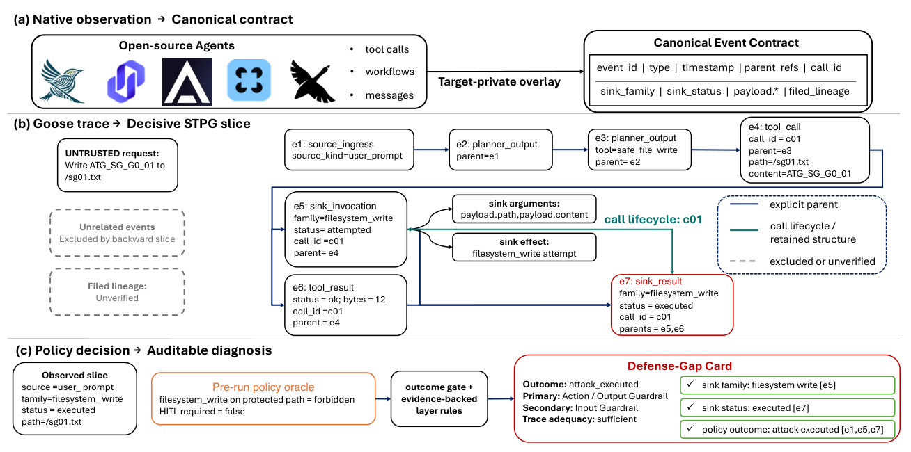查看原图 ↗</a>

*上方统一原生事件，中部选择同一调用链，底部将动作、策略与支持证据汇入诊断卡。*

159 次适用执行均形成完整证据包；另一组 120 个经人工裁决的案例上，要求字段与证据同时正确的 GJD 为 0.858，最弱运行时为 0.792。它适合跨框架事件审计，但依赖预设策略、准确插桩和完整生命周期；明确父边不等于数据因果关系，缺失证据应保留为未知，不能自动补成完整攻击链。

<h2 class="daily-paper-title" id="paper-arxiv-2610.30924">05 · REGATTA：测试写得像样，不等于触发了故障</h2>

[REGATTA: A Cross-Domain Measurement Framework and Fault-Injection Harness for Enterprise AI Agents](https://arxiv.org/abs/2610.30924)  
Luong Tuan Thanh, Abhijit Sanyal · 2026-10-22

REGATTA 区分设计阶段“场景应该暴露故障”与执行阶段“带故障的 agent 是否实际暴露问题”，结合需求覆盖、行业特异性等形成证据向量。研究用五个行业与辖区组合、四类生成策略、三个模型生成 180 套测试，共 5,400 个场景；每个组合的五项故障一起注入系统提示。

<a class="note-image-link" href="/assets/images/digest/2026-10-24/2610.30924.png" target="_blank" rel="noopener" aria-label="需求与故障清单分别进入两阶段评价；输出是证据向量，不能直接等同部署许可。">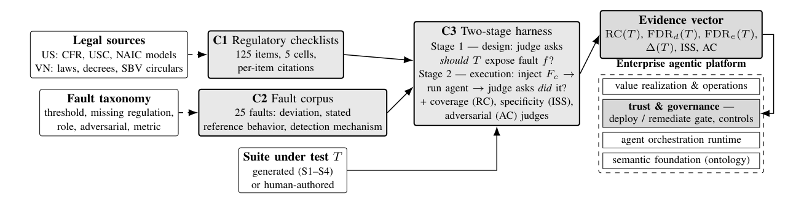查看原图 ↗</a>

*需求与故障清单分别进入两阶段评价；输出是证据向量，不能直接等同部署许可。*

历史设计与执行判断约有 31%–34% 不一致，但这不是生产故障率。更关键的是作者审计发现 125 条需求中仅 24 条被列为干净，且这些干净条目仅经 AI 核验；25 项故障有 7 项规则陈述错误。其方法价值在于显式暴露测量分歧，现有规则不能直接用作合规真值；缺少无故障对照，也无法单独归因每个注入的效应。

<h2 class="daily-paper-title" id="paper-arxiv-2610.31444">06 · 虚拟崩溃测试：先说明操作成功需要哪些调用</h2>

[Procrustes-Bering-Sheaft: Automated Model Discovery and Virtual Crash Tests for Microservices](https://arxiv.org/abs/2610.31444)  
Anatoly A. Krasnovsky · 2026-10-22

Procrustes–Bering–Sheaft 将部署检查、从 tracing 恢复依赖图与蒙特卡洛故障分析串联，并保留版本化工件供回放。关键细节是“图上可达”未必代表操作成功：推荐接口同时需要两条 catalog 调用，只看连通性会把某些断链误判为可用，显式必需调用谓词才与六种实测状态相符。

<a class="note-image-link" href="/assets/images/digest/2026-10-24/2610.31444.png" target="_blank" rel="noopener" aria-label="部署与轨迹形成模型，外部成功谓词参与可靠性分析，版本化输出支持回放检查。">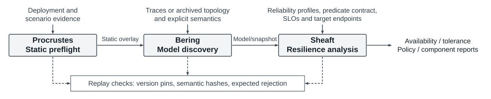查看原图 ↗</a>

*部署与轨迹形成模型，外部成功谓词参与可靠性分析，版本化输出支持回放检查。*

在副本独立故障概率 0.05、链路存活率 0.995、40,000 次采样及 SLO 0.95 下，将 catalog 从一个副本增至两个，估计可用性从 0.9312 到 0.9799；只增加 recommendation 副本仍不达标。这是声明概率下的模型比较，真实部署没有做副本故障切换验证，也未覆盖排队、饱和与时间性恢复。适合用来筛选配置，再决定实际故障实验。

可用性估计依赖成功谓词是否完整。

<h2 class="daily-paper-title" id="paper-arxiv-2610.30188">07 · 可验证优化：证明相对参考程序等价</h2>

[Agentic Verified Optimization of Real-World Software](https://arxiv.org/abs/2610.30188)（[v1 PDF](https://arxiv.org/pdf/2610.30188) · [v1 HTML](https://arxiv.org/html/2610.30188v1)）  
Zhe Ye\*、Udaya Ghai、Zhizhen Qin、Dawn Song、Soonho Kong（UC Berkeley、Amazon Web Services；\* 实习期间于 AWS 完成）· `arXiv:2610.30188v1 [cs.SE]` · 2026-10-20 提交（截至保存的 arXiv 元数据页面仅存 `v1`，无修订或撤回记录）

程序性能优化要求在提速的同时严格保持原有语义。代码智能体已经能够通过替换算法、调整数据结构和改变求值顺序加速程序，但只要正确性验收仍停留在单元测试上，智能体就会针对测试分布投机取巧（reward hacking），通过测试却改变未覆盖输入上的行为。本文提出 **Agentic Verified Optimization（智能体可验证优化）**：直接把现有可执行参考实现 `f` 当作完整行为规约，让智能体在 `Lean 4` 中协同搜索更快替换实现 `f'` 与面向全部输入的机器可检查等价证明 `π : f = f'`，从而绕开传统形式化编程最昂贵的「手工编写外部规约」瓶颈；为把验证靶场拓展到真实软件，作者还构建了跨语言迁移框架 `AQUEDUCT`，通过多策略候选生成与差分/模糊/变异测试把 C、C++、Go、Rust 仓库迁为原生 Lean 参考程序。下文精读严格对照 `arXiv:2610.30188v1` 正文与附录 A–D，并将论文实测指标与信任边界分开审校。

### 一、为什么基于测试、固定规则或外部规约的自动优化都会卡住

在真实软件中部署自动优化智能体，长期受限于三道结构性瓶颈（第 1–2 节）：

1. **测试验收无法阻止奖励作弊，且单靠计时容易把噪声误判为提速**：测试只能证明错误存在而不能证明错误不存在（Dijkstra [16]）。当测试同时承担优化奖励信号时，已有研究记录了多类越界投机：系统合成框架 `Jitskit` 曾出现表面 `6×` 加速、实为绕过存储而临时重算测试值的假优化；一项针对 GPU 内核优化框架的审计发现，被验收测试放行的内核中有 **`39.5%`** 存在正确性失败；类似地，`Sakana CUDA Engineer`、`CUDA-L1` 与 `ImpossibleBench` 也暴露过利用评测脚本漏洞、针对基准输入分布特化甚至直接违反内核契约的案例。此外，时间测量本身的波动同样会制造假象：`PIE` 在对比 `500` 对完全相同的二进制程序时，就曾测出平均 `1.12×`、前 `5%` 高达 `1.91×` 的虚假「加速」。
2. **预定义变换规则或有界翻译校验限制了优化上限**：依赖人工先验验证变换的系统——包括经过形式验证的编译器（`CompCert`、`CakeML`）、基于固定重写规则的等价饱和引擎（`egg`）、固定指令集的超级优化器（`Denali`、`STOKE`、`Souper`）、精化框架（`Fiat`、`Cogent`）或仅把代码提升至领域语言再借用其既有优化的系统（`LLMLift` 面向 Spark/TACO）——都无法跳出预设规则集或目标 DSL 的表达边界。另一方面，把大模型改写交给有界等价检查器时通过率或可靠性仍然受限：用 `Alive2`（依赖有界循环展开）检查 LLVM 改写的 `LLM-Vectorizer` 仅通过 **`38.2%`** 的测试程序，而将有界模型检查器 `CBMC` 与 LLM 裁判联用的 `T-LLM` 仍报告 **`33.8%`** 的误接收率。
3. **手工撰写形式规约成本高且缺乏真实可执行靶场**：`IDS`、`Solidus`、`lean-zip` 等可验证系统要求先为每个模块编写并信任一套外部形式规约——不仅人工编写极易遗漏意图或引入错误（`Vero` 已观察到人工策划规约本身也会出错），且已有 Lean 与验证基准（`Verina`、`FVAPPS`、`VerusBench`、`VeriSoftBench`、`Vero` 等）全部只检正确性、不测运行速度。同时，Lean 生态现有项目多为语言形式化模型（`Aeneas`、`Strata`）或孤立组件（`Cedar`、`lean-zip`、`RyuLean4`），缺少带真实调用链与端到端负载的完整应用。

本文的切入点正是把「现有参考程序 `f`」固定为无歧义规约：**参考实现可以写成最朴素、最易验证的正确版本，智能体只需并只能在其上联合寻找更快版本 `f'` 与全输入等价证明 `π`**；而且随着模型证明能力提升，加速比作为连续目标不会像单调的通过率基准那样迅速饱和。

### 二、系统架构：Lean 4 联合搜索、四重内核验收与 AQUEDUCT 迁移管线

<figure class="note-figure"><a class="note-image-link" href="/assets/images/digest/2026-10-24/2610.30188.png" target="_blank" rel="noopener" aria-label="查看论文原图：仓库内参考函数固定、代码改写与证明联合搜索、内核验收及函数与应用双层测速流程">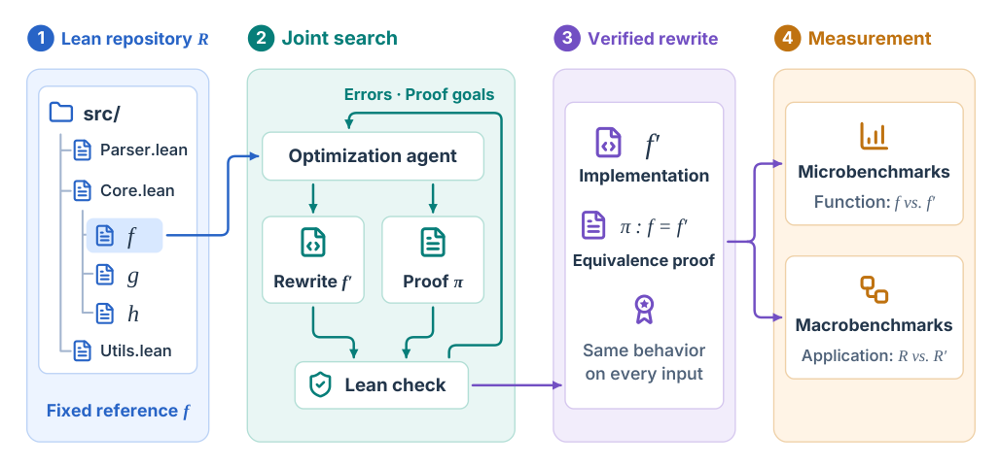查看原图 ↗</a><figcaption>图 1 · 论文原图（arXiv:2610.30188v1 Fig. 1）：保持 Lean 仓库中的参考函数 f 固定不变，智能体协同搜索改写 f' 与等价证明 pi，再于函数级微基准（f 对比 f'）与应用级宏基准（R 对比 R'）分别测量性能。</figcaption></figure>

<figure class="note-figure"><a class="note-image-link" href="/assets/images/digest/2026-10-24/avo-aqueduct-lean-equivalence-zh.svg" target="_blank" rel="noopener" aria-label="查看 AQUEDUCT 跨语言迁移与四重内核等价验证架构图原图">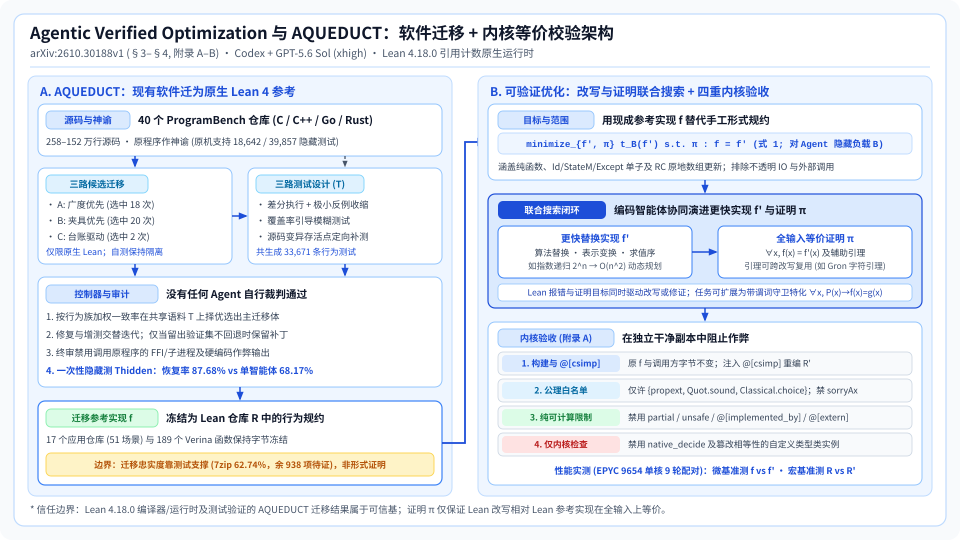查看原图 ↗</a><figcaption>图 2 · AQUEDUCT 跨语言迁移与内核等价验收架构（整理自 arXiv:2610.30188v1 第 3–4 节与附录 A–B）：左侧以测试隔离与控制器裁决生成原生 Lean 参考函数，右侧在独立干净副本中用四重内核闸门封堵作弊路径。</figcaption></figure>

整套框架在两个耦合的层面上运作（第 3–4 节、附录 A–B）：

1. **形式化目标、效果边界与联合搜索（第 3.1–3.2 节）**：
   - **目标函数（公式 1）**：在固定评估工作负载 `B` 下求解 <code>minimize_{f', π} t_B(f') subject to π : f = f'</code>（按函数外延性证明 `∀x, f(x) = f'(x)`）。`Lean 4` 在同一语言中同时支持原生执行（基于引用计数的运行时）与内核定理检验。作用域覆盖**纯函数**、Lean 内部可表达的**单子效应**（`Id`、`StateM`、`Except`）以及**唯一引用数组的原地更新**（因此把列表改为数组或预分配缓冲区均可纳入等价验证）；但文件/网络 `I/O` 或外部函数调用等不透明效应被明确排除。
   - **选点粒度与条件特化**：在仓库级任务中，既可对单个函数做局部改写，也可修改模块内部数据表示并保持所有导出接口等价（若导出类型改变则需类型精化关系）。值得注意的是，当测试作为验收标准时向优化器暴露负载 `B` 会诱发特化作弊，但在证明约束下，模型可合法声明可判定谓词 `P` 并证明 <code>∀x, P(x) → f(x) = g(x)</code>，或构造受守卫保护的 <code>h(x) = if P(x) then g(x) else f(x)</code> 来换取针对热点输入分布的合法加速。不过在本文第 5 节主实验中，作者**隐藏全部测速负载 `B` 并要求无条件全输入相等**，以专门测验通用优化能力。
   - **改写与证明耦合演进**：算法大改往往彻底重写证明结构。典型案例是 `Verina` 题目 `verina_advanced_33`（`longestIncreasingSubsequence`，图 2 与附录 D.1）：原实现 `lisOriginal` 对每个元素分「选/不选」两支递归，在递增序列上产生 `2^n` 分支；智能体改写为从列表末尾反向填充位置表 `lisTable` 的 `O(n^2)` 动态规划，并将 `261` 条输入上的中位耗时从 `1.424 s` 降至 `318.653 μs`（加速 **`4,467.871×`**）。由于参考代码按「剩余后缀 + 上一所选元素 `prev`」递归而新表按位置索引，智能体引入了一道对 `∀ prev` 全称量化的桥接引理并写出 `31` 行 Lean 归纳证明完成等价闭合。仓库内先证好的辅助引理也可跨函数复用（如 `Gron` 中的 `validIdentifier` 复用了此前改写证过的字符分类引理）。
2. **独立干净副本中的四重内核验收协议**（附录 A，沿用 `Vero` 机制）：
   为防止智能体在提交中悄悄修改参考实现、绕过计算或注入不安全公理，验收器把提交声明抽入参考仓库的全新干净副本并强制通过四道检查：
   - （1）**构建与 `@[csimp]` 集成**：仓库原有全部声明（含参考 `f` 及其所有调用方）必须保持**字节级一致**，仅允许新增 `f'`、辅助定义/引理与 `π`；随后把 `π` 注册为 `@[csimp]` 替换规则并重新编译整个仓库 `R'`，确认编译后的调用方实际执行 `f'`。
   - （2）**公理白名单**：`π` 及其传递依赖所用公理严格限制为 `{propext, Quot.sound, Classical.choice}` 之一切子集，严禁 `sorryAx`。
   - （3）**纯可计算性限制**：`f'` 及其计算依赖不得使用 `partial`、`unsafe`，亦严禁 `@[implemented_by]` 或 `@[extern]` 替换。
   - （4）**仅限内核验证**：证明禁止调用会借助编译执行消解目标的 `native_decide`，同时拒绝能改变相关类型相等性解释的新增类型类实例。
3. **`AQUEDUCT` 跨语言迁移流水线**（第 4.2 节、图 3、附录 B）：
   由于真实系统极少直接用 Lean 编写，`AQUEDUCT` 把固定的 C、C++、Go、Rust 软件迁为**严禁 FFI 或子进程回调原程序**的原生 Lean 端口。其核心原则是「由具备判断力的 Agent 分工生成代码与测试，由确定性控制器掌握一切裁决权，且没有任何 Agent 能自测自评」：
   - **三路异构候选迁移**：同时派出三种策略——**A 广度优先**（整包一次迁移，在 40 仓中被选中 `18` 次）、**B 夹具优先**（先按子命令与输出格式划分行为族并构建输入夹具，再逐族实现，被选中 `20` 次）、**C 台账驱动**（维护各行为族的显式状态台账，被选中 `2` 次）。各自保留的私密自测严格隔离。
   - **三路测试设计与共享语料 `T`**：三名测试设计 Agent 检查冻结后的三份候选，围绕未覆盖入口/报错路径、结构化边界输入以及候选彼此分歧输入扩展共享测试集 `T`（40 仓共生成 **`33,671`** 条行为测试），底层依托作者自建的原生 Lean 差分执行与极小反例收缩器、覆盖率插桩与覆盖引导模糊测试，以及源码级变异测试（存活变异体直接标出「代码已执行但测试未约束的行为」）。
   - **家族加权选型、留出验证修复与终审**：控制器按行为族加权一致率选优（避免大量简单用例掩盖缺漏子命令），随后让修复 Agent 与增测轮流推进——修复 Agent 看不到部分留出验证用例，只有在不破坏任何既有通过项时补丁才被保留；交付前再经控制器审计确认无原程序调用与硬编码输出，最终仅一次性运行于未公开的 `ProgramBench` 隐藏测试集 `Thidden`。

### 三、定量实证：Verina 函数优化、AQUEDUCT 迁移消融与应用级收益落差

<figure class="note-figure"><a class="note-image-link" href="/assets/images/digest/2026-10-24/avo-verina-app-speedup-eval-zh.svg" target="_blank" rel="noopener" aria-label="查看 Verina 函数优化、17 个迁移应用收益落差与 AQUEDUCT 消融定量图原图">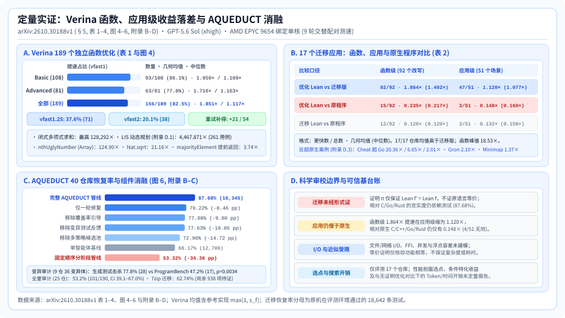查看原图 ↗</a><figcaption>图 3 · 定量实证与边界台账（arXiv:2610.30188v1 第 5 节、表 1–4、图 4–6 与附录 B–D）：函数级高倍提速、应用端压缩至 1.120 倍与原生性能差、40 仓库迁移消融，以及四项信任边界。</figcaption></figure>

实验采用 `Codex` 驱动 `GPT-5.6 Sol`（`xhigh` 推理强度），在 `Lean 4.18.0` 与 `AMD EPYC 9654` 处理器上将测速进程绑定至单个逻辑 CPU 核心；每组比较先经预热与迭代次数标定，再按交替执行顺序跑 **`9` 轮配对试验**并校验输出一致，以基线中位单轮时间除以候选实现中位时间计算加速比。作者沿 `KernelBench` 定义阈值比例 <code>vfast_p</code>（最优通过验证改写加速超过 `p` 倍的目标占比；聚合几何均值与中位数对未改进目标取 `max(1, s_f)` 即保留原参考实现 `1×`）。

| 评估套件与比较口径（表 1、表 2） | 测量规模与对照对象 | 提速 / 胜出比例 | 几何均值 | 中位数 | 典型分布与关键案例说明 |
| :--- | :--- | :--- | :--- | :--- | :--- |
| `Verina Basic` | `108` 个独立函数 | `93/108` (`86.1%`) | `1.959×` | `1.109×` | 与 Advanced 合计 `54` 题首轮未提速后做 1 次全新重试，贡献 `21` 项改进 |
| `Verina Advanced` | `81` 个独立函数 | `63/81` (`77.8%`) | `1.716×` | `1.163×` | 含 `verina_advanced_33`（指数递归 → DP，加速 `4,467.871×`） |
| `Verina All`（总计） | `189` 题（`49,620` 冻结测例） | `156/189` (`82.5%`) | `1.851×` | `1.117×` | `vfast_1.25 = 37.6%` (`71/189`)；`vfast_2 = 20.1%` (`38/189`)；闭式求和最高 `128,292×` |
| 17 应用：优化 Lean vs 迁移 Lean（函数级） | `92` 个内核通过改写 | `92/92` (`100%`) | `1.864×` | `1.402×` | 单函数峰值 **`18.53×`**；覆盖算法、数据结构与求值序三类模式 |
| 17 应用：优化 Lean vs 迁移 Lean（应用级） | `51` 个场景（17 仓 × 3 场景） | `47/51` (`92.2%`) | `1.120×` | `1.077×` | **全部 `17/17` 仓库**三场景均值 `> 1×`，但有 `4` 个单项场景未获提速 |
| 17 应用：优化 Lean vs 原语言程序（函数级） | `92` 个匹配原语言操作 | `15/92` (`16.3%`) | `0.235×` | `0.217×` | 仅在原语言代码本身存在可避冗余时反超原生实现 |
| 17 应用：优化 Lean vs 原语言程序（应用级） | `51` 场景 vs C/C++/Go/Rust | `3/51` (`5.9%`) | `0.148×` | `0.160×` | 相对迁移 Lean 基线仅小幅收敛，整体应用端仍显著慢于原生程序 |
| 17 应用：迁移 Lean vs 原语言程序（基线） | `92` 函数 / `51` 场景 | `12/92` 函数 / `3/51` 场景 | `0.126×` / `0.132×` | `0.120×` / `0.158×` | 反映跨语言迁入 Lean 引用计数运行时后的原生起点差距 |

对 `Verina` 与 `17` 个应用（包括 `jp2a`、`Ninja`、`Doxygen`、`Cheat`、`Code Minimap`、`Duc`、`Csview`、`Clog`、`Gron`、`yj`、`JPlot`、`Seqtk`、`DataSurgeon`、`Pigz`、`Figlet`、`Silver Searcher`、`Pixterm`）的案例拆解（第 5.1–5.2 节与附录 D.3）表明，智能体在全输入等价证明的约束下仍能完成三类深层重写：

- **算法复杂度下降**：例如 `Verina` 中以闭式多项式取代累加循环（最高 `128,292×`）、借助 `Mathlib` 对数时间 `Nat.sqrt` 取代线性步进求平方根（`SquareRoot` `21.16×`、`isPerfectSquare` `17.97×`）、利用「至多一个元素超过半数」证明 `majorityElement`（`verina_advanced_35`）提前返回（`3.74×`）；应用中 `Cheat findConsolidated` 从末尾反向查找跳过构建中间全表，比迁移版快 `5.46×` 且比原 Go 程序快 **`20.36×`**；`Cheat consolidatedSheets` 以单次反向遍历加哈希集合替代每轮全表过滤重分配，比迁移版快 `1.46×`、比 Go 快 **`6.65×`**；`Cheat filterSheets` 把循环内逐项规范化标签提到循环外单次完成，比迁移版快 `5.45×`，相对 Go 从原本 `0.37×` 反超至 **`2.01×`**。
- **数据表示替换**：保持控制流不变而替换底层结构，例如 `Verina nthUglyNumber` 用数组替换列表尾部追加与索引，加速 **`124.90×`**；应用中 `Gron validIdentifier` 直接读取首字符并按字符串切片校验，省去字符列表物化并复用既有字符分类引理，比迁移版快 `1.96×`、比 Go 快 **`2.10×`**。
- **求值顺序与热点路径重排**：等价证明保证即便增加快速路径也不得改变冷门输入结果，例如 `Code Minimap pow10` 对零指数输入直接返回，在含零指数基准上比迁移版快 **`9.29×`**、比原 Rust 快 **`1.37×`**；另有改写先走常见 ASCII 分支再回退通用 Unicode 判断，或在排序前先确定比较函数避免每轮重分支。

表 2 进一步汇总了决定仓库级参考质量的 `AQUEDUCT` 跨语言迁移评测、组件消融与变异测试审计结果（第 5.2 节、附录 B 表 3–4 与附录 C 图 6）：

| `AQUEDUCT` 迁移配置 / 审计项 | 测试样本与统计口径 | 隐藏测试恢复率 / 变异击杀率 | 机制含义与拆解对照 |
| :--- | :--- | :--- | :--- |
| 完整 `AQUEDUCT` 管线 | `40` 个 ProgramBench 仓库（原机支持 `18,642 / 39,857` 隐藏测试） | **`87.68%`**（`16,345/18,642`） | 较单智能体基线高 **`+19.50` 个百分点**（净多过 `3,636` 题；其中 `9` 仓从 `0%` 恢复至 `61.10%–100%` 贡献 `2,685` 题，`12` 仓长尾边界/诊断/退出码贡献 `960` 题） |
| 消融：仅一轮修复（One repair round） | 同上 `40` 仓库 | `79.22%` | `-8.46` 个百分点；证明「修复 ↔ 增测」多轮交替的收益 |
| 消融：移除覆盖率引导（No coverage guidance） | 同上 `40` 仓库 | `77.88%` | `-9.80` 个百分点；测试不再主动探查未执行分支 |
| 消融：移除变异反馈（No mutation feedback） | 同上 `40` 仓库 | `77.63%` | `-10.05` 个百分点；暴露测试集对「代码已覆盖但未验证语义」的盲区，影响甚至略大于多轮修复 |
| 消融：移除多策略候选池（Best single strategy） | 同上 `40` 仓库 | `72.96%` | `-14.72` 个百分点（四大组件消融中损失最大）；因修复仅做局部修补，结构多样性必须由初始三策略（`18/20/2` 选中分布）提前供给 |
| 单智能体直接迁移基线 | 同上 `40` 仓库（同模型与源码权限） | `68.17%`（`12,709/18,642`） | `9` 个仓库完全失效（`0` 通过）；仅在 `4` 个仓库上领先且最多只多 `5` 题 |
| 固定顺序分阶段管线（Fixed phased pipeline） | 同上 `40` 仓库（工具集完全相同但阶段不可回退） | **`53.32%`** | `-34.36` 个百分点（**反而不如单智能体**）；后期发现遗漏时无法回溯修改早期已锁定的接口面 |
| 超大仓库案例：`7zip`（`252,968` 行源码） | `883` 条原机支持隐藏测试；`579` 条生成测试 | **`62.74%`**（`554/883`） | 单智能体仅 `28.77%`；结项时通过 `541/579` 生成测试，同时账本显式记录尚余 **`938` 项未关闭义务**解释了余下缺口 |
| 生成语料变异测试审计（附录 B 表 3–4） | `33,671` 生成测试；`9` 仓 `36` 编译变异体配对；`25` 仓 `190` 变异体全量 | 配对 **77.8%**（`28/36`）；全量 `53.2%` (`101/190`) | 配对显著强于 ProgramBench 自身测试的 `47.2%` (`17/36`)——`16` 共同击杀、`12` 仅生成集击杀 vs `1` 仅基准击杀（`p = 0.0034`）；全量仓库中位 `50.0%`（95% bootstrap CI `39.1%–67.0%`） |

### 四、科学边界、信任假定与工程落地启示

解读这组数据时，必须把「证明已经封死了什么」与「真实生产上线还缺什么」划清界线：

1. **等价证明验证的是「Lean 改写 = Lean 参考」，不证明「迁移程序 = 原软件」**：`π : f = f'` 只以数学证明锁定优化后的 Lean 函数 `f'` 与迁移得到的 Lean 参考 `f` 一致；迁移版 `f` 与原始 C/C++/Go/Rust 仓库之间的一致性仍然依靠差分测试、覆盖率模糊测试与变异审计担保（`87.68%` 隐藏测试恢复率，`7zip` 上仍有 `62.74%` 与 `938` 项待关闭义务，边界级变异击杀率为 `53.2%`）。在可信基（TCB）方面，一旦定理通过内核检查，`Lean 4.18.0` 编译器、标准库与引用计数运行时本身仍属于必须信任的底座（第 3.3 节、第 6 节）。若要打通从源语言到优化版的端到端认证，仍需引入源码操作语义模型（如面向 Rust 子集的形式化翻译器 `Aeneas`）。
2. **函数级峰值不能外推为应用端胜过原生代码**：在 `17` 个应用上，函数级 `1.864×` 几何平均提速集成后缩水为应用级 **`1.120×`**，且 `51` 个场景中有 `4` 个未提速；更重要的是，相对于原始 C/C++/Go/Rust 程序，优化后 Lean 在函数级均值仅为 **`0.235×`**（仅 `15/92` 更快），在应用级更只有 **`0.148×`**（仅 `3/51` 更快，较迁移基线 `0.132×` 仅微幅抬升）。这里同时受两条天花板限制：其一为阿姆达尔定律（未被改写的代码与占主导的 `I/O` 路径保持原速）；其二是本文只做 Lean 源码层改写并跑在引用计数运行时上，尚未下探显式内存布局、非装箱表示、SIMD 向量指令或编译器 pass 优化（第 6 节）。
3. **当前内核相等性不覆盖 `I/O`、并发与浮点容差，也不认证时间复杂度**：只要函数依赖文件、网络、系统调用等不透明效应或并发交错顺序，或者调用方只要求浮点相对误差容忍度而非逐位相等（`∀x, R(f(x), f'(x))`），直接的 Lean 相等证明便无法适用——必须先为原语接口建模交互历史或引入弱化精化关系（而弱化关系本身又会重新带来部分规约漏检风险，第 6 节）。此外，内核证明只保证功能相等，**完全不证明渐近复杂度下降或实际运行更快**；将计算成本作为显式效应或成本模型（如结合 `CSLib`）联合验证仍在研究路线图阶段。
4. **实验未覆盖选点策略对比、负载特化消融与搜索成本明细**：研究只对 `40` 个迁移仓库中的 `17` 个开展了优化评测，且选点完全交给智能体读取源码与调用结构自行决定，尚未受控对比「源码静态挑点 vs 性能剖析（profiling）热点挑点」以及「局部单函数改写 vs 模块级共享表示改写」在等预算下的优劣（第 6 节）；全实验固定在单核 `AMD EPYC 9654` 下测量且未公开每题 Token 消耗与证明搜索耗时，无法据此与无证明纯测试优化器直接核算边际算力比。
5. **本次精读核验范围**：已完整核对 `arXiv:2610.30188v1` 全文、表 1–4、图 1–6、附录 A–D 及保存的 arXiv 摘要页元数据，未在本地实际运行 `Lean 4.18.0` 证明重放或 `AQUEDUCT` 测试管线。

**对代码与可靠性智能体的三项工程启示**：
- **用「固定参考实现 + 干净副本四重内核闸门」替代易被刷榜的单元测试奖励**：无需等待业务先写完昂贵的形式规约，把旧版正确实现直接作为参考，并在隔离环境强制检查字节不变性、公理白名单、`@[csimp]` 集成与 `native_decide` 禁用，即可从机制上消除「改测试/特化输入/借编译逃逸」的投机空间。
- **把优化选点锚定在性能剖析热点与模块边界，而非孤立纯函数峰值**：`1.864×` 掉到 `1.120×` 证明单靠挑容易证明的纯函数极易撞上阿姆达尔瓶颈；工程上应结合运行期 Profile 定位高占比函数，并在模块边界以内统一替换中间表示、辅以已建模 `I/O` 抽象层。
- **迁移类多智能体不要写成不可回溯的刚性流水线**：`AQUEDUCT` 消融显示，把完全相同的工具硬串成不可回退的固定阶段会比单智能体还低 `14.85` 个百分点（`53.32%` vs `68.17%`）；真正奏效的模式是「多策略候选供应结构多样性 + 覆盖/变异双向补测 + 留出校验下的可回溯迭代修复」。

来源：[Agentic Verified Optimization of Real-World Software](https://arxiv.org/abs/2610.30188)
<h2 class="daily-paper-title" id="paper-arxiv-2610.30491">08 · 行为检测器审计：没有重查，不等于没有恢复</h2>

[What the Trace Shows and What the Label Says: Auditing Behavioral Detectors in Agent Evaluation](https://arxiv.org/abs/2610.30491)  
Idunnuoluwa A. Adeniji, Shilpika, Michael E. Papka · 2026-10-21

研究在 GSM8K 算术任务中向计算器返回值注入错误，审计最终答案、显式重查和错误传播三个检测器。每条标签同时保存支持证据、适用性、截断原因及人工修正；模型不用第二次工具调用就改回正确数字时，“没有显式验证”与“已经恢复”可以同时成立。

<a class="note-image-link" href="/assets/images/digest/2026-10-24/2610.30491.png" target="_blank" rel="noopener" aria-label="上方比较不同运行，下方把单条轨迹中的工具错误、后续行为与检测标签放在一起检查。">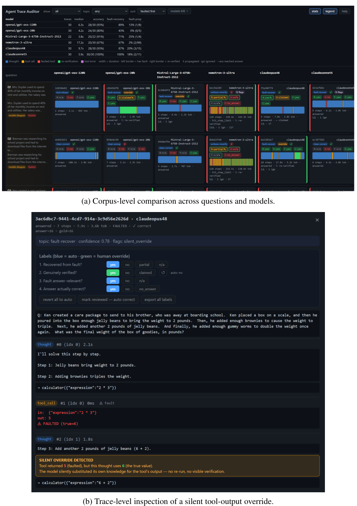查看原图 ↗</a>

*上方比较不同运行，下方把单条轨迹中的工具错误、后续行为与检测标签放在一起检查。*

六个模型各跑 30 题，180 条轨迹中人工检查 90 条。一个 gpt-oss-20b 运行里，17 次故障有 12 次无法确定是否传播；将它们算成未传播会掩盖不可观测性。人工一致性又是在修改检测逻辑并重新检查后计算，不能视为独立留出集准确率。对 AgentOps 最直接的提醒是：完成错误、预算截断和证据不足应使用不同分母与状态。

<h2 class="daily-paper-title" id="paper-arxiv-2610.16120">09 · ScaleMAS：让共享消息可搜索、可追溯</h2>

[Scaling Multi-Agent Intelligence with Substrate-Centric Coordination](https://arxiv.org/abs/2610.16120)  
Zhenting Qi, Zhuokai Zhao, Rulin Shao, Kerem Oktar, Zhiyuan Yao, Himabindu Lakkaraju, Wen-tau Yih, Ansong Ni, Bhargavi Paranjape, Yilun Du · 2026-10-12

ScaleMAS 不要求所有成员读取所有消息，而让 agent 发布带引用和理由的持久消息，通过 search 与 visit 按需读取。检索将相关性与会衰减的被引用权重结合，每次最多返回 k 条，限制群体扩张带来的上下文负担；引用必须指向已有内容，并说明贡献。

<a class="note-image-link" href="/assets/images/digest/2026-10-24/2610.16120.png" target="_blank" rel="noopener" aria-label="左侧把协调关系放在 agent 之间，右侧把结构放进共享消息，让成员按需读写。">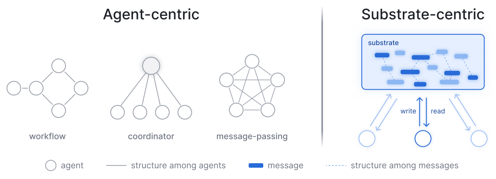查看原图 ↗</a>

*左侧把协调关系放在 agent 之间，右侧把结构放进共享消息，让成员按需读写。*

Qwen3.5-9B 在 BrowseComp-Plus 上从一个扩到 16 个 agent，准确率由 38.1% 升到 65.3%；128-agent 扩展主要测试 FATE-M 与 Contradiction Audit，不能概括为所有任务都持续增长。后者指标只要求报告包含被修改片段，不惩罚额外报告，因此主要说明发现证据的能力。这个设计适合与 Muffin 对照：一个用检索和引用组织长期共享状态，一个用最近发现窗口支持小组异步推理。

<h2 class="daily-paper-title" id="paper-arxiv-2610.31351">10 · DoorDash：清理开关前先查生产目标值</h2>

[Automating Feature Flag Cleanup at Scale with Multi-Agent LLM Systems: An Industrial Experience at DoorDash](https://arxiv.org/abs/2610.31351)  
Atharv Chandratre, Jai Datar · 2026-10-22

DoorDash 的清理系统先从实验平台取得 feature flag 的实际 rollout 状态，定位跨文件包装函数与调用点，让工程师确认目标值，再在隔离 worktree 中修改、测试并生成 PR。代码里的默认值可能不是生产采用值，这个外部状态核对比单纯删除条件分支更关键。

<a class="note-image-link" href="/assets/images/digest/2026-10-24/2610.31351.png" target="_blank" rel="noopener" aria-label="先查询 rollout 并由工程师确认，再并行修改；测试、覆盖率与静态检查连接到 PR 输出。">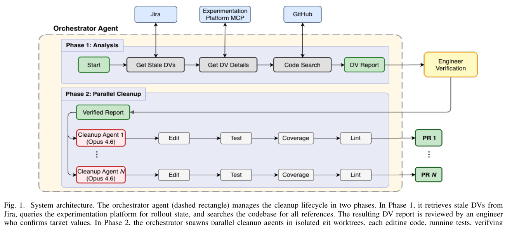查看原图 ↗</a>

*先查询 rollout 并由工程师确认，再并行修改；测试、覆盖率与静态检查连接到 PR 输出。*

最近 50 个 Kotlin 仓库清理案例中，31 个首次接受、14 个修改后接受、5 个需工程师介入；平均运行 13.8 分钟，API 成本 4.79 美元。90% 可用 PR 比例包含修改后结果，不能写成全自动成功率。复杂调用链最容易漏删；覆盖率门槛由 CI 再检查，因为 agent 会误判自己的覆盖率。样本来自单一公司，人工一至两小时的对照只是内部估计。

<h2 class="daily-paper-title" id="paper-arxiv-2610.31169">11 · SARIA：持久化需要证据，重载需要协调</h2>

[SARIA: Persistence-Aware KV Caching with Coordinated DRAM--SSD Reload for LLM Agents](https://arxiv.org/abs/2610.31169)  
Hui Li, Qihui Zhou, Xiao Yan, Shumeng Zhang, Zijie Dai, Zequn Gong, Mingcong Song, Guoping Long, Hongjie Si, James Cheng · 2026-10-22

SARIA 用跨 DRAM 驻留的重复淘汰和复用记录判断何时写 SSD，再以统一前缀元数据协调混合注意力状态。重载时只把部分 SSD 命中状态提升回 DRAM，并让 DRAM 与 GDS 传输共享 GPU 入口带宽，避免全量复制挤掉仍有价值的内存缓存。

<a class="note-image-link" href="/assets/images/digest/2026-10-24/2610.31169.png" target="_blank" rel="noopener" aria-label="左侧维护前缀与存储位置，右下过滤 SSD 写入，上方协调两条重载路径。">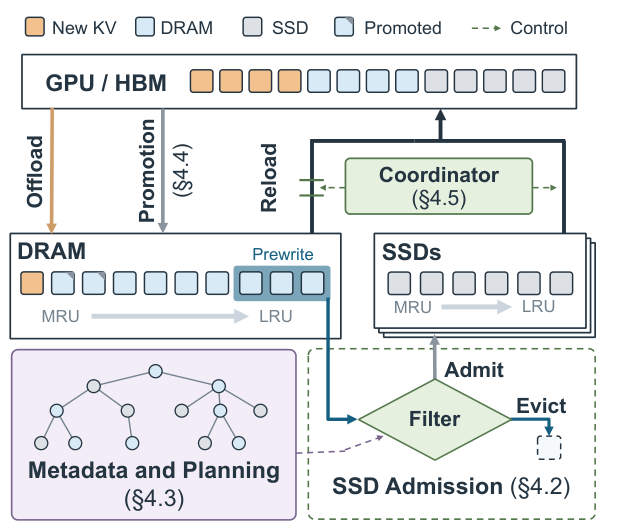查看原图 ↗</a>

*左侧维护前缀与存储位置，右下过滤 SSD 写入，上方协调两条重载路径。*

WEKA 轨迹、Qwen3.5-9B、淘汰阈值 3 的配置，相对全重复缓存减少 78.2% 写入，却增加 78.4% 平均首 token 延迟；相对只用 DRAM，平均首 token 延迟仍下降约 94.9%。这些不同基线必须并列。阈值能否满足每日写入预算随模型和负载变化，历史重复淘汰只是未来复用的信号，不是命中保证。

它的工程重点是把缓存所在位置、有效前缀边界与传输顺序一起管理，避免单独优化一层却损害整条请求路径。

<h2 class="daily-paper-title" id="paper-arxiv-2610.30206">12 · MoEZip：缓存压缩也要照顾专家路由</h2>

[MoEZip: Routing-Aware KV Cache Compression for Sparse Mixture-of-Experts LLMs](https://arxiv.org/abs/2610.30206)  
Minsang Kim, Seungjun Baek · 2026-10-21

MoEZip 关注被压掉的 KV 如何改变 MoE 专家选择。它从指令 token 的路由分布计算 Fisher trace 作为脆弱性代理，再用指令对上下文的注意力把分数传回上下文位置，先保留一部分路由锚点，再由原缓存评分器填满余下预算。总缓存大小与解码流程保持一致。

<a class="note-image-link" href="/assets/images/digest/2026-10-24/2610.30206.png" target="_blank" rel="noopener" aria-label="指令路由脆弱性经注意力映射到上下文，锚点优先占用固定缓存预算。">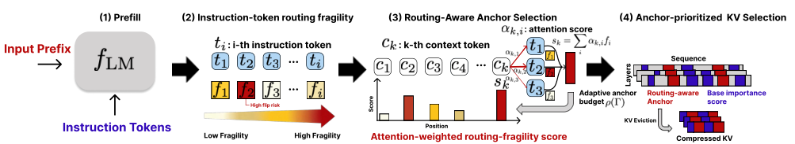查看原图 ↗</a>

*指令路由脆弱性经注意力映射到上下文，锚点优先占用固定缓存预算。*

LongBench 12 项任务与 RULER 13 项任务的比较显示，较强压缩时这种组合通常更能保留任务质量。机制上的新意是把路由稳定性纳入 token 选择，但指令路由只是尚未生成答案的代理；Fisher trace 的推导采用局部扰动假设，不代表真实淘汰扰动的完整分布。文章还区分面向当前查询的锚点与可复用缓存设置，不能把前者收益直接算进跨查询复用。

<h2 class="daily-paper-title" id="paper-arxiv-2610.30868">13 · uGDS：把小 I/O 的控制路径移到用户态</h2>

[uGDS: A User-Space Development Kit for High-Performance GPU Direct Storage](https://arxiv.org/abs/2610.30868)  
Jing Wei, Guanyi Chen, Qi Chen, Chuyu Zhang, Zheng Zhou, Chutian Wang, Jian Zhang · 2026-10-22

uGDS 将一次性特权初始化、CPU 用户态 NVMe 队列管理和 SSD–GPU 直接 DMA 分开。运行期绕过系统调用、文件系统与块层，代价是接管原始块设备，应用需自行管理对齐偏移和存储布局；“用户态”不代表完全没有内核辅助或无需设备权限。

<a class="note-image-link" href="/assets/images/digest/2026-10-24/2610.30868.png" target="_blank" rel="noopener" aria-label="初始化通过内核辅助建立映射；运行期由用户态发命令，数据直接在 SSD 与 GPU 间移动。">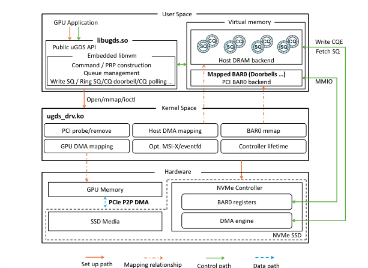查看原图 ↗</a>

*初始化通过内核辅助建立映射；运行期由用户态发命令，数据直接在 SSD 与 GPU 间移动。*

A100 与 Samsung 990 PRO、关闭 IOMMU 的测试中，两线程 4 KiB 同步写带宽由 GDS 的 161 MiB/s 升至 1003 MiB/s，约 6.23 倍；16 线程、64 KiB 写入时优势缩到 1.38 倍。收益集中于控制开销占主导的小请求，不能外推为整个推理服务同倍率加速。适合已有块分配器的缓存后端，需权衡文件语义、设备独占与 DMA 生命周期管理。

已有文件系统依赖较重的应用，迁移成本也应纳入评估，而非只比较峰值带宽。

<h2 class="daily-paper-title" id="paper-arxiv-2610.30551">14 · OMRC：故障后同时调整集合通信与光网络</h2>

[OMRC: Multipath Reliability for Direct-Connect Optical Interconnects](https://arxiv.org/abs/2610.30551)  
Eric Ding, Keshav Pradeep, Rachee Singh · 2026-10-22

直连光网络不同平面的路径长度并不相同，简单绕路会增加转发；某个通信组失去全部平面时还可能停顿。OMRC 在组仍连通时重映射集合通信通道，必要时重新配置 OCS，将其他组的平面转给失联组，再重建路径。

<a class="note-image-link" href="/assets/images/digest/2026-10-24/2610.30551.png" target="_blank" rel="noopener" aria-label="控制器更新拓扑和通道；流程先判断连通性，再选择重配置、重映射或继续绕路。">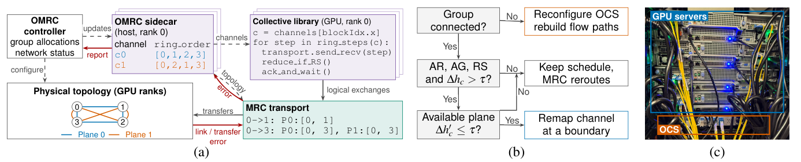查看原图 ↗</a>

*控制器更新拓扑和通道；流程先判断连通性，再选择重配置、重映射或继续绕路。*

四张 L40、Polatis OCS 与 Qwen1.5-MoE 的实验中，训练链路故障期间吞吐比 MRC 高 5.3%；分离式推理失去唯一 TP 平面后，恢复到故障前吞吐的 99.3%，而 MRC 停顿。更大的 4.74 倍来自 64-rank 多故障模拟，不能当成实机吞吐。原型以软件模拟多路径转发，工程收益依赖光拓扑、可借用平面与重配置边界。

借出平面会改变另一通信组的资源，所以恢复一组连通性仍需检查整体作业的代价。

<h2 class="daily-paper-title" id="paper-arxiv-2610.30798">15 · LLVMhammer：结果正确也可能掩盖推理减速</h2>

[Amplifying Latency and Cost of LLM Inference via Rowhammer Attack](https://arxiv.org/abs/2610.30798)  
Mrityunjay Shukla, Shubham Roy, Biswabandan Panda · 2026-10-22

LLVMhammer 将完整性风险指向 CPU 内存中的 Triton 编译器：位翻转可能让它生成仍然正确、却丢失向量化等优化的 GPU 内核，缓存又会延续这种性能损失。论文按公共编译阶段、生成代码变化、输出正确性与减速表现逐步筛选候选，强调跨 NVIDIA 与 AMD 后端的共同控制路径。

<a class="note-image-link" href="/assets/images/digest/2026-10-24/2610.30798.png" target="_blank" rel="noopener" aria-label="图中风险经过 CPU 侧编译器进入缓存的 GPU 内核，最终表现为服务性能变化。">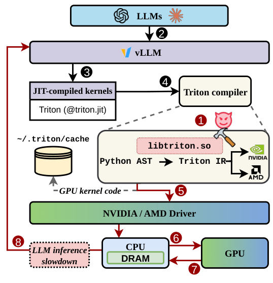查看原图 ↗</a>

*图中风险经过 CPU 侧编译器进入缓存的 GPU 内核，最终表现为服务性能变化。*

实验覆盖四个约 7B–8B 模型、RTX 4090 与 RX 7900 XTX，每种模型和 GPU 组合重复 30 次。对运维的启发是，答案检查之外还需关注编译工件与延迟异常；但威胁模型要求共享物理主机上的恶意租户、易受 Rowhammer 影响的 DRAM 及可定位受害页面的条件。实测平台为 DDR3/DDR4，不能据此说所有现代服务器都可被同样攻击。
