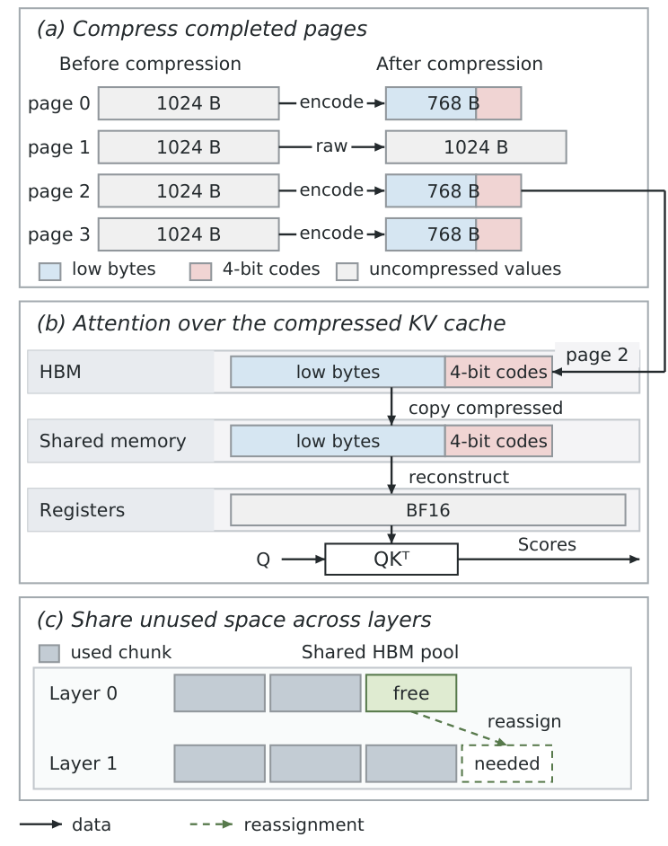
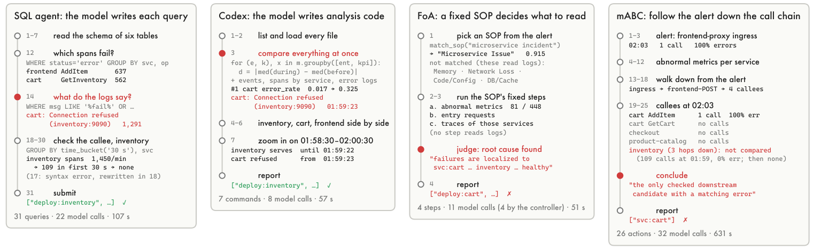
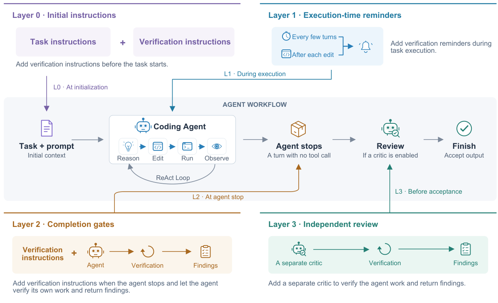
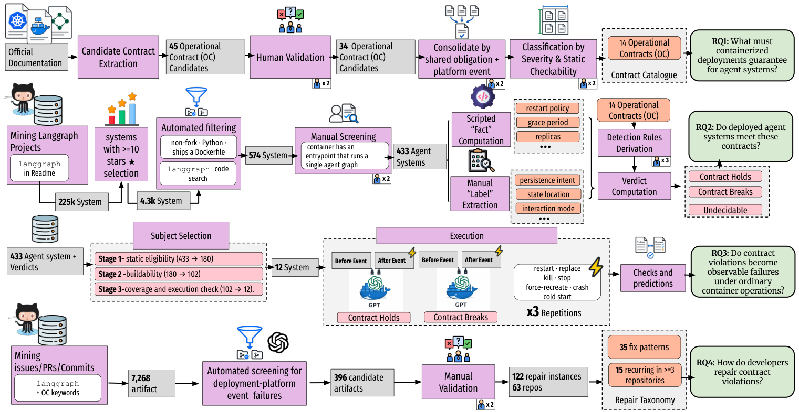

## 本期导读

15 篇论文、4 篇技术笔记。原文发表日期与本期阅读日期分别记录。

<h2 class="daily-paper-title" id="paper-arxiv-2609.36800">01 · AI Lowering：直接从 Triton 生成 PTX</h2>

[AI as a Compiler: Compiling Triton kernels without the Triton compiler](https://arxiv.org/abs/2609.36800) 
François Costa、Charly Castes、Thomas Bourgeat、Azalia Mirhoseini · arXiv · 2026-09-29

作者让 Agent 将 Triton kernel 直接转成 NVIDIA PTX，并在评测环境中检查候选实现。论文在指定的常见及近期研究 kernel 上报告相对自动调优 Triton 的性能范围为 0.83—3.34 倍，既有加速也有变慢；它还扩展 PTX 验证器以覆盖部分 Blackwell 特性。结果依赖 kernel、硬件和验证能力，不能理解为已用模型替代通用编译器。

<h2 class="daily-paper-title" id="paper-arxiv-2610.33719">02 · ZipFusion：压缩 KV 一直保留到 attention 寄存器</h2>

[ZipFusion: Fusing Lossless KV Decompression with Attention for Efficient LLM Decoding](https://arxiv.org/abs/2610.33719) 
Chen, Yuetao, Wang, Peng, Xu, Hong · 2026-10-24

以往无损 KV 压缩常在 attention 前恢复完整缓存，省了传输却没省反复读取 HBM。ZipFusion 将 BF16 指数编码与 attention 布局共同设计：符合指数范围条件的块用 12 位保存原来的 16 位信息，不合条件则保留原格式；线程在寄存器中恢复原始比特，无需完整解压缓冲区。

H100 80GB 上，两个 8B 模型的 decode attention 加速约 1.23–1.25 倍。8K 输入、相同显存预算且各自取最大 batch 时，相对未压缩 SGLang 的 decode 吞吐最高提高 26.3%。这组计时排除 prefill 和初始压缩，新生成 KV 未压缩，不能直接当作端到端服务收益。

值得读的是压缩格式、读取布局和跨层内存回收如何协同，而非仅比较压缩率。

<a class="note-image-link" href="/assets/images/digest/2026-10-28/zipfusion.png" target="_blank" rel="noopener" aria-label="ZipFusion 页面压缩、寄存器重建与跨层内存回收 · 查看原图 ↗">查看原图 ↗</a>

*从上到下：合适的块变小；attention 在寄存器内重建；释放的内存块可跨层重新分配。*

<h2 class="daily-paper-title" id="paper-arxiv-2610.35336">03 · Megakernel 边界：融合并非越大越好</h2>

[One Megakernel is Not Enough: Predicting Where to Cut for Streaming Inference](https://arxiv.org/abs/2610.35336) 
Aditya Chatterjee、Anand Joseph X M、Sanjay Singh Chauhan · arXiv · 2026-10-26

流式推理的不同阶段有不同速率和资源需求：将所有算子融合成一个持久 kernel，可能降低启动开销，却也可能让不匹配的阶段争用资源。作者根据常规执行图 profile、单算子测量及实现约束，模拟候选融合区域和事件依赖，预测首个输出时间并选择切分位置。

在 H100 NVL 上的三个模型和 13 种模型—批大小组合中，论文报告规划器均选中所测最佳布局；具体最佳方案从零到四个 megakernel 不等。以一个 TTS 模型、batch 32 为例，三个专用 megakernel 的首个音频输出时间比单一 megakernel 缩短 21.4%。这是有限模型、硬件和候选实现下的结果，不是所有模型都应切成三个。

<h2 class="daily-paper-title" id="paper-arxiv-2610.34907">04 · Hopper TMA：何时使用硬件异步拷贝</h2>

[When and Why to Use TMA: A Workload-Grounded Characterization of Tensor Memory Acceleration on NVIDIA Hopper GPUs](https://arxiv.org/abs/2610.34907) 
Christin David Bose、Cesar Avalos Baddouh、Junrui Pan、Timothy G. Rogers · arXiv · 2026-10-26

这项测量从 FlashAttention-3 等真实 kernel 的访存选择出发，对比 TMA、`cp.async` 及跨 block 的数据共享。作者指出，TMA 的优势取决于传输规模和描述符复用：小传输或低复用下，额外开销可能使 `cp.async` 更合适；多播也不总是有利。结论主要基于 H100，并在 B200 上做了扩展比较，具体交叉点随硬件和负载变化。

<h2 class="daily-paper-title" id="paper-arxiv-2610.33501">05 · DualPace：让 CPU 成为独立的解码资源</h2>

[DualPace: Decoupled Scheduling and Cooperative GPU–CPU Decoding for LLM Serving](https://arxiv.org/abs/2610.33501) 
YuXuan Lin、KeQiang Wu、Kingsum Chow · arXiv · 2026-10-24

将 KV Cache 卸载到主存可以扩大容量，但如果 CPU 请求只能等待 GPU 调度器提供空隙，主存就不是独立的服务资源。DualPace 为 GPU 和支持 AMX 的 CPU 分别调度解码：CPU 可完成整个解码迭代，也可在部分阶段请求 GPU 协助；路由和批量配置依赖离线性能测量。

论文在解码密集场景报告，同等延迟下服务吞吐相对 NEO 提高 6.9%—43.2%。例如一个实验使用 RTX 4090、12 个 Intel Xeon Silver 4510 物理核和 Llama-3.1-8B。结果依赖具体硬件、模型与负载，不能理解为所有 CPU 卸载都会获得该提升。

<h2 class="daily-paper-title" id="paper-arxiv-2610.34006">06 · InferScale：预测的价值在于赶上冷启动</h2>

[InferScale: Kubernetes-Native Predictive Autoscaling for SLO-Aware AI Inference](https://arxiv.org/abs/2610.34006) 
Huang, Wen · 2026-10-25

InferScale 在 Kubernetes 副本控制层组合短期趋势预测、SLO 状态、突增快速路径和租户优先级；每五秒读 Prometheus 指标，并用健康阶段的样本估计单副本能力，避免把过载吞吐下降误认为正常容量。它不替换调度器。

AKS 上 ResNet-50 的 CPU 推理实验，冷启动约 21 秒，三次 ramp-burst 运行的 SLO 达标率从外部指标 HPA 的 47.8%±1.5% 升到 65.3%±9.0%。代价也可见：平均副本数由 2.1 增至 5.5。另一个受控多租户实验稳定了 Gold 租户，低优先级延迟却可能变差。

这项工作提示扩缩容评价要同时看启动时间、资源占用和谁承担争用。它不是 GPU/LLM 实测；LLM 的 prefill/decode、KV 压力与动态 batch 仍需不同容量模型。

<h2 class="daily-paper-title" id="paper-arxiv-2610.34422">07 · GPU 到 TPU：迁移成功不等于训练语义一致</h2>

[From GPU to TPU with Coding Agents: What Works, What Fails, and What It Costs?](https://arxiv.org/abs/2610.34422) 
Hui Sun、Anderson Uchôa、Wesley K. G. Assunção · arXiv · 首次提交 2026-10-25，修订 2026-10-29

作者收集 148 个 PyTorch 研究项目，并实际让编码 Agent 将其中十个从 GPU 迁移到 TPU，分别检查可运行性、数值行为、硬件使用、项目目标和成本。十个项目中八个达到作者的项目目标标准；70 次执行尝试中有 53 次失败，其中 26 次没有抛出错误。

一个四芯片迁移案例中，程序运行结束且 Agent 报告成功，但梯度裁剪位置发生变化，准确率从 86.53% 降到 84.89%。这说明“进程成功退出”不足以证明训练语义保持；独立参考运行、目标硬件上的行为核验及人工成本都应纳入验收。实际迁移样本只有十个项目，结果不应泛化为所有迁移的成功率。

<h2 class="daily-paper-title" id="paper-arxiv-2610.35767">08 · RCA：让模型自己选择证据，是否比固定诊断流程更有效？</h2>

[Free to Look, Free to Reason: Simple LLM Harnesses Outdiagnose Hand-Crafted Root Cause Analysis Agents](https://arxiv.org/abs/2610.35767) 
Bi, Tingzhu, Zhang, Xun, Li, Jinglin, Wang, Ping, Ma, Meng · 2026-10-26

微服务根因分析常把专家经验写成标准流程、角色分工和固定检查阶段。但系统已经提供日志、指标和调用链时，这些控制是否仍能帮助强模型？这篇工作把三种简单 harness、五种已发表 LLM RCA 方法与统计、因果方法放到共同数据上比较，直接检验了一个经常被略过的基线：让模型自己决定查什么。

### 先统一案例，再比较控制权

作者构建 RCAtlas，将八个公开数据来源转换成统一格式，从经过有效性审查的案例中选出 90 个，覆盖 23 个场景。输入包括异常时间段、事前窗口、实体清单及可用遥测；输出是根因实体排序。评分会把更细的容器、Pod 答案映射到数据集标注层级，避免方法仅因答案粒度不同而失分。

三种简单方案的自由度并不一样：one-shot 接收规则整理的证据包；SQL agent 自行查询遥测；Codex 自行编写分析代码。前者仍受到证据预处理约束，后两者才能动态改变调查路径。它们的共同点是没有把领域调查步骤固定成必须执行的模型调用链。

<a class="note-image-link" href="/assets/images/digest/2026-10-28/rca-investigations.png" target="_blank" rel="noopener" aria-label="四种 RCA 调查路径及其读取的证据 · 查看原图 ↗">查看原图 ↗</a>

*左侧两种方案主动读取日志并检查下游；右侧固定流程把调查停在症状服务。红点标出决定性步骤。*

一个案例中，cart 大量报错，真正的故障却是 inventory 不再接收请求。自由查询方案读到连接拒绝日志，再检查下游请求量骤降；固定 SOP 没有日志步骤，沿告警调用链推进的方案也遗漏了已经没有调用的下游。这解释了固定流程如何错过决定性证据，而非只展示总分差距。

### 准确率之外，要分清模型、重复运行和成本

主表中简单方案 PR@1 为 65.3%–77.2%，已发表 LLM 方法为 15.6%–53.3%，最强非 LLM 基线 NSigma 为 38.9%。这是主表所用中档模型的汇总，部分方法与模型组合未运行；不能理解为所有方法都在完全填满的模型矩阵上取得该区间。对共同运行的模型，简单方案仍占优。

更强模型主要减少重复运行的不稳定，多轮工具使用主要增加至少一次解题成功的机会；提高推理强度则可能增加大量时间而仅换来少量准确率。这个拆分比单次最高分更适合判断事故诊断系统：需要的是稳定找到根因，而非偶尔走通。

**值得优先阅读的是共同评测与失败轨迹。** 部分基线经过重实现或适配，研究只测试一种通用编码 harness；单个案例和“预设调用比例”也没有构成控制流程导致低分的因果消融。因此，结论支持把简单 harness 作为强基线，并重新审视强制 SOP 的代价；它没有证明领域知识无用。将经验作为可选择的指导，再保留读取原始证据的通道，是这一结果提出的自然问题。

<h2 class="daily-paper-title" id="paper-arxiv-2610.34748">09 · MANDATE：从用户经历理解 Agent 委托失败</h2>

[Babysitting AI Agents: A User-Centered Taxonomy and Study of Agentic Delegation Failures](https://arxiv.org/abs/2610.34748) 
Shravika Mittal、Sunnie S. Y. Kim、Scott Counts、Jennifer Neville、Debarati Das、Philippe Laban · arXiv · 2026-10-26

Agent 完成任务并不意味着它按用户预期完成了委托。作者分析来自八个 Reddit 社区的 163,487 条相关帖子，其中 4,367 条被识别为包含至少一种委托失败，提出涵盖七组、23 类失败的 MANDATE 分类，包括误导性呈现、越过自主权限边界、偏离指令和运行不终止等。随后研究邀请 73 名有经验的 Agent 用户评价这些情境，发现被评为更严重的失败也往往被认为更难察觉。

这项工作提醒我们，可靠性评测除了最终答案，还要看用户能否发现 Agent 偏离意图、是否越过授权边界。Reddit 内容属于自选报告，偏向编码相关社区；163,487 是语料总数而非失败数，样本也不能代表所有 Agent 用户。73 人情境研究反映的是该样本的感受，不是线上真实故障发生率。

<h2 class="daily-paper-title" id="paper-arxiv-2610.34577">10 · 验证 harness：独立复核比反复要求自查更划算</h2>

[Rethinking Verification in Agent Harnesses](https://arxiv.org/abs/2610.34577) 
Zhang, Zhengxin, Zhu, Erkang, Lin, Yin, Cardie, Claire, Ding, Bolin, Zhou, Jingren · 2026-10-25

作者比较初始指令、运行中提醒、完成门禁和独立 reviewer 四层共 17 种设计。独立 reviewer 在新上下文中读取任务与修改，访问同一个沙箱执行检查，但不直接修改交付物；问题返回主 Agent 修复。

七个编码模型在 Terminal-Bench 与 SWE-bench Verified 的选定子集上，独立复核平均分别提高 5.9–9.5、3.9–6.6 个百分点，总成本含复核和修订，为基线的 1.13–1.25、1.00–1.04 倍。反复拒绝完成也能改善成绩，但代价更高。完整轨迹不总比“任务＋修改”更好，且增加 reviewer 成本。

这为 AgentOps 提供了可比较的验证位置和成本设计；收益是跨模型平均，个别组合仍退步，也不是完整榜单成绩。值得看 reviewer 如何构造主 Agent 未测试过的反例。

<a class="note-image-link" href="/assets/images/digest/2026-10-28/verification-layers.png" target="_blank" rel="noopener" aria-label="四层验证在 Agent 生命周期中的位置 · 查看原图 ↗">查看原图 ↗</a>

*沿中间执行链读：前三层要求主 Agent 检查，最后一层由独立 reviewer 返回发现。*

<h2 class="daily-paper-title" id="paper-arxiv-2610.34594">11 · NovaFabric：Agent 执行记录的封存与重放</h2>

[NovaFabric: A Black-Box Recorder for AI Agents with Sealed, Replayable, Diffable and Auditable Runs](https://arxiv.org/abs/2610.34594) 
Mohsen Seyedkazemi Ardebili · arXiv · 2026-10-25

NovaFabric 将模型调用、工具调用和运行环境记录为可封存的运行包，并提供按明确契约进行的模拟重放、差异比较和证据导出。报告强调，远端模型会变化，重新调用不等于逐字节重现；签名完整也不自动证明内容可信。这里是实现者的系统参考报告，不是新的独立效果评测；报告自身也指出脱敏扫描有盲点，完整提示与回复捕获的默认行为尚未满足其理想设计。

<h2 class="daily-paper-title" id="paper-arxiv-2610.34938">12 · Harness 自演化：写下经验不等于后续少走弯路</h2>

[How Do Coding-Agent Harnesses Self-Evolve? An Empirical Study of Retrospective Adaptation](https://arxiv.org/abs/2610.34938) 
Treude, Christoph, Baltes, Sebastian · 2026-10-26

作者让 Claude Code 在 30 个 SWE-bench Verified 任务后运行回顾，得到 125 条建议；人工选择后实施 24 条，最终评估 12 项改动在同仓库后续任务中的迁移。每个条件用新的会话和容器，重点观察目标行为是否再次发生。

七个有信息量的评估中，两项消除了目标行为，一项减少，四项没有减少。写明正确测试入口能避免反复调用不存在的 pytest；不完整的已知失败列表却可能让 Agent 在无关任务上多做检查。一例虽然消除了错误命令，附带 lint 指令仍使中位耗时从 88 秒升到 156 秒。

这是人参与选择的小样本行为研究，不是全自动自改进成功率。它给 AgentOps 的具体启示是分开检查：问题是否出现、经验是否被读取、行为是否改变、任务结果与总成本是否改善。

<h2 class="daily-paper-title" id="paper-arxiv-2610.34817">13 · CACHELINT：答案没错，缓存集成也可能悄悄失效</h2>

[Silent and Costly: Characterizing and Detecting Prompt-Caching Mis-Integration in LLM Agents](https://arxiv.org/abs/2610.34817) 
Zhang, Ying, Guo, Ruoqi, Liu, Yi, Deng, Gelei, Li, Yuekang, Liu, Yepang, Zhang, Leo · 2026-10-26

Agent 输出正确、HTTP 请求成功，并不意味着提示缓存工作正常。缓存前缀里多了时间戳、模型改名后漏过能力判断、返回的缓存 token 被错误计费，都可能让系统继续回答，却持续增加成本，甚至让观测面板掩盖问题。本文把这类故障作为独立的软件集成问题研究。

### 请求侧与读数侧需要不同检查

作者从十个开源 Agent 系统的已合并修复中确认 120 个案例。97 个发生在请求侧，23 个涉及返回用量的处理；108 个没有显式错误，其中既有缓存失效造成的浪费，也有缓存实际正常、统计却错误的情况。因此，“没有异常”和“面板显示命中”都不能独立充当缓存正确性的判据。

独特之处是把缺陷表示成“调用位置＋必须成立的前置条件”。CACHELINT 用 CodeQL 定位缓存指令和用量字段，再分别检查前缀稳定性、提供商能力与计量安全。对于时间戳或非确定序列化，需要判断改变的值是否真的进入缓存区、上游是否已有规范化；看到一个时间函数就报错会产生大量误报。

提供商能力又是另一类事实：同一模型、TTL 或缓存标记，在不同 API 上可能有不同语义，并会随时间变化。方法使用带核验日期和官方来源的能力表进行比较，不让模型凭训练记忆推测当前提供商支持什么。LLM 则负责有限代码上下文中的 guard 判断，例如已有排序或空值保护是否解除风险。

### 检出结果必须和规则来源一起看

在形成规则的十个项目上，作者报告 precision 0.71、recall 0.78。该召回率来自规则同源的数据，论文明确把它视作样本内上界，而非独立泛化估计。另在 571 个项目中，37 条告警经人工检查得到 32 个真实问题和五个误报，precision 为 0.86；因没有穷尽缺陷标签，这组实验不能计算 recall。正文报告已有 21 项开发者确认、18 项修复。

单点模型也有明确盲区：跨轮次修改历史、不同调用重新组装前缀，需要比较多个执行快照。120 个案例中的这两类共有 24 个，构成大多数漏报。LLM 还可能漏看实际存在的 guard，能力表本身也要更新。

**值得关注的是把“正确运行”扩展到成本语义和计量语义。** 对 Ops4LLM，缓存检测不应只有一个命中率，而应同时解释请求前缀、提供商能力、响应字段与账单之间是否一致。论文给出了可落到代码位置的检查框架，但它仍需要运行时证据补足跨调用行为。

<h2 class="daily-paper-title" id="paper-arxiv-2610.34620">14 · 容器化 Agent：保存状态、恢复任务与完成停机是三种保证</h2>

[Built to Remember, Shipped to Forget: Operational Contracts, Failures, and Repairs in Containerized LLM Agent Deployments](https://arxiv.org/abs/2610.34620) 
Mastouri, Meriem, Ksontini, Emna, Barrak, Amine · 2026-10-25

Agent 框架可以保存对话、暂停等待人工输入、从检查点继续执行；Docker 和 Kubernetes 则允许随时重启、替换或强制终止容器。两边各自符合文档，也可能在组合后失效。这项研究把接缝明确为“运维契约”：某个平台事件发生时，部署必须提供什么保证，才能保住 Agent 原本承诺的行为。

### 从两套文档推导可检查的义务

作者联合阅读 LangGraph 与 Docker、Compose、Kubernetes 的一手文档，提取、人工验证并合并出 14 项契约，覆盖保存状态、运行中工作、客户端和外部资源。一个直观例子是：框架允许后台任务在退出时排空 180 秒，容器却只给 10 秒就发送强制终止信号。实现了优雅停机函数，也无法弥补平台不给它运行时间。

<a class="note-image-link" href="/assets/images/digest/2026-10-28/operational-contracts.png" target="_blank" rel="noopener" aria-label="从官方文档到部署检查、故障注入及修复分析的研究流程 · 查看原图 ↗">查看原图 ↗</a>

*四行依次建立契约、检查仓库、执行平台事件、对照开发者修复；静态判断和运行证据分开保留。*

研究随后检查 433 个开源系统，并明确区分“不适用”“满足”“违反”和“证据不足”。需要跨请求保存状态的系统有 265 个，其中 99 个不满足进程重启后的状态持久性，110 个不满足容器替换后的持久性，分别为 37.4% 和 41.5%。这些是适用契约的子集比例，不是全部 Agent 的线上故障率。

### 有检查点，仍可能永远停在半路

状态持久化只回答“数据还在不在”。后台任务是否会被重新认领、恢复后的步骤是否重复付款或创建资源、流式客户端能否拿到剩余输出，是另外的问题。研究中 61 个相关后台系统有 54 个未在仓库中提供恢复机制，其中 28 个已经满足状态跨进程保存的要求。这个组合说明，数据库存在不能单独证明恢复能力。

运行验证选出 12 个可执行系统，诱发重启、替换、停止、强制终止等七类事件。16 个预测违规中，14 个表现为对应运行失败；七个可评分的“满足”预测全部通过。两个未复现的违规来自镜像内部额外保障，恰好揭示静态检查的盲点：实际部署镜像可能比仓库文件多做了工作。

### 修复必须跨过应用与平台边界

独立挖掘出的 122 项修复里，78% 只改应用代码，约三分之二完整恢复了相应义务。尤其在排空和任务续跑上，仅增加处理函数或“任务中断”状态，仍可能没有补齐平台宽限期和重新执行机制。

**这项工作的价值是把混沌测试对象从容器存活扩展到 Agent 语义。** 检查点、任务完成、外部副作用和客户端交付应分别设定断言。证据目前主要来自 LangGraph 生态；运行实验为了契约覆盖而挑选系统，每项契约只测试少量对象，不能据此推算整个生态的失效率。它更适合作为部署审查与故障注入的结构化起点。

<h2 class="daily-paper-title" id="paper-arxiv-2610.35073">15 · SPES-Ext：在多节点内存约束下协调预热、驱逐与负载</h2>

[Priority-Aware Scheduler for Serverless Functions Provision and Load Balancing](https://arxiv.org/abs/2610.35073) 
Cheryl Lee、Zishan Su、Zhouruixing Zhu、Tianyi Yang、Yuxin Su、Pinjia He、Michael R. Lyu · arXiv · 2026-10-26

Serverless 预热需要同时回答哪些函数值得提前加载、内存紧张时驱逐谁，以及多个 worker 如何分配负载。SPES-Ext 根据历史调用、函数之间的关联及近期变化分类预测调用，再结合优先级驱逐与动态负载均衡协调三项决策。它与本期 InferScale 关注预测能否赶上冷启动不同，重点在内存受限、多 worker 的函数调度。

作者使用 Azure Functions 14 天调用轨迹：前 12 天用于模式建模，后两天用于模拟。六个 worker 的设置中，函数级冷启动率的 75 分位从最佳对照 FaaSCache 的 50% 降至 10%。这不是线上部署结果，也不等于所有请求的冷启动率下降 80%。模拟假定执行在一分钟内完成、冷启动耗时相同，并按应用内函数数均分内存，且没有模拟 worker 动态变化；结果受这些简化条件影响。

## 同日技术笔记

- <a href="/tech/zh/cloudflare-kv-exposure/">Cloudflare KV 暴露事故：HTTP 200 为什么没挡住跨请求数据</a>
- <a href="/tech/zh/minite-nvfp4/">miniTE：低精度 RL 要同时对齐数值、学习与整轮成本</a>
- <a href="/tech/zh/fleet-kv-index/">异构 GPU 舰队的 KV 索引：缓存在哪里，比是否命中更重要</a>
- <a href="/tech/zh/lean-tokenizers/">Lean tokenizer 原型：把历史 token 不变写成可检查性质</a>