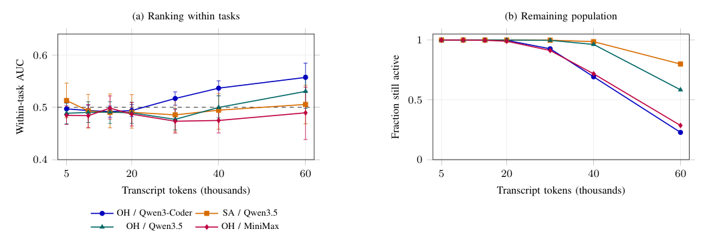

## 本期看点

发现一条编码智能体轨迹可能失败，不等于应该立刻重启：原来的执行可能稍后完成，而新执行只能使用剩余预算。两项研究从不同角度检查这一决策。一项比较同一任务的多次尝试，发现早期信号难以区分成功和失败；另一项提出决策价值与置信审计，说明准确率和实际重启收益之间还隔着什么。

<h2 class="daily-paper-title" id="paper-continue-or-restart-2026">继续还是重启：早期轨迹预测的边界</h2>

[Continue or Restart? The Limits of Early Failure Prediction in Coding Agents](https://arxiv.org/abs/2610.35971)  
Srinath Srinivasan, Lunxiao Li, Tim Menzies, Wesley Assunção · 2026-10-26

编码智能体运行一段时间后，监控器可能想根据工具调用、文件编辑和测试记录判断它是否值得继续。但一个预测器可能只是识别了任务难度：它能把简单问题与困难问题区分开，却不能在同一个问题的多次尝试中识别哪次即将失败。只有后者才直接支撑对某次运行的选择性干预。

作者分析两个公开语料中的 **147,002 条轨迹**，覆盖四种模型与框架组合；分别测试计数特征、初始文本嵌入、针对任务训练的排序器以及微调的 Qwen3-0.6B 监控器。评估同时报告总体排序和同一任务内的成功、失败尝试排序。20k token 时，神经监控器在 32,406 次尝试上的三种随机种子结果，同任务 AUC 均值为 **0.50**，区间为 **0.48–0.51**：在该设置下接近随机排序，而不是证明所有可能的监控信号都无效。

<a class="note-image-link" href="/assets/images/digest/2026-10-29/early-prediction.png" target="_blank" rel="noopener" aria-label="同任务排序能力与仍在运行的轨迹比例 · 查看原图 ↗">查看原图 ↗</a>

*读图：左侧比较不同时间点的同任务排序能力；右侧显示到该时间点仍未结束的轨迹比例。越晚的判断所覆盖的运行越少。*

接下来作者在共享 token 上限下回放策略：继续原尝试、按分数重启，或以相同停止比例随机重启。在 75k 上限下，学习型重启比随机重启最多高 **1.98 个百分点**；但分解显示收益主要来自跨任务的停止分配，即较少停止容易的问题，同一任务内部挑选尝试的贡献接近零。四种设置在 75k 上限下，以及全部 224 种预算与阈值组合中的 216 种，继续运行都比两种重启策略获得更高解决率且平均 token 成本更低。

这个负面结果提醒我们把**预测能力、干预方式和预算**一起评估。它针对记录轨迹的冷重启回放；保留已有编辑、使用更丰富的监控信号或其他工作负载，可能改变结论。阅读时尤其值得关注同任务评估和共享预算的策略比较，而不是只看总体 AUC。

<h2 class="daily-paper-title" id="paper-monitor-decision-value-2026">监控准确率之外：衡量重启决策的价值</h2>

[Monitor Accuracy Isn't the Answer: A Decision-Value Framework for Evaluating AI Agent Restart Monitors](https://arxiv.org/abs/2610.36544)  
Siddharth Jain, Venkat N Vedam · 2026-10-27

这篇工作把问题向前推进一步：即使监控器准确，重启也未必有利。决策取决于原执行继续完成的机会，以及独立的新尝试能否在剩余预算内成功。作者给出一个数学对照：在独立干净重启、监控无额外开销等假设下，固定 **90% 准确率**，仅改变新尝试的成功概率，成功率变化就可从降低 5 个百分点变为提高 35 个百分点。这是分析例子，不是实际监控器的性能。

作者将轨迹压缩是否保留“继续或重启”的决策信息作为判断标准，并用同时二项置信区间构造审计：证据不足时可以弃权，而不是强行推荐动作。实证材料包括 SWE-bench Verified 中 19 个选定 SymPy 问题上的 **194 次**外部验证执行，其中 130 次用于回顾性审计。一个表面上 2.29 个百分点的重启收益来自单条仍在运行且最终失败的尝试；另一模型出现 42.29 个百分点的损失；103 个有存活轨迹的比较均未达到作者设定的认证门槛。

它与上一篇的共同点是将动作收益放在预测指标之前；不同之处是这里主要贡献决策恒等式和小样本、可弃权的审计，而非大规模训练失败预测器。样本局限于所选任务与运行配置，置信结论依赖独立性等假设；保留编辑的重启也不能直接套用干净重启的结果。原文没有适合解释核心机制的架构图，因此这里用文字呈现。
<h2 class="daily-paper-title" id="paper-reinbench-2026">ReInBench：Agent 出错后，何时等待自我恢复</h2>

[When to Intervene? An Empirical Study of Errors and Self-Recovery in LLM Agents](https://arxiv.org/abs/2610.36471) 
Chiming Duan 等 · arXiv · 2026-10-27

### 出错不等于需要立即干预

上一组研究关注编码智能体是否应重启。ReInBench 换了一个互补的问题：当浏览器或计算机操作 Agent 出现局部错误，继续运行能否自行纠正？作者整理 1,259 条轨迹、1,403 个错误事件，记录错误出现、可观察到的识别和局部恢复；标注结合模型辅助与研究人员核验。一条轨迹可以包含多个错误，局部恢复也不等于整个任务最终成功。

在观察到的轨迹中，725 个错误事件自行恢复。其中 OSWorld 任务为 659/1,202，Web 任务为 66/201；在可测恢复时长的子集中，恢复分别以两步和三步为中位数。不同模型和任务环境的比例有明显差异，不能把总体比例作为所有 Agent 的预期恢复率。

### 预测自愈，不等于证明干预有效

作者提出 ReCoF：用历史执行上下文训练的恢复模式预测器，结合评估模型对当前任务和错误的判断，预测错误是否会自行恢复。输入只使用错误发生时可见的目标和最近执行步骤，不使用之后的恢复结果。研究报告三个执行模型上的 Macro-F1 为 72.99%—74.18%，分别比最强对照高 1.30—11.30 个百分点。

这与本期冷重启研究形成互补：先判断是否可能自行恢复，再考虑干预的价值与成本。但实验评估的是**预测**，没有实际执行干预来证明该策略提升了任务成功率；数据也只覆盖有限模型和界面任务。
<h2 class="daily-paper-title" id="paper-arxiv-2610.36636">Agar：用性能边界回答微服务假设问题</h2>

[Agar: What-If Analysis for Microservice Applications](https://arxiv.org/abs/2610.36636) 
Saarth Deshpande、Neeraja J. Yadwadkar、Venkat Arun · arXiv · 2026-10-27

微服务扩缩容需要回答：如果负载、资源或 SLO 改变，端到端性能会怎样？Agar 不逐点预测精确延迟，而是从观测数据学习可组合的组件性能边界，用它们判断给定配置是否可能满足 SLO。作者将最小资源分配表述为此类假设查询，并在三个微服务应用上评估扩缩容和诊断用途。

论文报告，相对所测水平扩缩容基线，CPU 分配最多降低 36.8%，同时满足实验设置的应用 SLO。这是特定应用和工作负载中的结果；方法假设应用行为基本稳定，代码或硬件变化后需要重新训练，观测范围外的行为也不能被当作无条件保证。

<h2 class="daily-paper-title" id="paper-arxiv-2610.37230">TAO：把工具返回时间纳入 Agent 服务调度</h2>

[TAO: Tool-Aware Joint Scheduling for LLM-Based Agentic Serving](https://arxiv.org/abs/2610.37230) 
Shuhuai Li、Shengdong Ye、Dongdong Ge、Yinyu Ye、Jianghao Lin · arXiv · 2026-10-27

Agent 服务在 GPU 模型推理和 CPU 外部工具之间交替，工具尚未返回时，过早为会话预留推理资源可能降低效率。TAO 把工具近期返回概率、节点相关的 KV 缓存收益及 token 占用结合起来，在容量约束下联合选择等待会话与 GPU 放置位置。

在论文报告的 12 组模型、负载与并发设置中，相对各项指标上最强的被测基线，延迟最多降低 26.8%、平均首 token 时间最多降低 36.3%。这些“最多”可能来自不同设置，不能当成同一运行同时取得的收益；工具时长预测及缓存收益也依赖工作负载。

<h2 class="daily-paper-title" id="paper-arxiv-2610.36329">GPU 集群：细粒度监控揭示资源使用间隙</h2>

[Plenty of Room in the Middle: Revealing Opportunities on a GPU Cluster via Fine-Grained Monitoring](https://arxiv.org/abs/2610.36329) 
Andrew Sheinberg、Samyak Gupta、Kai Li · arXiv · 2026-10-26

作者以 100 毫秒间隔监控大学研究集群，重点分析 89 个节点、319 张 GPU 上十天内的 7,399 个作业。研究发现，超过 70% 的作业使用不到 20% 的 GPU 内存，半数作业平均 SM 利用率低于 5%；论文据此讨论细粒度共享与调度机会。

低平均利用率不等于资源可以无干扰地共享：100 毫秒窗口可能平滑短暂通信峰值，多节点作业样本只有七个，集群也只覆盖两种 A100 配置。因此这些观察有助于提出调度假设，不能直接推算其他集群的可回收容量。

<h2 class="daily-paper-title" id="paper-arxiv-2610.36589">InfraDev：检验 Agent 是否真正完成 AI 基础设施开发</h2>

[InfraDev: Can Coding Agents Develop AI Infrastructure, and How Can We Tell?](https://arxiv.org/abs/2610.36589) 
Yangshen Deng 等 · arXiv · 2026-10-27

InfraDev 从 Megatron-LM、vLLM 和 verl 的真实 PR 构建 36 个跨文件、多 GPU 任务，并联合生成隐藏测试与说明所需接口的任务提示。作者报告六个模型中最高任务解决率为 38.9%；102 份通过全部官方测试的提交里，33 份被补充探针拒绝。通过已有测试因此不必然意味着状态、资源或分布式行为正确。

隐藏探针本身与生成提示相互配合，测量结果依赖评判设计、给出的接口信息和有限任务集；不能把它作为通用模型能力排名。论文也报告将失败经验整理为技能后在特定训练任务上的变化，但这并不证明对所有基础设施仓库有效。
