## 本期导读

19 篇论文、3 篇技术笔记。原文发表日期与本期阅读日期分别记录。

<h2 class="daily-paper-title" id="paper-arxiv-2610.38329">01 · A Case Study of a Multi-Agent Kernel-Optimization Loop That Learns a New AI Accelerator</h2>

[A Case Study of a Multi-Agent Kernel-Optimization Loop That Learns a New AI Accelerator](https://arxiv.org/abs/2610.38329) 
Byonggon Chun · 2026-10-30

该 RNGD 案例让 agent 通过文档总结、微基准和编译器规则建立目标知识，先做廉价合法性筛查，再重复设备对比。12 天运行优化三个 decode kernel，相对官方基线几何平均加速 9.293 倍。

单芯片、单次运行且无消融，无法归因各模块收益；合成输入和固定种子验证不是完整模型质量测试。

来源：[A Case Study of a Multi-Agent Kernel-Optimization Loop That Learns a New AI Accelerator](https://arxiv.org/abs/2610.38329)

<h2 class="daily-paper-title" id="paper-arxiv-2610.38983">02 · Beyond atol and rtol: Sound Test Oracles for Low-Precision GPU Kernels</h2>

[Beyond atol and rtol: Sound Test Oracles for Low-Precision GPU Kernels](https://arxiv.org/abs/2610.38983) 
Xinyi Shi · 2026-10-30

numoracle 从带精度标注的参考程序推导逐元素接受区间，跟踪共享舍入误差和块量化，避免固定 atol/rtol 的误报—漏报折中。RTX PRO 6000 实验检出 124 个有效变异中的 116 个。

soundness 依赖舍入、硬件、输入域与实现假设；有限实验零误报不是所有输入零误报，且仍有漏检。

来源：[Beyond atol and rtol: Sound Test Oracles for Low-Precision GPU Kernels](https://arxiv.org/abs/2610.38983)

<h2 class="daily-paper-title" id="paper-arxiv-2610.19792">03 · JetSpec++: Foresight Parallel Drafting with Self Refinements</h2>

[JetSpec++: Foresight Parallel Drafting with Self Refinements](https://arxiv.org/abs/2610.19792) 
Zhaoxiang Feng、Lanxiang Hu、Haoran Yuan、Yu-Yang Qian、Jihui Yang、Peng Zhao、Yibo Zhu、Tajana Rosing、Hao Zhang · 2026-10-30

JetSpec++ 在第二张 GPU 上提前草拟下一块，并在验证等待期间自我细化。Qwen3-8B 的 bf16 单请求最高 1361 token/s；其机制是隐藏草稿延迟，而非消除草稿计算。

使用两张 GPU；NVFP4 的更高速度是另一精度配置，高 batch 与大模型仍需验证，不能把延迟收益当作每 GPU 成本收益。

来源：[JetSpec++: Foresight Parallel Drafting with Self Refinements](https://arxiv.org/abs/2610.19792)

<h2 class="daily-paper-title" id="paper-arxiv-2610.37810">04 · ConfluxServe: Reconciling Resource Utilization and Parallelism Efficiency across Prefill and Decode in LLM Serving</h2>

[ConfluxServe: Reconciling Resource Utilization and Parallelism Efficiency across Prefill and Decode in LLM Serving](https://arxiv.org/abs/2610.37810) 
Wenhao Chen、Hong Zhang · 2026-10-30

ConfluxServe 允许同一 batch 的 prefill 与 decode 使用不同并行策略，通过算子结构兼顾资源互补与并行效率。作者报告在 TTFT/TBT 约束下 goodput 为最强基线的 1.26–1.62 倍。

goodput 取决于 SLO、流量和并行配置；不能当作任意模型的原始吞吐倍率。

来源：[ConfluxServe: Reconciling Resource Utilization and Parallelism Efficiency across Prefill and Decode in LLM Serving](https://arxiv.org/abs/2610.37810)

<h2 class="daily-paper-title" id="paper-arxiv-2610.37989">05 · GAUSS：用解析延迟曲面与蒙特卡洛排队预测 LLM 推理尾延迟与容量</h2>

[GAUSS: A Workload-Aware Analytical and Monte-Carlo Simulator for LLM Inference Serving](https://arxiv.org/abs/2610.37989)（[v1 PDF](https://arxiv.org/pdf/2610.37989)）  
Srikant Bharadwaj、Ankur Mallick、Spyridon Mastorakis、Anjaly Parayil、Dhruv Deshmukh、Victor Ruehle（Microsoft Technical Report）· `arXiv:2610.37989v1 [cs.AI]` · 2026-10-27 提交（截至核验仅存 `v1`，无修订或撤回记录；本期 2026-10-31 日报原条目缺漏作者列表，此处据原文补全；论文正文未附代码仓库链接）

生产环境中的大模型推理往往依据首字延迟（TTFT）与 token 间延迟（TBT）的 SLA 指标进行容量规划、监控与计费，而不能只看一个聚合吞吐数字。**GAUSS** 将分阶段延迟曲面（prefill 与 decode）、按输入/缓存/输出长度加权的工作负载分桶、随机到达下的 Lindley 排队递推与集成蒙特卡洛（ensemble Monte-Carlo）采样结合起来，预测给定工作负载、推理引擎与加速器下的完整 TTFT/TBT 分位数分布与最大可持续请求速率。需要在一开始明确指出：现存 `arXiv:2610.37989v1` 是一份 10 页**解析建模与方法论技术报告**，给出符号公式、`Algorithm 1`、显式假设与四类容量分析用例，但**正文不包含具体 GPU 硬件拟合参数、真实服务引擎基准测试或任何预测误差数值**；下文将作者推导出的模型机制与尚未完成实证校验的工程边界严格分开呈现。

### 一、为什么单一吞吐与单条 Trace 回放会低估尾延迟

传统服务容量指标与离散事件仿真在评估生成式 LLM 推理时存在结构性盲区（§1–§2）：

- **两阶段硬件瓶颈与连续批处理耦合（§2.1–§2.2）**：GPU/加速器受高带宽内存（HBM）层次约束，将单次请求割裂为两种截然不同的执行阶段——**Prefill** 并行消化提示词，属于**计算受限（compute-bound）**，计算代价随参与注意力计算的上下文长度增长；**Decode** 每次步进只吐出 1 个 token，却必须从 HBM 重读全部模型权重与所有并发请求的 KV cache，属于**访存受限（memory-bound）**，且 HBM KV 缓存容量而非原始算力往往先限制并发度。现代服务引擎通过三类机制重塑有效服务过程——`Orca` 的**迭代级连续批处理（continuous batching）**、`vLLM` 的**分页 KV 内存管理（PagedAttention）**，以及 `Sarathi-Serve` / `DeepSpeed-FastGen` 的**分块预填充（chunked prefill）**（把长 prefill 切成块交错塞入并发 decode 步，利用访存受限阶段的空闲算力以换取更平稳的 TBT）。因此，服务时间本身直接依赖于请求形状分布与批处理状态。
- **单条 Trace 回放低估尾部并受限于既有记录（§1, §2.3, §4.4）**：生产流量在提示长度、已缓存前缀长度、生成长度上高度异构，且到达具有突发性（如 `BurstGPT` 所记录）。像 `Vidur` 这类高保真离散事件模拟器（DES）适合细粒度剖析特定调度器实现，但其通常基于单条录制或合成 trace 运行，输出的是一条长轨迹的**时间平均（time average）**。在服务时间长尾、突发到达的工况下，单条轨迹对罕见极端拥塞事件的采样极其稀疏，会系统性低估 SLA 关注的 P95 与 P99 尾部；同时，trace 回放无法评估尚未上线的工作负载混合比例、路由切分策略或未部署硬件，且逐个到达率 `λ` 重跑 DES 成本高昂。另一方面，早期的画像驱动容量框架（如 `InferLine`、`Clockwork`）把推理视为固定代价流水线阶段，未能刻画上下文与批大小动态耦合的自回归服务过程。

### 二、GAUSS 核心设计：阶段延迟曲面、Lindley 递推与 Algorithm 1

<figure class="note-figure"><a class="note-image-link" href="/assets/images/digest/2026-10-31/gauss-queueing-montecarlo-arch-zh.svg" target="_blank" rel="noopener" aria-label="查看 GAUSS 解析延迟曲面与蒙特卡洛排队预测架构图原图">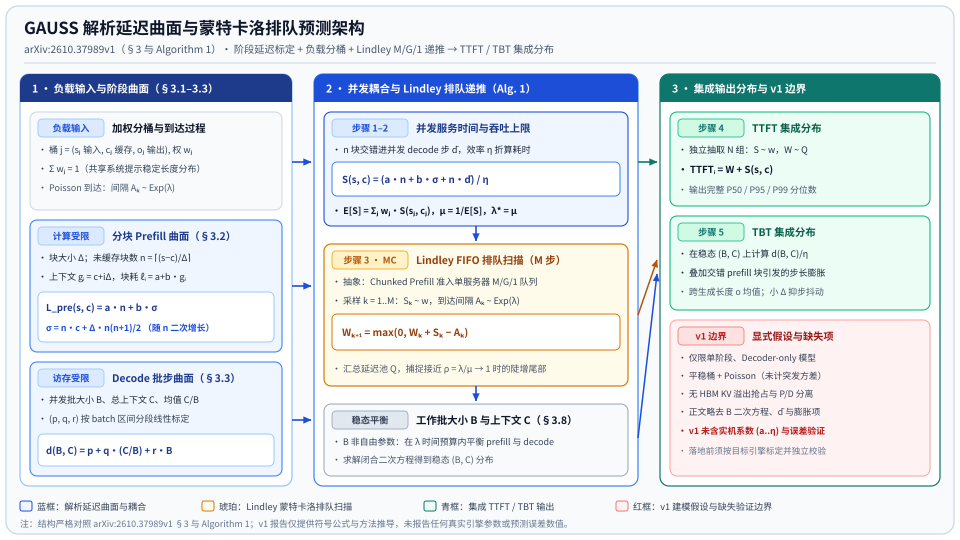查看原图 ↗</a><figcaption>图 1 · GAUSS 解析延迟曲面与蒙特卡洛排队预测流程（整理自 arXiv:2610.37989v1 §3 与 Algorithm 1）：先对单个 Decoder-only 服务阶段建立上下文/批大小相关延迟曲面，再经随机到达的 Lindley 递推将服务时间分布转化为 TTFT/TBT 分布。</figcaption></figure>

在单阶段、仅解码器（decoder-only）模型的设定下，GAUSS（§3 与 `Algorithm 1`）按以下五个紧耦合模块把工作负载描述与引擎标定参数映射为延迟分位数与可持续容量上限：

1. **加权请求分桶与 Poisson 到达（§3.1）**：工作负载被离散化为带权重的请求桶集合 <code>{(sⱼ, cⱼ, oⱼ, wⱼ)}</code>，满足 <code>Σⱼ wⱼ = 1</code>，其中 <code>sⱼ</code> 为输入 token 长度、<code>cⱼ</code> 为已命中驻留的前缀缓存长度、<code>oⱼ</code> 为输出 token 长度。作者指出高峰期大量请求复用共享系统提示缓存，使上下文分布相对稳定，从而允许规划期内复用同一分桶权重。到达过程建模为均值速率 <code>λ</code> 的 Poisson 流，相邻到达间隔 <code>A ~ Exp(λ)</code>。
2. **分块 Prefill 的二次计算曲面（§3.2）**：给定固定分块大小 <code>Δ</code>，一条请求只需计算未缓存部分 <code>(s − c)</code>，所需块数为 <code>n = ⌈(s − c) / Δ⌉</code>。第 <code>i</code> 个块（<code>i = 1..n</code>）需要关注已有缓存与此前已算块，总关注上下文为 <code>gᵢ = c + iΔ</code>。引擎标定显示单块计算延时关于 <code>gᵢ</code> 呈仿射关系 <code>ℓᵢ = a + b·gᵢ</code>，对 <code>n</code> 块求和得到等差级数闭式总计算量 <code>L_pre(s, c) = a·n + b·σ</code>，其中 <code>σ = n·c + Δ·n(n+1)/2</code>。也就是说，**单块耗时随驻留上下文线性增加，而整条请求的 prefill 总成本随块数 n 呈二次方增长**。
3. **Decode 批步的分段仿射曲面（§3.3）**：在生成阶段，包含 <code>B</code> 个并发请求、总驻留上下文为 <code>C</code> 的批每次同步前进 1 token，单请求平均上下文为 <code>C / B</code>。因为 decode 访存受限，单步延迟表达为关于批大小与平均上下文的曲面 <code>d(B, C) = p + q·(C / B) + r·B</code>——其中 <code>q·(C/B)</code> 刻画逐请求读取 KV 状态的开销，<code>r·B</code> 刻画扩宽批大小的边际代价，实际应用中系数 <code>(p, q, r)</code> 按批大小区间分段拟合。
4. **并发交错服务时间与最大服务率（§3.4–§3.5）**：在分块 prefill 与 decode 混跑时，请求的 <code>n</code> 个 prefill 块会分别搭便车进入并发 decode 步（并发步耗时记为 <code>d̄</code>），再除以把模型工作量折算为真实挂钟时间的引擎效率因子 <code>η</code>，得到请求的总 prefill 服务时间 <code>S(s, c) = (a·n + b·σ + n·d̄) / η</code>。按分桶权重求期望即得平均服务时间 <code>E[S] = Σⱼ wⱼ·S(sⱼ, cⱼ)</code>、有效服务率 <code>μ = 1 / E[S]</code>，以及队列稳定性边界（负载因子 <code>ρ = λ / μ &lt; 1</code> 下的最大可持续到达率 <code>λ* = μ</code>）。
5. **Lindley 队列递推、批大小平衡与集成输出（§3.6–§3.8, Algorithm 1）**：准入端被抽象为先到先服务（FIFO）的单服务器 <code>M/G/1</code> 队列。<code>Algorithm 1</code> 从 <code>W = 0</code> 开始执行 <code>M</code> 步蒙特卡洛扫描：每步按分布 <code>w</code> 抽取请求服务时间 <code>Sₖ</code>、按 <code>Exp(λ)</code> 抽取到达间隔 <code>Aₖ</code>，按 **Lindley 递推** <code>Wₖ₊₁ = max(0, Wₖ + Sₖ − Aₖ)</code> 更新等待延迟并存入样本池 <code>Q</code>。随后执行 <code>N</code> 次独立采样组合出稳态 <code>TTFTᵢ = W + S(s, c)</code> 分布；对于 <code>TBT</code>，则把给定负载下由时间预算平衡出的稳态工作批大小 <code>B</code>（正文指出求解一个闭合二次方程可得工作 <code>B</code> 分布）与上下文 <code>C</code> 代入 <code>d(B, C)/η</code>，并叠加交错 prefill 块引发的步长膨胀，在生成长度 <code>o</code> 上取均值。

| 模型模块（原文章节） | 核心符号与公式（严格依 v1 正文） | 物理与排队含义 | v1 正文参数与闭式完备度审计 |
| :--- | :--- | :--- | :--- |
| 工作负载与到达（§3.1） | 桶 <code>(sⱼ, cⱼ, oⱼ, wⱼ)</code>，<code>Σⱼ wⱼ = 1</code>；<code>Aₖ ~ Exp(λ)</code> | 离散化混合请求形状；假定高峰共享提示使 <code>wⱼ</code> 稳定 | 仅给出符号表达；未公布真实业务分桶统计样本 |
| 分块 Prefill 曲面（§3.2） | <code>n = ⌈(s − c)/Δ⌉</code>；<code>L_pre = a·n + b·σ</code>，<code>σ = n·c + Δ·n(n+1)/2</code> | 反映块内上下文线性增长与整条请求随 <code>n</code> 的二次方代价 | <code>(a, b, Δ)</code> 为未具名引擎符号；未提供硬件拟合表 |
| Decode 批步曲面（§3.3） | <code>d(B, C) = p + q·(C/B) + r·B</code>（实际分段线性） | 分离单请求 KV 读取（<code>C/B</code>）与批宽扩展代价（<code>B</code>） | <code>(p, q, r)</code> 分段断点与实测系数在 v1 均未列出 |
| 并发服务与上限（§3.4–3.5） | <code>S(s, c) = (a·n + b·σ + n·d̄)/η</code>；<code>μ = 1/E[S]</code>，<code>λ* = μ</code> | 把并发 decode 干扰与效率折算进服务率与稳定性门槛 | <code>d̄</code> 随负载 <code>λ</code> 变化的显式耦合公式在 v1 未展开 |
| Lindley 排队扫描（§3.6） | <code>Wₖ₊₁ = max(0, Wₖ + Sₖ − Aₖ)</code>（<code>k = 1..M</code> 扫入 <code>Q</code>） | <code>M/G/1</code> FIFO 排队延迟分布，捕捉 <code>ρ → 1</code> 拖尾激增 | <code>Alg. 1</code> 从 <code>W=0</code> 单链扫 <code>M</code> 步，未说明预热丢弃与链相关性 |
| TTFT / TBT 与工作批（§3.7–3.8） | <code>TTFTᵢ = W + S</code>；<code>TBTᵢ</code> 由 <code>d(B,C)/η</code> 加块膨胀均值；二次方程定 <code>B</code> | 联动输出端到端分位数与稳态并发批大小分布 | 确定 <code>B</code> 的二次方程与块膨胀公式在 §3.8/Alg. 1 仅文字描述 |

*表 1 · GAUSS 解析模型组件、符号方程与 v1 正文完备度对照（整理自 `arXiv:2610.37989v1` §3.1–§3.8 与 `Algorithm 1`）。*

### 三、四大容量决策场景：拐点寻优、流量切分、SRPT 与机群集成

<figure class="note-figure"><a class="note-image-link" href="/assets/images/digest/2026-10-31/gauss-tail-latency-capacity-zh.svg" target="_blank" rel="noopener" aria-label="查看 GAUSS 容量决策机理与 v1 实证边界总览图原图">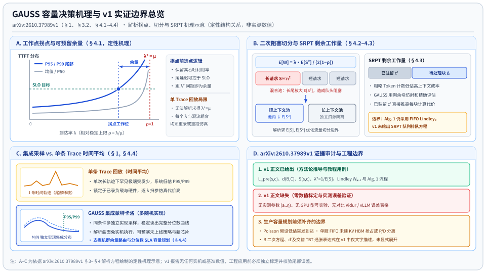查看原图 ↗</a><figcaption>图 2 · 容量决策机理示意与 v1 证据审计（整理自 arXiv:2610.37989v1 §1、§3.2、§4.1–4.4）：图 A–C 为依据解析方程绘制的定性机理示意而非实测数据，图 D 明确标出 v1 在实证验证与公式展开上的留白。</figcaption></figure>

作者在第 4 节展示了为何「服务时间成为请求形状的解析函数」能解锁单条 trace 回放难以回答的四类容量问题：

1. **工作点拐点选择与路由余量量化（§4.1）**：在单条 trace 仿真里，必须为每个候选到达率 `λ` 和每组流量配比重新录制或生成完整轨迹，且无法直接算得稳定极限。GAUSS 直接解析给出 <code>λ* = μ = 1 / E[S]</code>，并以极低计算成本沿 <code>λ</code> 扫描 TTFT 分位数曲线。由于当 <code>ρ = λ / μ</code> 逼近 1 时排队延迟骤然发散，P95/P99 曲线往往在均值拐点之前就出现陡峭弯折；把工作点设在拐点略下方，既能吃满大部分可利用吞吐，又让工作点与拐点之间的距离直接成为可用于跨集群路由或扩缩容的**可量化余量（headroom）**。
2. **基于二阶矩的流量切分与队头阻塞缓解（§4.2）**：依据经典 `M/G/1` Pollaczek-Khinchin 均值等待公式 <code>E[W] = λ · E[S²] / (2(1 − ρ))</code>，由于 prefill 服务时间随未缓存分块数呈二次方增长，混合长度流量中的少数超长请求会急剧拉高二阶矩 <code>E[S²]</code>，诱发排队论中的**检查悖论（inspection paradox）**与严重队头阻塞（大量短请求大概率撞在长请求背后）。按上下文长度切分流量并分配独立实例池可压缩短请求池内的 <code>E[S²]</code>。GAUSS 的优势在于无需重跑任何切分 trace，即可对任意候选切分阈值解析算出两侧池的 <code>E[S]</code> 与 <code>E[S²]</code>，从而搜索使总体排队延迟最小化的切分边界。
3. **分块 SRPT 调度的精确剩余工作量（§4.3）**：最短剩余处理时间优先（SRPT）是应对重尾作业尺寸时最小化平均响应时间的经典策略，但前提是调度器在每个决策点掌握精确的剩余服务时间。直接数「剩余未处理 token 数」或看历史滑动均值在重尾上下文下会误导排序——因为第 2 节证明：请求已有 `c′` 个 token 驻留后，后续每一块的注意力代价都随 `c′` 线性抬升。GAUSS 可以直接利用 §3.2 的仿射级数和给出任意部分完成请求的闭式剩余 prefill 时间，在真正写代码上线前预估 SRPT 收益。
4. **面向机群调度的集成估计（§4.4）**：所有上述能力的底层共性是区分**集成平均（ensemble average）**与单条 trace 的**时间平均（time average）**。在同等工作负载配比与到达率下通过多组独立随机实现生成集成分布，才能在罕见突发条件下稳定读取 P95/P99 尾部；这使得算力平台可以面向分位数 SLO 做容量预留、按瞬时剩余余量做负载均衡，并在硬件尚未集群部署前进行多代加速器与推理引擎的「what-if」推演。

### 四、方法定位与 v1 实证评估审计：已有推导 vs. 缺失数值验证

为了防止把方法论潜力误读为已验证的工程精度，下表严格对比 GAUSS 与既有容量评估范式的定位差异，并逐项审计 `arXiv:2610.37989v1` 的实证覆盖情况：

| 容量评估方法 / 基线定位 | 负载与服务时间建模方式 | 尾延迟分布与未见策略外推能力 | 计算扫描开销 | `arXiv:2610.37989v1` 实证验证状态审计 |
| :--- | :--- | :--- | :--- | :--- |
| 单一吞吐均值（Tokens/s） | 汇总标量吞吐，忽略双阶段耦合与长度混合 | 无法捕捉 <code>ρ &lt; 1</code> 时的队列拖尾与 TTFT/TBT 违约 | 最低（静态测速） | 原文用作反面动机基线；无实测对照数值 |
| 画像驱动流水线框架（`InferLine`、`Clockwork`） | 按固定阶段延迟画像与明确 SLO 驱动配额 | 面向固定代际阶段；未刻画自回归 <code>(s, c, B)</code> 动态表面 | 低 | 仅在 §2.3 文献综述定性对比；未运行复现实验 |
| Trace 驱动离散事件模拟器（如 `Vidur`） | 细粒度事件级调度、批处理与内存机制仿真 | 输出单条轨迹时间平均；难扫未录负载、策略或未建硬件 | 高（逐请求离散事件推进） | 仅作方法论对比对象；**v1 无运行时间或 P95/P99 精度对比** |
| **GAUSS（本报告，arXiv:2610.37989v1）** | 加权分桶 <code>(sⱼ,cⱼ,oⱼ,wⱼ)</code> + 标定 <code>L_pre</code> / <code>d(B,C)</code> + <code>M/G/1</code> Lindley 蒙特卡洛 | 理论上可生成多实现集成 P50–P99，并外推切分与未见硬件 | 极低（闭式曲面 + 标量递推） | **v1 含 0 组实测拟合参数 (a..η)、0 个具名 GPU 实验、0 项实测误差对比** |

*表 2 · 推理容量预测方法定位对比及 `arXiv:2610.37989v1` 实证审计（依据正文 §1–§4 逐页核查，严格区分方法论阐述与实测验证状态）。*

审计结论十分明确：这篇微软技术报告把**为什么需要解析曲面 + 蒙特卡洛排队**、**如何写下服务时间与队列递推公式**以及**能服务哪些运维决策**讲得十分透彻，但 **v1 正文尚未给出任何实机标定实验**。读者无法从中得知在实际部署（如 `vLLM` 或 `Sarathi-Serve` 运行于特定型号 GPU、特定 TP/PP 并行度与长上下文混合流量）下，分段仿射曲面拟合 <code>d(B, C)</code> 的残差有多大、效率因子 <code>η</code> 在跨负载均衡变化时是否漂移、以及 GAUSS 预测的 P95/P99 TTFT 与 TBT 相对真实系统或 `Vidur` 的绝对误差区间。

### 五、显式建模假设、未闭合公式与工程落地启示

在把 GAUSS 的思路引入真实容量规划或推理调度评估时，需要紧盯四项原文显式假设与正文未闭合的工程边界：

1. **「突发流量动机」与「平稳 Poisson 假设」之间的张力**：论文在 §1 与 §2.3 反复强调生产流量到达具有高度突发性（并引用了 `BurstGPT` 与 `Cox` 点过程），但 §3 的基线公式明确把到达固定为**平稳 Poisson 过程**（<code>Aₖ ~ Exp(λ)</code>，到达间隔方差系数为 1）且分桶权重 <code>wⱼ</code> 在规划窗口内静态平稳（仅诉诸共享系统提示缓存）。当真实流量呈现强突发聚集（<code>CV² &gt; 1</code>）或跨时段、多轮 Agent 工具调用导致提示/输出分布快速漂移时，Poisson 假定会系统性**低估**真实队列排队尾部，需把指数到达替换为调制/突发到达过程（如 Cox 或 MMPP）再行采样。
2. **单服 FIFO 队列与分块交错、SRPT 及 HBM KV 抢占的边界**：<code>Algorithm 1</code> 的第 3 步把准入排队简化为单服务器 **FIFO M/G/1 队列**（<code>Wₖ₊₁ = max(0, Wₖ + Sₖ − Aₖ)</code>）。这一抽象存在三处外推限制——（a）尽管 §2.1 指出 HBM KV 容量决定最大并发度，但 `Algorithm 1` 中并无 HBM 显存上限检查，无法预测高长文比例下 KV 耗尽引发的请求驱逐/抢占或准入阻塞；（b）§4.3 讨论 SRPT 调度时仅说明 GAUSS 能提供精确剩余工作量，但未给出替换 FIFO Lindley 递推的 SRPT 排队方程；（c）明确限定为**单阶段、Decoder-only** 模型，尚未涵盖 Prefill/Decode 分离部署的 KV 跨节点传输、MoE 稀疏专家路由、投机解码或张量并行通信开销。
3. **v1 正文略去的部分代数闭合与数值收敛细节**：包括 §3.8 中用于求解稳态工作批大小 <code>B</code> 的具体二次方程、<code>S(s, c)</code> 中并发平均步耗时 <code>d̄</code> 随 <code>λ</code> 变化的自洽迭代方式、<code>Algorithm 1</code> 第 5 步里交错 prefill 块引发 `TBT` 膨胀的具体边际项公式，以及 Lindley 单链从 <code>W = 0</code> 起步时在接近饱和（<code>ρ → 1</code>）区间的预热截断（burn-in）与长自相关处理（单链未做多链独立重复或预热丢弃可能导致近饱和区尾部方差偏高）。
4. **可迁移的工程落地建议**：（1）**用分位数分布和二阶矩替代单点吞吐评审**：哪怕暂不引入完整模拟器，容量评审也应停止依据单个 `tokens/s` 均值或单条 trace 回放签发 P99 SLO，至少同时核算未缓存 prefill 平方项导致的 <code>E[S²]</code> 放大系数；（2）**先分离两阶段表面，再做样本外尾延迟校验**：在目标引擎和 GPU 上按分块 prefill 与分段 decode 批步分别压测拟合系数，并用高突发生产回放或实时在线遥测验证 P95/P99 误差，确认 <code>η</code> 与分段断点在目标负载区间不漂移后再用于自动路由；（3）**谨慎设计静态流量切分**：按上下文长度隔离长请求确能削减短请求池的 <code>E[S²]</code> 队头阻塞，但硬切分会损失跨池统计复用率——若长短请求比日间波动大，应采用动态池边界或直接结合基于精确剩余工作量的分块调度策略。

来源：[GAUSS: A Workload-Aware Analytical and Monte-Carlo Simulator for LLM Inference Serving](https://arxiv.org/abs/2610.37989)
<h2 class="daily-paper-title" id="paper-arxiv-2610.38196">06 · GearUp: DAG-aware Acceleration for Serverless Inference Serving via Slack-guided Pre-loading</h2>

[GearUp: DAG-aware Acceleration for Serverless Inference Serving via Slack-guided Pre-loading](https://arxiv.org/abs/2610.38196) 
Qi Qi、Yifan Sui、Hanfei Yu、Hong Zhang、Hao Wang · 2026-10-30

GearUp 将库、权重与 CUDA kernel 加载放入上游执行留下的 DAG 空隙，并复用已初始化实例。两个 L40S 工作流中，相对 SMIless 中位端到端延迟分别降低 64.5% 与 75.9%。

依赖可用 slack、加载画像和复用流量；与冷启动及 eager preload 的倍率采用不同基线，不能混写。

来源：[GearUp: DAG-aware Acceleration for Serverless Inference Serving via Slack-guided Pre-loading](https://arxiv.org/abs/2610.38196)

<h2 class="daily-paper-title" id="paper-arxiv-2610.38355">07 · FlatCake: A Flat KVCache Storage Architecture for LLM Serving</h2>

[FlatCake: A Flat KVCache Storage Architecture for LLM Serving](https://arxiv.org/abs/2610.38355) 
Xin Huang、Teng Ma、Zhuoran Li、Yibo Zhao、Zhaoshi Li、Qianchao Zhu、Wei Yang、Chenxi Wang、Tao Xie、Youwei Zhuo · 2026-10-30

FlatCake 把 DRAM 与 SSD 作为平级 KV 存储，创建时按会话连续布局并固定位置，通过 GDS 流入有界 GPU 窗口。Claude Code 轨迹高负载下命中率保持 94%，对照 Mooncake 为 64%。

依赖不可变块与会话复用假设；总 token 吞吐包含输入，不能当作纯生成速度，存储配置会影响收益。

来源：[FlatCake: A Flat KVCache Storage Architecture for LLM Serving](https://arxiv.org/abs/2610.38355)

<h2 class="daily-paper-title" id="paper-arxiv-2610.38968">08 · TableTune: Measured, Self-Correcting Draft-Length Tables for Dynamic Speculative Decoding</h2>

[TableTune: Measured, Self-Correcting Draft-Length Tables for Dynamic Speculative Decoding](https://arxiv.org/abs/2610.38968) 
Abhishek Malvankar、Paul Castro、Nick Mitchell、Lionel Villard · 2026-10-30

TableTune 在真实 vLLM 执行路径测量 batch 大小与草稿长度组合，再依据在线接受率更新配置表。它把草稿长度从手写常量变成可测、可纠正的控制参数。

最高 58% 是修复错误配置的收益；论文仅与其他投机配置比较，不能证明相对非投机解码始终有收益。

来源：[TableTune: Measured, Self-Correcting Draft-Length Tables for Dynamic Speculative Decoding](https://arxiv.org/abs/2610.38968)

<h2 class="daily-paper-title" id="paper-arxiv-2610.38981">09 · Why Speculative Decoding Works Better Than Predicted on Sparse MoE Models</h2>

[Why Speculative Decoding Works Better Than Predicted on Sparse MoE Models](https://arxiv.org/abs/2610.38981) 
Ekagra Ranjan、Komal K. Teru、Bharat Venkitesh、Acyr Locatelli · 2026-10-30

该研究发现细粒度 MoE 的投机验证成本不能仅按专家字节量估计：相邻 token 路由重叠、L2 复用与 kernel 带宽利用共同决定低 batch 表现。IPF 模型预测独立专家数量的误差低于 4%。

专家计数误差不是端到端延迟误差；部分分析隔离目标验证，不包含实际 drafter 成本和接受率。

来源：[Why Speculative Decoding Works Better Than Predicted on Sparse MoE Models](https://arxiv.org/abs/2610.38981)

<h2 class="daily-paper-title" id="paper-arxiv-2610.39216">10 · PDScope：打破内存受限 MoE 推理的 Prefill-Decode 跷跷板</h2>

[PDScope: Breaking the Prefill-Decode Seesaw for Memory-Bound MoE Inference](https://arxiv.org/abs/2610.39216)（[v1 PDF](https://arxiv.org/pdf/2610.39216) · [v1 HTML](https://arxiv.org/html/2610.39216v1) · 论文脚注 1 声明代码链接为匿名占位地址 `https://github.com/nezha-Anonymous/PDScope`）  
Enda Yu、Dezun Dong\*、Zhaoning Zhang\*、Xiaojian Yang、Weiling Yang、Shaonan Ma、Dongsheng Li、Yongwei Wu、Xiangke Liao（国防科技大学、启元实验室；\* 共同通信作者）· `arXiv:2610.39216v1 [cs.DC]` · 2026-10-29 提交（`Comments` 标注 `accepted by PPoPP'27`；核验时仅存 `v1`，无修订或撤回记录）

在单机 CPU-GPU 节点上本地部署混合专家（MoE）大模型时，受限显存（如 `24 GB` 上限）迫使大部分专家参数驻留在主机内存。此时两个推理阶段呈现出完全相反的资源瓶颈：**prefill** 阶段高并行计算受限于算力与 GPU 处理占比，需要积极将热专家拉入 GPU；**decode** 阶段自回归逐 token 生成、计算极轻，性能被 PCIe 传输气泡主导，需要保守克制的 I/O 策略。传统阶段无关调度器在单请求或低并发场景下被迫陷入「跷跷板」：偏向 prefill 会把无法掩蔽的 PCIe 延迟注入 decode，偏向 decode 则让 prefill 的 GPU 大量空转。`PDScope` 把**阶段感知（phase-awareness）**提升为一等调度原语，在路由预测（`PhasePer`）、跨层成本调度（`AdaptSched`）与静态图零拷贝执行引擎三个层面彻底解耦 prefill 与 decode。以下精读严格依据 `arXiv:2610.39216v1` 原文与附录，明确区分作者实测指标与部署适用边界。

### 一、为什么统一调度会陷入「Prefill-Decode 跷跷板」与层群效应

单节点低并发 MoE 卸载推理（如本地编码助手或文档处理工具）缺少大批量请求间并行度来掩蔽阶段冲突。论文 §2.2 与 §3 从计算并行度、层间统计规律及系统微开销三个层面，拆解了既有系统的失效根因：

- **两阶段的极端瓶颈反转（§2.2，Fig. 3）**：以 `HybriMoE` 在 A100 平台调度 `Mixtral-8x7B` 为例，当输入 `1024` 个 token 时，prefill 在每层几乎激活全部 `8` 个专家（单专家最高承载数百个 token），CPU 被密集计算打满，耗时拆分为 **CPU `2,557 ms`、PCIe `2,321 ms`、GPU `292 ms`**，必须依靠积极把高负载专家送入 GPU 才能提速；而在逐 token decode 阶段，每层仅激活 `2` 个专家，耗时结构反转为 **PCIe `1,449 ms`（占三项之和的 `79.5%`）、CPU `264 ms`、GPU `109 ms`**，任何为追求负载均衡而多发起的传输都会立刻放大关键路径延迟。
- **三类阶段无关策略的顾此失彼（§1、§3.2，Fig. 1–2、Fig. 5）**：（1）**静态放置**（如 `KTransformers v0.3.2`）把高频热点专家常驻 GPU 并借助 CPU AVX-512 算子处理其余专家，decode 稳健无动态 I/O，但 prefill 在输入超过 `512–1024` token 后 GPU 大量闲置、吞吐不升反降；（2）**按需加载**（如 `Fate` 利用跨层门控近似预测）在 prefill 中把更多算力推向 GPU，但 decode 阶段频发无法掩蔽的 PCIe 气泡；（3）**逐层动态调度**（如 `Fiddler`、`HybriMoE`、`MoE-APEX`）虽然在当前层实时均衡 CPU-GPU 负载，却因「逐层贪心、缺乏跨层前瞻」导致双向失配——**Prefill 欠取（Case 1）**：当前层只剩冷专家时仍把它搬上 GPU，挤占了本该用来预取下一层热专家的 PCIe 带宽，导致下一层 GPU 饥饿；**Decode 过取（Case 2）**：当前层刚结束才触发下一层预取，若无法在下一层 attention 与 gating 完成前到达，就会直接变成阻塞关键路径的 I/O 气泡。
- **专家激活的「层群效应」阻断单一启发式预测（§3.1，Fig. 4 & §8.2 Fig. 16）**：在 `Mixtral-8x7B`、`Qwen3-30B-A3B`、`DeepSeek-V2-Lite` 与 `Moonlight-16B-A3B` 四款模型上，路由权重 `w_i` 的波动幅度与相邻层 attention 输出隐状态 `a` 的余弦相似度把网络自然划分为**输入群（Input）、中间群（Middle）与输出群（Output）**。在输入/输出群，路由权重剧烈波动且层间相似度较低，导致基于相邻门控的 `Fate` 等方法准确率大幅下滑；在中间群，层间余弦相似度长期稳定在高位，反而是仅依赖历史 token 相似度的检索式方法明显退化；统计频次法则在全局表现平庸。因此预测器必须具备**层群自适应架构**。
- **被低估的两类系统非计算税（§3.3，Table 1 & Table 2）**：在 prefill 阶段，CPU 侧为 I/O 准备锁页内存（pinned memory）与 DMA 会直接与计算争夺资源，使 PCIe `4.0 ×16` 实测单专家传输延迟相比无竞争微基准放大 **`40.3%–52.5%`**（`DeepSeek` 从 `1.95 ms` 升至 `2.78 ms`，`Qwen` 从 `1.34 ms` 升至 `1.88 ms`，`Mixtral` 从 `33.5 ms` 升至 `51.1 ms`）；在 decode 阶段，单 token 并行度极低，缓存加载、GPU kernel 启动与硬件状态轮询无法摊薄——Intel 6230R CPU 上运行 `Mixtral` 单专家单 token 纯计算仅需 `2.88 ms`，端到端实耗却达 **`4.25 ms`**（额外系统开销占比超 `32%`），RTX 3090 上 `Qwen` 也从 `0.13 ms` 放大至 `0.24 ms`。这意味着**任何每专家一次的运行时状态查询或调度轮询都会直接变成不可掩蔽的延迟**。

### 二、系统协同设计：PhasePer 预测、AdaptSched 跨层调度与静态图 Zero-Copy 执行

<figure class="note-figure"><a class="note-image-link" href="/assets/images/digest/2026-10-31/pdscope-phase-aware-moe-pipeline-zh.svg" target="_blank" rel="noopener" aria-label="查看 PDScope 分相协同架构图原图">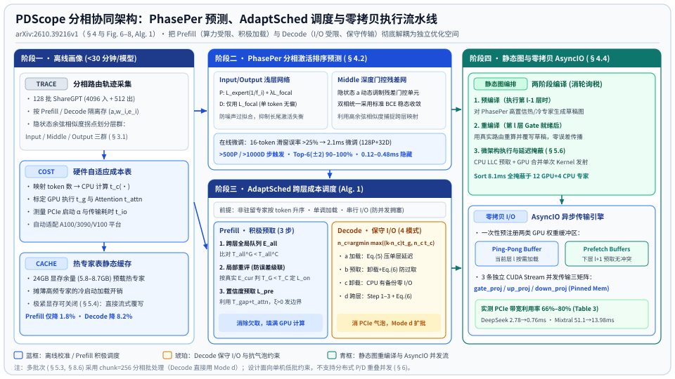查看原图 ↗</a><figcaption>图 1 · PDScope 离线画像与在线分相协同架构（整理自 arXiv:2610.39216v1 §4 与 Fig. 6–8、Algorithm 1）：把预测、调度与执行编译彻底拆分为两条独立优化通路，并用第 l 层重编译与局部重评兜底保证计算零误差传播。</figcaption></figure>

`PDScope` 分为离线校准（A100 上单模型耗时 `< 30` 分钟）与在线分相执行两段流水（§4.1–§4.4）：

1. **离线画像与硬件校准基底（§4.1、§4.2.3）**：系统先用 `128` 批 `ShareGPT` 数据（每批 `4096` 输入 token + `512` 生成 token）跑通离线推理，按 prefill 与 decode 完全隔离收集每层三元组 `(a, w_i, e_i)` 轨迹，根据隐状态余弦相似度拐点自动识别 Input/Middle/Output 层群边界；同时构建**硬件成本表**（映射不同 token 数量对应的 CPU 计算耗时 `t_c(·)`、GPU 执行耗时 `t_g`、注意力耗时 `t_attn` 以及 PCIe 启动延迟 `α` 和单专家传输耗时 `t_io`），并将最高频热专家预加载到 GPU 剩余可用显存（`5.8–8.7 GB`）作为静态热专家表。
2. **`PhasePer` 学习型分相激活排序预测器（§4.2）**：依托 §2.1 观察——一旦当前层注意力输出 `a`、激活专家 `e_i` 与路由权重 `w_i` 确定，下一层激活 `e'_i` 即由固定权重唯一决定——`PhasePer` 为每一 MoE 层配置独立微模型 `e'_i = PhasePer_θ(a, w_i, e_i)`，把专家激活预测形式化为面向调度排序的概率打分问题：
   - **层群异构网络与分相损失**：特征噪声较大且偏斜严重的 Input/Output 群采用**浅层网络**防过拟合，Middle 群采用**更深网络 + 由隐状态 `a` 调制的门控残差块**。在损失函数上，prefill 的 Input/Output 群使用混合损失 `L_prefill = L_expert + λ·L_focal`，其中 `L_expert` 按专家激活频率的倒数 `1 / f_i` 对二元交叉熵加权以抵抗极端长尾失衡，Decode 因逐 token 计算不存在批内不平衡而退化为 `L_decode = L_focal`；Middle 群两阶段统一采用标准 `BCE`。
   - **在线滑动窗口微调（§4.2.3 & §8.4）**：在线监控 Input 群连续 `16` 个 token 的滑动窗口预测误差，仅当均值超过 `25%` 阈值时才用运行时 `128` prefill + `32` decode token 触发一次 `2.1 ms` 的轻量更新；实测在三套数据集上触发间隔分别超过 **`500` 步（prefill）**与 **`1000` 步（decode）**，且完全调度进 GPU I/O 空闲期或下一 token 的 attention 计算间隙，对关键路径引入**零可观测延迟**。
3. **`AdaptSched` 跨层成本模型与相自适应调度（§4.3，Algorithm 1）**：基于「剔除 GPU 驻留专家后按待处理 token 升序排列 `E_cur` 与 `E_next`」「按需加载单调性（加载较冷者必加载更热者）」「串行 I/O（单专家传输已占满 `66%–80%` 带宽，并行仅增拥塞）」三项前提，对两阶段执行截然不同的规划：
   - **Prefill 三步积极预取**：**Step 1（跨层全局队列）**合并排序 `E_cur` 与 `E_next` 得 `E_all`，利用公式 `(3)` 比较 GPU 负载时间 `T_all^G = α + (n + n' - i + 1)·t_io + t_g` 与 CPU 计算加注意力窗口 `T_all^C = t_c(E_all[0:i]) + t_attn`，切分出最值得上 GPU 的全局子集 `L_global`；**Step 2（层内局部重评安全网）**针对 `L_global ∩ E_cur` 用真实门控计数的当前层成本模型公式 `(4)`（`T_G < T_C`）重定按需加载集 `L_on`，避免跨层分布偏斜或 `PhasePer` 误判导致当前层 CPU 空转，并把单层误预测的代价严格封顶在最多一次额外 I/O 往返、彻底阻断误差跨层传播（§8.4）；**Step 3（置信度门控预取）**把剩余 CPU 计算与 GPU 之间的气泡 `T_gap = T_C - T_G` 加上 `t_attn` 折算为最大可隐藏预取数 `f = (T_gap + t_attn) / t_io`（Algorithm 1 取整 `⌊f⌋`），再以结合预测命中率 `R_hit` 的净期望效用公式 `ξ = R_hit·(f - ⌈f⌉ + 1)·t_io - (1 - R_hit)·(⌈f⌉ - f)·t_io`（注：原文排版将该边界上取整符号印作 `<code>&#124;f&#124;</code>`）决定是否多发一次边界预取（仅 `ξ > 0` 时发送）。附录 §8.7 证实单层前瞻已足够：扩展到两层前瞻（`l+1, l+2`）在四款模型上仅带来 `1.1%–2.3%`（prefill）与 `0.8%–5.4%`（decode）吞吐差异，却成倍推高三层并发缓存显存压力。
   - **Decode 四模式保守 I/O**：每 token 固定激活 `top-k` 个专家，围绕理想 CPU-GPU 完工平衡点 `n_c = arg min max((k - n_c)·t_g, n_c·t_c)` 划分为四种模式**：Mode a（加载优先）**在当前层待处理 CPU 专家超 `n_c` 且下层 ≤ `n_c` 时，改用公式 `(5)` 最小化当前层端到端延迟；**Mode b（预取优先）**在当前层 ≤ `n_c` 且下层超 `n_c` 时卸载冗余专家并预取下层，同时施加公式 `(6)` 约束（防止下层 GPU 因等待未完成的预取而比纯 CPU 执行更慢）；**Mode c（卸载优先）**在两层均 ≤ `n_c` 时仅做本地卸载、零 PCIe 开销；**Mode d（跨层协同）**在两层均超 `n_c` 时复用 Step 1–3 加公式 `(6)` 约束，并天然承接 §5.3/§8.6 中的多批次并发 decode。
4. **两阶段静态计算图与 `AsyncIO` 零拷贝引擎（§4.4）**：为根除 §3.3 揭示的动态轮询税与并发争用，执行层包含两项协同机制：（1）**两阶段静态图编排（§4.4.1）**：在执行第 `l - 1` 层时，依据 `PhasePer` 高置信度的最热/最冷预测结果**预编译**第 `l` 层草稿静态图，提前触发 CPU LLC 缓存预取；一旦第 `l` 层真实 Gate 输出就绪，立刻以真实门控结果运行完整 `AdaptSched` **重编译**并覆盖草稿图，再把全部驻留与预取专家的 GPU kernel **合并为单次调度发射**——既掩蔽调度与构图延迟，又确保预测误差绝不污染最终数学输出。（2）**`AsyncIO` 零拷贝传输优化（§4.4.2，Table 3）**：在 GPU 显存中一次性预注册两类缓冲区——用于当前层按需加载的 **Ping-Pong 缓冲**与用于下一层预取的**多路 Prefetch 缓冲**（避免层间传输冲突），并将每个专家的 `gate_proj`、`up_proj`、`down_proj` 三个权重矩阵分配到 **3 条独立 CUDA Stream**，通过锁页主机内存异步拷贝并发传输，使 PCIe `3.0/4.0 ×16` 有效带宽利用率达到 **`66%–80%`**（逼近硬件实测上限）。

### 三、定量评测：跨平台吞吐、291B 扩展、逐模块消融与预测误差鲁棒性

<figure class="note-figure"><a class="note-image-link" href="/assets/images/digest/2026-10-31/pdscope-seesaw-throughput-gains-zh.svg" target="_blank" rel="noopener" aria-label="查看 PDScope 实证证据与消融汇总图原图">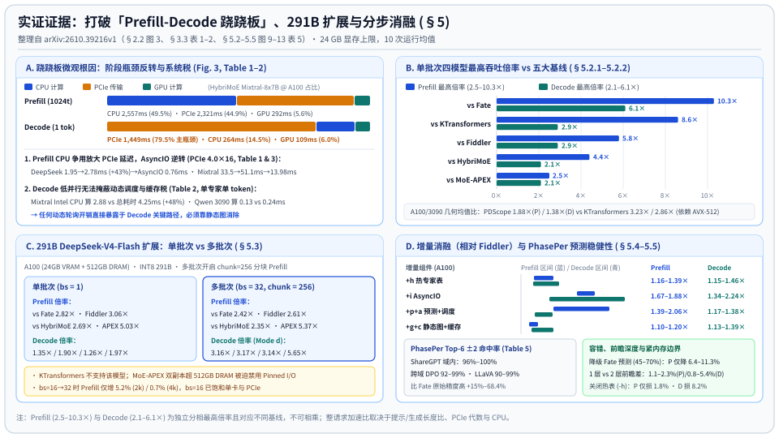查看原图 ↗</a><figcaption>图 2 · 实证对比汇总（整理自 arXiv:2610.39216v1 §2.2、§3.3、§5.2–§5.5 与 Table 1–5）：所有结果均为 24 GB 显存上限下 10 次运行均值，两阶段倍率分开统计。</figcaption></figure>

论文在两套主平台与一套旧架构辅助平台上评测：主平台为 **NVIDIA A100 + 双路 Intel Xeon Gold 6230R**（支持 AVX-512，无 AMX）与 **NVIDIA RTX 3090 + AMD EPYC 7452**（云节点每 GPU 分配 16 核，无 AVX-512），均采用 PCIe `4.0 ×16`；附录 §8.5 补充了 **NVIDIA V100 + Intel 6230R**（PCIe `3.0 ×16`）。全实验把单卡可用显存统一限制在 `24 GB`，扣除注意力与非专家缓冲区后留给 GPU 驻留专家的预算为 **`5.8–8.7 GB`**；五个对照基线（`KTransformers v0.3.2`、`Fate`、`Fiddler`、`HybriMoE`、`MoE-APEX`）均在相同显存上限下经 3 轮方法专属预热并调至各自最优配置，采用与 `KTransformers` 一致的分相吞吐口径（`ShareGPT` 输入 `128–4096` token、生成 `64` token，10 次运行取均值；291B 大模型测试采用 `INT8` 量化与 `512 GB` 主机内存）。

| 模型（主测 BF16） | 架构参数（层数 / 专家 / Top-k / 单专家） | PCIe 4.0 原始转运（微基准 → Prefill / 理论下界） | AsyncIO 优化后 Prefill 转运（PCIe 4.0 / 3.0 带宽利用率） | 单专家单 token 运行耗时（Intel 6230R 计算/总耗 vs RTX 3090） | PhasePer Top-6 ±2 命中率（ShareGPT / DPO / LLaVA）与开销 |
| :--- | :--- | :--- | :--- | :--- | :--- |
| Mixtral-8x7B | 32 层 / 8 专家 / Top-2 / 336 MB | 33.5 → 51.1 ms / 10.67 ms | 13.98 ms (76%) / 26.7 ms (80%) | 2.88 → 4.25 ms vs 0.33 → 0.44 ms | 100% / 99% / 99%（1.2–3.8 MB · 0.15 ms） |
| Qwen3-30B-A3B | 48 层 / 128 专家 / Top-8 / 9 MB | 1.34 → 1.88 ms / 0.29 ms | 0.44 ms (66%) / 0.79 ms (72%) | 0.16 → 0.34 ms vs 0.13 → 0.24 ms | 97% / 94% / 92%（1.7–4.2 MB · 0.12 ms） |
| DeepSeek-V2-Lite | 26 层 / 64 专家 / Top-6 / 16.5 MB | 1.95 → 2.78 ms / 0.53 ms | 0.76 ms (70%) / 1.39 ms (76%) | 0.21 → 0.43 ms vs 0.17 → 0.29 ms | 96% / 92% / 90%（1.6–4.0 MB · 0.48 ms） |
| Moonlight-16B-A3B | 26 层 / 64 专家 / Top-6 / 16.5 MB | 未单列（同 DeepSeek 专家体量） | 未单列（见 §4.4.2 / §5.2 端到端） | 未单列（AMD EPYC 前三款见 §3.3 Table 2） | 99% / 95% / 92%（1.6–4.0 MB · 0.48 ms） |

*表 1 · 四款主测 MoE 模型的结构特征、单专家系统开销对比与 PhasePer 预测表现汇总（整理自 `arXiv:2610.39216v1` Table 1、Table 2、Table 3、Table 4 与 Table 5；Table 1/2/3 中未单列项注明出处边界；`PhasePer` 以离线 `16%` `ShareGPT` 训练并在未见 `DPO`/`LLaVA` 跨领域评测）。*

| 对比基线（调度范式） | 四模型 Prefill 最高倍率（§5.2.1） | 四模型 Decode 最高倍率（§5.2.2） | A100 / RTX 3090 几何均值比（Prefill / Decode） | 291B DeepSeek-V4 单批次 bs=1（Prefill / Decode） | 291B DeepSeek-V4 多批次 bs=32（Prefill / Decode） | 核心瓶颈归因与硬件敏感度 |
| :--- | :--- | :--- | :--- | :--- | :--- | :--- |
| vs. Fate（按需加载） | 最高 **10.3×** | 最高 **6.1×** | 1.67 / 1.71（PDScope 1.88 / 1.38） | 2.82× / 1.35× | 2.42× / 3.16× | 门控近似在输入/输出群掉精度；Decode 频发 I/O 气泡 |
| vs. KTransformers v0.3.2（静态放置） | 最高 **8.6×** | 最高 **2.9×** | **3.23** / **2.86**（强 CPU 绑定） | 不支持 A100 运行该模型 | 不支持 A100 运行该模型 | Prefill 512–1024 tok 后见顶回落；依赖 Intel AVX-512，AMD 下大跌 |
| vs. Fiddler（动态调度） | 最高 **5.8×** | 最高 **2.9×** | 1.92 / 1.69 | 3.06× / 1.90× | 2.61× / 3.17× | 缺乏前瞻与跨层协同；动态轮询税直接暴露在 Decode |
| vs. HybriMoE（动态+缓存） | 最高 **4.4×** | 最高 **2.1×** | 1.85 / 1.68 | 2.69× / 1.26× | 2.35× / 3.14× | 逐层贪心诱发 Case 1 欠取与 Case 2 过取气泡 |
| vs. MoE-APEX（动态+INT4） | 最高 **2.5×** | 最高 **2.1×** | 1.72 / 1.49 | 5.03× / 1.97× | 5.37× / 5.65× | 长上下文量化决策耗时；291B 存双副本超 512GB DRAM 被迫关 pinned I/O |

*表 2 · PDScope 相对五套主流基线的分相端到端吞吐倍率、跨平台稳定性及 291B 大模型多批次扩展表现（整理自 `arXiv:2610.39216v1` §5.2.1–§5.3 与 Fig. 9–11；各行最高倍率为不同平台或输入长度下的对应基线极值）。*

结合 Table 1、Table 2 与消融/轨迹跟踪实验，原文的核心实证结论如下：

- **破除跷跷板与跨平台稳健性（§5.2 & §8.5）**：在 `128–4096` token prefill 上，`PDScope` 随序列长度增长保持最陡斜率，相对五套基线分别取得最高 `10.3×`（Fate）、`8.6×`（KTransformers）、`5.8×`（Fiddler）、`4.4×`（HybriMoE）与 `2.5×`（MoE-APEX）的吞吐优势；在 decode 阶段同步取得最高 `6.1×`（Fate）、`2.9×`（KTransformers 与 Fiddler）、`2.1×`（HybriMoE 与 MoE-APEX）的提升。在无 AVX-512 的 AMD EPYC + RTX 3090 与使用 PCIe `3.0 ×16` 的 V100（§8.5 Fig. 18–19，排除不支持 pre-Ampere 的 KTransformers）上，`PDScope` 仍维持显著领先，其 A100/3090 几何均值比仅为 `1.88×`（prefill）与 `1.38×`（decode），远低于强绑定 Intel AVX-512 算子的 `KTransformers`（`3.23× / 2.86×`）。
- **291B 大模型与多批次并发扩展（§5.3 & §8.6 Fig. 20）**：在 `24 GB` 显存、`512 GB` 主机内存运行 `DeepSeek-V4-Flash`（INT8，291B）时，所有系统在多批次启用 `chunk size = 256` 分块 prefill。`PDScope` 在 `bs=1` 与 `bs=32` 下分别领先最强对手至少 `2.69×`/`1.26×` 与 `2.35×`/`3.14×`（相对被迫关闭锁页内存的 `MoE-APEX` 最高达 `5.37×`/`5.65×`）。值得注意的是，`bs=16` 升至 `bs=32` 时各系统 prefill 增幅极微（`PDScope` 在 `2048` 与 `4096` 输入下分别仅增 `5.2%` 与 `0.7%`），说明 `bs=16` 已基本跑满单卡算力与 PCIe 带宽；而在附录 §8.6 全四模型 `bs=32`（`1024` 入 / `128` 出）实验中，既有基线间的跷跷板冲突依然存在，`PDScope` 通过在 decode 启用 **Mode d** 在高并发下同样打破折中。
- **增量消融、紧密显存兜底与微架构 Trace（§5.4–§5.6，Fig. 12–14）**：以 `Fiddler` 为起点在 A100 上逐项开启组件，各模块相对无该模块时的增量收益依次为：热专家表 `+h` 贡献 `1.16×–1.39×`（P）/ `1.15×–1.46×`（D）；`AsyncIO` `+i` 贡献 `1.67×–1.88×`（P）/ `1.34×–2.24×`（D）；`PhasePer + AdaptSched` `+p+a` 协同贡献 `1.39×–2.06×`（P）/ `1.17×–1.38×`（D）；静态图与缓存预取 `+g+c` 贡献 `1.10×–1.20×`（P）/ `1.13×–1.39×`（D，在微开销敏感的 decode 更显著）。若因显存吃紧关闭热专家表（`+i+p+a+g+c`），prefill 平均仅下降 `1.8%`、decode 下降 `8.2%`，依赖 `AsyncIO` 缓冲池直接流式覆写即可维持主体收益。在 `Qwen3-30B-A3B` A100 单层微架构 Trace（§5.6 Fig. 14，关闭热专家预加载）中，prefill 阶段 `PDScope` 把单层 GPU 专家数从 `HybriMoE` 的 `38` 个推升至 **`49` 个**（CPU 从 `43` 降至 `32` 个），且 `8.1 ms` 的调度与静态图构造（`Sort`）完全掩蔽在 `12` 个 GPU 专家与 `4` 个 CPU 专家计算之中。
- **跨领域泛化与极差预测精度下的鲁棒性（§5.5、§6、§8.3）**：仅以 `16%` `ShareGPT` 训练的 `PhasePer`（每层参数仅 `1.2–4.2 MB`、前向推理 `0.12–0.48 ms` 隐藏在传输间隙中），在跨领域 `DPO` 与多模态 `LLaVA` 上的 Top-6（±2 排名容差）命中率仍稳定在 `90%–99%`，平均精度相比域内仅微降 `4.8%–5.3%`、原始准确率从未跌破 `80%`、较 `Fate` 提升 `15%–68.4%`。更关键的是 §8.3 压力测试：即便把 `PhasePer` 人为替换为准确率跌至 `45%–70%` 的 `Fate` 预测器，在 `4096` 输入下 `AdaptSched` 的输入/输出群 prefill 吞吐也仅下降 **`6.4%–11.3%`**，中间群仅降 `0.9%–2.4%`——因为在大批量统计下只要热点排序命中率高于随机基准（如 Mixtral `2/8 = 25%`），预取便持续产生正收益，而 Step 2 局部重评会把漏预测专家自动兜底回按需加载。

### 四、科学边界、实验假设与工程迁移启示

把 `PDScope` 的设计模式迁入实际本地或边缘 MoE 推理服务前，需要明确区分原文实证范围与未覆盖的工程前提：

1. **分相倍率不可相乘，请求级加速受输入/输出长度比主导**：报告中的 `2.5–10.3×`（prefill）与 `2.1–6.1×`（decode）是按阶段独立测得的最高吞吐倍率，且分别来自不同对比基线（如 `10.3×` 针对 `Fate`，`2.5×` 针对 `MoE-APEX`），**绝不能将两个倍率相乘来估算完整请求的端到端加速**。真实请求收益高度依赖提示词与生成长度比（`L_in / L_out`）、PCIe 带宽代际、CPU 向量指令集以及模型专家粒度（`Mixtral` 单专家 `336 MB` 与 `Qwen3` 单专家 `9 MB` 的 I/O-计算比完全不同）。
2. **明确不支持分布式 P/D 重叠与多卡张量/专家并行**：§6 指出，在受限显存的单机 CPU-GPU 节点上，prefill 本身已经打满 CPU 与 PCIe，若像分布式集群那样把 decode 与 prefill 重叠混跑（Chunked P/D overlap），只会加剧资源争用；`PDScope` 的多批次支持仅限**分相合并批处理（phase-consolidated batching）**，且在 `A100` 上 `bs=16` 即达硬件饱和上限。此外，离线阶段每模型需 `< 30` 分钟校准且依赖主机拥有足够 DRAM 与锁页内存空间（如 `MoE-APEX` 在 `291B` 模型下即触及 `512 GB` 主机内存天花板）。
3. **无精度损失评测与代码/文本核验注记**：由于两阶段重编译用第 `l` 层真实门控结果覆盖预测草稿，系统只改变算子在 CPU/GPU 上的执行时序而不改变任何数值计算（异于 `MoE-APEX` 的有损 `INT4` 压缩），故论文聚焦系统吞吐与路由命中率而非困惑度评测；同时原文未与投机解码、KV-Cache 量化卸载联合验证。文献文本核验还需注意：脚注 1 提供的 `https://github.com/nezha-Anonymous/PDScope` 属于匿名占位仓库，正文第 5、11 页存在两处未解析的 `Appendix §??` 交叉引用（分别对应 §8.7 与 §8.3），Step 3 与公式 `(6)` 排印中的 `<code>&#124;f&#124;</code>` 在语义上应理解为面向小数界限的向上取整预取计数 `⌈f⌉`。
4. **可迁移的三条系统工程原则**：（1）**把「阶段轴」从调度黑箱里显式拆出来**：prefill 追求算力与高负载热点预取，decode 追求极简关键路径与零冗余 I/O，用单一启发式同时讨好两者必然产生跷跷板；（2）**把预测误差挡在控制面与执行面之间**：高准确率只能降低带宽浪费，真正让生产系统敢用轻量预测器的底座是「Step 2 真实门控局部重评兜底 + 第 `l` 层重编译覆盖草稿图」的零误差传播护栏；（3）**用静态图合并发射与预注册双缓冲消灭微开销**：当 decode 进入亚毫秒级专家执行区，动态状态轮询、CUDA 缓冲区动态注册与多矩阵串行拷贝很容易吞噬掉调度算法省下的收益，必须从执行栈底层同步消除。

来源：[PDScope: Breaking the Prefill-Decode Seesaw for Memory-Bound MoE Inference](https://arxiv.org/abs/2610.39216)（`arXiv:2610.39216v1`）
<h2 class="daily-paper-title" id="paper-arxiv-2610.39999">11 · PhOSv1：跨睡眠模型去重 GPU 上下文，化解单机扩缩容显存税</h2>

[PhOSv1: Efficient Scaling of Model Sleeping on a Single Server for Autoscaling with GPU-Context Deduplication](https://arxiv.org/abs/2610.39999)（[v1 PDF](https://arxiv.org/pdf/2610.39999) · [HTML](https://arxiv.org/html/2610.39999v1) · [代码仓库](https://github.com/blitz-serving/PhoenixOSv1)）  
Tianle Sun、Xingda Wei、Rong Chen（Shanghai Jiao Tong University）· `arXiv:2610.39999v1 [cs.DC]`（IEEE HPCC 2026 录用）· 2026-10-29 提交（截至核验仅存 `v1`，无修订或撤回记录；原简报条目曾标注 2026-10-30 归档日期）

模型即服务（MaaS）平台需要在同一共享集群中同时托管来自不同厂商、不同参数规模的大量模型，并随动态波动的请求速率弹性扩缩容。`vLLM`、`SGLang` 与 `Aegaeon` 采用的**模型休眠（model sleeping）**虽能靠预生成并暂停推理引擎绕开冷启动控制面延迟，但每保留一个休眠模型都必须把完整 GPU 上下文长期锁在显存中。`PhOSv1` 观察到不同休眠模型的驱动上下文与算子核二进制高度冗余，通过常驻系统守护进程与 `LD_PRELOAD` 透明 API 远程转发（API remoting）集中托管并去重 GPU 上下文，同时在睡眠期释放不可共享的内部 GPU 缓冲区、仅在唤醒调用前按需重建。以下精读严格依据 `arXiv:2610.39999v1` 原文与图表数据，明确区分作者单卡实测结论与工程适用边界。

### 一、为什么模型休眠也会拖垮线上吞吐：控制面冷启动与线性显存税

弹性扩缩容触发扩容（scale-up）时，新分配 GPU 在引擎就绪前无法服务请求，直接拉长过载排队窗口。论文 §2（Fig. 1c）把推理引擎冷启动拆分为**控制面**与**数据面**两个阶段：

- **数据面已逼近链路极限，瓶颈退回到控制面**：将权重从主机内存或远端存储拷入 GPU HBM 的数据面耗时，已由 `BlitzScale`、`lambdascale` 等网络组播与主机缓存技术压缩到 `1 s` 以内；真正卡住扩容的是控制面初始化。在 Fig. 1(c) 给出的原生 `vLLM` 冷启动分解中，启动 Python 解释器并加载数万个模块构造 **CPU 上下文**需 **`6.6 s`**，创建 CUDA Primary Context、加载 GPU 核代码及初始化 `cuBLAS`/`cuDNN`/stream 句柄构造 **GPU 上下文**还需 **`3.5 s`**；在 §4.2 覆盖 16 个热门模型的评测中，即便归一化去除了权重加载的存储 I/O 开销，原生冷启动平均耗时仍高达 **`24.41 s`**。
- **Checkpoint/Restore（C/R）为何走不通**：以 `PhoenixOS` 为代表的操作系统级 C/R 虽可把 Fig. 1(c) 中的 CPU 上下文恢复压至 **`0.57 s`**、GPU 上下文接近零，但存在两道硬伤——其一是**长尾稳定性**：`CRIU` 恢复进程页表与内核状态在最差情况下偶发 **`10–20 s`** 未解释延迟；其二是**引擎演进兼容性**：现代推理引擎广泛采用的 `io_uring` 等内核新特性至今仍不被 `CRIU` 支持，强行改造引擎或 `CRIU` 成本过高。
- **原生模型休眠的两难困境**：`vLLM`、`SGLang` 与 `Aegaeon` 的休眠模式离线预热引擎并用 Linux `cgroup freezer` 暂停进程，唤醒时免除控制面初始化，且 CPU 上下文（如 `vLLM` 占 **`2.9 GB`**）驻留主机内存并可通过共享内存复用；但**每个休眠模型仍把自己的 GPU 上下文常驻在 HBM 中**。即使剔除可快速恢复的模型权重，**24 个休眠模型在 vLLM v0.19.1 上仍吞掉约 27 GB（80 GB A800 的 34%）显存**，且呈线性增长（Fig. 3 左）。而服务期间可用的空闲 HBM 直接决定 `KV Cache` 容量——在 `A800` 上运行 `Qwen3.6-27B` 时，当休眠占用从 `0` 增至 `16 GiB`，KV 空间缩水迫使请求排队、吞吐从 **`747` 骤降至 `341 tokens/s`（下降 `54%`）**（Fig. 3 右）。服务商被迫在「多缓存模型保唤醒速度」与「少缓存模型保线上吞吐」之间二选一。

### 二、GPU 上下文四分拆解：驱动共享、算子核高重叠与缓冲区快速重建

为在不牺牲唤醒速度的前提下消除线性显存税，论文 §3 在 24 个热门开源模型上对不含权重的休眠 GPU 上下文做逐项解剖（Fig. 4 与 Fig. 5），将其拆为四类资源：

1. **CUDA Context（驱动主上下文）**：封装虚拟内存管理控制状态与同步事件，完全**与具体模型无关**——同一物理 GPU 上的不同模型天然可共用同一个 Driver Primary Context；而在原生模式下每个进程独立从零构建一次需耗时 **`~430 ms`**。
2. **GPU Kernels（已编译算子二进制）**：由于主流 LLM 共享矩阵乘（GEMM）、注意力等核心原语，且高效 GPU 核高度集中在少数基础库（如 `FlashInfer`、`cuBLAS`），不同规模与架构的模型内核代码高度重合。在 17 个 Hugging Face 高下载模型（覆盖 `Qwen`、`Qwen3`、`Qwen3.5`、`Llama` 与 `Gemma`）的两两核相似度矩阵中（Fig. 5，排除 GPU Buffer），多数模型对的核二进制重叠率达 **`59%–99%`**，其中 `Qwen-1.5B/3B`、`Qwen3-4B/8B`、`Gemma-E2B/E4B` 同族达 **`1.00`**，`Llama-3B` 与 `Qwen-3B`/`Qwen3-4B` 也分别高达 **`0.99`**。
3. **GPU Buffers（模型内部运行时缓冲区）**：不可跨模型去重，且在大模型或特定结构上占据原生上下文的大头——Fig. 4 顶部显示不含权重的原生单模型上下文总量介于 `Qwen3-8B` 的 **`544 MiB`** 到 `gemma-4-26B-A4B` 的 **`1,646 MiB`**（如 `Qwen2.5-VL-7B` **`1,360 MiB`**、`Qwen3.5-27B`/`Qwen3.6-27B` **`1,272 MiB`**、`gpt-oss-20b` **`1,338 MiB`**、`Qwen3-30B-A3B-In.` **`1,238 MiB`**）。但论文发现此类缓冲区**可快速按需重建**：Fig. 4 底部实测从零创建 GPU Buffer 仅需 **`~30 ms`**，不到创建 CUDA Context（`~430 ms`）的 `1/14`。
4. **Handles（流与计算库句柄）**：即 CUDA streams、cuBLAS 等资源注册表，显存占用在 Fig. 4 中几乎可忽略。

<figure class="note-figure"><a class="note-image-link" href="/assets/images/digest/2026-10-31/phosv1-cuda-context-dedup-arch-zh.svg" target="_blank" rel="noopener" aria-label="查看 PhOSv1 架构与 GPU 上下文去重示意图原图">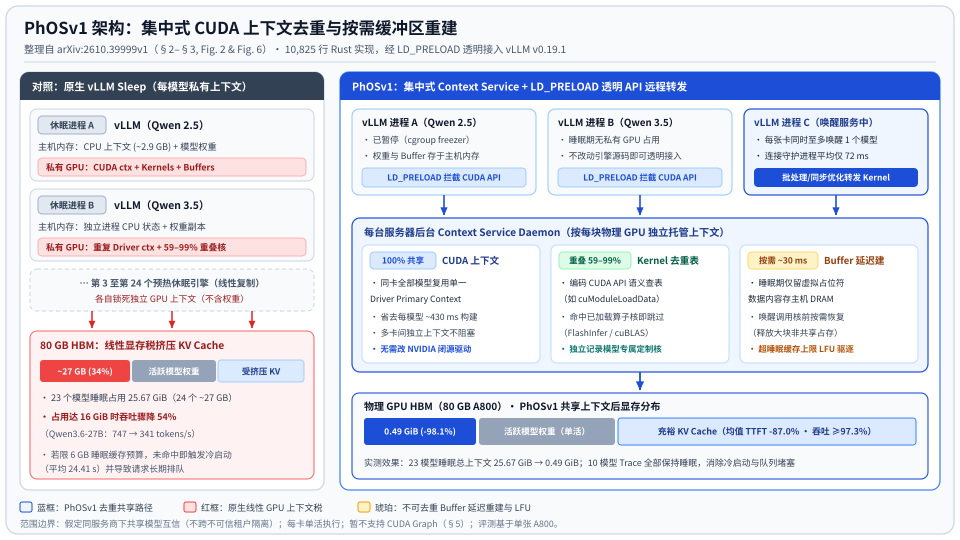查看原图 ↗</a><figcaption>图 1 · PhOSv1 集中式 GPU 上下文去重架构（整理自 arXiv:2610.39999v1 §2–§3 与 Fig. 2、Fig. 6）：原生休眠每进程锁死一份 GPU 上下文；PhOSv1 经 LD_PRELOAD 将分配委托给每卡共享的守护进程，对可共享层做 100% 驱动复用与 59%–99% 核去重，对不可共享 Buffer 改为主机占位加 ~30 ms 延迟重建。</figcaption></figure>

### 三、系统架构：Context Service 守护进程、LD_PRELOAD 远程转发与 LFU 驱逐

基于上述解剖，作者以 **10,825 行 Rust** 从零实现 `PhOSv1` 并集成到 `vLLM v0.19.1` 休眠模式，核心机制分为集中式守护进程与离线/在线两阶段协作（Fig. 6）：

- **每卡一实例的 Context Service Daemon**：`PhOSv1` 在每台服务器部署后台系统守护进程。针对多卡机器，守护进程**按每张物理 GPU 独立维护一个共享 CUDA Primary Context**、已去重的公共 Kernel 二进制池及少数模型专属定制核，保证不同 GPU 上的唤醒彼此独立、互不阻塞。同时沿用前文系统模型假定**：单张 GPU 可缓存多个休眠引擎，但同一时刻至多唤醒并运行 1 个活跃引擎**。
- **基于 LD_PRELOAD 的透明 API 远程转发**：在不修改 `vLLM`/`SGLang` 源码、也不改动闭源 NVIDIA CUDA 驱动的前提下，`PhOSv1` 利用 `LD_PRELOAD` 在 **CUDA Driver API 边界**拦截所有 GPU 资源分配与核调用并转发给守护进程。守护进程维护一张编码 API 语义的查表索引（例如识别 `cuModuleLoadData` 加载算子核二进制）：若同一核二进制此前已被其他模型加载，则直接记录复用并**跳过重复创建**。
- **GPU Buffer 虚拟占位与主机检查点延迟重建**：遇到无法去重的内部 GPU Buffer 分配请求时，守护进程在睡眠阶段只返回**虚拟占位符（virtual placeholder）**、不在 GPU HBM 实质分配显存，同时把缓冲区内容作为检查点保存在**主机内存**；当某引擎被唤醒并真正发起 GPU 核调用时，API 转发先检查并按需分配恢复所需缓冲区（仅 `~30 ms`），随后执行核函数。针对 `API remoting` 本身可能带来的推理调用开销，`PhOSv1` 结合批处理（batching）与同步优化，使瓶颈停留在 GPU 计算本身而非 CPU 侧核发射。
- **增量预热与 LFU 容量上限保护**：**离线阶段**（可选但推荐）按序启动并休眠 `N` 个引擎即可把公共上下文写入守护进程，也可在服务空闲时或首次按需扩容时**增量完成**以摊薄首次延迟。由于未缓存新模型仍会引入少量独特核与元数据，守护进程设定了**休眠上下文最大显存上限**，超出时按**最不经常使用（LFU）**策略淘汰低频休眠模型。

| GPU 上下文资源组件 | 占用规模与重建耗时实测（Fig. 4） | 跨模型可共享性（Fig. 5） | PhOSv1 守护进程处置机制 | 适用前提与剩余代价 |
| :--- | :--- | :--- | :--- | :--- |
| `CUDA Context`（驱动主上下文） | 每进程独立持有一份；从零创建需 `~430 ms` | 模型无关，同卡内 **100%** 可共享 | 按物理 GPU 维护单一共享 Primary Context，后续引擎直接复用 | 同上下文引擎共享地址与隔离域，假定多模型彼此可信 |
| `GPU Kernels`（算子编译代码） | 随算子库体积变化，大量复制于每进程 | 热门模型两两重叠 **59%–99%**（同族 `0.99–1.00`） | 拦截 `cuModuleLoadData` 等 API 语义查表，命中相同二进制即跳过加载 | 高度异构自定义算子会降低命中率；超上限触发 LFU 驱逐 |
| `GPU Buffers`（模型内部缓冲区） | 推高总上下文至 `544–1,646 MiB`（如 `gemma-4-26B-A4B` `1,646`）；重建仅 **~30 ms** | 模型强相关，不可直接去重 | 睡眠期只建虚拟占位并把内容 Checkpoint 到主机内存，唤醒执行前按需恢复 | 需足够主机 DRAM 暂存检查点；当前不支持 `CUDA Graphs` 指针重建 |
| `Handles`（Streams / cuBLAS 句柄） | 显存占用在 Fig. 4 中几乎可忽略 | 轻量化，无需重型跨进程去重 | 由 API 语义查表托管句柄注册与运行时转发 | 频繁发射极小核时依赖 batching 与同步优化控制 remoting 延迟 |

*表 1 · 休眠模型 GPU 上下文的四类解剖、可共享性特征与 PhOSv1 差异化处置策略（整理自 arXiv:2610.39999v1 §3、Fig. 4 与 Fig. 5）。*

### 四、单卡 A800 实证评测：98.1% 睡眠显存压缩、4.12 秒唤醒与 87.0% TTFT 降幅

<figure class="note-figure"><a class="note-image-link" href="/assets/images/digest/2026-10-31/phosv1-sleeping-scaleup-memory-zh.svg" target="_blank" rel="noopener" aria-label="查看 PhOSv1 单卡 A800 实证表现四象限图原图">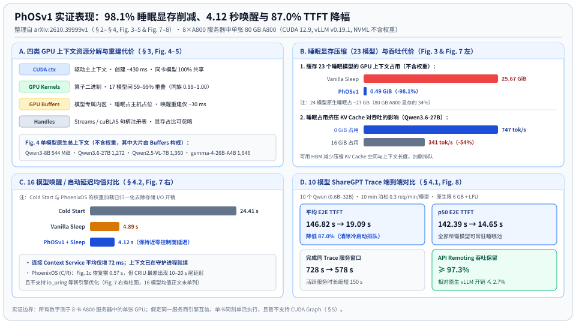查看原图 ↗</a><figcaption>图 2 · PhOSv1 单卡 A800 实证结果汇总（整理自 arXiv:2610.39999v1 §2–§4、Fig. 3–5 与 Fig. 7–8）：在单张 80 GB A800 上实现 98.1% 睡眠显存削减、4.12 s 快速唤醒与端到端 TTFT 87.0% 改善，同时保留 ≥97.3% 原生推理吞吐。</figcaption></figure>

作者在一台配备 **8 张 NVIDIA A800 GPU（每卡 80 GB HBM）**、双路 Intel Xeon Platinum 8350C（共 64 核）与 **1 TB DRAM** 的服务器上运行 `CUDA 12.9` 与 `vLLM v0.19.1` 开展评测，并明确说明**本节汇报的全部测量均使用单张 GPU（1 × A800）**；GPU 上下文显存通过 `NVML` 在引擎进入睡眠后采集（故已剔除模型权重）：

| 对比方案 | 控制面启动特征（Fig. 1c / §2） | 16 模型平均启动延迟（Fig. 7 右，归一化 I/O） | 23 模型休眠显存（Fig. 7 左，不含权重） | 10 模型 ShareGPT Trace 端到端表现（Fig. 8） | 主要瓶颈或已知限制 |
| :--- | :--- | :--- | :--- | :--- | :--- |
| `Cold Start`（原生 vLLM） | CPU `6.6 s` + GPU `3.5 s`；每次扩缩容重初始化 | **24.41 s** | 不适用（不常驻缓存） | 基线预算外未命中模型触发冷启动与排队 | 频繁重载 Python 与 CUDA 上下文导致长排队延迟 |
| `PhoenixOS`（CRIU C/R） | CPU `0.57 s` + GPU `≈0`；CRIU 最差 **10–20 s** | Fig. 7 右绘有柱图（16 模型均值正文未单列） | `0`（进程已 Checkpoint 退出显存） | 未纳入 §4.1 端到端 Trace 对比 | 不兼容 `io_uring` 等现代引擎特性，且 CRIU 恢复存在长尾 |
| `Vanilla vLLM Sleep` | 命中睡眠缓存时接近 `0` 控制面开销 | **4.89 s** | **25.67 GiB**（24 模型约 `27 GB / 34%`） | 平均 TTFT **146.82 s** · p50 **142.39 s** · 窗口 **728 s** | 线性显存税迫使将睡眠预算限在 `6 GB`，未命中即退回冷启动 |
| `PhOSv1 + Sleep` | 连接 Context Service 平均仅 **72 ms** | **4.12 s**（保持快速唤醒水平） | **0.49 GiB**（减少 **98.1%**） | 平均 TTFT **19.09 s**（**-87.0%**）· p50 **14.65 s** · 窗口 **578 s** · 吞吐 **≥97.3%** | 假定同租户互信、单卡单活执行，暂不支持 `CUDA Graphs` |

*表 2 · 四种引擎扩缩容方案在启动延迟、睡眠显存占用与端到端长尾多模型 Trace 上的实测对比（arXiv:2610.39999v1 §2、§4.1、§4.2 与 Fig. 1c、Fig. 7–8；Cold Start 与 PhoenixOS 权重加载已归一化去除存储 I/O 开销）。*

1. **睡眠显存压缩 98.1%（§4.2，Fig. 7 左）**：取自 Fig. 4 的 **23 个模型**逐个加载并休眠后（不含权重），原生 `vLLM` 睡眠模式占用随模型数线性攀升至 **`25.67 GiB`**，而 `PhOSv1 + sleep` 合计仅占 **`0.49 GiB`**，节省 **`98.1%`** GPU 显存。
2. **保持与原生休眠相当的唤醒速度（§4.2，Fig. 7 右）**：在 **16 个热门模型**（含 `Qwen2.5`、`Qwen3`、`Qwen3-30B-A3B`、`Qwen3.5`、`Llama-3.1/3.2` 与 `gemma-4` 系列）上对比冷启动、原生休眠、`PhoenixOS` 与 `PhOSv1`（冷启动与 `PhoenixOS` 的权重加载均归一化去除存储 I/O）。`PhOSv1` 平均启动耗时 **`4.12 s`**，与原生休眠 **`4.89 s`** 处于同一量级（连接守护进程仅 **`72 ms`**），远低于冷启动的 **`24.41 s`**。
3. **长尾多模型 Trace 端到端收益与开销（§4.1，Fig. 8）**：遵循 `Aegaeon` 的 Trace 构造方法，在单卡上用 `ShareGPT` 构造 **10 分钟、10 个热门 Qwen 模型（0.6B–32B）**的泊松到达流，每个模型 **`0.3 req/min`** 以模拟长尾低频多模型服务。基线原生 `vLLM` 采用不缩水默认 `KV Cache`/上下文长度下的最大安全睡眠缓存预算 **`6 GB`**，超出后按 `LFU` 驱逐并在未命中时冷启动。结果显示：`PhOSv1` 让 10 个模型全数保活睡眠池，将**平均端到端 TTFT 从 146.82 s 降至 19.09 s（-87.0%）**、**p50 TTFT 从 142.39 s 降至 14.65 s**，完成整段负载的活跃服务窗口也从 **`728 s` 缩短至 `578 s`**；与此同时，底部吞吐面板（input/output tokens/s）显示 `PhOSv1` 保留了**至少 `97.3%`** 的原生 `vLLM` 吞吐（即 API 远程转发开销 `≤ 2.7%`）。

### 五、已证实机制边界、多租户隔离前提与工程实践启示

把 `PhOSv1` 纳入生产多模型集群架构时，必须把原文验证过的收益与明确的工程边界拆开评估：

1. **可信单租户安全边界（§5）**：`PhOSv1` 让同一 GPU 上的休眠/唤醒引擎共享同一个 `CUDA Primary Context`，直接消除了跨进程 GPU 驱动隔离。作者明确声明系统**假定共享上下文的引擎彼此可信**（适用于同一 MaaS 厂商统一运维的多模型池），**跨不可信多租户的安全隔离不在本文覆盖范围**；若存在第三方不可信代码或需要强故障/安全隔离，不能直接复用同一 CUDA 上下文。
2. **服务器 8 卡但仅单卡实测，且每卡同刻只运行单一引擎（§2、§4）**：虽然测试机装有 8 张 `A800`，但论文全部数据均来自**单卡评测**，多卡 `Tensor Parallel` 下的 `NCCL` 通信上下文与跨卡协调并未实测。此外，`PhOSv1` 主打「单卡缓存多模型、同时至多唤醒 `1` 个模型独占整卡」的时间复用模型，与 `NVIDIA MPS`、`MIG`、`TGS` 或 `REEF` 等多模型并发空间复用正交。
3. **暂不支持 CUDA Graphs 与仅验证 vLLM（§4–§5）**：作者明确指出 `PhOSv1` 目前**不支持 CUDA Graphs**，因为图节点中嵌入了设备指针与核引用，检查点恢复需要额外的指针重写或离线物化（如 `Medusa`/`Foundry`）；凡重度依赖 `CUDA Graphs` 压低小 batch decode 延迟的线上引擎均需权衡这一缺失（§4.1 评测中 `PhOSv1` 与基线采用同一 `vLLM` 配置）。同时，虽然摘要与设计提及 `SGLang`，但完整实现与实验仅基于 `vLLM v0.19.1` 验证。
4. **主机内存与算子同构依赖**：休眠时把内部 Buffer 检查点与模型权重暂存主机（测试机配 `1 TB DRAM`）、且按模型叠加 CPU 进程常驻状态仍需充足 CPU 内存；`59%–99%` 的高去重收益也建立在 `FlashInfer`/`cuBLAS` 等主流公共算子库共享基础上——若同一集群混跑算子库完全异构的定制推理框架，核去重比例会收窄，但单共享 CUDA 上下文与 Buffer 延迟重建仍可节省固定开销。对服务端工程的可迁移启发是**：把 GPU 上下文按「模型无关驱动态 + 可去重只读代码段 + 可快速重放运行时缓冲区」三层拆解后，用操作系统边界的 LD_PRELOAD 拦截即可在不改引擎源码下撬动接近 2 个数量级的睡眠显存压缩。**

来源：[PhOSv1: Efficient Scaling of Model Sleeping on a Single Server for Autoscaling with GPU-Context Deduplication](https://arxiv.org/abs/2610.39999)
<h2 class="daily-paper-title" id="paper-arxiv-2610.40287">12 · Only Accepted Tokens Count: An Energy Accounting of Speculative Decoding Under Latency Targets</h2>

[Only Accepted Tokens Count: An Energy Accounting of Speculative Decoding Under Latency Targets](https://arxiv.org/abs/2610.40287) 
Bole Ma、Ayesha Afzal、Jan Eitzinger、Harald Koestler、Gerhard Wellein · 2026-10-30

该研究按实际接受的输出 token 计算投机解码能耗。batch 增大后，权重读取已被摊薄，验证可能变为计算瓶颈；接受率低时，满足更严延迟目标反而增加每 token 能耗。

依赖模型、语料、batch 和功耗测量范围；不能把单 GPU 能耗直接当作整座数据中心能耗。

来源：[Only Accepted Tokens Count: An Energy Accounting of Speculative Decoding Under Latency Targets](https://arxiv.org/abs/2610.40287)

<h2 class="daily-paper-title" id="paper-arxiv-2610.40292">13 · DolphinRouting：面向 PD 分离推理的簇级二值路由</h2>

[DolphinRouting: Cluster-Level Binary Routing for Disaggregated LLM Inference Serving](https://arxiv.org/abs/2610.40292)（[v1 PDF](https://arxiv.org/pdf/2610.40292) · [arXiv HTML](https://arxiv.org/html/2610.40292v1)） 
Yishuo Yuan\*、Shaoyu Yang\*、Chunrong Fang（南京大学，Nanjing University；\* 共同一作，Chunrong Fang 为通信作者）· `arXiv:2610.40292v1 [cs.LG]` · 2026-10-29 UTC 提交（截至核验仅存 `v1`，无修订或撤回记录；原简报按公告日时差写作 2026-10-30，`v1` 未附公开代码仓库链接）

在 Prefill-Decode（PD）分离式大模型服务集群中，把 Prefill 与 Decode 隔离到独立工作池虽然消除了跨阶段干扰，却也锁死了可用于 Prefill 的算力比例；当集群同时面对长冷提示词、多轮高命中前缀缓存与短输入请求时，「全部走远程 Prefill」与「按单一静态长度阈值本地消化」都难以兼顾首字延迟（TTFT）与生成速率（TPOT）。`DolphinRouting` 在**给定 P/D 资源配比**的前提下，把请求级路径选择（本地 Decode 节点聚合执行 vs. 远程 Prefill 节点分离执行）抽象为簇级二值策略搜索：离线按原始长度、P/D 双端缓存调整后的有效输入长度及输出长度信息对请求聚簇，在饱和负载下经「逐簇扫描初始化 + ε-greedy 联合搜索」直接从真实端到端 SLO 反馈中学习每簇的 1-bit 路由表；线上准入阶段仅做并行特征提取、簇归属映射与查表。以下精读严格依据 `arXiv:2610.40292v1` 原文与图表，将作者实测数据与评估边界分开陈述。

### 一、为什么规则阈值与纯分离都不够：混合负载下的 P/D 路径两难

大模型推理包含两个资源特性截然相反的阶段：**Prefill** 一次性读入整段提示词并受限于算力（决定 `TTFT`），**Decode** 逐 token 自回归生成并随 KV Cache 膨胀受限于显存带宽（决定 `TPOT`）。论文 §1 引用 TaiChi 在 `12 req/s` 模拟 ArXiv 负载上的对比（Wang et al., 2025）直观揭示了「纯聚合 vs. 纯分离」的固有权衡：

- **紧 TTFT、松 TPOT（`5 s / 250 ms`）**：聚合部署 SLO 达成率达 **`97%`**，而 PD 分离仅有 **`42%`**——聚合允许集群内全部 GPU 实例参与 Prefill 算力供给。
- **紧 TPOT、松 TTFT（`16 s / 60 ms`）**：聚合达成率骤降至 **`7%`**，PD 分离则达 **`98%`**——隔离使 Decode 免受长 Prefill 抢占算力。
- **中等约束（`6 s / 100 ms`）**：双方分别为 **`16%`** 与 **`50%`**，可见固定一刀切策略在中间地带同样吃力。

在真实生产的 PD 分离集群中，每条新请求其实存在一条二值分流开关：**聚合路径（`a_c = 0`，本地 Prefill）**直接在 Decode 节点完成 Prefill 与 Decode，省去远程 KV 传输；**分离路径（`a_c = 1`，远程 Prefill）**先由 Prefill 节点计算，再把 KV 状态传输至 Decode 节点。既有工作大多停留在另外两个层面，未能直接解决「考虑双池缓存不对称与输出需求的动态路径判定」：

1. **资源配比与实例调度层面**：DistServe、Splitwise 等聚焦静态阶段放置与实例并行配置；Llumnix（Sun et al., 2024）与 Calibrate, Then Route（Tumkur et al., 2026）解决的是「把请求调度或迁移到哪个具体实例」，而 DolphinRouting 解决的是在给定 P/D 实例配比下「Prefill 应该留在 Decode 池还是发往 Prefill 池」。
2. **规则式条件分离的盲区**：如 NVIDIA Dynamo（2026）暴露的长度条件分离规则，主要依据全局有效输入长度（effective ISL）及其与原始长度比值（或负载）设定人工阈值。这种规则同时忽略了两处关键信息——**P 池与 D 池可能持有不同长度的前缀 KV 缓存**（缓存不对称），以及**输出长度（OSL）决定的后续 Decode 持续压力与 KV 显存占用**。
3. **在线逐请求代价模型的开销**：若为每条请求在线运行复杂延迟/排队代价模型会增加准入延迟；DolphinRouting 将全部策略寻优推至离线真实负载反馈环节，线上仅保留可并行化的轻量特征提取与 `O(1)` 查表。

### 二、系统设计与机制：四维请求画像、离线聚类与饱和负载 ε-greedy 策略搜索

<figure class="note-figure"><a class="note-image-link" href="/assets/images/digest/2026-10-31/dolphinrouting-cluster-binary-router-zh.svg" target="_blank" rel="noopener" aria-label="查看 DolphinRouting 离线策略搜索与线上查表架构图原图">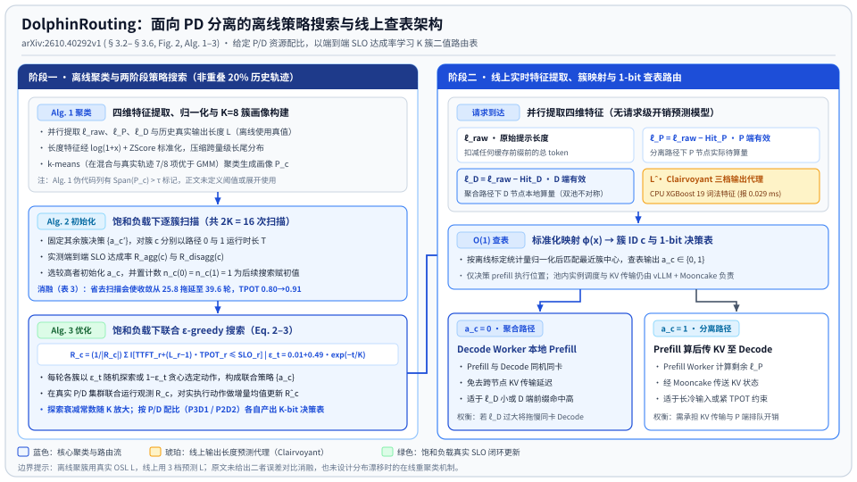查看原图 ↗</a><figcaption>图 1 · DolphinRouting 离线策略搜索与线上查表架构（整理自 arXiv:2610.40292v1 §3.2–§3.6、Fig. 2 与 Alg. 1–3）：离线阶段使用历史真实输出长度并针对每种 P/D 配比在饱和集群上学习一张 K 比特表，线上准入阶段以 Clairvoyant 代理输出长度并直接查表路由。</figcaption></figure>

系统由特征提取器、簇归属模块、二值决策查找表和离线决策更新器四部分组成，核心流程拆解如下：

1. **四维请求特征与双端缓存不对称建模（§3.3）**：对每条请求提取四项独立来源的特征——**原始提示词长度 `ℓ_raw`**、**P 端有效输入长度 `ℓ_P = ℓ_raw − Hit_P(x)`**（走分离路径时 Prefill 节点实际待算量）、**D 端有效输入长度 `ℓ_D = ℓ_raw − Hit_D(x)`**（走聚合路径时 Decode 节点本地待算量）以及**输出序列长度 `L`**（刻画 Decode 压力与 KV 增长）。
   - **离线 vs. 线上的关键切换**：离线聚簇（Algorithm 1）直接读取历史轨迹中记录的**真实输出长度 `L`**；而线上准入时输出长度未知，系统改为调用部署在 CPU 上的 XGBoost 三分类器 `Clairvoyant`（Sundaresan, 2026），仅靠 19 个免分词器词法特征预测 `short`、`medium` 或 `long`（Clairvoyant 原作者报告单请求耗时 `0.029 ms`），再映射为代表性输出长度 `L̂`。
2. **长尾归一化与离线聚簇（§3.4，Algorithm 1）**：鉴于请求长度跨越多个数量级、呈明显长尾分布，系统对长度特征先做 `log(1 + x)` 变换再执行 `ZScore` 标准化，随后用 `k-means` 或高斯混合模型（`GMM`）将历史轨迹划分为 `K` 簇（主实验取 `K = 8`），为每簇建立分布画像 `P_c`。注：Algorithm 1 伪代码第 12–14 行列出了 `if Span(P_c) > τ then Mark(c)` 的簇跨度标记检查，但论文正文并未定义 `Span(P_c)`、`τ` 或 `Mark(c)` 的具体数值与后续处理。
3. **端到端 SLO 奖励与簇间耦合（§3.5，Eq. 2）**：对生成 `L_r ≥ 2` 个 token 的请求，端到端完成时间为 `T_r^e2e = TTFT_r + (L_r − 1) · TPOT_r`。簇 `c` 的奖励定义为该簇内满足各自延迟阈值 `SLO_r` 的请求比例：`R_c = (1 / |R_c|) ∑_{r ∈ R_c} I[T_r^e2e ≤ SLO_r]`。全系统策略向量 `a = (a_1, ..., a_K) ∈ {0, 1}^K` 共有 `2^K` 种组合；由于不同簇共享同一套 P/D 实例和缓存池，单簇动作改变会经由排队与缓存状态耦合影响其他簇，因此必须把整张决策表放到真实服务系统上做联合评估。
4. **两阶段饱和负载策略搜索（§3.6，Algorithms 2 & 3）**：优化全程在饱和并发负载下基于实测集群反馈完成——
   - **第一阶段 · 逐簇扫描初始化（Algorithm 2）**：依次遍历 `c = 1, ..., K`，固定其余簇动作 `{a_c′}_{c′≠c}`，让簇 `c` 先走聚合路径（`0`）运行时长 `T` 记录 `R_agg(c)`，再走分离路径（`1`）运行同样时长 `T` 记录 `R_disagg(c)`，取奖励更高者作为初始动作 `a_c`，同时初始化 `R̂_c(0) = R_agg(c)`、`R̂_c(1) = R_disagg(c)` 与观测次数 `n_c(0) = n_c(1) = 1`。一轮共需 `2K` 次扫描（`K = 8` 时为 `16` 次）。
   - **第二阶段 · 联合 `ε-greedy` 精调（Algorithm 3）**：执行 `T_max` 轮联合优化，探索率按指数衰减 `ε_t = ε_min + (ε_0 − ε_min) exp(−t / K)` 调整，其中 `ε_0 = 0.5`、`ε_min = 0.01`，将簇数 `K` 设为衰减时间常数以在决策维度增大时按比例拉长探索周期。每轮所有簇以概率 `ε_t` 随机探索、以 `1 − ε_t` 贪心选当前最优动作，将联合表 `{a_c}` 下发至真实集群实测各簇 `R_c`，仅对本轮实际执行的动作执行增量均值更新：`R̂_c(a_c) ← R̂_c(a_c) + (1 / n_c(a_c))(R_c − R̂_c(a_c))`。
5. **线上极简路由与执行隔离（§3.2）**：请求到达后并行算完四维向量，按离线标定参数归一化后匹配最近簇中心 `c`，查表读取 `a_c ∈ {0, 1}` 决定本地或远程 Prefill；具体的实例负载均衡、批处理调度与 KV 传输仍全权交由底层 `vLLM` 与 `Mooncake` 完成。

### 三、真实集群评测：Qwen3.8-72B 对比 Dynamo、基准分化与消融分析

<figure class="note-figure"><a class="note-image-link" href="/assets/images/digest/2026-10-31/dolphinrouting-pd-slo-evaluation-zh.svg" target="_blank" rel="noopener" aria-label="查看 DolphinRouting 真实集群实证评测四象限图原图">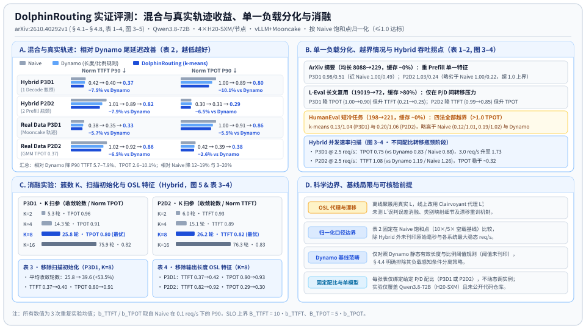查看原图 ↗</a><figcaption>图 2 · DolphinRouting 真实 PD 集群实证结果与边界（整理自 arXiv:2610.40292v1 §4.1–§4.8、表 1–4 与图 3–5）：在混合负载与真实对话轨迹上稳定压低双指标尾延迟，而在单一结构工作负载中呈现跨阶段转移或共同越界。</figcaption></figure>

实验以 `Qwen3.8-72B` 为服务模型，在多节点 GPU 集群上展开：每节点配备 `4 × NVIDIA H20-SXM` GPU（单卡 `141 GB HBM3e`，卡间 `900 GB/s NVLink`）、`Intel Xeon Platinum 8457C` CPU 与最高 `800 Gb/s` 节点间 RDMA 网卡；每个节点按启动参数部署单一 Prefill 或 Decode 实例，测试 **`P3D1`（3P1D）** 与 **`P2D2`（2P2D）** 两种配比，全部系统共用 `vLLM` 推理引擎与 `Mooncake` KV 传输层（§4.1, §4.4–4.5）。离线聚类与策略优化在各数据集**互不重叠的 20% 历史轨迹样本**上完成，默认 `K = 8`，所有数据点为重复 3 次的均值。

- **五类工作负载特征（表 1）**：`ArXiv Summarization`（平均输入 `8,088`、输出 `229`、缓存命中 `~0%`，Poisson 到达，典型重 Prefill）；`L-Eval`（平均输入 `19,019`、输出 `72`、缓存命中 `>80%`，Poisson，长上下文高前缀复用）；`HumanEval`（平均输入 `198`、输出 `221`、缓存命中 `~0%`，Poisson，短冷请求）；`Hybrid`（按 Poisson 到达率混合上述三者）；`Real Data`（Mooncake 公开真实对话轨迹，平均输入 `12,035`、输出 `343`、缓存命中 `~50%`，带真实时间戳）。
- **归一化 SLO 指标与饱和点测试协议（§4.3, §4.5）**：对每种工作负载和 P/D 配置，先测 `Naive`（无条件分离）在近空载 `0.1 req/s` 下的 `P90 TTFT` 与 `P90 TPOT` 作为参考基准 `b_TTFT`、`b_TPOT`，定义 SLO 上界 `B_TTFT = 10·b_TTFT` 与 `B_TPOT = 5·b_TPOT`。随后逐步提高请求速率直至 `Naive` 首次触及 `Norm TTFT P90 ≥ 1.0` 或 `Norm TPOT P90 ≥ 1.0`（饱和边界），并在**该同一请求速率下**对比四种方案：

| 工作负载（特性摘要） | 路由方案 | P3D1 Norm TTFT P90 ↓ | P3D1 Norm TPOT P90 ↓ | P2D2 Norm TTFT P90 ↓ | P2D2 Norm TPOT P90 ↓ |
| :--- | :--- | :--- | :--- | :--- | :--- |
| ArXiv（8088→229，缓存 ~0%） | Naive | 1.00 | **0.49** | **1.00** | **0.22** |
| ArXiv（8088→229，缓存 ~0%） | Dynamo | 0.99 | 0.50 | 1.01 | 0.24 |
| ArXiv（8088→229，缓存 ~0%） | DolphinRouting (k-means) | **0.98** | 0.51 | 1.03 | 0.24 |
| ArXiv（8088→229，缓存 ~0%） | DolphinRouting (GMM) | 0.99 | 0.50 | 1.02 | 0.23 |
| L-Eval（19019→72，缓存 &gt;80%） | Naive | **0.21** | 1.00 | 0.99 | **0.25** |
| L-Eval（19019→72，缓存 &gt;80%） | Dynamo | 0.24 | 0.92 | 0.91 | 0.27 |
| L-Eval（19019→72，缓存 &gt;80%） | DolphinRouting (k-means) | 0.25 | **0.90** | **0.85** | 0.28 |
| L-Eval（19019→72，缓存 &gt;80%） | DolphinRouting (GMM) | 0.24 | 0.92 | 0.90 | 0.27 |
| HumanEval（198→221，缓存 ~0%） | Naive | 0.12 | **1.01** | **0.19** | **1.02** |
| HumanEval（198→221，缓存 ~0%） | Dynamo | **0.11** | 1.03 | **0.19** | 1.03 |
| HumanEval（198→221，缓存 ~0%） | DolphinRouting (k-means) | 0.13 | 1.04 | 0.20 | 1.06 |
| HumanEval（198→221，缓存 ~0%） | DolphinRouting (GMM) | 0.13 | 1.03 | 0.21 | 1.05 |
| Hybrid（三基准混合，Poisson） | Naive | 0.42 | 1.00 | 1.01 | 0.30 |
| Hybrid（三基准混合，Poisson） | Dynamo | 0.40 | 0.89 | 0.89 | 0.31 |
| Hybrid（三基准混合，Poisson） | DolphinRouting (k-means) | **0.37** | **0.80** | **0.82** | **0.29** |
| Hybrid（三基准混合，Poisson） | DolphinRouting (GMM) | 0.39 | 0.83 | 0.84 | 0.30 |
| Real Data（12035→343，缓存 ~50%） | Naive | 0.38 | 1.00 | 1.02 | 0.42 |
| Real Data（12035→343，缓存 ~50%） | Dynamo | 0.35 | 0.91 | 0.92 | 0.39 |
| Real Data（12035→343，缓存 ~50%） | DolphinRouting (k-means) | **0.33** | **0.86** | **0.86** | 0.38 |
| Real Data（12035→343，缓存 ~50%） | DolphinRouting (GMM) | 0.35 | 0.89 | 0.87 | **0.37** |

*表 1 · 五类工作负载在 Naive 饱和点上的归一化 P90 TTFT 与 TPOT 对比（整理自 arXiv:2610.40292v1 Table 1 与 Table 2；数值越低越好，≤1.00 表示满足 SLO 上界，加粗表示该负载与指标列的最优值）。*

- **混合与真实轨迹表现突出（§4.6）**：在 `Hybrid` 与 `Real Data` 的全部 4 组组合中，`DolphinRouting (k-means)` 均同步压低了两项尾延迟——相对 `Dynamo`（静态长度与比例阈值规则），**P90 TTFT 降低 `5.7%–7.9%`**（Hybrid P3D1 `-7.5%`、P2D2 `-7.9%`；Real Data P3D1 `-5.7%`、P2D2 `-6.5%`），**P90 TPOT 降低 `2.6%–10.1%`**（Hybrid P3D1 `-10.1%`、P2D2 `-6.5%`；Real Data P3D1 `-5.5%`、P2D2 `-2.6%`）；相对 `Naive` 则分别降低约 **`12%–19%`**（TTFT）与 **`3%–20%`**（TPOT）。两条混合/真实轨迹共 8 个指标比较中，`k-means` 有 7 项优于 `GMM`，仅 `Real Data P2D2` 的 TPOT 上 `GMM` 以 `0.37` 微弱领先 `k-means` 的 `0.38`。
- **单一工作负载为何没有共同增益（§4.6）**：`ArXiv` 几乎全是长冷 Prefill，`P3D1` 下各方法接近 `Naive`，`P2D2` 下 `DolphinRouting` TTFT（`1.02–1.03`）反略高于 `Naive`（`1.00`）并越过 SLO；`L-Eval` 则纯属阶段压力搬运——`P3D1` 下 `k-means` 以提高 TTFT（`0.21→0.25`）换取降 TPOT（`1.00→0.90`），`P2D2` 下恰恰相反（TTFT `0.99→0.85`，TPOT `0.25→0.28`）；`HumanEval` 均为短输入短输出冷请求，所有四种方法在饱和点都越过 `1.0` TPOT 上界（`1.01–1.06`），且 `DolphinRouting` 的查表决策未能带来收益甚至略差于 `Naive`（`0.13/1.04` vs `0.12/1.01`）。这印证了簇级路由的收益前提是**负载内存在异构的 Prefill/Decode 需求与缓存差异**。
- **负载曲线与 P/D 瓶颈翻转（§4.7，Fig. 3 & Fig. 4）**：在 `Hybrid` 请求速率扫描中，`P3D1`（仅 1 个 Decode 实例）瓶颈在 TPOT：`2.5 req/s` 时 `k-means` TPOT 为 `0.75`，低于 `Dynamo`（`0.83`）与 `Naive`（`0.88`），升至 `3.0 req/s` 时越界达 `1.73`（TTFT 从 `0.31` 升至 `0.70`）。`P2D2`（2 个 Prefill 实例）瓶颈转向 TTFT：`2.0→2.5 req/s` 时 `k-means` TTFT 从 `0.47` 升至 `1.08`，仍在 `2.5 req/s` 低于 `Dynamo`（`1.19`）和 `Naive`（`1.26`），而 TPOT 全程维持在约 `0.32`。针对每种配比单独学一张表，正是为了适应这种瓶颈阶段切换。

| 消融实验维度（均在 Hybrid 负载与 K-means 下测量） | 变体设置 | P3D1 收敛轮数 ↓ | P3D1 Norm TTFT P90 ↓ | P3D1 Norm TPOT P90 ↓ | P2D2 收敛轮数 ↓ | P2D2 Norm TTFT P90 ↓ | P2D2 Norm TPOT P90 ↓ |
| :--- | :--- | :--- | :--- | :--- | :--- | :--- | :--- |
| 簇数量 `K` 扫参（Fig. 5） | `K = 2` | 5.3 | — | 0.96 | 6.0 | 0.93 | — |
| 簇数量 `K` 扫参（Fig. 5） | `K = 4` | 14.3 | — | 0.91 | 15.1 | 0.89 | — |
| 簇数量 `K` 扫参（Fig. 5，默认基线） | `K = 8`（Full） | 25.8 | 0.37 | **0.80** | 26.2 | **0.82** | 0.29 |
| 簇数量 `K` 扫参（Fig. 5） | `K = 16` | 75.9 | — | 0.82 | 76.3 | 0.83 | — |
| 扫描初始化消融（Table 3，`K = 8`） | `w/o initialization`（随机初表） | 39.6 | 0.40 | 0.91 | — | — | — |
| 输出长度 OSL 特征消融（Table 4，`K = 8`） | `w/o OSL`（仅 3 项输入特征） | — | 0.42 | 0.93 | — | 0.92 | 0.30 |

*表 2 · Hybrid 负载上的簇数 K 扫参、初始化阶段与 OSL 特征消融汇总（整理自 arXiv:2610.40292v1 Fig. 5、Table 3 与 Table 4；表中「—」表示原图或原表未报告该项数值）。*

- **消融发现（§4.8）**：（1）将 `K` 从 `8` 翻倍至 `16` 会把收敛轮数拉长约 **3 倍**（`25.8→75.9`、`26.2→76.3`），尾延迟却略微退化（TPOT `0.80→0.82`，TTFT `0.82→0.83`）；而 `K = 2` 或 `4` 虽在 `5–15` 轮快速收敛，却因簇内行为混杂使对应尾延迟恶化约 `9%–20%`。（2）去掉 Algorithm 2 的 `16` 次逐簇扫描初始化（Table 3）后，收敛轮数从 `25.8` 增至 `39.6`（`+53.5%`），且在有限预算下未能追平性能（TPOT `0.80→0.91`）。（3）去掉输出长度特征（Table 4）在两种配比下均引发显著退化，尤其 `P3D1` 的 TPOT 从 `0.80` 跃升至 `0.93`（`+16.3%`）、`P2D2` 的 TTFT 从 `0.82` 跃升至 `0.92`（`+12.2%`），证实仅靠输入侧与缓存特征不足以刻画后续 Decode 争用。

### 四、科学边界、基线局限与可迁移工程启示

将 `DolphinRouting` 引入生产推理路由前，必须看清 `v1` 报告自身留下的实验边界与尚未验证的部署前提：

1. **输出长度信息的离线/线上落差与流量漂移风险**：Algorithm 1 用历史**真实输出长度 `L`** 聚簇并学习决策表，而线上只能通过 `Clairvoyant` 预测三类粗粒度响应长度并映射为 `L̂`。论文既没有给出 `short/medium/long` 切分边界与映射数值，也未实测 `Clairvoyant` 在这 5 个基准上的分类准确率与错分代价（Table 4 仅测试了「完全删去 OSL 特征」，而非「用真实 `L` 对比有噪声 `L̂`」）。一旦对话或业务分布漂移导致 `L̂` 系统性偏移或簇比例大幅变化，静态 `K-bit` 表与聚类中心就会失效，而本文尚未验证在线重聚簇或轻量增量修正策略。
2. **评测口径限制了绝对吞吐与尾延迟的可推演性**：主表（Table 2）将全部方法固定在 `Naive` 刚好触及饱和上界 `1.0` 的并发速率上，并按 `Naive 0.1 req/s` 基准做 `10× / 5×` 归一化。除 `Hybrid`（Fig. 3–4）外，读者无法获知各工作负载的**绝对毫秒延迟**、**各方案独立能支撑的最大吞吐（req/s）**，以及在 `HumanEval` 那样全员超标（`1.01–1.06`）之前各方法在低负载区间的表现。
3. **Dynamo 基线范围、未公开参数与单模型验证**：§4.4 明确指出对比的 `Dynamo` 仅包含静态有效长度与比例阈值规则，**未覆盖 Dynamo 已有的负载感知条件分离策略**，且全局阈值超参数值未刊印；算法 1 中 `Span(P_c) > τ` 与 `Mark(c)` 的作用在正文缺席；全部实验仅基于单款 `Qwen3.8-72B` 模型与 `4×H20-SXM` 节点配置，且未公开复现代码。
4. **可迁移的系统工程启示**：（1）**把 P/D 双池缓存不对称显式纳入调度特征**：同一条请求在 P 池与 D 池的缓存命中量 `Hit_P`、`Hit_D` 往往不相等，单独对比 `ℓ_P` 与 `ℓ_D` 能直接暴露「在 Decode 本地做轻量增量算完」还是「传 KV 走远程」的真实边际成本；（2）**离线闭环寻优 + 线上 `O(1)` 查表解耦**：对于延迟极敏感的准入路径，不要在线跑多因子打分回归，而应先在真实/回放集群用端到端 SLO 达成率学出紧凑查找表，再结合配比切换独立版本化管理；（3）**不要假设混合负载方法对单一分布免费**：当线上路由几乎全由同质短冷请求或单调长输入构成时，额外分类路由可能带来正开销甚至微幅退化，上线前应先检验请求长度与缓存复用率方差是否足够支撑分流收益。

来源：[DolphinRouting: Cluster-Level Binary Routing for Disaggregated LLM Inference Serving](https://arxiv.org/abs/2610.40292)（[v1 PDF](https://arxiv.org/pdf/2610.40292)）
<h2 class="daily-paper-title" id="paper-arxiv-2610.40305">14 · Rimuru：以弹性专家卸载统一现代 LLM 服务显存管理</h2>

[Rimuru: Unified Memory Management for Modern LLM Serving via Elastic Expert Offloading](https://arxiv.org/abs/2610.40305)（[v1 PDF](https://arxiv.org/pdf/2610.40305) · [HTML](https://arxiv.org/html/2610.40305v1)）  
Zhiyuan Fang、Dingyang Li、Jianfeng Zhong、Bin Wang、Weixi Zhu、Cunshu Ni、Zicong Hong、Wuhui Chen、Zibin Zheng（中山大学、独立研究者、EPFL、鹏城实验室）· `arXiv:2610.40305v1 [cs.OS; cs.LG]` · 2026-10-29 UTC 提交（原条目曾记为 2026-10-30；截至本地快照核验仅存 `v1`，无修订或撤回记录；预印本未附公开代码仓库链接）

在中小企业本地私有化或单机多卡等显存受限场景中，现代混合专家（MoE）与线性注意力（Mamba/GDN）大模型同时被「静态权重占用」和「动态请求状态膨胀」挤压：把全部专家常驻 GPU 会锁死并发上限，而传统专家卸载虽能腾出显存，却仍在「专家缓存区」与「注意力状态池」之间保留硬性边界，导致高峰期无法驱逐闲置专家来扩充 KV 缓存，低峰期也无法把空闲状态池借给热点专家以减少 PCIe 传输。`Rimuru` 构建在 `vLLM` 之上，通过**共享字节页池上的多视图映射**、**L1→L2→L3 三级分裂合并分配器**、**页表感知直读 Triton FusedMoE 算子**以及**滞回式负载感知缓存调节器**打破这一静态隔离墙。原文评测报告其相对各类卸载基线最高取得 **`19.03×` 吞吐**并**平均降低 `98.1%` TTFT**、相对 `vLLM`/`SGLang` 取得 `1.1×–2.88×` 吞吐。以下精读严格依据 `arXiv:2610.40305v1` 全文、公式 (1)、算法 1 与图 1–13，将作者实测指标与受限基线前提、TPOT 权衡分开陈述。

### 一、为什么固定显存边界会失效：张量异构与动态并发冲突

现代 LLM 推理面临「架构张量异构」与「负载阶段性波动」的双重挤压（§1–§3、图 1–4、表 1）：

- **长上下文下注意力状态被静态权重挤占**：以论文 §1 例举的 `DeepSeek-V4-Flash` 部署在 `8 × NVIDIA A100` 上为例，权重常驻后每卡仅余约 **`7 GB`** 显存用于注意力状态，仅够支撑 **`2` 个 `1M` token 并发请求**。更复杂的是，现代模型不再只有单一形状的 KV 缓存：如 `Qwen3.5-35B-A3B` 同时混合全注意力与 Mamba/线性注意力层，引入了维度迥异的卷积状态 `conv`（`[3, 8192]`）与状态空间模型状态 `SSM`（`[32, 128, 128]`），而单个专家投影矩阵 `w1`/`w3` 为 `[2048, 512]`、`w2` 为 `[512, 2048]`（相比 `Qwen3-30B-A3B` 的 `[2048, 768]` 小 `1/3`）；KV 缓存则按每 token `[2, 4, 128]`（Qwen3）或 `[2, 2, 256]`（Qwen3.5）增量申请。若用统一小页管理大权重会暴增页表映射开销，用统一大页服务细粒度状态又造成严重内部碎片。
- **生产流量与推理阶段的显存重心不断漂移**：真实服务流量（图 3）在 24 小时内请求到达率在数千量级剧烈波动，序列长度 `p50` 约 `300–600` 而 `p99` 飙升至约 `10k`；同时在单次请求生命周期内，**Prefill 阶段**输入 token 多、几乎激活全部专家且 KV 快速生长，而 **Decode 阶段**每步仅激活少数专家、注意力状态却持续累积。
- **个案对比揭示「有卸载」与「弹性共享」的本质差异（§2.3、图 4）**：在 `1 × NVIDIA RTX 5090`（显存利用率上限 `0.9`）以 `10 req/s` 运行 `Qwen1.5-MoE-14B`（ShareGPT 请求流）时：
  1. `vLLM`（全权重常驻）：KV 空间受限，峰值并发仅 **`34` 请求**，跑完负载需约 **`2,100` 个前向步（forward steps）**；
  2. `vLLM + 固定边界卸载（Fate 策略）`：预留更大 KV 池，峰值并发升至 **`74`**、总步数降至约 **`1,300` 步**；但高并发时仍无法从固定专家缓存回收显存，低负载时空闲 KV 池也不能用来多缓存专家；
  3. `Rimuru`（统一页池弹性调整）：并发冲高时收缩专家缓存让位给 KV，请求结束后再把腾出页恢复为缓存专家，峰值并发进一步提升至 **`90` 请求**，总前向步降至约 **`1,000` 步**（较固定边界卸载再省约 **`30%`** 步数）。

要在不引发额外张量拷贝的前提下实现这种跨类型复用，系统必须同时克服 §3 提出的三大挑战：**（1）不同粒度释放后的直接可复用性**（避免空间被锁死在不兼容页规格里）；**（2）离散分页专家的高效计算**（传统 FusedMoE 依赖连续排列权重，每次重排拷入临时缓冲会吞噬缓存收益）；**（3）负载感知与执行安全的容量调整**（防止临界点反复驱逐/重载抖动，并保证正在运行的前向步不读到被提前回收的页）。

### 二、核心机制：多视图三级页池、页表感知 FusedMoE 与滞回调控

<figure class="note-figure"><a class="note-image-link" href="/assets/images/digest/2026-10-31/rimuru-unified-pagetable-moe-zh.svg" target="_blank" rel="noopener" aria-label="查看 Rimuru 统一显存布局、三级分裂合并分配器与页表感知 FusedMoE 执行图原图">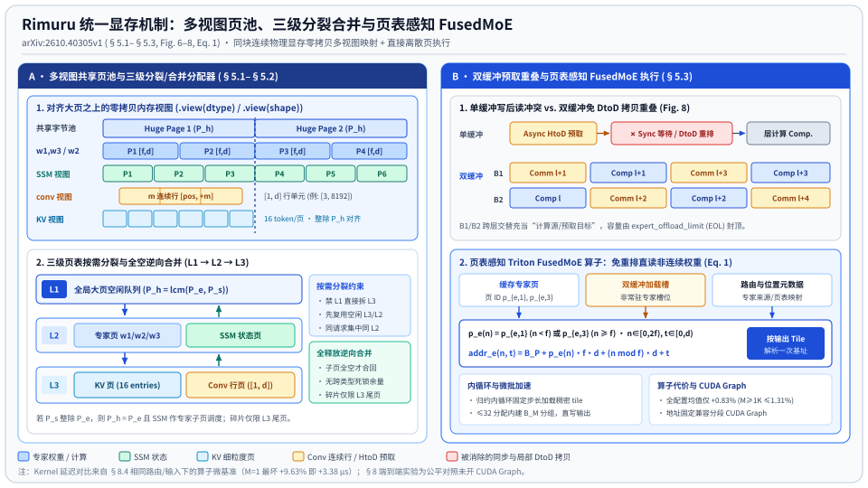查看原图 ↗</a><figcaption>图 1 · Rimuru 统一显存与离散页执行机制（整理自 arXiv:2610.40305v1 §5.1–§5.3、Fig. 6–8 与 Eq. 1）：同一连续物理缓冲区通过多视图与三级分裂合并消除跨类型容量隔离，并通过 Tile 级页表寻址与双缓冲免除局部 DtoD 拷贝。</figcaption></figure>

Rimuru 基于 `vLLM` 实现（约 `4,400` 行 Python 控制与内存管理代码、`800` 行 C++ 锁页内存异步加载扩展与 Triton 页表感知 MoE 算子；§7），在控制流上将前端调度决策与后端设备执行解耦（§4、图 5 步骤 ❶–❾）：

1. **零拷贝多视图布局与对齐大页（§5.1、图 6）**：
   - 底层仅申请一块连续 GPU 字节缓冲作为全局共享页池，借助 `.view(dtype)` 与 `.view(shape)` 直接按各张量类型重新解释元素布局与页表索引，彻底免除视图间数据搬运。
   - **对齐原则**：取专家页大小 <code>P_e</code> 与 SSM 页大小 <code>P_s</code> 的最小公倍数作为大页大小 <code>P_h = lcm(P_e, P_s)</code>（无 SSM 层时直接取 <code>P_h = P_e</code>），并要求 KV 缓存与卷积状态页大小整除 <code>P_h</code>。
   - **卷积状态行分页与连续索引**：针对 `[m, d]` 卷积状态（如 `Qwen3.5-35B-A3B` 的 `[3, 8192]`）整体大小未必整除父页的问题，Rimuru 取单行 `[1, d]` 作为页单元，每次连续分配 `m` 页，并在 conv 页表中只记录起始位置 `[start_pos, start_pos + m]`；KV 缓存沿用 PagedAttention，默认每页 `16` 个 token 条目。
2. **三级按需分裂与逆向合并分配器（§5.2、图 7）**：
   - 将共享池划分为 **L1（大页 <code>P_h</code>）→ L2（专家页 <code>w1/w2/w3</code> 与 SSM 页）→ L3（KV 缓存页与 conv 行页）** 三层；当 <code>P_s</code> 整除 <code>P_e</code> 时，<code>P_h = P_e</code> 且 SSM 页可直接作为专家页的子页管理。
   - **分裂禁止跨级跳跃**：申请 L3 细粒度页时先复用同类空闲子页，不足则优先拆解空闲 L2 页（不到万不得已才拆分 L1 为 L2 再拆 L3），**严禁直接将巨大 L1 拆碎成 L3**，并尽量把同一请求的 L3 页集中分配在同一个 L2 父页内以加速整块回收。
   - **逆向合并防容量搁浅**：释放 L3 页时更新其父 L2 状态；仅当一个 L2 父页下**所有子页均已释放**时，分配器将其从 L3 空闲集中摘除并整体恢复为空闲专家/SSM 页；同理所有中间页全空后才归还 L1 全局大页。由此消除「释放后卡在错误粒度里」的容量搁浅，残留内部碎片仅限于 L3 尾页极小余量。
3. **双缓冲异步预取与页表感知 Triton FusedMoE（§5.3、图 8、公式 1）**：
   - **双缓冲消除读写冲突与 DtoD 拷贝**：为避免单加载缓冲区在「当前层计算读取」与「下一层异步 HtoD 预取写入」间发生写后读冲突或被迫引入额外局部 DtoD 拷出，Rimuru 预分配两组可复用专家加载缓冲 `Buff 1` 与 `Buff 2`，跨层交替充当计算源与预取目标，总占用严格受每层 `expert_offload_limit` 约束。
   - **页表感知直读寻址（公式 1）**：对于融合 <code>W1/W3</code> 投影（局部隐藏维 <code>d</code>、中间维 <code>f</code>），缓存专家的两个投影各占一块稠密 <code>[f, d]</code> 页（页 ID 为 <code>p_{e,1}</code>、<code>p_{e,3}</code>），非常驻专家则定位到双缓冲槽位。对输出列 <code>n ∈ [0, 2f)</code> 与归约偏移 <code>t ∈ [0, d)</code>，Kernel 计算 <code>p_e(n) = p_{e,1}</code>（当 <code>n &lt; f</code>）或 <code>p_{e,3}</code>（当 <code>n ≥ f</code>），地址为 <code>addr_e(n, t) = B_P + p_e(n)·f·d + (n mod f)·d + t</code>。**关键性能设计**在于页表查询与源选择只在**每个输出 tile 归约循环之前**执行一次，内循环仍以固定步长加载稠密 tile；对于 `≤ 32` 个分配的小微批（且无重映射），Kernel 内部按 <code>B_M</code> 步长直接分组并直写输出张量，省去额外对齐 Kernel 启动与归零缓冲。
   - **分段 CUDA Graph 兼容性**：底层页池、专家页表、双缓冲及元数据张量均在启动时一次性按固定形状与地址分配，运行时仅原地更新内容，因此设计上兼容分段 CUDA Graph（注：§8 实验因多数卸载基线不支持而统一关闭了 CUDA Graph）。
4. **负载感知专家缓存调节器与 GPU 安全同步（§6、算法 1）**：
   - **离线热集前缀策略**：为避免线上维护访问统计的开销，第 0 层 MoE 全量常驻（无前序预取窗口），后续可调层依赖离线统计的专家热序 `{H_l}` 与经验路由概率 `{p_l}` 维持前缀缓存，并设全局 `expert_offload_limit`（下文简记 `EOL`，即每层允许卸载的专家上限，等价决定 GPU 最少保留前缀长度 `C_min`）。
   - **CPU 侧滞回阈值调控（算法 1）**：每次调度器排完批次后读取当前空闲专家块数 `F_b`（含可分裂大页）和等待请求所需的额外块数 `R_b`：
     - **显式缺口缩容（`R_b > 0`）**：按每专家占 3 块（`w1`/`w2`/`w3`）外加 1 块缓冲余量，计算缩容数 `N_shrink = ceil((R_b + 1)/3)`，`GreedyShrink` 跨层选出满足 `C_l > C_min` 且路由概率 `p_l(e)` 最小的尾部专家；
     - **低余量预防缩容（`R_b == 0` 且 `F_b < 2`）**：缩容 `1` 个最低代价专家；
     - **滞回保护与上限扩容（`F_b > 9`）**：先预留 `3` 个专家（`9` 块）作为安全垫，仅在 `F_b > 9` 时触发扩容 `N_expand = min(5, floor((F_b - 9)/3))`，单步最多扩 `5` 个，由 `GreedyExpand` 挑选最高 `p_l(e)` 的下一个未缓存专家。缩容阈值 `2` 与扩容阈值 `9` 之间的滞回死区用于抑制容量在临界值附近来回震荡。
   - **GPU 端执行安全顺序（§6.2）**：与 `Fate` 跨层预测器正交集成，扩容专家并入第 `l+1` 层异步预取队列并去重且赋予更高优先级，必须**等待 HtoD 拷贝事件完成后**再更新页表；缩容专家在**当前正在进行的前向步中保持可见**以提升复用，待整步结束后才提交页表失效并将旧物理页归还共享池。多卡张量并行（TP）下各 rank 保持对称专家布局与分片加载，避免各卡 I/O 失衡。

### 三、定量评测、组件消融、算子微基准与 EOL 敏感性

<figure class="note-figure"><a class="note-image-link" href="/assets/images/digest/2026-10-31/rimuru-elastic-offload-boundaries-zh.svg" target="_blank" rel="noopener" aria-label="查看 Rimuru 弹性卸载调控流、并发消融与基线条件边界图原图">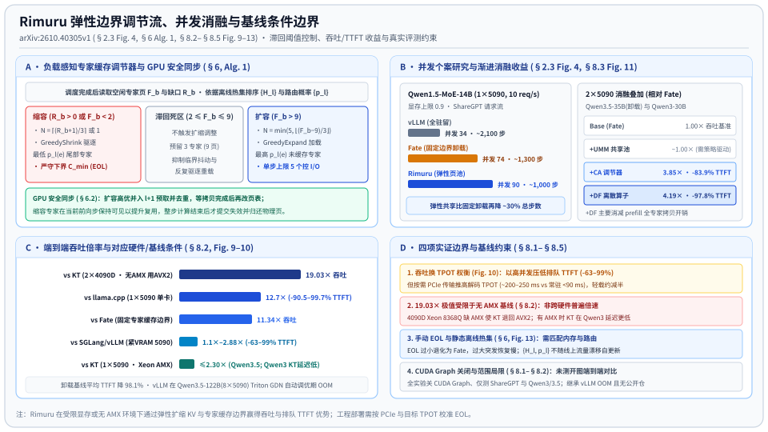查看原图 ↗</a><figcaption>图 2 · 负载感知调节流、消融分解与实证基线条件（整理自 arXiv:2610.40305v1 §2.3 Fig. 4、§6 Alg. 1、§8.2–§8.5 Fig. 9–13）：把 19.03× 等峰值倍率严格锚定到对应的硬件指令集与受限内存前提。</figcaption></figure>

作者在两套硬件平台上使用 `ShareGPT` 请求流评估了三款 Qwen MoE 模型（含纯全注意力 `Qwen3-30B-A3B` 与混合注意力 `Qwen3.5-35B-A3B`、`Qwen3.5-122B-A10B`）：`8 × RTX 5090`（32 GB/卡，双路 Xeon 8470Q 支持 **Intel AMX**，720 GB 内存，PCIe 5.0 ×16）与 `2 × RTX 4090D`（24 GB/卡，单路 Xeon 8368Q **无 AMX 仅支持 AVX2**，256 GB 内存，PCIe 4.0 ×16），并在支持 CUDA Graph 的系统上统一关闭该特性以隔离内存管理收益（§8.1）。表 1 汇总了端到端对比及各类基线的特定前提：

| 评测场景与对照基线 | 硬件与模型配置 | 作者报告的核心指标 | 基线状态与对应权衡条件（§8.2、Fig. 9–10） |
| :--- | :--- | :--- | :--- |
| 案例对比：`vLLM` / `Fate`（Fig. 4） | `1×RTX 5090`（0.9 显存），`Qwen1.5-MoE-14B`，`10 req/s` | 峰值并发 `34` → `74` → **`90`**；步数 `~2,100` → `~1,300` → **`~1,000`** | 比固定卸载（Fate）再减约 **`30%`** 总前向步 |
| 对比 `KTransformers`（无 AMX 平台，Fig. 9c–d） | `2×RTX 4090D` + Xeon 8368Q（`AVX2`），`Qwen3-30B` / `Qwen3.5-35B` | 最高 **`19.03×`** 输出吞吐；卸载基线总体平均降 **`98.1%`** TTFT | 该极端倍速来自 4090D 缺失 Intel AMX、迫使 KT 退回 AVX2 CPU 计算的特定场景 |
| 对比 `KTransformers`（AMX 平台，Fig. 9a–b） | `1×RTX 5090` + Xeon 8470Q（支持 `AMX`），`Qwen3-30B` / `Qwen3.5-35B` | 最高 **`2.30×`** 吞吐（`Qwen3.5` 专家小 `1/3` 减压 I/O） | `KT-Full` 塞满权重致 KV 匮乏；在 `Qwen3-30B` 上保留状态的 `KT` 取得**更低 TTFT 与 TPOT**，Rimuru 胜在并发与峰值吞吐 |
| 对比 `Fate`（固定边界卸载，Fig. 9） | `1×5090` 与 `2×4090D`，`Qwen3-30B` / `Qwen3.5-35B` | 最高 **`11.34×`** 输出吞吐，高并发下显著压低排队 TTFT | 高压时 `Fate` 无法从专家缓存腾挪页面给 KV，触发请求堆积 |
| 对比 `llama.cpp`（单卡 CPU-GPU，Fig. 9a–b） | `1×RTX 5090`（不支持双卡未测 `c/d`），`Qwen3-30B` / `Qwen3.5-35B` | 最高 **`12.7×`** 吞吐，TTFT 降低 **`90.50%–99.7%`** | `llama.cpp` 缺乏多卡支持且 CPU 执行受限于单机算力 |
| 对比常驻引擎 `SGLang` / `vLLM`（紧显存，Fig. 10） | `8×5090`（`Qwen3.5-122B`）与 `2×5090`（`Qwen3-30B`） | 吞吐 **`1.1×–2.88×`**，TTFT 降低 **`63%–99%`** | 高到达率下缓解排队延迟，但 Rimuru 的 **decode TPOT 明显高于**常驻基线（`~200–250 ms` 对 `<90 ms`）；`vLLM` 在 `Qwen3.5-122B` 上因 Triton GDN 自动调优 OOM 而缺席 Fig. 10a |

*表 1 · Rimuru 端到端系统与案例评测汇总（整理自 `arXiv:2610.40305v1` §2.3 Fig. 4、§8.1–§8.2 Fig. 9–10；`CUDA Graph` 在全系统评测中均关闭）。*

为拆解收益来源并核验算子级与超参边界，表 2 进一步整理了论文 §8.3–§8.5 的三组关键分析：

| 实验维度（对应小节/图表） | 实验设置与变量范围 | 核心实测结果 | 机制解释与边界含义 |
| :--- | :--- | :--- | :--- |
| 组件渐进消融（§8.3、Fig. 11） | `2×RTX 5090`（`Qwen3.5-35B` 需卸载 / `Qwen3-30B` 紧驻留），以 `Fate` 为 `Base` 依次叠 `+UMM`、`+CA`、`+DF` | 单加 `+UMM` 与基线持平；叠 `+CA` 升至 **`3.85×`** 吞吐、TTFT **`-83.9%`**；再叠 `+DF` 达 **`4.19×`** 吞吐、TTFT **`-97.8%`** | 共享页池本身不提速，须配合调节器释放并发；离散算子主要消除 **Prefill 阶段**全专家权重拷贝，Decode 端 TPOT 改善较小 |
| `FusedMoE` 算子微基准（§8.4、Fig. 12） | `RTX 5090` 与 `4090D`、Qwen3/3.5、小批 `M=1–32` 与大批 `M=1024–8192`，同输入/路由对照 `vLLM` 连续算子 | 全配置算子延迟均值仅增 **`+0.83%`**；`M≥1024` 均增 **`≤1.31%`**；`M=1` 最坏相对增 **`+9.63%`**（绝对值 **`≤3.38 µs`**）；页驻留比例在 `50%–100%` 间波动影响 **`≤0.22%`** | 每输出 tile 解析一次页表的开销被大模型批计算充分摊薄，证明零拷贝直读非连续页几乎不损伤原始算子效率 |
| `expert_offload_limit`（`EOL`）敏感性（§8.5、Fig. 13） | 4 套模型-硬件组合下从最小必需卸载数起逐步增大每层 `EOL` 上限 | 最小 `EOL` 时退化为固定卸载 `Fate`（高 TTFT、低吞吐）；小幅增加约 **`10` 个专家**即达到吞吐峰值并剧降 TTFT；过高 `EOL` 在 `(a)(b)` 中致性能回落；**TPOT 全程基本持平** | 小幅放开 `EOL` 即可腾出可观 KV 空间拉高并发；但允许卸载过多在突发潮退后需要更长回载恢复期；TPOT 因热集与预取覆盖稳定不变 |

*表 2 · 组件消融、页表感知算子延迟开销与 `EOL` 参数敏感性实测汇总（整理自 `arXiv:2610.40305v1` §8.3–§8.5、Fig. 11–13）。*

### 四、科学边界、基线限定条件与工程迁移启示

把 Rimuru 的数据与方案用于生产级 MoE/混合架构推理服务选型时，必须把原文已证明的机制边界与未覆盖约束交代清楚：

1. **`19.03×` 峰值倍率高度依赖「无 AMX 的 AVX2 CPU 卸载基线」**：§8.2 明确指出，`19.03×` 仅发生在搭载 `Xeon 8368Q`（无 Intel AMX）的 `2×4090D` 服务器上，迫使 `KTransformers` 回退至 AVX2；当主机 CPU 支持 AMX（`5090` 平台 `Xeon 8470Q`）时，二者吞吐差距收敛到 **`≤ 2.30×`**，且在专家矩阵更大、I/O 更重的 `Qwen3-30B`（`1×5090`）上，`KT` 凭借 CPU 算子避免了跨 PCIe 搬运，反而保持了比 Rimuru **更低的 TTFT 与 TPOT**。
2. **以高并发压低排队 TTFT 的另一面是解码 TPOT 上升**：对比全常驻的 `vLLM`/`SGLang`（图 10），Rimuru 的 `1.1×–2.88×` 吞吐与 `63%–99%` TTFT 降幅主要来自**内存受限高到达率下的请求准入提升**（消灭排队积压）；但在单步解码效率上，按需 HtoD 卸载仍使 Rimuru 的 TPOT 显著高于全常驻引擎（如图 10 所示达 `~200–250 ms` 对 `<90 ms`），即便低负载扩满缓存可使 TPOT 较重负载减半，仍无法做到与全驻留卡内带宽等价。若 SLA 严格卡死低 TPOT 而非总体完成时间/吞吐，则单纯靠卸载并不能绕过 PCIe 物理上限。
3. **CUDA Graph 在全部端到端评测中被禁用**：虽然 §5.3 说明了固定地址元数据对分段 CUDA Graph 的兼容设计，但 §8.1 因多数对比卸载框架不支持而关闭了所有系统的 CUDA Graph；**开启分段 CUDA Graph 后与常驻引擎开图基线之间的实测对比并未在文中给出**。
4. **静态离线热集假设、手动 `EOL` 调参及基座继承限制**：算法 1 依赖离线收集的固定热集序 `{H_l}` 与概率 `{p_l}`，若线上多租户/多领域切换造成路由热点漂移，前缀驱逐序将不再最优；同时最优 `EOL` 需随模型体积、显存余量与突发特征手工整定（过高拖慢突发回载、过低退化为静态边界）。此外，Rimuru 继承 `vLLM` 自身非权重区的内存特性（例如作者注明 `vLLM` 在 `Qwen3.5-122B` Triton GDN kernel autotuning 期间发生 OOM，且 Rimuru 同受其基础影响），全部评测仅基于 `ShareGPT` 与三款 `Qwen` 模型单次曲线汇报，未见跨架构（如 `DeepSeek-V4` 1M 长上下文实机跑分）与方差统计，且预印本未提供公开代码库供第三方直接复现。

**可迁移的工程启示**：
- **用「共享页池 + 对齐大页 + 多视图分级分裂/全空合并」替换固定比例划分**：在同时存在权重缓存与多种运行时状态（KV、SSM、conv）的推理引擎中，仅靠 `P_h = lcm(P_e, P_s)` 边界对齐与禁止跨级直接碎裂，就能在不额外开辟隔离池或引入碎片的前提下实现容量双向借用。
- **将离散页寻址代价压到 Tile 级而非归约内循环，并留出滞回死区**：页表感知算子证明只要在输出 tile 入口解一次基址、保持张量顶层地址稳定，非连续存储的内核延迟成本可压到 `1%` 量级；而在策略层设立非对称阈值（如缩容 `< 2`、扩容 `> 9`）与「前向结束后延迟释放」规则，是避免动态缓存抖动与异步预取竞态的关键低成本护栏。

来源：[Rimuru: Unified Memory Management for Modern LLM Serving via Elastic Expert Offloading](https://arxiv.org/abs/2610.40305)
<h2 class="daily-paper-title" id="paper-arxiv-2610.38228">15 · The Endgame of FSDP Communication: Layout-Aware Collectives on Copy Engines, RDMA, and NVSwitch</h2>

[The Endgame of FSDP Communication: Layout-Aware Collectives on Copy Engines, RDMA, and NVSwitch](https://arxiv.org/abs/2610.38228) 
Zejian Wang、Yifan Zhao、Kaihui Ren、Xiaoling Zhou、Yubin Wang、Chenhao Guan、Lin Zhang、Yufeng Li、Zhikang Mo、Zhuoru Ma、Yingtong Xiong、Jihu Guo、Yiqiao Liao、Chengru Song · 2026-10-30

TIDE 把 FSDP2 的逐参数布局转换并入 collective 地址，利用 copy engine、RDMA 和 NVSwitch 减少拷贝及 SM 干扰。64 GPU 测试步时相对标准 FSDP2 最高减少 27.1%，相对 SymmMem 最高减少 6%。

依赖特定互联和 NCCL API；最大值来自不同配置，不能合并为同一工作点。

来源：[The Endgame of FSDP Communication: Layout-Aware Collectives on Copy Engines, RDMA, and NVSwitch](https://arxiv.org/abs/2610.38228)

<h2 class="daily-paper-title" id="paper-arxiv-2610.39711">16 · Sandman：把突发的训练沙箱放进共享集群</h2>

**原文：** [Sandman: Building and Operating Sandboxes for Agentic Reinforcement Learning on Shared Kubernetes](https://arxiv.org/abs/2610.39711) 
**作者：** Yiming Yan, Hongyang Wang, Wenbo Chen, Xuan Wang, Jingguo Liu, Xian Li, Chen Qi, Leo Fan, Siwei Li, Qianli Wu, Yichuan Li, Ruochen Wen, Qian Qu, Zheshen Wang, Benoit Dumoulin · **首发：** 2026-10-29

智能体强化学习中的一次轨迹会反复调用工具，文件和进程必须在调用之间保留；训练又会成批发起环境请求。作者报告的一次突发达到每秒 132 次创建，而对应训练活动的平均速率为每秒 1.8 次。只按平均负载配置资源，容易忽略 Kubernetes 准入、调度和网络分配的瞬时压力。

Sandman 将每个沙箱作为普通 pod，向原任务镜像挂载小型守护进程。训练端获取沙箱后，交替进行模型推理和工具调用；结束后提取补丁，默认在独立、未使用过的评分 pod 中运行测试。provider 负责创建、节流、分散放置和删除；可选的 pool 可预热常用镜像。关键的生命周期细节是：即使调用方超时放弃，创建过程仍有明确的清理责任，避免遗留 pod 累积。

<a class="note-image-link" href="/assets/images/digest/2026-10-31/sandman-architecture.png" target="_blank" rel="noopener" aria-label="Sandman 训练与沙箱组件示意图 · 查看原图 ↗">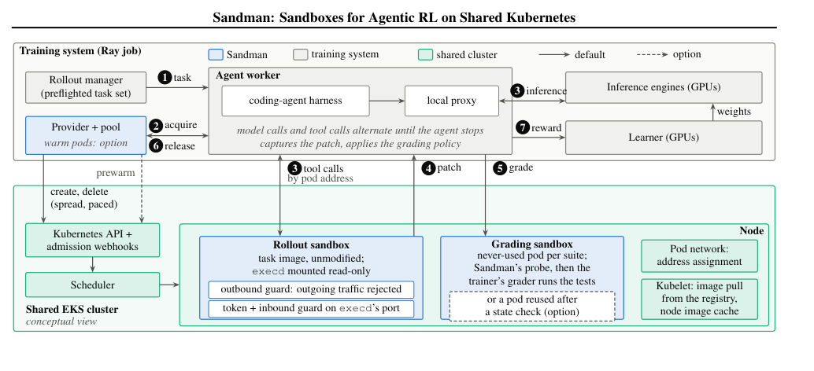查看原图 ↗</a>

*读图：训练端取得轨迹沙箱，模型与工具交替运行；补丁交给单独的评分沙箱，provider 管理 pod 生命周期。*

作者在压力测试中维持了 11,858 个小型沙箱；四个内部 SWE-bench Verified 训练活动共创建约 313 万个沙箱。两者不是同一种负载：前者使用轻量 pod，不能视为真实任务镜像的容量承诺。预热可缩短获取时间，但空闲 pod 占用资源；论文还强调镜像拉取、网络地址分配和超时清理。其实验来自一个共享 EKS 集群，且部分机制晚于报告的生产活动。对 AgentOps 的启发是把创建尾延迟、泄漏回收和评分环境完整性一起纳入训练系统设计，而不只关注工具执行速度。

<h2 class="daily-paper-title" id="paper-arxiv-2610.39468">17 · Soei: Structured Observability of Evidence and Intent for Multi-Agent AI Software Engineering</h2>

Soei 分析 45 个编码 agent 会话，用经过盲审的分类器估计：23.4% 编辑片段最后一次修改后无独立检查，57.8% 被标记完成的 todo 缺少期间证明。它提出区分执行确认、归属和完成证据的事件账本。

局限：分类器会误判，缺少可观察检查不等于修复错误；哈希链只能揭示篡改，不能证明事件内容真实。

来源：[Soei: Structured Observability of Evidence and Intent for Multi-Agent AI Software Engineering](https://arxiv.org/abs/2610.39468)

<h2 class="daily-paper-title" id="paper-arxiv-2610.38610">18 · 修复选择：让真正的执行者评价候选动作</h2>

**原文：** [Repairs for Whom? Evaluator-Executor Mismatch in Selecting Repairs for Failed LLM Agents](https://arxiv.org/abs/2610.38610) 
**作者：** Yijun Liao, Fanwei Liang · **首发：** 2026-10-28

修复失败轨迹时，常见做法是让更强模型、确定性重放或环境规划器为候选修复打分。但一个动作能否帮助后续执行，取决于执行者如何解读状态、采样以及使用剩余步数。评估者自己能够成功，不代表部署中的智能体也能沿同一路径成功。

作者固定失败轨迹和单步替换候选，让不同评估者选出修复，再用部署策略独立 rollout 衡量选择带来的净收益。净收益以替换原动作后的成功率减去原动作重新运行时的成功率；WebShop 使用奖励差。对照组使用部署者自身 rollout 选择，选择与最终评价使用分开的样本。这样既比较不同目标的偏差，也把使用较少样本造成的预算问题单独列出。

在未按修复价值预筛的 ALFWorld 与 WebShop 故障池上，相对于匹配执行者的选择，贪心重放分别损失 0.08–0.13 的预期净成功增益和 0.06–0.13 的净奖励。对 Qwen2.5-7B 的修复，使用 14B rollout 选择分别损失 0.25 和 0.07。数字是该实验中的选择损失，不代表所有强模型都更差。每个未筛选池各有 60 条失败轨迹；实验只替换一个动作，候选和可回放环境也受到实验设计约束。

这一结果提示，修复系统需要把模型、提示、历史协议和解码设置一起视作执行者，并用实际策略的后续表现验证选择；更强的代理可以帮助提出候选，但不能自动作为部署收益的替身。原文的实验设计和不同评估器比较适合用于设计干预验证。

<h2 class="daily-paper-title" id="paper-arxiv-2610.39234">19 · AgentHeal: Evaluating Goal-Preserving Resource Recovery of Web Agents under Access Barriers</h2>

[AgentHeal: Evaluating Goal-Preserving Resource Recovery of Web Agents under Access Barriers](https://arxiv.org/abs/2610.39234) 
Zhiyi Liu、Haohua Du、Haoqi Sun、Haisheng Tan · 2026-10-30

AgentHeal 评估 agent 遇到死链、认证和限流时能否寻找合法替代来源并保留原目标。九类障碍的快照测试中，平均成功率从 89.4% 降至 43.7%，暴露相似假源、无效重试与不当越权。

采用快照与 replay，不代表实时网络动态；评分含 LLM judge，确定性检查只能覆盖预设来源和动作规则。

来源：[AgentHeal: Evaluating Goal-Preserving Resource Recovery of Web Agents under Access Barriers](https://arxiv.org/abs/2610.39234)

## 同日技术笔记

- <a href="/tech/zh/baseten-fastest-delta-weight-syncs/">用 GPU 权重作为父版本：Baseten 的增量同步</a>
- <a href="/tech/zh/review-skyhook-radar-k8s-ai-sre-mcp/">Radar：共享集群状态与受限诊断对比</a>
- <a href="/tech/zh/review-nvidia-dynamo-validated-kubernetes-runtime/">Dynamo AICR：固定依赖与运行时验证</a>
