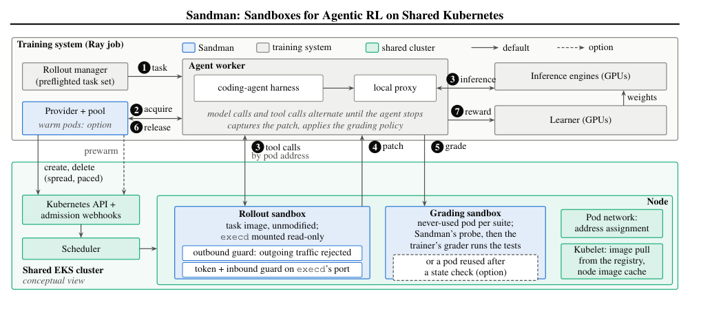

智能体故障修复不止要找到一条看似合理的替代动作，还要判断**实际执行它的智能体**能否从那里继续完成任务。另一篇工作把视角转向训练基础设施：当大量轨迹同时启动，沙箱的创建、状态和清理如何影响共享集群与训练节奏？

<h2 class="daily-paper-title" id="paper-arxiv-2610.38610">修复选择：让真正的执行者评价候选动作</h2>

**原文：** [Repairs for Whom? Evaluator-Executor Mismatch in Selecting Repairs for Failed LLM Agents](https://arxiv.org/abs/2610.38610)  
**作者：** Yijun Liao, Fanwei Liang · **首发：** 2026-10-28

修复失败轨迹时，常见做法是让更强模型、确定性重放或环境规划器为候选修复打分。但一个动作能否帮助后续执行，取决于执行者如何解读状态、采样以及使用剩余步数。评估者自己能够成功，不代表部署中的智能体也能沿同一路径成功。

作者固定失败轨迹和单步替换候选，让不同评估者选出修复，再用部署策略独立 rollout 衡量选择带来的净收益。净收益以替换原动作后的成功率减去原动作重新运行时的成功率；WebShop 使用奖励差。对照组使用部署者自身 rollout 选择，选择与最终评价使用分开的样本。这样既比较不同目标的偏差，也把使用较少样本造成的预算问题单独列出。

在未按修复价值预筛的 ALFWorld 与 WebShop 故障池上，相对于匹配执行者的选择，贪心重放分别损失 0.08–0.13 的预期净成功增益和 0.06–0.13 的净奖励。对 Qwen2.5-7B 的修复，使用 14B rollout 选择分别损失 0.25 和 0.07。数字是该实验中的选择损失，不代表所有强模型都更差。每个未筛选池各有 60 条失败轨迹；实验只替换一个动作，候选和可回放环境也受到实验设计约束。

这一结果提示，修复系统需要把模型、提示、历史协议和解码设置一起视作执行者，并用实际策略的后续表现验证选择；更强的代理可以帮助提出候选，但不能自动作为部署收益的替身。原文的实验设计和不同评估器比较适合用于设计干预验证。

<h2 class="daily-paper-title" id="paper-arxiv-2610.39711">Sandman：把突发的训练沙箱放进共享集群</h2>

**原文：** [Sandman: Building and Operating Sandboxes for Agentic Reinforcement Learning on Shared Kubernetes](https://arxiv.org/abs/2610.39711)  
**作者：** Yiming Yan, Hongyang Wang, Wenbo Chen, Xuan Wang, Jingguo Liu, Xian Li, Chen Qi, Leo Fan, Siwei Li, Qianli Wu, Yichuan Li, Ruochen Wen, Qian Qu, Zheshen Wang, Benoit Dumoulin · **首发：** 2026-10-29

智能体强化学习中的一次轨迹会反复调用工具，文件和进程必须在调用之间保留；训练又会成批发起环境请求。作者报告的一次突发达到每秒 132 次创建，而对应训练活动的平均速率为每秒 1.8 次。只按平均负载配置资源，容易忽略 Kubernetes 准入、调度和网络分配的瞬时压力。

Sandman 将每个沙箱作为普通 pod，向原任务镜像挂载小型守护进程。训练端获取沙箱后，交替进行模型推理和工具调用；结束后提取补丁，默认在独立、未使用过的评分 pod 中运行测试。provider 负责创建、节流、分散放置和删除；可选的 pool 可预热常用镜像。关键的生命周期细节是：即使调用方超时放弃，创建过程仍有明确的清理责任，避免遗留 pod 累积。

<a class="note-image-link" href="/assets/images/digest/2026-10-31/sandman-architecture.png" target="_blank" rel="noopener" aria-label="Sandman 训练与沙箱组件示意图 · 查看原图 ↗">查看原图 ↗</a>

*读图：训练端取得轨迹沙箱，模型与工具交替运行；补丁交给单独的评分沙箱，provider 管理 pod 生命周期。*

作者在压力测试中维持了 11,858 个小型沙箱；四个内部 SWE-bench Verified 训练活动共创建约 313 万个沙箱。两者不是同一种负载：前者使用轻量 pod，不能视为真实任务镜像的容量承诺。预热可缩短获取时间，但空闲 pod 占用资源；论文还强调镜像拉取、网络地址分配和超时清理。其实验来自一个共享 EKS 集群，且部分机制晚于报告的生产活动。对 AgentOps 的启发是把创建尾延迟、泄漏回收和评分环境完整性一起纳入训练系统设计，而不只关注工具执行速度。

<h2 class="daily-paper-title" id="paper-arxiv-2610.19792">03 · JetSpec++: Foresight Parallel Drafting with Self Refinements</h2>

[JetSpec++: Foresight Parallel Drafting with Self Refinements](https://arxiv.org/abs/2610.19792) 
Zhaoxiang Feng、Lanxiang Hu、Haoran Yuan、Yu-Yang Qian、Jihui Yang、Peng Zhao、Yibo Zhu、Tajana Rosing、Hao Zhang · 2026-10-30

JetSpec++ 在第二张 GPU 上提前草拟下一块，并在验证等待期间自我细化。Qwen3-8B 的 bf16 单请求最高 1361 token/s；其机制是隐藏草稿延迟，而非消除草稿计算。

使用两张 GPU；NVFP4 的更高速度是另一精度配置，高 batch 与大模型仍需验证，不能把延迟收益当作每 GPU 成本收益。

来源：[JetSpec++: Foresight Parallel Drafting with Self Refinements](https://arxiv.org/abs/2610.19792)

<h2 class="daily-paper-title" id="paper-arxiv-2610.37810">04 · ConfluxServe: Reconciling Resource Utilization and Parallelism Efficiency across Prefill and Decode in LLM Serving</h2>

[ConfluxServe: Reconciling Resource Utilization and Parallelism Efficiency across Prefill and Decode in LLM Serving](https://arxiv.org/abs/2610.37810) 
Wenhao Chen、Hong Zhang · 2026-10-30

ConfluxServe 允许同一 batch 的 prefill 与 decode 使用不同并行策略，通过算子结构兼顾资源互补与并行效率。作者报告在 TTFT/TBT 约束下 goodput 为最强基线的 1.26–1.62 倍。

goodput 取决于 SLO、流量和并行配置；不能当作任意模型的原始吞吐倍率。

来源：[ConfluxServe: Reconciling Resource Utilization and Parallelism Efficiency across Prefill and Decode in LLM Serving](https://arxiv.org/abs/2610.37810)

<h2 class="daily-paper-title" id="paper-arxiv-2610.37921">05 · FAD-KV: Adaptive Dictionary KV Caching for Efficient Reasoning Decoding</h2>

[FAD-KV: Adaptive Dictionary KV Caching for Efficient Reasoning Decoding](https://arxiv.org/abs/2610.37921) 
Yuxuan Zhu、David H. Yang、Parisa Shiravani、Mohammad Mohammadi Amiri、Tejaswini Pedapati、Subhajit Chaudhury、Keerthiram Murugesan、Pin-Yu Chen · 2026-10-30

FAD-KV 用一次 Top-n 筛选和轻量系数修正降低稀疏编码成本，再复用闲置字典原子，适应生成中的 KV 分布变化而不无限增大字典。其目标是有界内存下的质量—效率折中。

KV 压缩有损；追加式基线可使用更大字典，比较必须同时看质量、总缓存和编码成本。

来源：[FAD-KV: Adaptive Dictionary KV Caching for Efficient Reasoning Decoding](https://arxiv.org/abs/2610.37921)

<h2 class="daily-paper-title" id="paper-arxiv-2610.38196">06 · GearUp: DAG-aware Acceleration for Serverless Inference Serving via Slack-guided Pre-loading</h2>

[GearUp: DAG-aware Acceleration for Serverless Inference Serving via Slack-guided Pre-loading](https://arxiv.org/abs/2610.38196) 
Qi Qi、Yifan Sui、Hanfei Yu、Hong Zhang、Hao Wang · 2026-10-30

GearUp 将库、权重与 CUDA kernel 加载放入上游执行留下的 DAG 空隙，并复用已初始化实例。两个 L40S 工作流中，相对 SMIless 中位端到端延迟分别降低 64.5% 与 75.9%。

依赖可用 slack、加载画像和复用流量；与冷启动及 eager preload 的倍率采用不同基线，不能混写。

来源：[GearUp: DAG-aware Acceleration for Serverless Inference Serving via Slack-guided Pre-loading](https://arxiv.org/abs/2610.38196)

<h2 class="daily-paper-title" id="paper-arxiv-2610.38210">07 · GAAC: Lossless KV Compression for Bandwidth-Efficient LLM Inference on Personal Devices</h2>

[GAAC: Lossless KV Compression for Bandwidth-Efficient LLM Inference on Personal Devices](https://arxiv.org/abs/2610.38210) 
Yipin Guo、Arun M George、Siddharth Joshi · 2026-10-30

GAAC 利用 BF16 指数字段冗余实现逐位无损 KV 编码，并在 attention kernel 内恢复 tile，避免全缓存解压。缓存压缩约 1.405–1.407 倍，Spark 的端到端 decode step 加速为 1.04–1.15 倍。

FP8 可压空间更小；上下文位置漂移可降低压缩率和速度，虽然编解码仍无损。

来源：[GAAC: Lossless KV Compression for Bandwidth-Efficient LLM Inference on Personal Devices](https://arxiv.org/abs/2610.38210)

<h2 class="daily-paper-title" id="paper-arxiv-2610.38228">08 · The Endgame of FSDP Communication: Layout-Aware Collectives on Copy Engines, RDMA, and NVSwitch</h2>

[The Endgame of FSDP Communication: Layout-Aware Collectives on Copy Engines, RDMA, and NVSwitch](https://arxiv.org/abs/2610.38228) 
Zejian Wang、Yifan Zhao、Kaihui Ren、Xiaoling Zhou、Yubin Wang、Chenhao Guan、Lin Zhang、Yufeng Li、Zhikang Mo、Zhuoru Ma、Yingtong Xiong、Jihu Guo、Yiqiao Liao、Chengru Song · 2026-10-30

TIDE 把 FSDP2 的逐参数布局转换并入 collective 地址，利用 copy engine、RDMA 和 NVSwitch 减少拷贝及 SM 干扰。64 GPU 测试步时相对标准 FSDP2 最高减少 27.1%，相对 SymmMem 最高减少 6%。

依赖特定互联和 NCCL API；最大值来自不同配置，不能合并为同一工作点。

来源：[The Endgame of FSDP Communication: Layout-Aware Collectives on Copy Engines, RDMA, and NVSwitch](https://arxiv.org/abs/2610.38228)

<h2 class="daily-paper-title" id="paper-arxiv-2610.38311">09 · Detecting Incorrect LLM Explanations for Automated Program Repair</h2>

[Detecting Incorrect LLM Explanations for Automated Program Repair](https://arxiv.org/abs/2610.38311) 
Lam Nguyen Tung、Chenxi Gu、Xiaoning Du、Haoye Tian、Aldeida Aleti、Neelofar Neelofar · 2026-10-30

MetaReJ 通过保留或改变 bug 的程序变换，追问修复解释并检测矛盾。在 1756 条人工标注解释上，最高 MCC 为 0.43，说明解释可靠性需要单独评估。

矛盾是检测信号而非正确性证明；多次追问有成本，不能把相对 MCC 增益理解为高绝对准确率。

来源：[Detecting Incorrect LLM Explanations for Automated Program Repair](https://arxiv.org/abs/2610.38311)

<h2 class="daily-paper-title" id="paper-arxiv-2610.38329">10 · A Case Study of a Multi-Agent Kernel-Optimization Loop That Learns a New AI Accelerator</h2>

[A Case Study of a Multi-Agent Kernel-Optimization Loop That Learns a New AI Accelerator](https://arxiv.org/abs/2610.38329) 
Byonggon Chun · 2026-10-30

该 RNGD 案例让 agent 通过文档总结、微基准和编译器规则建立目标知识，先做廉价合法性筛查，再重复设备对比。12 天运行优化三个 decode kernel，相对官方基线几何平均加速 9.293 倍。

单芯片、单次运行且无消融，无法归因各模块收益；合成输入和固定种子验证不是完整模型质量测试。

来源：[A Case Study of a Multi-Agent Kernel-Optimization Loop That Learns a New AI Accelerator](https://arxiv.org/abs/2610.38329)

<h2 class="daily-paper-title" id="paper-arxiv-2610.38355">11 · FlatCake: A Flat KVCache Storage Architecture for LLM Serving</h2>

[FlatCake: A Flat KVCache Storage Architecture for LLM Serving](https://arxiv.org/abs/2610.38355) 
Xin Huang、Teng Ma、Zhuoran Li、Yibo Zhao、Zhaoshi Li、Qianchao Zhu、Wei Yang、Chenxi Wang、Tao Xie、Youwei Zhuo · 2026-10-30

FlatCake 把 DRAM 与 SSD 作为平级 KV 存储，创建时按会话连续布局并固定位置，通过 GDS 流入有界 GPU 窗口。Claude Code 轨迹高负载下命中率保持 94%，对照 Mooncake 为 64%。

依赖不可变块与会话复用假设；总 token 吞吐包含输入，不能当作纯生成速度，存储配置会影响收益。

来源：[FlatCake: A Flat KVCache Storage Architecture for LLM Serving](https://arxiv.org/abs/2610.38355)

<h2 class="daily-paper-title" id="paper-arxiv-2610.38617">12 · How Deterministic SAST and AI Security Agents Divide the Work: Coverage, Harness Policy and Cost in Snyk VulnBench 2.0</h2>

[How Deterministic SAST and AI Security Agents Divide the Work: Coverage, Harness Policy and Cost in Snyk VulnBench 2.0](https://arxiv.org/abs/2610.38617) 
Liran Tal、Chris Liu、Charlotte Fereday、Sebastian Roth、Brian Clark · 2026-10-30

VulnBench 2.0 要求定位漏洞的 source 与 sink，而非只报文件。108 个漏洞中，Snyk 检出 89 个、一个 Claude 配置 85 个，合并达 101 个；harness 的排除政策和文件筛选也显著改变覆盖。

由 SAST 厂商参与报告，需注意样本与评分规则；参考集外真实发现不能当作假阳性，各产品配置也非单纯模型比较。

来源：[How Deterministic SAST and AI Security Agents Divide the Work: Coverage, Harness Policy and Cost in Snyk VulnBench 2.0](https://arxiv.org/abs/2610.38617)

<h2 class="daily-paper-title" id="paper-arxiv-2610.38778">13 · Slant: Shaping Traffic for Resource-Efficient Microservices</h2>

[Slant: Shaping Traffic for Resource-Efficient Microservices](https://arxiv.org/abs/2610.38778) 
Congwei Zhang、Chieh-Jan Mike Liang、Mengbai Xiao、Yifei Zou、Shulun Wu、Xiangyu Gao、Xiuzhen Cheng、Dongxiao Yu · 2026-10-30

Slant 有意保持安全的冷热 pod 分布，让现有 VPA 更清晰地观察利用率。三个微服务基准中，CPU 分配最高减少 26%，P99 延迟最高降低 18%，并提供异常时的保守回退。

需要服务画像与容量估计；最大收益不一定同时发生，不能据此直接修改任意生产路由。

来源：[Slant: Shaping Traffic for Resource-Efficient Microservices](https://arxiv.org/abs/2610.38778)

<h2 class="daily-paper-title" id="paper-arxiv-2610.38809">14 · Causal Attention on CPU: A Cache-Aware and Load-Balanced Scheduling Kernel for Prefill</h2>

[Causal Attention on CPU: A Cache-Aware and Load-Balanced Scheduling Kernel for Prefill](https://arxiv.org/abs/2610.38809) 
Kwun Fung Lau、Frost Mitchell、Kanya Mo、Emani Ashok · 2026-10-30

CACPU 为 CPU 因果 prefill 设计多层缓存 blocking 与 kernel 内任务分配。两类 Intel CPU 上 kernel 最高加速 2.01 倍，接入 SGLang 后 Llama-3.1-8B TTFT 最高改善 1.74 倍。

桌面 CPU 无 AMX，未比较相应 SGLang kernel；CPU prefill 结果不等同于替代整个 GPU serving。

来源：[Causal Attention on CPU: A Cache-Aware and Load-Balanced Scheduling Kernel for Prefill](https://arxiv.org/abs/2610.38809)

<h2 class="daily-paper-title" id="paper-arxiv-2610.38968">15 · TableTune: Measured, Self-Correcting Draft-Length Tables for Dynamic Speculative Decoding</h2>

[TableTune: Measured, Self-Correcting Draft-Length Tables for Dynamic Speculative Decoding](https://arxiv.org/abs/2610.38968) 
Abhishek Malvankar、Paul Castro、Nick Mitchell、Lionel Villard · 2026-10-30

TableTune 在真实 vLLM 执行路径测量 batch 大小与草稿长度组合，再依据在线接受率更新配置表。它把草稿长度从手写常量变成可测、可纠正的控制参数。

最高 58% 是修复错误配置的收益；论文仅与其他投机配置比较，不能证明相对非投机解码始终有收益。

来源：[TableTune: Measured, Self-Correcting Draft-Length Tables for Dynamic Speculative Decoding](https://arxiv.org/abs/2610.38968)

<h2 class="daily-paper-title" id="paper-arxiv-2610.38981">16 · Why Speculative Decoding Works Better Than Predicted on Sparse MoE Models</h2>

[Why Speculative Decoding Works Better Than Predicted on Sparse MoE Models](https://arxiv.org/abs/2610.38981) 
Ekagra Ranjan、Komal K. Teru、Bharat Venkitesh、Acyr Locatelli · 2026-10-30

该研究发现细粒度 MoE 的投机验证成本不能仅按专家字节量估计：相邻 token 路由重叠、L2 复用与 kernel 带宽利用共同决定低 batch 表现。IPF 模型预测独立专家数量的误差低于 4%。

专家计数误差不是端到端延迟误差；部分分析隔离目标验证，不包含实际 drafter 成本和接受率。

来源：[Why Speculative Decoding Works Better Than Predicted on Sparse MoE Models](https://arxiv.org/abs/2610.38981)

<h2 class="daily-paper-title" id="paper-arxiv-2610.38983">17 · Beyond atol and rtol: Sound Test Oracles for Low-Precision GPU Kernels</h2>

[Beyond atol and rtol: Sound Test Oracles for Low-Precision GPU Kernels](https://arxiv.org/abs/2610.38983) 
Xinyi Shi · 2026-10-30

numoracle 从带精度标注的参考程序推导逐元素接受区间，跟踪共享舍入误差和块量化，避免固定 atol/rtol 的误报—漏报折中。RTX PRO 6000 实验检出 124 个有效变异中的 116 个。

soundness 依赖舍入、硬件、输入域与实现假设；有限实验零误报不是所有输入零误报，且仍有漏检。

来源：[Beyond atol and rtol: Sound Test Oracles for Low-Precision GPU Kernels](https://arxiv.org/abs/2610.38983)

<h2 class="daily-paper-title" id="paper-arxiv-2610.39216">18 · PDScope: Breaking the Prefill-Decode Seesaw for Memory-Bound MoE Inference</h2>

[PDScope: Breaking the Prefill-Decode Seesaw for Memory-Bound MoE Inference](https://arxiv.org/abs/2610.39216) 
Enda Yu、Dezun Dong、Zhaoning Zhang、Xiaojian Yang、Weiling Yang、Shaonan Ma、Dongsheng Li、Yongwei Wu、Xiangke Liao · 2026-10-30

PDScope 对内存受限 MoE 分别优化 prefill 的积极加载与 decode 的保守传输，通过专家预测、跨层成本模型和静态图形成流水。作者报告 prefill 与 decode 的独立吞吐提升。

两阶段倍率不能相乘；结果依赖模型、PCIe、CPU 和缓存容量，不能据此推断整个请求同倍提速。

来源：[PDScope: Breaking the Prefill-Decode Seesaw for Memory-Bound MoE Inference](https://arxiv.org/abs/2610.39216)

<h2 class="daily-paper-title" id="paper-arxiv-2610.39234">19 · AgentHeal: Evaluating Goal-Preserving Resource Recovery of Web Agents under Access Barriers</h2>

[AgentHeal: Evaluating Goal-Preserving Resource Recovery of Web Agents under Access Barriers](https://arxiv.org/abs/2610.39234) 
Zhiyi Liu、Haohua Du、Haoqi Sun、Haisheng Tan · 2026-10-30

AgentHeal 评估 agent 遇到死链、认证和限流时能否寻找合法替代来源并保留原目标。九类障碍的快照测试中，平均成功率从 89.4% 降至 43.7%，暴露相似假源、无效重试与不当越权。

采用快照与 replay，不代表实时网络动态；评分含 LLM judge，确定性检查只能覆盖预设来源和动作规则。

来源：[AgentHeal: Evaluating Goal-Preserving Resource Recovery of Web Agents under Access Barriers](https://arxiv.org/abs/2610.39234)

<h2 class="daily-paper-title" id="paper-arxiv-2610.39562">20 · Raincheck: Deferred Multimodal Prefill for Efficient Multi-Turn MLLM Inference</h2>

[Raincheck: Deferred Multimodal Prefill for Efficient Multi-Turn MLLM Inference](https://arxiv.org/abs/2610.39562) 
Wenjie Huang、Jun Zhang、Hongyaoxing Gu、Haoyang Huang、Tianqi Xu、Xinyue Hao、Xinyi Hu、Xinle Du、Jun Dai、Shuang Ge、Chen Lei、Yue Li、Mingcheng Wan · 2026-10-30

Raincheck 先保留部分多模态 token 降低首轮 prefill，再利用 decode 和调度空隙补算未选 token，使后续问题仍有机会访问原信息。两个模型上可恢复硬裁剪丢失质量的较大部分。

系统测量仅单个运行请求，且不减少模态编码；恢复损失比例不等于比完整输入更高的绝对质量。

来源：[Raincheck: Deferred Multimodal Prefill for Efficient Multi-Turn MLLM Inference](https://arxiv.org/abs/2610.39562)

<h2 class="daily-paper-title" id="paper-arxiv-2610.39621">21 · The Real Cost of Context: Predicting Compute Time and Energy Consumption in LLM Prefill and Decode Phases</h2>

[The Real Cost of Context: Predicting Compute Time and Energy Consumption in LLM Prefill and Decode Phases](https://arxiv.org/abs/2610.39621) 
Lars Krupp、Daniel Geißler、Francisco M. Calatrava-Nicolas、Stefan Gerd Fritsch、Paul Lukowicz、Jakob Karolus · 2026-10-30

该研究分别拟合输入和输出长度对应的时间与能耗：长上下文 prefill 包含线性与二次项，不能只按输出 token 估算。对专有 API 则用最接近的本地时间模型配对能耗模型进行推断。

本地仅少量 H100/H200 配置、batch=1，且无完全匹配 API；相同响应时间不能唯一确定硬件功耗。

来源：[The Real Cost of Context: Predicting Compute Time and Energy Consumption in LLM Prefill and Decode Phases](https://arxiv.org/abs/2610.39621)

<h2 class="daily-paper-title" id="paper-arxiv-2610.39807">22 · InferD: A Honeypot Framework for AI Inference Infrastructure</h2>

[InferD: A Honeypot Framework for AI Inference Infrastructure](https://arxiv.org/abs/2610.39807) 
Hicham Hammouchi、Gabriele Lenzini · 2026-10-30

InferD 以静态响应池模拟模型清单、API、工具协议和授权流程，原则是让攻击者观察到服务但绝不执行其推理或工具输入。它把 AI 基础设施蜜罐的可观测性与执行风险分开。

可验证推理题、重复回答和时间特征都可能识破蜜罐；设计合理性不等于生产检测效果已验证。

来源：[InferD: A Honeypot Framework for AI Inference Infrastructure](https://arxiv.org/abs/2610.39807)

<h2 class="daily-paper-title" id="paper-arxiv-2610.39853">23 · KV Cache Quantization for Diffusion Language Models</h2>

[KV Cache Quantization for Diffusion Language Models](https://arxiv.org/abs/2610.39853) 
Yan Tai、Yunan Ding、Guangzhao Li、Siqi Luo、Chaoyang Zhang、Guangtao Zhai、Guodong Guo、Xiaohong Liu · 2026-10-30

dLLM-KVQ 指出扩散语言模型的双向状态会随揭示 token 改变，复用缓存本身已带来误差。TRACE 构造贴近逐步揭示的校准轨迹，再保留敏感 key 的高精度条目。

量化与缓存复用均可能有损；只在给定 LLaDA/Dream 协议下验证，不能套用自回归缓存精确性的假设。

来源：[KV Cache Quantization for Diffusion Language Models](https://arxiv.org/abs/2610.39853)

<h2 class="daily-paper-title" id="paper-arxiv-2610.39999">24 · PhOSv1: Efficient Scaling of Model Sleeping on a Single Server for Autoscaling with GPU-Context Deduplication</h2>

[PhOSv1: Efficient Scaling of Model Sleeping on a Single Server for Autoscaling with GPU-Context Deduplication](https://arxiv.org/abs/2610.39999) 
Tianle Sun、Xingda Wei、Rong Chen · 2026-10-30

PhOSv1 通过中心 daemon 和 API remoting 共享睡眠模型重复的 CUDA context 与 kernel binary，减少预生成 engine 的显存税，同时保持快速唤醒。

报告来自单 GPU 测量，虽服务器有八张卡；共享 context 的隔离和多租户边界仍需独立评估。

来源：[PhOSv1: Efficient Scaling of Model Sleeping on a Single Server for Autoscaling with GPU-Context Deduplication](https://arxiv.org/abs/2610.39999)

<h2 class="daily-paper-title" id="paper-arxiv-2610.40287">25 · Only Accepted Tokens Count: An Energy Accounting of Speculative Decoding Under Latency Targets</h2>

[Only Accepted Tokens Count: An Energy Accounting of Speculative Decoding Under Latency Targets](https://arxiv.org/abs/2610.40287) 
Bole Ma、Ayesha Afzal、Jan Eitzinger、Harald Koestler、Gerhard Wellein · 2026-10-30

该研究按实际接受的输出 token 计算投机解码能耗。batch 增大后，权重读取已被摊薄，验证可能变为计算瓶颈；接受率低时，满足更严延迟目标反而增加每 token 能耗。

依赖模型、语料、batch 和功耗测量范围；不能把单 GPU 能耗直接当作整座数据中心能耗。

来源：[Only Accepted Tokens Count: An Energy Accounting of Speculative Decoding Under Latency Targets](https://arxiv.org/abs/2610.40287)

<h2 class="daily-paper-title" id="paper-arxiv-2610.40292">26 · DolphinRouting: Cluster-Level Binary Routing for Disaggregated LLM Inference Serving</h2>

[DolphinRouting: Cluster-Level Binary Routing for Disaggregated LLM Inference Serving](https://arxiv.org/abs/2610.40292) 
Yishuo Yuan、Shaoyu Yang、Chunrong Fang · 2026-10-30

DolphinRouting 按原始长度、两类 worker 的缓存调整长度和输出长度信息聚类，离线为每簇学习本地或远程 prefill，线上只做特征提取与查表。

给定 P/D 资源配置和特征可得性下成立；输出长度信息的获取与漂移会影响真实部署。

来源：[DolphinRouting: Cluster-Level Binary Routing for Disaggregated LLM Inference Serving](https://arxiv.org/abs/2610.40292)

<h2 class="daily-paper-title" id="paper-arxiv-2610.40305">27 · Rimuru: Unified Memory Management for Modern LLM Serving via Elastic Expert Offloading</h2>

[Rimuru: Unified Memory Management for Modern LLM Serving via Elastic Expert Offloading](https://arxiv.org/abs/2610.40305) 
Zhiyuan Fang、Dingyang Li、Jianfeng Zhong、Bin Wang、Weixi Zhu、Cunshu Ni、Zicong Hong、Wuhui Chen、Zibin Zheng · 2026-10-30

Rimuru 让专家权重与 attention 状态共享页池，用不同粒度的 memory view、分裂合并分配器和直接访问非连续权重的 MoE kernel 动态调节内存边界。

极大倍率来自特定受限内存基线，不能当作普遍加速；弹性 offload 的传输成本和并发需求仍决定收益。

来源：[Rimuru: Unified Memory Management for Modern LLM Serving via Elastic Expert Offloading](https://arxiv.org/abs/2610.40305)

<h2 class="daily-paper-title" id="paper-arxiv-2610.40477">28 · Can We Rely on Language Models to Orchestrate Services across the Edge-Cloud Continuum?</h2>

[Can We Rely on Language Models to Orchestrate Services across the Edge-Cloud Continuum?](https://arxiv.org/abs/2610.40477) 
Zhenghao Wu、Ruihai Dong、Reza Farahani、Hamed Haddadi、Omer Rana、Hadi Tabatabaee Malazi · 2026-10-30

这篇 39 项研究的系统综述把系统约束、编排决策、模型职责、操作权限与评估证据关联起来。多数设计让 LLM 提议方案，由下游确定性组件约束和执行；成功执行动作仍不等于验证恢复。

综合结论受检索范围与原研究质量限制，不是新的生产实验，也未证明闭环编排普遍可靠。

来源：[Can We Rely on Language Models to Orchestrate Services across the Edge-Cloud Continuum?](https://arxiv.org/abs/2610.40477)

<h2 class="daily-paper-title" id="paper-arxiv-2610.39017">29 · DistOptimize: Automatic Optimization of Distributed Protocols</h2>

[DistOptimize: Automatic Optimization of Distributed Protocols](https://arxiv.org/abs/2610.39017) 
David Chu McElroy、Shadaj Laddad、Lucky Katahanas、Mingwei Samuel、Octavio Lomeli、Natacha Crooks、Joseph M. Hellerstein、Mohsen Lesani · 2026-10-30

DistOptimize 用 Rocq 验证分布式协议重写规则，再结合校准和 ILP 搜索吞吐优化。AWS 测试中吞吐最高提高四倍，延迟增加不超过 0.3ms，展示优化与安全约束联合设计。

保证针对形式模型和重写前提，不覆盖任意实现错误；吞吐与新增机器资源需一起比较。

来源：[DistOptimize: Automatic Optimization of Distributed Protocols](https://arxiv.org/abs/2610.39017)

## vLLM Day-0 RL：Mistral Large 4 + SkyRL（8×GB200 LoRA RL）
{: #reading-x-vllm-2115985388649242699}

[vLLM Day-0 RL：Mistral Large 4 + SkyRL（8×GB200 LoRA RL）](https://x.com/vllm_project/status/2115985388649242699)

vLLM 官方帖报告 Mistral Large 4 的 LoRA RL：八个 GB200 节点上结合 NVFP4 QAT、FP8 KV 模拟和路由回放，75 步后 AIME 2024 avg@8 从约 64% 升至 75%。

是八个节点而非八张 GPU；仅社交报告、单个评估集，尚不能证明广泛泛化或完全训练—推理一致。

来源：[vLLM Day-0 RL：Mistral Large 4 + SkyRL（8×GB200 LoRA RL）](https://x.com/vllm_project/status/2115985388649242699)

## 同日技术笔记

- [ForgeKernel：参考提升、里程碑与证据缺口](/tech/zh/review-openbmb-forgekernel/)
- [Radar：共享集群状态与受限诊断对比](/tech/zh/review-skyhook-radar-k8s-ai-sre-mcp/)
- [Dynamo AICR：固定依赖与运行时验证](/tech/zh/review-nvidia-dynamo-validated-kubernetes-runtime/)
